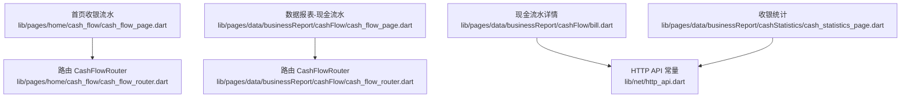
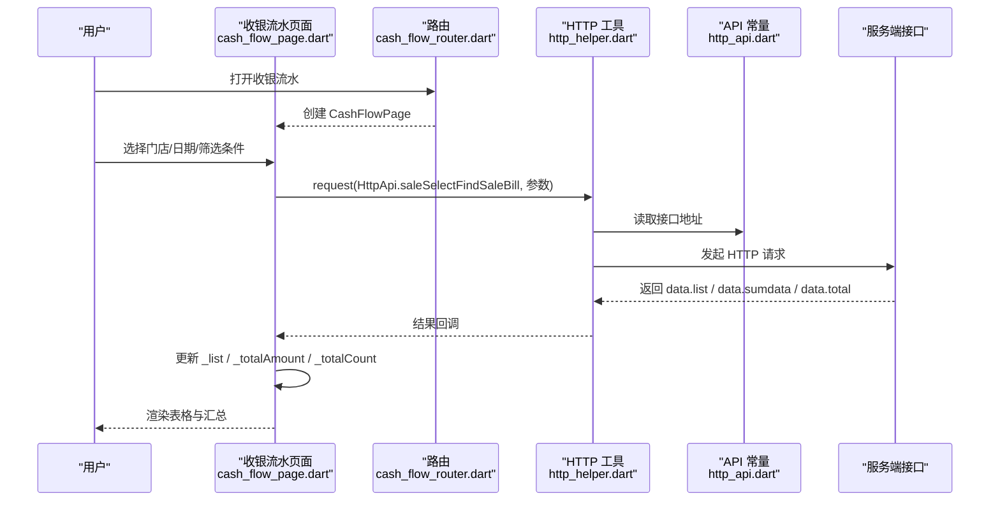
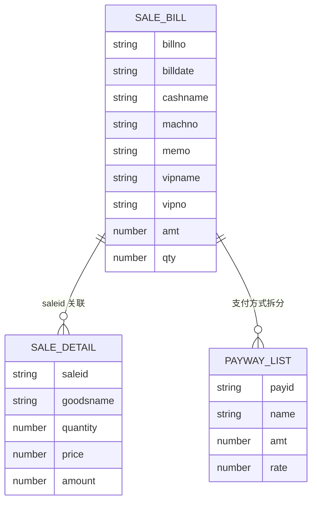
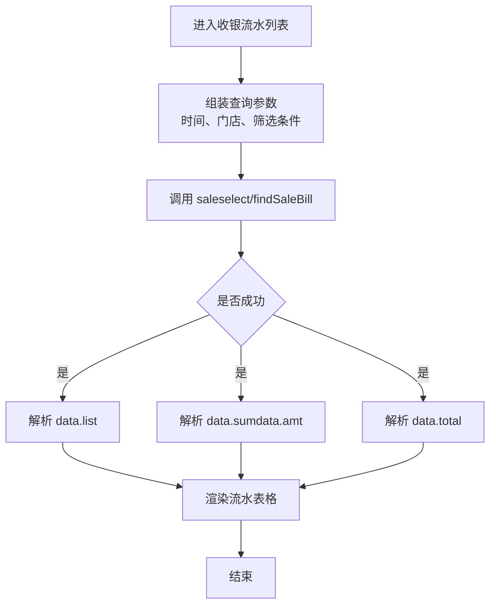
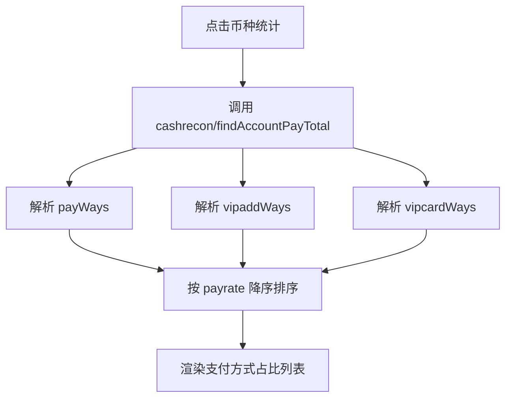
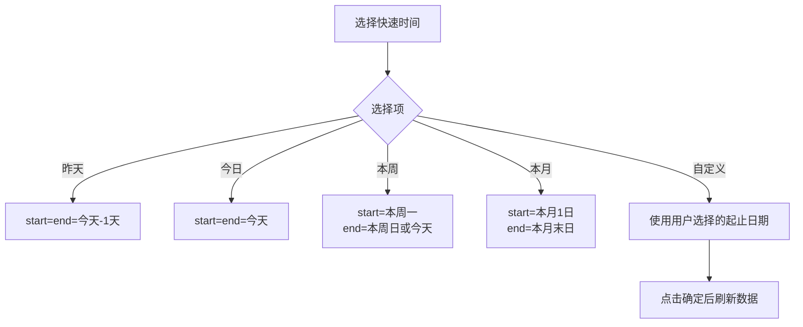
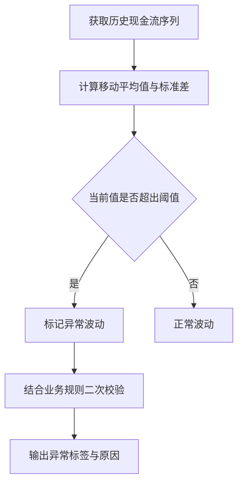
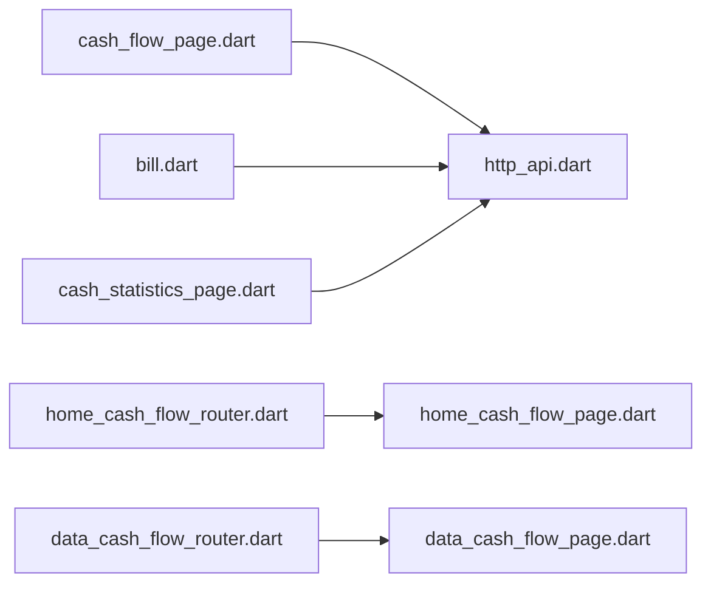

# 现金流分析

<cite>
**本文引用的文件**   
- [lib/pages/data/businessReport/cashFlow/cash_flow_page.dart](file://lib/pages/data/businessReport/cashFlow/cash_flow_page.dart)
- [lib/pages/data/businessReport/cashFlow/bill.dart](file://lib/pages/data/businessReport/cashFlow/bill.dart)
- [lib/pages/data/businessReport/cashFlow/cash_flow_router.dart](file://lib/pages/data/businessReport/cashFlow/cash_flow_router.dart)
- [lib/pages/home/cash_flow/cash_flow_page.dart](file://lib/pages/home/cash_flow/cash_flow_page.dart)
- [lib/pages/home/cash_flow/cash_flow_router.dart](file://lib/pages/home/cash_flow/cash_flow_router.dart)
- [lib/pages/data/businessReport/cashStatistics/cash_statistics_page.dart](file://lib/pages/data/businessReport/cashStatistics/cash_statistics_page.dart)
- [lib/net/http_api.dart](file://lib/net/http_api.dart)
</cite>

## 目录
1. [引言](#引言)
2. [项目结构与定位](#项目结构与定位)
3. [核心组件总览](#核心组件总览)
4. [系统架构与数据流](#系统架构与数据流)
5. [现金流水明细：查询、筛选与排序](#现金流水明细查询筛选与排序)
6. [资金流入流出统计与净额计算](#资金流入流出统计与净额计算)
7. [支付方式分类统计逻辑](#支付方式分类统计逻辑)
8. [现金流趋势、同比环比与异常波动](#现金流趋势同比环比与异常波动)
9. [现金流预测、资金周转率与流动性风险](#现金流预测资金周转率与流动性风险)
10. [依赖关系分析](#依赖关系分析)
11. [性能与体验特性](#性能与体验特性)
12. [常见问题排查](#常见问题排查)
13. [结论](#结论)

## 引言
本文件围绕灵犀管店 Flutter 项目中的“现金流分析”能力进行系统化说明，重点覆盖以下范围：
- 收银流水明细的数据结构、查询条件、筛选维度与排序规则。
- 资金流入、流出与净额的汇总来源及计算方式。
- 不同支付方式的分类、占比与汇总逻辑。
- 现金流趋势图的时间轴设置、同比/环比的计算方法以及异常波动的识别思路。
- 面向业务分析的现金流预测模型、资金周转率分析与流动性风险评估方法。

需要特别说明的是：当前代码仓库中已经实现了“收银流水列表”“收银流水详情”和“收银统计”等前端页面；而“趋势图、同比环比、现金流预测、资金周转率、流动性风险”等指标在现有前端文件中未直接实现，因此该部分以通用分析方法论为主，并结合已有接口字段给出可落地的扩展建议。

## 项目结构与定位
现金流相关功能主要分布在两个入口：
- 数据分析模块的“现金流水”与“现金统计”，位于 `lib/pages/data/businessReport` 下。
- 首页快捷入口的“收银流水”，位于 `lib/pages/home/cash_flow` 下。

**图示来源**
- [lib/pages/home/cash_flow/cash_flow_page.dart:1-60](file://lib/pages/home/cash_flow/cash_flow_page.dart#L1-L60)
- [lib/pages/home/cash_flow/cash_flow_router.dart:1-12](file://lib/pages/home/cash_flow/cash_flow_router.dart#L1-L12)
- [lib/pages/data/businessReport/cashFlow/cash_flow_page.dart:1-40](file://lib/pages/data/businessReport/cashFlow/cash_flow_page.dart#L1-L40)
- [lib/pages/data/businessReport/cashFlow/cash_flow_router.dart:1-19](file://lib/pages/data/businessReport/cashFlow/cash_flow_router.dart#L1-L19)
- [lib/pages/data/businessReport/cashFlow/bill.dart:1-30](file://lib/pages/data/businessReport/cashFlow/bill.dart#L1-L30)
- [lib/pages/data/businessReport/cashStatistics/cash_statistics_page.dart:1-40](file://lib/pages/data/businessReport/cashStatistics/cash_statistics_page.dart#L1-L40)
- [lib/net/http_api.dart:270-295](file://lib/net/http_api.dart#L270-L295)

**章节来源**
- [lib/pages/home/cash_flow/cash_flow_page.dart:1-60](file://lib/pages/home/cash_flow/cash_flow_page.dart#L1-L60)
- [lib/pages/home/cash_flow/cash_flow_router.dart:1-12](file://lib/pages/home/cash_flow/cash_flow_router.dart#L1-L12)
- [lib/pages/data/businessReport/cashFlow/cash_flow_page.dart:1-40](file://lib/pages/data/businessReport/cashFlow/cash_flow_page.dart#L1-L40)
- [lib/pages/data/businessReport/cashFlow/cash_flow_router.dart:1-19](file://lib/pages/data/businessReport/cashFlow/cash_flow_router.dart#L1-L19)
- [lib/pages/data/businessReport/cashStatistics/cash_statistics_page.dart:1-40](file://lib/pages/data/businessReport/cashStatistics/cash_statistics_page.dart#L1-L40)
- [lib/net/http_api.dart:270-295](file://lib/net/http_api.dart#L270-L295)

## 核心组件总览
| 组件 | 职责 | 关键行为 |
|---|---|---|
| 收银流水列表页 | 展示收银流水明细，支持门店、日期、单据类型、来源、收银员、机号、支付方式筛选 | 分页加载、横向滚动表格、固定单号列、顶部汇总金额与数量 |
| 收银流水详情页 | 查看单笔流水的商品明细、结算信息、支付方式拆分 | 按 saleid 与 sid 拉取主表、商品明细、支付方式列表 |
| 收银统计页 | 收银员统计、币种统计、交班统计三个 Tab | 时间筛选、分页、合计行、支付方式占比排序 |
| HTTP API 常量 | 集中定义后端接口路径 | 收银流水、支付方式列表、收银员统计、币种统计、交班统计、异常监控等 |

**章节来源**
- [lib/pages/data/businessReport/cashFlow/cash_flow_page.dart:1-40](file://lib/pages/data/businessReport/cashFlow/cash_flow_page.dart#L1-L40)
- [lib/pages/data/businessReport/cashFlow/bill.dart:1-30](file://lib/pages/data/businessReport/cashFlow/bill.dart#L1-L30)
- [lib/pages/data/businessReport/cashStatistics/cash_statistics_page.dart:1-40](file://lib/pages/data/businessReport/cashStatistics/cash_statistics_page.dart#L1-L40)
- [lib/net/http_api.dart:270-295](file://lib/net/http_api.dart#L270-L295)

## 系统架构与数据流
现金流相关的前端流程统一遵循“页面状态 → 筛选参数 → 网络请求 → 列表或汇总数据 → UI 渲染”。

**图示来源**
- [lib/pages/data/businessReport/cashFlow/cash_flow_page.dart:40-120](file://lib/pages/data/businessReport/cashFlow/cash_flow_page.dart#L40-L120)
- [lib/pages/data/businessReport/cashFlow/cash_flow_router.dart:1-19](file://lib/pages/data/businessReport/cashFlow/cash_flow_router.dart#L1-L19)
- [lib/net/http_api.dart:270-295](file://lib/net/http_api.dart#L270-L295)

## 现金流水明细：查询、筛选与排序

### 数据结构
收银流水明细由后端返回列表，并在响应中包含三类关键数据：
- 列表数据：`data.list`，每条记录代表一笔收银流水。
- 汇总数据：`data.sumdata`，包含总金额与聚合指标。
- 总数：`data.total`，用于分页控制。

**图示来源**
- [lib/pages/data/businessReport/cashFlow/bill.dart:30-120](file://lib/pages/data/businessReport/cashFlow/bill.dart#L30-L120)
- [lib/pages/data/businessReport/cashFlow/cash_flow_page.dart:80-120](file://lib/pages/data/businessReport/cashFlow/cash_flow_page.dart#L80-L120)

### 查询条件
收银流水列表调用 `HttpApi.saleSelectFindSaleBill`，基础查询参数包括：
- 时间范围：`starttime`、`endtime`，默认当天。
- 机构维度：`sids`，支持选择全部机构或指定门店。
- 分页参数：`is_page`、`page`、`pagesize`。
- 排序字段：`field='createtime'`，`type='desc'`，即按创建时间倒序。

可选筛选参数包括：
- 单号：`billno`
- 交易方式：`billflag`
- 单据来源：`saletype`
- 收银员：`cashid`
- 机号：`machno`
- 支付方式：`payid`

**章节来源**
- [lib/pages/data/businessReport/cashFlow/cash_flow_page.dart:60-120](file://lib/pages/data/businessReport/cashFlow/cash_flow_page.dart#L60-L120)
- [lib/pages/home/cash_flow/cash_flow_page.dart:60-120](file://lib/pages/home/cash_flow/cash_flow_page.dart#L60-L120)
- [lib/net/http_api.dart:273-285](file://lib/net/http_api.dart#L273-L285)

### 筛选维度
UI 提供如下筛选维度：
| 维度 | 含义 | 典型值或行为 |
|---|---|---|
| 输入单号 | 模糊匹配流水单号 | 文本输入框 |
| 交易方式 | 区分销售单、退货单、整单退货 | 选项包括“销售单”“退货单”“整单退货” |
| 单据来源 | 区分 PC 端销售、微信商城、APP、自助收银、其他平台、门店助手、安卓收银端 | 多选项按钮组 |
| 收银员 | 按收银员过滤 | 弹窗选择器，使用用户列表接口 |
| 机号 | 按收银机编号过滤 | 文本输入框 |
| 支付方式 | 按支付方式过滤 | 弹窗选择器，使用支付方式列表接口 |

**章节来源**
- [lib/pages/data/businessReport/cashFlow/cash_flow_page.dart:120-240](file://lib/pages/data/businessReport/cashFlow/cash_flow_page.dart#L120-L240)
- [lib/pages/home/cash_flow/cash_flow_page.dart:120-240](file://lib/pages/home/cash_flow/cash_flow_page.dart#L120-L240)

### 排序规则
- 列表默认排序为创建时间倒序，字段为 `createtime`，类型为 `desc`。
- 币种统计中的支付方式占比按 `payrate` 降序排序，解析时去除百分号并转为数值比较。
- 目前收银流水列表未实现客户端自定义列排序，仅保留单号列固定显示。

**章节来源**
- [lib/pages/data/businessReport/cashFlow/cash_flow_page.dart:80-100](file://lib/pages/data/businessReport/cashFlow/cash_flow_page.dart#L80-L100)
- [lib/pages/data/businessReport/cashStatistics/cash_statistics_page.dart:220-260](file://lib/pages/data/businessReport/cashStatistics/cash_statistics_page.dart#L220-L260)

## 资金流入流出统计与净额计算

### 数据来源
- 收银流水列表汇总来自 `data.sumdata.amt`，用于展示筛选范围内的总金额。
- 收银流水详情中的主表字段包含单号、结算时间、会员信息、机号、备注等信息。
- 支付方式拆分来自 `salePaywayList`，展示每笔流水按支付渠道拆分的金额。

**图示来源**
- [lib/pages/data/businessReport/cashFlow/cash_flow_page.dart:80-120](file://lib/pages/data/businessReport/cashFlow/cash_flow_page.dart#L80-L120)
- [lib/pages/data/businessReport/cashFlow/bill.dart:30-120](file://lib/pages/data/businessReport/cashFlow/bill.dart#L30-L120)

### 资金流入与流出口径
在当前实现中：
- 列表汇总字段 `amt` 表示筛选条件下的流水金额总和。
- 交易方式 `billflag` 支持“销售单”“退货单”“整单退货”，可用于区分正向收入与负向退款场景。
- 前端并未对流入、流出分别求和并显式展示“净流入”字段；如需明确“资金流入”“资金流出”“净额”，应在后端或前端根据 `billflag` 与金额正负进行拆分计算。

### 净额计算方法
若采用前端补充计算，推荐口径如下：
- 资金流入 = 所有销售类单据对应的金额之和。
- 资金流出 = 所有退货类单据对应的金额绝对值之和。
- 净额 = 资金流入 - 资金流出。

该口径可与 `billflag` 的“销售单”“退货单”“整单退货”对应，但具体映射需以后端返回语义为准。

**章节来源**
- [lib/pages/data/businessReport/cashFlow/cash_flow_page.dart:80-120](file://lib/pages/data/businessReport/cashFlow/cash_flow_page.dart#L80-L120)
- [lib/pages/data/businessReport/cashFlow/bill.dart:30-120](file://lib/pages/data/businessReport/cashFlow/bill.dart#L30-L120)

## 支付方式分类统计逻辑

### 支付方式选择与筛选
收银流水筛选中的支付方式通过 `_openPaySelector` 打开选择器，调用 `HttpApi.paywayGetList` 获取支付方式列表，并按 `payid` 与 `name` 进行绑定。选中后，将 `payid` 作为筛选条件传入列表查询。

**章节来源**
- [lib/pages/data/businessReport/cashFlow/cash_flow_page.dart:480-540](file://lib/pages/data/businessReport/cashFlow/cash_flow_page.dart#L480-L540)
- [lib/net/http_api.dart:278-285](file://lib/net/http_api.dart#L278-L285)

### 币种统计中的支付方式汇总
收银统计页面的“币种统计”Tab 调用 `cashrecon/findAccountPayTotal`，返回三类支付方式数据：
- `payWays`：常规支付方式。
- `vipaddWays`：会员储值充值相关支付方式。
- `vipcardWays`：会员卡消费相关支付方式。

每种列表都按 `payrate` 降序排序，便于观察各支付方式占比排名。

**图示来源**
- [lib/pages/data/businessReport/cashStatistics/cash_statistics_page.dart:220-300](file://lib/pages/data/businessReport/cashStatistics/cash_statistics_page.dart#L220-L300)

### 不同支付方式的分类建议
结合现有字段，可将支付方式分为：
- 现金类：现金、备用金等。
- 银行卡类：借记卡、信用卡、POS 收款。
- 线上支付类：微信支付、支付宝、银联云闪付等。
- 会员类：会员储值充值、会员卡扣款。
- 其他类：平台补贴、优惠券抵扣、第三方代付等。

分类映射应基于 `payid` 或 `name` 在后端或前端维护映射表，以便统一展示“现金”“银行卡”“微信”“支付宝”等业务口径。

**章节来源**
- [lib/pages/data/businessReport/cashStatistics/cash_statistics_page.dart:220-300](file://lib/pages/data/businessReport/cashStatistics/cash_statistics_page.dart#L220-L300)

## 现金流趋势、同比环比与异常波动

### 时间轴设置
收银流水与收银统计均提供相同的时间选择模式：
- 快速时间：昨天、今日、本周、本月、自定义。
- 日期导航：左右箭头按日、周、月推移。
- 自定义区间：单日、起止区间、按月选择。

**图示来源**
- [lib/pages/data/businessReport/cashFlow/cash_flow_page.dart:560-700](file://lib/pages/data/businessReport/cashFlow/cash_flow_page.dart#L560-L700)
- [lib/pages/data/businessReport/cashStatistics/cash_statistics_page.dart:430-560](file://lib/pages/data/businessReport/cashStatistics/cash_statistics_page.dart#L430-L560)

### 同比与环比计算
当前代码未直接实现同比与环比指标，可按以下通用方法在前端或后端补充：
- 环比：本期金额除以最近一个可比周期金额减一。
- 同比：本期金额除以去年同一周期金额减一。
- 基期处理：当上期或同期金额为 0 或空时，应显示为空或提示“无对比值”。

示例公式（文字描述）：
- 环比增长率 = (本期值 - 上期值) ÷ 上期值 × 100%
- 同比增长率 = (本期值 - 去年同期值) ÷ 去年同期值 × 100%

### 异常波动标识
异常波动可从以下角度设计：
- 阈值法：当日现金流偏离过去 N 日移动平均值的若干倍标准差。
- 比例法：单日涨跌幅超过设定百分比阈值。
- 业务规则法：退货金额突然放大、某支付方式占比异常升高或降低。
- 结合异常监控接口：利用 `sale/cashMonitor/getCashMonitor` 与明细接口对接异常事件。

[本图为概念流程图，不直接对应具体源码文件]

## 现金流预测、资金周转率与流动性风险

### 现金流预测模型
当前仓库未包含专门的现金流预测算法实现。可基于现有流水数据构建如下预测方案：
- 短期预测：使用近期流水金额的移动平均、指数平滑或季节性分解。
- 中期预测：结合门店营业日历、促销活动、节假日因素建立回归模型。
- 输出形式：未来 N 日的流入、流出与净额区间预测，并附带置信区间。

实施建议：
- 先清洗流水数据，剔除测试单、内部转账等非经营性流水。
- 按日粒度聚合流入、流出与净额。
- 将预测结果与实时流水看板集成，提供预警与调整建议。

### 资金周转率分析
资金周转率通常反映资金在企业运营中的循环效率。建议从以下维度展开：
- 现金周转天数：应付账款周期 + 库存周转天数 - 应收账款周期。
- 收银资金周转：以一定周期内的营业收入与平均现金占用余额计算。
- 支付方式影响：高线上支付占比可能缩短回款周期，提升周转效率。

计算公式（文字描述）：
- 资金周转率 = 营业收入 ÷ 平均资金占用
- 现金周转天数 = 365 ÷ 资金周转率

### 流动性风险评估
流动性风险衡量企业短期偿债与支付能力，建议结合以下指标：
- 流动比率：流动资产 ÷ 流动负债。
- 速动比率：扣除存货后的流动资产 ÷ 流动负债。
- 现金比率：可用现金及等价物 ÷ 流动负债。
- 现金流覆盖率：经营性现金流 ÷ 到期债务。
- 预警信号：连续多日净流出、大额退货、主要支付方式中断、供应商付款逾期。

[本节为通用分析方法，不直接引用具体源码文件]

## 依赖关系分析

**图示来源**
- [lib/pages/data/businessReport/cashFlow/cash_flow_page.dart:1-40](file://lib/pages/data/businessReport/cashFlow/cash_flow_page.dart#L1-L40)
- [lib/pages/data/businessReport/cashFlow/bill.dart:1-30](file://lib/pages/data/businessReport/cashFlow/bill.dart#L1-L30)
- [lib/pages/data/businessReport/cashStatistics/cash_statistics_page.dart:1-40](file://lib/pages/data/businessReport/cashStatistics/cash_statistics_page.dart#L1-L40)
- [lib/pages/home/cash_flow/cash_flow_router.dart:1-12](file://lib/pages/home/cash_flow/cash_flow_router.dart#L1-L12)
- [lib/pages/data/businessReport/cashFlow/cash_flow_router.dart:1-19](file://lib/pages/data/businessReport/cashFlow/cash_flow_router.dart#L1-L19)
- [lib/net/http_api.dart:270-295](file://lib/net/http_api.dart#L270-L295)

**章节来源**
- [lib/pages/data/businessReport/cashFlow/cash_flow_page.dart:1-40](file://lib/pages/data/businessReport/cashFlow/cash_flow_page.dart#L1-L40)
- [lib/pages/data/businessReport/cashFlow/bill.dart:1-30](file://lib/pages/data/businessReport/cashFlow/bill.dart#L1-L30)
- [lib/pages/data/businessReport/cashStatistics/cash_statistics_page.dart:1-40](file://lib/pages/data/businessReport/cashStatistics/cash_statistics_page.dart#L1-L40)
- [lib/pages/home/cash_flow/cash_flow_router.dart:1-12](file://lib/pages/home/cash_flow/cash_flow_router.dart#L1-L12)
- [lib/pages/data/businessReport/cashFlow/cash_flow_router.dart:1-19](file://lib/pages/data/businessReport/cashFlow/cash_flow_router.dart#L1-L19)
- [lib/net/http_api.dart:270-295](file://lib/net/http_api.dart#L270-L295)

## 性能与体验特性
- 列表使用 DataTable2，固定左侧单号列，支持横向滚动。
- 下拉刷新与上拉加载更多结合 `_hasMore` 与 `_page` 控制。
- 首次加载与后续刷新有差异化空态处理，避免表格骨架闪烁。
- 收银统计页使用 Tab 切换，每次切换重新请求数据。
- 合计行横向滚动同步通过 ScrollNotification 捕获，避免外部控制器生命周期问题。

**章节来源**
- [lib/pages/data/businessReport/cashFlow/cash_flow_page.dart:80-120](file://lib/pages/data/businessReport/cashFlow/cash_flow_page.dart#L80-L120)
- [lib/pages/data/businessReport/cashFlow/cash_flow_page.dart:700-900](file://lib/pages/data/businessReport/cashFlow/cash_flow_page.dart#L700-L900)
- [lib/pages/data/businessReport/cashStatistics/cash_statistics_page.dart:120-200](file://lib/pages/data/businessReport/cashStatistics/cash_statistics_page.dart#L120-L200)

## 常见问题排查
| 现象 | 可能原因 | 处理建议 |
|---|---|---|
| 列表无数据 | 时间范围过窄、门店筛选错误、筛选条件过多 | 检查 starttime/endtime、sids、billflag、saletype、cashid、machno、payid |
| 总金额与明细不一致 | 后端 sumdata 与 list 口径不同 | 核对后端接口文档，确认 amt 是否含税、抹零、优惠等 |
| 支付方式为空 | 支付方式列表接口未返回或门店权限限制 | 检查 paywayGetList 返回与 sids 传参 |
| 币种统计排序异常 | payrate 为字符串带百分号 | 确认前端已去除百分号再转数值排序 |
| 表格横向滚动错位 | 合计行与数据行滚动不同步 | 检查 ScrollNotification 与 summaryScrollController 使用 |

**章节来源**
- [lib/pages/data/businessReport/cashFlow/cash_flow_page.dart:80-120](file://lib/pages/data/businessReport/cashFlow/cash_flow_page.dart#L80-L120)
- [lib/pages/data/businessReport/cashStatistics/cash_statistics_page.dart:220-300](file://lib/pages/data/businessReport/cashStatistics/cash_statistics_page.dart#L220-L300)

## 结论
灵犀管店 Flutter 项目的现金流分析能力以“收银流水明细”和“收银统计”为核心，已实现：
- 按门店、时间、单据类型、来源、收银员、机号、支付方式的多维筛选。
- 流水列表的分页、汇总金额与总数展示。
- 单笔流水的商品明细与支付方式拆分。
- 收银员统计、币种统计与交班统计。

尚未在现有代码中实现的“现金流趋势图、同比环比、现金流预测、资金周转率、流动性风险”等高级分析能力，可通过扩展后端接口或在 Flutter 前端增加计算逻辑来完成。建议在扩展时优先统一支付方式分类口径、明确流入流出净额计算规则，并将异常波动与风险指标纳入统一的现金流看板。