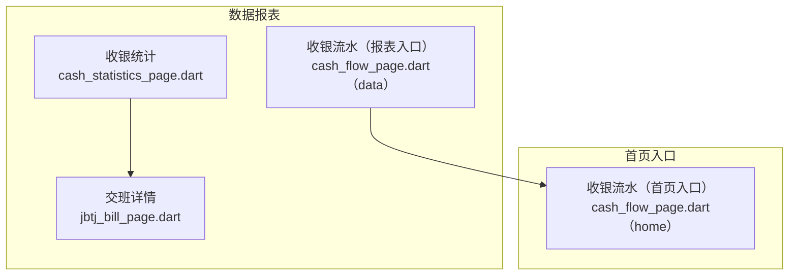
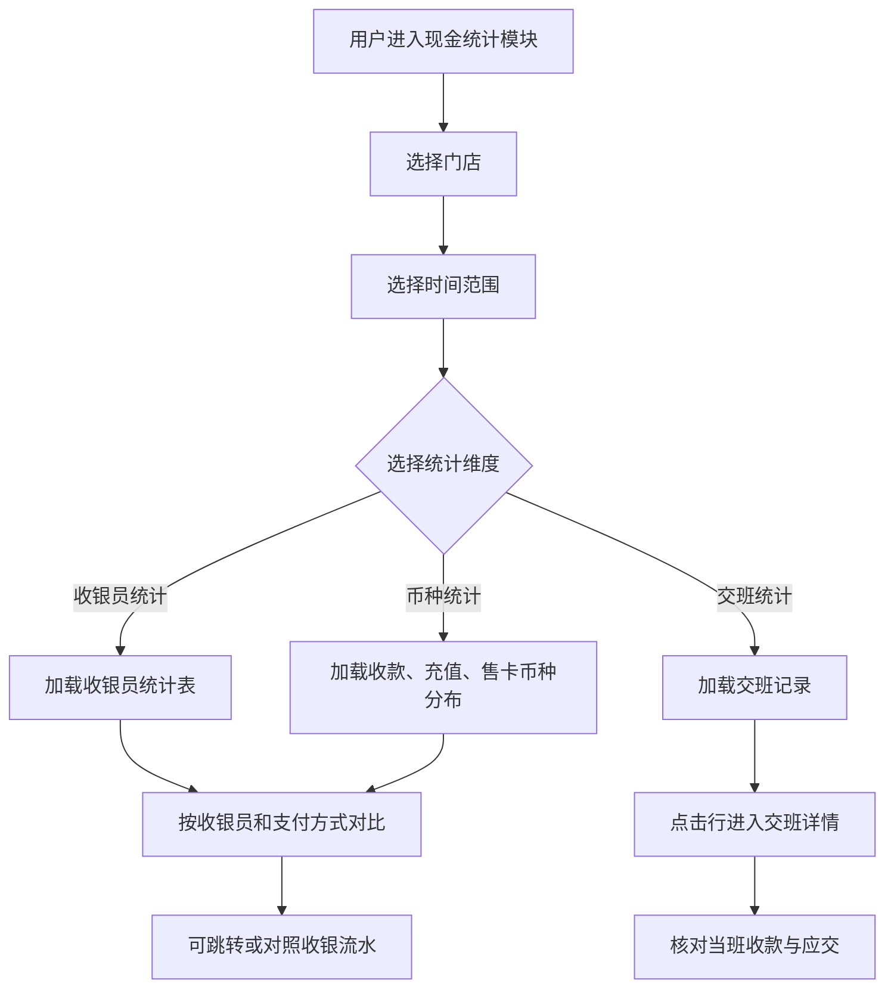
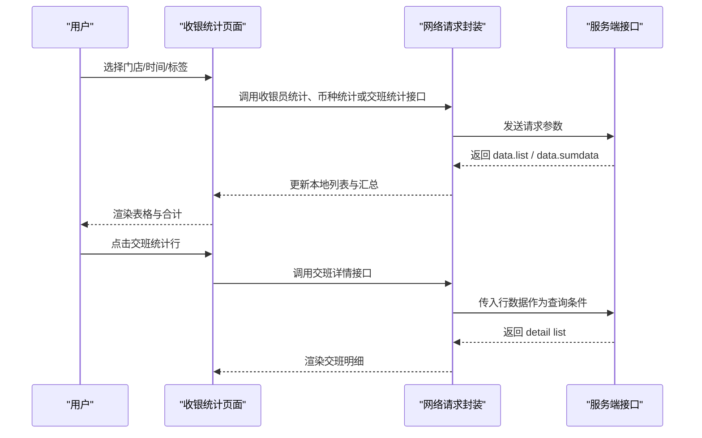
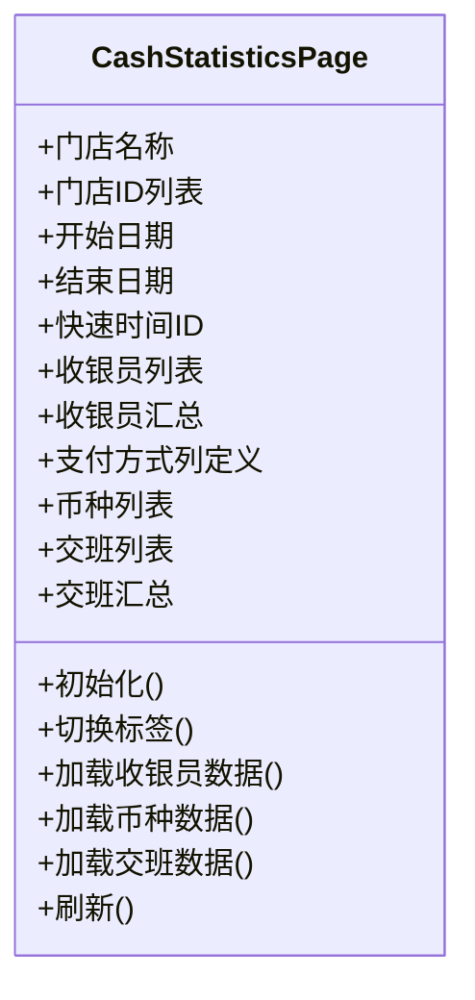
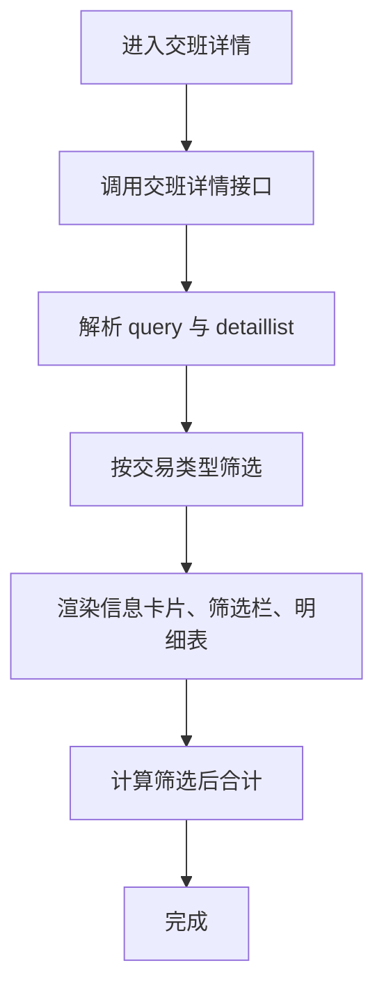
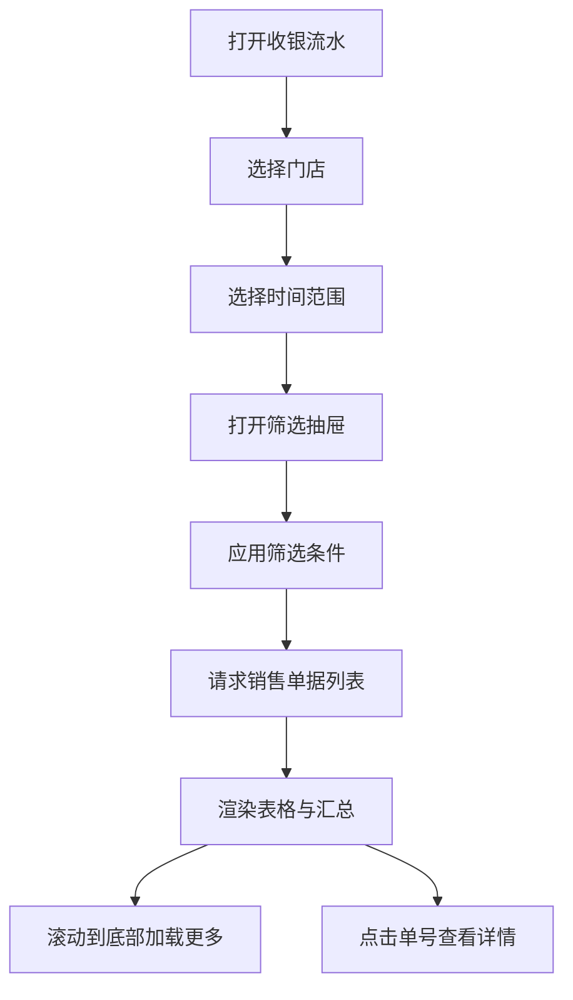
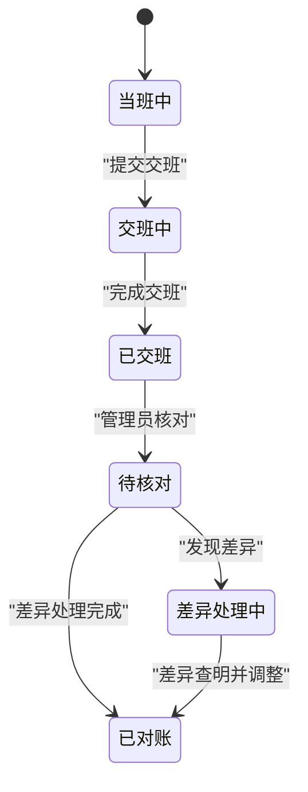
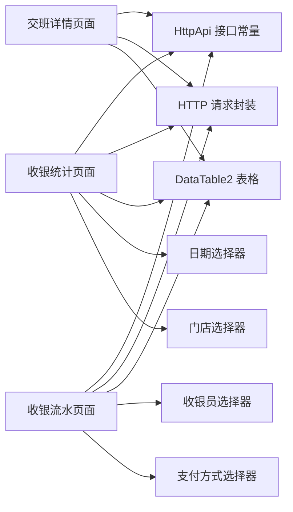

# 现金统计

<cite>
**本文引用的文件**   
- [cash_statistics_page.dart](file://lib/pages/data/businessReport/cashStatistics/cash_statistics_page.dart)
- [jbtj_bill_page.dart](file://lib/pages/data/businessReport/cashStatistics/jbtj_bill_page.dart)
- [cash_flow_page.dart（业务报表）](file://lib/pages/data/businessReport/cashFlow/cash_flow_page.dart)
- [cash_flow_page.dart（首页入口）](file://lib/pages/home/cash_flow/cash_flow_page.dart)
</cite>

## 目录
1. [引言](#引言)
2. [项目结构定位](#项目结构定位)
3. [核心功能总览](#核心功能总览)
4. [系统架构与数据流](#系统架构与数据流)
5. [详细组件分析](#详细组件分析)
6. [统计口径、分类标准与汇总逻辑](#统计口径分类标准与汇总逻辑)
7. [收银统计明细查询条件、时间范围与导出能力](#收银统计明细查询条件时间范围与导出能力)
8. [不同收银员与支付方式对比分析](#不同收银员与支付方式对比分析)
9. [现金日记账管理流程、对账机制与差异处理](#现金日记账管理流程对账机制与差异处理)
10. [内部控制要点、风险防范与审计追踪建议](#内部控制要点风险防范与审计追踪建议)
11. [依赖关系分析](#依赖关系分析)
12. [性能与体验特征](#性能与体验特征)
13. [常见问题排查](#常见问题排查)
14. [结论](#结论)

## 引言
本文件围绕灵犀管店 Flutter 项目的现金统计相关能力进行系统化文档说明，重点覆盖以下目标：
- 明确现金收付的统计口径、分类标准和汇总逻辑。
- 梳理收银统计明细的查询条件、时间范围筛选方式。
- 说明当前代码中是否实现数据导出能力，并给出扩展建议。
- 解释按收银员和支付方式的业绩统计与对比方法。
- 结合交班统计页面，说明现金日记账管理流程、对账思路及差异处理方向。
- 提供内部控制、风险防范与审计追踪的可落地建议。

需要特别说明的是：本文严格基于仓库中的 Flutter 前端源码进行分析；后端接口字段、权限控制、安全策略以及最终财务制度以实际部署环境为准。

## 项目结构定位
现金统计功能主要分布在两个业务域：
- 数据报表域：`lib/pages/data/businessReport/cashStatistics` 与 `lib/pages/data/businessReport/cashFlow`。
- 首页快捷入口域：`lib/pages/home/cash_flow`。

**图表来源**
- [cash_statistics_page.dart:1-200](file://lib/pages/data/businessReport/cashStatistics/cash_statistics_page.dart#L1-L200)
- [jbtj_bill_page.dart:1-200](file://lib/pages/data/businessReport/cashStatistics/jbtj_bill_page.dart#L1-L200)
- [cash_flow_page.dart（业务报表）:1-200](file://lib/pages/data/businessReport/cashFlow/cash_flow_page.dart#L1-L200)
- [cash_flow_page.dart（首页入口）:1-200](file://lib/pages/home/cash_flow/cash_flow_page.dart#L1-L200)

**章节来源**
- [cash_statistics_page.dart:1-200](file://lib/pages/data/businessReport/cashStatistics/cash_statistics_page.dart#L1-L200)
- [jbtj_bill_page.dart:1-200](file://lib/pages/data/businessReport/cashStatistics/jbtj_bill_page.dart#L1-L200)
- [cash_flow_page.dart（业务报表）:1-200](file://lib/pages/data/businessReport/cashFlow/cash_flow_page.dart#L1-L200)
- [cash_flow_page.dart（首页入口）:1-200](file://lib/pages/home/cash_flow/cash_flow_page.dart#L1-L200)

## 核心功能总览
现金统计模块包含三个关键视图：
1. **收银统计**：支持“收银员统计”“币种统计”“交班统计”三个标签页，统一门店和时间筛选。
2. **交班详情**：在交班统计行上查看当班交易明细，支持交易类型过滤和本地合计计算。
3. **收银流水**：用于查询销售单据流水，支持单号、交易方式、单据来源、收银员、机号和支付方式等多维筛选，并提供下拉加载更多。

**图表来源**
- [cash_statistics_page.dart:201-500](file://lib/pages/data/businessReport/cashStatistics/cash_statistics_page.dart#L201-L500)
- [jbtj_bill_page.dart:201-391](file://lib/pages/data/businessReport/cashStatistics/jbtj_bill_page.dart#L201-L391)
- [cash_flow_page.dart（业务报表）:201-500](file://lib/pages/data/businessReport/cashFlow/cash_flow_page.dart#L201-L500)

**章节来源**
- [cash_statistics_page.dart:201-500](file://lib/pages/data/businessReport/cashStatistics/cash_statistics_page.dart#L201-L500)
- [jbtj_bill_page.dart:201-391](file://lib/pages/data/businessReport/cashStatistics/jbtj_bill_page.dart#L201-L391)
- [cash_flow_page.dart（业务报表）:201-500](file://lib/pages/data/businessReport/cashFlow/cash_flow_page.dart#L201-L500)

## 系统架构与数据流
收银统计和收银流水采用典型的 Flutter 状态驱动 UI + HTTP 请求模式：
- 页面维护本地状态：门店、时间、分页、列表、汇总数据。
- 通过网络层发起接口请求，解析服务端返回的 `list`、`sumdata`、`detaillist` 等结构。
- 使用表格组件展示明细，并在表尾或独立区域展示汇总。
- 交班详情页面从交班统计行传递上下文数据，再拉取明细。

**图表来源**
- [cash_statistics_page.dart:201-500](file://lib/pages/data/businessReport/cashStatistics/cash_statistics_page.dart#L201-L500)
- [jbtj_bill_page.dart:1-200](file://lib/pages/data/businessReport/cashStatistics/jbtj_bill_page.dart#L1-L200)

**章节来源**
- [cash_statistics_page.dart:201-500](file://lib/pages/data/businessReport/cashStatistics/cash_statistics_page.dart#L201-L500)
- [jbtj_bill_page.dart:1-200](file://lib/pages/data/businessReport/cashStatistics/jbtj_bill_page.dart#L1-L200)

## 详细组件分析

### 收银统计页面
收银统计页面是一个带三个标签的状态组件，负责：
- 门店选择与默认门店加载。
- 快速时间选项：昨天、今日、本周、本月、自定义。
- 日期导航：左右箭头切换周/月/日，支持起止日期选择。
- 三个子标签：收银员统计、币种统计、交班统计。
- 表格横向滚动时同步合计行，避免冻结列错位。
- 空态与加载中卡片分离，减少刷新闪烁。

#### 数据加载与分页
- 收银员统计：分页请求，每次最多 20 条，下一页追加到列表。
- 币种统计：一次性加载三类币种明细，并按占比降序排序。
- 交班统计：分页加载交班记录，支持横向滚动和底部合计。

#### 交互细节
- 切换标签时重置分页并重新请求数据。
- 时间变化触发 `_onRefresh`，根据当前标签刷新对应数据。
- 水平滚动监听用于同步合计行偏移。

**图表来源**
- [cash_statistics_page.dart:1-200](file://lib/pages/data/businessReport/cashStatistics/cash_statistics_page.dart#L1-L200)
- [cash_statistics_page.dart:201-500](file://lib/pages/data/businessReport/cashStatistics/cash_statistics_page.dart#L201-L500)
- [cash_statistics_page.dart:501-900](file://lib/pages/data/businessReport/cashStatistics/cash_statistics_page.dart#L501-L900)
- [cash_statistics_page.dart:901-1291](file://lib/pages/data/businessReport/cashStatistics/cash_statistics_page.dart#L901-L1291)

**章节来源**
- [cash_statistics_page.dart:1-200](file://lib/pages/data/businessReport/cashStatistics/cash_statistics_page.dart#L1-L200)
- [cash_statistics_page.dart:201-500](file://lib/pages/data/businessReport/cashStatistics/cash_statistics_page.dart#L201-L500)
- [cash_statistics_page.dart:501-900](file://lib/pages/data/businessReport/cashStatistics/cash_statistics_page.dart#L501-L900)
- [cash_statistics_page.dart:901-1291](file://lib/pages/data/businessReport/cashStatistics/cash_statistics_page.dart#L901-L1291)

### 交班详情页面
交班详情页面承接交班统计行的上下文数据，用于查看当班交易明细。

关键职责：
- 显示收银员、当班时间、交班时间、当班金额、中途提款、收款合计、应交合计。
- 提供交易类型筛选，包括消费、充值、发卡、退卡、买次卡、一卡通充值、会员挂账还款、积分兑换加价、会员续费、会员绑定、批量充值。
- 本地遍历明细计算筛选后的收款合计与应交合计。
- 使用简单表格展示序号、交易类型、应交款项、收款金额、应交金额。

**图表来源**
- [jbtj_bill_page.dart:1-200](file://lib/pages/data/businessReport/cashStatistics/jbtj_bill_page.dart#L1-L200)
- [jbtj_bill_page.dart:201-391](file://lib/pages/data/businessReport/cashStatistics/jbtj_bill_page.dart#L201-L391)

**章节来源**
- [jbtj_bill_page.dart:1-200](file://lib/pages/data/businessReport/cashStatistics/jbtj_bill_page.dart#L1-L200)
- [jbtj_bill_page.dart:201-391](file://lib/pages/data/businessReport/cashStatistics/jbtj_bill_page.dart#L201-L391)

### 收银流水页面（业务报表入口）
收银流水页面是现金统计的重要辅助页面，用于查看销售单据流水，便于对账与追溯。

关键职责：
- 支持门店选择、时间范围筛选。
- 支持多条件筛选：单号、交易方式、单据来源、收银员、机号、支付方式。
- 使用 DataTable2 固定左侧单号列，横向滚动其他列。
- 支持下拉加载更多，首屏为空态或加载中卡片提示。
- 顶部统计栏显示单据数量和总金额。
- 点击单号跳转到流水详情。

**图表来源**
- [cash_flow_page.dart（业务报表）:1-200](file://lib/pages/data/businessReport/cashFlow/cash_flow_page.dart#L1-L200)
- [cash_flow_page.dart（业务报表）:201-500](file://lib/pages/data/businessReport/cashFlow/cash_flow_page.dart#L201-L500)
- [cash_flow_page.dart（业务报表）:501-900](file://lib/pages/data/businessReport/cashFlow/cash_flow_page.dart#L501-L900)
- [cash_flow_page.dart（业务报表）:901-1373](file://lib/pages/data/businessReport/cashFlow/cash_flow_page.dart#L901-L1373)

**章节来源**
- [cash_flow_page.dart（业务报表）:1-200](file://lib/pages/data/businessReport/cashFlow/cash_flow_page.dart#L1-L200)
- [cash_flow_page.dart（业务报表）:201-500](file://lib/pages/data/businessReport/cashFlow/cash_flow_page.dart#L201-L500)
- [cash_flow_page.dart（业务报表）:501-900](file://lib/pages/data/businessReport/cashFlow/cash_flow_page.dart#L501-L900)
- [cash_flow_page.dart（业务报表）:901-1373](file://lib/pages/data/businessReport/cashFlow/cash_flow_page.dart#L901-L1373)

### 收银流水页面（首页入口）
首页入口的收银流水页面结构与业务报表入口高度相似，差异主要体现在：
- 默认时间计算略有不同。
- 列表字段渲染顺序和金额字段名存在差异。
- 点击单号的跳转路径可能不同。

二者共同点是：
- 都通过销售单据接口获取流水。
- 都支持相同的多维筛选。
- 都使用下拉加载和空态/加载卡片。

**章节来源**
- [cash_flow_page.dart（首页入口）:1-200](file://lib/pages/home/cash_flow/cash_flow_page.dart#L1-L200)
- [cash_flow_page.dart（首页入口）:201-500](file://lib/pages/home/cash_flow/cash_flow_page.dart#L201-L500)
- [cash_flow_page.dart（首页入口）:501-900](file://lib/pages/home/cash_flow/cash_flow_page.dart#L501-L900)
- [cash_flow_page.dart（首页入口）:901-1359](file://lib/pages/home/cash_flow/cash_flow_page.dart#L901-L1359)

## 统计口径、分类标准与汇总逻辑

### 收银员统计
- 统计维度：收银员、总收银金额、各支付方式金额。
- 支付方式列由接口动态返回 `payname` 与 `code`，若未返回则回退为默认列：现金、微信、支付宝、会员卡、抹零。
- 每行显示收银员姓名、总收银金额和各支付方式金额。
- 合计行显示所有收银员的总收银金额及各支付方式合计。

统计口径要点：
- 以时间范围和门店范围为聚合边界。
- 总收银金额为该收银员在时间段内的收款总和。
- 各支付方式金额按接口返回的支付编码聚合。

**章节来源**
- [cash_statistics_page.dart:201-500](file://lib/pages/data/businessReport/cashStatistics/cash_statistics_page.dart#L201-L500)
- [cash_statistics_page.dart:901-1291](file://lib/pages/data/businessReport/cashStatistics/cash_statistics_page.dart#L901-L1291)

### 币种统计
- 统计三类数据：
  - 收银明细：收款币种分布。
  - 充值币种明细：充值资金币种分布。
  - 售卡币种明细：售卡资金币种分布。
- 每项按 `payamt` 累加合计，并按 `payrate` 百分比降序排列。
- 百分比字段可能为数字或带 `%` 字符串，前端会清理 `%` 后转为数值比较。

分类标准要点：
- 币种字段来自服务端返回的 `payname`。
- 金额字段为 `payamt`。
- 占比字段为 `payrate`，前端仅做展示排序，不改变后端计算结果。

**章节来源**
- [cash_statistics_page.dart:201-500](file://lib/pages/data/businessReport/cashStatistics/cash_statistics_page.dart#L201-L500)
- [cash_statistics_page.dart:901-1291](file://lib/pages/data/businessReport/cashStatistics/cash_statistics_page.dart#L901-L1291)

### 交班统计
- 统计维度：收银员、应交金额、收款金额、实交金额、时间。
- 列表分页加载，支持横向滚动与底部合计。
- 合计行显示应交金额、收款金额、实交金额合计。

对账口径要点：
- 应交金额表示应收到的应缴金额。
- 收款金额表示实际收款总额。
- 实交金额表示实际上交金额。
- 三者差异可用于判断是否存在短款、长款或中途提款未登记等情况。

**章节来源**
- [cash_statistics_page.dart:201-500](file://lib/pages/data/businessReport/cashStatistics/cash_statistics_page.dart#L201-L500)
- [cash_statistics_page.dart:901-1291](file://lib/pages/data/businessReport/cashStatistics/cash_statistics_page.dart#L901-L1291)

### 收银流水
- 基础字段包括：单号、支付方式、销售金额、交易方式、收银员、单据来源。
- 交易方式映射：销售、退货、已整单退货。
- 单据来源包括 PC 端销售、微信商城、APP、自助收银、其他平台、门店助手、安卓收银端。
- 列表顶部显示单据数量和总金额。

流水口径要点：
- 流水代表销售单据维度，适合对账、查单、追溯。
- 金额字段在两个入口文件中命名略有差异，但语义均为该单据相关金额。

**章节来源**
- [cash_flow_page.dart（业务报表）:201-500](file://lib/pages/data/businessReport/cashFlow/cash_flow_page.dart#L201-L500)
- [cash_flow_page.dart（业务报表）:901-1373](file://lib/pages/data/businessReport/cashFlow/cash_flow_page.dart#L901-L1373)
- [cash_flow_page.dart（首页入口）:501-900](file://lib/pages/home/cash_flow/cash_flow_page.dart#L501-L900)
- [cash_flow_page.dart（首页入口）:901-1359](file://lib/pages/home/cash_flow/cash_flow_page.dart#L901-L1359)

## 收银统计明细查询条件、时间范围与导出能力

### 查询条件
收银统计本身主要通过门店和时间范围控制聚合范围；具体明细查询条件体现在收银流水页面：
- 单号：模糊或精确匹配。
- 交易方式：销售、退货、整单退货。
- 单据来源：PC 端销售、微信商城、APP、自助收银、其他平台、门店助手、安卓收银端。
- 收银员：通过人员列表选择器选择。
- 机号：文本输入。
- 支付方式：通过支付方式列表选择器选择。

这些条件最终拼接到销售单据查询接口参数中，服务端返回符合条件的 `list` 与汇总数据。

**章节来源**
- [cash_flow_page.dart（业务报表）:201-500](file://lib/pages/data/businessReport/cashFlow/cash_flow_page.dart#L201-L500)
- [cash_flow_page.dart（首页入口）:201-500](file://lib/pages/home/cash_flow/cash_flow_page.dart#L201-L500)

### 时间范围筛选
收银统计与收银流水均采用统一的时间选择器：
- 快速选项：昨天、今日、本周、本月、自定义。
- 日期导航：左右箭头按日、周、月平移。
- 自定义模式：支持起止日期选择或年月选择。
- 时间格式化：起始时间为当日 00:00:00，结束时间为当日 23:59:59。

**章节来源**
- [cash_statistics_page.dart:501-900](file://lib/pages/data/businessReport/cashStatistics/cash_statistics_page.dart#L501-L900)
- [cash_flow_page.dart（业务报表）:501-900](file://lib/pages/data/businessReport/cashFlow/cash_flow_page.dart#L501-L900)
- [cash_flow_page.dart（首页入口）:501-900](file://lib/pages/home/cash_flow/cash_flow_page.dart#L501-L900)

### 数据导出能力
在当前源码中：
- 收银统计页面没有发现直接的数据导出按钮或导出逻辑。
- 交班详情页面也没有导出逻辑。
- 收银流水页面没有导出逻辑，仅提供列表筛选、分页和详情跳转。

因此，从现有代码看，**现金统计功能未内置数据导出能力**。如需导出，可在未来版本中增加：
- 将当前筛选条件与分页结果合并为完整数据集。
- 生成 CSV 或 Excel 文件。
- 在页面增加“导出”按钮，并增加权限校验。
- 对于大数据量，优先采用服务端分页导出或异步任务下载。

**章节来源**
- [cash_statistics_page.dart:1-1364](file://lib/pages/data/businessReport/cashStatistics/cash_statistics_page.dart#L1-L1364)
- [jbtj_bill_page.dart:1-391](file://lib/pages/data/businessReport/cashStatistics/jbtj_bill_page.dart#L1-L391)
- [cash_flow_page.dart（业务报表）:1-1459](file://lib/pages/data/businessReport/cashFlow/cash_flow_page.dart#L1-L1459)
- [cash_flow_page.dart（首页入口）:1-1381](file://lib/pages/home/cash_flow/cash_flow_page.dart#L1-L1381)

## 不同收银员与支付方式对比分析

### 收银员对比
- 收银员统计表格按收银员分组，展示每个收银员的总收银金额与各支付方式金额。
- 合计行提供全局对比基准，便于识别表现突出或偏低的收银员。
- 若支付方式列由接口动态返回，可直接观察不同支付方式在不同收银员间的分布差异。

分析建议：
- 关注总收银金额明显低于同门店平均值的收银员。
- 关注某支付方式金额异常偏高或偏低的情况，例如现金比例过高或移动支付比例过低。
- 结合收银流水筛选特定收银员，进一步核查大额或异常交易。

**章节来源**
- [cash_statistics_page.dart:201-500](file://lib/pages/data/businessReport/cashStatistics/cash_statistics_page.dart#L201-L500)
- [cash_statistics_page.dart:901-1291](file://lib/pages/data/businessReport/cashStatistics/cash_statistics_page.dart#L901-L1291)

### 支付方式对比
- 币种统计分别展示收款、充值、售卡的币种分布。
- 每种币种显示金额和占比，并按占比降序排列。
- 可用于分析现金、微信、支付宝、会员卡等支付方式的收入贡献。

分析建议：
- 对比收款币种与充值、售卡币种的结构差异，识别资金来源与资金用途是否匹配。
- 对占比突然变化的支付方式设置预警，例如现金占比异常上升。
- 结合收银流水筛选特定支付方式，检查是否存在退款集中、单笔异常或渠道问题。

**章节来源**
- [cash_statistics_page.dart:201-500](file://lib/pages/data/businessReport/cashStatistics/cash_statistics_page.dart#L201-L500)
- [cash_statistics_page.dart:901-1291](file://lib/pages/data/businessReport/cashStatistics/cash_statistics_page.dart#L901-L1291)

## 现金日记账管理流程、对账机制与差异处理

### 管理流程
现金日记账在本项目中体现为“交班统计”与“交班详情”的组合：
1. 收银员上岗后产生当班记录。
2. 系统中记录当班时间、交班时间、当班金额、中途提款、收款合计、应交合计。
3. 交班统计列出各收银员的应交、收款、实交金额与时间。
4. 点击进入交班详情，查看当班交易明细，并可按交易类型筛选。

**图表来源**
- [cash_statistics_page.dart:201-500](file://lib/pages/data/businessReport/cashStatistics/cash_statistics_page.dart#L201-L500)
- [jbtj_bill_page.dart:1-200](file://lib/pages/data/businessReport/cashStatistics/jbtj_bill_page.dart#L1-L200)

**章节来源**
- [cash_statistics_page.dart:201-500](file://lib/pages/data/businessReport/cashStatistics/cash_statistics_page.dart#L201-L500)
- [jbtj_bill_page.dart:1-200](file://lib/pages/data/businessReport/cashStatistics/jbtj_bill_page.dart#L1-L200)

### 对账机制
对账的核心是对比以下字段：
- 应交金额：理论应收金额。
- 收款金额：实际收款总额。
- 实交金额：实际上交金额。
- 当班金额与中途提款：用于理解资金流出。
- 交班详情中的交易明细：用于逐笔核对。

对账步骤建议：
1. 先核对应交金额与收款金额是否一致。
2. 若不一致，检查中途提款是否登记。
3. 进入交班详情，按交易类型筛选，检查是否存在未入账、重复入账或退款未冲销。
4. 对照收银流水，查找对应单据，确认交易真实性和准确性。

**章节来源**
- [jbtj_bill_page.dart:1-200](file://lib/pages/data/businessReport/cashStatistics/jbtj_bill_page.dart#L1-L200)
- [jbtj_bill_page.dart:201-391](file://lib/pages/data/businessReport/cashStatistics/jbtj_bill_page.dart#L201-L391)

### 差异处理
当前代码未提供自动差异调账流程，差异处理更适合由后台管理系统或线下流程完成。建议的差异处理规则：
- 短款：实交金额小于应交金额，需查明原因并记录。
- 长款：实交金额大于应交金额，需查明原因并记录。
- 中途提款未登记：导致实交金额与账面不一致。
- 退款未冲销：导致收款金额与应收金额不一致。
- 交易类型错误：例如消费误记为充值，影响分类统计。

**章节来源**
- [jbtj_bill_page.dart:1-200](file://lib/pages/data/businessReport/cashStatistics/jbtj_bill_page.dart#L1-L200)
- [cash_statistics_page.dart:201-500](file://lib/pages/data/businessReport/cashStatistics/cash_statistics_page.dart#L201-L500)

## 内部控制要点、风险防范与审计追踪建议

### 内部控制要点
- 收银员权限隔离：不同收银员只能查看和操作自己的交班记录。
- 交班必须登记中途提款，避免资金流向不清。
- 收银流水与交班明细应可相互追溯。
- 支付方式与交易方式必须准确录入，避免分类错误。
- 时间范围必须闭合，防止跨日数据遗漏或重复。

### 风险防范措施
- 对现金占比异常、单笔金额异常、退款集中情况进行预警。
- 对同一收银员短时间内频繁修改或作废交易进行监控。
- 对交班时长异常、交班时间缺失进行告警。
- 对支付方式与终端设备不匹配的交易进行核查。

### 审计追踪方法
- 保留收银流水作为原始交易凭证。
- 保留交班统计与交班详情作为对账依据。
- 对差异处理过程增加审批记录和备注。
- 对导出操作增加日志记录，包括操作人、时间、筛选条件、导出格式。
- 对敏感字段如金额、账号、手机号等进行脱敏展示。

[本节为通用内控与审计建议，不直接分析具体代码文件]

## 依赖关系分析
现金统计相关页面依赖以下能力：
- 门店选择器：用于选择统计范围。
- 日期选择器：用于选择时间范围。
- 网络请求封装：用于调用服务端接口。
- 表格组件：用于展示明细与汇总。
- 人员与支付方式选择器：用于收银流水筛选。

**图表来源**
- [cash_statistics_page.dart:1-200](file://lib/pages/data/businessReport/cashStatistics/cash_statistics_page.dart#L1-L200)
- [jbtj_bill_page.dart:1-200](file://lib/pages/data/businessReport/cashStatistics/jbtj_bill_page.dart#L1-L200)
- [cash_flow_page.dart（业务报表）:1-200](file://lib/pages/data/businessReport/cashFlow/cash_flow_page.dart#L1-L200)
- [cash_flow_page.dart（首页入口）:1-200](file://lib/pages/home/cash_flow/cash_flow_page.dart#L1-L200)

**章节来源**
- [cash_statistics_page.dart:1-200](file://lib/pages/data/businessReport/cashStatistics/cash_statistics_page.dart#L1-L200)
- [jbtj_bill_page.dart:1-200](file://lib/pages/data/businessReport/cashStatistics/jbtj_bill_page.dart#L1-L200)
- [cash_flow_page.dart（业务报表）:1-200](file://lib/pages/data/businessReport/cashFlow/cash_flow_page.dart#L1-L200)
- [cash_flow_page.dart（首页入口）:1-200](file://lib/pages/home/cash_flow/cash_flow_page.dart#L1-L200)

## 性能与体验特征
当前现金统计相关页面的性能和体验设计有如下特点：
- 使用分页加载，避免一次性加载大量数据。
- 使用 `DataTable2` 固定左侧列，提升横向滚动时的可读性。
- 使用空态占位与居中加载卡片，避免刷新时表格骨架闪烁。
- 使用 `NotificationListener` 监听表格横向滚动，同步合计行偏移。
- 使用 RefreshIndicator 支持下拉刷新。
- 交班详情使用本地筛选，避免频繁请求接口。

潜在优化点：
- 对大表格增加虚拟滚动或懒加载渲染。
- 对币种统计的大列表限制最大高度，避免过长页面。
- 对导出功能增加进度提示和失败重试。
- 对筛选条件增加缓存，减少重复请求。

**章节来源**
- [cash_statistics_page.dart:201-500](file://lib/pages/data/businessReport/cashStatistics/cash_statistics_page.dart#L201-L500)
- [cash_statistics_page.dart:901-1291](file://lib/pages/data/businessReport/cashStatistics/cash_statistics_page.dart#L901-L1291)
- [cash_flow_page.dart（业务报表）:501-900](file://lib/pages/data/businessReport/cashFlow/cash_flow_page.dart#L501-L900)
- [cash_flow_page.dart（首页入口）:501-900](file://lib/pages/home/cash_flow/cash_flow_page.dart#L501-L900)

## 常见问题排查
- 数据为空：检查门店和时间范围是否正确，确认接口返回是否为空。
- 合计错位：检查表格横向滚动同步逻辑是否生效，确认合计行控制器状态。
- 支付方式列缺失：确认接口是否返回支付方式列定义，若未返回会使用默认列。
- 交班详情无明细：确认交班统计行数据是否完整，接口是否返回 `detaillist`。
- 筛选无效：检查筛选条件是否真正拼接到请求参数中，确认服务端是否支持对应字段。
- 导出不可用：当前代码未实现导出，需在后续版本补充导出逻辑。

**章节来源**
- [cash_statistics_page.dart:201-500](file://lib/pages/data/businessReport/cashStatistics/cash_statistics_page.dart#L201-L500)
- [jbtj_bill_page.dart:201-391](file://lib/pages/data/businessReport/cashStatistics/jbtj_bill_page.dart#L201-L391)
- [cash_flow_page.dart（业务报表）:201-500](file://lib/pages/data/businessReport/cashFlow/cash_flow_page.dart#L201-L500)

## 结论
灵犀管店 Flutter 项目的现金统计功能以收银统计、交班详情和收银流水为核心，形成从聚合统计到明细追溯的闭环：
- 收银统计提供收银员、币种、交班三个维度的汇总视图。
- 交班详情提供当班交易明细与交易类型筛选，支持本地合计。
- 收银流水提供多维度查询与分页加载，便于对账与审计。

当前实现侧重于查询、展示与交互体验，尚未内置数据导出功能。建议在后续迭代中补充导出能力，并完善差异处理流程、权限控制和审计日志，使现金统计不仅“看得清”，还能“管得住、审得明”。