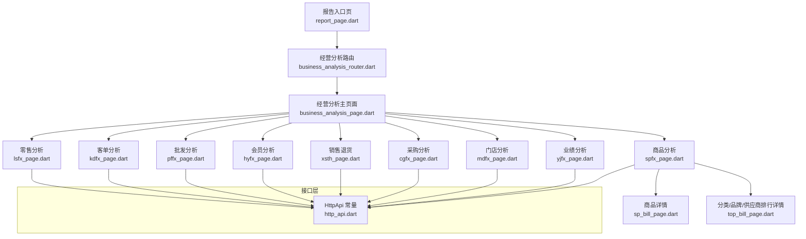
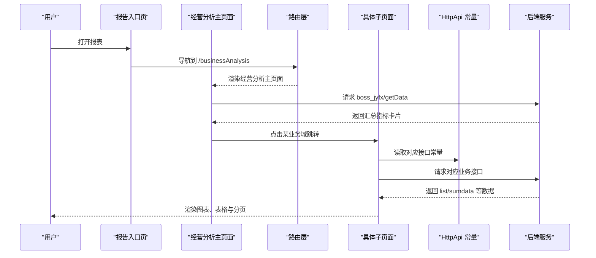
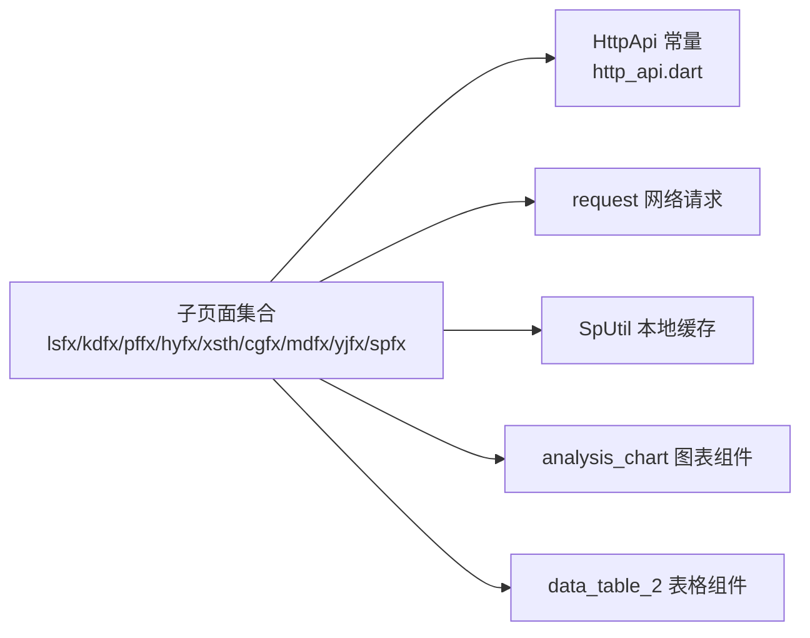

# 经营分析报告

<cite>
**本文引用的文件**   
- [report_page.dart](file://lib/pages/home/report_page.dart)
- [business_analysis_router.dart](file://lib/pages/data/businessReport/businessAnalysis/business_analysis_router.dart)
- [business_analysis_page.dart](file://lib/pages/data/businessReport/businessAnalysis/business_analysis_page.dart)
- [lsfx_page.dart](file://lib/pages/data/businessReport/businessAnalysis/subpage/lsfx_page.dart)
- [kdfx_page.dart](file://lib/pages/data/businessReport/businessAnalysis/subpage/kdfx_page.dart)
- [pffx_page.dart](file://lib/pages/data/businessReport/businessAnalysis/subpage/pffx_page.dart)
- [hyfx_page.dart](file://lib/pages/data/businessReport/businessAnalysis/subpage/hyfx_page.dart)
- [xsth_page.dart](file://lib/pages/data/businessReport/businessAnalysis/subpage/xsth_page.dart)
- [cgfx_page.dart](file://lib/pages/data/businessReport/businessAnalysis/subpage/cgfx_page.dart)
- [mdfx_page.dart](file://lib/pages/data/businessReport/businessAnalysis/subpage/mdfx_page.dart)
- [yjfx_page.dart](file://lib/pages/data/businessReport/businessAnalysis/subpage/yjfx_page.dart)
- [spfx_page.dart](file://lib/pages/data/businessReport/businessAnalysis/subpage/spfx_page.dart)
- [sp_bill_page.dart](file://lib/pages/data/businessReport/businessAnalysis/subpage/sp_bill_page.dart)
- [top_bill_page.dart](file://lib/pages/data/businessReport/businessAnalysis/subpage/top_bill_page.dart)
- [http_api.dart](file://lib/net/http_api.dart)
</cite>

## 目录
1. [引言](#引言)
2. [项目结构](#项目结构)
3. [核心组件](#核心组件)
4. [架构总览](#架构总览)
5. [详细组件分析](#详细组件分析)
6. [依赖关系分析](#依赖关系分析)
7. [性能与可用性](#性能与可用性)
8. [业务指标口径与计算逻辑](#业务指标口径与计算逻辑)
9. [图表展示与筛选机制](#图表展示与筛选机制)
10. [阈值、预警与异常处理](#阈值预警与异常处理)
11. [决策支持指南](#决策支持指南)
12. [故障排查](#故障排查)
13. [结论](#结论)

## 引言
本文件为灵犀管店 Flutter 项目中“经营分析报告”功能的完整技术文档。重点覆盖：
- 主页面的综合经营指标入口与版本控制；
- 销售分析、客单分析、批发分析、会员分析、销售退货、采购分析、门店分析、业绩分析、商品分析等子页面的功能实现；
- 各业务指标的统计口径、数据来源和计算方式；
- 图表呈现、数据筛选条件与时间维度切换机制；
- 阈值设定、预警机制与异常数据处理；
- 基于经营数据的业务洞察方法与决策支持工具使用指南。

## 项目结构
经营分析报告位于数据报表模块，以“经营分析”作为统一入口，再按业务域拆分为多个子页面。整体采用“路由层 + 页面层 + 接口常量层”的分层组织方式：

**图示来源**
- [report_page.dart:1-120](file://lib/pages/home/report_page.dart#L1-L120)
- [business_analysis_router.dart:1-39](file://lib/pages/data/businessReport/businessAnalysis/business_analysis_router.dart#L1-L39)
- [business_analysis_page.dart:1-120](file://lib/pages/data/businessReport/businessAnalysis/business_analysis_page.dart#L1-L120)
- [http_api.dart:300-317](file://lib/net/http_api.dart#L300-L317)

**章节来源**
- [report_page.dart:1-120](file://lib/pages/home/report_page.dart#L1-L120)
- [business_analysis_router.dart:1-39](file://lib/pages/data/businessReport/businessAnalysis/business_analysis_router.dart#L1-L39)
- [business_analysis_page.dart:1-120](file://lib/pages/data/businessReport/businessAnalysis/business_analysis_page.dart#L1-L120)

## 核心组件
- 报告入口页：负责席位与版本显示、基础版/专业版功能可见性控制，并聚合跳转到各类报表页面。
- 经营分析路由：集中定义经营分析及其子页面的路由地址与页面映射。
- 经营分析主页面：汇总展示零售、客单、会员、商品、销售退货、采购、批发、门店、业绩等卡片指标，并提供门店选择与时间筛选。
- 子页面族：每个业务域一个独立 StatefulWidget，封装自身的数据加载、图表、列表、分页与排序逻辑。
- 接口常量层：统一声明后端接口路径，如 `boss_jyfx/getData`、`boss_jyfx/getLsfx` 等。

**章节来源**
- [report_page.dart:1-200](file://lib/pages/home/report_page.dart#L1-L200)
- [business_analysis_router.dart:1-39](file://lib/pages/data/businessReport/businessAnalysis/business_analysis_router.dart#L1-L39)
- [business_analysis_page.dart:1-200](file://lib/pages/data/businessReport/businessAnalysis/business_analysis_page.dart#L1-L200)
- [http_api.dart:300-317](file://lib/net/http_api.dart#L300-L317)

## 架构总览
经营分析报告的调用链路如下：用户从报告入口进入“经营分析”，页面根据当前门店和时间范围向后端请求汇总数据或明细数据，再渲染数值卡片、趋势图、排行榜和明细表。

**图示来源**
- [business_analysis_router.dart:1-39](file://lib/pages/data/businessReport/businessAnalysis/business_analysis_router.dart#L1-L39)
- [business_analysis_page.dart:1-200](file://lib/pages/data/businessReport/businessAnalysis/business_analysis_page.dart#L1-L200)
- [http_api.dart:300-317](file://lib/net/http_api.dart#L300-L317)

## 详细组件分析

### 报告入口页
报告入口页承担三个职责：
1. 版本与席位控制：判断是否专业版、是否临近到期，并在基础版中对非白名单功能进行灰显锁定。
2. 分区顺序调整：基础版将“库存分析”分区后移，并在内部高频功能前置。
3. 报表导航：聚合跳转至收银流水、收银统计、销售监控、异常监控、经营分析、库存相关报表及会员报表。

关键行为：
- 通过本地缓存与异步刷新获取增值服务与席位信息；
- 基础版白名单包括收银流水、收银统计、销售监控、异常监控、经营分析等；
- 库存分析内部优先项包含库存查询、库存预警、有效期预警、零库存。

**章节来源**
- [report_page.dart:1-200](file://lib/pages/home/report_page.dart#L1-L200)

### 经营分析主页面
经营分析主页面是“综合经营指标”的统一视图，提供以下能力：
- 门店选择：读取本地存储的机构信息，支持切换到其他门店；
- 时间筛选：昨日、今日、本周、本月、自定义时间段；
- 汇总指标卡片：零售分析、客单分析、会员分析、商品分析、销售退货、采购分析、批发分析、门店分析、业绩分析；
- 跳转子页面：点击卡片进入对应业务域子页面。

数据来源：
- 调用 `boss_jyfx/getData`，返回字段用于填充各卡片指标，例如零售销售额、毛利额、毛利率，客单数、客单价、营业额，会员新增、充值金额、消费金额、消费占比等。

**章节来源**
- [business_analysis_page.dart:1-200](file://lib/pages/data/businessReport/businessAnalysis/business_analysis_page.dart#L1-L200)

### 零售分析
零售分析面向销售侧的核心趋势与明细：
- 数据源：`boss_jyfx/getLsfx`；
- 返回结构：`list` 为明细行，`sumdata` 为汇总数据；
- 图表：根据时间维度生成折线/柱状图；当日按小时聚合，本周按天聚合，其他按日期标签；
- 排序：支持按销售额等指标排序；
- 滚动同步：顶部汇总区域与明细表格横向滚动联动。

时间维度映射：
- 昨日、今日映射为日粒度；
- 本周、本月映射为更粗粒度。

**章节来源**
- [lsfx_page.dart:1-200](file://lib/pages/data/businessReport/businessAnalysis/subpage/lsfx_page.dart#L1-L200)

### 客单分析
客单分析关注订单数量、客单价与营业额：
- 数据源：`boss_jyfx/getKdfx`；
- 默认指标：按单据数量列排序；
- 图表：同样按小时、按周、按日三种时间粒度聚合；
- 交互：门店选择与时间选择与零售分析一致。

**章节来源**
- [kdfx_page.dart:1-200](file://lib/pages/data/businessReport/businessAnalysis/subpage/kdfx_page.dart#L1-L200)

### 批发分析
批发分析聚焦批发业务的销售额、毛利额、毛利率：
- 数据源：`boss_jyfx/getPffx`；
- 默认指标：按销售额排序；
- 图表：与零售分析一致的三档时间粒度；
- 适用场景：批发渠道营收与利润趋势诊断。

**章节来源**
- [pffx_page.dart:1-200](file://lib/pages/data/businessReport/businessAnalysis/subpage/pffx_page.dart#L1-L200)

### 会员分析
会员分析提供会员维度的分层统计与明细：
- 数据源：列表接口 `boss_jyfx/getHyfx`，头部 VIP 等级数据 `boss_jyfx/getHyfxHead`；
- 头部数据：返回会员等级分布、比例等信息；
- 列表：支持分页、水平滚动、汇总数据；
- 等级抽屉：展示各等级会员数量与占比，并按比例排序。

**章节来源**
- [hyfx_page.dart:1-200](file://lib/pages/data/businessReport/businessAnalysis/subpage/hyfx_page.dart#L1-L200)

### 销售退货
销售退货关注退货数量与退货金额：
- 数据源：`boss_jyfx/getXsth`；
- 分页：每页 20 条，自动判断是否有更多数据；
- 汇总：返回 `sumdata`，用于顶部汇总展示。

**章节来源**
- [xsth_page.dart:1-200](file://lib/pages/data/businessReport/businessAnalysis/subpage/xsth_page.dart#L1-L200)

### 采购分析
采购分析提供采购数量、金额以及供应商维度：
- 数据源：`boss_jyfx/getCgfx`；
- 筛选：支持选择供应商；
- 排序：支持字段与升降序；
- 分页：每页 20 条。

**章节来源**
- [cgfx_page.dart:1-200](file://lib/pages/data/businessReport/businessAnalysis/subpage/cgfx_page.dart#L1-L200)

### 门店分析
门店分析按门店维度对比营业额、毛利额、毛利率等：
- 数据源：`boss_jyfx/getMdfx`；
- 排序：支持字段与升降序；
- 分页：每页 20 条。

**章节来源**
- [mdfx_page.dart:1-200](file://lib/pages/data/businessReport/businessAnalysis/subpage/mdfx_page.dart#L1-L200)

### 业绩分析
业绩分析聚焦员工或业务员的销售数量、销售金额与提成金额：
- 数据源：`boss_jyfx/getYjfx`；
- 筛选：可按零售业绩或其他业绩维度筛选；
- 排序：支持字段与升降序；
- 分页：每页 20 条。

**章节来源**
- [yjfx_page.dart:1-200](file://lib/pages/data/businessReport/businessAnalysis/subpage/yjfx_page.dart#L1-L200)

### 商品分析
商品分析是较复杂的聚合页面，包含四个 Tab：
- 商品排行；
- 类别排行；
- 品牌排行；
- 供应商排行。

核心能力：
- 排序维度：销量、金额、毛利额、毛利率、均价；
- 搜索：支持关键词过滤；
- 分页：每页 20 条；
- 详情跳转：
  - 商品详情：`sp_bill_page.dart`，固定最近 7 天趋势；
  - 分类/品牌/供应商详情：`top_bill_page.dart`，传入所属维度与排序字段。

接口：
- 商品：`boss_jyfx/getSpfx`；
- 类别：`boss_jyfx/getFlfx`；
- 品牌：`boss_jyfx/getPpfx`；
- 供应商：`boss_jyfx/getHsfx`；
- 商品详情：`boss_jyfx/getSpfxInfo`。

**章节来源**
- [spfx_page.dart:1-200](file://lib/pages/data/businessReport/businessAnalysis/subpage/spfx_page.dart#L1-L200)
- [sp_bill_page.dart:1-200](file://lib/pages/data/businessReport/businessAnalysis/subpage/sp_bill_page.dart#L1-L200)
- [top_bill_page.dart:1-200](file://lib/pages/data/businessReport/businessAnalysis/subpage/top_bill_page.dart#L1-L200)

## 依赖关系分析
经营分析报告对外的主要依赖包括：
- 路由框架：Fluro 路由，用于页面跳转；
- 网络层：`HttpApi` 常量与 `request` 方法；
- 本地存储：`sp_util` 的 `SpUtil` 读取门店、用户等缓存；
- UI 组件：日期选择器、通用图表组件、数据表格组件。

**图示来源**
- [lsfx_page.dart:1-60](file://lib/pages/data/businessReport/businessAnalysis/subpage/lsfx_page.dart#L1-L60)
- [kdfx_page.dart:1-60](file://lib/pages/data/businessReport/businessAnalysis/subpage/kdfx_page.dart#L1-L60)
- [pffx_page.dart:1-60](file://lib/pages/data/businessReport/businessAnalysis/subpage/pffx_page.dart#L1-L60)
- [http_api.dart:300-317](file://lib/net/http_api.dart#L300-L317)

**章节来源**
- [http_api.dart:300-317](file://lib/net/http_api.dart#L300-L317)

## 性能与可用性
- 首次加载防闪屏：多数子页面使用 `_hasLoadedOnce` 标记，避免空数据刷新时闪烁；
- 列表分页：分页大小统一为 20，减少单次渲染压力；
- 横向滚动同步：汇总区与明细区通过 ScrollController 同步横向滚动位置；
- 时间维度复用：各子页面共享相同的时间选择逻辑，降低重复代码；
- 错误处理：统一在 try/catch 中捕获异常，未加载成功时清空列表并提示“加载失败，请重试”。

建议优化：
- 对大列表增加虚拟列表或懒加载策略；
- 对图表数据做降采样或增量更新；
- 对网络请求增加超时与重试机制；
- 对空数据状态提供更友好的引导文案。

[本节为通用指导，不直接分析具体文件]

## 业务指标口径与计算逻辑

### 零售分析
- 销售额：按所选门店和时间范围内的零售销售额合计；
- 毛利额：零售毛利额合计；
- 毛利率：由后端返回百分比值；
- 明细维度：通常按日期或小时聚合，取决于时间维度。

数据来源：`boss_jyfx/getLsfx`

**章节来源**
- [lsfx_page.dart:1-200](file://lib/pages/data/businessReport/businessAnalysis/subpage/lsfx_page.dart#L1-L200)

### 客单分析
- 客单数：订单单据数量；
- 客单价：平均客单价；
- 营业额：该维度下的营业额合计。

数据来源：`boss_jyfx/getKdfx`

**章节来源**
- [kdfx_page.dart:1-200](file://lib/pages/data/businessReport/businessAnalysis/subpage/kdfx_page.dart#L1-L200)

### 批发分析
- 销售额：批发渠道销售额；
- 毛利额：批发毛利额；
- 毛利率：批发毛利率。

数据来源：`boss_jyfx/getPffx`

**章节来源**
- [pffx_page.dart:1-200](file://lib/pages/data/businessReport/businessAnalysis/subpage/pffx_page.dart#L1-L200)

### 会员分析
- 新增会员：统计期内新增会员数量；
- 充值金额：会员充值金额合计；
- 消费金额：会员消费金额合计；
- 消费占比：会员消费金额占总体消费的比例；
- 会员等级：按 VIP 等级分组统计数量与占比。

数据来源：`boss_jyfx/getHyfx`、`boss_jyfx/getHyfxHead`

**章节来源**
- [hyfx_page.dart:1-200](file://lib/pages/data/businessReport/businessAnalysis/subpage/hyfx_page.dart#L1-L200)

### 销售退货
- 退货数量：统计期内退货商品数量；
- 退货金额：统计期内退货金额合计。

数据来源：`boss_jyfx/getXsth`

**章节来源**
- [xsth_page.dart:1-200](file://lib/pages/data/businessReport/businessAnalysis/subpage/xsth_page.dart#L1-L200)

### 采购分析
- 采购数量：统计期内采购商品数量；
- 采购金额：统计期内采购金额合计；
- 供应商维度：可筛选特定供应商。

数据来源：`boss_jyfx/getCgfx`

**章节来源**
- [cgfx_page.dart:1-200](file://lib/pages/data/businessReport/businessAnalysis/subpage/cgfx_page.dart#L1-L200)

### 门店分析
- 营业额：各门店营业额对比；
- 毛利额：各门店毛利额对比；
- 毛利率：各门店毛利率对比。

数据来源：`boss_jyfx/getMdfx`

**章节来源**
- [mdfx_page.dart:1-200](file://lib/pages/data/businessReport/businessAnalysis/subpage/mdfx_page.dart#L1-L200)

### 业绩分析
- 销售数量：人员销售数量；
- 销售金额：人员销售金额；
- 提成金额：人员提成金额；
- 业绩维度：可按零售业绩等筛选。

数据来源：`boss_jyfx/getYjfx`

**章节来源**
- [yjfx_page.dart:1-200](file://lib/pages/data/businessReport/businessAnalysis/subpage/yjfx_page.dart#L1-L200)

### 商品分析
- 商品维度：商品名称、条码、分类、品牌、供应商；
- 排行维度：销量、金额、毛利额、毛利率、均价；
- 商品详情：最近 7 天的销售趋势；
- 分类/品牌/供应商详情：在该维度下的商品排行。

数据来源：`boss_jyfx/getSpfx`、`boss_jyfx/getFlfx`、`boss_jyfx/getPpfx`、`boss_jyfx/getHsfx`、`boss_jyfx/getSpfxInfo`

**章节来源**
- [spfx_page.dart:1-200](file://lib/pages/data/businessReport/businessAnalysis/subpage/spfx_page.dart#L1-L200)
- [sp_bill_page.dart:1-200](file://lib/pages/data/businessReport/businessAnalysis/subpage/sp_bill_page.dart#L1-L200)
- [top_bill_page.dart:1-200](file://lib/pages/data/businessReport/businessAnalysis/subpage/top_bill_page.dart#L1-L200)

## 图表展示与筛选机制

### 时间维度切换机制
大多数子页面使用统一的快速时间选择器：
- 昨日、今日：映射为日粒度；
- 本周、本月：映射为更粗粒度；
- 自定义：使用日期选择器设置起止日期。

时间参数构造：
- `starttime` 为起始日期 00:00:00；
- `endtime` 为结束日期 23:59:59；
- `selectdatetype` 由快速时间 ID 决定。

**章节来源**
- [business_analysis_page.dart:60-120](file://lib/pages/data/businessReport/businessAnalysis/business_analysis_page.dart#L60-L120)
- [lsfx_page.dart:100-160](file://lib/pages/data/businessReport/businessAnalysis/subpage/lsfx_page.dart#L100-L160)

### 门店筛选机制
- 默认门店来自本地缓存；
- 仅当当前门店等于指定门店（`isZd`）时才允许切换；
- 切换门店后重新加载数据。

**章节来源**
- [lsfx_page.dart:60-120](file://lib/pages/data/businessReport/businessAnalysis/subpage/lsfx_page.dart#L60-L120)
- [kdfx_page.dart:60-120](file://lib/pages/data/businessReport/businessAnalysis/subpage/kdfx_page.dart#L60-L120)
- [pffx_page.dart:60-120](file://lib/pages/data/businessReport/businessAnalysis/subpage/pffx_page.dart#L60-L120)

### 图表聚合逻辑
- 当日：按小时聚合，横轴为 0-23；
- 本周：按星期几聚合，标签为周一到周日；
- 其他：按日期字符串聚合，保留“周”字或去除年份前缀。

**章节来源**
- [lsfx_page.dart:160-220](file://lib/pages/data/businessReport/businessAnalysis/subpage/lsfx_page.dart#L160-L220)
- [kdfx_page.dart:160-220](file://lib/pages/data/businessReport/businessAnalysis/subpage/kdfx_page.dart#L160-L220)
- [pffx_page.dart:160-220](file://lib/pages/data/businessReport/businessAnalysis/subpage/pffx_page.dart#L160-L220)

## 阈值、预警与异常处理

### 异常处理
- 网络异常：所有数据加载方法均包裹 try/catch，未加载成功时清空列表并显示“加载失败，请重试”；
- 数据结构异常：对返回数据做类型检查，如 `data is Map<String, dynamic>`，否则降级为空数据；
- 首次加载保护：使用 `_hasLoadedOnce` 避免空数据刷新导致界面闪烁。

**章节来源**
- [business_analysis_page.dart:120-180](file://lib/pages/data/businessReport/businessAnalysis/business_analysis_page.dart#L120-L180)
- [lsfx_page.dart:120-180](file://lib/pages/data/businessReport/businessAnalysis/subpage/lsfx_page.dart#L120-L180)
- [kdfx_page.dart:120-180](file://lib/pages/data/businessReport/businessAnalysis/subpage/kdfx_page.dart#L120-L180)
- [pffx_page.dart:120-180](file://lib/pages/data/businessReport/businessAnalysis/subpage/pffx_page.dart#L120-L180)
- [hyfx_page.dart:120-180](file://lib/pages/data/businessReport/businessAnalysis/subpage/hyfx_page.dart#L120-L180)
- [xsth_page.dart:120-180](file://lib/pages/data/businessReport/businessAnalysis/subpage/xsth_page.dart#L120-L180)
- [cgfx_page.dart:120-180](file://lib/pages/data/businessReport/businessAnalysis/subpage/cgfx_page.dart#L120-L180)
- [mdfx_page.dart:120-180](file://lib/pages/data/businessReport/businessAnalysis/subpage/mdfx_page.dart#L120-L180)
- [yjfx_page.dart:120-180](file://lib/pages/data/businessReport/businessAnalysis/subpage/yjfx_page.dart#L120-L180)
- [spfx_page.dart:120-180](file://lib/pages/data/businessReport/businessAnalysis/subpage/spfx_page.dart#L120-L180)

### 阈值与预警
- 当前子页面未发现内置的业务阈值判断或告警逻辑；
- 阈值与预警更适合在后端接口或数据分析平台实现，前端仅负责展示；
- 若需在前端实现阈值提醒，可在数据到达后进行本地比较并高亮异常指标。

[本节为通用指导，不直接分析具体文件]

## 决策支持指南

### 如何解读经营分析报告
- 先看汇总：在经营分析主页面查看零售、客单、会员、商品、销售退货、采购、批发、门店、业绩的整体表现；
- 再看趋势：进入零售、客单、批发分析，观察不同时间维度的趋势变化；
- 再看结构：进入会员分析、商品分析，理解会员分层与商品贡献度；
- 最后看明细：进入销售退货、采购分析、门店分析、业绩分析，定位问题与机会点。

### 常用分析方法
- 同比环比：切换“本周”“本月”“自定义”时间段，观察趋势变化；
- 结构分析：在商品分析中选择按金额、毛利额、毛利率排行，识别核心商品；
- 渠道分析：对比零售分析与批发分析，评估渠道健康度；
- 人员绩效：在业绩分析中按销售金额或提成金额排序，评估团队产出；
- 供应链分析：在采购分析中按供应商筛选，评估供应效率与成本。

### 决策支持工具使用建议
- 结合门店分析，定位低效门店并制定改进计划；
- 结合会员分析，设计会员拉新、促活与留存策略；
- 结合商品分析，优化选品、定价与促销方案；
- 结合销售退货分析，复盘售后问题并改进服务质量；
- 结合采购分析，优化供应商结构与采购节奏。

[本节为通用指导，不直接分析具体文件]

## 故障排查
常见问题与解决思路：
- 数据为空：检查时间范围是否正确，确认门店是否为当前门店；
- 图表无数据：检查时间维度是否产生有效聚合，尤其是自定义时间范围；
- 列表不翻页：检查 `_hasMore` 与 `_loadingMore` 状态；
- 切换门店无效：确认 `_isZd` 是否为真，只有当前门店才允许切换；
- 接口报错：检查 `HttpApi` 中的接口常量是否与后端一致。

**章节来源**
- [business_analysis_page.dart:120-180](file://lib/pages/data/businessReport/businessAnalysis/business_analysis_page.dart#L120-L180)
- [http_api.dart:300-317](file://lib/net/http_api.dart#L300-L317)

## 结论
经营分析报告以“经营分析主页面”为核心入口，围绕零售、客单、批发、会员、销售退货、采购、门店、业绩、商品等业务域形成完整的移动端数据分析体系。其实现特点包括：
- 清晰的路由与页面分层；
- 统一的门店与时间筛选机制；
- 稳定的数据加载与异常处理；
- 丰富的图表与表格展示；
- 可扩展的商品多维度排行与详情。

未来可在阈值预警、趋势预测、跨维度交叉分析等方面继续增强，使经营分析报告成为更强大的业务决策支持工具。