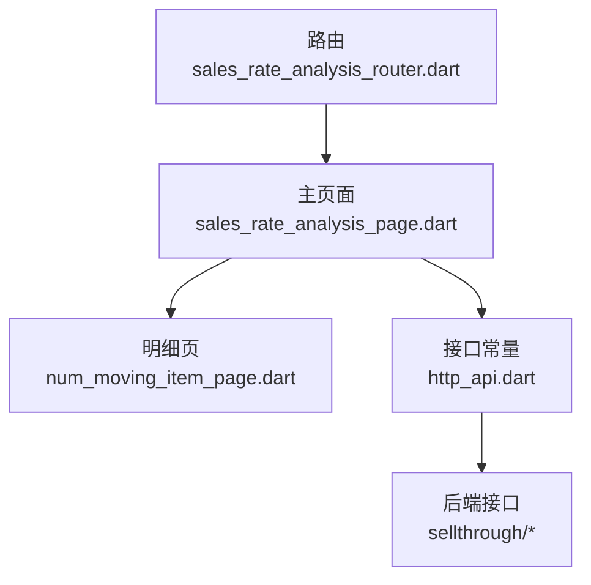
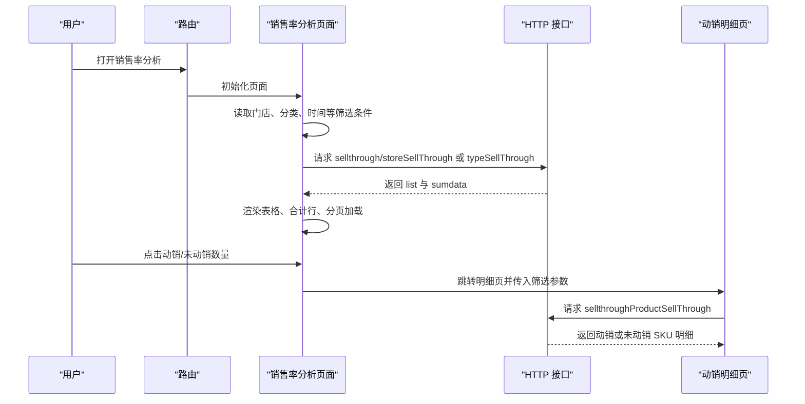
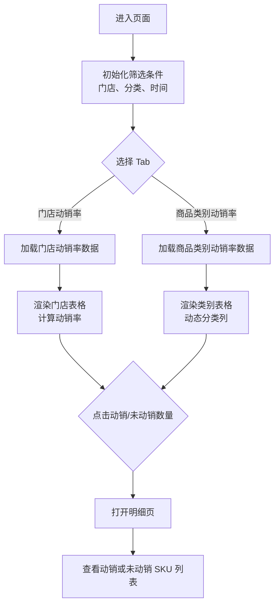
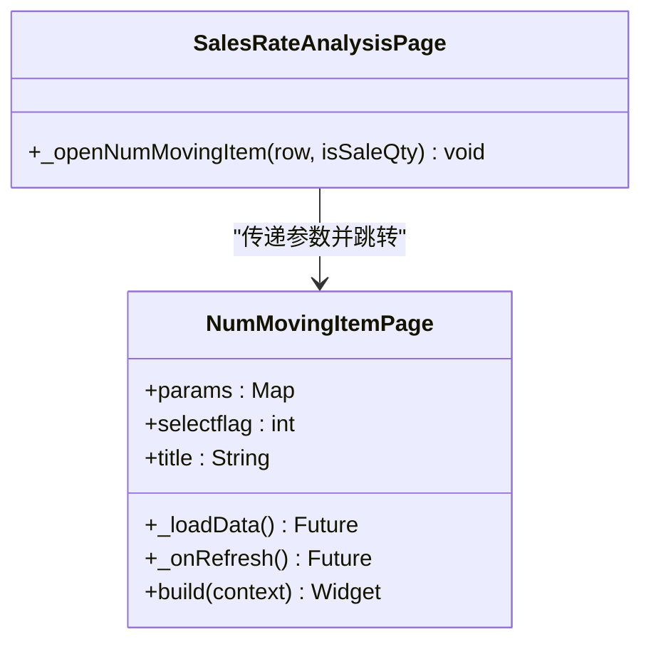
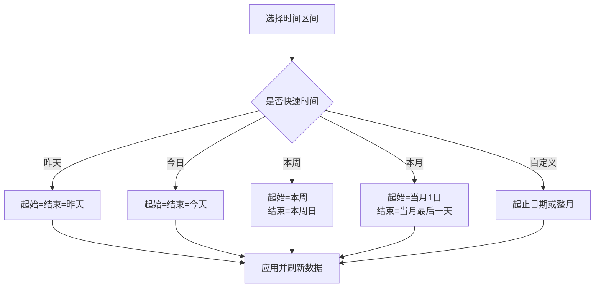
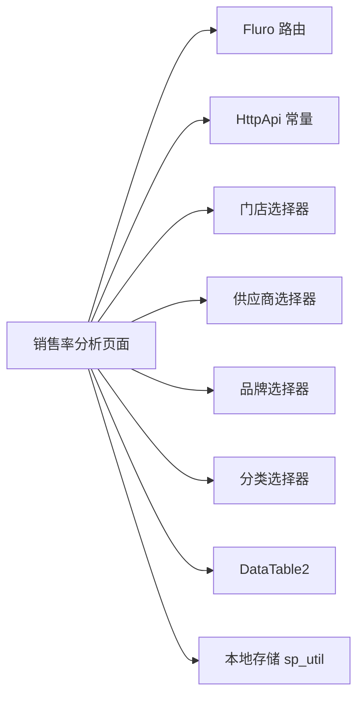
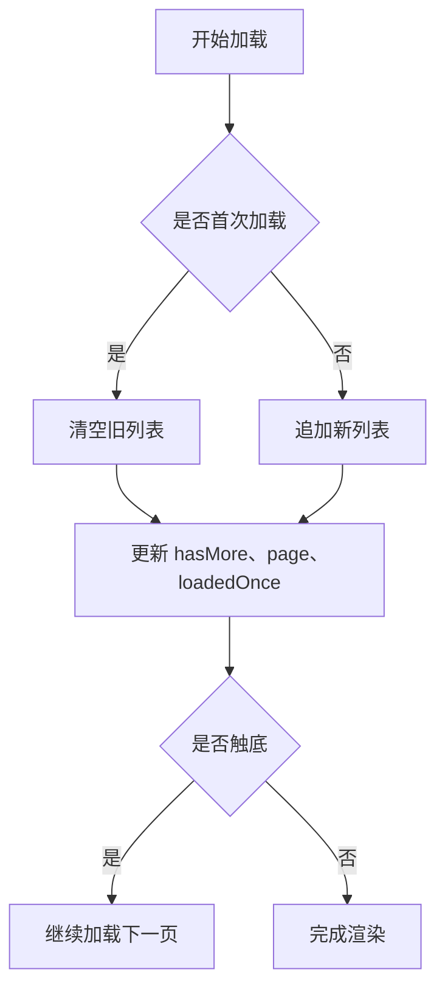

# 销售率分析

<cite>
**本文引用的文件**   
- [sales_rate_analysis_page.dart](file://lib/pages/data/businessReport/salesRateAnalysis/sales_rate_analysis_page.dart)
- [sales_rate_analysis_router.dart](file://lib/pages/data/businessReport/salesRateAnalysis/sales_rate_analysis_router.dart)
- [num_moving_item_page.dart](file://lib/pages/data/businessReport/salesRateAnalysis/num_moving_item_page.dart)
- [http_api.dart](file://lib/net/http_api.dart)
</cite>

## 目录
1. [引言](#引言)
2. [项目结构定位](#项目结构定位)
3. [核心概念与指标定义](#核心概念与指标定义)
4. [系统架构总览](#系统架构总览)
5. [详细组件分析](#详细组件分析)
6. [动销商品与滞销商品识别规则](#动销商品与滞销商品识别规则)
7. [统计口径、时间周期与对比分析](#统计口径时间周期与对比分析)
8. [依赖关系分析](#依赖关系分析)
9. [库存周转率与积压风险评估](#库存周转率与积压风险评估)
10. [性能与交互设计要点](#性能与交互设计要点)
11. [策略建议与最佳实践](#策略建议与最佳实践)
12. [常见问题排查](#常见问题排查)
13. [结论](#结论)

## 引言
本文围绕灵犀管店 Flutter 项目中的“销售率分析”功能，系统性说明销售率的定义、计算逻辑、统计口径、动销与滞销商品的分类规则，以及与库存周转率、库存积压风险的关系。文档同时覆盖品类、品牌、价格段等维度划分方式，时间周期选择机制和对比分析方法，并给出优化库存结构、提升动销率的策略建议和落地案例。

## 项目结构定位
销售率分析属于数据报表模块下的业务报表功能，具体实现位于：
- 路由入口：`lib/pages/data/businessReport/salesRateAnalysis/sales_rate_analysis_router.dart`
- 主页面：`lib/pages/data/businessReport/salesRateAnalysis/sales_rate_analysis_page.dart`
- 明细页：`lib/pages/data/businessReport/salesRateAnalysis/num_moving_item_page.dart`
- 接口常量：`lib/net/http_api.dart`

该功能以移动端报表为主，通过表格展示门店维度和商品类别维度的动销情况，并提供动销品项数、未动销品项数的明细列表。

**图表来源**
- [sales_rate_analysis_router.dart:1-12](file://lib/pages/data/businessReport/salesRateAnalysis/sales_rate_analysis_router.dart#L1-L12)
- [sales_rate_analysis_page.dart:1-200](file://lib/pages/data/businessReport/salesRateAnalysis/sales_rate_analysis_page.dart#L1-L200)
- [num_moving_item_page.dart:1-80](file://lib/pages/data/businessReport/salesRateAnalysis/num_moving_item_page.dart#L1-L80)
- [http_api.dart:297-300](file://lib/net/http_api.dart#L297-L300)

**章节来源**
- [sales_rate_analysis_router.dart:1-12](file://lib/pages/data/businessReport/salesRateAnalysis/sales_rate_analysis_router.dart#L1-L12)
- [sales_rate_analysis_page.dart:1-200](file://lib/pages/data/businessReport/salesRateAnalysis/sales_rate_analysis_page.dart#L1-L200)
- [num_moving_item_page.dart:1-80](file://lib/pages/data/businessReport/salesRateAnalysis/num_moving_item_page.dart#L1-L80)
- [http_api.dart:297-300](file://lib/net/http_api.dart#L297-L300)

## 核心概念与指标定义
- 销售率（动销率）
  - 定义：在选定时间区间内，有销售记录的 SKU 数量占可售 SKU 总数的比例。
  - 计算公式：销售率 = 动销品项数 ÷ 品项总数 × 100%。
  - 代码实现位置：主页面在行级计算动销率时，使用 `saleqty / allqty * 100`；合计行也按相同逻辑汇总后计算。
  - 参考路径：[sales_rate_analysis_page.dart](file://lib/pages/data/businessReport/salesRateAnalysis/sales_rate_analysis_page.dart)

- 动销品项数
  - 含义：在查询时间段内有销售发生的 SKU 数量。
  - 数据来源：后端返回字段 `saleqty`。

- 未动销品项数
  - 含义：在查询时间段内无销售发生但仍在可售范围中的 SKU 数量。
  - 数据来源：后端返回字段 `nosaleqty`。

- 品项总数
  - 含义：用于统计分母的可售 SKU 集合大小。
  - 数据来源：后端返回字段 `allqty`。

- 明细维度
  - 门店维度：按机构名称分组，展示各门店的动销率、动销品项数和未动销品项数。
  - 商品类别维度：支持一级、二级、三级分类，并可切换分类级别查看不同粒度的动销表现。

**章节来源**
- [sales_rate_analysis_page.dart:901-1020](file://lib/pages/data/businessReport/salesRateAnalysis/sales_rate_analysis_page.dart#L901-L1020)
- [sales_rate_analysis_page.dart:1327-1400](file://lib/pages/data/businessReport/salesRateAnalysis/sales_rate_analysis_page.dart#L1327-L1400)

## 系统架构总览
销售率分析的前端流程如下：
1. 用户通过路由进入销售率分析页面。
2. 页面根据选择的门店、分类、供应商、品牌、商品状态和时间区间构建查询参数。
3. 根据当前 Tab 调用不同接口：
   - 门店动销率：`sellthrough/storeSellThrough`
   - 商品类别动销率：`sellthrough/typeSellThrough`
4. 前端对返回的 `list`、`sumdata` 进行分页加载、横向滚动同步、合计行计算。
5. 点击动销或未动销数量可跳转到明细页，查看具体 SKU 列表。

**图表来源**
- [sales_rate_analysis_router.dart:1-12](file://lib/pages/data/businessReport/salesRateAnalysis/sales_rate_analysis_router.dart#L1-L12)
- [sales_rate_analysis_page.dart:201-320](file://lib/pages/data/businessReport/salesRateAnalysis/sales_rate_analysis_page.dart#L201-L320)
- [num_moving_item_page.dart:30-70](file://lib/pages/data/businessReport/salesRateAnalysis/num_moving_item_page.dart#L30-L70)
- [http_api.dart:297-300](file://lib/net/http_api.dart#L297-L300)

**章节来源**
- [sales_rate_analysis_page.dart:201-320](file://lib/pages/data/businessReport/salesRateAnalysis/sales_rate_analysis_page.dart#L201-L320)
- [num_moving_item_page.dart:30-70](file://lib/pages/data/businessReport/salesRateAnalysis/num_moving_item_page.dart#L30-L70)

## 详细组件分析

### 销售率分析主页面
主页面承担以下职责：
- 维护筛选状态：门店、分类、供应商、品牌、商品状态、分类级别、时间区间。
- 管理两个 Tab：
  - 门店动销率
  - 商品类别动销率
- 处理分页加载、横向滚动同步、合计行计算。
- 提供动销/未动销品项数明细跳转。

关键行为包括：
- 默认时间区间为近 30 天，快速时间选项包含昨天、今日、本周、本月、自定义。
- 门店动销率调用 `sellthrough/storeSellThrough`，并按 `saleqty` 降序排序。
- 商品类别动销率调用 `sellthrough/typeSellThrough`，并根据分类级别动态显示一级、二级、三级分类列。
- 点击动销或未动销数量时，构造明细查询参数并跳转到 `NumMovingItemPage`。

**图表来源**
- [sales_rate_analysis_page.dart:201-320](file://lib/pages/data/businessReport/salesRateAnalysis/sales_rate_analysis_page.dart#L201-L320)
- [sales_rate_analysis_page.dart:901-1020](file://lib/pages/data/businessReport/salesRateAnalysis/sales_rate_analysis_page.dart#L901-L1020)
- [sales_rate_analysis_page.dart:1327-1400](file://lib/pages/data/businessReport/salesRateAnalysis/sales_rate_analysis_page.dart#L1327-L1400)

**章节来源**
- [sales_rate_analysis_page.dart:201-320](file://lib/pages/data/businessReport/salesRateAnalysis/sales_rate_analysis_page.dart#L201-L320)
- [sales_rate_analysis_page.dart:901-1020](file://lib/pages/data/businessReport/salesRateAnalysis/sales_rate_analysis_page.dart#L901-L1020)
- [sales_rate_analysis_page.dart:1327-1400](file://lib/pages/data/businessReport/salesRateAnalysis/sales_rate_analysis_page.dart#L1327-L1400)

### 动销明细页
明细页负责展示动销或未动销的 SKU 列表，主要能力包括：
- 接收父页面传递的筛选参数：时间区间、门店、分类、供应商、品牌、商品状态、分类级别。
- 根据 `selectflag` 判断是动销还是未动销：1 表示动销，0 表示未动销。
- 调用接口 `sellthroughProductSellThrough`，分页获取 SKU 明细。
- 展示机构名称、商品名称或条码、末次销售时间等字段。

**图表来源**
- [num_moving_item_page.dart:1-80](file://lib/pages/data/businessReport/salesRateAnalysis/num_moving_item_page.dart#L1-L80)
- [sales_rate_analysis_page.dart:320-450](file://lib/pages/data/businessReport/salesRateAnalysis/sales_rate_analysis_page.dart#L320-L450)

**章节来源**
- [num_moving_item_page.dart:1-80](file://lib/pages/data/businessReport/salesRateAnalysis/num_moving_item_page.dart#L1-L80)
- [num_moving_item_page.dart:201-262](file://lib/pages/data/businessReport/salesRateAnalysis/num_moving_item_page.dart#L201-L262)
- [sales_rate_analysis_page.dart:320-450](file://lib/pages/data/businessReport/salesRateAnalysis/sales_rate_analysis_page.dart#L320-L450)

## 动销商品与滞销商品识别规则
- 动销商品
  - 判定依据：在查询时间段内存在销售记录。
  - 前端体现：`saleqty > 0` 的 SKU 计入动销品项数。
  - 明细入口：点击动销品项数可进入动销 SKU 明细列表。

- 未动销商品（通常对应业务中的滞销商品）
  - 判定依据：在查询时间段内无销售记录。
  - 前端体现：`nosaleqty > 0` 的 SKU 计入未动销品项数。
  - 明细入口：点击未动销品项数可进入未动销 SKU 明细列表。

注意：
- 前端并未实现固定阈值（例如超过 N 天未动销才认定为滞销），而是以“是否在查询时间段内产生销售”作为动销与未动销的分界。
- 若需更严格的滞销标准（如 30 天、60 天未动销），应在后端增加时间阈值或在前端扩展筛选逻辑。

**章节来源**
- [sales_rate_analysis_page.dart:901-1020](file://lib/pages/data/businessReport/salesRateAnalysis/sales_rate_analysis_page.dart#L901-L1020)
- [sales_rate_analysis_page.dart:1327-1400](file://lib/pages/data/businessReport/salesRateAnalysis/sales_rate_analysis_page.dart#L1327-L1400)
- [num_moving_item_page.dart:30-70](file://lib/pages/data/businessReport/salesRateAnalysis/num_moving_item_page.dart#L30-L70)

## 统计口径、时间周期与对比分析

### 统计口径
- 分母口径：品项总数 `allqty`，即参与统计的可售 SKU 集合。
- 分子口径：动销品项数 `saleqty`，即在时间区间内有销售的 SKU 数量。
- 未动销品项数 `nosaleqty` 与 `allqty`、`saleqty` 共同构成可解释性更强的动销结构。
- 动销率 = `saleqty / allqty * 100%`。

### 时间周期选择
- 快速时间选项：昨天、今日、本周、本月、自定义。
- 默认区间：近 30 天。
- 周月切换：支持按周、按月左右翻页。
- 自定义区间：支持起止日期选择，或整月选择。

**图表来源**
- [sales_rate_analysis_page.dart:560-740](file://lib/pages/data/businessReport/salesRateAnalysis/sales_rate_analysis_page.dart#L560-L740)

**章节来源**
- [sales_rate_analysis_page.dart:560-740](file://lib/pages/data/businessReport/salesRateAnalysis/sales_rate_analysis_page.dart#L560-L740)

### 对比分析能力
当前实现以单期对比为主，支持：
- 按门店对比动销率。
- 按分类级别对比动销率。
- 通过供应商、品牌、商品状态进行交叉筛选。
- 通过动销/未动销明细进一步定位问题 SKU。

如需跨期对比（例如本期 vs 上期、同比、环比），可在现有筛选基础上增加历史区间对比组件，并在后端增加对比接口或返回对比字段。

**章节来源**
- [sales_rate_analysis_page.dart:451-560](file://lib/pages/data/businessReport/salesRateAnalysis/sales_rate_analysis_page.dart#L451-L560)
- [sales_rate_analysis_page.dart:1100-1326](file://lib/pages/data/businessReport/salesRateAnalysis/sales_rate_analysis_page.dart#L1100-L1326)

## 依赖关系分析
销售率分析功能依赖以下外部能力：
- 路由：Fluro 路由注册。
- HTTP 接口：通过 `HttpApi` 常量调用后端 `sellthrough/*` 接口。
- 选择器组件：门店选择器、供应商选择器、品牌选择器、分类选择器。
- 表格组件：`data_table_2` 提供高性能表格展示。
- 本地存储：`sp_util` 读取当前门店信息。

**图表来源**
- [sales_rate_analysis_router.dart:1-12](file://lib/pages/data/businessReport/salesRateAnalysis/sales_rate_analysis_router.dart#L1-L12)
- [sales_rate_analysis_page.dart:1-80](file://lib/pages/data/businessReport/salesRateAnalysis/sales_rate_analysis_page.dart#L1-L80)
- [http_api.dart:297-300](file://lib/net/http_api.dart#L297-L300)

**章节来源**
- [sales_rate_analysis_page.dart:1-80](file://lib/pages/data/businessReport/salesRateAnalysis/sales_rate_analysis_page.dart#L1-L80)
- [http_api.dart:297-300](file://lib/net/http_api.dart#L297-L300)

## 库存周转率与积压风险评估

### 与销售率的关系
- 销售率衡量的是“有多少 SKU 产生了销售”，反映动销面。
- 库存周转率衡量的是“库存被卖出再补货的速度”，反映资金占用效率。
- 两者关联：
  - 高销售率不一定代表高周转率：可能动销面广但单品销量低，导致库存周转慢。
  - 低销售率通常意味着大量 SKU 未产生销售，容易形成库存积压，拉低整体周转率。

### 积压风险评估方法
结合前端已有字段和常见业务逻辑，可建立如下评估思路：
- 基础信号
  - 未动销品项数占比高：`nosaleqty / allqty` 较高，提示潜在积压。
  - 动销率低：`saleqty / allqty` 较低，提示动销面不足。
- 时间维度
  - 连续多期动销率下降：趋势恶化。
  - 长周期未动销 SKU 增多：需要引入“末次销售时间”等字段做滞销预警。
- 明细穿透
  - 通过动销/未动销明细页定位具体 SKU。
  - 结合商品状态（新品、正常、冻结、停购、停用）分析是否为计划外库存。

注意：
- 当前前端未直接展示库存周转率或库存金额，因此积压风险评估应以后端提供的库存量、库龄、最后销售时间为补充。
- 建议在明细页增加“末次销售时间”“库存数量”“库龄”等字段，以便运营人员精准识别积压 SKU。

**章节来源**
- [num_moving_item_page.dart:201-262](file://lib/pages/data/businessReport/salesRateAnalysis/num_moving_item_page.dart#L201-L262)
- [sales_rate_analysis_page.dart:901-1020](file://lib/pages/data/businessReport/salesRateAnalysis/sales_rate_analysis_page.dart#L901-L1020)

## 性能与交互设计要点
- 分页加载
  - 列表采用下拉加载更多，每页默认 20 条。
  - 首次加载与后续加载分别控制 `_hasLoadedOnce`，避免空数据刷新闪屏。
- 横向滚动同步
  - 合计行与表格主体通过独立 ScrollController 同步横向滚动位置。
- 加载态优化
  - 使用居中卡片加载指示器，避免全屏遮罩造成的页面泛白。
- 空态处理
  - 无数据时展示统一空状态图标与文案。

**图表来源**
- [sales_rate_analysis_page.dart:237-320](file://lib/pages/data/businessReport/salesRateAnalysis/sales_rate_analysis_page.dart#L237-L320)
- [num_moving_item_page.dart:30-70](file://lib/pages/data/businessReport/salesRateAnalysis/num_moving_item_page.dart#L30-L70)

**章节来源**
- [sales_rate_analysis_page.dart:237-320](file://lib/pages/data/businessReport/salesRateAnalysis/sales_rate_analysis_page.dart#L237-L320)
- [sales_rate_analysis_page.dart:901-980](file://lib/pages/data/businessReport/salesRateAnalysis/sales_rate_analysis_page.dart#L901-L980)
- [num_moving_item_page.dart:30-70](file://lib/pages/data/businessReport/salesRateAnalysis/num_moving_item_page.dart#L30-L70)

## 策略建议与最佳实践

### 优化库存结构
- 聚焦动销面
  - 将资源倾斜到动销率较高的品类和品牌，减少长期不动销 SKU 的采购和铺货。
- 分层管理
  - 一级分类用于宏观动销面分析。
  - 二级、三级分类用于精细化定位动销薄弱区域。
- 商品状态治理
  - 对“冻结”“停购”“停用”类 SKU 定期清理，避免无效库存占用货架和资金。

### 提升动销率
- 新品导入节奏控制
  - 新品短期内动销率偏低属正常现象，应设置观察期并结合末次销售时间判断是否保留。
- 促销与组合销售
  - 针对未动销占比高的品类开展促销、搭售或满减活动，提升动销面。
- 供应链协同
  - 与供应商协商退换货、调拨或替换策略，降低滞销风险。

### 对比分析最佳实践
- 时间对比
  - 先选“本月”，再切“上月”或自定义区间做对比。
- 维度对比
  - 同一时间段下，比较不同门店、不同分类级别的动销率差异。
- 明细穿透
  - 从动销率低的分类切入，进入未动销明细，定位具体 SKU 并制定处置方案。

### 典型场景案例
- 场景一：某门店动销率低于全部门店均值
  - 操作：进入该门店明细，查看未动销 SKU 列表。
  - 决策：对长期未动销 SKU 进行清仓或下架，调整陈列和促销策略。
- 场景二：某一级分类动销率持续下降
  - 操作：切换到二级、三级分类，定位动销薄弱子类。
  - 决策：减少该类新品铺货，优先消化库存，必要时更换品牌或供应商。

[本节为通用策略说明，不直接分析具体代码文件]

## 常见问题排查

### 动销率为 0 或异常低
- 可能原因
  - 时间区间过短或为空。
  - 筛选条件过严（门店、分类、供应商、品牌、商品状态）。
  - 后端返回 `allqty` 或 `saleqty` 异常。
- 排查步骤
  - 检查时间选择器是否选择了有效区间。
  - 逐步放开筛选条件验证。
  - 核对接口返回的 `allqty`、`saleqty`、`nosaleqty`。

**章节来源**
- [sales_rate_analysis_page.dart:560-740](file://lib/pages/data/businessReport/salesRateAnalysis/sales_rate_analysis_page.dart#L560-L740)
- [sales_rate_analysis_page.dart:237-320](file://lib/pages/data/businessReport/salesRateAnalysis/sales_rate_analysis_page.dart#L237-L320)

### 明细页无数据
- 可能原因
  - 父页面筛选条件导致无匹配 SKU。
  - 接口分页已无更多数据。
- 排查步骤
  - 确认父页面筛选条件是否合理。
  - 检查 `selectflag` 是否正确传入。
  - 查看 `_hasMore` 和 `_loading` 状态。

**章节来源**
- [num_moving_item_page.dart:30-70](file://lib/pages/data/businessReport/salesRateAnalysis/num_moving_item_page.dart#L30-L70)
- [num_moving_item_page.dart:201-262](file://lib/pages/data/businessReport/salesRateAnalysis/num_moving_item_page.dart#L201-L262)

### 横向滚动错位
- 可能原因
  - 合计行与表格主体未正确同步 ScrollController。
- 排查步骤
  - 检查 `_mdSummaryHCtrl`、`_lbSummaryHCtrl` 是否与表格横向滚动控制器绑定。
  - 确认监听 `ScrollUpdateNotification` 并执行 `jumpTo`。

**章节来源**
- [sales_rate_analysis_page.dart:901-980](file://lib/pages/data/businessReport/salesRateAnalysis/sales_rate_analysis_page.dart#L901-L980)
- [sales_rate_analysis_page.dart:1100-1180](file://lib/pages/data/businessReport/salesRateAnalysis/sales_rate_analysis_page.dart#L1100-L1180)

## 结论
灵犀管店 Flutter 的销售率分析功能以动销率为核心指标，通过门店维度和商品类别维度呈现动销表现，并支持动销与未动销 SKU 的明细穿透。其计算逻辑清晰：动销率等于动销品项数除以品项总数。虽然当前实现未直接展示库存周转率和库龄，但可通过动销率、未动销占比、商品状态和明细时间字段进行积压风险初步评估。

在实际经营中，建议将销售率分析与库存周转率、库龄、末次销售时间联动，形成“动销面—动销深度—库存效率”的完整分析闭环，从而更科学地优化库存结构、提升动销率并降低积压风险。