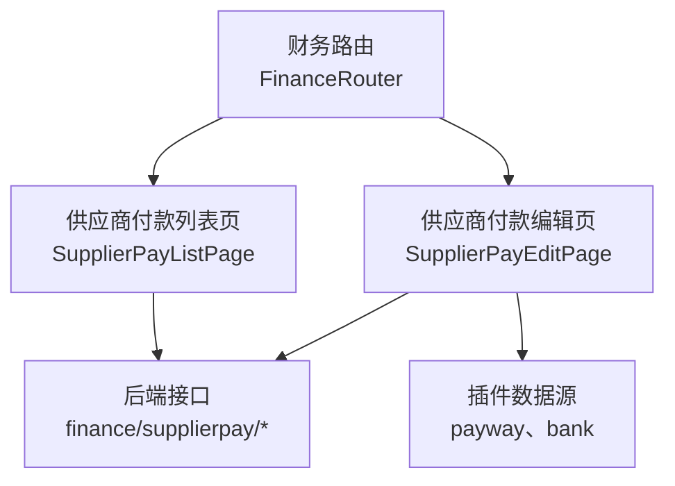
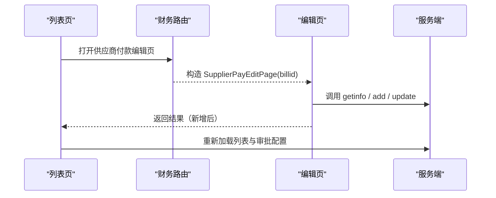
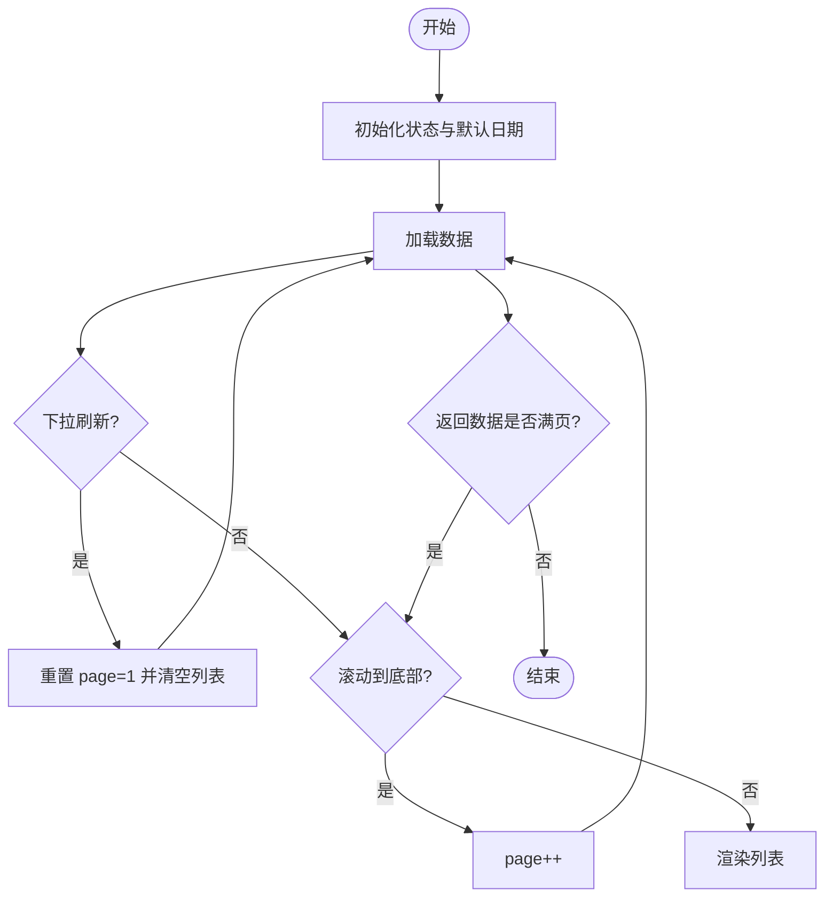
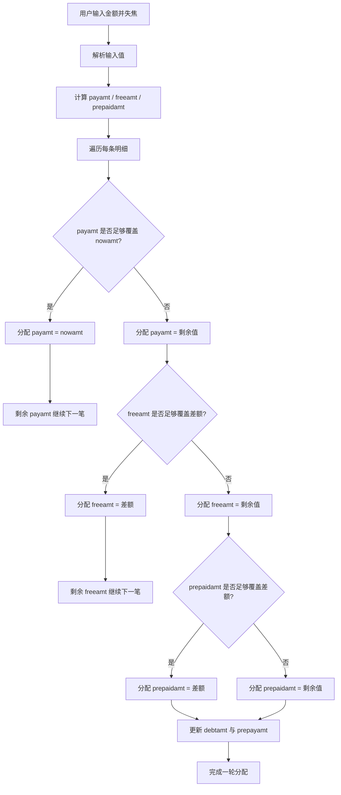
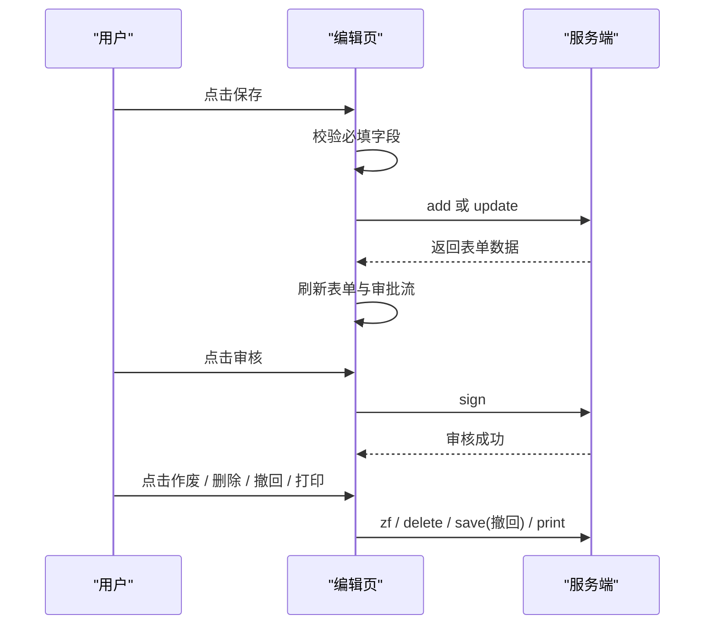
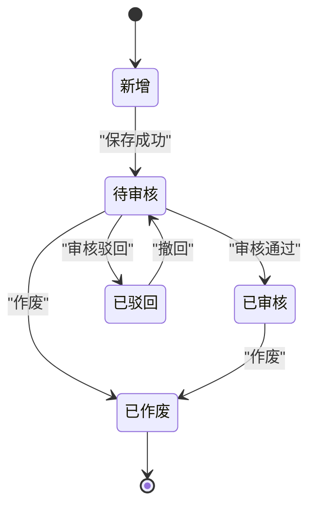
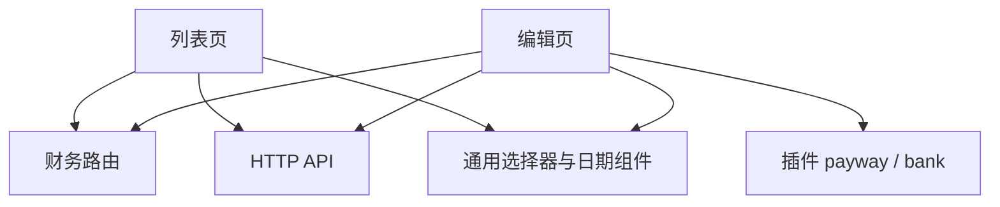

# 供应商付款管理

<cite>
**本文引用的文件**   
- [router.dart](file://lib/pages/business/finance/router.dart)
- [list.dart](file://lib/pages/business/finance/supplier_pay/list.dart)
- [edit.dart](file://lib/pages/business/finance/supplier_pay/edit.dart)
- [http_api.dart](file://lib/net/http_api.dart)
</cite>

## 目录
1. [简介](#简介)
2. [项目结构定位](#项目结构定位)
3. [核心组件总览](#核心组件总览)
4. [系统架构与路由](#系统架构与路由)
5. [列表页：筛选、Tab 与分页](#列表页筛选tab-与分页)
6. [编辑页：创建、编辑、核销与金额核算](#编辑页创建编辑核销与金额核算)
7. [审批流程与状态机](#审批流程与状态机)
8. [与采购入库及应付账款的数据关联](#与采购入库及应付账款的数据关联)
9. [供应商对账与资金流出监控](#供应商对账与资金流出监控)
10. [异常处理与权限控制](#异常处理与权限控制)
11. [依赖关系分析](#依赖关系分析)
12. [性能与可维护性建议](#性能与可维护性建议)
13. [常见问题排查](#常见问题排查)
14. [结语](#结语)

## 简介
本文件面向灵犀管店 Flutter 应用中的“供应商付款管理”功能，围绕供应商付款单的创建、编辑、审核、作废、删除、撤回、查询与打印等完整业务闭环展开。重点说明以下能力：
- 列表页的机构筛选、单号搜索、多维度筛选条件（供应商、制单人、经手人、付款方式、银行账户、供应商对账状态）、日期范围与 Tab 状态切换。
- 数据分页加载机制、下拉刷新与滚动加载更多。
- 编辑页的供应商与机构选择、单据选择、付款方式与银行账户配置、本次免付与预付结算。
- 应付账款核销逻辑：按明细计算本次应付、已付、免付、预付款分配以及剩余欠款。
- 多级审批、普通审核、撤回、作废、删除、打印等操作。
- 与采购入库、应付账款模块的数据衔接，以及对账状态和资金流出的管理方法。

## 项目结构定位
供应商付款管理位于业务财务模块中，主要包含两个页面：
- 列表页：`lib/pages/business/finance/supplier_pay/list.dart`
- 编辑页：`lib/pages/business/finance/supplier_pay/edit.dart`
路由入口由财务路由统一注册：`lib/pages/business/finance/router.dart`

**图表来源**  
- [router.dart:1-48](file://lib/pages/business/finance/router.dart#L1-L48)
- [list.dart:1-200](file://lib/pages/business/finance/supplier_pay/list.dart#L1-L200)
- [edit.dart:1-200](file://lib/pages/business/finance/supplier_pay/edit.dart#L1-L200)
- [http_api.dart:495-502](file://lib/net/http_api.dart#L495-L502)

**章节来源**  
- [router.dart:1-48](file://lib/pages/business/finance/router.dart#L1-L48)

## 核心组件总览
| 组件 | 职责 | 关键行为 |
|---|---|---|
| 供应商付款列表页 | 展示付款单列表，支持筛选、Tab 状态、分页、查看明细 | 按状态拉取数据；支持下拉刷新、滚动加载；点击卡片进入编辑页 |
| 供应商付款编辑页 | 新增或编辑付款单，完成供应商选择、单据选择、金额核算与提交 | 校验必填项；计算本次应付、免付、预付款分配；保存、审核、作废、删除、撤回、打印 |
| 财务路由 | 声明并注册供应商付款相关路由 | 提供列表与编辑路由，传递 billid |
| 网络接口常量 | 定义供应商付款相关后端接口路径 | getList、getInfo、add、update、sign、delete、zf、getSupplierBill |

**章节来源**  
- [list.dart:1-200](file://lib/pages/business/finance/supplier_pay/list.dart#L1-L200)
- [edit.dart:1-200](file://lib/pages/business/finance/supplier_pay/edit.dart#L1-L200)
- [http_api.dart:495-502](file://lib/net/http_api.dart#L495-L502)

## 系统架构与路由
供应商付款功能通过 Fluro 路由进行导航，列表页跳转到编辑页时携带 `billid`；编辑页在新增成功后返回，列表页会重新评审审批配置以动态显示“已驳回”标签。

**图表来源**  
- [router.dart:10-30](file://lib/pages/business/finance/router.dart#L10-L30)
- [list.dart:860-920](file://lib/pages/business/finance/supplier_pay/list.dart#L860-L920)
- [edit.dart:1103-1180](file://lib/pages/business/finance/supplier_pay/edit.dart#L1103-L1180)

**章节来源**  
- [router.dart:10-30](file://lib/pages/business/finance/router.dart#L10-L30)

## 列表页：筛选、Tab 与分页
### 筛选条件
列表页支持如下筛选维度：
- 时间范围：昨天、今日、本周、本月、自定义；支持左右翻页快捷切换。
- 机构：可选择全部或部分门店，登录门店为供应商标志时自动传入供应商筛选参数。
- 单号：模糊搜索付款单号。
- 供应商名称与编码。
- 制单人名称与编码。
- 经手人名称与编码。
- 付款方式。
- 付款账户（银行账户）。
- 供应商对账状态：待确定、同意、不同意。

这些筛选条件最终组合成请求参数，包括 `starttime`、`endtime`、`billno`、`sids`、`supid`、`createid`、`handlerid`、`payway`、`bankid`、`supsignflag` 等字段。

### Tab 状态管理
列表页默认有“全部”“待审核”“已审核”三个 Tab；是否显示“已驳回”Tab 由审批配置决定。状态索引映射到服务端 `signflag`：
- 待审核：signflag=0
- 已审核：signflag=1
- 已驳回：signflag=2
- 其他（全部）：空值

Tab 切换时会重置分页、清空历史列表并重新加载数据。

### 数据分页加载
列表使用下拉刷新与滚动到底部加载更多两种方式：
- 下拉刷新：重置 page=1，重新加载数据。
- 滚动加载：当滚动条接近底部且未加载中且有更多数据时，page++ 继续拉取。
- 每页固定 pagesize=20，后端返回不足 20 条时视为最后一页。
- 首次加载或 Tab 切换时清空 `_list`；后续加载更多时追加。

**图表来源**  
- [list.dart:201-260](file://lib/pages/business/finance/supplier_pay/list.dart#L201-L260)
- [list.dart:300-420](file://lib/pages/business/finance/supplier_pay/list.dart#L300-L420)

**章节来源**  
- [list.dart:1-200](file://lib/pages/business/finance/supplier_pay/list.dart#L1-L200)
- [list.dart:201-560](file://lib/pages/business/finance/supplier_pay/list.dart#L201-L560)
- [list.dart:561-900](file://lib/pages/business/finance/supplier_pay/list.dart#L561-L900)

## 编辑页：创建、编辑、核销与金额核算
### 基本信息选择
编辑页支持选择：
- 供应商：用于拉取该供应商在指定机构下的账单。
- 机构：影响账单范围与供应商账单接口参数。
- 单据：从供应商账单列表中勾选本次要核销的应付单据。
- 日期范围：作为筛选供应商账单的时间条件。
- 经手人：可选，用于记录经办人员。
- 备注：文本备注。

### 付款方式与银行账户配置
- 付款方式：从插件 `payway` 获取，支持搜索过滤。
- 付款账户：从插件 `bank` 获取，支持搜索过滤。
两者均为下拉选择器，选中后将 name 与 id 同时写入表单。

### 应付账款核销与金额核算
编辑页的核心计算逻辑围绕以下字段展开：
- 单据金额：billamt
- 已付金额：paidamt
- 本次免付合计：freetotalamt
- 预付款合计：prepaidtotalamt
- 本次应付：prepayamt = billamt - paidamt - freetotalamt - prepaidtotalamt
- 本次实付：payamt
- 本次免付：freeamt
- 预付结算：prepaidamt
- 剩余欠款：debtamt = nowamt - (payamt + freeamt + prepaidamt)

其中 nowamt 表示当前单据还需支付的余额。

#### 结算分配算法
当用户输入“付款金额”“本次免付”或“预付结算”任一字段并失焦时，触发结算分配：
1. 根据输入类型解析目标金额。
2. 计算新的 payamt、freeamt、prepaidamt。
3. 将总额分配到每条明细：
   - 先按本次应付优先级分配 payamt；
   - 若还有剩余，再分配 freeamt；
   - 若仍有余量，最后分配 prepaidamt；
4. 每条明细更新 debtamt 与 prepayamt，确保“本次应付 = 实付 + 免付 + 预付款”。

**图表来源**  
- [edit.dart:700-780](file://lib/pages/business/finance/supplier_pay/edit.dart#L700-L780)
- [edit.dart:637-700](file://lib/pages/business/finance/supplier_pay/edit.dart#L637-L700)

**章节来源**  
- [edit.dart:201-350](file://lib/pages/business/finance/supplier_pay/edit.dart#L201-L350)
- [edit.dart:350-500](file://lib/pages/business/finance/supplier_pay/edit.dart#L350-L500)
- [edit.dart:500-700](file://lib/pages/business/finance/supplier_pay/edit.dart#L500-L700)
- [edit.dart:700-780](file://lib/pages/business/finance/supplier_pay/edit.dart#L700-L780)

### 保存、审核、作废、删除与撤回
- 保存：校验供应商、机构、单据、付款方式、付款账户；组装 suppayflow 并提交 add 或 update。
- 审核：根据是否启用多级审批弹出审批弹窗或直接确认；审核后 signflag=0 并调用 sign 接口。
- 作废：确认后调用 zf 接口，标记 signflag=-1。
- 删除：确认后调用 delete 接口。
- 撤回：设置 reviewsignflag=2 后保存，使单据回到待处理状态，需要重新走审批流程。
- 打印：调用 cgorderPrint 接口发送打印任务。

**图表来源**  
- [edit.dart:1103-1200](file://lib/pages/business/finance/supplier_pay/edit.dart#L1103-L1200)
- [edit.dart:1200-1504](file://lib/pages/business/finance/supplier_pay/edit.dart#L1200-L1504)

**章节来源**  
- [edit.dart:1103-1504](file://lib/pages/business/finance/supplier_pay/edit.dart#L1103-L1504)

## 审批流程与状态机
编辑页支持两种审批模式：
- 无多级审批：简单确认对话框后直接审核。
- 多级审批：弹出审批弹窗，选择通过或驳回，填写备注；通过后 reviewsignflag=1，驳回保留 reviewsignflag=0。

状态机如下：

**图表来源**  
- [edit.dart:1505-1700](file://lib/pages/business/finance/supplier_pay/edit.dart#L1505-L1700)

**章节来源**  
- [edit.dart:1505-1700](file://lib/pages/business/finance/supplier_pay/edit.dart#L1505-L1700)

## 与采购入库及应付账款的数据关联
供应商付款单来源于供应商账单。编辑页通过“选择单据”弹窗展示该供应商在指定机构和时间范围内的账单列表，字段包括：
- 单据编号、单据类型、单据金额、已付金额、欠款金额、制单日期。
- 预付款余额 advance，用于优先抵扣部分单据的预付款。

前端在获取供应商账单后，会为每条账单计算 nowamt 与 prepayamt，并将 advance 优先分配到首笔可用单据，从而体现预付款核销逻辑。保存时将 suppayflow 明细一并提交，形成应付账款核销凭证。

[此图为概念图，不直接映射具体代码文件]

**章节来源**  
- [edit.dart:500-700](file://lib/pages/business/finance/supplier_pay/edit.dart#L500-L700)

## 供应商对账与资金流出监控
### 供应商对账
列表页筛选条件中包含“供应商对账状态”，对应字段 supsignflag：
- 待确定：0
- 同意：1
- 不同意：2

这有助于快速筛选处于不同对账状态的付款单，辅助财务对账。

### 资金流出监控
供应商付款单代表企业对外资金流出。可通过以下方式监控：
- 列表页按时间范围筛选，统计已审核的付款单金额。
- 编辑页汇总字段显示“单据数量”“单据总金额”，结合付款金额、免付、预付款结算观察实际现金流出。
- 结合财务报表模块中的现金流与资金统计功能进行综合分析。

**章节来源**  
- [list.dart:300-560](file://lib/pages/business/finance/supplier_pay/list.dart#L300-L560)
- [edit.dart:350-500](file://lib/pages/business/finance/supplier_pay/edit.dart#L350-L500)

## 异常处理与权限控制
### 权限控制
列表页与编辑页均通过权限码控制操作：
- 查看列表：014401
- 编辑付款单：014402
- 新增付款单：014403
- 删除付款单：014404
- 审核付款单：014405
- 作废付款单：014406
- 查看单据明细：014408

权限不足时提示用户前往后台修改权限。

### 异常处理
- 网络请求失败时，catchError 会将 hasMore 置为 false，避免无限重试。
- 加载详情失败时提示“加载失败”。
- 保存、审核、作废、删除等关键操作均有 try/catch，失败时 Toast 提示。
- 返回编辑页时检测未保存修改，弹出确认对话框，避免误退出。

**章节来源**  
- [list.dart:1-200](file://lib/pages/business/finance/supplier_pay/list.dart#L1-L200)
- [list.dart:201-260](file://lib/pages/business/finance/supplier_pay/list.dart#L201-L260)
- [edit.dart:1103-1200](file://lib/pages/business/finance/supplier_pay/edit.dart#L1103-L1200)
- [edit.dart:1200-1504](file://lib/pages/business/finance/supplier_pay/edit.dart#L1200-L1504)

## 依赖关系分析
供应商付款模块依赖以下外部资源：
- 路由：FinanceRouter 提供 supplierPayList 与 supplierPayEdit。
- 网络：HttpApi 定义 finance/supplierpay/* 与 airprint/setWxPrintRw。
- 插件：pluginsGet 获取 payway 与 bank 枚举。
- 通用组件：SelectSupplierPage、SelectStorePage、CommonSelectSheet、日期选择器等。

**图表来源**  
- [router.dart:10-30](file://lib/pages/business/finance/router.dart#L10-L30)
- [http_api.dart:85-85](file://lib/net/http_api.dart#L85-L85)
- [http_api.dart:495-502](file://lib/net/http_api.dart#L495-L502)

**章节来源**  
- [http_api.dart:85-85](file://lib/net/http_api.dart#L85-L85)
- [http_api.dart:495-502](file://lib/net/http_api.dart#L495-L502)

## 性能与可维护性建议
- 列表缓存：ListView.builder 已使用 cacheExtent，建议在大数据量场景下考虑虚拟列表优化。
- 防抖搜索：已有 500ms 防抖，避免频繁请求。
- 分页策略：固定 pagesize=20，适合移动端；如需更高性能可引入增量更新与去重。
- 插件缓存：payway 与 bank 数据在 CommonSelectSheet 内本地缓存，减少重复请求。
- 状态一致性：TabController 长度与 _showRejectedTab 派生一致，避免崩溃风险。
- 金额精度：统一使用三位小数格式化，避免浮点误差。

[本节为通用建议，不直接分析具体文件]

## 常见问题排查
| 问题 | 可能原因 | 处理方法 |
|---|---|---|
| 列表无法加载更多 | 后端返回数据少于 20 条或接口异常 | 检查 hasMore 与 catchError 分支；确认后端分页逻辑 |
| 编辑页白屏 | 加载详情失败或 formData 为空 | 检查 getinfo 接口返回；确认 billid 是否正确 |
| 金额分配异常 | 输入值为空或负数 | 校验输入框格式；确认结算函数解析逻辑 |
| 审批按钮不显示 | 用户不属于审批节点或已撤回 | 检查 reviewFlowUsers 与 reviewsignflag |
| 权限提示频繁出现 | 角色权限未配置 | 在后台为用户分配对应权限码 |

**章节来源**  
- [list.dart:201-260](file://lib/pages/business/finance/supplier_pay/list.dart#L201-L260)
- [edit.dart:1103-1200](file://lib/pages/business/finance/supplier_pay/edit.dart#L1103-L1200)

## 结语
供应商付款管理功能在 Flutter 端通过清晰的列表与编辑页面实现完整的付款单生命周期管理。其核心在于：
- 灵活的筛选与分页机制；
- 严谨的金额核算与核销分配；
- 灵活的审批流程与状态机；
- 与采购入库、应付账款的业务联动；
- 完善的权限与异常处理。

在实际使用中，建议重点关注供应商账单准确性、预付款余额分配、审批节点权限与资金流出统计，以确保财务数据的正确性与可追溯性。