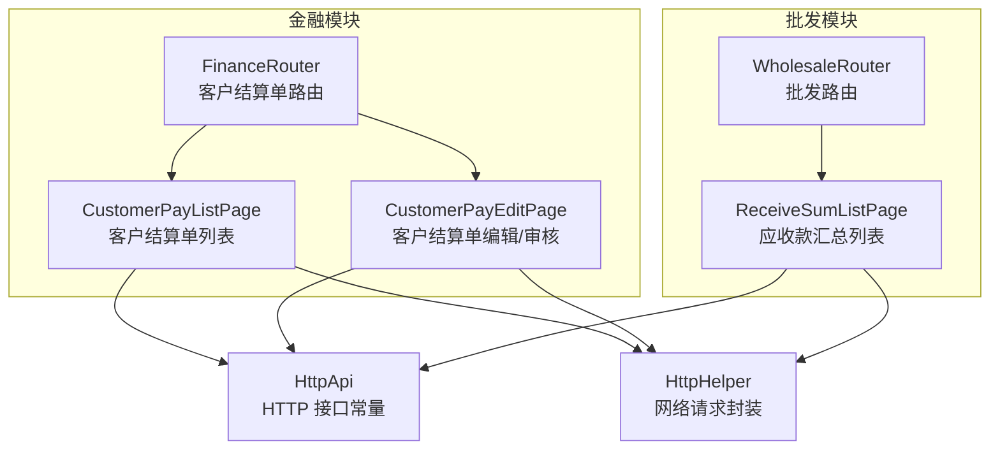
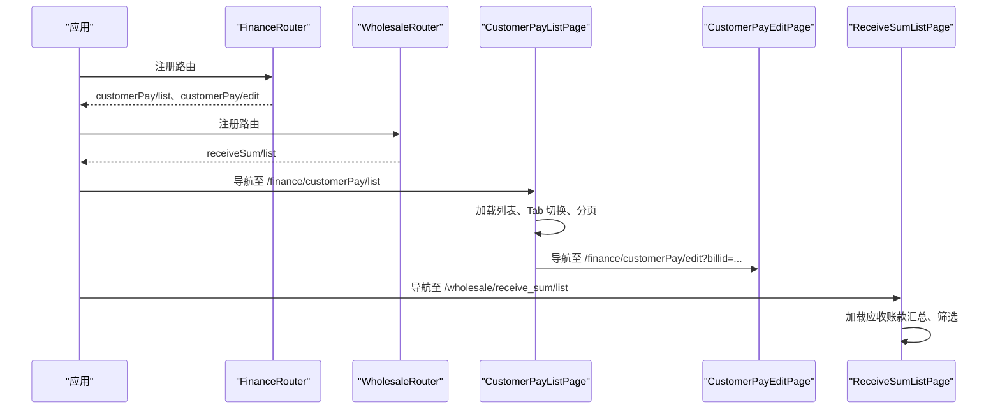
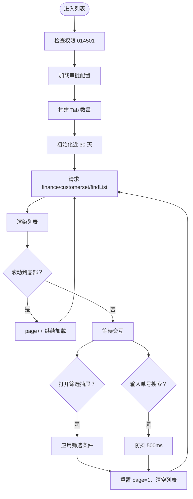
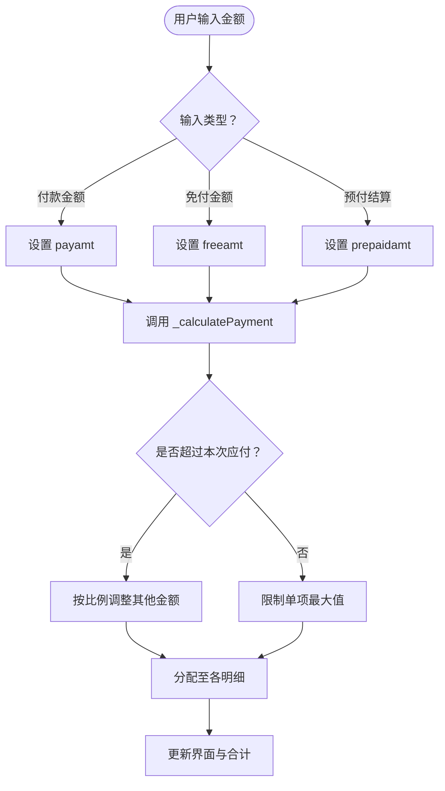
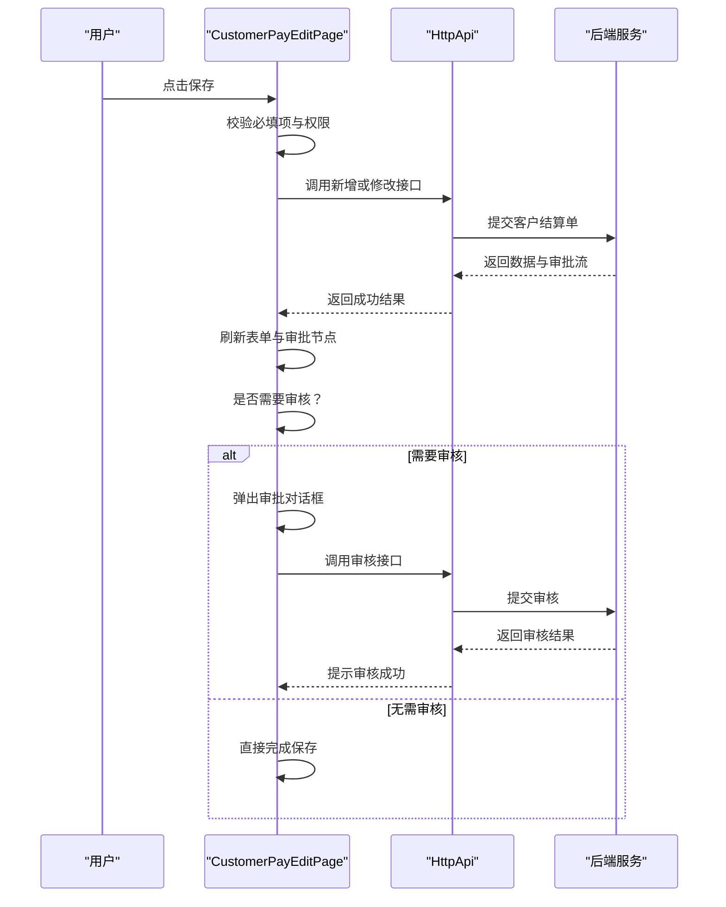
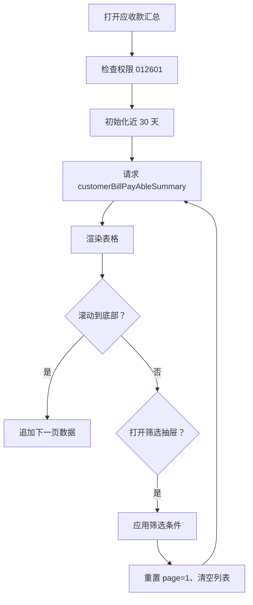
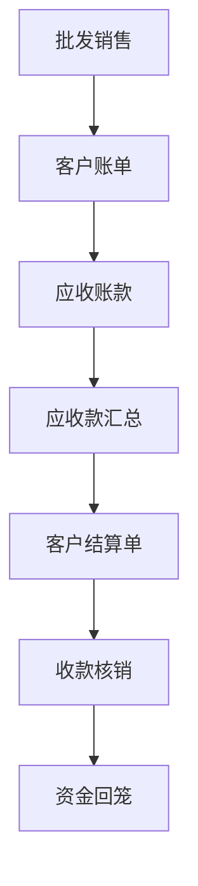
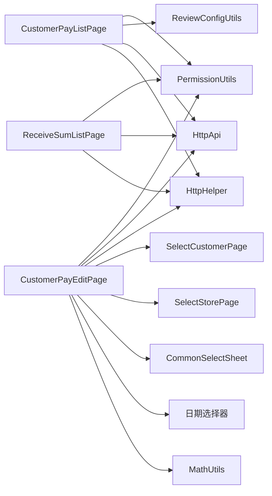

# 客户收款管理

<cite>
**本文引用的文件**   
- [finance/router.dart](file://lib/pages/business/finance/router.dart)
- [wholesale/router.dart](file://lib/pages/business/wholesale/router.dart)
- [customer_pay/list.dart](file://lib/pages/business/finance/customer_pay/list.dart)
- [customer_pay/edit.dart](file://lib/pages/business/finance/customer_pay/edit.dart)
- [receive_sum/list.dart](file://lib/pages/business/wholesale/receive_sum/list.dart)
- [http_api.dart](file://lib/net/http_api.dart)
</cite>

## 目录
1. [引言](#引言)
2. [项目结构与定位](#项目结构与定位)
3. [核心功能总览](#核心功能总览)
4. [架构与路由关系](#架构与路由关系)
5. [客户结算单列表页](#客户结算单列表页)
6. [客户结算单编辑与审核页](#客户结算单编辑与审核页)
7. [批发应收款汇总与对账](#批发应收款汇总与对账)
8. [数据模型与金额核算逻辑](#数据模型与金额核算逻辑)
9. [业务关联：批发销售与应收账款](#业务关联批发销售与应收账款)
10. [审批流、凭证与异常处理](#审批流凭证与异常处理)
11. [依赖关系分析](#依赖关系分析)
12. [性能与可维护性建议](#性能与可维护性建议)
13. [故障排查指南](#故障排查指南)
14. [结语](#结语)

## 引言
本文面向灵犀管店 Flutter 客户端中的“客户收款管理”能力，聚焦以下目标：
- 客户结算单的创建、编辑、查询、审核、作废、删除和撤回。
- 客户选择、机构选择、收款方式与银行账户配置。
- 列表页筛选条件（客户名称、经办人、收款方式、银行账户、制单人、时间范围、门店等）。
- Tab 状态管理与分页加载机制。
- 与批发销售、应收账款模块的关联关系。
- 客户对账与资金回笼跟踪方法。
- 收款凭证管理、财务审批流程及异常处理实现细节。

该功能由金融模块的“客户结算单”页面与批发模块的“应收款汇总”页面共同构成：前者完成收款单据操作，后者提供应收账款可视化和对账入口。

## 项目结构与定位
客户收款相关代码主要分布在以下路径：
- 金融模块路由与页面：`lib/pages/business/finance/customer_pay/*`
- 批发模块应收汇总页面：`lib/pages/business/wholesale/receive_sum/*`
- 全局 HTTP 接口常量：`lib/net/http_api.dart`
- 通用网络请求封装：`lib/net/http_helper.dart`
- 权限校验工具：`lib/util/permission_utils.dart`
- 审批配置工具：`lib/util/review_config_utils.dart`

**图示来源**
- [finance/router.dart:1-48](file://lib/pages/business/finance/router.dart#L1-L48)
- [wholesale/router.dart:1-54](file://lib/pages/business/wholesale/router.dart#L1-L54)
- [customer_pay/list.dart:1-60](file://lib/pages/business/finance/customer_pay/list.dart#L1-L60)
- [customer_pay/edit.dart:1-60](file://lib/pages/business/finance/customer_pay/edit.dart#L1-L60)
- [receive_sum/list.dart:1-40](file://lib/pages/business/wholesale/receive_sum/list.dart#L1-L40)
- [http_api.dart:480-513](file://lib/net/http_api.dart#L480-L513)

**章节来源**
- [finance/router.dart:1-48](file://lib/pages/business/finance/router.dart#L1-L48)
- [wholesale/router.dart:1-54](file://lib/pages/business/wholesale/router.dart#L1-L54)

## 核心功能总览
| 功能域 | 主要页面 | 关键能力 |
|---|---|---|
| 客户结算单列表 | `CustomerPayListPage` | 按状态 Tab 查看、多条件筛选、分页滚动加载、进入编辑或详情 |
| 客户结算单编辑 | `CustomerPayEditPage` | 新增/编辑、选择客户与机构、选择应收单据、计算付款金额、保存、审核、作废、删除、撤回、打印 |
| 应收款汇总 | `ReceiveSumListPage` | 按时间、门店、客户分类、客户、业务员、客户状态筛选，查看应收账款明细与汇总 |
| 路由注册 | `FinanceRouter`、`WholesaleRouter` | 将上述页面注册到应用路由表，支持带参数跳转 |
| 接口契约 | `HttpApi` | 定义客户结算单列表、详情、新增、修改、审核、删除、作废、应收汇总等接口常量 |

**章节来源**
- [customer_pay/list.dart:1-60](file://lib/pages/business/finance/customer_pay/list.dart#L1-L60)
- [customer_pay/edit.dart:1-60](file://lib/pages/business/finance/customer_pay/edit.dart#L1-L60)
- [receive_sum/list.dart:1-40](file://lib/pages/business/wholesale/receive_sum/list.dart#L1-L40)
- [http_api.dart:480-513](file://lib/net/http_api.dart#L480-L513)

## 架构与路由关系
金融模块通过 `FinanceRouter` 暴露两条核心路由：
- `/finance/customerPay/list`：打开客户结算单列表页。
- `/finance/customerPay/edit`：打开客户结算单编辑页，携带 `billid` 表示编辑已有单据。

批发模块通过 `WholesaleRouter` 暴露：
- `/wholesale/receive_sum/list`：打开应收款汇总列表页。

**图示来源**
- [finance/router.dart:1-48](file://lib/pages/business/finance/router.dart#L1-L48)
- [wholesale/router.dart:1-54](file://lib/pages/business/wholesale/router.dart#L1-L54)

**章节来源**
- [finance/router.dart:1-48](file://lib/pages/business/finance/router.dart#L1-L48)
- [wholesale/router.dart:1-54](file://lib/pages/business/wholesale/router.dart#L1-L54)

## 客户结算单列表页
`CustomerPayListPage` 是客户收款管理的入口列表，负责：
- 展示客户结算单列表。
- 提供状态 Tab：全部、待审核、已审核、可选的已驳回。
- 提供筛选抽屉：时间范围、门店、客户、制单人、经手人、付款方式、付款账户。
- 支持搜索框模糊检索单号。
- 支持下拉刷新与滚动分页加载。
- 控制权限并加载动态审批配置。

### 筛选条件
列表筛选包含以下维度：
| 字段 | 含义 | 默认行为 |
|---|---|---|
| 时间范围 | 近 30 天为初始值 | 支持昨天、今日、本周、本月、自定义 |
| 门店 | 多选或清空 | 登录门店 `custflag==1` 时传 `custflag: 1` 且不传 `storetypes` |
| 客户 | 客户编码与名称 | 可为空表示全部 |
| 制单人 | 制单人编码与名称 | 可为空 |
| 经手人 | 经手人编码与名称 | 可为空 |
| 付款方式 | 收款方式编码与名称 | 可为空 |
| 付款账户 | 银行账号编码与名称 | 可为空 |
| 单号搜索 | 模糊匹配单号 | 防抖 500ms |

### Tab 状态管理
- 初始构建 3 个 Tab：全部、待审核、已审核。
- 动态加载审批配置后，若允许显示“已驳回”，则扩展到 4 个 Tab。
- 使用 `_statusIndex` 记录当前选中索引；切换 Tab 时重置分页并重新加载。
- 使用 `ReviewNavState.consumePendingStatusIndex()` 从导航状态恢复待办 Tab。

### 分页加载机制
- 每页固定 20 条。
- 监听滚动位置，接近底部时自动下一页。
- `_loading` 防止重复请求。
- `_hasMore` 根据返回数据长度判断是否还有更多。
- 下拉刷新会先刷新审批配置，再重新加载数据。

**图示来源**
- [customer_pay/list.dart:1-60](file://lib/pages/business/finance/customer_pay/list.dart#L1-L60)
- [customer_pay/list.dart:201-260](file://lib/pages/business/finance/customer_pay/list.dart#L201-L260)
- [customer_pay/list.dart:260-450](file://lib/pages/business/finance/customer_pay/list.dart#L260-L450)

**章节来源**
- [customer_pay/list.dart:1-60](file://lib/pages/business/finance/customer_pay/list.dart#L1-L60)
- [customer_pay/list.dart:201-450](file://lib/pages/business/finance/customer_pay/list.dart#L201-L450)

## 客户结算单编辑与审核页
`CustomerPayEditPage` 承担客户结算单的新增、编辑、查看、审核、作废、删除、撤回和打印职责。

### 表单字段
| 字段 | 说明 |
|---|---|
| 客户 | 必须选择，用于关联应收账款 |
| 机构 | 必须选择，决定所属门店或组织 |
| 选择单据 | 选择需要核销的客户账单明细 |
| 日期范围 | 与“选择单据”联动，过滤客户账单 |
| 经手人 | 可选 |
| 备注 | 可选 |
| 本次应付款 | 根据明细汇总自动计算 |
| 付款金额 | 现金/转账等实际收款 |
| 本次免付 | 免收部分金额 |
| 收款账户 | 银行账户信息 |
| 收款方式 | 支付方式配置 |
| 收款日期 | 收款时间 |
| 预付余额 | 客户预付款可用余额 |
| 预付结算 | 使用预付款冲抵 |

### 客户与机构选择
- 客户选择调用 `SelectCustomerPage.show`。
- 机构选择调用 `SelectStorePage.show`，并根据登录门店 `custflag` 决定是否传入 `custflag: 1`。
- 当客户和机构都选定后，自动拉取该客户在指定时间范围内的账单。

### 收款方式与银行账户
- 收款方式通过插件接口 `pluginsGet` 获取 `payway` 列表。
- 银行账户通过插件接口 `pluginsGet` 获取 `bank` 列表。
- 两者均支持本地缓存与名称模糊搜索。

### 收款金额核算
核心核算逻辑位于 `_calculatePayment` 与 `_settleConfirm`：
- 以“本次应付金额”为上限，限制付款金额、免付金额、预付结算金额的总和。
- 支持正数收款与负数退款场景。
- 输入任一金额时，自动调整其他两项，保证不超支。
- 计算完成后将总额分配到每条账单明细的 `payamt`、`freeamt`、`prepaidamt`。
- 同时更新 `debtamt` 与 `prepayamt`，体现剩余欠款与本次应付。

**图示来源**
- [customer_pay/edit.dart:601-750](file://lib/pages/business/finance/customer_pay/edit.dart#L601-L750)
- [customer_pay/edit.dart:750-950](file://lib/pages/business/finance/customer_pay/edit.dart#L750-L950)

### 保存、审核、作废、删除、撤回
| 操作 | 权限码 | 行为 |
|---|---|---|
| 新增 | `014502` | 调用新增接口，成功后刷新详情与审批流 |
| 编辑 | `014503` | 调用修改接口，行为同新增 |
| 审核 | `014505` | 无审批流时弹窗确认；有审批流时弹出审批对话框 |
| 作废 | `014506` | 确认后调用作废接口，状态改为已作废 |
| 删除 | `014504` | 确认后删除单据并返回列表 |
| 撤回 | 无独立权限码 | 将 `reviewsignflag` 设为撤回待处理态，再次保存触发撤回流程 |

**图示来源**
- [customer_pay/edit.dart:950-1150](file://lib/pages/business/finance/customer_pay/edit.dart#L950-L1150)
- [customer_pay/edit.dart:1150-1350](file://lib/pages/business/finance/customer_pay/edit.dart#L1150-L1350)
- [http_api.dart:506-513](file://lib/net/http_api.dart#L506-L513)

**章节来源**
- [customer_pay/edit.dart:1-200](file://lib/pages/business/finance/customer_pay/edit.dart#L1-L200)
- [customer_pay/edit.dart:201-600](file://lib/pages/business/finance/customer_pay/edit.dart#L201-L600)
- [customer_pay/edit.dart:601-950](file://lib/pages/business/finance/customer_pay/edit.dart#L601-L950)
- [customer_pay/edit.dart:950-1350](file://lib/pages/business/finance/customer_pay/edit.dart#L950-L1350)
- [http_api.dart:506-513](file://lib/net/http_api.dart#L506-L513)

## 批发应收款汇总与对账
`ReceiveSumListPage` 是批发业务中的应收账款汇总页面，主要用于：
- 查看客户未结清应收款的汇总情况。
- 按时间、门店、客户分类、客户、业务员、客户状态筛选。
- 作为客户对账与资金回笼跟踪的数据入口。

### 筛选条件
| 字段 | 含义 |
|---|---|
| 时间范围 | 默认近 30 天，支持快速标签与自定义区间 |
| 门店 | 可选择单一门店 |
| 客户分类 | 按客户分类筛选 |
| 客户 | 按具体客户筛选 |
| 业务员 | 按销售负责人筛选 |
| 客户状态 | 全部、启用、停用 |

### 分页加载
- 每页 20 条。
- 首次加载覆盖列表，后续追加。
- 错误时停止加载更多。
- 下拉刷新重置为第 1 页。

**图示来源**
- [receive_sum/list.dart:1-40](file://lib/pages/business/wholesale/receive_sum/list.dart#L1-L40)
- [receive_sum/list.dart:40-120](file://lib/pages/business/wholesale/receive_sum/list.dart#L40-L120)
- [receive_sum/list.dart:201-502](file://lib/pages/business/wholesale/receive_sum/list.dart#L201-L502)

**章节来源**
- [receive_sum/list.dart:1-120](file://lib/pages/business/wholesale/receive_sum/list.dart#L1-L120)
- [receive_sum/list.dart:201-502](file://lib/pages/business/wholesale/receive_sum/list.dart#L201-L502)

## 数据模型与金额核算逻辑
客户结算单的核心数据结构包括主表信息与明细流水：
- 主表字段：客户、机构、经手人、收款方式、收款账户、收款日期、备注、付款金额、免付金额、预付结算金额、单据数量、单据总金额等。
- 明细流水 `custpayflow`：每条对应一笔客户账单，包含账单金额、已付金额、免付总额、预付款总额、本次应付、本次支付分配、免付分配、预付分配、剩余欠款等。

### 关键字段关系
| 字段 | 计算含义 |
|---|---|
| `nowamt` | 账单金额 − 已付金额 − 免付总额 − 预付款总额 |
| `prepayamt` | 本次应付金额，即 `nowamt` |
| `payamt` | 实际收款金额 |
| `freeamt` | 免收金额 |
| `prepaidamt` | 使用预付款冲抵的金额 |
| `debtamt` | 本次应付 − 本次支付分配后的剩余欠款 |

### 核算约束
- 收款三要素之和不得超过本次应付金额。
- 正数场景限制总额不超过 `nowamt`。
- 负数退款场景限制总额不低于 `nowamt`。
- 若某一项输入超限，系统会自动下调其他项。
- 最终将分配结果写回每条明细，保证前端展示与后端提交一致。

**章节来源**
- [customer_pay/edit.dart:601-750](file://lib/pages/business/finance/customer_pay/edit.dart#L601-L750)
- [customer_pay/edit.dart:750-950](file://lib/pages/business/finance/customer_pay/edit.dart#L750-L950)

## 业务关联：批发销售与应收账款
客户收款管理与批发销售、应收账款的关系如下：
- 批发销售产生客户账单，形成应收账款。
- 应收款汇总页面展示这些尚未结清的应收款项。
- 客户结算单通过“选择单据”绑定具体账单明细，完成收款核销。
- 收款完成后，应收账款减少，资金回笼增加。

[本图为概念关系图，不对应具体源码结构]

**章节来源**
- [wholesale/router.dart:1-54](file://lib/pages/business/wholesale/router.dart#L1-L54)
- [receive_sum/list.dart:1-120](file://lib/pages/business/wholesale/receive_sum/list.dart#L1-L120)
- [customer_pay/edit.dart:201-400](file://lib/pages/business/finance/customer_pay/edit.dart#L201-L400)

## 审批流、凭证与异常处理
### 审批流程
- 编辑页从服务端返回 `reviewFlowUsers` 与 `reviewBillFlows`。
- 若无审批流，审核仅需二次确认。
- 若有审批流，需弹出审批对话框，填写审核意见并设置 `reviewsignflag`。
- 审核通过后，单据状态变为已审核；被驳回归为已驳回。
- 撤回操作将 `reviewsignflag` 设为 2，再次保存触发撤回逻辑。

### 凭证管理
- 编辑页提供打印入口，调用 `cgorderPrint` 发送打印任务。
- 打印菜单标识为 `101701`，属于客户结算单打印通道。

### 异常处理
- 列表加载失败时停止加载更多，避免无限重试。
- 编辑页加载失败时提示“加载失败”。
- 选择客户账单为空时提示“该客户没有账单，请重新选择”。
- 接口异常时提示后端返回的 `retmsg`。
- 保存失败统一提示“保存失败”。
- 审核、作废、删除等操作均有成功与失败分支提示。

**章节来源**
- [customer_pay/edit.dart:950-1350](file://lib/pages/business/finance/customer_pay/edit.dart#L950-L1350)
- [http_api.dart:85](file://lib/net/http_api.dart#L85)
- [http_api.dart:510-513](file://lib/net/http_api.dart#L510-L513)

## 依赖关系分析
客户收款功能依赖以下模块：
- 路由模块：`FinanceRouter`、`WholesaleRouter`。
- 网络层：`HttpApi` 定义接口常量，`HttpHelper.request` 发起请求。
- 权限模块：`PermissionUtils` 控制新增、编辑、审核、作废、删除等操作。
- 审批配置：`ReviewConfigUtils.shouldShowRejectedTab` 动态控制“已驳回” Tab。
- 选择器组件：`SelectCustomerPage`、`SelectStorePage`、`CommonSelectSheet`。
- 日期组件：`showCommonDatePicker`、`showCommonMonthPicker`、`showDateRangeCalendarPicker`。
- 工具类：`MathUtils` 用于金额格式化与计算。

**图示来源**
- [customer_pay/list.dart:1-60](file://lib/pages/business/finance/customer_pay/list.dart#L1-L60)
- [customer_pay/edit.dart:1-60](file://lib/pages/business/finance/customer_pay/edit.dart#L1-L60)
- [receive_sum/list.dart:1-40](file://lib/pages/business/wholesale/receive_sum/list.dart#L1-L40)
- [http_api.dart:480-513](file://lib/net/http_api.dart#L480-L513)

**章节来源**
- [customer_pay/list.dart:1-60](file://lib/pages/business/finance/customer_pay/list.dart#L1-L60)
- [customer_pay/edit.dart:1-60](file://lib/pages/business/finance/customer_pay/edit.dart#L1-L60)
- [receive_sum/list.dart:1-40](file://lib/pages/business/wholesale/receive_sum/list.dart#L1-L40)

## 性能与可维护性建议
- 列表分页采用固定 20 条，适合移动端滚动体验；如需提升大数据量表现，可考虑虚拟列表或增量渲染。
- 筛选抽屉使用局部 `StatefulBuilder`，避免整页重建。
- 搜索输入使用 500ms 防抖，降低频繁请求压力。
- 收款金额计算在前端完成，减少后端计算复杂度；但需注意浮点精度，当前使用 `MathUtils.formatDecimal(3)` 控制三位小数。
- 审批配置动态加载，避免硬编码 Tab 数量，提升扩展性。
- 插件化收款方式与银行账户通过 `pluginsGet` 获取，便于后续扩展新支付方式。

[本节为通用优化建议，不直接分析具体文件]

## 故障排查指南
| 现象 | 可能原因 | 排查建议 |
|---|---|---|
| 列表无法加载 | 权限不足或接口异常 | 检查权限码 `014501`，查看网络请求返回值 |
| 列表翻页失效 | 返回数据为空或长度小于 20 | 检查后端分页返回结构 |
| 编辑页白屏 | 新增模式 `_formData` 为空且加载未完成 | 确认 `_billLoading` 与 `_loading` 状态分支 |
| 收款金额异常 | 输入金额超过本次应付或退款方向错误 | 检查 `_calculatePayment` 的正负数分支 |
| 审核失败 | 审批流用户不匹配或审核参数缺失 | 检查 `reviewFlowUsers` 与 `reviewsignflag` |
| 撤回无效 | 未正确设置 `reviewsignflag=2` | 检查 `_handleRetsign` 与保存逻辑 |
| 打印无响应 | 打印接口调用失败或设备未连接 | 检查 `cgorderPrint` 返回消息 |

**章节来源**
- [customer_pay/list.dart:201-260](file://lib/pages/business/finance/customer_pay/list.dart#L201-L260)
- [customer_pay/edit.dart:601-750](file://lib/pages/business/finance/customer_pay/edit.dart#L601-L750)
- [customer_pay/edit.dart:950-1350](file://lib/pages/business/finance/customer_pay/edit.dart#L950-L1350)

## 结语
灵犀管店的客户收款管理以 `CustomerPayListPage` 和 `CustomerPayEditPage` 为核心，结合批发模块的 `ReceiveSumListPage`，形成从应收账款可视到收款核销闭环的业务链路。系统在筛选、分页、金额核算、审批流、异常处理等方面具备较完整的实现。未来可进一步关注大数据列表性能、审批流可视化、以及收款凭证归档与导出能力。