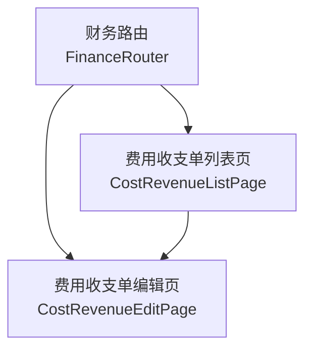
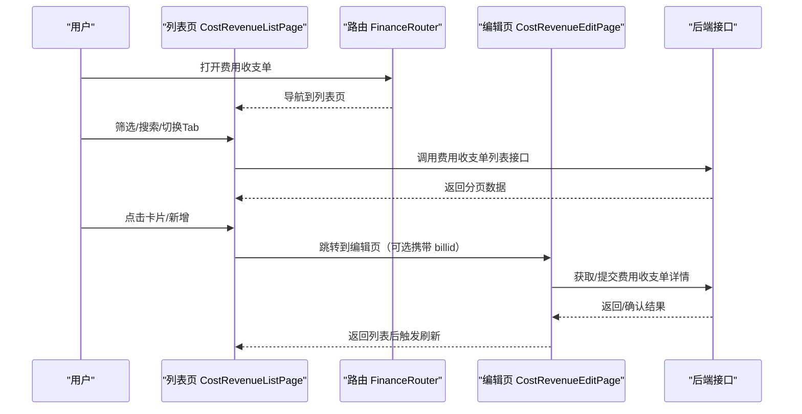
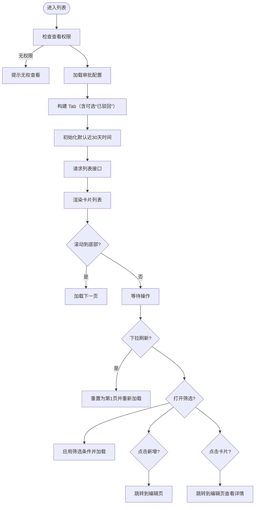
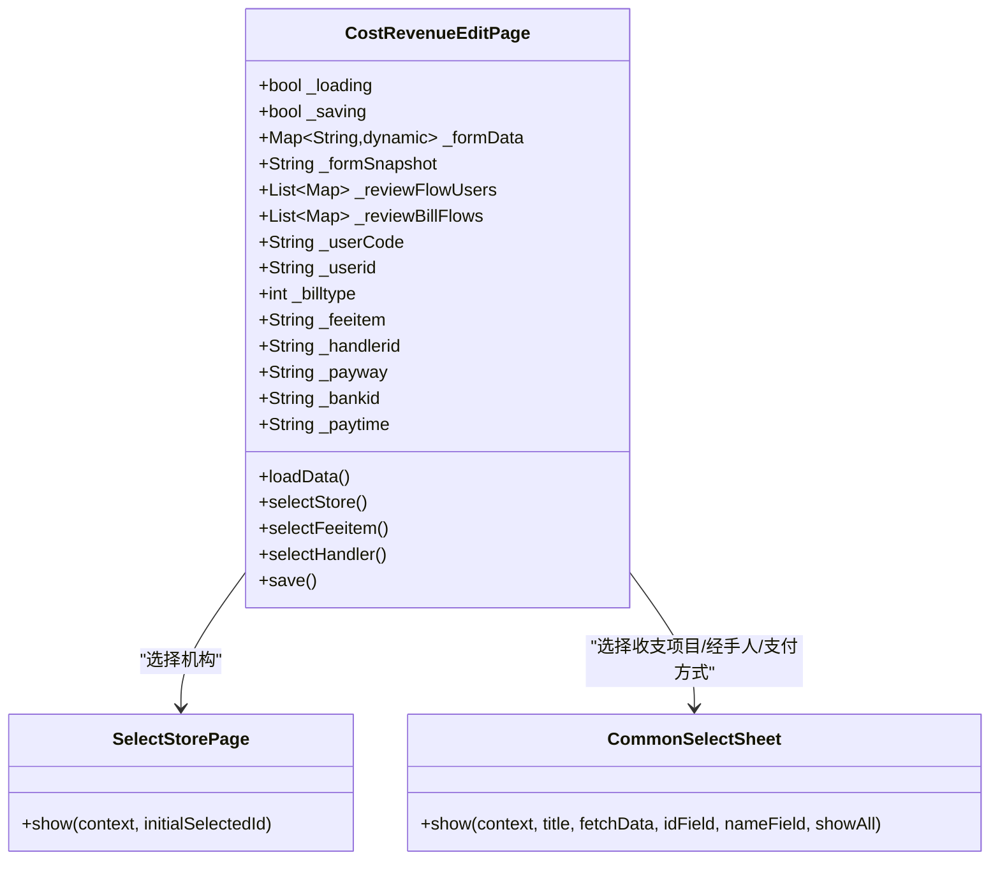
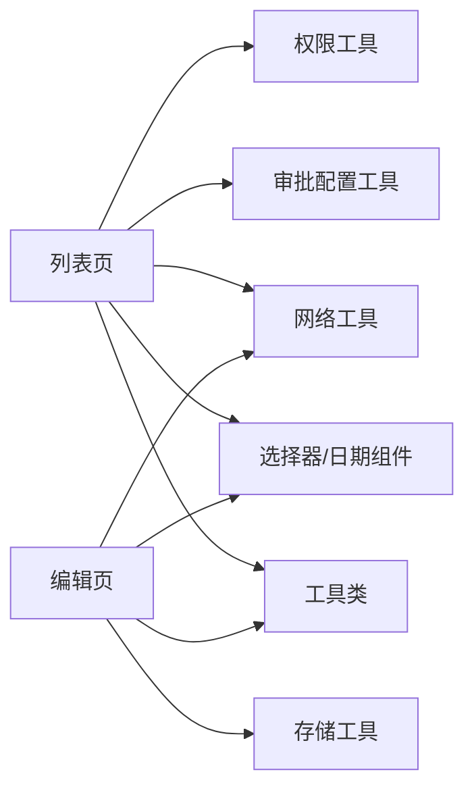

# 成本收入管理

<cite>
**本文引用的文件**   
- [lib/pages/business/finance/router.dart](file://lib/pages/business/finance/router.dart)
- [lib/pages/business/finance/cost_revenue/list.dart](file://lib/pages/business/finance/cost_revenue/list.dart)
- [lib/pages/business/finance/cost_revenue/edit.dart](file://lib/pages/business/finance/cost_revenue/edit.dart)
</cite>

## 目录
1. [引言](#引言)
2. [项目结构](#项目结构)
3. [核心组件](#核心组件)
4. [架构总览](#架构总览)
5. [详细组件分析](#详细组件分析)
6. [依赖关系分析](#依赖关系分析)
7. [性能与体验](#性能与体验)
8. [权限、校验与错误处理](#权限校验与错误处理)
9. [业务关联与财务分析](#业务关联与财务分析)
10. [故障排查](#故障排查)
11. [结论](#结论)

## 引言
本文件面向“灵犀管店”Flutter 端中的“费用收支单（成本收入管理）”功能，覆盖以下目标：
- 费用收支单的创建、编辑、审核与查询；
- 费用类型分类、收支金额计算、关联业务单据与审批流程；
- 列表页筛选条件、Tab 状态切换与分页加载机制；
- 与采购、销售等业务模块的成本收入数据关联说明；
- 权限控制、数据校验与错误处理的实现要点。

该功能在 Flutter 层以页面 + 网络请求的方式实现，前端通过路由跳转到列表与编辑页面，列表页负责筛选、分页和跳转，编辑页负责表单维护、审批流展示与提交。

## 项目结构
成本收入管理相关代码位于业务财务子模块下，关键入口如下：
- 财务路由注册：定义费用收支单列表与编辑路由；
- 列表页：实现筛选、分页、Tab 切换、卡片展示与跳转；
- 编辑页：实现新增/编辑、字段选择器、金额格式化、审批信息展示与保存。

图示来源
- [lib/pages/business/finance/router.dart:1-48](file://lib/pages/business/finance/router.dart#L1-L48)

章节来源
- [lib/pages/business/finance/router.dart:1-48](file://lib/pages/business/finance/router.dart#L1-L48)

## 核心组件
- 费用收支单列表页
  - 提供机构筛选、单号搜索、高级筛选抽屉、Tab 切换、下拉刷新与上拉加载更多；
  - 根据审批配置动态显示“已驳回”Tab；
  - 通过权限控制查看、新增与进入明细的入口。
- 费用收支单编辑页
  - 支持新增与编辑两种模式；
  - 提供收支项目、经手人、收支方式、银行等选择器；
  - 对金额进行失焦格式化；
  - 读取并展示多级审批信息与撤回待处理态；
  - 区分只读状态（已审核、已驳回、已作废）。

章节来源
- [lib/pages/business/finance/cost_revenue/list.dart:1-1187](file://lib/pages/business/finance/cost_revenue/list.dart#L1-L1187)
- [lib/pages/business/finance/cost_revenue/edit.dart:1-1565](file://lib/pages/business/finance/cost_revenue/edit.dart#L1-L1565)

## 架构总览
列表页与编辑页均通过 HTTP 接口获取或提交数据，使用统一的网络工具类发起请求。审批相关逻辑由通用工具类提供（如是否显示“已驳回”Tab），权限校验通过权限工具完成。

图示来源
- [lib/pages/business/finance/router.dart:1-48](file://lib/pages/business/finance/router.dart#L1-L48)
- [lib/pages/business/finance/cost_revenue/list.dart:1-1187](file://lib/pages/business/finance/cost_revenue/list.dart#L1-L1187)
- [lib/pages/business/finance/cost_revenue/edit.dart:1-1565](file://lib/pages/business/finance/cost_revenue/edit.dart#L1-L1565)

## 详细组件分析

### 列表页：费用收支单列表
职责与交互要点：
- 顶部工具栏
  - 机构选择：仅选当前机构，影响列表请求参数；
  - 单号搜索：支持即时搜索与回车搜索；
  - 筛选按钮：打开筛选抽屉；
  - 新增按钮：权限校验通过后进入编辑页。
- Tab 状态切换
  - 全部、待审核、已审核，以及根据审批配置显示的“已驳回”；
  - 切换 Tab 时重置分页并重新加载数据；
  - “已驳回”Tab 是否显示通过统一配置工具判断。
- 筛选抽屉
  - 快捷时间：昨日、今日、本周、本月、自定义；
  - 时间范围前后翻页；
  - 业务类型：收入单、支出单、转账单；
  - 收支项目：从后端枚举选择；
  - 制单人、经手人：从系统用户选择；
  - 收支方式：从支付方式枚举选择。
- 数据加载与分页
  - 首次加载第 1 页，后续滚动到底部追加下一页；
  - 下拉刷新回到第 1 页并重新加载；
  - 请求参数包含 signflag（对应 Tab）、时间范围、单号、机构、业务类型、收支项目、制单人、经手人、支付方式等。
- 卡片展示
  - 显示单号、状态、机构、业务类型、制单人、收支金额、制单时间；
  - 金额使用统一工具格式化；
  - 点击卡片进入编辑页查看详情。

图示来源
- [lib/pages/business/finance/cost_revenue/list.dart:1-1187](file://lib/pages/business/finance/cost_revenue/list.dart#L1-L1187)

章节来源
- [lib/pages/business/finance/cost_revenue/list.dart:1-1187](file://lib/pages/business/finance/cost_revenue/list.dart#L1-L1187)

#### 列表页筛选条件与请求映射
- 筛选维度
  - 业务类型：收入单、支出单、转账单；
  - 收支项目：来自后端枚举；
  - 制单人：来自系统用户；
  - 经手人：来自系统用户；
  - 收支方式：来自支付方式枚举；
  - 时间范围：昨日、今日、本周、本月、自定义；
  - 机构：按所选机构过滤；
  - 单号：模糊搜索。
- 请求参数映射
  - signflag：0=待审核、1=已审核、2=已驳回、空=全部；
  - starttime/endtime：时间范围起止；
  - billno：单号；
  - sids：机构ID数组；
  - billtype：业务类型；
  - feeitem：收支项目；
  - createid：制单人；
  - handlerid：经手人；
  - paytype：支付方式。

章节来源
- [lib/pages/business/finance/cost_revenue/list.dart:1-1187](file://lib/pages/business/finance/cost_revenue/list.dart#L1-L1187)

### 编辑页：费用收支单编辑
职责与交互要点：
- 新增与编辑模式
  - 存在 billid 时为编辑模式，否则为新增；
  - 编辑模式下从后端加载完整数据并填充表单。
- 字段与选择器
  - 机构：选择器选择门店；
  - 业务类型：收入单、支出单、转账单；
  - 收支项目：从后端枚举选择；
  - 经手人：从系统用户选择；
  - 收支方式：从支付方式枚举选择；
  - 银行账户及其他账户：用于支付信息补充；
  - 收支日期：选择器选择；
  - 备注：文本输入。
- 金额格式化
  - 金额输入框失焦时自动格式化为三位小数；
  - 金额显示使用统一工具格式化。
- 审批信息
  - 读取并展示多级审批人员与审批单流转信息；
  - 根据管理员标识与审批节点判断可处理权限；
  - 当单据处于撤回待处理态时，前端做相应展示与控制。
- 只读状态
  - 已审核、已驳回、已作废单据不可编辑。

图示来源
- [lib/pages/business/finance/cost_revenue/edit.dart:1-1565](file://lib/pages/business/finance/cost_revenue/edit.dart#L1-L1565)

章节来源
- [lib/pages/business/finance/cost_revenue/edit.dart:1-1565](file://lib/pages/business/finance/cost_revenue/edit.dart#L1-L1565)

### 路由与导航
- 财务路由统一注册费用收支单列表与编辑页面；
- 列表页跳转到编辑页时可传递 billid；
- 编辑页返回列表时触发列表刷新，以便“已驳回”Tab 及时出现或消失。

章节来源
- [lib/pages/business/finance/router.dart:1-48](file://lib/pages/business/finance/router.dart#L1-L48)
- [lib/pages/business/finance/cost_revenue/list.dart:1-1187](file://lib/pages/business/finance/cost_revenue/list.dart#L1-L1187)

## 依赖关系分析
- 列表页依赖
  - 权限工具：检查查看、新增、查看明细权限；
  - 审批配置工具：判断是否显示“已驳回”Tab；
  - 网络工具：调用费用收支单列表接口、收支项目枚举、系统用户列表、支付方式枚举；
  - 选择器组件：机构选择、通用选择器；
  - 日期选择组件：快捷时间与自定义时间；
  - 工具类：金额格式化、Toast 提示。
- 编辑页依赖
  - 存储工具：读取当前用户信息；
  - 网络工具：调用费用收支单详情接口、收支项目枚举；
  - 选择器组件：机构选择、通用选择器；
  - 日期选择组件：收支日期；
  - 工具类：金额格式化、Toast 提示、未保存变更对话框。

图示来源
- [lib/pages/business/finance/cost_revenue/list.dart:1-1187](file://lib/pages/business/finance/cost_revenue/list.dart#L1-L1187)
- [lib/pages/business/finance/cost_revenue/edit.dart:1-1565](file://lib/pages/business/finance/cost_revenue/edit.dart#L1-L1565)

章节来源
- [lib/pages/business/finance/cost_revenue/list.dart:1-1187](file://lib/pages/business/finance/cost_revenue/list.dart#L1-L1187)
- [lib/pages/business/finance/cost_revenue/edit.dart:1-1565](file://lib/pages/business/finance/cost_revenue/edit.dart#L1-L1565)

## 性能与体验
- 列表分页
  - 采用滚动到底部自动加载下一页，避免一次性加载大量数据；
  - 下拉刷新重置分页并重新加载；
  - 去抖搜索减少频繁请求。
- 组件复用
  - 卡片组件封装展示逻辑，提升可读性与复用性；
  - 筛选行组件统一样式与交互。
- 内存与重建
  - TabController 长度变化时按需重建，避免不必要的重建；
  - 控制器（滚动、搜索、定时器）在销毁时释放资源。
- 用户体验
  - 权限不足时给出明确提示；
  - 金额失焦自动格式化，降低输入错误；
  - 已审核/已驳回/已作废单据只读，防止误改。

章节来源
- [lib/pages/business/finance/cost_revenue/list.dart:1-1187](file://lib/pages/business/finance/cost_revenue/list.dart#L1-L1187)
- [lib/pages/business/finance/cost_revenue/edit.dart:1-1565](file://lib/pages/business/finance/cost_revenue/edit.dart#L1-L1565)

## 权限、校验与错误处理
- 权限控制
  - 列表查看权限：若无权限则提示并在初始化阶段阻止加载；
  - 新增权限：点击新增前校验权限；
  - 查看明细权限：点击卡片进入编辑页前校验权限。
- 数据校验
  - 金额字段失焦时格式化为三位小数；
  - 必填字段在选择器中选择后才生效；
  - 编辑状态下对已审核、已驳回、已作废单据进行只读保护。
- 错误处理
  - 列表加载失败时停止继续分页；
  - 编辑数据加载失败时提示用户；
  - 所有异步操作完成后统一恢复 loading 状态。

章节来源
- [lib/pages/business/finance/cost_revenue/list.dart:1-1187](file://lib/pages/business/finance/cost_revenue/list.dart#L1-L1187)
- [lib/pages/business/finance/cost_revenue/edit.dart:1-1565](file://lib/pages/business/finance/cost_revenue/edit.dart#L1-L1565)

## 业务关联与财务分析
- 与采购、销售等业务模块的关联
  - 费用收支单通常与采购入库、销售出库、调拨、退货等业务单据产生成本与收入的影响；
  - 前端通过“业务类型”字段区分收入单、支出单、转账单，便于在报表中汇总与分析；
  - 实际的数据生成与关联规则由后端业务逻辑保证，前端侧重查询、筛选与展示。
- 财务数据分析与管理报表
  - 通过“收支项目”维度统计不同费用类别的收入与支出；
  - 结合“支付方式”与“时间范围”分析现金流趋势；
  - 借助“机构”维度进行多门店成本收入对比；
  - 建议在后端扩展汇总接口，在前端以图表或表格形式呈现，例如：
    - 按月/周统计收支总额；
    - 按收支项目统计占比；
    - 按机构统计收支排名。

[本节为概念性说明，不直接分析具体源码文件]

## 故障排查
- 列表无数据
  - 检查权限是否授予；
  - 检查筛选条件是否过严；
  - 检查时间范围是否正确；
  - 检查网络请求是否成功返回数据。
- “已驳回”Tab 不显示
  - 检查审批配置是否允许显示“已驳回”Tab；
  - 检查刷新流程是否正确重评配置。
- 编辑页无法编辑
  - 检查单据状态是否为已审核、已驳回或已作废；
  - 检查必填字段是否选择完整；
  - 检查金额格式化是否正确。
- 金额显示异常
  - 检查金额格式化工具调用是否正确；
  - 检查输入框失焦事件是否触发格式化。

章节来源
- [lib/pages/business/finance/cost_revenue/list.dart:1-1187](file://lib/pages/business/finance/cost_revenue/list.dart#L1-L1187)
- [lib/pages/business/finance/cost_revenue/edit.dart:1-1565](file://lib/pages/business/finance/cost_revenue/edit.dart#L1-L1565)

## 结论
费用收支单功能在 Flutter 端通过列表页与编辑页协同完成，具备完善的筛选、分页、权限控制与审批流程展示能力。列表页聚焦查询与导航，编辑页聚焦数据维护与审批信息展示。建议在后端进一步提供财务汇总与报表接口，在前端扩展可视化分析，以提升财务数据的可用性与决策支持能力。