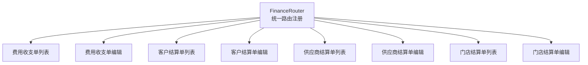
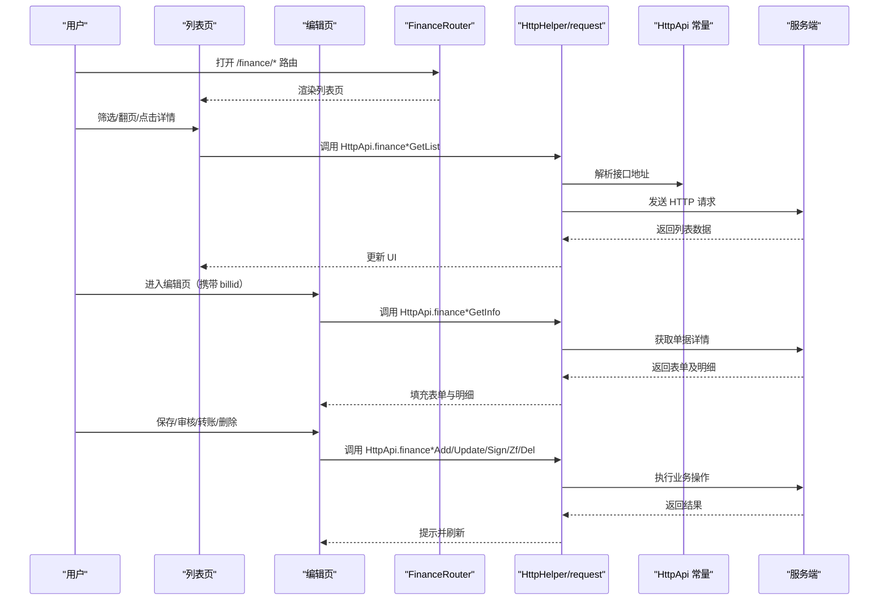
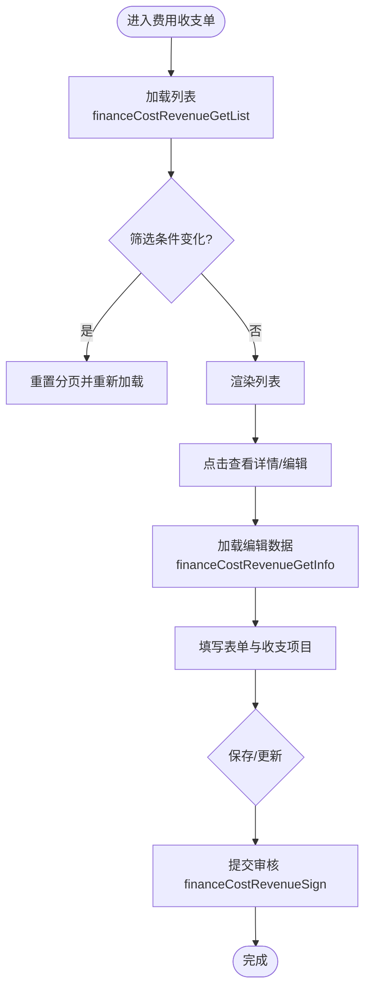
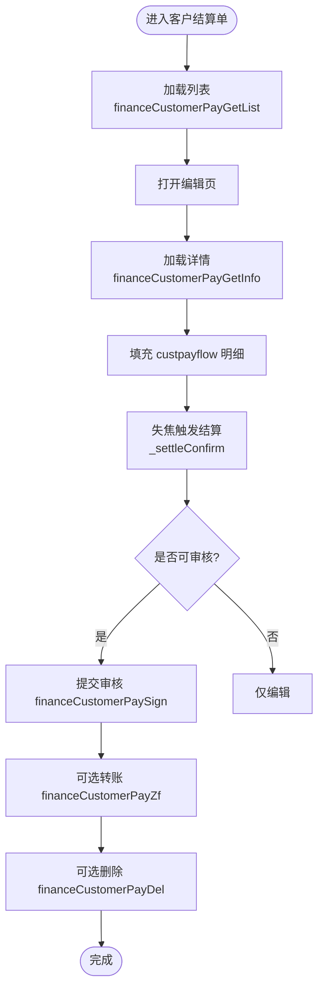
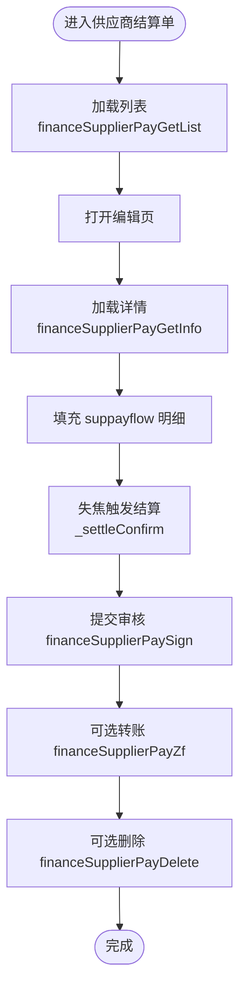
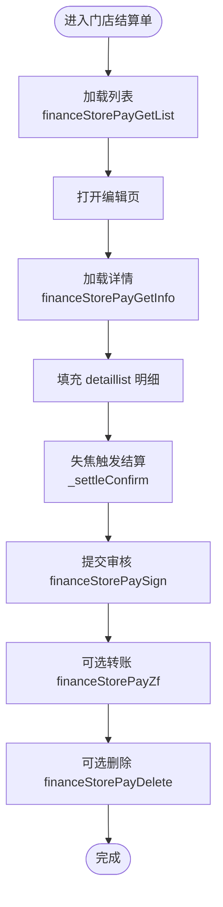
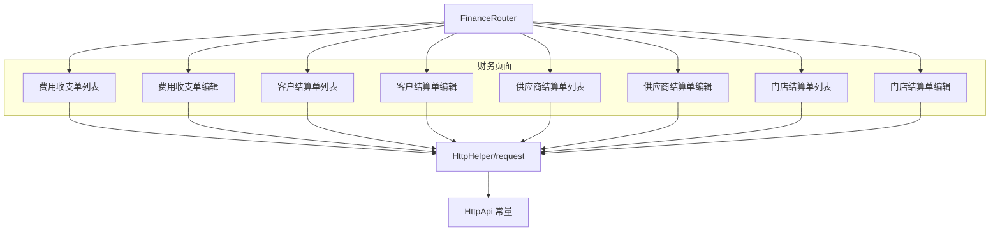
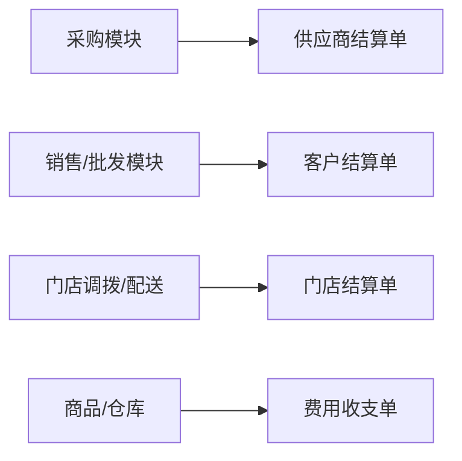
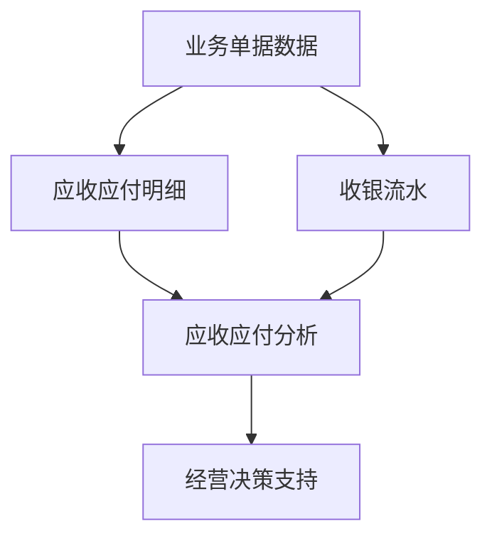

# 财务管理模块

<cite>
**本文引用的文件**   
- [lib/pages/business/finance/router.dart](file://lib/pages/business/finance/router.dart)
- [lib/pages/business/finance/cost_revenue/list.dart](file://lib/pages/business/finance/cost_revenue/list.dart)
- [lib/pages/business/finance/cost_revenue/edit.dart](file://lib/pages/business/finance/cost_revenue/edit.dart)
- [lib/pages/business/finance/customer_pay/list.dart](file://lib/pages/business/finance/customer_pay/list.dart)
- [lib/pages/business/finance/customer_pay/edit.dart](file://lib/pages/business/finance/customer_pay/edit.dart)
- [lib/pages/business/finance/supplier_pay/list.dart](file://lib/pages/business/finance/supplier_pay/list.dart)
- [lib/pages/business/finance/supplier_pay/edit.dart](file://lib/pages/business/finance/supplier_pay/edit.dart)
- [lib/pages/business/finance/store_pay/list.dart](file://lib/pages/business/finance/store_pay/list.dart)
- [lib/pages/business/finance/store_pay/edit.dart](file://lib/pages/business/finance/store_pay/edit.dart)
- [lib/net/http_api.dart](file://lib/net/http_api.dart)
- [lib/net/http_helper.dart](file://lib/net/http_helper.dart)
- [lib/components/select/select_refbill.dart](file://lib/components/select/select_refbill.dart)
- [lib/pages/home/cash_flow/cash_flow_router.dart](file://lib/pages/home/cash_flow/cash_flow_router.dart)
- [lib/pages/data/businessReport/cashFlow/cash_flow_page.dart](file://lib/pages/data/businessReport/cashFlow/cash_flow_page.dart)
</cite>

## 目录
1. [引言](#引言)
2. [项目结构](#项目结构)
3. [核心组件](#核心组件)
4. [架构总览](#架构总览)
5. [详细组件分析](#详细组件分析)
6. [依赖关系分析](#依赖关系分析)
7. [性能与可用性](#性能与可用性)
8. [财务数据准确性、审计追踪与合规性](#财务数据准确性审计追踪与合规性)
9. [与其他业务模块的财务关联](#与其他业务模块的财务关联)
10. [财务分析与决策支持](#财务分析与决策支持)
11. [故障排查指南](#故障排查指南)
12. [结论](#结论)

## 引言
本文件面向灵犀管店 Flutter 应用中的“财务管理模块”，聚焦以下核心能力：
- 成本收入管理（费用收支单）
- 客户收款（客户结算单）
- 供应商付款（供应商结算单）
- 门店结算（门店结算单）
- 资金流向追踪与财务报表展示（收银流水等）

该模块通过统一的列表页与编辑页模式，对接后端 API，实现应收应付管理、资金收付、单据审批与状态流转，并为经营分析提供基础数据。

## 项目结构
财务管理模块位于 `lib/pages/business/finance` 下，按业务子域划分为四个子目录：
- `cost_revenue`：费用收支单
- `customer_pay`：客户结算单
- `supplier_pay`：供应商结算单
- `store_pay`：门店结算单

每个子域均包含：
- 列表页：负责筛选、分页、状态 Tab、权限校验、滚动加载
- 编辑页：负责新增/编辑、明细勾兑、金额汇总、审批流、提交与后续操作

路由入口集中在 `router.dart`，统一注册各页面的 Fluro 路由，并透传 `billid` 参数用于编辑。

图表来源
- [lib/pages/business/finance/router.dart:1-48](file://lib/pages/business/finance/router.dart#L1-L48)

章节来源
- [lib/pages/business/finance/router.dart:1-48](file://lib/pages/business/finance/router.dart#L1-L48)

## 核心组件
- 路由层：`FinanceRouter` 集中定义 `/finance/*` 路由，并在编辑页面接收 `billid` 参数。
- 列表层：四张列表页遵循相同交互模型——Tab 状态（全部/待审核/已审核/已驳回）、日期范围、机构/对象筛选、分页、滚动加载。
- 编辑层：四张编辑页遵循相同业务模型——表单主信息、明细勾兑（应收应付）、金额汇总、审批流、保存/审核/反审核/删除/转账等操作。
- 网络层：统一通过 `HttpApi` 常量调用后端接口；请求封装在 `request(HttpHelper)` 中。
- 选择器与工具：复用 `SelectStorePage`、`SelectSupplierPage`、`CommonSelectSheet`、`MathUtils`、`PermissionUtils`、`ReviewConfigUtils` 等通用组件。

章节来源
- [lib/pages/business/finance/router.dart:1-48](file://lib/pages/business/finance/router.dart#L1-L48)
- [lib/pages/business/finance/cost_revenue/list.dart:1-200](file://lib/pages/business/finance/cost_revenue/list.dart#L1-L200)
- [lib/pages/business/finance/customer_pay/list.dart:1-200](file://lib/pages/business/finance/customer_pay/list.dart#L1-L200)
- [lib/pages/business/finance/supplier_pay/list.dart:1-260](file://lib/pages/business/finance/supplier_pay/list.dart#L1-L260)
- [lib/pages/business/finance/store_pay/list.dart:1-260](file://lib/pages/business/finance/store_pay/list.dart#L1-L260)

## 架构总览
下图展示了从用户操作到后端接口的完整链路，以及关键组件之间的依赖关系。

图表来源
- [lib/pages/business/finance/router.dart:1-48](file://lib/pages/business/finance/router.dart#L1-L48)
- [lib/pages/business/finance/cost_revenue/list.dart:180-200](file://lib/pages/business/finance/cost_revenue/list.dart#L180-L200)
- [lib/pages/business/finance/cost_revenue/edit.dart:120-170](file://lib/pages/business/finance/cost_revenue/edit.dart#L120-L170)
- [lib/pages/business/finance/customer_pay/list.dart:180-200](file://lib/pages/business/finance/customer_pay/list.dart#L180-L200)
- [lib/pages/business/finance/customer_pay/edit.dart:150-200](file://lib/pages/business/finance/customer_pay/edit.dart#L150-L200)
- [lib/pages/business/finance/supplier_pay/list.dart:180-210](file://lib/pages/business/finance/supplier_pay/list.dart#L180-L210)
- [lib/pages/business/finance/supplier_pay/edit.dart:170-210](file://lib/pages/business/finance/supplier_pay/edit.dart#L170-L210)
- [lib/pages/business/finance/store_pay/list.dart:150-190](file://lib/pages/business/finance/store_pay/list.dart#L150-L190)
- [lib/pages/business/finance/store_pay/edit.dart:160-210](file://lib/pages/business/finance/store_pay/edit.dart#L160-L210)

## 详细组件分析

### 费用收支单（成本收入管理）
费用收支单用于记录门店或机构的收入、支出和内部转账。它不直接勾兑应收应付明细，而是以“收支项目”为核心进行记账。

- 列表页要点
  - 权限校验：使用固定权限码控制可见性
  - 状态 Tab：全部/待审核/已审核/已驳回（是否显示“已驳回”由配置动态决定）
  - 筛选字段：单据类型、收支项目、经手人、支付方式、时间范围、机构
  - 数据接口：`HttpApi.financeCostRevenueGetList`
- 编辑页要点
  - 表单字段：机构、收支类型（收入/支出/转账）、收支项目、经手人、支付方式、银行账户、收支日期、金额、备注
  - 审批流：读取当前用户与审批流成员，判断是否具备处理权限
  - 操作：新增/编辑、提交审核、反审核、删除

图表来源
- [lib/pages/business/finance/cost_revenue/list.dart:180-200](file://lib/pages/business/finance/cost_revenue/list.dart#L180-L200)
- [lib/pages/business/finance/cost_revenue/edit.dart:120-170](file://lib/pages/business/finance/cost_revenue/edit.dart#L120-L170)
- [lib/pages/business/finance/cost_revenue/edit.dart:460-480](file://lib/pages/business/finance/cost_revenue/edit.dart#L460-L480)
- [lib/pages/business/finance/cost_revenue/edit.dart:560-580](file://lib/pages/business/finance/cost_revenue/edit.dart#L560-L580)

章节来源
- [lib/pages/business/finance/cost_revenue/list.dart:1-200](file://lib/pages/business/finance/cost_revenue/list.dart#L1-L200)
- [lib/pages/business/finance/cost_revenue/edit.dart:1-200](file://lib/pages/business/finance/cost_revenue/edit.dart#L1-L200)
- [lib/pages/business/finance/cost_revenue/edit.dart:460-480](file://lib/pages/business/finance/cost_revenue/edit.dart#L460-L480)
- [lib/pages/business/finance/cost_revenue/edit.dart:560-580](file://lib/pages/business/finance/cost_revenue/edit.dart#L560-L580)

### 客户结算单（客户收款）
客户结算单用于核销客户的应收账款，支持多笔订单勾兑、预收预付、免付金额等结算逻辑。

- 列表页要点
  - 权限校验：使用固定权限码控制可见性
  - 状态 Tab：全部/待审核/已审核/已驳回
  - 筛选字段：客户、创建人、经手人、支付方式、银行、时间范围、机构
  - 数据接口：`HttpApi.financeCustomerPayGetList`
- 编辑页要点
  - 主表字段：客户、机构、经手人、起止日期、银行账户、支付方式、预收、付款日期、备注
  - 明细勾兑：`custpayflow` 列表，含未结账单据、本次付款、免付、预付结算等
  - 金额计算：失焦时触发 `_settleConfirm`，自动汇总 `payamt/freeamt/prepaidamt` 等
  - 操作：新增/编辑、提交审核、转账、删除

图表来源
- [lib/pages/business/finance/customer_pay/list.dart:180-200](file://lib/pages/business/finance/customer_pay/list.dart#L180-L200)
- [lib/pages/business/finance/customer_pay/edit.dart:150-200](file://lib/pages/business/finance/customer_pay/edit.dart#L150-L200)
- [lib/pages/business/finance/customer_pay/edit.dart:870-880](file://lib/pages/business/finance/customer_pay/edit.dart#L870-L880)
- [lib/pages/business/finance/customer_pay/edit.dart:960-980](file://lib/pages/business/finance/customer_pay/edit.dart#L960-L980)
- [lib/pages/business/finance/customer_pay/edit.dart:1040-1080](file://lib/pages/business/finance/customer_pay/edit.dart#L1040-L1080)

章节来源
- [lib/pages/business/finance/customer_pay/list.dart:1-200](file://lib/pages/business/finance/customer_pay/list.dart#L1-L200)
- [lib/pages/business/finance/customer_pay/edit.dart:1-200](file://lib/pages/business/finance/customer_pay/edit.dart#L1-L200)
- [lib/pages/business/finance/customer_pay/edit.dart:870-880](file://lib/pages/business/finance/customer_pay/edit.dart#L870-L880)
- [lib/pages/business/finance/customer_pay/edit.dart:960-980](file://lib/pages/business/finance/customer_pay/edit.dart#L960-L980)
- [lib/pages/business/finance/customer_pay/edit.dart:1040-1080](file://lib/pages/business/finance/customer_pay/edit.dart#L1040-L1080)

### 供应商结算单（供应商付款）
供应商结算单用于核销对供应商的应付账款，支持多笔单据勾兑、预收预付、免付金额等结算逻辑。

- 列表页要点
  - 权限校验：使用固定权限码控制可见性
  - 状态 Tab：全部/待审核/已审核/已驳回
  - 筛选字段：供应商、创建人、经手人、支付方式、银行、时间范围、机构、对账状态
  - 数据接口：`HttpApi.financeSupplierPayGetList`
- 编辑页要点
  - 主表字段：供应商、机构、经手人、起止日期、银行账户、支付方式、预收
  - 明细勾兑：`suppayflow` 列表，含未结账单据、本次付款、免付、预付结算等
  - 金额计算：失焦时触发 `_settleConfirm`，自动汇总 `payamt/freeamt/prepaidamt` 等
  - 操作：新增/编辑、提交审核、转账、删除

图表来源
- [lib/pages/business/finance/supplier_pay/list.dart:180-210](file://lib/pages/business/finance/supplier_pay/list.dart#L180-L210)
- [lib/pages/business/finance/supplier_pay/edit.dart:170-210](file://lib/pages/business/finance/supplier_pay/edit.dart#L170-L210)
- [lib/pages/business/finance/supplier_pay/edit.dart:880-900](file://lib/pages/business/finance/supplier_pay/edit.dart#L880-L900)
- [lib/pages/business/finance/supplier_pay/edit.dart:990-1010](file://lib/pages/business/finance/supplier_pay/edit.dart#L990-L1010)
- [lib/pages/business/finance/supplier_pay/edit.dart:1070-1110](file://lib/pages/business/finance/supplier_pay/edit.dart#L1070-L1110)

章节来源
- [lib/pages/business/finance/supplier_pay/list.dart:1-260](file://lib/pages/business/finance/supplier_pay/list.dart#L1-L260)
- [lib/pages/business/finance/supplier_pay/edit.dart:1-260](file://lib/pages/business/finance/supplier_pay/edit.dart#L1-L260)
- [lib/pages/business/finance/supplier_pay/edit.dart:880-900](file://lib/pages/business/finance/supplier_pay/edit.dart#L880-L900)
- [lib/pages/business/finance/supplier_pay/edit.dart:990-1010](file://lib/pages/business/finance/supplier_pay/edit.dart#L990-L1010)
- [lib/pages/business/finance/supplier_pay/edit.dart:1070-1110](file://lib/pages/business/finance/supplier_pay/edit.dart#L1070-L1110)

### 门店结算单（门店间资金划转）
门店结算单用于两个门店之间的应收应付结算，包括应付门店与应收门店、账户差异等。

- 列表页要点
  - 权限校验：使用固定权限码控制可见性
  - 状态 Tab：全部/待审核/已审核/已驳回
  - 筛选字段：应付门店、应收门店、创建人、经手人、支付方式、银行、时间范围
  - 数据接口：`HttpApi.financeStorePayGetList`
- 编辑页要点
  - 主表字段：应付门店、应收门店、经手人、起止日期、收款账户、付款账户、支付方式、预收
  - 明细勾兑：`detaillist` 列表，含未结账单据、本次付款、免付、预付结算等
  - 金额计算：失焦时触发 `_settleConfirm`，自动汇总 `payamt/freeamt/prepaidamt` 等
  - 操作：新增/编辑、提交审核、转账、删除

图表来源
- [lib/pages/business/finance/store_pay/list.dart:150-190](file://lib/pages/business/finance/store_pay/list.dart#L150-L190)
- [lib/pages/business/finance/store_pay/edit.dart:160-210](file://lib/pages/business/finance/store_pay/edit.dart#L160-L210)
- [lib/pages/business/finance/store_pay/edit.dart:960-980](file://lib/pages/business/finance/store_pay/edit.dart#L960-L980)
- [lib/pages/business/finance/store_pay/edit.dart:1050-1070](file://lib/pages/business/finance/store_pay/edit.dart#L1050-L1070)
- [lib/pages/business/finance/store_pay/edit.dart:1130-1170](file://lib/pages/business/finance/store_pay/edit.dart#L1130-L1170)

章节来源
- [lib/pages/business/finance/store_pay/list.dart:1-260](file://lib/pages/business/finance/store_pay/list.dart#L1-L260)
- [lib/pages/business/finance/store_pay/edit.dart:1-260](file://lib/pages/business/finance/store_pay/edit.dart#L1-L260)
- [lib/pages/business/finance/store_pay/edit.dart:960-980](file://lib/pages/business/finance/store_pay/edit.dart#L960-L980)
- [lib/pages/business/finance/store_pay/edit.dart:1050-1070](file://lib/pages/business/finance/store_pay/edit.dart#L1050-L1070)
- [lib/pages/business/finance/store_pay/edit.dart:1130-1170](file://lib/pages/business/finance/store_pay/edit.dart#L1130-L1170)

### 资金流向与报表
- 首页资金流入口：`CashFlowRouter` 提供 `/cashflow/list` 路由，跳转至收银流水页面。
- 收银流水页面：基于 `saleSelectFindSaleBill` 接口，展示销售、退货等业务产生的资金流水，支持门店、日期、渠道、支付方式等筛选，并提供汇总统计。

图表来源
- [lib/pages/home/cash_flow/cash_flow_router.dart:1-12](file://lib/pages/home/cash_flow/cash_flow_router.dart#L1-L12)
- [lib/pages/data/businessReport/cashFlow/cash_flow_page.dart:1-120](file://lib/pages/data/businessReport/cashFlow/cash_flow_page.dart#L1-L120)

章节来源
- [lib/pages/home/cash_flow/cash_flow_router.dart:1-12](file://lib/pages/home/cash_flow/cash_flow_router.dart#L1-L12)
- [lib/pages/data/businessReport/cashFlow/cash_flow_page.dart:1-240](file://lib/pages/data/businessReport/cashFlow/cash_flow_page.dart#L1-L240)

## 依赖关系分析
- 路由依赖：所有财务子模块通过 `FinanceRouter` 暴露统一路径，便于导航与权限控制。
- 网络依赖：列表与编辑均依赖 `HttpApi` 定义的接口常量，并通过 `request(HttpHelper)` 发起请求。
- 选择器依赖：列表与编辑广泛复用 `SelectStorePage`、`SelectSupplierPage`、`CommonSelectSheet`、`select_refbill` 等选择器。
- 权限与审批：依赖 `PermissionUtils`、`ReviewConfigUtils`、`ReviewNavState` 控制可见性与“已驳回”Tab。
- 工具依赖：`MathUtils` 用于金额格式化与计算，`ToastUtils` 用于用户反馈。

图表来源
- [lib/pages/business/finance/router.dart:1-48](file://lib/pages/business/finance/router.dart#L1-L48)
- [lib/net/http_api.dart:1-260](file://lib/net/http_api.dart#L1-L260)

章节来源
- [lib/pages/business/finance/router.dart:1-48](file://lib/pages/business/finance/router.dart#L1-L48)
- [lib/net/http_api.dart:1-260](file://lib/net/http_api.dart#L1-L260)

## 性能与可用性
- 分页与滚动加载：所有列表采用 `page/pagelist` 模式，结合 `ScrollController` 监听滚动到底部时加载更多，避免一次性加载大数据量。
- 防抖搜索：输入框变更使用定时器延迟触发查询，减少频繁请求。
- Tab 重建优化：根据审批配置动态增减“已驳回”Tab，避免不必要的 `TabController` 重建。
- 权限前置检查：进入页面即校验权限，失败则提示并阻止进一步操作。
- 金额格式化：使用 `MathUtils.formatDecimal` 保证显示精度一致，避免浮点误差。

章节来源
- [lib/pages/business/finance/cost_revenue/list.dart:1-200](file://lib/pages/business/finance/cost_revenue/list.dart#L1-L200)
- [lib/pages/business/finance/customer_pay/list.dart:1-200](file://lib/pages/business/finance/customer_pay/list.dart#L1-L200)
- [lib/pages/business/finance/supplier_pay/list.dart:1-260](file://lib/pages/business/finance/supplier_pay/list.dart#L1-L260)
- [lib/pages/business/finance/store_pay/list.dart:1-260](file://lib/pages/business/finance/store_pay/list.dart#L1-L260)

## 财务数据准确性、审计追踪与合规性
- 金额精度控制
  - 编辑页通过失焦事件触发 `_settleConfirm`，将“本次付款、免付、预付结算”等金额同步回明细并汇总，确保总额与明细一致。
  - 金额显示统一使用 `MathUtils.formatDecimal`，避免前端显示精度问题。
- 审批流与状态机
  - 列表通过 `signflag` 区分“待审核/已审核/已驳回”，编辑页通过 `reviewFlowUsers`、`reviewsignflag` 控制可操作按钮与只读态。
  - “已驳回”Tab 由 `ReviewConfigUtils.shouldShowRejectedTab` 动态决定是否显示，保持与后台配置一致。
- 权限控制
  - 列表页在进入时调用 `PermissionUtils.checkPermission`，无权限则提示并终止加载。
- 审计线索
  - 单据状态、创建人、经手人、支付方式、银行账户、时间戳等关键字段在列表与编辑中均有体现，便于追溯资金流向与责任主体。
- 合规性要求
  - 所有财务单据需经过审批流程后方可生效；反审核、删除、转账等操作均对应独立接口，形成闭环审计链。

章节来源
- [lib/pages/business/finance/customer_pay/edit.dart:150-200](file://lib/pages/business/finance/customer_pay/edit.dart#L150-L200)
- [lib/pages/business/finance/supplier_pay/edit.dart:170-210](file://lib/pages/business/finance/supplier_pay/edit.dart#L170-L210)
- [lib/pages/business/finance/store_pay/edit.dart:160-210](file://lib/pages/business/finance/store_pay/edit.dart#L160-L210)
- [lib/pages/business/finance/cost_revenue/list.dart:1-200](file://lib/pages/business/finance/cost_revenue/list.dart#L1-L200)
- [lib/pages/business/finance/customer_pay/list.dart:1-200](file://lib/pages/business/finance/customer_pay/list.dart#L1-L200)
- [lib/pages/business/finance/supplier_pay/list.dart:1-260](file://lib/pages/business/finance/supplier_pay/list.dart#L1-L260)
- [lib/pages/business/finance/store_pay/list.dart:1-260](file://lib/pages/business/finance/store_pay/list.dart#L1-L260)

## 与其他业务模块的财务关联
- 采购模块 → 供应商结算单
  - 供应商结算单的明细来源于采购相关单据（如采购入库、采购订货、采购退货、直配订单等），通过 `financeSupplierPayGetSupplierBill` 获取未结清应付明细。
- 销售/批发模块 → 客户结算单
  - 客户结算单的明细来源于销售相关单据（如零售、批发销售单、退货单等），通过 `financeCustomerPayGetCustomerBill` 获取未结清应收明细。
- 门店调拨/配送 → 门店结算单
  - 门店结算单用于跨门店应收应付结算，明细来源于门店间调拨、配送等业务产生的应收应付关系，通过 `financeStorePayGetStoreBill` 获取未结清单据。
- 商品/仓库 → 费用收支单
  - 费用收支单作为非业务性收支记账，可与商品采购价格调整、促销计划等间接关联，但不直接勾兑库存数量。

图表来源
- [lib/pages/business/finance/supplier_pay/edit.dart:470-490](file://lib/pages/business/finance/supplier_pay/edit.dart#L470-L490)
- [lib/pages/business/finance/customer_pay/edit.dart:460-480](file://lib/pages/business/finance/customer_pay/edit.dart#L460-L480)
- [lib/pages/business/finance/store_pay/edit.dart:550-570](file://lib/pages/business/finance/store_pay/edit.dart#L550-L570)

章节来源
- [lib/pages/business/finance/supplier_pay/edit.dart:470-490](file://lib/pages/business/finance/supplier_pay/edit.dart#L470-L490)
- [lib/pages/business/finance/customer_pay/edit.dart:460-480](file://lib/pages/business/finance/customer_pay/edit.dart#L460-L480)
- [lib/pages/business/finance/store_pay/edit.dart:550-570](file://lib/pages/business/finance/store_pay/edit.dart#L550-L570)

## 财务分析与决策支持
- 收银流水分析
  - 通过收银流水页面查看销售、退货等业务产生的资金流入流出，支持按门店、日期、销售渠道、支付方式筛选，并展示汇总金额与总数。
- 应收应付分析
  - 通过对账单（客户/供应商/门店）的未结清明细，评估资金占用与周转效率。
- 费用收支分析
  - 通过费用收支单的收支项目分类，辅助分析门店运营成本与利润影响。

[本图为概念性流程图，不映射具体源码文件]

## 故障排查指南
- 无法查看某财务页面
  - 检查权限码是否正确，列表页在初始化阶段会进行权限校验并提示。
- 列表不加载或分页异常
  - 检查网络请求参数（时间范围、机构、状态标志位），确认后端返回结构与前端期望一致。
- 编辑页金额不一致
  - 检查失焦事件是否触发 `_settleConfirm`，确认明细行金额与汇总金额同步更新。
- 审核按钮不可用
  - 检查审批流成员是否包含当前用户，或是否为管理员；同时确认单据状态是否允许审核。
- 转账或删除失败
  - 检查转账/删除接口调用参数是否正确，特别是 `billid` 与表单状态。

章节来源
- [lib/pages/business/finance/customer_pay/list.dart:1-200](file://lib/pages/business/finance/customer_pay/list.dart#L1-L200)
- [lib/pages/business/finance/supplier_pay/list.dart:1-260](file://lib/pages/business/finance/supplier_pay/list.dart#L1-L260)
- [lib/pages/business/finance/store_pay/list.dart:1-260](file://lib/pages/business/finance/store_pay/list.dart#L1-L260)
- [lib/pages/business/finance/cost_revenue/list.dart:1-200](file://lib/pages/business/finance/cost_revenue/list.dart#L1-L200)

## 结论
财务管理模块以统一的列表/编辑模式构建，围绕费用收支、客户收款、供应商付款、门店结算四大核心场景，结合审批流、权限控制与金额汇总机制，为门店与机构的应收应付管理与资金流向追踪提供了完整解决方案。配合收银流水与业务单据明细，可为管理层提供准确的财务数据与决策支持。未来可在报表维度、自动化对账与异常预警方面继续增强。