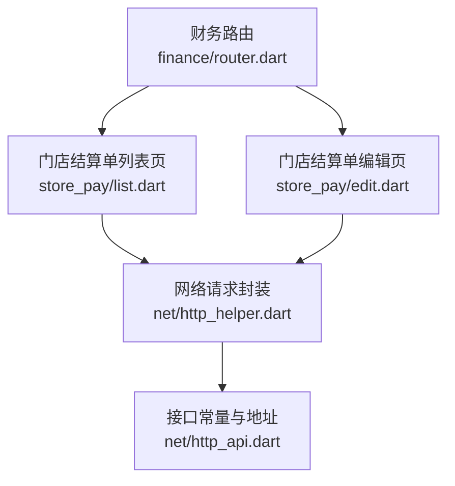
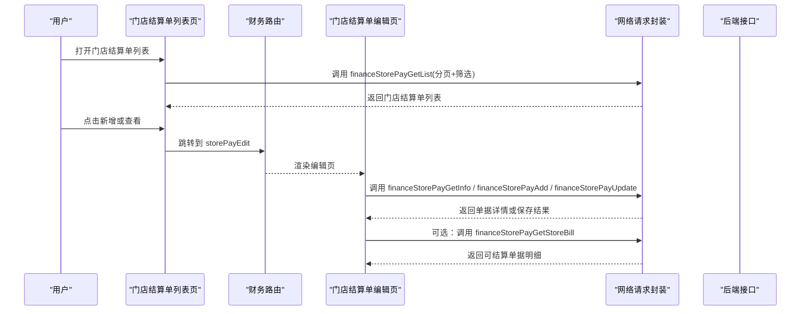
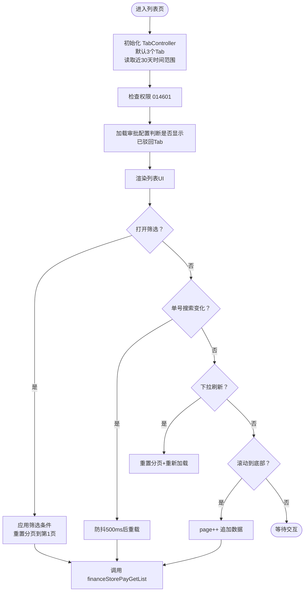
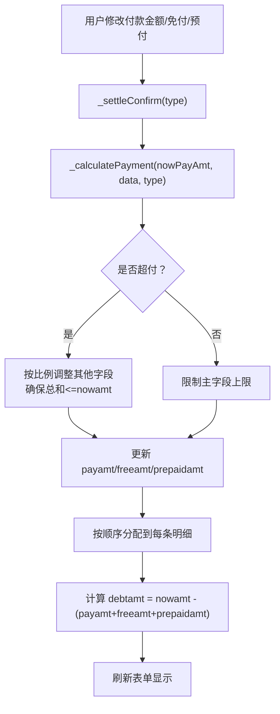
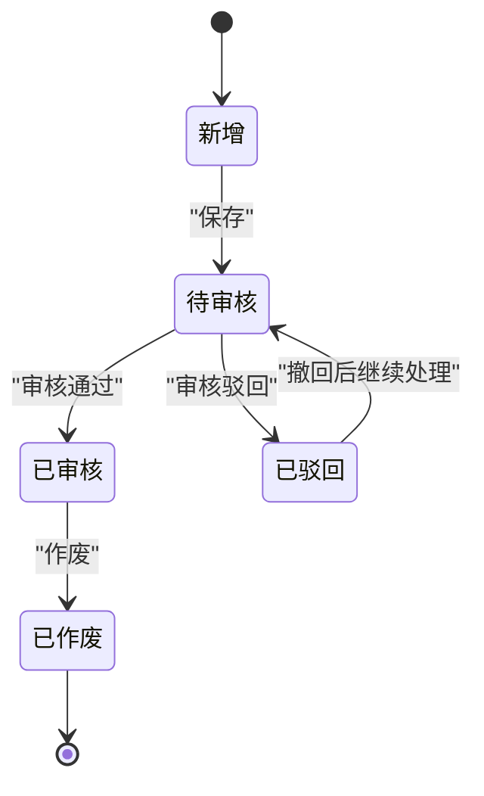
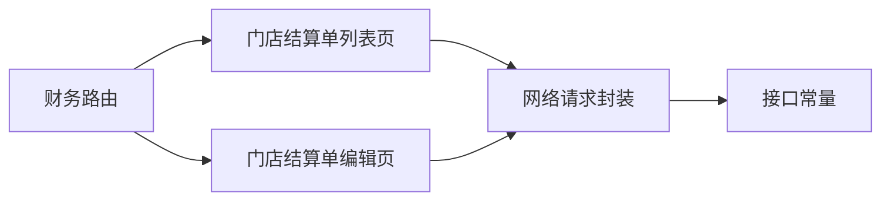

# 门店付款管理

<cite>
**本文引用的文件**   
- [finance/router.dart](file://lib/pages/business/finance/router.dart)
- [store_pay/list.dart](file://lib/pages/business/finance/store_pay/list.dart)
- [store_pay/edit.dart](file://lib/pages/business/finance/store_pay/edit.dart)
- [http_api.dart](file://lib/net/http_api.dart)
- [http_helper.dart](file://lib/net/http_helper.dart)
</cite>

## 目录
1. [引言](#引言)
2. [项目结构](#项目结构)
3. [核心组件](#核心组件)
4. [架构总览](#架构总览)
5. [详细组件分析](#详细组件分析)
6. [依赖关系分析](#依赖关系分析)
7. [性能与分页](#性能与分页)
8. [异常处理与权限控制](#异常处理与权限控制)
9. [多门店资金监控与对账建议](#多门店资金监控与对账建议)
10. [结论](#结论)

## 引言
本文面向灵犀管店 Flutter 项目的“门店付款管理”功能，聚焦以下目标：
- 门店付款单的创建、编辑、审核和查询。
- 门店选择、付款原因分类（付款方式）、内部转账处理和付款金额核算。
- 列表页的门店筛选条件、Tab 状态管理与数据分页加载机制。
- 与库存调拨、内部结算等业务模块的资金流转关联说明。
- 内部交易凭证、财务审批流程和异常处理机制的实现细节。

该功能由两个主要页面组成：门店结算单列表页和门店结算单编辑页，并通过统一财务路由注册入口。

## 项目结构
门店付款管理位于业务财务模块下，采用页面级组织方式：
- 路由定义：`lib/pages/business/finance/router.dart`
- 列表页：`lib/pages/business/finance/store_pay/list.dart`
- 编辑页：`lib/pages/business/finance/store_pay/edit.dart`
- 网络层：`lib/net/http_api.dart`、`lib/net/http_helper.dart`

**图表来源**
- [finance/router.dart:1-48](file://lib/pages/business/finance/router.dart#L1-L48)
- [store_pay/list.dart:1-1222](file://lib/pages/business/finance/store_pay/list.dart#L1-L1222)
- [store_pay/edit.dart:1-2612](file://lib/pages/business/finance/store_pay/edit.dart#L1-L2612)
- [http_helper.dart](file://lib/net/http_helper.dart)
- [http_api.dart](file://lib/net/http_api.dart)

**章节来源**
- [finance/router.dart:1-48](file://lib/pages/business/finance/router.dart#L1-L48)

## 核心组件
- 门店结算单列表页 `StorePayListPage`
  - 负责列表展示、搜索、筛选、Tab 切换（全部/待审核/已审核/已驳回）、下拉刷新和上拉加载更多。
  - 提供跳转至编辑页的入口，并在新增后返回时重新评估“已驳回”Tab 显示。
- 门店结算单编辑页 `StorePayEditPage`
  - 负责新增/编辑门店结算单，包括应付门店、应收门店、单据选择、日期范围、经手人、备注、收款账户、付款账户、付款方式等。
  - 实现内部结算金额计算、预付款自动分配、明细行分摊、审批节点展示与操作（保存、审核、作废、删除、撤回）。

**章节来源**
- [store_pay/list.dart:1-200](file://lib/pages/business/finance/store_pay/list.dart#L1-L200)
- [store_pay/edit.dart:1-200](file://lib/pages/business/finance/store_pay/edit.dart#L1-L200)

## 架构总览
门店付款管理采用 Flutter 页面 + 通用网络层的典型架构：
- 页面层负责 UI 交互、表单校验、本地状态维护。
- 网络层通过 `request(HttpApi.xxx, params)` 调用后端接口。
- 路由层统一管理财务模块页面跳转。

**图表来源**
- [finance/router.dart:1-48](file://lib/pages/business/finance/router.dart#L1-L48)
- [store_pay/list.dart:1-200](file://lib/pages/business/finance/store_pay/list.dart#L1-L200)
- [store_pay/edit.dart:1-200](file://lib/pages/business/finance/store_pay/edit.dart#L1-L200)
- [http_helper.dart](file://lib/net/http_helper.dart)
- [http_api.dart](file://lib/net/http_api.dart)

## 详细组件分析

### 门店结算单列表页 `StorePayListPage`
职责：
- 维护 Tab 状态：全部、待审核、已审核、可选的已驳回。
- 维护筛选参数：时间范围、应付门店、应收门店、制单人、经手人、付款方式、收款账户、付款账户、单号模糊搜索。
- 分页加载：每页 20 条，支持下拉刷新和滚动到底部自动加载更多。
- 权限控制：查看列表需权限码 `014601`；查看详情需 `014608`；新增需 `014602`。

#### 列表筛选条件
- 时间范围：昨天、今日、本周、本月、自定义；支持左右箭头快速切换时间段。
- 应付门店：调用门店列表接口，过滤掉当前已选的应收门店。
- 应收门店：根据登录门店字段动态设置 `nosidsflag`，排除已选的应付门店。
- 制单人、经手人：调用系统用户列表接口。
- 付款方式、收款账户、付款账户：通过插件接口 `pluginsGet` 获取字典数据。
- 单号搜索：输入框防抖 500ms，触发重新加载。

**图表来源**
- [store_pay/list.dart:1-200](file://lib/pages/business/finance/store_pay/list.dart#L1-L200)
- [store_pay/list.dart:201-500](file://lib/pages/business/finance/store_pay/list.dart#L201-L500)
- [store_pay/list.dart:501-900](file://lib/pages/business/finance/store_pay/list.dart#L501-L900)
- [store_pay/list.dart:901-1222](file://lib/pages/business/finance/store_pay/list.dart#L901-L1222)

#### 列表数据结构与状态
- `_statusIndex`：对应 signflag 映射（全部为空、待审核为0、已审核为1、已驳回为2）。
- `_list`：当前页合并后的列表数据。
- `_page`、`_hasMore`、`_loading`：分页控制。
- `_startDate`、`_endDate`：筛选时间范围。
- 各筛选字段：应付/应收门店ID与名称、制单人ID与名称、经手人ID与名称、付款方式ID与名称、收款账户ID与名称、付款账户ID与名称。

**章节来源**
- [store_pay/list.dart:1-200](file://lib/pages/business/finance/store_pay/list.dart#L1-L200)
- [store_pay/list.dart:201-500](file://lib/pages/business/finance/store_pay/list.dart#L201-L500)
- [store_pay/list.dart:501-900](file://lib/pages/business/finance/store_pay/list.dart#L501-L900)
- [store_pay/list.dart:901-1222](file://lib/pages/business/finance/store_pay/list.dart#L901-L1222)

### 门店结算单编辑页 `StorePayEditPage`
职责：
- 新增/编辑门店结算单。
- 选择应付门店、应收门店、关联单据、日期范围、经手人、备注。
- 选择付款方式、收款账户、付款账户。
- 内部结算金额计算：本次应付款=单据金额-已付-免付-预付；自动分配付款金额、免付、预付到明细行。
- 审批流程：保存、审核、作废、删除、撤回；展示审批节点与日志。

#### 表单字段与数据来源
- 应付门店 `_bsid`、应收门店 `_sid`：通过通用选择器 `CommonSelectSheet` 调用门店列表接口。
- 选择单据：调用 `financeStorePayGetStoreBill` 获取两门店间可结算单据，并在弹窗中展示与选择。
- 经手人：调用系统用户列表接口。
- 收款/付款账户：调用插件接口 `pluginsGet` 获取银行列表。
- 付款方式：调用插件接口 `pluginsGet` 获取支付方式字典。

#### 金额核算与分配逻辑
- `_comBillList`：将后端返回的可结算单据补齐字段，计算 `nowamt`（本次应付）和 `prepayamt`（本次应付合计），并根据预付款余额进行自动分配。
- `_settleConfirm`：在付款金额、本次免付、预付结算任一字段失焦时触发，按优先级分配：
  1. 先分配付款金额 `payamt`。
  2. 剩余部分分配免付 `freeamt`。
  3. 再剩余部分分配预付结算 `prepaidamt`。
  4. 计算每条明细的 `debtamt`（未结清金额）。
- `_calculatePayment`：保证三个金额之和不超过 `nowamt`，避免超付；支持退款模式（`nowamt < 0`）。
- `_sumFields`：汇总选中单据的总金额、数量等。

**图表来源**
- [store_pay/edit.dart:601-1000](file://lib/pages/business/finance/store_pay/edit.dart#L601-L1000)

#### 审批流程与按钮行为
- 底部按钮根据单据状态动态展示：
  - 新增：保存。
  - 待审核：审核（含多级审批判断）、打印。
  - 已审核：作废、打印。
  - 已驳回：删除、打印、撤回。
  - 已作废：仅打印。
- 审核弹窗支持“通过/驳回”，驳回必须填写原因。
- 审批节点信息来自 `reviewFlowUsers` 与 `reviewBillFlows`，包含当前节点、审批人和日志查看入口。

**图表来源**
- [store_pay/edit.dart:1201-1546](file://lib/pages/business/finance/store_pay/edit.dart#L1201-L1546)
- [store_pay/edit.dart:1601-1944](file://lib/pages/business/finance/store_pay/edit.dart#L1601-L1944)

**章节来源**
- [store_pay/edit.dart:1-200](file://lib/pages/business/finance/store_pay/edit.dart#L1-L200)
- [store_pay/edit.dart:201-600](file://lib/pages/business/finance/store_pay/edit.dart#L201-L600)
- [store_pay/edit.dart:601-1000](file://lib/pages/business/finance/store_pay/edit.dart#L601-L1000)
- [store_pay/edit.dart:1201-1546](file://lib/pages/business/finance/store_pay/edit.dart#L1201-L1546)
- [store_pay/edit.dart:1601-1944](file://lib/pages/business/finance/store_pay/edit.dart#L1601-L1944)

## 依赖关系分析
- 路由依赖：
  - 财务路由定义门店结算单列表与编辑的路径 `/finance/storePay/list` 与 `/finance/storePay/edit`。
- 页面依赖：
  - 列表页依赖网络层发起 `financeStorePayGetList`。
  - 编辑页依赖 `financeStorePayGetInfo`、`financeStorePayAdd`、`financeStorePayUpdate`、`financeStorePayGetStoreBill`。
  - 两者均使用通用选择器与插件接口获取门店、用户、银行、支付方式等基础数据。

**图表来源**
- [finance/router.dart:1-48](file://lib/pages/business/finance/router.dart#L1-L48)
- [store_pay/list.dart:1-200](file://lib/pages/business/finance/store_pay/list.dart#L1-L200)
- [store_pay/edit.dart:1-200](file://lib/pages/business/finance/store_pay/edit.dart#L1-L200)
- [http_api.dart](file://lib/net/http_api.dart)
- [http_helper.dart](file://lib/net/http_helper.dart)

**章节来源**
- [finance/router.dart:1-48](file://lib/pages/business/finance/router.dart#L1-L48)

## 性能与分页
- 列表分页：固定每页 20 条，使用 `_page`、`_hasMore`、`_loading` 控制追加数据；滚动监听距离底部 60px 触发下一页。
- 下拉刷新：`RefreshIndicator.onRefresh` 重置分页并重载数据。
- 滚动优化：ListView 使用 `cacheExtent: 800` 与 `RepaintBoundary` 减少重绘开销。
- 搜索防抖：输入框变化 500ms 后触发搜索，避免频繁请求。
- Tab 切换：切换状态时重置分页和数据，确保每次加载从第一页开始。

**章节来源**
- [store_pay/list.dart:1-200](file://lib/pages/business/finance/store_pay/list.dart#L1-L200)
- [store_pay/list.dart:201-500](file://lib/pages/business/finance/store_pay/list.dart#L201-L500)
- [store_pay/list.dart:501-900](file://lib/pages/business/finance/store_pay/list.dart#L501-L900)
- [store_pay/list.dart:901-1222](file://lib/pages/business/finance/store_pay/list.dart#L901-L1222)

## 异常处理与权限控制
- 权限控制：
  - 列表查看：`PermissionUtils.checkPermission('014601')`。
  - 查看详情：`PermissionUtils.checkPermission('014608')`。
  - 新增/编辑：`PermissionUtils.checkPermission('014602'/'014603')`。
- 错误提示：
  - 网络请求失败时捕获异常并提示“加载失败”或“保存失败”。
  - 单据为空时提示“请选择单据”。
  - 必填项缺失时提示相应字段。
- 审批异常：
  - 非当前审批节点时提示“您不属于当前审批节点的审核人”。
  - 驳回原因必填校验。

**章节来源**
- [store_pay/list.dart:1-200](file://lib/pages/business/finance/store_pay/list.dart#L1-L200)
- [store_pay/edit.dart:601-1000](file://lib/pages/business/finance/store_pay/edit.dart#L601-L1000)
- [store_pay/edit.dart:1201-1546](file://lib/pages/business/finance/store_pay/edit.dart#L1201-L1546)

## 多门店资金监控与对账建议
虽然仓库未提供专门的多门店资金监控页面，但可通过现有门店结算单功能实现：
- 以应付门店或应收门店为维度统计月度/季度结算总额。
- 结合“已审核”与“已驳回”状态区分有效与异常资金流。
- 导出结算单列表，核对银行流水与账面金额差异。
- 针对内部转账场景，关注收款账户与付款账户的一致性，防止跨账户错配。

建议扩展方向：
- 增加资金看板，按门店聚合 `billamt`、`payamt`、`freeamt`、`prepaidamt`。
- 增加异常预警：如未结清 `debtamt > 0` 且超过阈值时提醒。
- 增加对账报表：对比银行流水与结算单明细。

[本节为概念性建议，不直接分析具体代码文件]

## 结论
灵犀管店 Flutter 项目的门店付款管理功能以清晰的页面划分和完善的金额核算逻辑为核心：
- 列表页提供丰富的筛选条件和稳定的分页体验。
- 编辑页实现了完整的内部结算金额计算、预付款自动分配和多级审批流程。
- 通过统一的财务路由和网络封装，保证了功能的一致性和可维护性。
- 权限控制和异常处理保障了业务流程的健壮性。
- 在多门店资金监控方面，现有功能可作为基础，进一步扩展数据分析与对账能力。