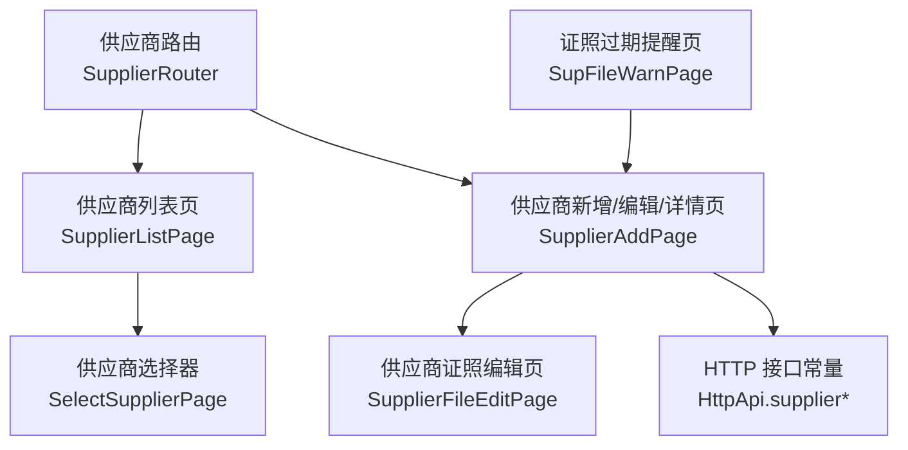
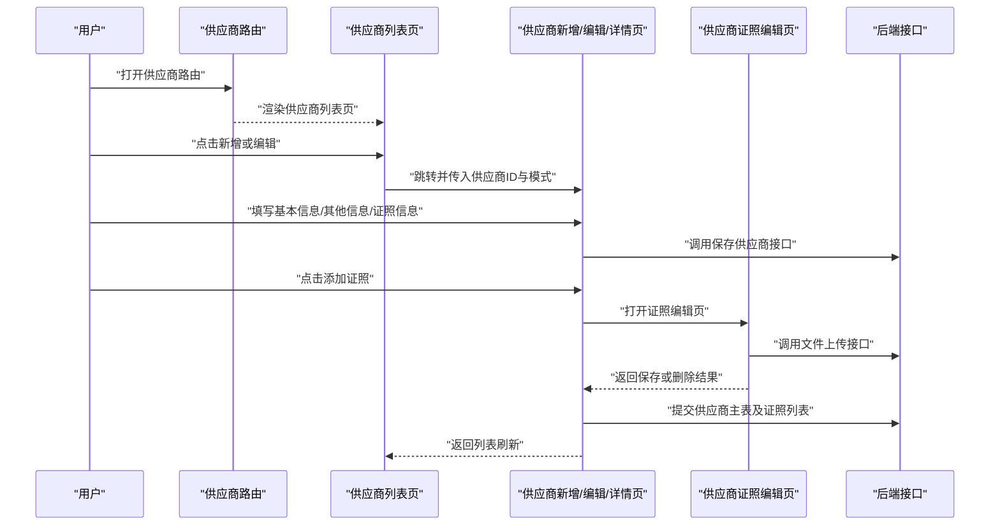
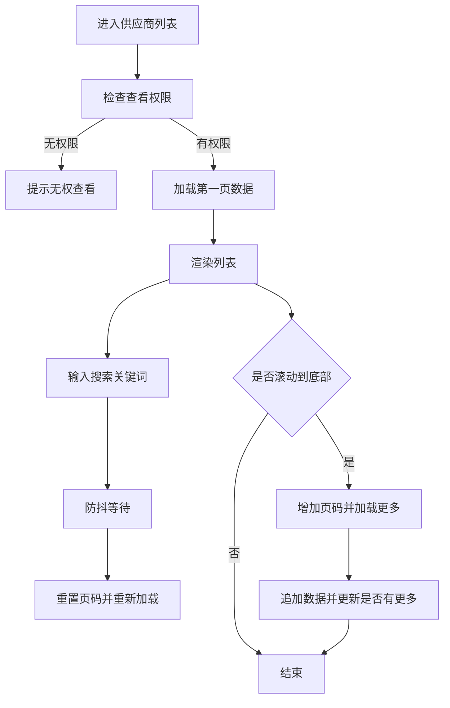
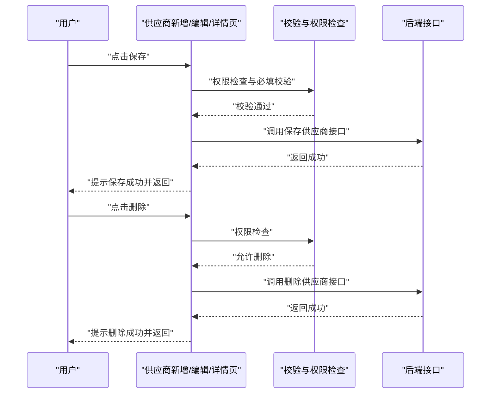
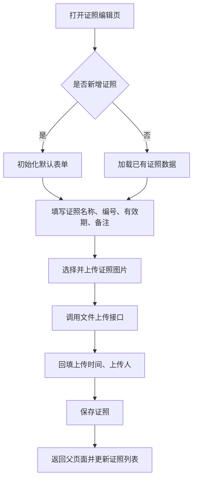
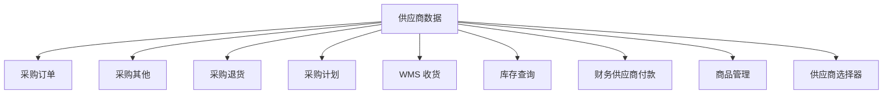
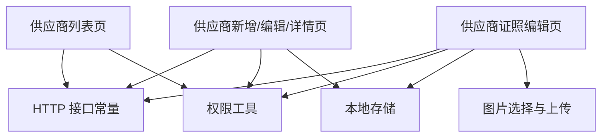

# 供应商管理

<cite>
**本文引用的文件**   
- [list.dart](file://lib/pages/business/purchase/supplier/list.dart)
- [add.dart](file://lib/pages/business/purchase/supplier/add.dart)
- [file_edit.dart](file://lib/pages/business/purchase/supplier/file_edit.dart)
- [router.dart](file://lib/pages/business/purchase/supplier/router.dart)
- [http_api.dart](file://lib/net/http_api.dart)
- [select_supplier.dart](file://lib/components/select/select_supplier.dart)
- [sup_file_warn_page.dart](file://lib/pages/home/custom/sup_file_warn_page.dart)
</cite>

## 目录
1. [引言](#引言)
2. [项目结构定位](#项目结构定位)
3. [核心功能总览](#核心功能总览)
4. [架构与路由设计](#架构与路由设计)
5. [供应商列表与筛选](#供应商列表与筛选)
6. [供应商档案增删改查](#供应商档案增删改查)
7. [供应商分类与等级管理](#供应商分类与等级管理)
8. [联系方式、银行账户与结算方式](#联系方式银行账户与结算方式)
9. [供应商资质文件与有效期提醒](#供应商资质文件与有效期提醒)
10. [采购业务中的应用](#采购业务中的应用)
11. [典型业务场景](#典型业务场景)
12. [依赖关系分析](#依赖关系分析)
13. [性能与体验特征](#性能与体验特征)
14. [故障排查指南](#故障排查指南)
15. [结论](#结论)

## 引言
本文件面向灵犀管店 Flutter 应用中的“供应商管理”能力，围绕供应商基础信息维护、分类体系、经销方式、银行账户、资质证照、过期提醒以及采购环节中的数据引用展开说明。文档以现有代码实现为依据，重点解释：
- 供应商列表查询、搜索与多维度筛选；
- 供应商新增、编辑、查看与删除；
- 供应商分类树选择；
- 基本信息、其他信息与证照信息三栏式维护；
- 证照上传、编辑与删除；
- 证照过期提醒；
- 供应商数据在采购、库存、财务等模块中的引用方式。

## 项目结构定位
供应商管理功能主要位于业务模块的“采购”子模块中，采用页面+路由+网络接口常量组织方式：
- 列表页：`SupplierListPage`
- 新增/编辑/详情页：`SupplierAddPage`
- 证照编辑页：`SupplierFileEditPage`
- 供应商路由注册：`SupplierRouter`
- 网络接口常量：`HttpApi.supplier*`
- 外部复用组件：供应商选择器 `SelectSupplierPage`
- 首页扩展入口：供应商证照过期提醒 `SupFileWarnPage`

**图示来源**  
- [router.dart:1-25](file://lib/pages/business/purchase/supplier/router.dart#L1-L25)  
- [list.dart:1-200](file://lib/pages/business/purchase/supplier/list.dart#L1-L200)  
- [add.dart:1-200](file://lib/pages/business/purchase/supplier/add.dart#L1-L200)  
- [file_edit.dart:1-200](file://lib/pages/business/purchase/supplier/file_edit.dart#L1-L200)  
- [http_api.dart:380-386](file://lib/net/http_api.dart#L380-L386)  
- [select_supplier.dart:1-39](file://lib/components/select/select_supplier.dart#L1-L39)  
- [sup_file_warn_page.dart:1-200](file://lib/pages/home/custom/sup_file_warn_page.dart#L1-L200)

**章节来源**  
- [router.dart:1-25](file://lib/pages/business/purchase/supplier/router.dart#L1-L25)  
- [http_api.dart:380-386](file://lib/net/http_api.dart#L380-L386)

## 核心功能总览
当前代码已实现的供应商管理能力包括：
- 供应商列表分页加载、滚动加载更多；
- 按编码/名称/手机号模糊搜索；
- 按供应商分类、状态、经销方式筛选；
- 新增供应商时自动生成编码；
- 供应商基本信息、其他信息、证照信息三栏维护；
- 经销商方式包含购销、联营、成本代销、扣率代销、租赁；
- 扣率在特定经销方式下可配置；
- 银行账户、营业执照、税务登记号等结算相关字段维护；
- 证照图片上传、有效期设置、编辑与删除；
- 证照过期提醒与跳转处理；
- 权限控制覆盖查看、新增、编辑、删除等操作；
- 供应商数据被采购订单、入库、WMS、财务付款等模块引用。

未在当前代码中发现的功能范围：
- 独立的供应商批量操作（如批量停用、批量导出）未在供应商页面直接实现；
- 供应商评估指标、绩效考核评分模型未在供应商页面实现；
- 供应商黑名单独立实体未体现，但可通过“状态”字段表达冻结或停用等业务约束。

**章节来源**  
- [list.dart:1-200](file://lib/pages/business/purchase/supplier/list.dart#L1-L200)  
- [list.dart:801-1204](file://lib/pages/business/purchase/supplier/list.dart#L801-L1204)  
- [add.dart:1-200](file://lib/pages/business/purchase/supplier/add.dart#L1-L200)  
- [add.dart:201-520](file://lib/pages/business/purchase/supplier/add.dart#L201-L520)  
- [add.dart:901-1426](file://lib/pages/business/purchase/supplier/add.dart#L901-L1426)  
- [file_edit.dart:1-200](file://lib/pages/business/purchase/supplier/file_edit.dart#L1-L200)  
- [file_edit.dart:201-567](file://lib/pages/business/purchase/supplier/file_edit.dart#L201-L567)  
- [sup_file_warn_page.dart:1-200](file://lib/pages/home/custom/sup_file_warn_page.dart#L1-L200)

## 架构与路由设计
供应商模块使用 Fluro 路由进行页面注册，对外暴露两个核心路由：
- `/purchase/supplier/list`：供应商列表；
- `/purchase/supplier/add`：供应商新增或编辑入口。

`SupplierListPage` 负责列表展示和跳转到新增/编辑页；`SupplierAddPage` 承载新增、编辑、查看三种模式；`SupplierFileEditPage` 专注证照编辑，通过导航返回值与父页面同步证照列表。

**图示来源**  
- [router.dart:1-25](file://lib/pages/business/purchase/supplier/router.dart#L1-L25)  
- [list.dart:801-880](file://lib/pages/business/purchase/supplier/list.dart#L801-L880)  
- [add.dart:901-1020](file://lib/pages/business/purchase/supplier/add.dart#L901-L1020)  
- [file_edit.dart:1-200](file://lib/pages/business/purchase/supplier/file_edit.dart#L1-L200)  
- [http_api.dart:380-386](file://lib/net/http_api.dart#L380-L386)

**章节来源**  
- [router.dart:1-25](file://lib/pages/business/purchase/supplier/router.dart#L1-L25)

## 供应商列表与筛选
`SupplierListPage` 提供以下能力：
- 分页加载，每页固定大小；
- 滚动到底部自动加载下一页；
- 支持上拉刷新；
- 搜索框支持输入后防抖触发查询；
- 筛选抽屉支持状态、经销方式、供应商分类；
- 快速状态选择与快速经销方式选择；
- 卡片展示供应商名称、联系人、手机号、地址与经销方式标签；
- 点击卡片进入编辑模式。

### 列表查询流程

**图示来源**  
- [list.dart:1-200](file://lib/pages/business/purchase/supplier/list.dart#L1-L200)  
- [list.dart:801-1204](file://lib/pages/business/purchase/supplier/list.dart#L801-L1204)

### 筛选维度
- **状态**：正常、冻结业务、冻结账款、停用；
- **经销方式**：购销、联营、成本代销、扣率代销、租赁；
- **供应商分类**：从后端获取树形分类，支持展开/折叠、单选选中。

筛选参数最终拼接到列表请求中，包含分类标识、分类名称、状态值、经销方式值以及搜索条件。

**章节来源**  
- [list.dart:1-200](file://lib/pages/business/purchase/supplier/list.dart#L1-L200)  
- [list.dart:201-450](file://lib/pages/business/purchase/supplier/list.dart#L201-L450)  
- [list.dart:451-800](file://lib/pages/business/purchase/supplier/list.dart#L451-L800)  
- [list.dart:801-1204](file://lib/pages/business/purchase/supplier/list.dart#L801-L1204)

## 供应商档案增删改查
`SupplierAddPage` 同时承担新增、编辑、查看三类场景，通过模式参数区分：
- 新增模式：自动生成供应商编码；
- 编辑模式：加载供应商详情；
- 查看模式：只读展示，并提供删除与切换到编辑模式的按钮。

### 表单数据结构
供应商主表字段包括：
- 编码、名称、分类、联系人、手机、传真、地址；
- 业务员；
- 期初金额、预付款金额、年采购额度；
- 经销方式、扣率；
- 备注；
- 开户行、银行账户；
- 营业执照、税务登记号；
- 其他扩展字段如助记码、区域、图片链接、合同范本信息等；
- 证照列表随主表一起提交。

### 保存逻辑
保存时以原始响应数据为基础合并用户编辑字段，确保后端下发的字段不丢失；校验必填项后发起保存接口。新增模式下支持“保存并继续”，清空表单并重新生成编码。

### 删除逻辑
删除时使用记录主键 `id` 调用删除接口，删除成功后返回上一页并刷新。

**图示来源**  
- [add.dart:201-520](file://lib/pages/business/purchase/supplier/add.dart#L201-L520)  
- [http_api.dart:380-384](file://lib/net/http_api.dart#L380-L384)

**章节来源**  
- [add.dart:1-200](file://lib/pages/business/purchase/supplier/add.dart#L1-L200)  
- [add.dart:201-520](file://lib/pages/business/purchase/supplier/add.dart#L201-L520)  
- [add.dart:901-1426](file://lib/pages/business/purchase/supplier/add.dart#L901-L1426)

## 供应商分类与等级管理
供应商分类由后端分类接口返回树形结构，前端将其展平为带深度的节点列表，用于分类选择与筛选。分类节点关键字段包括：
- `typeid`：分类标识；
- `name`：分类名称；
- `code`：分类编码；
- `children`：子分类列表。

分类选择器支持：
- 展开/折叠子分类；
- 单选选中分类；
- 显示 `[编码] 名称` 格式的分类文本；
- 空数据时显示“暂无分类数据”。

当前代码未实现供应商等级字段。若后续需要引入等级管理，可在供应商主表增加等级字段，并在列表、筛选与表单中补充对应 UI 与校验逻辑。

**章节来源**  
- [list.dart:451-800](file://lib/pages/business/purchase/supplier/list.dart#L451-L800)  
- [add.dart:521-900](file://lib/pages/business/purchase/supplier/add.dart#L521-L900)  
- [http_api.dart:384](file://lib/net/http_api.dart#L384)

## 联系方式、银行账户与结算方式
供应商基本信息中包含联系方式字段：
- 联系人；
- 手机号码；
- 传真号码；
- 地址；
- 业务员。

其他信息中包含结算相关字段：
- 开户行；
- 银行账户；
- 营业执照；
- 税务登记号；
- 期初金额；
- 预付款金额；
- 年采购额度；
- 经销方式；
- 扣率。

经销方式枚举包含：
- 购销；
- 联营；
- 成本代销；
- 扣率代销；
- 租赁。

当经销方式为联营、扣率代销或租赁时，界面会显示“扣率(%)”字段，并对输入值进行限制：仅数字和小数点、最多两位小数、最大值不超过 100。

**章节来源**  
- [add.dart:1-200](file://lib/pages/business/purchase/supplier/add.dart#L1-L200)  
- [add.dart:201-520](file://lib/pages/business/purchase/supplier/add.dart#L201-L520)  
- [add.dart:901-1426](file://lib/pages/business/purchase/supplier/add.dart#L901-L1426)

## 供应商资质文件与有效期提醒
供应商资质文件以“证照”形式管理，每个证照包含：
- 证照名称；
- 证照编号；
- 有效期；
- 备注；
- 证照图片；
- 上传时间；
- 上传人；
- 文件 URL、文件名、文件大小；
- 临时键与状态。

### 证照编辑流程

**图示来源**  
- [file_edit.dart:1-200](file://lib/pages/business/purchase/supplier/file_edit.dart#L1-L200)  
- [file_edit.dart:201-567](file://lib/pages/business/purchase/supplier/file_edit.dart#L201-L567)  
- [add.dart:901-1020](file://lib/pages/business/purchase/supplier/add.dart#L901-L1020)

### 证照过期提醒
`SupFileWarnPage` 提供供应商证照过期提醒：
- 从首页提示总数接口获取过期证照数量；
- 从供应商证照列表接口获取即将过期证照明细；
- 展示摘要卡片与证照卡片；
- 点击证照卡片跳转到供应商查看页。

该页面体现了供应商资质文件的有效期管理机制：系统根据有效期判断是否提醒，并将提醒结果与供应商档案关联。

**章节来源**  
- [file_edit.dart:1-200](file://lib/pages/business/purchase/supplier/file_edit.dart#L1-L200)  
- [file_edit.dart:201-567](file://lib/pages/business/purchase/supplier/file_edit.dart#L201-L567)  
- [sup_file_warn_page.dart:1-200](file://lib/pages/home/custom/sup_file_warn_page.dart#L1-L200)

## 采购业务中的应用
供应商数据在采购及相关业务中被广泛引用，主要体现在：
- 采购订单、采购其他出库、采购退货、采购计划等采购模块；
- 入库单、WMS 收货；
- 库存查询、盘点、调拨；
- 财务供应商付款；
- 商品管理与供应商关联；
- 全局供应商选择器。

`SelectSupplierPage` 通过调用供应商列表接口实现供应商选择，供采购单据、库存单据、财务单据等页面复用。

**图示来源**  
- [select_supplier.dart:1-39](file://lib/components/select/select_supplier.dart#L1-L39)  
- [http_api.dart:380-386](file://lib/net/http_api.dart#L380-L386)

**章节来源**  
- [select_supplier.dart:1-39](file://lib/components/select/select_supplier.dart#L1-L39)

## 典型业务场景
### 新供应商引入流程
1. 进入供应商列表；
2. 点击新增；
3. 自动生成供应商编码；
4. 填写基本信息：名称、分类、联系人、手机、地址、业务员；
5. 填写其他信息：开户行、银行账户、营业执照、税务登记号；
6. 添加证照：上传证照图片、设置有效期；
7. 保存供应商；
8. 如需连续录入，可使用“保存并继续”；
9. 回到列表确认新增成功。

### 供应商信息变更管理
1. 在列表中搜索目标供应商；
2. 点击卡片进入编辑模式；
3. 修改基本信息或其他信息；
4. 调整经销方式或扣率；
5. 更新证照信息；
6. 保存变更；
7. 返回列表刷新。

### 供应商状态与黑名单管理
当前代码未实现独立黑名单实体，但可通过“状态”字段表达业务约束：
- 正常：可参与采购；
- 冻结业务：暂停业务合作；
- 冻结账款：存在应收应付问题；
- 停用：不再使用。

建议在后续版本中补充“供应商黑名单”独立模型与审批流程，并与状态字段建立映射关系，以便审计与追溯。

**章节来源**  
- [list.dart:201-450](file://lib/pages/business/purchase/supplier/list.dart#L201-L450)  
- [list.dart:801-1204](file://lib/pages/business/purchase/supplier/list.dart#L801-L1204)  
- [add.dart:201-520](file://lib/pages/business/purchase/supplier/add.dart#L201-L520)

## 依赖关系分析
供应商模块依赖以下核心资源：
- HTTP 接口常量：供应商列表、详情、保存、删除、编码生成、分类列表、证照列表；
- 权限工具：查看、新增、编辑、删除权限校验；
- 本地存储：登录用户信息、门店信息；
- 图片选择与上传：证照图片上传；
- 日志记录：页面进入、搜索、新增、保存等操作日志。

**图示来源**  
- [list.dart:1-200](file://lib/pages/business/purchase/supplier/list.dart#L1-L200)  
- [add.dart:1-200](file://lib/pages/business/purchase/supplier/add.dart#L1-L200)  
- [file_edit.dart:1-200](file://lib/pages/business/purchase/supplier/file_edit.dart#L1-L200)  
- [http_api.dart:380-386](file://lib/net/http_api.dart#L380-L386)

**章节来源**  
- [http_api.dart:380-386](file://lib/net/http_api.dart#L380-L386)

## 性能与体验特征
供应商列表使用分页与滚动加载更多策略，减少单次数据量；
- 列表使用 `cacheExtent` 提升滚动性能；
- 卡片项使用 `RepaintBoundary` 减少无关重绘；
- 搜索输入使用防抖定时器，避免频繁请求；
- 下拉刷新与滚动加载结合，提升大数据量体验；
- 分类选择器将树形数据展平并缓存，提升交互流畅度；
- 证照图片上传前限制文件大小，避免过大文件影响性能。

建议进一步优化方向：
- 对分类树数据做本地缓存，减少重复请求；
- 对供应商列表搜索结果进行服务端排序与索引优化；
- 对证照图片加载使用懒加载与缩略图；
- 对批量操作增加后端批量接口，提高批量处理能力。

**章节来源**  
- [list.dart:1-200](file://lib/pages/business/purchase/supplier/list.dart#L1-L200)  
- [list.dart:451-800](file://lib/pages/business/purchase/supplier/list.dart#L451-L800)  
- [add.dart:521-900](file://lib/pages/business/purchase/supplier/add.dart#L521-L900)  
- [file_edit.dart:1-200](file://lib/pages/business/purchase/supplier/file_edit.dart#L1-L200)

## 故障排查指南
常见问题与排查建议：
- **无法查看供应商列表**：检查“查看供应商”权限；
- **无法新增供应商**：检查“新增供应商”权限；
- **无法编辑供应商**：检查“编辑供应商”权限；
- **无法删除供应商**：检查“删除供应商”权限；
- **证照上传失败**：检查图片大小是否超过限制、网络连接是否正常；
- **证照有效期为空**：检查后端返回日期格式，前端已兼容完整时间戳；
- **证照过期提醒数量为 0**：检查首页提示总数接口与门店 ID 是否正确；
- **分类选择无数据**：检查分类接口返回结构与字段名；
- **扣率输入异常**：检查输入格式化规则，确保不超过 100 且最多两位小数。

**章节来源**  
- [list.dart:1-200](file://lib/pages/business/purchase/supplier/list.dart#L1-L200)  
- [add.dart:201-520](file://lib/pages/business/purchase/supplier/add.dart#L201-L520)  
- [file_edit.dart:1-200](file://lib/pages/business/purchase/supplier/file_edit.dart#L1-L200)  
- [sup_file_warn_page.dart:1-200](file://lib/pages/home/custom/sup_file_warn_page.dart#L1-L200)

## 结论
灵犀管店 Flutter 项目的供应商管理功能以列表、新增/编辑/查看、证照编辑为核心页面，配合路由与网络接口常量形成完整闭环。当前实现覆盖了供应商基本信息、联系方式、银行账户、结算方式、分类选择、证照管理与有效期提醒，并在采购、库存、财务等模块中提供数据引用能力。

尚未在当前代码中发现的能力包括：
- 供应商评估与绩效考核模型；
- 独立供应商黑名单实体；
- 批量操作界面与批量接口。

若业务需要，可在现有基础上扩展评估维度、绩效指标、黑名单审批流程与批量操作能力，使供应商管理体系更加完善。