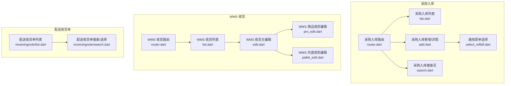
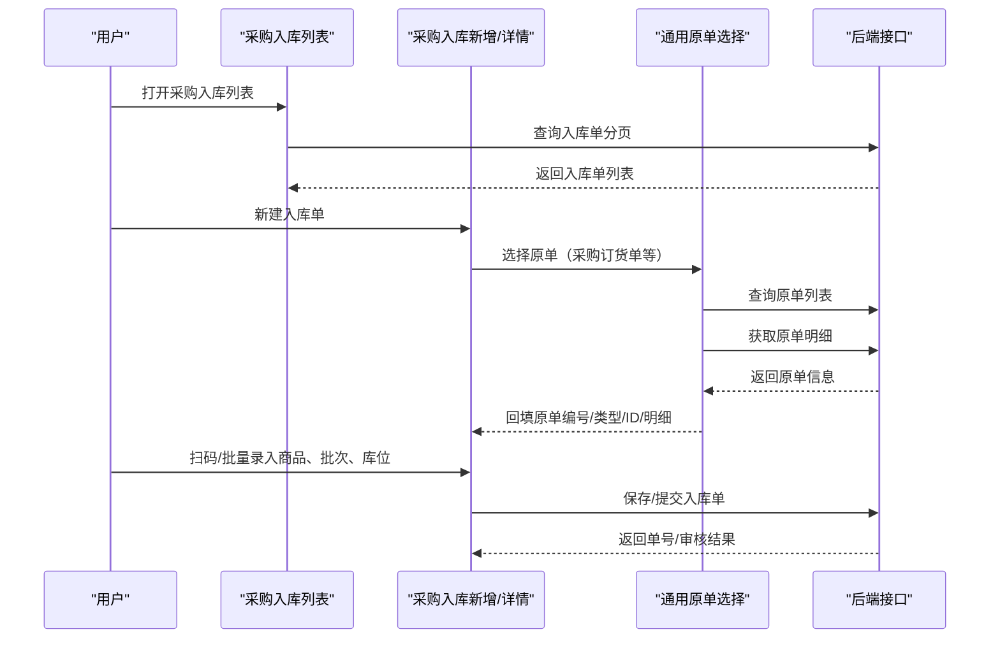
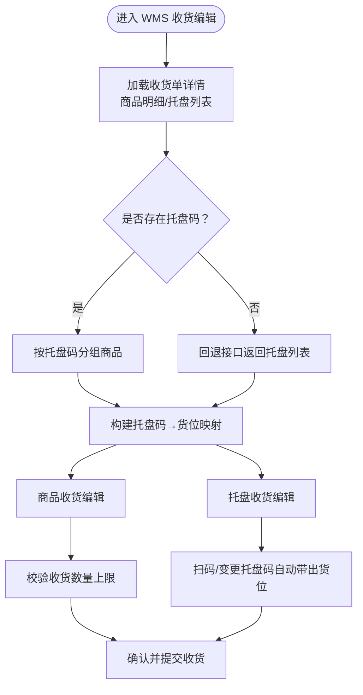
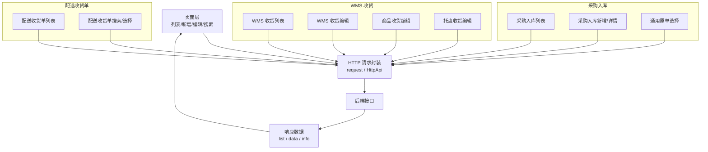
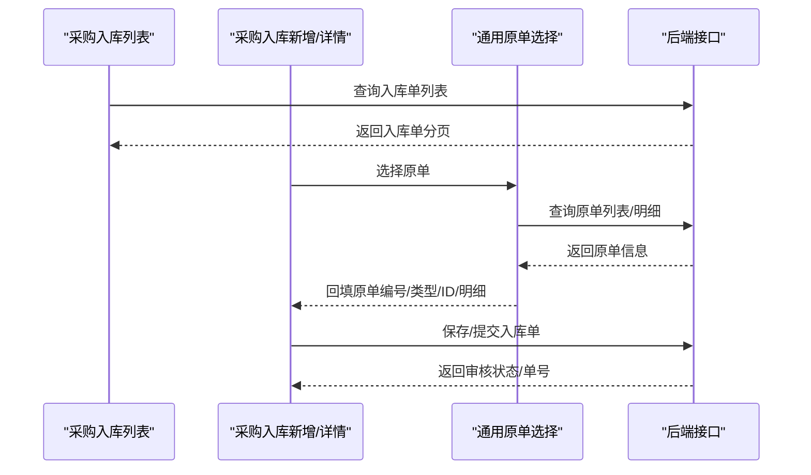
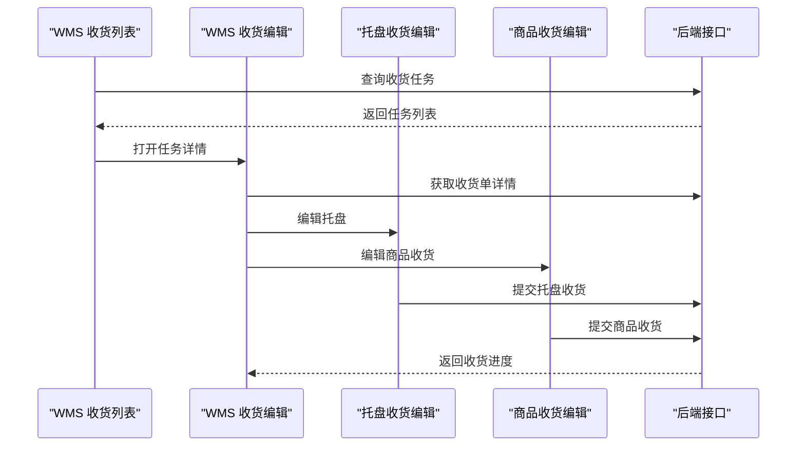
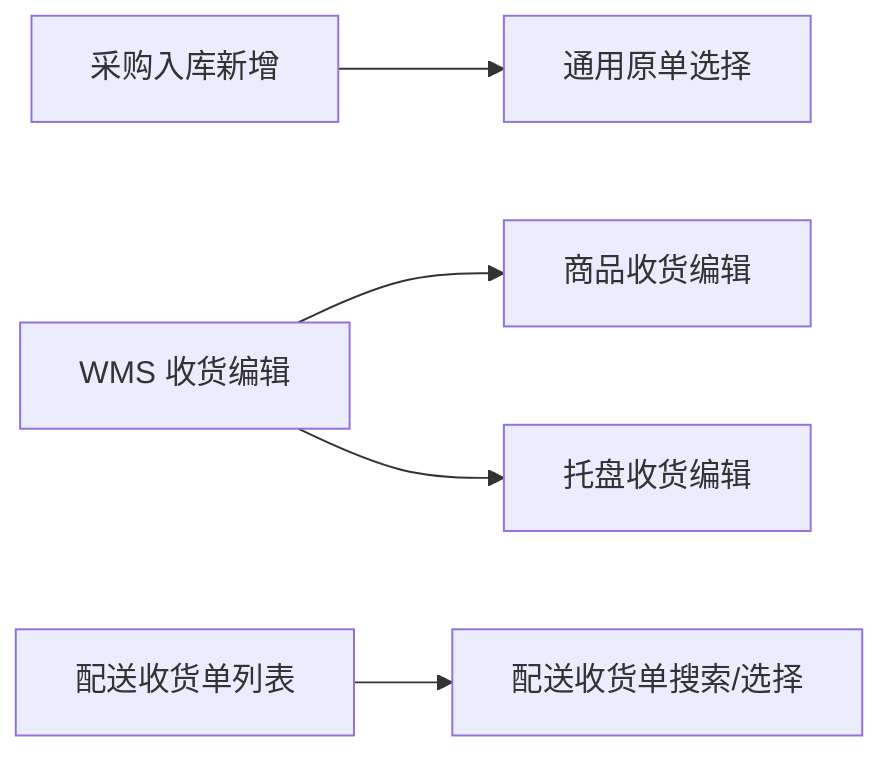

# 入库管理

<cite>
**本文引用的文件**   
- [lib/pages/business/purchase/instore/router.dart](file://lib/pages/business/purchase/instore/router.dart)
- [lib/pages/business/purchase/instore/list.dart](file://lib/pages/business/purchase/instore/list.dart)
- [lib/pages/business/purchase/instore/add.dart](file://lib/pages/business/purchase/instore/add.dart)
- [lib/pages/business/purchase/instore/search.dart](file://lib/pages/business/purchase/instore/search.dart)
- [lib/components/select/select_refbill.dart](file://lib/components/select/select_refbill.dart)
- [lib/pages/business/wms/receive/router.dart](file://lib/pages/business/wms/receive/router.dart)
- [lib/pages/business/wms/receive/list.dart](file://lib/pages/business/wms/receive/list.dart)
- [lib/pages/business/wms/receive/edit.dart](file://lib/pages/business/wms/receive/edit.dart)
- [lib/pages/business/wms/receive/pro_edit.dart](file://lib/pages/business/wms/receive/pro_edit.dart)
- [lib/pages/business/wms/receive/pallet_edit.dart](file://lib/pages/business/wms/receive/pallet_edit.dart)
- [lib/pages/business/chain/receivingnote/search.dart](file://lib/pages/business/chain/receivingnote/search.dart)
- [lib/pages/business/chain/receivingnote/list.dart](file://lib/pages/business/chain/receivingnote/list.dart)
</cite>

## 目录
1. [引言](#引言)
2. [项目结构与入口](#项目结构与入口)
3. [入库业务总览](#入库业务总览)
4. [核心组件分析](#核心组件分析)
5. [架构与数据流](#架构与数据流)
6. [详细业务流程](#详细业务流程)
7. [依赖关系分析](#依赖关系分析)
8. [性能与可用性特性](#性能与可用性特性)
9. [异常处理与问题商品处理](#异常处理与问题商品处理)
10. [排错指南](#排错指南)
11. [结论](#结论)

## 引言
本文件面向灵犀管店 Flutter 项目的“入库管理”能力，聚焦以下入库场景：
- 采购入库：基于采购订货单、采购计划单、自采申请单、直配订单、越库订单等采购单据创建入库单。
- WMS 收货：仓库收货任务列表、托盘收货、按商品分批收货、货位分配与条码扫描。
- 配送收货单：连锁调拨、配送发货等业务中产生的配送收货单查询、选择与编辑。

文档从系统结构、页面职责、数据来源、流程编排、批次与库位逻辑、搜索筛选统计、扫码与多仓库模式，以及与库存模块的同步和异常处理等方面进行说明。为避免泄露实现细节，所有代码级引用均以“文件路径 + 行号范围”的形式给出。

## 项目结构与入口
入库相关功能分布在三个子域：
- 采购入库：`lib/pages/business/purchase/instore`
- WMS 收货：`lib/pages/business/wms/receive`
- 配送收货单：`lib/pages/business/chain/receivingnote`
- 公共原单选择组件：`lib/components/select/select_refbill.dart`

**图表来源**
- [lib/pages/business/purchase/instore/router.dart:1-51](file://lib/pages/business/purchase/instore/router.dart#L1-L51)
- [lib/pages/business/wms/receive/router.dart:1-17](file://lib/pages/business/wms/receive/router.dart#L1-L17)
- [lib/pages/business/purchase/instore/list.dart:1-200](file://lib/pages/business/purchase/instore/list.dart#L1-L200)
- [lib/pages/business/purchase/instore/add.dart:1-200](file://lib/pages/business/purchase/instore/add.dart#L1-L200)
- [lib/pages/business/purchase/instore/search.dart:1-200](file://lib/pages/business/purchase/instore/search.dart#L1-L200)
- [lib/components/select/select_refbill.dart:1-200](file://lib/components/select/select_refbill.dart#L1-L200)
- [lib/pages/business/wms/receive/list.dart:1-200](file://lib/pages/business/wms/receive/list.dart#L1-L200)
- [lib/pages/business/wms/receive/edit.dart:1-200](file://lib/pages/business/wms/receive/edit.dart#L1-L200)
- [lib/pages/business/wms/receive/pro_edit.dart:1-200](file://lib/pages/business/wms/receive/pro_edit.dart#L1-L200)
- [lib/pages/business/wms/receive/pallet_edit.dart:1-200](file://lib/pages/business/wms/receive/pallet_edit.dart#L1-L200)
- [lib/pages/business/chain/receivingnote/list.dart:1-200](file://lib/pages/business/chain/receivingnote/list.dart#L1-L200)
- [lib/pages/business/chain/receivingnote/search.dart:1-200](file://lib/pages/business/chain/receivingnote/search.dart#L1-L200)

**章节来源**
- [lib/pages/business/purchase/instore/router.dart:1-51](file://lib/pages/business/purchase/instore/router.dart#L1-L51)
- [lib/pages/business/wms/receive/router.dart:1-17](file://lib/pages/business/wms/receive/router.dart#L1-L17)

## 入库业务总览
入库管理的核心目标是把外部采购或内部调拨产生的货物，经过验收、核对、质检、批次登记与库位分配后，形成可追踪的入库记录并同步库存。

主要类型与来源：
- 采购入库单：来源于采购订货单、采购计划单、自采申请单、直配订单、越库订单。通过通用原单选择组件拉取已审核的原单及明细。
- WMS 收货任务：来源于仓库收货任务（如 WMS 接口返回），支持按托盘、按商品维度收货，并维护批次、生产日期、有效期、货位、托盘码。
- 配送收货单：用于连锁门店对配送中心发货的确认收货，同时可作为其他业务的参考单据来源。

关键关联字段（概念性说明）：
- 原单编号、原单类型、原单 ID：用于溯源采购来源。
- 机构/门店、仓库、货位、托盘：用于物理入库定位。
- 商品编码、批次号、数量、单位：用于库存增量与批次追踪。
- 审核状态：待审核、已审核、已驳回；影响是否允许继续操作和库存生效。

**章节来源**
- [lib/components/select/select_refbill.dart:1-200](file://lib/components/select/select_refbill.dart#L1-L200)
- [lib/pages/business/wms/receive/edit.dart:1-200](file://lib/pages/business/wms/receive/edit.dart#L1-L200)
- [lib/pages/business/chain/receivingnote/list.dart:1-200](file://lib/pages/business/chain/receivingnote/list.dart#L1-L200)

## 核心组件分析

### 采购入库模块
采购入库提供三类页面：
- 列表页：分页加载、Tab 切换（全部/待审核/已审核/可选已驳回）、时间范围与供应商等筛选、权限校验、审计日志。
- 新增/详情页：表单头（供应商、仓库、门店、经手人、备注）、扫码入库、批量选择、附件、多级审批、提交/打印/撤回/删除等操作。
- 搜索页：供其他模块作为原单选择或独立查询使用，支持日期、供应商、合并参数透传。

关键行为要点：
- 列表页调用采购入库列表接口，按状态、单号、供应商、创建人、时间等条件分页查询。
- 新增页支持红外扫码枪与二维码扫描，防抖触发扫码查询，支持扫码后自动匹配商品、批次、库位。
- 原单选择通过 `SelectRefbillPage` 统一选择采购订货单、采购计划单、自采申请单、直配订单、越库订单，并获取完整明细。
- 审核状态与审批流由页面状态与后端 signflag 共同决定。

**图表来源**
- [lib/pages/business/purchase/instore/list.dart:1-200](file://lib/pages/business/purchase/instore/list.dart#L1-L200)
- [lib/pages/business/purchase/instore/add.dart:1-200](file://lib/pages/business/purchase/instore/add.dart#L1-L200)
- [lib/components/select/select_refbill.dart:1-200](file://lib/components/select/select_refbill.dart#L1-L200)

**章节来源**
- [lib/pages/business/purchase/instore/router.dart:1-51](file://lib/pages/business/purchase/instore/router.dart#L1-L51)
- [lib/pages/business/purchase/instore/list.dart:1-200](file://lib/pages/business/purchase/instore/list.dart#L1-L200)
- [lib/pages/business/purchase/instore/add.dart:1-200](file://lib/pages/business/purchase/instore/add.dart#L1-L200)
- [lib/pages/business/purchase/instore/search.dart:1-200](file://lib/pages/business/purchase/instore/search.dart#L1-L200)
- [lib/components/select/select_refbill.dart:1-200](file://lib/components/select/select_refbill.dart#L1-L200)

### WMS 收货模块
WMS 收货围绕“收货任务”展开，包括：
- 收货任务列表：按待收货/已收货 Tab 分页查询，支持供应商、创建人、商品名称、时间筛选。
- 收货主编辑：展示收货单头、商品明细、托盘分组、收货进度（待收货/部分收货/已收货）。
- 商品收货编辑：按商品维度的批次、生产日期、有效期、收货数量、货位、托盘码维护。
- 托盘收货编辑：按托盘维度维护托盘码、货位、托盘内商品项，支持扫码添加、删除、自动带出货位。

关键逻辑：
- 托盘分组：根据托盘码聚合商品明细，若明细无托盘则回退到接口返回的托盘列表。
- 托盘→货位映射：根据已有明细生成托盘码到货位号的映射，用于自动填充和校验。
- 商品收货数量上限：每行的最大允许收货数 = 订单数量 - 其他行已收货数量。
- 扫码交互：托盘码扫码、商品扫码添加，结合二维码扫描页面完成。

**图表来源**
- [lib/pages/business/wms/receive/edit.dart:1-200](file://lib/pages/business/wms/receive/edit.dart#L1-L200)
- [lib/pages/business/wms/receive/pro_edit.dart:1-200](file://lib/pages/business/wms/receive/pro_edit.dart#L1-L200)
- [lib/pages/business/wms/receive/pallet_edit.dart:1-200](file://lib/pages/business/wms/receive/pallet_edit.dart#L1-L200)

**章节来源**
- [lib/pages/business/wms/receive/router.dart:1-17](file://lib/pages/business/wms/receive/router.dart#L1-L17)
- [lib/pages/business/wms/receive/list.dart:1-200](file://lib/pages/business/wms/receive/list.dart#L1-L200)
- [lib/pages/business/wms/receive/edit.dart:1-200](file://lib/pages/business/wms/receive/edit.dart#L1-L200)
- [lib/pages/business/wms/receive/pro_edit.dart:1-200](file://lib/pages/business/wms/receive/pro_edit.dart#L1-L200)
- [lib/pages/business/wms/receive/pallet_edit.dart:1-200](file://lib/pages/business/wms/receive/pallet_edit.dart#L1-L200)

### 配送收货单模块
配送收货单模块负责：
- 列表页：按待审核/已审核/可选已驳回 Tab 分页查询，支持收货门店、配送中心、创建人、时间范围筛选。
- 搜索/选择页：支持多种单据类型的原单查询（配送收货单、调拨申请单、要货申请单），并可作为其他业务的选择器返回整张单据。

关键点：
- 列表页按 signflag 控制审核状态，按 storetype 计算 sids/nosidsflag 以限定机构范围。
- 搜索页根据不同单据类型调用不同接口，并传递相应过滤参数。

**章节来源**
- [lib/pages/business/chain/receivingnote/list.dart:1-200](file://lib/pages/business/chain/receivingnote/list.dart#L1-L200)
- [lib/pages/business/chain/receivingnote/search.dart:1-200](file://lib/pages/business/chain/receivingnote/search.dart#L1-L200)

## 架构与数据流
整体数据流遵循“前端页面 → HTTP 工具 → 后端接口 → 数据渲染/状态更新”的模式。

**图表来源**
- [lib/pages/business/purchase/instore/list.dart:1-200](file://lib/pages/business/purchase/instore/list.dart#L1-L200)
- [lib/pages/business/purchase/instore/add.dart:1-200](file://lib/pages/business/purchase/instore/add.dart#L1-L200)
- [lib/components/select/select_refbill.dart:1-200](file://lib/components/select/select_refbill.dart#L1-L200)
- [lib/pages/business/wms/receive/list.dart:1-200](file://lib/pages/business/wms/receive/list.dart#L1-L200)
- [lib/pages/business/wms/receive/edit.dart:1-200](file://lib/pages/business/wms/receive/edit.dart#L1-L200)
- [lib/pages/business/wms/receive/pro_edit.dart:1-200](file://lib/pages/business/wms/receive/pro_edit.dart#L1-L200)
- [lib/pages/business/wms/receive/pallet_edit.dart:1-200](file://lib/pages/business/wms/receive/pallet_edit.dart#L1-L200)
- [lib/pages/business/chain/receivingnote/list.dart:1-200](file://lib/pages/business/chain/receivingnote/list.dart#L1-L200)
- [lib/pages/business/chain/receivingnote/search.dart:1-200](file://lib/pages/business/chain/receivingnote/search.dart#L1-L200)

## 详细业务流程

### 采购入库单流程
1. 进入采购入库列表，进行权限校验与审计日志记录。
2. 列表按状态、单号、供应商、时间等条件分页查询。
3. 新建入库单时，通过通用原单选择组件选择采购订货单等原单，并拉取原单明细。
4. 在新增页中进行商品录入、扫码入库、批量选择、批次与库位填写。
5. 提交入库单，根据 signflag 判断审核状态，支持打印、撤回、删除等后续操作。

**图表来源**
- [lib/pages/business/purchase/instore/list.dart:1-200](file://lib/pages/business/purchase/instore/list.dart#L1-L200)
- [lib/pages/business/purchase/instore/add.dart:1-200](file://lib/pages/business/purchase/instore/add.dart#L1-L200)
- [lib/components/select/select_refbill.dart:1-200](file://lib/components/select/select_refbill.dart#L1-L200)

**章节来源**
- [lib/pages/business/purchase/instore/list.dart:1-200](file://lib/pages/business/purchase/instore/list.dart#L1-L200)
- [lib/pages/business/purchase/instore/add.dart:1-200](file://lib/pages/business/purchase/instore/add.dart#L1-L200)
- [lib/components/select/select_refbill.dart:1-200](file://lib/components/select/select_refbill.dart#L1-L200)

### WMS 收货任务流程
1. 打开 WMS 收货列表，按待收货/已收货 Tab 切换，并进行供应商、创建人、商品名称、时间筛选。
2. 点击任务进入收货编辑，查看商品明细与托盘分组。
3. 分别通过“商品收货编辑”与“托盘收货编辑”维护批次、数量、货位、托盘码。
4. 托盘码扫码后可自动带出货位；商品收货数量受订单数量限制。
5. 确认后提交收货，更新收货进度（待收货/部分收货/已收货）。

**图表来源**
- [lib/pages/business/wms/receive/list.dart:1-200](file://lib/pages/business/wms/receive/list.dart#L1-L200)
- [lib/pages/business/wms/receive/edit.dart:1-200](file://lib/pages/business/wms/receive/edit.dart#L1-L200)
- [lib/pages/business/wms/receive/pallet_edit.dart:1-200](file://lib/pages/business/wms/receive/pallet_edit.dart#L1-L200)
- [lib/pages/business/wms/receive/pro_edit.dart:1-200](file://lib/pages/business/wms/receive/pro_edit.dart#L1-L200)

**章节来源**
- [lib/pages/business/wms/receive/list.dart:1-200](file://lib/pages/business/wms/receive/list.dart#L1-L200)
- [lib/pages/business/wms/receive/edit.dart:1-200](file://lib/pages/business/wms/receive/edit.dart#L1-L200)
- [lib/pages/business/wms/receive/pallet_edit.dart:1-200](file://lib/pages/business/wms/receive/pallet_edit.dart#L1-L200)
- [lib/pages/business/wms/receive/pro_edit.dart:1-200](file://lib/pages/business/wms/receive/pro_edit.dart#L1-L200)

### 配送收货单流程
1. 进入配送收货单列表，按审核状态与机构范围筛选。
2. 通过搜索页按不同单据类型（配送收货单、调拨申请单、要货申请单）查询原单。
3. 选择原单后，将整张单据回传给调用方，供其进一步处理。

**章节来源**
- [lib/pages/business/chain/receivingnote/list.dart:1-200](file://lib/pages/business/chain/receivingnote/list.dart#L1-L200)
- [lib/pages/business/chain/receivingnote/search.dart:1-200](file://lib/pages/business/chain/receivingnote/search.dart#L1-L200)

## 依赖关系分析
- 页面层依赖 HTTP 工具发起网络请求，并通过常量定义接口路径。
- 通用原单选择组件被采购入库新增页复用，屏蔽了不同原单类型的差异。
- WMS 收货编辑页依赖商品收货编辑与托盘收货编辑，完成多维度的收货数据维护。
- 配送收货单列表与搜索页相互解耦，但共享相同的数据模型与筛选习惯。

**图表来源**
- [lib/pages/business/purchase/instore/add.dart:1-200](file://lib/pages/business/purchase/instore/add.dart#L1-L200)
- [lib/components/select/select_refbill.dart:1-200](file://lib/components/select/select_refbill.dart#L1-L200)
- [lib/pages/business/wms/receive/edit.dart:1-200](file://lib/pages/business/wms/receive/edit.dart#L1-L200)
- [lib/pages/business/wms/receive/pro_edit.dart:1-200](file://lib/pages/business/wms/receive/pro_edit.dart#L1-L200)
- [lib/pages/business/wms/receive/pallet_edit.dart:1-200](file://lib/pages/business/wms/receive/pallet_edit.dart#L1-L200)
- [lib/pages/business/chain/receivingnote/list.dart:1-200](file://lib/pages/business/chain/receivingnote/list.dart#L1-L200)
- [lib/pages/business/chain/receivingnote/search.dart:1-200](file://lib/pages/business/chain/receivingnote/search.dart#L1-L200)

**章节来源**
- [lib/pages/business/purchase/instore/add.dart:1-200](file://lib/pages/business/purchase/instore/add.dart#L1-L200)
- [lib/components/select/select_refbill.dart:1-200](file://lib/components/select/select_refbill.dart#L1-L200)
- [lib/pages/business/wms/receive/edit.dart:1-200](file://lib/pages/business/wms/receive/edit.dart#L1-L200)
- [lib/pages/business/wms/receive/pro_edit.dart:1-200](file://lib/pages/business/wms/receive/pro_edit.dart#L1-L200)
- [lib/pages/business/wms/receive/pallet_edit.dart:1-200](file://lib/pages/business/wms/receive/pallet_edit.dart#L1-L200)
- [lib/pages/business/chain/receivingnote/list.dart:1-200](file://lib/pages/business/chain/receivingnote/list.dart#L1-L200)
- [lib/pages/business/chain/receivingnote/search.dart:1-200](file://lib/pages/business/chain/receivingnote/search.dart#L1-L200)

## 性能与可用性特性
- 分页与防抖：多个列表页均使用分页加载与滚动触底加载，并结合防抖减少重复查询。
- Tab 动态长度：采购入库与配送收货单根据审批配置动态显示“已驳回” Tab，避免 TabBar 与控制器失步。
- 权限校验：关键页面在进入前进行权限检查，未授权时提示并阻止加载。
- 审计日志：页面进入、查询、搜索等操作写入操作审计日志，便于追踪。
- 扫码体验：采购入库新增页针对 PDA 扫码枪做了键盘隐藏、防抖与回车事件处理；WMS 收货通过二维码扫描页完成托盘码与商品扫码。

**章节来源**
- [lib/pages/business/purchase/instore/list.dart:1-200](file://lib/pages/business/purchase/instore/list.dart#L1-L200)
- [lib/pages/business/purchase/instore/add.dart:1-200](file://lib/pages/business/purchase/instore/add.dart#L1-L200)
- [lib/pages/business/chain/receivingnote/list.dart:1-200](file://lib/pages/business/chain/receivingnote/list.dart#L1-L200)
- [lib/pages/business/chain/receivingnote/search.dart:1-200](file://lib/pages/business/chain/receivingnote/search.dart#L1-L200)

## 异常处理与问题商品处理
- 权限异常：未获得查看权限时弹出提示，不执行数据加载。
- 网络异常：列表与选择页对请求失败进行降级处理，停止加载更多并提示错误。
- 原单明细获取失败：通用原单选择在 getInfo 失败时提示重试。
- 收货数量校验：商品收货编辑根据订单数量与其他行已收货数量计算最大允许收货数，防止超额。
- 托盘与货位一致性：托盘码变更后尝试自动带出货位，避免手动输入不一致。

建议的问题商品处理策略（结合现有校验机制）：
- 当扫码或批量录入发现商品不存在或无法匹配时，提示并中止该行录入。
- 对批次、生产日期、有效期进行必填校验，避免无效批次入库。
- 对超量收货进行阻断，要求先调整其他行或原单数量。
- 对托盘码与货位不一致的情况，提示用户重新扫描或选择正确货位。

**章节来源**
- [lib/pages/business/purchase/instore/list.dart:1-200](file://lib/pages/business/purchase/instore/list.dart#L1-L200)
- [lib/pages/business/purchase/instore/add.dart:1-200](file://lib/pages/business/purchase/instore/add.dart#L1-L200)
- [lib/components/select/select_refbill.dart:1-200](file://lib/components/select/select_refbill.dart#L1-L200)
- [lib/pages/business/wms/receive/pro_edit.dart:1-200](file://lib/pages/business/wms/receive/pro_edit.dart#L1-L200)
- [lib/pages/business/wms/receive/pallet_edit.dart:1-200](file://lib/pages/business/wms/receive/pallet_edit.dart#L1-L200)

## 排错指南
常见问题与排查步骤：
- 列表无数据：
  - 检查权限是否授予。
  - 检查时间与筛选条件是否正确。
  - 检查分页状态与 hasMore 标志。
- 原单选择无数据：
  - 检查原单类型与接口路径配置。
  - 检查日期范围与 refdhflag 参数是否匹配。
- 扫码无效：
  - 检查扫码框焦点与软键盘状态。
  - 检查防抖定时器是否被取消。
  - 检查二维码扫描页返回值是否为空。
- 收货数量异常：
  - 检查订单数量与其他行已收货数量。
  - 检查批次数量与默认收货数继承逻辑。

**章节来源**
- [lib/pages/business/purchase/instore/add.dart:1-200](file://lib/pages/business/purchase/instore/add.dart#L1-L200)
- [lib/components/select/select_refbill.dart:1-200](file://lib/components/select/select_refbill.dart#L1-L200)
- [lib/pages/business/wms/receive/pro_edit.dart:1-200](file://lib/pages/business/wms/receive/pro_edit.dart#L1-L200)
- [lib/pages/business/wms/receive/pallet_edit.dart:1-200](file://lib/pages/business/wms/receive/pallet_edit.dart#L1-L200)

## 结论
灵犀管店 Flutter 的入库管理模块通过清晰的页面分层与通用组件复用，实现了采购入库、WMS 收货与配送收货单三大类入库业务。其优势在于：
- 数据结构清晰：原单选择、商品明细、托盘分组、货位映射各司其职。
- 流程可追溯：从原单到入库单的关联明确，审核状态贯穿全流程。
- 用户体验友好：分页、防抖、权限校验、审计日志与扫码优化提升了可操作性。
- 扩展性强：通用原单选择组件与 WMS 多维度收货编辑为后续扩展提供了良好基础。

未来可在以下方面继续增强：
- 增加更丰富的统计维度（如按仓库、按供应商、按商品类别的入库量与金额统计）。
- 完善问题商品处理闭环（质检不合格、退货入库、销毁流程）。
- 强化多仓库与多货位的自动化分配策略（规则引擎驱动）。