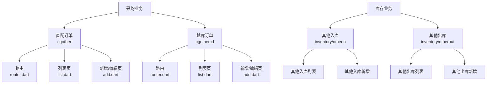
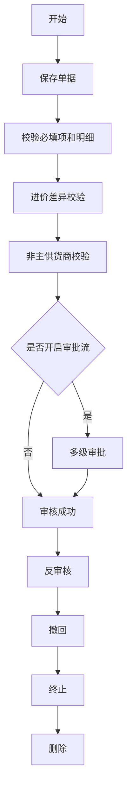
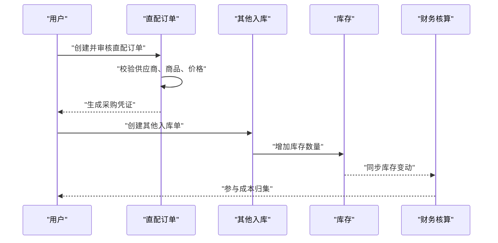
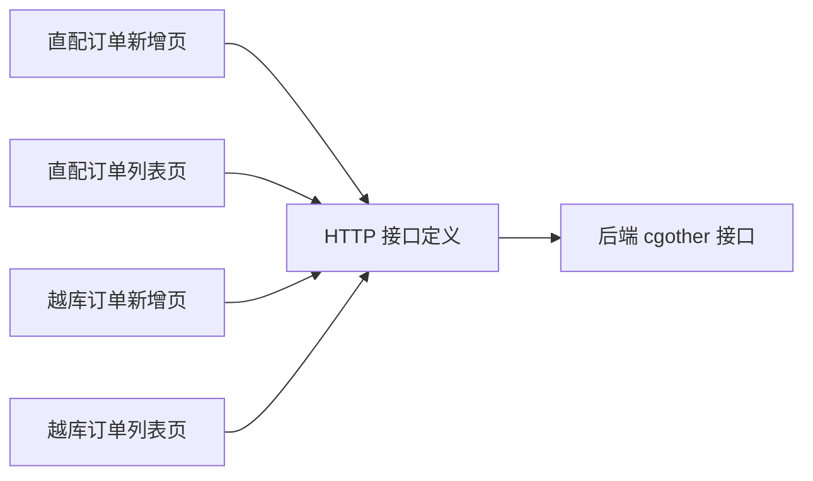

# 其他采购

<cite>
**本文引用的文件**
- [lib/pages/business/purchase/cgother/router.dart](file://lib/pages/business/purchase/cgother/router.dart)
- [lib/pages/business/purchase/cgother/add.dart](file://lib/pages/business/purchase/cgother/add.dart)
- [lib/pages/business/purchase/cgother/list.dart](file://lib/pages/business/purchase/cgother/list.dart)
- [lib/pages/business/purchase/cgothercd/router.dart](file://lib/pages/business/purchase/cgothercd/router.dart)
- [lib/pages/business/purchase/cgothercd/add.dart](file://lib/pages/business/purchase/cgothercd/add.dart)
- [lib/pages/business/purchase/cgothercd/list.dart](file://lib/pages/business/purchase/cgothercd/list.dart)
- [lib/pages/business/inventory/otherin/add.dart](file://lib/pages/business/inventory/otherin/add.dart)
- [lib/pages/business/inventory/otherin/list.dart](file://lib/pages/business/inventory/otherin/list.dart)
- [lib/pages/business/inventory/otherout/add.dart](file://lib/pages/business/inventory/otherout/add.dart)
- [lib/pages/business/inventory/otherout/list.dart](file://lib/pages/business/inventory/otherout/list.dart)
- [lib/net/http_api.dart](file://lib/net/http_api.dart)
</cite>

## 目录
1. [引言](#引言)
2. [项目结构定位](#项目结构定位)
3. [业务适用范围与场景](#业务适用范围与场景)
4. [与其他采购相关单据的关系](#与其他采购相关单据的关系)
5. [其他采购单据结构与字段](#其他采购单据结构与字段)
6. [审核流程与状态控制](#审核流程与状态控制)
7. [入库处理与库存更新机制](#入库处理与库存更新机制)
8. [财务核算与成本归集关联](#财务核算与成本归集关联)
9. [典型业务场景示例](#典型业务场景示例)
10. [依赖关系分析](#依赖关系分析)
11. [性能与交互特性](#性能与交互特性)
12. [常见问题排查](#常见问题排查)
13. [结论](#结论)

## 引言
本文面向灵犀管店 Flutter 客户端中的“其他采购”能力，重点说明代码中已实现的直配订单、越库订单及其他出入库相关功能。需要特别说明的是：当前仓库中直接以“其他采购”命名的前端页面主要对应直配订单和越库订单两类非标准采购；并未发现专门的“费用类采购”“办公用品采购”等独立业务入口。因此，本文在业务概念部分会区分“仓库中已有实现”和“仅作为业务背景说明的内容”，避免把通用业务解释误写成代码事实。

从现有代码看，“其他采购”在客户端表现为：
- 直配订单：用于非标准商品或服务的直配采购，单据类型标识为 `billtype=1`，后端接口前缀为 `cgother/*`。
- 越库订单：用于跨仓或越库场景的采购调度，单据类型标识为 `billtype=2`，复用直配订单的数据结构和审批流程。
- 其他入库、其他出库：属于库存模块的非销售/非普通采购入库、出库单据，是其他采购完成后可能进入库存调整的重要补充。

## 项目结构定位
其他采购相关的核心页面位于业务模块的采购子目录和库存子目录：

**图示来源**
- [lib/pages/business/purchase/cgother/router.dart:1-25](file://lib/pages/business/purchase/cgother/router.dart#L1-L25)
- [lib/pages/business/purchase/cgother/list.dart:1-200](file://lib/pages/business/purchase/cgother/list.dart#L1-L200)
- [lib/pages/business/purchase/cgother/add.dart:1-200](file://lib/pages/business/purchase/cgother/add.dart#L1-L200)
- [lib/pages/business/purchase/cgothercd/router.dart:1-25](file://lib/pages/business/purchase/cgothercd/router.dart#L1-L25)
- [lib/pages/business/purchase/cgothercd/list.dart:1-260](file://lib/pages/business/purchase/cgothercd/list.dart#L1-L260)
- [lib/pages/business/purchase/cgothercd/add.dart:1-260](file://lib/pages/business/purchase/cgothercd/add.dart#L1-L260)

**章节来源**
- [lib/pages/business/purchase/cgother/router.dart:1-25](file://lib/pages/business/purchase/cgother/router.dart#L1-L25)
- [lib/pages/business/purchase/cgothercd/router.dart:1-25](file://lib/pages/business/purchase/cgothercd/router.dart#L1-L25)

## 业务适用范围与场景
### 直配订单
直配订单是代码中明确实现的“其他采购”主入口之一。它适用于：
- 非标准采购：不在常规标准采购订单路径下的商品或服务采购。
- 零星采购：金额较小、频次较低、不适合走完整标准采购计划的商品。
- 供应商直配：由供应商直接向门店或配送中心发货的场景。

直配订单的前端路由定义为 `/purchase/cgother/list` 和 `/purchase/cgother/add`，列表页通过权限码 `011501` 控制查看权限，新增权限码 `011502`，编辑权限码 `011503`，审核权限码 `011505`，反审权限码 `011506`，删除权限码 `011504`。

### 越库订单
越库订单与直配订单共用大量数据结构，但用于不同业务场景：
- 越库场景：货物不进入常规库存，而是直接从供应商流向门店或下游节点。
- 特殊供应链调度：需要在仓储链路中跳过常规入库环节的业务。

越库订单列表使用权限码 `011601`，并在查询时传入 `billtype=2`，与直配订单的 `billtype=1` 区分开。

### 其他入库与其他出库
其他入库和其他出库属于库存管理中的非标准出入库单据，通常用于：
- 非采购来源的入库：如赠品入库、调拨入库、盘点差异入库等。
- 非销售来源的出库：如损耗出库、报废出库、样品出库等。

它们不是直配订单的直接替代，而是其他采购或其他业务发生后，对库存数量进行调整的工具。

### 未在前端体现的费用类采购
仓库中没有独立的“费用类采购”页面。若业务需要将费用类支出纳入采购体系，通常应结合财务管理模块的费用核算逻辑进行设计；当前 Flutter 客户端并未提供专门的费用类采购表单入口。

**章节来源**
- [lib/pages/business/purchase/cgother/list.dart:1-200](file://lib/pages/business/purchase/cgother/list.dart#L1-L200)
- [lib/pages/business/purchase/cgother/add.dart:1-200](file://lib/pages/business/purchase/cgother/add.dart#L1-L200)
- [lib/pages/business/purchase/cgothercd/list.dart:1-260](file://lib/pages/business/purchase/cgothercd/list.dart#L1-L260)

## 与其他采购相关单据的关系
其他采购在客户端中并非单一单据，而是一个由多个页面组成的业务集合：

| 单据 | 主要用途 | 前端路由或标识 | 关键类型值 |
|---|---|---|---|
| 直配订单 | 非标准商品或服务直配采购 | `/purchase/cgother/list`、`/purchase/cgother/add` | `billtype=1` |
| 越库订单 | 跨仓或越库采购调度 | `/purchase/cgothercd/list`、`/purchase/cgothercd/add` | `billtype=2` |
| 其他入库 | 非标准入库，增加库存 | 库存模块 `inventory/otherin` | 非销售、非普通采购入库 |
| 其他出库 | 非标准出库，减少库存 | 库存模块 `inventory/otherout` | 非销售、非普通采购出库 |

直配订单和越库订单共享相似的表单结构：收货机构、供应商、采购员、配送中心、有效期、参考单号、备注、附件、商品明细等。区别主要在业务类型和列表筛选条件。

**章节来源**
- [lib/pages/business/purchase/cgother/router.dart:1-25](file://lib/pages/business/purchase/cgother/router.dart#L1-L25)
- [lib/pages/business/purchase/cgothercd/router.dart:1-25](file://lib/pages/business/purchase/cgothercd/router.dart#L1-L25)
- [lib/pages/business/purchase/cgother/list.dart:1-200](file://lib/pages/business/purchase/cgother/list.dart#L1-L200)
- [lib/pages/business/purchase/cgothercd/list.dart:1-260](file://lib/pages/business/purchase/cgothercd/list.dart#L1-L260)

## 其他采购单据结构与字段
直配订单和越库订单的表单字段基本一致，主要包括以下维度：

| 字段类别 | 字段含义 | 代码中的行为或约束 |
|---|---|---|
| 收货机构 | 接收货物的门店或机构 | 新增时默认回填登录机构；编辑时从详情加载 |
| 采购员 | 负责本次采购的人员 | 新增时默认回填登录用户 |
| 供应商 | 供货方 | 必填校验；提交时同时发送 `billsupid` 和 `supid` |
| 配送中心 | 直配场景的出仓或配送主体 | 新增时若登录机构为配送中心且非总店，默认使用当前机构 |
| 有效期 | 收货期限 | 新增时默认当前日期加上配置天数，未配置时默认为 30 天 |
| 参考单号 | 关联的上游单据编号 | 可选，支持选择参考单并回写编号和 ID |
| 备注 | 业务说明 | 文本输入，保存时提交 |
| 附件 | 发票、合同、验收单等 | 支持附件列表上传 |
| 商品明细 | 商品编码、名称、数量、单价、金额 | 支持扫码、批量选择、价格刷新、批量删除 |
| 单据汇总 | 数量和金额合计 | 根据明细行自动计算并提交 |

商品明细行还包含：
- 商品唯一标识：如 `prodid`、`productid`。
- 条码：如 `barcode`、`selfbarcode`。
- 规格与单位：如 `unitonlyid`、`sizeonlyid`。
- 进价与档案价：用于进价差异校验。
- 库存数量：用于价格刷新后展示可用库存信息。
- 原始数据：用于保留后端返回的原始字段。

此外，直配订单和越库订单都支持多级审批流：
- 审批人列表：`reviewFlowUsers`
- 审批记录列表：`reviewBillFlows`
- 审批标记：`reviewsignflag`
- 审批备注：`reviewremark`

**章节来源**
- [lib/pages/business/purchase/cgother/add.dart:1-200](file://lib/pages/business/purchase/cgother/add.dart#L1-L200)
- [lib/pages/business/purchase/cgother/add.dart:201-600](file://lib/pages/business/purchase/cgother/add.dart#L201-L600)
- [lib/pages/business/purchase/cgother/add.dart:601-1048](file://lib/pages/business/purchase/cgother/add.dart#L601-L1048)
- [lib/pages/business/purchase/cgother/add.dart:1200-1562](file://lib/pages/business/purchase/cgother/add.dart#L1200-L1562)
- [lib/pages/business/purchase/cgothercd/add.dart:1-260](file://lib/pages/business/purchase/cgothercd/add.dart#L1-L260)

## 审核流程与状态控制
### 单据状态
直配订单和越库订单均使用 `signflag` 表示单据状态：
- 未审核：通常为 `0`
- 已审核：通常为 `1`
- 已驳回：通常为 `2`

列表页通过 Tab 切换展示全部、待审核、已审核，并根据后台审批配置动态显示“已驳回”标签。

### 审核与反审核
审核流程包括：
1. 保存单据：校验必填项、商品明细、进货价差异、非主供货商校验。
2. 审核：调用审核接口，设置 `signflag=1`。
3. 反审核：允许已审核单据恢复为可编辑状态，并清空审批流状态。
4. 撤回：将处于审批中的单据撤回，要求重新处理审批步骤。
5. 终止：终止单据生命周期。
6. 删除：删除未生效或允许的单据。

**图示来源**
- [lib/pages/business/purchase/cgother/add.dart:601-1048](file://lib/pages/business/purchase/cgother/add.dart#L601-L1048)
- [lib/pages/business/purchase/cgother/add.dart:1048-1200](file://lib/pages/business/purchase/cgother/add.dart#L1048-L1200)

### 权限控制
直配订单涉及以下权限：
- 查看：`011501`
- 新增：`011502`
- 编辑：`011503`
- 删除：`011504`
- 审核：`011505`
- 反审：`011506`

越库订单列表查看权限为 `011601`。

**章节来源**
- [lib/pages/business/purchase/cgother/list.dart:1-200](file://lib/pages/business/purchase/cgother/list.dart#L1-L200)
- [lib/pages/business/purchase/cgother/add.dart:601-1048](file://lib/pages/business/purchase/cgother/add.dart#L601-L1048)
- [lib/pages/business/purchase/cgothercd/list.dart:1-260](file://lib/pages/business/purchase/cgothercd/list.dart#L1-L260)

## 入库处理与库存更新机制
### 直配订单与其他入库的关系
直配订单本身是采购业务单据，其核心作用是记录采购意向、供应商、商品、数量和价格等信息。实际库存增加通常由其他入库单据完成。仓库中存在 `inventory/otherin` 目录，说明系统支持非标准入库操作，可作为直配订单后续入库的补充路径。

### 其他入库页面职责
其他入库新增页和列表页承担以下职责：
- 录入非标准入库原因。
- 选择入库商品、数量、仓库、批次等。
- 触发库存数量增加。
- 与成本核算、库存报表联动。

### 其他出库页面职责
其他出库新增页和列表页承担以下职责：
- 录入非标准出库原因。
- 选择出库商品、数量、仓库、批次等。
- 触发库存数量减少。
- 用于损耗、报废、样品等非销售场景。

**图示来源**
- [lib/pages/business/purchase/cgother/add.dart:601-1048](file://lib/pages/business/purchase/cgother/add.dart#L601-L1048)
- [lib/pages/business/inventory/otherin/add.dart](file://lib/pages/business/inventory/otherin/add.dart)
- [lib/pages/business/inventory/otherout/add.dart](file://lib/pages/business/inventory/otherout/add.dart)

**章节来源**
- [lib/pages/business/inventory/otherin/add.dart](file://lib/pages/business/inventory/otherin/add.dart)
- [lib/pages/business/inventory/otherin/list.dart](file://lib/pages/business/inventory/otherin/list.dart)
- [lib/pages/business/inventory/otherout/add.dart](file://lib/pages/business/inventory/otherout/add.dart)
- [lib/pages/business/inventory/otherout/list.dart](file://lib/pages/business/inventory/otherout/list.dart)

## 财务核算与成本归集关联
从现有代码可以看出，直配订单和越库订单主要关注采购业务数据和审批流程，并没有直接实现完整的会计分录生成逻辑。财务核算更可能由后端或财务管理模块完成。Flutter 前端中与财务相关的可见点包括：
- 商品价格、数量、金额的计算。
- 进价与档案价的差异提示。
- 商品进价批量刷新。
- 与库存模块的数据衔接。

具体财务科目、借方贷方、税务处理等规则未在 Flutter 前端页面中直接暴露。若需要对接费用类采购的成本归集，建议：
- 在后端将直配订单、越库订单、其他入库、其他出库统一映射到财务凭证。
- 在前端保持采购单据与库存单据之间的可追溯性。
- 在财务报表中按单据类型聚合成本和费用。

**章节来源**
- [lib/pages/business/purchase/cgother/add.dart:1200-1562](file://lib/pages/business/purchase/cgother/add.dart#L1200-L1562)
- [lib/pages/business/inventory/otherin/add.dart](file://lib/pages/business/inventory/otherin/add.dart)
- [lib/pages/business/inventory/otherout/add.dart](file://lib/pages/business/inventory/otherout/add.dart)

## 典型业务场景示例
### 办公用品采购
适用场景：
- 门店临时采购办公文具、打印纸、清洁用品。
- 不属于常规商品采购计划。
- 供应商直配到门店。

推荐流程：
1. 使用直配订单录入办公用品明细。
2. 填写供应商、采购员、收货机构。
3. 审核通过后，如需入库则创建其他入库单。
4. 若不需要实物入库，可由后端或财务模块直接计入费用。

### 设备维修采购
适用场景：
- 门店设备出现故障，需要外部服务商上门维修。
- 维修费用可能包含人工费和配件费。
- 配件可能单独入库，人工费作为服务费用。

推荐流程：
1. 直配订单记录维修服务及所需配件。
2. 配件部分通过其他入库增加库存。
3. 人工服务部分由财务模块按费用科目归集。
4. 维修完成后归档附件和验收记录。

### 咨询服务采购
适用场景：
- 管理咨询、培训服务、信息系统服务等。
- 不涉及实物商品入库。
- 更接近费用类支出。

推荐流程：
1. 若系统尚未提供费用类采购专用表单，可使用直配订单记录服务内容。
2. 不生成库存变动。
3. 由财务管理模块按服务类费用科目入账。
4. 附件上传合同、验收报告、发票。

**章节来源**
- [lib/pages/business/purchase/cgother/add.dart:1-200](file://lib/pages/business/purchase/cgother/add.dart#L1-L200)
- [lib/pages/business/inventory/otherin/add.dart](file://lib/pages/business/inventory/otherin/add.dart)
- [lib/pages/business/inventory/otherout/add.dart](file://lib/pages/business/inventory/otherout/add.dart)

## 依赖关系分析
### 页面与路由依赖
直配订单和越库订单分别通过 Fluro 路由注册列表页和新增页。路由常量清晰分离了直配和越库两个业务入口。

### 页面与网络接口依赖
直配订单使用的后端接口包括：
- 列表查询：`cgother/findList`
- 详情查询：`cgother/getInfo`
- 保存：`cgother/save`
- 审核：`cgother/sign`
- 反审核：`cgother/retsign`
- 删除：`cgother/delBill`
- 终止：`cgother/stop`
- 打印：`airprint/setWxPrintRw`

越库订单复用直配订单的列表接口，但通过 `billtype=2` 区分。

**图示来源**
- [lib/pages/business/purchase/cgother/add.dart:1-200](file://lib/pages/business/purchase/cgother/add.dart#L1-L200)
- [lib/pages/business/purchase/cgother/list.dart:1-200](file://lib/pages/business/purchase/cgother/list.dart#L1-L200)
- [lib/pages/business/purchase/cgothercd/add.dart:1-260](file://lib/pages/business/purchase/cgothercd/add.dart#L1-L260)
- [lib/pages/business/purchase/cgothercd/list.dart:1-260](file://lib/pages/business/purchase/cgothercd/list.dart#L1-L260)
- [lib/net/http_api.dart:229-239](file://lib/net/http_api.dart#L229-L239)

**章节来源**
- [lib/net/http_api.dart:229-239](file://lib/net/http_api.dart#L229-L239)

## 性能与交互特性
### 扫码与批量操作
直配订单和越库订单新增页支持：
- PDA 扫码枪输入。
- 摄像头扫码。
- 批量选择商品。
- 批量删除商品。
- 批量刷新商品价格。

这些交互提升了零星采购和非标准采购的效率。

### 未保存修改保护
新增页通过表单快照检测用户离开时的未保存修改，避免误删数据。

### 价格刷新
系统支持一次性批量更新商品价格，减少多次请求开销，并同步商品规格和单位信息。

### 审批流体验
页面根据登录用户和审批流配置，动态控制编辑按钮、审核按钮、反审核按钮和审批日志查看入口。

**章节来源**
- [lib/pages/business/purchase/cgother/add.dart:1200-1562](file://lib/pages/business/purchase/cgother/add.dart#L1200-L1562)
- [lib/pages/business/purchase/cgother/add.dart:601-1048](file://lib/pages/business/purchase/cgother/add.dart#L601-L1048)

## 常见问题排查
### 无法查看其他采购列表
检查权限码：
- 直配订单列表：`011501`
- 越库订单列表：`011601`

若权限不足，页面会提示无权查看。

### 无法新增或编辑
检查权限码：
- 直配订单新增：`011502`
- 直配订单编辑：`011503`

同时检查必填项：收货机构、供应商、配送中心、有效期、商品明细、数量。

### 审核失败或无审核按钮
检查：
- 单据是否已审核。
- 是否开启多级审批。
- 当前用户是否在审批流中。
- 是否为管理员或第一审批人。

### 反审核后仍无法编辑
检查：
- 反审核是否成功。
- 审批流是否被清空。
- 是否存在退回待处理的审批状态。

### 其他入库未影响库存
确认：
- 是否创建了其他入库单。
- 商品、数量、仓库是否正确。
- 是否已完成其他入库单的审核或生效逻辑。

**章节来源**
- [lib/pages/business/purchase/cgother/list.dart:1-200](file://lib/pages/business/purchase/cgother/list.dart#L1-L200)
- [lib/pages/business/purchase/cgother/add.dart:601-1048](file://lib/pages/business/purchase/cgother/add.dart#L601-L1048)
- [lib/pages/business/inventory/otherin/add.dart](file://lib/pages/business/inventory/otherin/add.dart)

## 结论
灵犀管店 Flutter 项目中的“其他采购”在代码层面主要体现为直配订单和越库订单两类非标准采购单据，并辅以其他入库、其他出库等库存调整单据。直配订单适合供应商直配、零星采购和非标准商品服务采购；越库订单适合跨仓或越库调度场景。两者共享相似的数据结构和审批流程，并通过 `billtype` 与后端接口前缀区分。

对于费用类采购、办公用品采购、设备维修采购、咨询服务采购等业务场景，当前前端未提供独立的费用类采购表单，但可通过直配订单记录采购内容，并结合其他入库和财务管理模块完成库存与成本处理。未来若需要更精细的费用类采购能力，可在现有直配订单基础上扩展费用科目、税务处理和财务凭证映射。