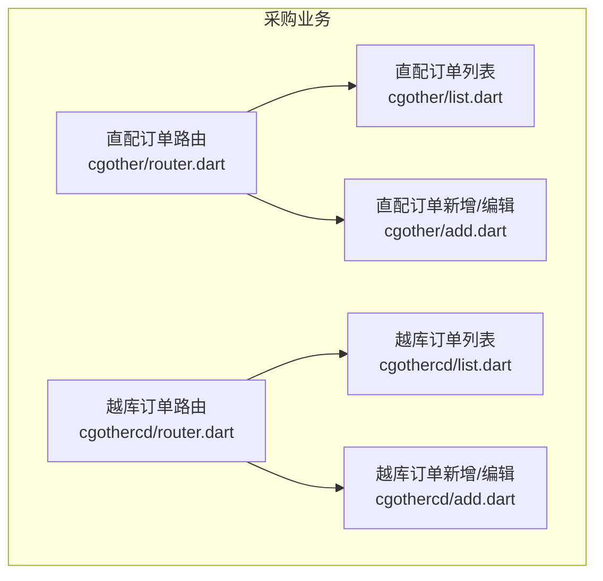
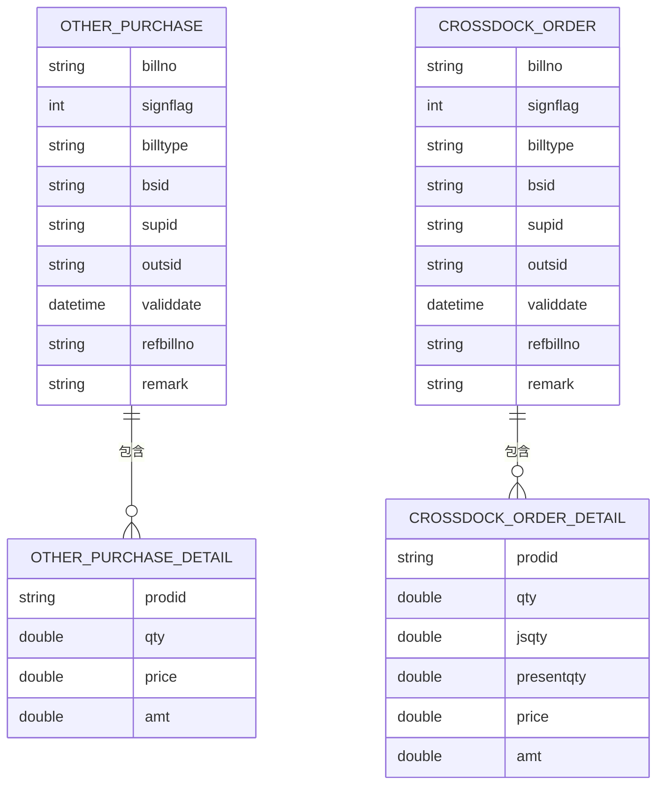
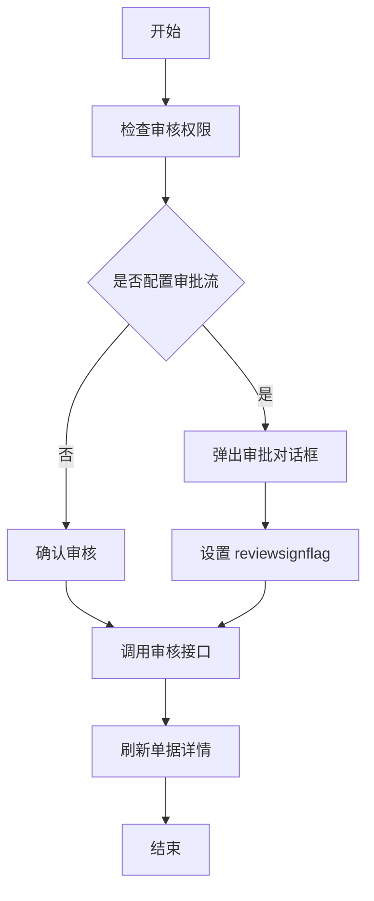
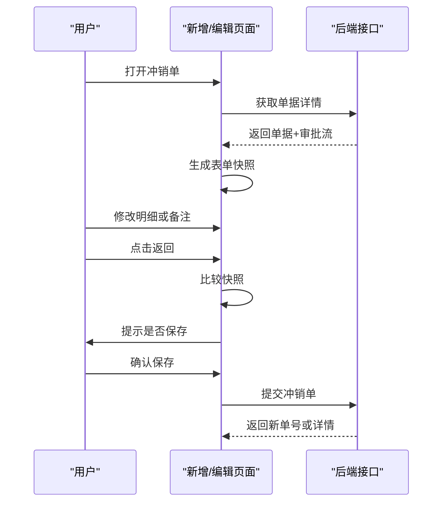
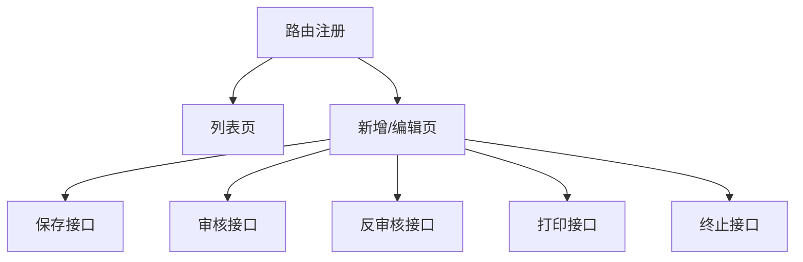
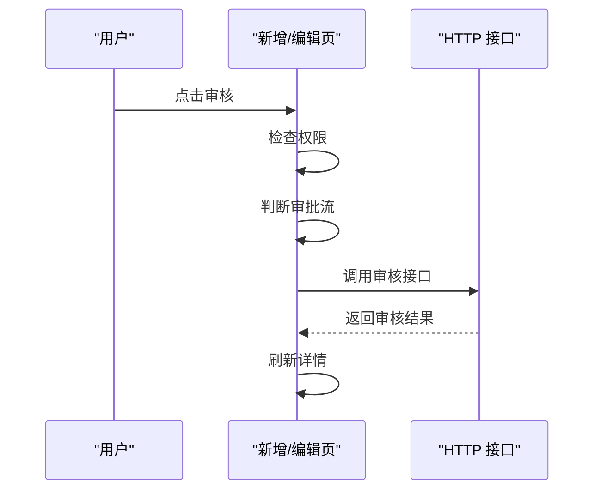
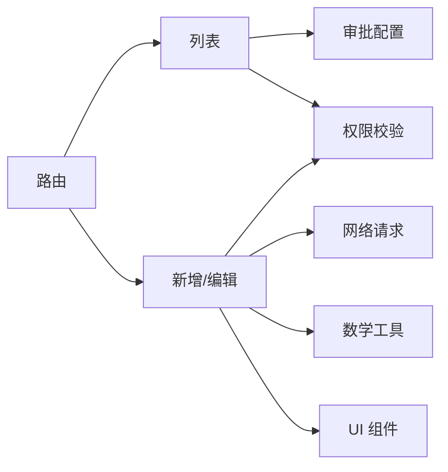

# 其他采购冲销

<cite>
**本文引用的文件**   
- [lib/pages/business/purchase/cgother/add.dart](file://lib/pages/business/purchase/cgother/add.dart)
- [lib/pages/business/purchase/cgother/list.dart](file://lib/pages/business/purchase/cgother/list.dart)
- [lib/pages/business/purchase/cgother/router.dart](file://lib/pages/business/purchase/cgother/router.dart)
- [lib/pages/business/purchase/cgothercd/add.dart](file://lib/pages/business/purchase/cgothercd/add.dart)
- [lib/pages/business/purchase/cgothercd/list.dart](file://lib/pages/business/purchase/cgothercd/list.dart)
- [lib/pages/business/purchase/cgothercd/router.dart](file://lib/pages/business/purchase/cgothercd/router.dart)
</cite>

## 目录
1. [引言](#引言)
2. [项目结构与定位](#项目结构与定位)
3. [业务场景与使用条件](#业务场景与使用条件)
4. [核心单据类型与字段关系](#核心单据类型与字段关系)
5. [冲销逻辑与数据规则](#冲销逻辑与数据规则)
6. [审核流程与权限控制](#审核流程与权限控制)
7. [对库存、财务与上游单的影响](#对库存财务与上游单的影响)
8. [典型业务示例](#典型业务示例)
9. [历史追踪与审计能力](#历史追踪与审计能力)
10. [架构总览与调用序列](#架构总览与调用序列)
11. [依赖分析](#依赖分析)
12. [性能与可用性要点](#性能与可用性要点)
13. [故障排查](#故障排查)
14. [结论](#结论)

## 引言
本文件围绕灵犀管店 Flutter 前端中的“其他采购”和“其他采购冲销”相关功能进行说明。代码仓库中并未实现独立的“冲销单”页面；冲销在实现上表现为：通过“其他采购”和“越库订单”两个业务单据，以新增负数量、负金额或调整明细的方式，对冲原始其他采购业务结果。本文重点解释：

- 哪些业务情形适合用其他采购/越库订单做冲销；
- 冲销单与原始其他采购单之间的关联方式；
- 全额冲销与部分冲销在前端的数据表达；
- 审核、反审核、撤回等状态流转；
- 前端如何维护可追溯的表单快照与审批上下文；
- 库存与财务影响由后端负责时，前端应遵循的提交规范。

## 项目结构与定位
“其他采购”对应 `cgother`，“其他采购冲销”在代码中体现为“越库订单” `cgothercd`。两者共享相似的页面结构：列表页 + 新增/编辑页 + 路由注册。

**图示来源**
- [lib/pages/business/purchase/cgother/router.dart:1-25](file://lib/pages/business/purchase/cgother/router.dart#L1-L25)
- [lib/pages/business/purchase/cgothercd/router.dart:1-25](file://lib/pages/business/purchase/cgothercd/router.dart#L1-L25)

**章节来源**
- [lib/pages/business/purchase/cgother/router.dart:1-25](file://lib/pages/business/purchase/cgother/router.dart#L1-L25)
- [lib/pages/business/purchase/cgothercd/router.dart:1-25](file://lib/pages/business/purchase/cgothercd/router.dart#L1-L25)

## 业务场景与使用条件
### 适用冲销的业务情形
结合前端参数和页面行为，以下情形适合通过“其他采购”或“越库订单”完成冲销：

| 业务情形 | 推荐单据 | 前端处理思路 |
|---|---|---|
| 供应商发票金额高于实际结算，需调减应付 | 其他采购或越库订单 | 新增一条冲销明细，数量为负、金额为负，备注说明发票差异 |
| 供应商价格调整后需要追回差价 | 其他采购或越库订单 | 按商品维度新增负差额行，或在原行基础上修正价格并补充差额行 |
| 收货数量与合同不一致，需要数量修正 | 其他采购或越库订单 | 新增负数量行，或补充差额数量行 |
| 采购取消但已产生入库或应付记录 | 其他采购或越库订单 | 使用负数量、负金额整单冲销，并在备注中写明取消原因 |
| 规格变更导致成本重算 | 越库订单更合适 | 越库订单支持件数、赠送数量等字段，适合表达包装规格差异 |

### 使用前提
- 必须选择收货机构、供应商、配送中心和收货期限；
- 至少包含一条有效明细；
- 若为编辑模式，需具备相应编辑权限；
- 若涉及审批流，当前用户必须属于审批节点或被配置为可签字人。

**章节来源**
- [lib/pages/business/purchase/cgother/add.dart:463-590](file://lib/pages/business/purchase/cgother/add.dart#L463-L590)
- [lib/pages/business/purchase/cgothercd/add.dart:470-610](file://lib/pages/business/purchase/cgothercd/add.dart#L470-L610)

## 核心单据类型与字段关系
### 直配订单（其他采购）
- 单据类型标识为 `billtype: "1"`；
- 关键字段包括收货机构、供应商、配送中心、收货期限、参考单号、明细列表、附件、审批状态；
- 列表请求携带 `billtype: "1"`，用于区分直配订单与其他采购类单据。

### 越库订单（其他采购冲销载体）
- 单据类型标识为 `billtype: "2"`；
- 除其他采购常见字段外，还支持件数、赠送数量等字段，适合表达规格、包装差异；
- 列表请求携带 `billtype: "2"`，用于区分越库订单。

**图示来源**
- [lib/pages/business/purchase/cgother/add.dart:609-650](file://lib/pages/business/purchase/cgother/add.dart#L609-L650)
- [lib/pages/business/purchase/cgothercd/add.dart:616-658](file://lib/pages/business/purchase/cgothercd/add.dart#L616-L658)

**章节来源**
- [lib/pages/business/purchase/cgother/list.dart:120-170](file://lib/pages/business/purchase/cgother/list.dart#L120-L170)
- [lib/pages/business/purchase/cgothercd/list.dart:120-170](file://lib/pages/business/purchase/cgothercd/list.dart#L120-L170)
- [lib/pages/business/purchase/cgother/add.dart:609-650](file://lib/pages/business/purchase/cgother/add.dart#L609-L650)
- [lib/pages/business/purchase/cgothercd/add.dart:616-658](file://lib/pages/business/purchase/cgothercd/add.dart#L616-L658)

## 冲销逻辑与数据规则
### 全额冲销
全额冲销表示针对一张原始其他采购单，创建一张金额与数量完全反向的冲销单。前端实现建议：

1. 从原始单据明细中复制商品、供应商、收货机构等基础信息；
2. 将每条明细的数量取负值；
3. 重新计算单价和行金额，确保 `qty × price = amt`；
4. 在备注中明确标注“全额冲销”及原始单号；
5. 提交时使用相同的 `billsupid`、`supid`、`bsid`、`outsid`，保证上下游一致。

### 部分冲销
部分冲销适用于只调整部分商品、部分数量或部分金额的情形：

1. 仅对需要冲销的商品新增一行；
2. 冲销行的 `qty` 为负数，`amt` 为负差额；
3. 如果仅调整价格或规格，可同时保留正数量行和负差额行；
4. 越库订单可使用 `jsqty`、`presentqty` 表达件数与赠品差异；
5. 若存在参考单号，应填写 `refbillno`、`refbillid`，以便后台建立溯源关系。

### 数据一致性规则
- 新增模式会校验必填项：收货机构、供应商、配送中心、收货期限、明细非空；
- 保存前会汇总 `billqty` 和 `billamt`；
- 编辑模式下可直接复用已有单据对象，避免丢失审批上下文；
- 附件、备注、参考单号等元数据应与冲销原因保持一致。

**章节来源**
- [lib/pages/business/purchase/cgother/add.dart:463-590](file://lib/pages/business/purchase/cgother/add.dart#L463-L590)
- [lib/pages/business/purchase/cgothercd/add.dart:470-610](file://lib/pages/business/purchase/cgothercd/add.dart#L470-L610)
- [lib/pages/business/purchase/cgothercd/add.dart:240-330](file://lib/pages/business/purchase/cgothercd/add.dart#L240-L330)

## 审核流程与权限控制
### 单据状态
两类单据都使用 `signflag` 表达审核状态：

| signflag | 含义 | 前端表现 |
|---|---|---|
| 0 | 未审核 | 允许保存、提交审核 |
| 1 | 已审核 | 禁止编辑，允许反审核、撤回、终止、打印 |
| 2 | 已驳回 | 通常不可编辑，列表提供“已驳回”Tab |

### 权限控制
前端使用权限码控制操作入口：

| 操作 | 直配订单权限 | 越库订单权限 |
|---|---|---|
| 查看列表 | `011501` | `011601` |
| 新增 | `011502` | `011602` |
| 编辑 | `011503` | `011603` |
| 审核 | `011505` | `011605` |
| 反审核 | `011506` | `011606` |

### 多级审批
当后台配置了审批流时：

1. 新增或审核后，页面加载 `reviewFlowUsers` 和 `reviewBillFlows`；
2. 如果当前用户不在审批节点，弹窗提示“您不属于当前审批节点的审核人”；
3. 审批通过后，更新 `reviewsignflag` 并继续执行审核；
4. 反审核时会清空本地审批流缓存，并重新加载详情；
5. 撤回操作会将 `reviewsignflag` 置为待处理状态，同时保持 `signflag` 为已审核。

**图示来源**
- [lib/pages/business/purchase/cgother/add.dart:701-760](file://lib/pages/business/purchase/cgother/add.dart#L701-L760)
- [lib/pages/business/purchase/cgothercd/add.dart:706-765](file://lib/pages/business/purchase/cgothercd/add.dart#L706-L765)

**章节来源**
- [lib/pages/business/purchase/cgother/list.dart:140-170](file://lib/pages/business/purchase/cgother/list.dart#L140-L170)
- [lib/pages/business/purchase/cgothercd/list.dart:140-170](file://lib/pages/business/purchase/cgothercd/list.dart#L140-L170)
- [lib/pages/business/purchase/cgother/add.dart:109-140](file://lib/pages/business/purchase/cgother/add.dart#L109-L140)
- [lib/pages/business/purchase/cgothercd/add.dart:109-140](file://lib/pages/business/purchase/cgothercd/add.dart#L109-L140)
- [lib/pages/business/purchase/cgother/add.dart:701-920](file://lib/pages/business/purchase/cgother/add.dart#L701-L920)
- [lib/pages/business/purchase/cgothercd/add.dart:706-920](file://lib/pages/business/purchase/cgothercd/add.dart#L706-L920)

## 对库存、财务与上游单的影响
### 库存影响
- 其他采购和越库订单属于采购侧业务单据，其是否扣减或增加库存，取决于后端对 `detaillist` 中数量的语义处理；
- 冲销通常通过负数量或负金额表达逆向业务；
- 若原始单已经过入库或出库联动，冲销单可能需要触发对应的逆向库存变动。

### 财务影响
- 前端会汇总 `billqty` 和 `billamt`，并提交给后端；
- 应付账款、暂估入账、供应商往来等财务科目由后端根据单据类型和明细处理；
- 冲销单的 `supselltype`、`supid`、`billsupid`、`outstorename` 等字段会影响供应商对账和配送中心结算。

### 与原始其他采购单的关系
- 如果冲销是针对某张具体采购单，建议在参考单号中填写原始单号；
- 如果冲销是全局价格调整或供应商结算调整，可在备注中说明范围；
- 若后端要求 `refbillid`、`refbillno`，应在选择参考单后同步传递。

**章节来源**
- [lib/pages/business/purchase/cgother/add.dart:609-650](file://lib/pages/business/purchase/cgother/add.dart#L609-L650)
- [lib/pages/business/purchase/cgothercd/add.dart:616-658](file://lib/pages/business/purchase/cgothercd/add.dart#L616-L658)

## 典型业务示例
### 供应商发票金额调整
- 场景：供应商发票金额高于结算金额；
- 操作：新建越库订单或其他采购冲销单；
- 明细：新增一行负金额行，金额为发票差额；
- 备注：填写“发票金额调整，原单号 XXX”。

### 商品规格变更导致的采购修正
- 场景：采购商品由整箱改为拆零，或件数变化；
- 操作：优先使用越库订单；
- 明细：使用 `jsqty`、`presentqty` 表达件数和赠品差异；
- 数量：对差异部分使用负数量或差额行；
- 备注：填写“规格变更，原箱改拆零”。

### 采购取消
- 场景：供应商取消供货或门店取消采购；
- 操作：新建全额冲销单；
- 明细：所有明细数量取负；
- 备注：填写“采购取消，原因 XXX”。

**章节来源**
- [lib/pages/business/purchase/cgothercd/add.dart:240-330](file://lib/pages/business/purchase/cgothercd/add.dart#L240-L330)
- [lib/pages/business/purchase/cgother/add.dart:609-650](file://lib/pages/business/purchase/cgother/add.dart#L609-L650)
- [lib/pages/business/purchase/cgothercd/add.dart:616-658](file://lib/pages/business/purchase/cgothercd/add.dart#L616-L658)

## 历史追踪与审计能力
### 表单快照机制
两个新增/编辑页面都实现了“未保存修改检测”：

1. 页面初始化后生成表单快照；
2. 返回时比对当前表单与快照；
3. 如果存在未保存修改且处于可保存态，则弹出确认保存对话框；
4. 已审核或已驳回单据直接放行返回。

该机制有助于防止误关闭冲销单造成数据遗漏。

### 审批上下文追踪
- 页面加载详情时会解析 `reviewFlowUsers`、`reviewBillFlows`；
- 审核、反审核、撤回都会更新 `reviewsignflag`；
- 反审核成功后清空本地审批流缓存，再重新加载详情；
- 这些字段共同构成前端可观察的审计轨迹。

**图示来源**
- [lib/pages/business/purchase/cgother/add.dart:420-470](file://lib/pages/business/purchase/cgother/add.dart#L420-L470)
- [lib/pages/business/purchase/cgothercd/add.dart:427-470](file://lib/pages/business/purchase/cgothercd/add.dart#L427-L470)

**章节来源**
- [lib/pages/business/purchase/cgother/add.dart:420-470](file://lib/pages/business/purchase/cgother/add.dart#L420-L470)
- [lib/pages/business/purchase/cgothercd/add.dart:427-470](file://lib/pages/business/purchase/cgothercd/add.dart#L427-L470)
- [lib/pages/business/purchase/cgother/add.dart:630-700](file://lib/pages/business/purchase/cgother/add.dart#L630-L700)
- [lib/pages/business/purchase/cgothercd/add.dart:638-710](file://lib/pages/business/purchase/cgothercd/add.dart#L638-L710)

## 架构总览与调用序列
### 其他采购冲销整体流程

**图示来源**
- [lib/pages/business/purchase/cgother/router.dart:1-25](file://lib/pages/business/purchase/cgother/router.dart#L1-L25)
- [lib/pages/business/purchase/cgother/add.dart:701-920](file://lib/pages/business/purchase/cgother/add.dart#L701-L920)
- [lib/pages/business/purchase/cgothercd/add.dart:706-920](file://lib/pages/business/purchase/cgothercd/add.dart#L706-L920)

### 审核调用序列

**图示来源**
- [lib/pages/business/purchase/cgother/add.dart:701-760](file://lib/pages/business/purchase/cgother/add.dart#L701-L760)
- [lib/pages/business/purchase/cgothercd/add.dart:706-765](file://lib/pages/business/purchase/cgothercd/add.dart#L706-L765)

**章节来源**
- [lib/pages/business/purchase/cgother/router.dart:1-25](file://lib/pages/business/purchase/cgother/router.dart#L1-L25)
- [lib/pages/business/purchase/cgothercd/router.dart:1-25](file://lib/pages/business/purchase/cgothercd/router.dart#L1-L25)
- [lib/pages/business/purchase/cgother/add.dart:701-920](file://lib/pages/business/purchase/cgother/add.dart#L701-L920)
- [lib/pages/business/purchase/cgothercd/add.dart:706-920](file://lib/pages/business/purchase/cgothercd/add.dart#L706-L920)

## 依赖分析
### 页面内部依赖
- 新增/编辑页依赖：
  - 网络请求工具；
  - 权限校验工具；
  - 数学工具；
  - Toast 提示；
  - 扫描设置；
  - 附件组件；
  - 商品、供应商、门店、采购员、参考单选择器；
  - 审批流相关工具。

- 列表页依赖：
  - 权限校验；
  - 审批配置工具；
  - 日期选择；
  - 搜索与分页滚动。

### 模块耦合关系
- 路由模块仅负责页面注册；
- 新增/编辑模块承载主要业务逻辑；
- 列表模块主要负责查询、筛选和跳转；
- 两者通过相同的数据结构和后端接口契约耦合。

**图示来源**
- [lib/pages/business/purchase/cgother/add.dart:1-80](file://lib/pages/business/purchase/cgother/add.dart#L1-L80)
- [lib/pages/business/purchase/cgothercd/add.dart:1-80](file://lib/pages/business/purchase/cgothercd/add.dart#L1-L80)
- [lib/pages/business/purchase/cgother/list.dart:1-40](file://lib/pages/business/purchase/cgother/list.dart#L1-L40)
- [lib/pages/business/purchase/cgothercd/list.dart:1-40](file://lib/pages/business/purchase/cgothercd/list.dart#L1-L40)

**章节来源**
- [lib/pages/business/purchase/cgother/add.dart:1-80](file://lib/pages/business/purchase/cgother/add.dart#L1-L80)
- [lib/pages/business/purchase/cgothercd/add.dart:1-80](file://lib/pages/business/purchase/cgothercd/add.dart#L1-L80)
- [lib/pages/business/purchase/cgother/list.dart:1-40](file://lib/pages/business/purchase/cgother/list.dart#L1-L40)
- [lib/pages/business/purchase/cgothercd/list.dart:1-40](file://lib/pages/business/purchase/cgothercd/list.dart#L1-L40)

## 性能与可用性要点
- 列表采用分页加载，滚动到底部自动加载更多；
- Tab 切换时重置分页，避免重复加载；
- 新增/编辑页面在保存后重建表单快照，减少误判；
- 扫码枪输入有防抖处理，避免频繁触发；
- 审批流为空时跳过弹窗，减少交互开销；
- 未保存拦截仅在可保存态生效，已审核单据直接放行。

[本节为通用优化说明，不直接分析具体代码片段]

## 故障排查
### 无法查看列表
- 检查是否拥有查看权限；
- 直配订单查看权限为 `011501`；
- 越库订单查看权限为 `011601`。

### 无法新增或编辑
- 新增权限：直配订单 `011502`，越库订单 `011602`；
- 编辑权限：直配订单 `011503`，越库订单 `011603`；
- 必填字段缺失时，前端会提示“请选择收货机构”“请选择供应商”等。

### 审核失败
- 检查当前用户是否属于审批节点；
- 检查是否已正确设置 `reviewsignflag`；
- 检查是否选择了正确的单据类型。

### 反审核异常
- 反审核会尝试补全 `billdate`、`billid`、`billtypeid`、`detaillist`；
- 如果明细为空，前端会尝试重新构建明细；
- 反审成功后会清空审批流缓存并刷新详情。

### 冲销数据不准确
- 检查明细是否满足 `qty × price = amt`；
- 检查是否使用了负数量或负金额；
- 检查参考单号是否正确填写；
- 检查是否混用了直配订单和越库订单。

**章节来源**
- [lib/pages/business/purchase/cgother/list.dart:140-170](file://lib/pages/business/purchase/cgother/list.dart#L140-L170)
- [lib/pages/business/purchase/cgothercd/list.dart:140-170](file://lib/pages/business/purchase/cgothercd/list.dart#L140-L170)
- [lib/pages/business/purchase/cgother/add.dart:463-590](file://lib/pages/business/purchase/cgother/add.dart#L463-L590)
- [lib/pages/business/purchase/cgothercd/add.dart:470-610](file://lib/pages/business/purchase/cgothercd/add.dart#L470-L610)
- [lib/pages/business/purchase/cgother/add.dart:754-820](file://lib/pages/business/purchase/cgother/add.dart#L754-L820)
- [lib/pages/business/purchase/cgothercd/add.dart:759-825](file://lib/pages/business/purchase/cgothercd/add.dart#L759-L825)

## 结论
在当前 Flutter 前端实现中，“其他采购冲销”并非独立单据类型，而是通过“直配订单”和“越库订单”两种单据，配合负数量、负金额、参考单号和审批状态来完成冲销业务。开发者在使用时应注意：

- 区分直配订单和越库订单的使用场景；
- 使用负数量和负金额表达冲销方向；
- 通过参考单号和备注建立业务溯源；
- 严格遵守权限控制和审批流约束；
- 利用表单快照和审批上下文保障数据完整性；
- 将库存与财务的最终处理交给后端，前端专注数据表达和流程控制。