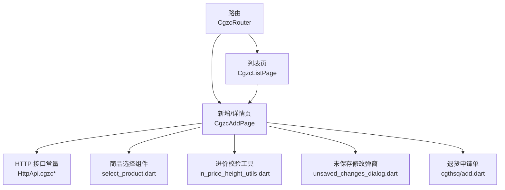
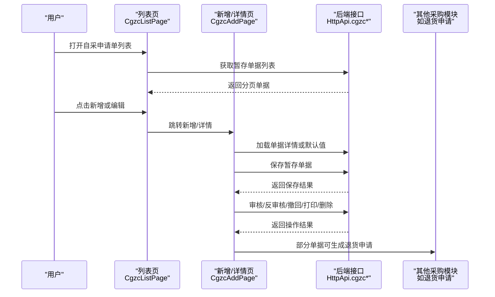
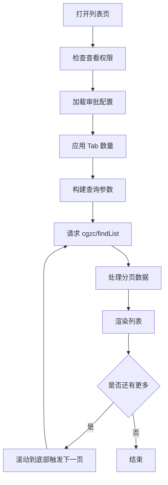
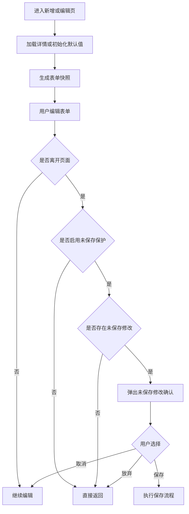
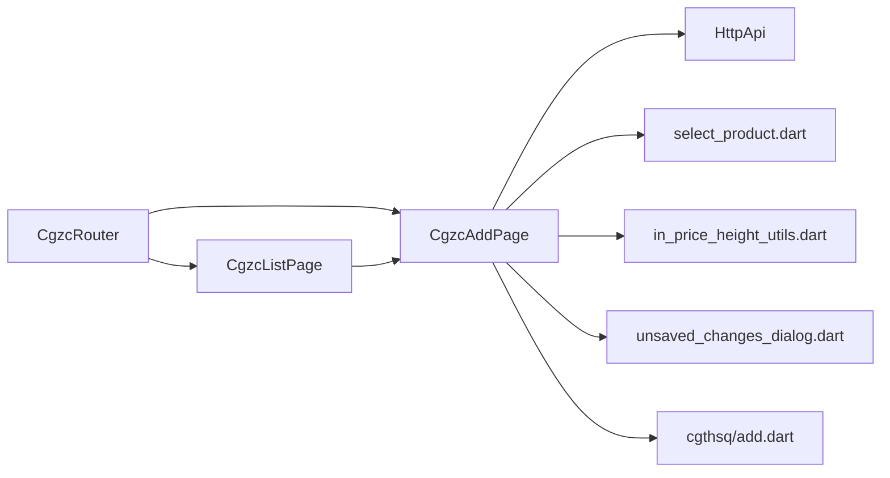
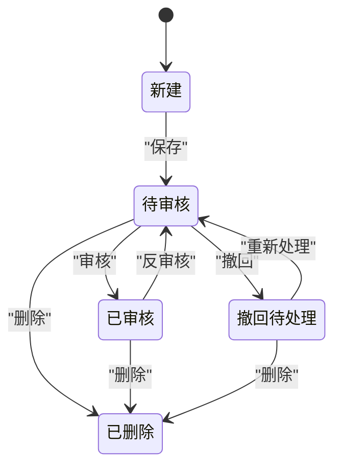

# 采购暂存

<cite>
**本文引用的文件**   
- [router.dart](file://lib/pages/business/purchase/cgzc/router.dart)
- [list.dart](file://lib/pages/business/purchase/cgzc/list.dart)
- [add.dart](file://lib/pages/business/purchase/cgzc/add.dart)
- [http_api.dart](file://lib/net/http_api.dart)
- [select_product.dart](file://lib/components/select/select_product.dart)
- [in_price_height_utils.dart](file://lib/util/in_price_height_utils.dart)
- [unsaved_changes_dialog.dart](file://lib/widgets/unsaved_changes_dialog.dart)
- [cgthsq_add.dart](file://lib/pages/business/purchase/cgthsq/add.dart)
</cite>

## 目录
1. [引言](#引言)
2. [项目结构定位](#项目结构定位)
3. [核心组件](#核心组件)
4. [架构总览](#架构总览)
5. [详细组件分析](#详细组件分析)
6. [依赖关系分析](#依赖关系分析)
7. [性能与可靠性考量](#性能与可靠性考量)
8. [使用场景示例](#使用场景示例)
9. [生命周期与数据清理策略](#生命周期与数据清理策略)
10. [导入导出与同步机制](#导入导出与同步机制)
11. [本地存储与安全注意事项](#本地存储与安全注意事项)
12. [故障排查指南](#故障排查指南)
13. [结论](#结论)

## 引言

本文件围绕灵犀管店 Flutter 项目中“采购暂存”能力进行完整说明。根据当前代码库，该能力以“自采申请单”形式实现，对应模块标识为 `cgzc`。它主要面向门店或业务人员在正式入库、结算之前，对采购意向进行临时保存和编辑的场景：例如批量录入商品、跨会话继续编辑、分批补充明细、审批流转前的草稿式维护等。

需要明确的是，当前仓库中并未出现独立的“本地草稿持久化数据库表”或“本地暂存文件”。所谓“暂存”，在现有实现中更接近“可多次保存的待审核单据”：用户可以在新增或编辑模式下反复调用后端保存接口，生成一条 `signflag=0`（待审核）的单据；只有当单据被审核后，才进入更正式的流转状态。因此，“暂存”并不等同于完全离线的本地草稿，而是“服务端可查询、可编辑、可撤销、可删除”的待审核采购申请。

| 概念 | 当前实现含义 |
| --- | --- |
| 采购暂存 | 指 `cgzc` 自采申请单的待审核态，允许反复保存、编辑、审核、反审核、撤回、打印和删除 |
| 正式采购订单 | 指已经过审核流程、后续可能参与入库、退货、结算等业务闭环的单据；暂存本身不是最终入库凭证 |
| 暂存到正式订单 | 通过“审核”操作将暂存单推进到已审核状态，再由其他采购相关单据或仓储流程消费 |
| 本地草稿 | 当前未实现纯离线本地草稿持久化；返回拦截提示是内存快照比对，不自动落盘 |

**章节来源**
- [http_api.dart:111-121](file://lib/net/http_api.dart#L111-L121)
- [add.dart:32-110](file://lib/pages/business/purchase/cgzc/add.dart#L32-L110)
- [add.dart:511-650](file://lib/pages/business/purchase/cgzc/add.dart#L511-L650)

## 项目结构定位

“采购暂存”功能集中在 `lib/pages/business/purchase/cgzc` 路径下，由路由、列表页和新增/详情页组成，并通过全局路由和 API 常量与其他模块交互。

**图表来源**
- [router.dart:1-25](file://lib/pages/business/purchase/cgzc/router.dart#L1-L25)
- [list.dart:1-200](file://lib/pages/business/purchase/cgzc/list.dart#L1-L200)
- [add.dart:1-120](file://lib/pages/business/purchase/cgzc/add.dart#L1-L120)
- [http_api.dart:111-121](file://lib/net/http_api.dart#L111-L121)

**章节来源**
- [router.dart:1-25](file://lib/pages/business/purchase/cgzc/router.dart#L1-L25)
- [list.dart:1-200](file://lib/pages/business/purchase/cgzc/list.dart#L1-L200)
- [add.dart:1-120](file://lib/pages/business/purchase/cgzc/add.dart#L1-L120)

## 核心组件

| 组件 | 职责 | 关键行为 |
| --- | --- | --- |
| `CgzcRouter` | 定义自采申请单路由 | 提供 `/purchase/cgzc/list` 和 `/purchase/cgzc/add` 两个页面入口 |
| `CgzcListPage` | 展示自采申请单列表 | 分页加载、按状态筛选、按时间范围筛选、按供应商和制单人筛选、按收货状态筛选、搜索单号 |
| `CgzcAddPage` | 新增、编辑、审核、反审核、撤回、打印、删除自采申请单 | 表单校验、商品明细管理、价格校验、附件管理、未保存修改检测、多级审批支持 |
| `HttpApi.cgzc*` | 自采申请单后端接口常量 | 列表、详情、保存、审核、反审核、删除、打印、退货申请生成等 |
| 商品选择与进价校验工具 | 辅助商品录入和价格合理性校验 | 支持反算数量、进价不一致提示、进价翻倍提示 |
| 未保存修改弹窗 | 统一提示用户是否保存未保存更改 | 在返回列表时判断表单是否变更并弹窗确认 |

**章节来源**
- [router.dart:1-25](file://lib/pages/business/purchase/cgzc/router.dart#L1-L25)
- [list.dart:1-200](file://lib/pages/business/purchase/cgzc/list.dart#L1-L200)
- [add.dart:32-110](file://lib/pages/business/purchase/cgzc/add.dart#L32-L110)
- [http_api.dart:111-121](file://lib/net/http_api.dart#L111-L121)
- [select_product.dart:87](file://lib/components/select/select_product.dart#L87)
- [in_price_height_utils.dart:150-202](file://lib/util/in_price_height_utils.dart#L150-L202)
- [unsaved_changes_dialog.dart:3-38](file://lib/widgets/unsaved_changes_dialog.dart#L3-L38)

## 架构总览

从业务流程看，采购暂存的核心链路包括：创建或加载暂存单、维护供应商和商品明细、保存为待审核单据、审核进入正式流程、必要时反审核或撤回、打印单据、删除无效单据。

**图表来源**
- [list.dart:170-200](file://lib/pages/business/purchase/cgzc/list.dart#L170-L200)
- [add.dart:290-360](file://lib/pages/business/purchase/cgzc/add.dart#L290-L360)
- [add.dart:511-650](file://lib/pages/business/purchase/cgzc/add.dart#L511-L650)
- [add.dart:708-820](file://lib/pages/business/purchase/cgzc/add.dart#L708-L820)
- [http_api.dart:111-121](file://lib/net/http_api.dart#L111-L121)
- [cgthsq_add.dart:554-560](file://lib/pages/business/purchase/cgthsq/add.dart#L554-L560)

## 详细组件分析

### 路由组件 `CgzcRouter`

`CgzcRouter` 实现了统一的 `IRouterProvider`，负责注册两个路由：

| 路由 | 页面 | 用途 |
| --- | --- | --- |
| `/purchase/cgzc/list` | `CgzcListPage` | 查看自采申请单列表 |
| `/purchase/cgzc/add` | `CgzcAddPage` | 新增或编辑自采申请单 |

路由本身不包含业务逻辑，仅把 URL 映射到 Flutter 页面。

**章节来源**
- [router.dart:1-25](file://lib/pages/business/purchase/cgzc/router.dart#L1-L25)

### 列表组件 `CgzcListPage`

#### 主要职责

1. 分页加载自采申请单列表。
2. 支持按状态筛选：全部、待审核、已审核、已驳回。
3. 支持按时间范围、机构、供应商、制单人、收货状态筛选。
4. 支持按单号模糊搜索。
5. 支持下拉刷新和上拉加载更多。
6. 跳转到新增或编辑页。
7. 动态显示“已驳回”标签，依据后台审批配置。

#### 数据加载流程

**图表来源**
- [list.dart:150-200](file://lib/pages/business/purchase/cgzc/list.dart#L150-L200)
- [list.dart:201-260](file://lib/pages/business/purchase/cgzc/list.dart#L201-L260)
- [list.dart:501-857](file://lib/pages/business/purchase/cgzc/list.dart#L501-L857)

#### 筛选能力

列表筛选包含以下维度：

| 筛选项 | 说明 |
| --- | --- |
| 快速时间 | 昨天、今天、本周、本月、自定义 |
| 时间范围 | 开始日期与结束日期 |
| 机构 | 支持选择特定门店或机构 |
| 供应商 | 支持选择具体供应商 |
| 制单人 | 支持选择制单人 |
| 收货状态 | 全部、待处理、待收货、部分收货、已收货、已终止、已过期 |
| 单号搜索 | 输入单号后去抖搜索 |

#### 状态与权限

列表会根据后台审批配置决定是否显示“已驳回”标签。同时，查看、新增、编辑、删除等操作均依赖权限码控制，例如查看权限、新增权限、编辑权限、删除权限。

**章节来源**
- [list.dart:150-200](file://lib/pages/business/purchase/cgzc/list.dart#L150-L200)
- [list.dart:201-260](file://lib/pages/business/purchase/cgzc/list.dart#L201-L260)
- [list.dart:501-857](file://lib/pages/business/purchase/cgzc/list.dart#L501-L857)
- [list.dart:857-1041](file://lib/pages/business/purchase/cgzc/list.dart#L857-L1041)

### 新增与详情组件 `CgzcAddPage`

#### 主要职责

`CgzcAddPage` 是采购暂存功能的核心页面，承担新增、编辑、保存、审核、反审核、撤回、打印、删除、附件管理、商品明细维护、扫码录入、语音识别、未保存修改保护等功能。

#### 核心字段与状态

| 类别 | 字段或状态 | 作用 |
| --- | --- | --- |
| 基础信息 | 机构、供应商、采购员、备注、收货期限 | 构成暂存单头信息 |
| 单据状态 | `signflag`、`reviewsignflag` | 控制审核、反审核、撤回、只读等状态 |
| 明细数据 | `_items` | 商品明细列表，包含商品、条码、名称、数量、单价、金额 |
| 附件数据 | `_fileLists` | 上传或本地附件集合 |
| 提交动作 | `_submitAction` | 防止重复提交的状态枚举 |
| 表单快照 | `_formSnapshot` | 用于检测返回时是否有未保存修改 |
| 审批流 | `_reviewFlowUsers`、`_reviewBillFlows` | 多级审批人员及审批记录 |
| 扫描设置 | `_scanSettings` | PDA 扫码枪和扫码行为设置 |

#### 新增与编辑模式

- 新增模式：填充默认门店、采购员、收货期限，并建立初始表单快照。
- 编辑模式：调用详情接口回填数据，再重建快照作为未保存比对基准。
- 是否为编辑模式由传入单据 ID 或 `billData` 决定。

#### 保存与校验

保存前执行以下校验：

1. 权限校验：新增和编辑分别校验不同权限。
2. 必填校验：机构、供应商、收货期限、至少一个有效商品。
3. 商品校验：商品编号和名称不能为空。
4. 数量校验：每条明细数量必须大于零。
5. 非供货资格商品校验：若存在非主供货商商品，弹出提示并可移除。
6. 进价校验：比较档案价与入库价差异，以及进价是否达到原进价两倍。
7. 汇总计算：计算总数量和总金额，组装明细列表。

#### 审核、反审核、撤回、打印、删除

| 操作 | 权限要求 | 行为 |
| --- | --- | --- |
| 保存 | 新增或编辑权限 | 保存暂存单据 |
| 审核 | 审核权限 | 将 `signflag` 设置为已审核；支持多级审批弹窗 |
| 反审核 | 无显式权限校验但需有单据 | 将单据恢复到可再次审批或编辑的状态 |
| 撤回 | 反审核权限 | 将单据标记为撤回待处理 |
| 打印 | 无显式权限校验 | 调用打印接口输出单据 |
| 删除 | 删除权限 | 删除暂存单据并返回上一页 |

#### 未保存修改保护

新增和编辑模式下，如果单据处于待审核状态，返回时会比对当前表单快照与上次保存后的快照。若存在差异，则弹出统一未保存修改对话框，让用户选择保存或放弃。

**图表来源**
- [add.dart:511-650](file://lib/pages/business/purchase/cgzc/add.dart#L511-L650)
- [add.dart:650-708](file://lib/pages/business/purchase/cgzc/add.dart#L650-L708)
- [unsaved_changes_dialog.dart:3-38](file://lib/widgets/unsaved_changes_dialog.dart#L3-L38)

**章节来源**
- [add.dart:32-110](file://lib/pages/business/purchase/cgzc/add.dart#L32-L110)
- [add.dart:201-360](file://lib/pages/business/purchase/cgzc/add.dart#L201-L360)
- [add.dart:511-650](file://lib/pages/business/purchase/cgzc/add.dart#L511-L650)
- [add.dart:650-820](file://lib/pages/business/purchase/cgzc/add.dart#L650-L820)
- [add.dart:820-980](file://lib/pages/business/purchase/cgzc/add.dart#L820-L980)
- [unsaved_changes_dialog.dart:3-38](file://lib/widgets/unsaved_changes_dialog.dart#L3-L38)

### 接口常量 `HttpApi.cgzc*`

| 接口常量 | 实际路径 | 用途 |
| --- | --- | --- |
| `cgzcFindList` | `cgzc/findList` | 获取自采申请单列表 |
| `cgzcGetInfo` | `cgzc/getInfo` | 获取自采申请单详情 |
| `cgzcSave` | `cgzc/save` | 保存或更新自采申请单 |
| `cgzcSign` | `cgzc/sign` | 审核或撤回 |
| `cgzcRetsign` | `cgzc/retsign` | 反审核 |
| `cgzcDelBill` | `cgzc/delBill` | 删除自采申请单 |
| `cgzcPrint` | `airprint/setWxPrintRw` | 打印单据 |
| `cgthsqGenerateCgStockRet` | `cgzc/generateCgStockRet` | 从自采申请单生成库存退货申请 |

**章节来源**
- [http_api.dart:111-121](file://lib/net/http_api.dart#L111-L121)
- [cgthsq_add.dart:554-560](file://lib/pages/business/purchase/cgthsq/add.dart#L554-L560)

## 依赖关系分析

**图表来源**
- [router.dart:1-25](file://lib/pages/business/purchase/cgzc/router.dart#L1-L25)
- [list.dart:1-200](file://lib/pages/business/purchase/cgzc/list.dart#L1-L200)
- [add.dart:1-120](file://lib/pages/business/purchase/cgzc/add.dart#L1-L120)
- [http_api.dart:111-121](file://lib/net/http_api.dart#L111-L121)
- [select_product.dart:87](file://lib/components/select/select_product.dart#L87)
- [in_price_height_utils.dart:150-202](file://lib/util/in_price_height_utils.dart#L150-L202)
- [unsaved_changes_dialog.dart:3-38](file://lib/widgets/unsaved_changes_dialog.dart#L3-L38)
- [cgthsq_add.dart:554-560](file://lib/pages/business/purchase/cgthsq/add.dart#L554-L560)

**章节来源**
- [router.dart:1-25](file://lib/pages/business/purchase/cgzc/router.dart#L1-L25)
- [list.dart:1-200](file://lib/pages/business/purchase/cgzc/list.dart#L1-L200)
- [add.dart:1-120](file://lib/pages/business/purchase/cgzc/add.dart#L1-L120)

## 性能与可靠性考量

### 列表性能

- 列表采用分页加载，每页固定大小，避免一次性加载过多数据。
- 滚动到底部时延迟加载下一页，减少首屏压力。
- 搜索输入使用定时器去抖，避免频繁请求。
- 下拉刷新会重新评估审批配置并重置分页。

### 表单性能

- 商品明细通过独立对象维护，销毁时释放资源。
- 扫码输入使用防抖处理，降低高频输入造成的重复处理。
- 表单快照只在加载完成或保存成功后重建，避免每次变更都重新计算复杂字符串。

### 网络可靠性

- 所有关键操作均调用后端接口，成功或失败均有 toast 提示。
- 审核、反审核、撤回、打印、删除等操作在进入请求前设置提交动作状态，防止重复点击。
- 列表加载失败时关闭“还有更多”标志，避免无限重试。

**章节来源**
- [list.dart:150-260](file://lib/pages/business/purchase/cgzc/list.dart#L150-L260)
- [list.dart:201-260](file://lib/pages/business/purchase/cgzc/list.dart#L201-L260)
- [add.dart:201-290](file://lib/pages/business/purchase/cgzc/add.dart#L201-L290)
- [add.dart:650-708](file://lib/pages/business/purchase/cgzc/add.dart#L650-L708)
- [add.dart:708-820](file://lib/pages/business/purchase/cgzc/add.dart#L708-L820)

## 使用场景示例

### 大量商品信息录入时的暂存保存

用户在新增自采申请单时，可以逐条添加商品、调整数量和单价。由于商品数量可能较多，建议在录入一定批次后点击保存，形成待审核暂存单。这样即使退出应用或切换页面，下一次进入仍可继续编辑已有单据。

### 跨会话继续编辑

用户第一次录入部分商品后保存，第二次打开自采申请单列表，找到该单据并进入编辑页。系统会加载已保存的详情数据，用户可以继续补充商品、修改供应商或调整收货期限。

### 分批录入与合并

对于需要分批次核对的商品，用户可以先保存一批，再打开同一单据追加第二批。最终在确认无误后执行审核，使暂存单进入正式流程。

### 审核前校验与纠错

系统在保存和审核前会检查供应商、收货期限、商品明细、数量、进价差异和进价翻倍等情况。这些校验帮助用户在提交前发现错误，避免后续入库或退货流程出现问题。

### 从暂存单生成退货申请

当前代码中存在从自采申请单生成库存退货申请的接口调用点，说明暂存单可以作为上游单据，向其他采购或仓储流程派生下游业务单据。

**章节来源**
- [add.dart:511-650](file://lib/pages/business/purchase/cgzc/add.dart#L511-L650)
- [add.dart:290-360](file://lib/pages/business/purchase/cgzc/add.dart#L290-L360)
- [http_api.dart:111-121](file://lib/net/http_api.dart#L111-L121)
- [cgthsq_add.dart:554-560](file://lib/pages/business/purchase/cgthsq/add.dart#L554-L560)

## 生命周期与数据清理策略

### 暂存单据生命周期

当前实现的暂存单据生命周期如下：

**图表来源**
- [add.dart:511-650](file://lib/pages/business/purchase/cgzc/add.dart#L511-L650)
- [add.dart:708-820](file://lib/pages/business/purchase/cgzc/add.dart#L708-L820)
- [add.dart:900-980](file://lib/pages/business/purchase/cgzc/add.dart#L900-L980)

### 自动清理策略

在当前代码中，未发现针对暂存数据的定时清理、自动过期或自动删除逻辑。暂存数据的生命周期主要由用户主动操作和后端状态共同决定：

- 用户可手动删除暂存单据。
- 用户可审核、反审核或撤回暂存单据。
- 列表可通过状态筛选区分待审核、已审核和已驳回数据。
- 若后端存在基于时间或状态的清理策略，则属于服务端行为，当前前端未体现。

因此，建议运维和业务侧在后端层面制定明确的暂存数据保留策略，例如：

| 策略 | 建议 |
| --- | --- |
| 保留时长 | 根据业务合规要求设定待审核单据保留天数 |
| 清理条件 | 超过时限且未被使用的待审核单据可归档或删除 |
| 审计要求 | 删除前应保留审计日志，避免业务追溯丢失 |
| 用户提醒 | 可在列表或详情页提示暂存单据的创建时间和即将清理风险 |

**章节来源**
- [list.dart:150-200](file://lib/pages/business/purchase/cgzc/list.dart#L150-L200)
- [add.dart:708-820](file://lib/pages/business/purchase/cgzc/add.dart#L708-L820)
- [add.dart:900-980](file://lib/pages/business/purchase/cgzc/add.dart#L900-L980)

## 导入导出与同步机制

### 导入功能

当前仓库中没有发现专门针对“采购暂存”的数据导入接口或页面。也就是说，用户不能通过 Excel、CSV 或其他文件格式批量导入暂存单据。

### 导出功能

同样，当前代码中没有发现专门的“导出采购暂存列表”或“导出暂存明细”的实现。虽然列表页支持筛选和分页，但这些操作主要用于前端展示，不代表后端提供了标准导出接口。

### 数据同步机制

暂存数据的主要同步方式是 HTTP 请求：

- 列表页通过 `cgzc/findList` 同步后端暂存单据。
- 新增/详情页通过 `cgzc/getInfo` 同步单据详情。
- 保存、审核、反审核、撤回、删除、打印均通过各自接口同步状态。
- 退货申请单可从自采申请单生成，体现跨模块数据联动。

需要注意：当前没有看到本地缓存层、离线队列、增量同步或冲突解决机制。如果网络不可用，暂存操作会依赖网络请求结果并给出提示，而不是优先写入本地离线数据库。

**章节来源**
- [http_api.dart:111-121](file://lib/net/http_api.dart#L111-L121)
- [list.dart:170-200](file://lib/pages/business/purchase/cgzc/list.dart#L170-L200)
- [add.dart:511-650](file://lib/pages/business/purchase/cgzc/add.dart#L511-L650)
- [cgthsq_add.dart:554-560](file://lib/pages/business/purchase/cgthsq/add.dart#L554-L560)

## 本地存储与安全注意事项

### 本地存储现状

- 暂存单据主体保存在后端，而非本地数据库。
- 前端会在内存中维护表单快照，用于判断是否有未保存修改。
- 登录信息、门店信息和登录参数会从本地存储读取，用于填充默认值和权限判断。
- 附件可能涉及本地或云端存储，但当前代码中附件集合以列表形式维护，具体存储细节不在本文件中体现。

### 安全性考虑

| 方面 | 说明 |
| --- | --- |
| 权限控制 | 新增、查看、编辑、审核、反审核、删除等操作均有权限校验 |
| 表单完整性 | 通过必填校验、数量校验、进价校验减少错误数据进入后端 |
| 操作审计 | 页面混入日志 Mixin，记录进入、查询、保存等行为 |
| 敏感数据 | 用户和门店信息从本地存储读取，应避免在暂存明细中写入无关敏感字段 |
| 附件安全 | 附件上传应遵循平台安全策略，避免上传恶意文件或泄露隐私 |

### 未保存修改的安全性

未保存修改弹窗能防止用户误退出导致数据丢失，但它只是 UI 层保护。如果进程崩溃或被强制杀掉，内存中的表单快照会丢失。因此，重要暂存数据应在编辑过程中及时调用保存接口，而不是依赖返回提示。

**章节来源**
- [add.dart:201-290](file://lib/pages/business/purchase/cgzc/add.dart#L201-L290)
- [add.dart:511-650](file://lib/pages/business/purchase/cgzc/add.dart#L511-L650)
- [unsaved_changes_dialog.dart:3-38](file://lib/widgets/unsaved_changes_dialog.dart#L3-L38)

## 故障排查指南

### 列表无法加载

可能原因：

- 无查看权限。
- 筛选条件过于严格。
- 网络请求失败。
- 后端接口返回数据结构异常。

排查建议：

1. 检查是否拥有查看权限。
2. 清空筛选条件，尝试加载全部数据。
3. 检查控制台和网络请求是否返回错误。
4. 确认 `cgzc/findList` 接口是否正常。

**章节来源**
- [list.dart:150-200](file://lib/pages/business/purchase/cgzc/list.dart#L150-L200)
- [list.dart:201-260](file://lib/pages/business/purchase/cgzc/list.dart#L201-L260)

### 保存失败或提示缺少必填项

可能原因：

- 未选择机构。
- 未选择供应商。
- 未选择收货期限。
- 未添加商品或数量为 0。
- 非供货资格商品未处理。
- 进价校验未确认。

排查建议：

1. 检查必填字段是否填写。
2. 检查商品明细是否至少有一条有效数据。
3. 关注进价不一致或进价翻倍提示。
4. 根据弹窗提示选择移除商品或继续保存。

**章节来源**
- [add.dart:511-650](file://lib/pages/business/purchase/cgzc/add.dart#L511-L650)

### 审核或反审核失败

可能原因：

- 无相应权限。
- 单据状态不符合预期。
- 多级审批配置缺失或不匹配。
- 反审核参数不完整。

排查建议：

1. 检查当前用户是否具备审核或反审核权限。
2. 确认单据是否为待审核或已审核状态。
3. 检查多级审批配置是否正确。
4. 查看反审核请求参数是否包含必要字段。

**章节来源**
- [add.dart:650-820](file://lib/pages/business/purchase/cgzc/add.dart#L650-L820)

### 返回列表时被提示未保存

可能原因：

- 当前处于新增或编辑模式。
- 单据为待审核状态。
- 表单内容相比上次保存发生变化。

处理建议：

- 选择保存后返回。
- 选择放弃后直接返回。
- 如需避免误报，应先保存一次，再离开页面。

**章节来源**
- [add.dart:511-650](file://lib/pages/business/purchase/cgzc/add.dart#L511-L650)
- [unsaved_changes_dialog.dart:3-38](file://lib/widgets/unsaved_changes_dialog.dart#L3-L38)

## 结论

灵犀管店 Flutter 项目的“采购暂存”能力以自采申请单为核心载体，通过列表管理与新增/详情页实现暂存单据的创建、维护、审核、反审核、撤回、打印和删除。其本质是“可反复保存的待审核采购申请”，而不是完全离线的本地草稿系统。

对于业务用户而言，暂存适合用于分批录入、跨会话编辑、审核前校验和数据修正；对于开发者而言，当前实现强调后端同步、权限控制和表单校验，暂未提供本地草稿持久化、批量导入导出和离线同步机制。未来若需要更强的暂存能力，可在现有 `cgzc` 模块基础上扩展本地缓存、导入导出、自动清理和离线队列。