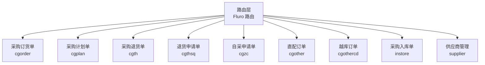
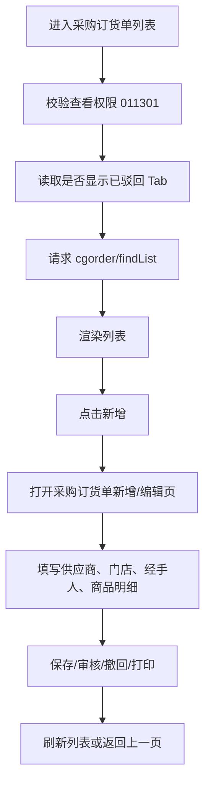
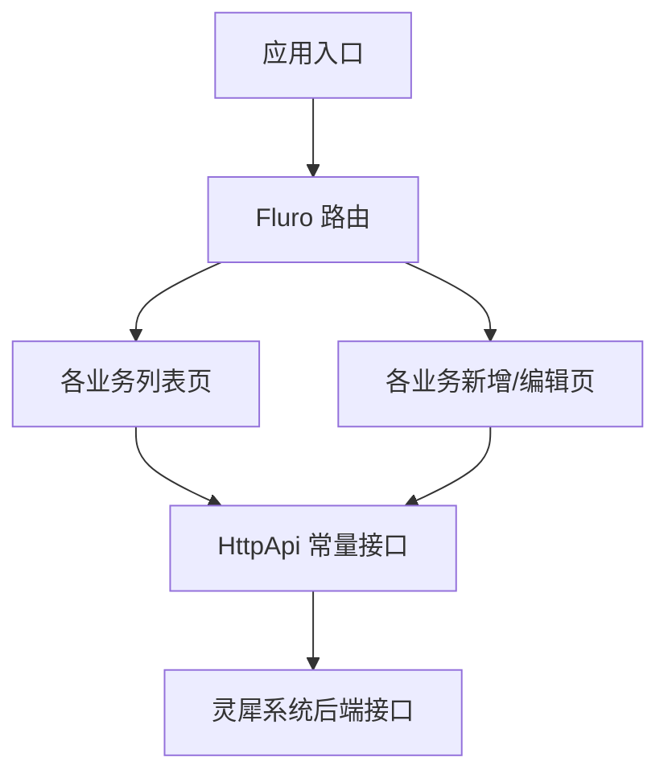
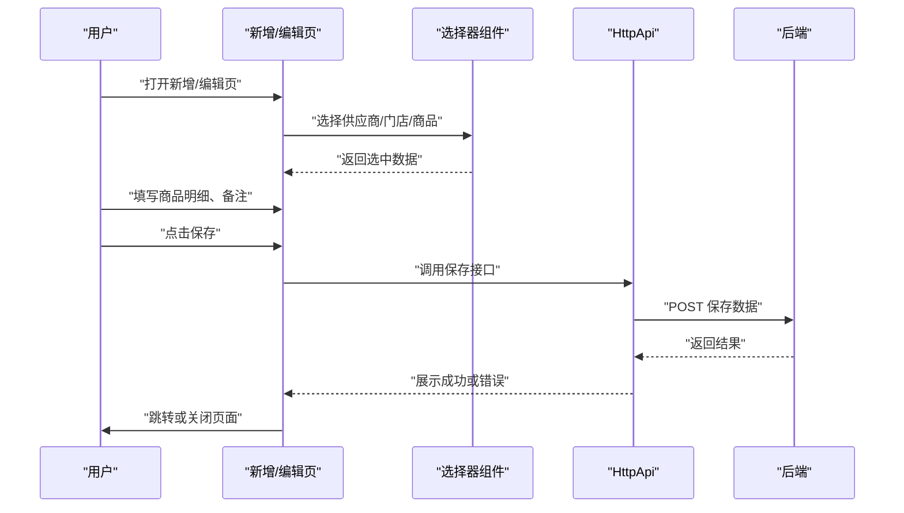
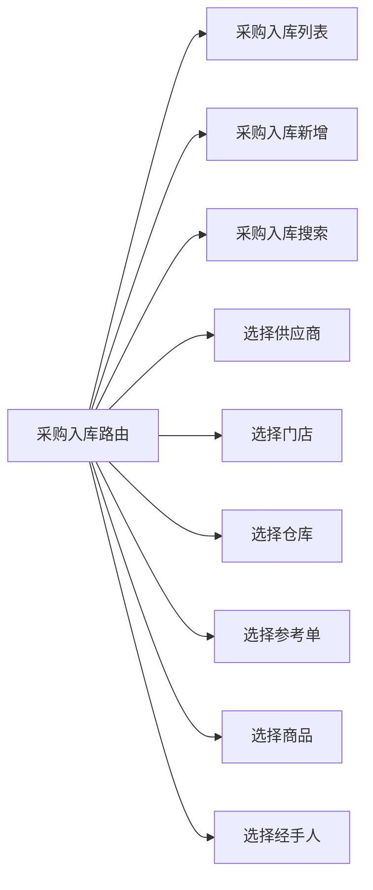
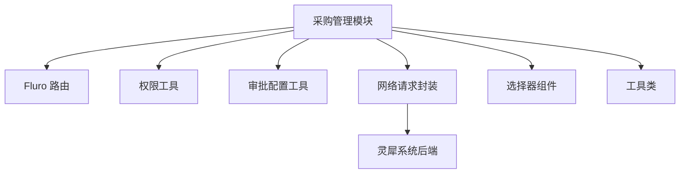
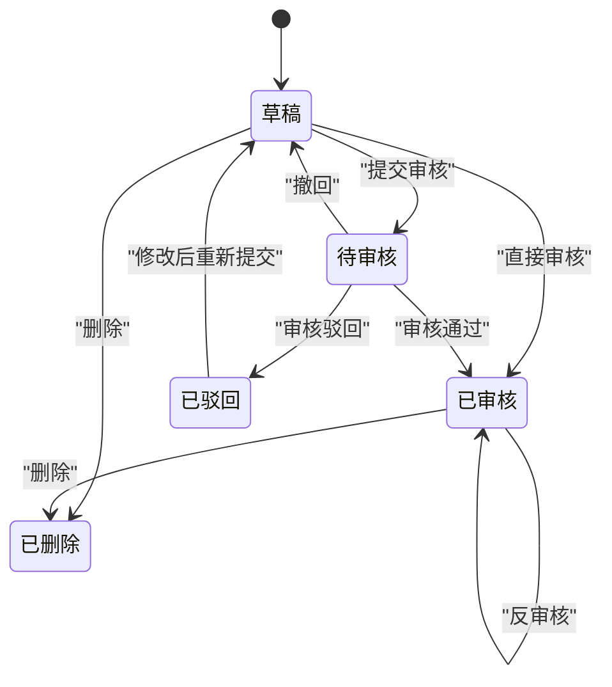
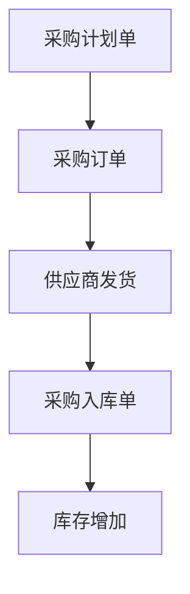
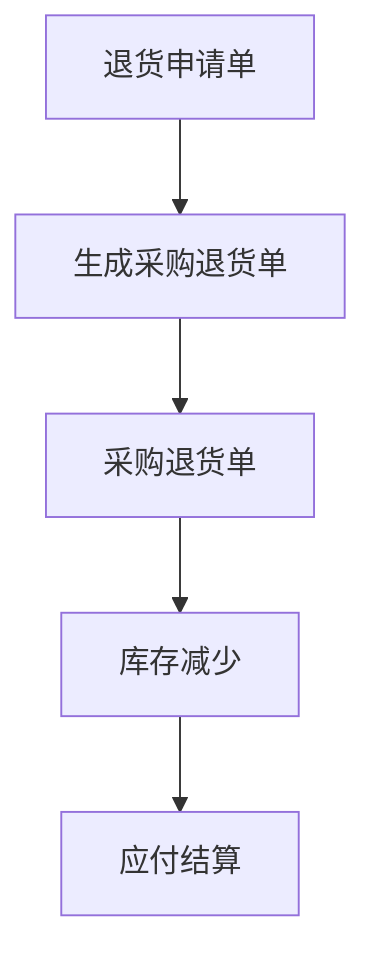
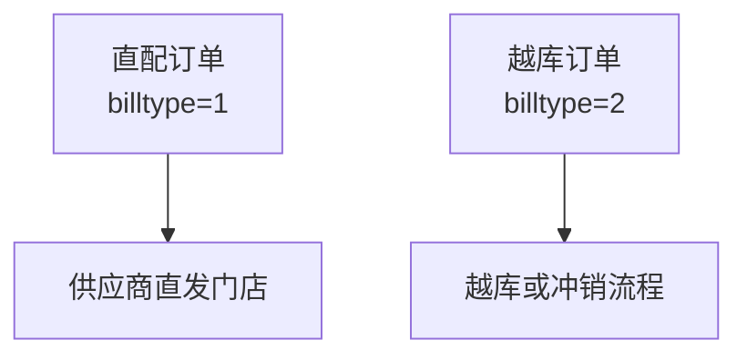

# 采购管理模块

<cite>
**本文引用的文件**   
- [lib/pages/business/purchase/cgorder/router.dart](file://lib/pages/business/purchase/cgorder/router.dart)
- [lib/pages/business/purchase/cgorder/list.dart](file://lib/pages/business/purchase/cgorder/list.dart)
- [lib/pages/business/purchase/cgorder/add.dart](file://lib/pages/business/purchase/cgorder/add.dart)
- [lib/pages/business/purchase/cgplan/router.dart](file://lib/pages/business/purchase/cgplan/router.dart)
- [lib/pages/business/purchase/cgplan/list.dart](file://lib/pages/business/purchase/cgplan/list.dart)
- [lib/pages/business/purchase/cgplan/add.dart](file://lib/pages/business/purchase/cgplan/add.dart)
- [lib/pages/business/purchase/cgth/router.dart](file://lib/pages/business/purchase/cgth/router.dart)
- [lib/pages/business/purchase/cgth/list.dart](file://lib/pages/business/purchase/cgth/list.dart)
- [lib/pages/business/purchase/cgth/add.dart](file://lib/pages/business/purchase/cgth/add.dart)
- [lib/pages/business/purchase/cgthsq/router.dart](file://lib/pages/business/purchase/cgthsq/router.dart)
- [lib/pages/business/purchase/cgthsq/list.dart](file://lib/pages/business/purchase/cgthsq/list.dart)
- [lib/pages/business/purchase/cgthsq/add.dart](file://lib/pages/business/purchase/cgthsq/add.dart)
- [lib/pages/business/purchase/cgzc/router.dart](file://lib/pages/business/purchase/cgzc/router.dart)
- [lib/pages/business/purchase/cgzc/list.dart](file://lib/pages/business/purchase/cgzc/list.dart)
- [lib/pages/business/purchase/cgother/router.dart](file://lib/pages/business/purchase/cgother/router.dart)
- [lib/pages/business/purchase/cgother/list.dart](file://lib/pages/business/purchase/cgother/list.dart)
- [lib/pages/business/purchase/cgothercd/router.dart](file://lib/pages/business/purchase/cgothercd/router.dart)
- [lib/pages/business/purchase/cgothercd/list.dart](file://lib/pages/business/purchase/cgothercd/list.dart)
- [lib/pages/business/purchase/instore/router.dart](file://lib/pages/business/purchase/instore/router.dart)
- [lib/pages/business/purchase/instore/list.dart](file://lib/pages/business/purchase/instore/list.dart)
- [lib/pages/business/purchase/supplier/router.dart](file://lib/pages/business/purchase/supplier/router.dart)
- [lib/pages/business/purchase/supplier/list.dart](file://lib/pages/business/purchase/supplier/list.dart)
- [lib/net/http_api.dart](file://lib/net/http_api.dart)
</cite>

## 目录

1. [引言](#引言)
2. [项目结构](#项目结构)
3. [核心组件](#核心组件)
4. [架构总览](#架构总览)
5. [详细组件分析](#详细组件分析)
6. [依赖关系分析](#依赖关系分析)
7. [性能与体验特性](#性能与体验特性)
8. [跨模块交互](#跨模块交互)
9. [业务生命周期与状态转换](#业务生命周期与状态转换)
10. [典型业务场景](#典型业务场景)
11. [最佳实践](#最佳实践)
12. [故障排查指南](#故障排查指南)
13. [结论](#结论)

## 引言

本文件面向灵犀管店 Flutter 客户端中的“采购管理模块”，对以下核心能力进行系统化说明：

- 采购订单
- 采购计划
- 采购退货
- 采购退货申请
- 自采申请单（对应“采购暂存”类业务）
- 其他采购：直配订单、越库订单
- 其他采购单冲销：通过“越库订单”的独立入口体现
- 入库管理：采购入库单列表及选择器路由
- 供应商管理：供应商列表与基础筛选

文档目标包括：

- 描述从“计划或申请”到“订单生成”、再到“退货/入库/冲销”的完整业务流程。
- 解释各单据在列表页和新增/编辑页中的数据处理方式。
- 梳理审批状态、审核、反审核、撤回等状态流转。
- 说明与库存、财务、WMS、扫码、打印等周边模块的交互点。
- 给出可操作的优化建议和常见问题排查思路。

## 项目结构

采购管理模块集中在 `lib/pages/business/purchase` 目录下，采用“按业务子域 + 页面职责”组织：

| 目录 | 业务含义 | 主要文件 |
|---|---|---|
| `cgorder` | 采购订货单 | `router.dart`、`list.dart`、`add.dart` |
| `cgplan` | 采购计划单 | `router.dart`、`list.dart`、`add.dart` |
| `cgth` | 采购退货单 | `router.dart`、`list.dart`、`add.dart` |
| `cgthsq` | 退货申请单 | `router.dart`、`list.dart`、`add.dart` |
| `cgzc` | 自采申请单 | `router.dart`、`list.dart`、`add.dart` |
| `cgother` | 直配订单 | `router.dart`、`list.dart`、`add.dart` |
| `cgothercd` | 越库订单 | `router.dart`、`list.dart`、`add.dart` |
| `instore` | 采购入库单及相关选择器 | `router.dart`、`list.dart`、`add.dart`、`search.dart` |
| `supplier` | 供应商管理 | `router.dart`、`list.dart`、`add.dart`、`file_edit.dart` |

每个子模块通常包含：

- `router.dart`：注册 Fluro 路由，定义列表页、新增页路径。
- `list.dart`：列表页，负责权限校验、分页、搜索、快速时间、Tab 状态过滤。
- `add.dart`：新增/编辑/详情页，负责表单数据、商品明细、附件、审批签字、打印等操作。

**图表来源**

- [lib/pages/business/purchase/cgorder/router.dart:1-25](file://lib/pages/business/purchase/cgorder/router.dart#L1-L25)
- [lib/pages/business/purchase/cgplan/router.dart:1-25](file://lib/pages/business/purchase/cgplan/router.dart#L1-L25)
- [lib/pages/business/purchase/cgth/router.dart:1-25](file://lib/pages/business/purchase/cgth/router.dart#L1-L25)
- [lib/pages/business/purchase/cgthsq/router.dart:1-25](file://lib/pages/business/purchase/cgthsq/router.dart#L1-L25)
- [lib/pages/business/purchase/cgzc/router.dart:1-25](file://lib/pages/business/purchase/cgzc/router.dart#L1-L25)
- [lib/pages/business/purchase/cgother/router.dart:1-25](file://lib/pages/business/purchase/cgother/router.dart#L1-L25)
- [lib/pages/business/purchase/cgothercd/router.dart:1-25](file://lib/pages/business/purchase/cgothercd/router.dart#L1-L25)
- [lib/pages/business/purchase/instore/router.dart:1-51](file://lib/pages/business/purchase/instore/router.dart#L1-L51)
- [lib/pages/business/purchase/supplier/router.dart:1-25](file://lib/pages/business/purchase/supplier/router.dart#L1-L25)

**章节来源**

- [lib/pages/business/purchase/cgorder/router.dart:1-25](file://lib/pages/business/purchase/cgorder/router.dart#L1-L25)
- [lib/pages/business/purchase/instore/router.dart:1-51](file://lib/pages/business/purchase/instore/router.dart#L1-L51)
- [lib/pages/business/purchase/supplier/router.dart:1-25](file://lib/pages/business/purchase/supplier/router.dart#L1-L25)

## 核心组件

### 采购订货单

采购订货单是采购主流程的核心单据之一，用于记录门店向供应商发起的采购需求。

- 列表页 `PurchaseCgorderListPage` 提供：
  - 权限校验：使用权限码 `011301`。
  - Tab 分类：全部、待审核、已审核；若后端开启“已驳回”，则动态增加第四项。
  - 搜索字段：单号、供应商、经手人、门店、日期范围。
  - 分页加载：滚动到底部自动加载下一页。
  - 调用接口：`HttpApi.cgorderFindList`，即 `cgorder/findList`。

- 新增/编辑页 `PurchaseCgorderAddPage` 承担：
  - 选择供应商、门店、经手人。
  - 商品明细录入，支持批量选择。
  - 多审批流用户判断、管理员权限、反审核权限。
  - 保存、审核、删除、反审核、撤回、打印等操作枚举。
  - 扫码输入框适配 PDA 红外扫描枪。
  - 进价校验提示，例如“入库价与档案价不同”“进价达到原进价两倍”。

**图表来源**

- [lib/pages/business/purchase/cgorder/list.dart:1-200](file://lib/pages/business/purchase/cgorder/list.dart#L1-L200)
- [lib/pages/business/purchase/cgorder/add.dart:1-200](file://lib/pages/business/purchase/cgorder/add.dart#L1-L200)
- [lib/net/http_api.dart:1-260](file://lib/net/http_api.dart#L1-L260)

**章节来源**

- [lib/pages/business/purchase/cgorder/list.dart:1-200](file://lib/pages/business/purchase/cgorder/list.dart#L1-L200)
- [lib/pages/business/purchase/cgorder/add.dart:1-200](file://lib/pages/business/purchase/cgorder/add.dart#L1-L200)
- [lib/net/http_api.dart:1-260](file://lib/net/http_api.dart#L1-L260)

### 采购计划单

采购计划单用于门店根据销售预测或库存补货策略生成采购计划，是计划驱动采购的重要入口。

- 列表页 `CgplanListPage`：
  - 权限码：`011201`。
  - 状态过滤：待审核、已审核、已驳回。
  - 调用接口：`HttpApi.cgplanFindList`，即 `cgplan/findList`。
  - 支持按创建人、门店、时间范围查询。

- 新增/编辑页 `CgplanAddPage`：
  - 支持默认门店、默认经手人回填。
  - 支持商品明细、附件、扫码、批量操作。
  - 支持多级审批和用户权限控制。

**章节来源**

- [lib/pages/business/purchase/cgplan/list.dart:1-200](file://lib/pages/business/purchase/cgplan/list.dart#L1-L200)
- [lib/pages/business/purchase/cgplan/add.dart:1-200](file://lib/pages/business/purchase/cgplan/add.dart#L1-L200)
- [lib/net/http_api.dart:1-260](file://lib/net/http_api.dart#L1-L260)

### 采购退货单

采购退货单用于处理实际发生的退货入库业务。

- 列表页 `PurchaseCgthListPage`：
  - 权限码：`011901`。
  - 调用接口：`HttpApi.cgthFindList`，即 `cgstockin/findList`。
  - 参数中包含 `billtype=2`，表示退货类型。
  - 支持供应商、创建人、经办人、门店、时间范围筛选。

- 新增/编辑页 `PurchaseCgthAddPage`：
  - 支持关联原单，如采购入库单或退货申请单。
  - 支持仓库、仓库存储方式、批号、商品明细。
  - 支持保存、审核、删除、反审核、撤回、打印。
  - 支持登录配置项控制金额计算逻辑。

**章节来源**

- [lib/pages/business/purchase/cgth/list.dart:1-200](file://lib/pages/business/purchase/cgth/list.dart#L1-L200)
- [lib/pages/business/purchase/cgth/add.dart:1-200](file://lib/pages/business/purchase/cgth/add.dart#L1-L200)
- [lib/net/http_api.dart:1-260](file://lib/net/http_api.dart#L1-L260)

### 退货申请单

退货申请单是退货业务的申请前置单据，后续可生成采购退货单。

- 列表页 `CgthsqListPage`：
  - 权限码：`012001`。
  - 调用接口：代码中实际调用 `HttpApi.cgzcFindList`，并传入 `billtype=2`，用于退货申请单列表。
  - 支持创建人、供应商、门店、时间范围筛选。

- 新增/编辑页 `CgthsqAddPage`：
  - 提供“生成采购退货单”的能力。
  - 支持商品明细、扫码、附件、审批流。
  - 提交动作包括保存、审核、删除、反审核、打印、撤回、生成。

**章节来源**

- [lib/pages/business/purchase/cgthsq/list.dart:1-200](file://lib/pages/business/purchase/cgthsq/list.dart#L1-L200)
- [lib/pages/business/purchase/cgthsq/add.dart:1-200](file://lib/pages/business/purchase/cgthsq/add.dart#L1-L200)
- [lib/net/http_api.dart:1-260](file://lib/net/http_api.dart#L1-L260)

### 自采申请单

自采申请单用于门店发起自行采购申请，对应“采购暂存”类业务语义。

- 列表页 `CgzcListPage`：
  - 权限码：`011401`。
  - 调用接口：`HttpApi.cgzcFindList`，即 `cgzc/findList`。
  - 固定 `billtype=1`，表示自采申请单。
  - 支持收货状态筛选。

**章节来源**

- [lib/pages/business/purchase/cgzc/list.dart:1-200](file://lib/pages/business/purchase/cgzc/list.dart#L1-L200)
- [lib/net/http_api.dart:1-260](file://lib/net/http_api.dart#L1-L260)

### 其他采购：直配订单与越库订单

#### 直配订单

直配订单由 `CgotherListPage` 管理，常用于供应商直接配送至门店的场景。

- 权限码：`011501`。
- 调用接口：`HttpApi.cgotherFindList`，即 `cgother/findList`。
- `billtype=1` 表示直配订单。
- 支持收货状态筛选。

#### 越库订单

越库订单由 `CgothercdListPage` 管理，可用于“其他采购单冲销”等业务场景。

- 权限码：`011601`。
- 调用接口：`HttpApi.cgotherFindList`，但 `billtype=2`，用于区分越库订单。
- 新增/编辑详情接口为 `cgothercd/getInfo`。

**章节来源**

- [lib/pages/business/purchase/cgother/list.dart:1-200](file://lib/pages/business/purchase/cgother/list.dart#L1-L200)
- [lib/pages/business/purchase/cgothercd/list.dart:1-200](file://lib/pages/business/purchase/cgothercd/list.dart#L1-L200)
- [lib/net/http_api.dart:1-260](file://lib/net/http_api.dart#L1-L260)

### 入库管理

入库管理以“采购入库单”为核心，是采购订单、采购退货等单据最终落库的关键节点。

- 列表页 `PurchaseInstoreListPage`：
  - 权限码：`011701`。
  - 调用接口：`/cgstockin/findList`。
  - 支持供应商、仓库、创建人、退货状态、付款状态、时间范围筛选。
  - 页面进入时记录操作审计日志。

- 路由 `PurchaseRouter`：
  - 除列表和新增外，还暴露多个通用选择器路由：供应商、门店、仓库、参考单、商品、经手人。

**章节来源**

- [lib/pages/business/purchase/instore/list.dart:1-200](file://lib/pages/business/purchase/instore/list.dart#L1-L200)
- [lib/pages/business/purchase/instore/router.dart:1-51](file://lib/pages/business/purchase/instore/router.dart#L1-L51)
- [lib/net/http_api.dart:1-260](file://lib/net/http_api.dart#L1-L260)

### 供应商管理

供应商管理提供供应商基础信息的查看、筛选、新增能力。

- 列表页 `SupplierListPage`：
  - 权限码：`011101`。
  - 调用接口：`HttpApi.supplierList`，即 `supplierinfo/findList`。
  - 支持供应商类型、类型名称、停用状态、销售类型筛选。
  - 支持分页、搜索、底部抽屉筛选。

**章节来源**

- [lib/pages/business/purchase/supplier/list.dart:1-200](file://lib/pages/business/purchase/supplier/list.dart#L1-L200)
- [lib/net/http_api.dart:1-260](file://lib/net/http_api.dart#L1-L260)

## 架构总览

采购管理模块整体遵循“路由 → 页面 → 网络请求 → 后端接口”的分层结构：

**图表来源**

- [lib/pages/business/purchase/cgorder/router.dart:1-25](file://lib/pages/business/purchase/cgorder/router.dart#L1-L25)
- [lib/pages/business/purchase/instore/router.dart:1-51](file://lib/pages/business/purchase/instore/router.dart#L1-L51)
- [lib/net/http_api.dart:1-260](file://lib/net/http_api.dart#L1-L260)

## 详细组件分析

### 列表页通用模式

大多数采购相关列表页都采用相似结构：

1. 初始化时设置 Tab 控制器长度，默认为 3：全部、待审核、已审核。
2. 根据 `ReviewConfigUtils.shouldShowRejectedTab` 动态决定是否显示“已驳回”标签。
3. 进入页面时执行权限检查，无权限则提示。
4. 调用 `request` 方法请求后端列表接口。
5. 解析返回的 `data.list`，并按页码合并或替换本地列表。
6. 滚动到底部触发下一页加载。
7. 搜索输入防抖后重置页码并重新查询。

这种模式保证了采购模块列表行为一致，同时通过权限码和后端审批配置控制可见性。

**章节来源**

- [lib/pages/business/purchase/cgorder/list.dart:1-200](file://lib/pages/business/purchase/cgorder/list.dart#L1-L200)
- [lib/pages/business/purchase/cgplan/list.dart:1-200](file://lib/pages/business/purchase/cgplan/list.dart#L1-L200)
- [lib/pages/business/purchase/cgth/list.dart:1-200](file://lib/pages/business/purchase/cgth/list.dart#L1-L200)
- [lib/pages/business/purchase/cgthsq/list.dart:1-200](file://lib/pages/business/purchase/cgthsq/list.dart#L1-L200)
- [lib/pages/business/purchase/cgzc/list.dart:1-200](file://lib/pages/business/purchase/cgzc/list.dart#L1-L200)
- [lib/pages/business/purchase/cgother/list.dart:1-200](file://lib/pages/business/purchase/cgother/list.dart#L1-L200)
- [lib/pages/business/purchase/cgothercd/list.dart:1-200](file://lib/pages/business/purchase/cgothercd/list.dart#L1-L200)
- [lib/pages/business/purchase/instore/list.dart:1-200](file://lib/pages/business/purchase/instore/list.dart#L1-L200)

### 新增/编辑页通用模式

新增/编辑页普遍具备以下能力：

- 表单控件：供应商、门店、经手人、仓库、备注。
- 商品明细列表：支持增删改查、数量、价格、批号。
- 附件上传：通过 `attach_page.dart` 接入。
- 扫码输入：监听键盘事件和文本变化，兼容 PDA 扫码枪。
- 审批流：读取当前用户、管理员标志、审批人员列表。
- 操作按钮：保存、审核、反审核、删除、撤回、打印。
- 未保存变更保护：通过表单快照判断离开时是否弹窗确认。

**图表来源**

- [lib/pages/business/purchase/cgorder/add.dart:1-200](file://lib/pages/business/purchase/cgorder/add.dart#L1-L200)
- [lib/pages/business/purchase/cgplan/add.dart:1-200](file://lib/pages/business/purchase/cgplan/add.dart#L1-L200)
- [lib/pages/business/purchase/cgth/add.dart:1-200](file://lib/pages/business/purchase/cgth/add.dart#L1-L200)
- [lib/pages/business/purchase/cgthsq/add.dart:1-200](file://lib/pages/business/purchase/cgthsq/add.dart#L1-L200)

**章节来源**

- [lib/pages/business/purchase/cgorder/add.dart:1-200](file://lib/pages/business/purchase/cgorder/add.dart#L1-L200)
- [lib/pages/business/purchase/cgplan/add.dart:1-200](file://lib/pages/business/purchase/cgplan/add.dart#L1-L200)
- [lib/pages/business/purchase/cgth/add.dart:1-200](file://lib/pages/business/purchase/cgth/add.dart#L1-L200)
- [lib/pages/business/purchase/cgthsq/add.dart:1-200](file://lib/pages/business/purchase/cgthsq/add.dart#L1-L200)

### 路由与选择器

采购入库模块的路由比较集中，除了列表和新增外，还统一暴露了供应商、门店、仓库、参考单、商品、经手人的选择器路由。这体现了“列表页 + 新增页 + 共享选择器”的复用设计。

**图表来源**

- [lib/pages/business/purchase/instore/router.dart:1-51](file://lib/pages/business/purchase/instore/router.dart#L1-L51)

**章节来源**

- [lib/pages/business/purchase/instore/router.dart:1-51](file://lib/pages/business/purchase/instore/router.dart#L1-L51)

## 依赖关系分析

采购管理模块对外依赖主要包括：

| 依赖类别 | 依赖内容 | 作用 |
|---|---|---|
| 路由依赖 | Fluro | 定义页面跳转路径 |
| 网络依赖 | Dio 封装与 `http_api.dart` | 调用灵犀系统后端接口 |
| 权限依赖 | `PermissionUtils` | 控制页面查看权限 |
| 审批依赖 | `ReviewConfigUtils`、`ReviewNavState` | 动态控制“已驳回”标签和初始状态 |
| 工具依赖 | `ToastUtils`、`FileLogWriter` | 提示、日志 |
| 组件依赖 | `select_*` 组件 | 供应商、门店、仓库、商品、参考单、经手人选择 |
| 设备依赖 | 扫码、PDA 扫描、语音识别、打印 | 提升移动端采购效率 |

**图表来源**

- [lib/pages/business/purchase/cgorder/list.dart:1-200](file://lib/pages/business/purchase/cgorder/list.dart#L1-L200)
- [lib/pages/business/purchase/instore/router.dart:1-51](file://lib/pages/business/purchase/instore/router.dart#L1-L51)
- [lib/net/http_api.dart:1-260](file://lib/net/http_api.dart#L1-L260)

**章节来源**

- [lib/pages/business/purchase/cgorder/list.dart:1-200](file://lib/pages/business/purchase/cgorder/list.dart#L1-L200)
- [lib/pages/business/purchase/instore/router.dart:1-51](file://lib/pages/business/purchase/instore/router.dart#L1-L51)
- [lib/net/http_api.dart:1-260](file://lib/net/http_api.dart#L1-L260)

## 性能与体验特性

采购模块在移动端体验上做了多项优化：

- 分页加载：避免一次性拉取大量数据。
- 搜索防抖：减少频繁查询。
- Tab 数量动态调整：避免 TabBar 与控制器长度不一致。
- 权限前置校验：无权限直接提示，避免无效请求。
- PDA 扫码枪适配：监听键盘 Enter 事件和文本变化。
- 未保存变更保护：离开页面时检测表单快照。
- 操作日志：部分页面记录进入、查询等操作轨迹。

这些特性共同提升了采购人员在门店或仓库环境下的操作效率。

**章节来源**

- [lib/pages/business/purchase/cgorder/list.dart:1-200](file://lib/pages/business/purchase/cgorder/list.dart#L1-L200)
- [lib/pages/business/purchase/cgorder/add.dart:1-200](file://lib/pages/business/purchase/cgorder/add.dart#L1-L200)
- [lib/pages/business/purchase/instore/list.dart:1-200](file://lib/pages/business/purchase/instore/list.dart#L1-L200)

## 跨模块交互

### 与库存模块

采购入库单直接与库存变动相关。入库审核后，库存数量通常会增加；采购退货单则会减少库存或产生负库存冲销。入库列表和退货列表共用 `cgstockin` 相关接口前缀，说明它们在库存维度有较强关联。

### 与财务模块

采购业务涉及应付账款、采购成本、供应商结算等财务数据。虽然采购模块本身不直接实现财务记账，但采购订单、采购退货、采购入库的数据会作为财务应付和成本核算的来源。

### 与 WMS 模块

WMS 模块包含收货任务、上架任务、补货、货位库存等功能。采购入库完成后，可能触发 WMS 的上架任务；采购退货也可能影响 WMS 的库存和货位状态。

### 与扫码、打印模块

采购新增/编辑页广泛支持扫码和打印：

- 扫码：用于快速添加商品条码。
- 打印：通过 `airprint/setWxPrintRw` 调用打印功能。
- 语音识别：部分页面集成语音输入，辅助录入。

**章节来源**

- [lib/pages/business/purchase/cgth/list.dart:1-200](file://lib/pages/business/purchase/cgth/list.dart#L1-L200)
- [lib/pages/business/purchase/instore/list.dart:1-200](file://lib/pages/business/purchase/instore/list.dart#L1-L200)
- [lib/net/http_api.dart:1-260](file://lib/net/http_api.dart#L1-L260)

## 业务生命周期与状态转换

### 状态模型

采购相关单据普遍使用以下状态：

| signflag | 含义 | 常见业务含义 |
|---|---|---|
| 空或默认值 | 草稿或未审核 | 可编辑、可提交审核 |
| 0 | 待审核 | 需要审批人审核 |
| 1 | 已审核 | 生效，可继续下游业务 |
| 2 | 已驳回 | 被拒绝，通常需要修改后重新提交 |

此外，`reviewsignflag=2` 表示单据处于“撤回待处理”态，允许撤回方继续处理。

### 状态转换流程

该状态模型适用于采购订货单、采购计划单、采购退货单、自采申请单、直配订单、越库订单等大多数采购类单据。

**章节来源**

- [lib/pages/business/purchase/cgorder/add.dart:1-200](file://lib/pages/business/purchase/cgorder/add.dart#L1-L200)
- [lib/pages/business/purchase/cgplan/add.dart:1-200](file://lib/pages/business/purchase/cgplan/add.dart#L1-L200)
- [lib/pages/business/purchase/cgth/add.dart:1-200](file://lib/pages/business/purchase/cgth/add.dart#L1-L200)
- [lib/pages/business/purchase/cgthsq/add.dart:1-200](file://lib/pages/business/purchase/cgthsq/add.dart#L1-L200)
- [lib/pages/business/purchase/cgother/list.dart:1-200](file://lib/pages/business/purchase/cgother/list.dart#L1-L200)
- [lib/pages/business/purchase/cgothercd/list.dart:1-200](file://lib/pages/business/purchase/cgothercd/list.dart#L1-L200)

## 典型业务场景

### 场景一：从采购计划到采购订单

1. 用户在“采购计划单”列表中新增计划，选择门店、经手人和商品。
2. 计划审核通过后，可在采购订单中引用或手动新建采购订单。
3. 采购订单选择供应商、商品明细，并提交审核。
4. 审核通过后，供应商发货，门店准备收货。
5. 在“采购入库单”中完成入库，库存增加。

**图表来源**

- [lib/pages/business/purchase/cgplan/list.dart:1-200](file://lib/pages/business/purchase/cgplan/list.dart#L1-L200)
- [lib/pages/business/purchase/cgorder/list.dart:1-200](file://lib/pages/business/purchase/cgorder/list.dart#L1-L200)
- [lib/pages/business/purchase/instore/list.dart:1-200](file://lib/pages/business/purchase/instore/list.dart#L1-L200)

### 场景二：退货申请转采购退货

1. 门店发现商品质量问题，在“退货申请单”中登记退货原因和商品明细。
2. 退货申请审核通过后，生成“采购退货单”。
3. 仓库按退货单收货，库存减少。
4. 后续与供应商结算应付账款时，退货金额参与结算。

**图表来源**

- [lib/pages/business/purchase/cgthsq/add.dart:1-200](file://lib/pages/business/purchase/cgthsq/add.dart#L1-L200)
- [lib/pages/business/purchase/cgth/list.dart:1-200](file://lib/pages/business/purchase/cgth/list.dart#L1-L200)

### 场景三：直配订单与越库订单

- 直配订单：供应商直接将商品配送到门店，跳过中间仓。
- 越库订单：可用于越库作业或其他采购单冲销场景。
- 两类订单都通过 `cgother/findList` 获取列表，但通过 `billtype` 区分。

**图表来源**

- [lib/pages/business/purchase/cgother/list.dart:1-200](file://lib/pages/business/purchase/cgother/list.dart#L1-L200)
- [lib/pages/business/purchase/cgothercd/list.dart:1-200](file://lib/pages/business/purchase/cgothercd/list.dart#L1-L200)
- [lib/net/http_api.dart:1-260](file://lib/net/http_api.dart#L1-L260)

### 场景四：供应商管理与采购关联

供应商是采购业务的基础主数据。采购订单、采购退货、直配订单、越库订单都需要关联供应商。供应商列表支持按类型、状态、销售类型筛选，帮助采购人员快速定位可用供应商。

**章节来源**

- [lib/pages/business/purchase/supplier/list.dart:1-200](file://lib/pages/business/purchase/supplier/list.dart#L1-L200)
- [lib/pages/business/purchase/cgorder/list.dart:1-200](file://lib/pages/business/purchase/cgorder/list.dart#L1-L200)
- [lib/pages/business/purchase/cgth/list.dart:1-200](file://lib/pages/business/purchase/cgth/list.dart#L1-L200)

## 最佳实践

### 1. 优先使用计划驱动采购

对于稳定门店，建议先维护采购计划，再转换为采购订单，这样可以控制采购频率和总量，降低盲目采购风险。

### 2. 严格区分退货申请与采购退货

退货申请是申请流程，采购退货是实际退货入库流程。不要跳过申请直接做退货，否则会导致审批链不完整。

### 3. 谨慎使用“已驳回”状态

“已驳回”意味着流程被拒绝。应引导用户修改后再提交，而不是反复提交相同数据。

### 4. 充分利用扫码和批量操作

采购明细录入量大时，优先使用扫码和批量选择，减少手工输入错误。

### 5. 注意权限与审批配置

“已驳回”标签不是所有环境都显示，需依赖后端审批配置。开发或测试时应关注权限码和审批流配置。

### 6. 入库前核对供应商和商品

入库是库存变动的关键节点，建议在入库前核对供应商、商品、数量、批次、仓库等信息。

### 7. 直配与越库订单要分清用途

直配订单适合供应商直发；越库订单更适合越库或冲销场景，不要混用。

[本节为通用指导，不直接分析具体源码文件]

## 故障排查指南

### 问题一：看不到“已驳回”标签

可能原因：

- 后端未开启该单据类型的“已驳回”审批配置。
- 当前用户没有查看该单据的权限。
- 页面缓存导致配置未刷新。

排查建议：

- 检查 `ReviewConfigUtils.shouldShowRejectedTab` 对应的单据名称是否正确。
- 检查权限码是否匹配。
- 使用强制刷新配置的逻辑，确认后台配置是否变化。

**章节来源**

- [lib/pages/business/purchase/cgorder/list.dart:1-200](file://lib/pages/business/purchase/cgorder/list.dart#L1-L200)
- [lib/pages/business/purchase/cgplan/list.dart:1-200](file://lib/pages/business/purchase/cgplan/list.dart#L1-L200)
- [lib/pages/business/purchase/cgth/list.dart:1-200](file://lib/pages/business/purchase/cgth/list.dart#L1-L200)

### 问题二：扫码无法触发商品查询

可能原因：

- PDA 扫码枪模拟键盘输入过快，文本变化防抖未触发。
- 输入框焦点丢失。
- 扫码设置未正确加载。

排查建议：

- 检查 `onKeyEvent` 是否捕获 Enter。
- 检查文本变化监听是否启用。
- 检查扫码设置是否从本地存储加载。

**章节来源**

- [lib/pages/business/purchase/cgorder/add.dart:1-200](file://lib/pages/business/purchase/cgorder/add.dart#L1-L200)
- [lib/pages/business/purchase/cgplan/add.dart:1-200](file://lib/pages/business/purchase/cgplan/add.dart#L1-L200)
- [lib/pages/business/purchase/cgth/add.dart:1-200](file://lib/pages/business/purchase/cgth/add.dart#L1-L200)
- [lib/pages/business/purchase/cgthsq/add.dart:1-200](file://lib/pages/business/purchase/cgthsq/add.dart#L1-L200)

### 问题三：列表翻页异常

可能原因：

- 后端返回数据为空或长度小于预期。
- `_hasMore` 判断条件不符合后端分页规则。
- 重复触发 `_loadData`。

排查建议：

- 检查 `_loading` 防重入。
- 检查 `rows.length >= pageSize` 或 `rows.isNotEmpty` 的判断。
- 检查后端返回的 `data.list` 是否为数组。

**章节来源**

- [lib/pages/business/purchase/cgother/list.dart:1-200](file://lib/pages/business/purchase/cgother/list.dart#L1-L200)
- [lib/pages/business/purchase/cgothercd/list.dart:1-200](file://lib/pages/business/purchase/cgothercd/list.dart#L1-L200)
- [lib/pages/business/purchase/supplier/list.dart:1-200](file://lib/pages/business/purchase/supplier/list.dart#L1-L200)

### 问题四：权限提示“无权查看”

可能原因：

- 当前用户缺少对应权限码。
- 后台角色或席位未授权。

排查建议：

- 核对列表页中的权限码。
- 在后台为用户分配对应菜单权限。

**章节来源**

- [lib/pages/business/purchase/cgorder/list.dart:1-200](file://lib/pages/business/purchase/cgorder/list.dart#L1-L200)
- [lib/pages/business/purchase/cgplan/list.dart:1-200](file://lib/pages/business/purchase/cgplan/list.dart#L1-L200)
- [lib/pages/business/purchase/cgth/list.dart:1-200](file://lib/pages/business/purchase/cgth/list.dart#L1-L200)
- [lib/pages/business/purchase/cgthsq/list.dart:1-200](file://lib/pages/business/purchase/cgthsq/list.dart#L1-L200)
- [lib/pages/business/purchase/cgzc/list.dart:1-200](file://lib/pages/business/purchase/cgzc/list.dart#L1-L200)
- [lib/pages/business/purchase/cgother/list.dart:1-200](file://lib/pages/business/purchase/cgother/list.dart#L1-L200)
- [lib/pages/business/purchase/cgothercd/list.dart:1-200](file://lib/pages/business/purchase/cgothercd/list.dart#L1-L200)
- [lib/pages/business/purchase/instore/list.dart:1-200](file://lib/pages/business/purchase/instore/list.dart#L1-L200)
- [lib/pages/business/purchase/supplier/list.dart:1-200](file://lib/pages/business/purchase/supplier/list.dart#L1-L200)

## 结论

灵犀管店 Flutter 项目的采购管理模块围绕“计划、订单、退货、申请、暂存、其他采购、冲销、入库、供应商”形成完整闭环。其前端实现具有以下特点：

- 模块边界清晰：每个业务子域都有独立的目录和路由。
- 列表页模式统一：权限、分页、搜索、Tab 状态过滤高度一致。
- 新增页功能丰富：覆盖扫码、附件、审批、打印、批量操作。
- 状态模型统一：草稿、待审核、已审核、已驳回、撤回等状态贯穿多数单据。
- 与库存、WMS、财务、扫码、打印等模块存在明确交互点。

在实际使用中，建议以“计划驱动、订单执行、退货规范、入库严谨”为原则，结合权限和审批配置，确保采购业务数据准确、流程可控、库存可追溯。