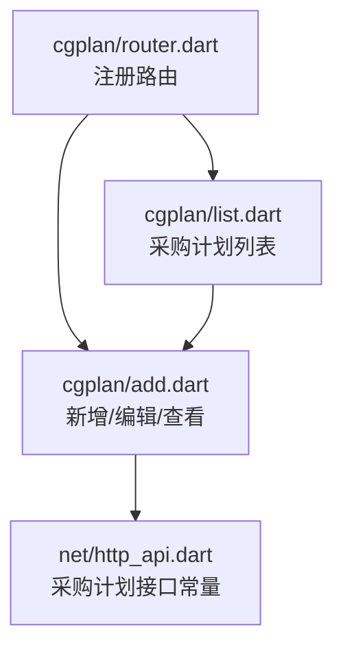
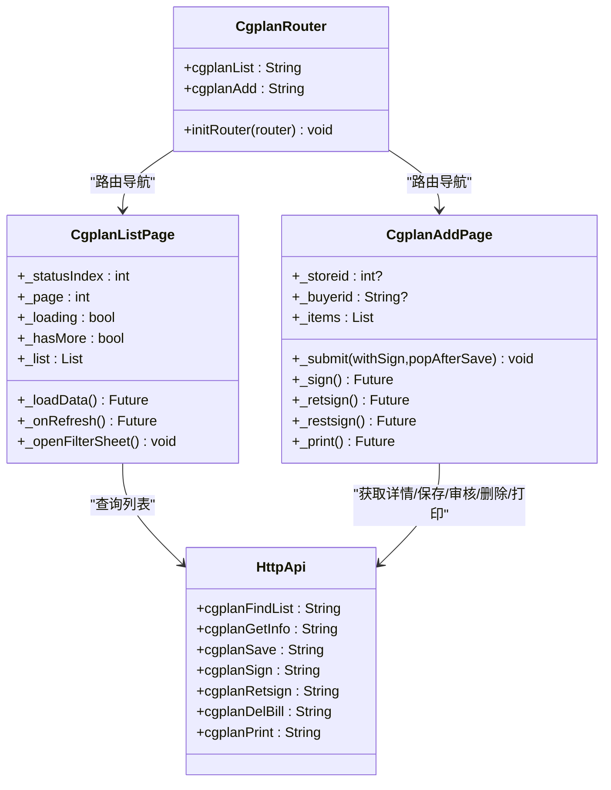
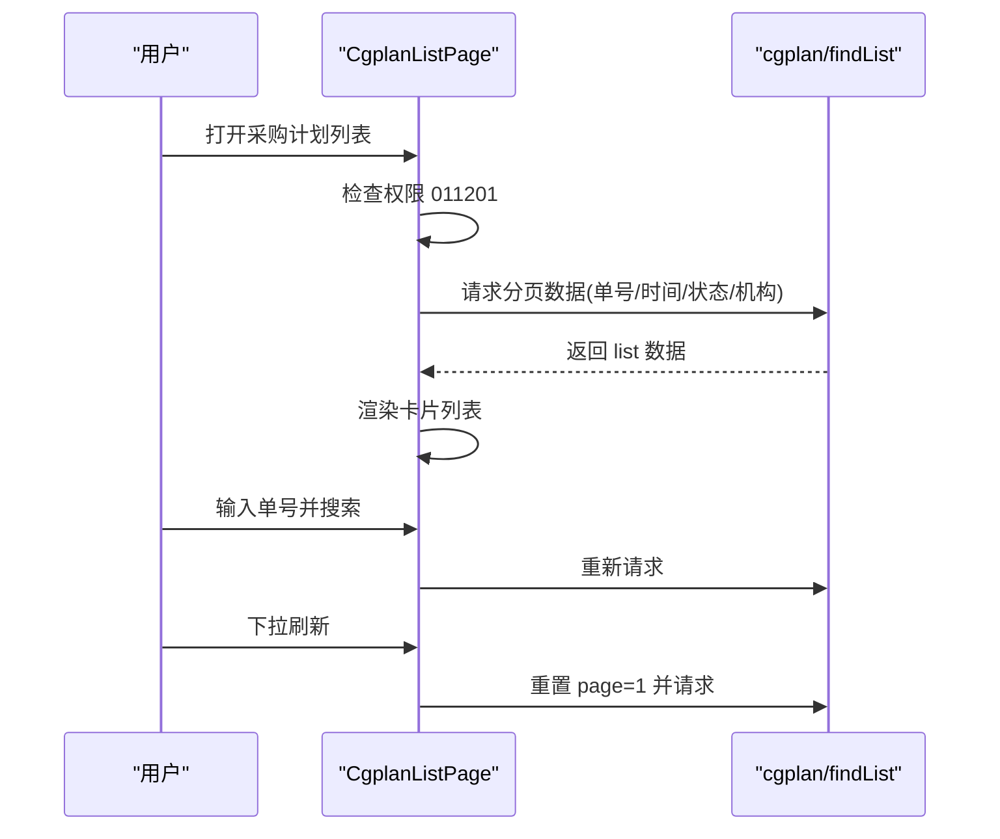
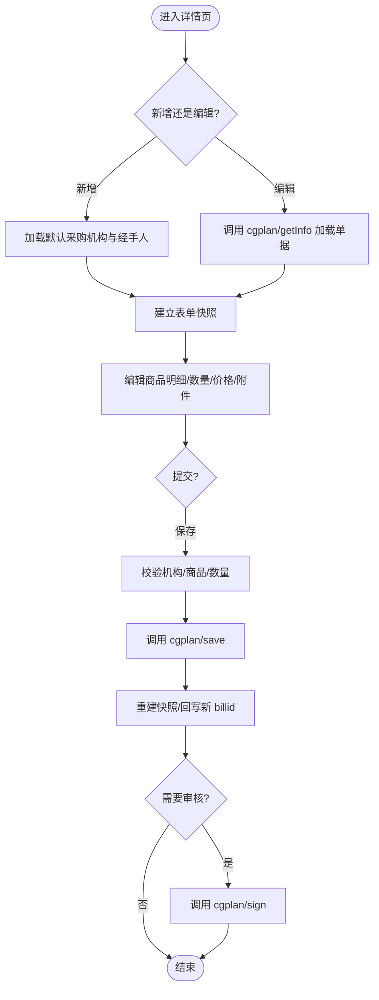
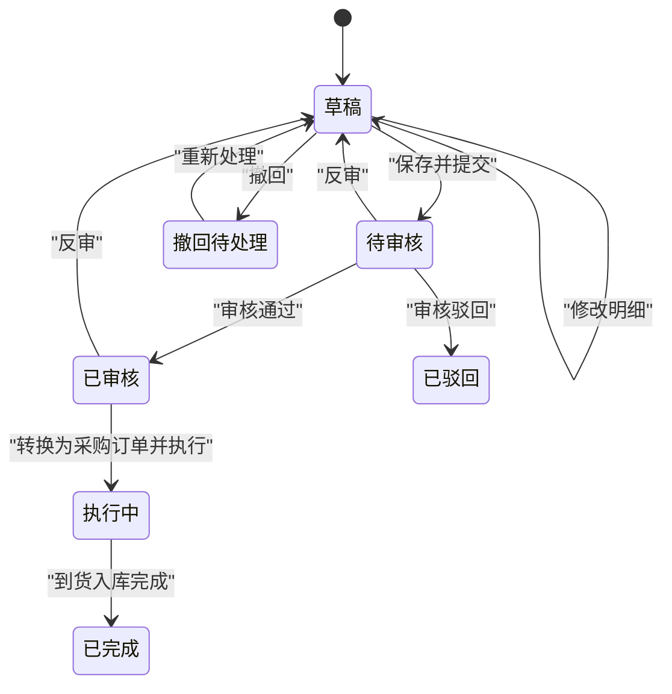
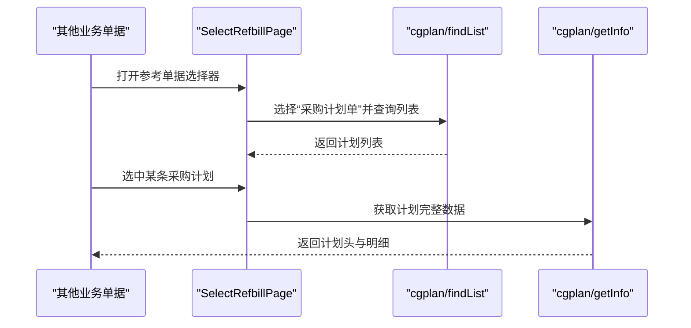
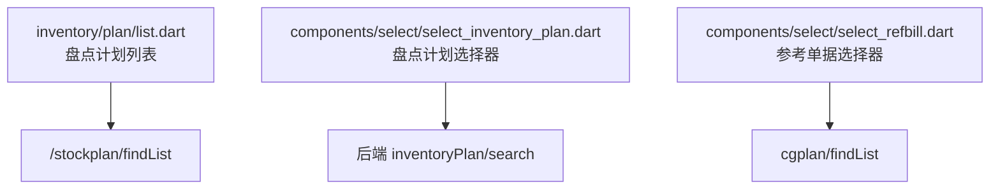

# 采购计划

<cite>
**本文引用的文件**   
- [router.dart](file://lib/pages/business/purchase/cgplan/router.dart)
- [list.dart](file://lib/pages/business/purchase/cgplan/list.dart)
- [add.dart](file://lib/pages/business/purchase/cgplan/add.dart)
- [http_api.dart](file://lib/net/http_api.dart)
- [select_refbill.dart](file://lib/components/select/select_refbill.dart)
- [select_inventory_plan.dart](file://lib/components/select/select_inventory_plan.dart)
- [inventory_plan_list.dart](file://lib/pages/business/inventory/plan/list.dart)
- [inventory_plan_add.dart](file://lib/pages/business/inventory/plan/add.dart)
</cite>

## 目录
1. [简介](#简介)
2. [项目结构与入口](#项目结构与入口)
3. [核心功能总览](#核心功能总览)
4. [架构与模块关系](#架构与模块关系)
5. [详细组件分析](#详细组件分析)
6. [数据模型与关键字段](#数据模型与关键字段)
7. [状态管理与审批流程](#状态管理与审批流程)
8. [与采购订单的转换关系](#与采购订单的转换关系)
9. [筛选、搜索与批量操作](#筛选搜索与批量操作)
10. [库存联动与业务场景](#库存联动与业务场景)
11. [性能与可维护性建议](#性能与可维护性建议)
12. [常见问题排查](#常见问题排查)
13. [结论](#结论)

## 简介
本文件聚焦灵犀管店 Flutter 客户端中的“采购计划”功能，覆盖采购计划的制定、审批和执行路径，说明其与采购订单、盘点计划及库存分析模块的数据关联。文档面向产品、运营和开发者三类读者：既给出业务视角的流程说明，也给出前端页面、API 调用和数据结构层面的实现要点。

## 项目结构与入口
采购计划功能位于业务模块 `lib/pages/business/purchase/cgplan`，由路由、列表页和新增/编辑详情页组成：

- 路由定义：`lib/pages/business/purchase/cgplan/router.dart`
- 列表页：`lib/pages/business/purchase/cgplan/list.dart`
- 新增/编辑/查看页：`lib/pages/business/purchase/cgplan/add.dart`
- API 常量：`lib/net/http_api.dart`

**图表来源**
- [router.dart:1-25](file://lib/pages/business/purchase/cgplan/router.dart#L1-L25)
- [list.dart:581-960](file://lib/pages/business/purchase/cgplan/list.dart#L581-L960)
- [add.dart:201-627](file://lib/pages/business/purchase/cgplan/add.dart#L201-L627)
- [http_api.dart:96-103](file://lib/net/http_api.dart#L96-L103)

**章节来源**
- [router.dart:1-25](file://lib/pages/business/purchase/cgplan/router.dart#L1-L25)
- [list.dart:581-960](file://lib/pages/business/purchase/cgplan/list.dart#L581-L960)
- [add.dart:201-627](file://lib/pages/business/purchase/cgplan/add.dart#L201-L627)
- [http_api.dart:96-103](file://lib/net/http_api.dart#L96-L103)

## 核心功能总览
采购计划是门店或机构在正式发起采购订单前，用于汇总商品需求、预估数量与金额、安排到货时间的计划单据。其核心能力包括：

- 列表查询：按单号、时间范围、制单人、机构等条件分页加载。
- 新增与编辑：选择采购机构、经手人、明细商品、数量、单价、金额、附件和备注。
- 提交保存：校验必填字段、计算合计数量和金额、持久化到后端。
- 审核流程：支持简单确认和多级审批；支持反审、撤回、打印。
- 查看详情：以只读或可编辑态展示单据头和明细行。
- 与外部单据关联：通过通用参考单据选择器引用采购计划。
- 与库存分析联动：通过“盘点计划选择器”等组件间接使用计划类数据。

**章节来源**
- [list.dart:201-580](file://lib/pages/business/purchase/cgplan/list.dart#L201-L580)
- [add.dart:201-627](file://lib/pages/business/purchase/cgplan/add.dart#L201-L627)

## 架构与模块关系
从客户端职责看，采购计划分为三层：

1. 路由层：声明 `/purchase/cgplan/list` 与 `/purchase/cgplan/add` 两个页面路由。
2. 表现层：列表页负责筛选、搜索、分页、卡片展示；详情页负责表单、扫码、批量操作、审批交互。
3. 数据层：统一通过 `HttpApi` 中定义的采购计划接口常量访问后端；权限控制、日志记录、工具方法辅助业务逻辑。

**图表来源**
- [router.dart:1-25](file://lib/pages/business/purchase/cgplan/router.dart#L1-L25)
- [list.dart:201-580](file://lib/pages/business/purchase/cgplan/list.dart#L201-L580)
- [add.dart:201-627](file://lib/pages/business/purchase/cgplan/add.dart#L201-L627)
- [http_api.dart:96-103](file://lib/net/http_api.dart#L96-L103)

**章节来源**
- [router.dart:1-25](file://lib/pages/business/purchase/cgplan/router.dart#L1-L25)
- [http_api.dart:96-103](file://lib/net/http_api.dart#L96-L103)

## 详细组件分析

### 采购计划列表页
列表页承担以下职责：

- 顶部工具栏：机构选择、单号搜索、筛选按钮、新增按钮。
- Tab 状态栏：全部、待审核、已审核，根据审批配置动态显示“已驳回”。
- 下拉刷新与上拉加载更多。
- 筛选抽屉：快速时间标签、自定义日期范围、制单人选择。
- 列表卡片：单号、状态、制单人、金额、制单时间。
- 点击卡片进入详情页查看或编辑。

关键行为：
- 首次进入时根据权限 `011201` 判断是否允许查看采购计划。
- 通过 `cgplan/findList` 拉取分页数据，按创建时间倒序。
- 根据 `signflag` 映射 Tab：空为全部、`0` 为待审核、`1` 为已审核、`2` 为已驳回。
- 搜索输入框带防抖，清空按钮即时清除并刷新。
- 筛选抽屉返回后重置分页并重新请求。

**图表来源**
- [list.dart:201-580](file://lib/pages/business/purchase/cgplan/list.dart#L201-L580)
- [list.dart:581-960](file://lib/pages/business/purchase/cgplan/list.dart#L581-L960)
- [http_api.dart:97-97](file://lib/net/http_api.dart#L97-L97)

**章节来源**
- [list.dart:201-580](file://lib/pages/business/purchase/cgplan/list.dart#L201-L580)
- [list.dart:581-960](file://lib/pages/business/purchase/cgplan/list.dart#L581-L960)

### 采购计划新增/编辑/查看页
详情页同时承担新增、编辑和查看三种模式：

- 新增模式：自动回填当前登录用户作为经手人，并从本地存储读取默认采购机构。
- 编辑模式：调用 `cgplan/getInfo` 加载完整单据，包括头信息、明细、附件、审批流和用户可见权限。
- 查看模式：根据审核状态决定是否可编辑。

主要能力：

| 能力 | 说明 |
|---|---|
| 表单校验 | 采购机构、商品明细、数量必填；新增模式还依赖 Form 校验规则。 |
| 明细管理 | 商品、条码、名称、数量、单价、金额、库存、批次等；支持批量选择、批量删除。 |
| 扫码录入 | 支持 PDA 红外扫码枪连续录入，失焦后自动恢复扫描框焦点。 |
| 价格同步 | 切换机构后批量刷新商品价格、库存，并按数量重算金额。 |
| 保存 | 计算合计数量 `billqty`、合计金额 `billamt`，提交 `cgplan/save`。 |
| 审核 | 支持简单确认与多级审批；通过后设置 `signflag=1`。 |
| 反审 | 将单据恢复到未审核状态，必要时补全单据日期、单号类型、明细。 |
| 撤回 | 针对处于撤回待处理状态的单据执行撤回。 |
| 删除 | 删除整张采购计划。 |
| 打印 | 调用打印接口并传入菜单标识和数据体。 |
| 未保存拦截 | 新增或未审核单据离开时检测表单快照差异。 |

**图表来源**
- [add.dart:201-627](file://lib/pages/business/purchase/cgplan/add.dart#L201-L627)
- [add.dart:628-1054](file://lib/pages/business/purchase/cgplan/add.dart#L628-L1054)
- [http_api.dart:98-103](file://lib/net/http_api.dart#L98-L103)

**章节来源**
- [add.dart:201-627](file://lib/pages/business/purchase/cgplan/add.dart#L201-L627)
- [add.dart:628-1054](file://lib/pages/business/purchase/cgplan/add.dart#L628-L1054)

## 数据模型与关键字段
采购计划数据由单据头、明细列表和审批相关字段构成。以下为前端实际使用的关键字段集合：

| 类别 | 字段 | 含义 | 说明 |
|---|---|---|---|
| 单据头 | `billid` | 单据 ID | 新增成功后返回，用于后续编辑、审核、删除。 |
| 单据头 | `billno` | 计划编号 | 列表展示和搜索的主要标识。 |
| 单据头 | `bsid` | 机构 ID | 对应采购机构。 |
| 单据头 | `storename` | 机构名称 | 列表和详情展示。 |
| 单据头 | `storetype` | 机构类型 | 部分价格刷新逻辑中使用。 |
| 单据头 | `buyerid` | 经手人 ID | 新增默认值来自登录用户。 |
| 单据头 | `buyername` | 经手人名称 | 列表和详情展示。 |
| 单据头 | `remark` | 备注 | 可编辑文本。 |
| 单据头 | `fileLists` | 附件列表 | 上传后参与保存。 |
| 单据头 | `signflag` | 审核状态 | `0` 待审核，`1` 已审核，`2` 已驳回。 |
| 单据头 | `reviewsignflag` | 审批标志 | `2` 表示撤回待处理。 |
| 单据头 | `reviewremark` | 审批意见 | 审批时填写。 |
| 汇总字段 | `billqty` | 计划总数量 | 明细数量求和。 |
| 汇总字段 | `billamt` | 计划总金额 | 明细金额求和。 |
| 明细行 | `prodid` / `productid` | 商品 ID | 支持两种键名兼容。 |
| 明细行 | `barcode` / `selfbarcode` | 条码 | 支持多种条码字段。 |
| 明细行 | `productname` / `name` | 商品名称 | 支持两种键名兼容。 |
| 明细行 | `qty` | 计划数量 | 必填且大于零。 |
| 明细行 | `price` | 显示单价 | 优先使用采购价 `cgprice`。 |
| 明细行 | `cgprice` | 采购价 | 用于覆盖默认显示价格。 |
| 明细行 | `amt` | 行金额 | 由数量乘以单价重算。 |
| 明细行 | `stockqty` | 库存数量 | 价格刷新后同步。 |
| 明细行 | `unitonlyid` | 规格单位 ID | 用于价格匹配键。 |
| 明细行 | `sizeonlyid` | 规格尺寸 ID | 用于价格匹配键。 |
| 明细行 | `batchno` | 批次号 | 参与价格刷新键。 |
| 明细行 | `rawData` | 原始明细数据 | 保留接口返回的原始字段。 |
| 审批流 | `reviewFlowUsers` | 审批人员列表 | 决定当前用户是否属于审批节点。 |
| 审批流 | `reviewBillFlows` | 审批记录列表 | 用于查看审批日志。 |

该模型并非仅存在于单一 Dart 实体文件中，而是以 JSON 形式在网络响应中流转，并在详情页 `_DetailRow` 内部对象中被规范化使用。

**章节来源**
- [add.dart:201-627](file://lib/pages/business/purchase/cgplan/add.dart#L201-L627)
- [add.dart:628-1054](file://lib/pages/business/purchase/cgplan/add.dart#L628-L1054)

## 状态管理与审批流程
采购计划的状态由两个维度共同决定：

1. 审核状态 `signflag`：
   - `0`：待审核。
   - `1`：已审核。
   - `2`：已驳回。
2. 审批流程状态 `reviewsignflag`：
   - `2`：撤回待处理。
   - 其他值通常表示正常审批结果。

列表页根据 `signflag` 过滤 Tab；详情页根据 `signflag` 和审批流数据控制可编辑性、审核按钮、反审按钮、撤回按钮和打印按钮。

**图表来源**
- [list.dart:201-580](file://lib/pages/business/purchase/cgplan/list.dart#L201-L580)
- [add.dart:628-1054](file://lib/pages/business/purchase/cgplan/add.dart#L628-L1054)

**章节来源**
- [list.dart:201-580](file://lib/pages/business/purchase/cgplan/list.dart#L201-L580)
- [add.dart:628-1054](file://lib/pages/business/purchase/cgplan/add.dart#L628-L1054)

## 与采购订单的转换关系
采购计划与采购订单的关系如下：

- 采购计划是上游计划单据，用于汇总需求和计划到货时间。
- 采购订单是下游执行单据，用于向供应商下单、跟踪发货和入库。
- 前端通用参考单据选择器支持选择“采购计划单”，其列表接口为 `cgplan/findList`，详情接口为 `cgplan/getInfo`。
- 这意味着其他业务流程可以引用已存在的采购计划，从而把计划数据带入订单或其他单据中。

需要注意：在当前仓库代码中，并未发现采购计划直接“一键生成采购订单”的专用按钮；更常见的集成方式是其他单据在选择参考单据时引用采购计划，或由后端在业务扩展点中将计划转为订单。

**图表来源**
- [select_refbill.dart:32-41](file://lib/components/select/select_refbill.dart#L32-L41)
- [http_api.dart:97-99](file://lib/net/http_api.dart#L97-L99)

**章节来源**
- [select_refbill.dart:32-41](file://lib/components/select/select_refbill.dart#L32-L41)
- [http_api.dart:97-99](file://lib/net/http_api.dart#L97-L99)

## 筛选、搜索与批量操作

### 列表筛选
列表支持三类筛选：

| 筛选项 | 行为 |
|---|---|
| 快速时间 | 昨天、今天、本周、本月、自定义。 |
| 时间范围 | 开始日期与结束日期组合，默认最近 30 天。 |
| 制单人 | 通过选择器指定制单人。 |
| 机构 | 顶部工具栏选择机构，影响列表范围。 |
| 单号 | 搜索框实时防抖搜索。 |

筛选参数最终映射到后端请求，包含 `starttime`、`endtime`、`createid`、`sids`、`billno`、`signflag`、`page` 等。

### 搜索
搜索框支持：

- 回车提交。
- 输入变化防抖 500 毫秒后自动刷新。
- 清空按钮立即清除并刷新。

### 批量操作
批量操作主要在详情页的明细行层面：

- 开启批量选择模式。
- 全选或单选明细行。
- 批量删除选中的明细行。
- 批量删除前弹出确认提示。

注意：当前实现没有提供“批量删除整张采购计划”的列表级多选功能；批量删除针对的是计划内的商品明细。

**章节来源**
- [list.dart:201-580](file://lib/pages/business/purchase/cgplan/list.dart#L201-L580)
- [list.dart:581-960](file://lib/pages/business/purchase/cgplan/list.dart#L581-L960)
- [add.dart:628-1054](file://lib/pages/business/purchase/cgplan/add.dart#L628-L1054)

## 库存联动与业务场景

### 与库存分析模块的数据联动
仓库中存在“盘点计划”相关模块，其列表页调用 `/stockplan/findList`，并提供选择盘点计划的能力。虽然盘点计划不是采购计划，但二者都属于“计划类单据”，在前端结构、Tab 状态、筛选方式和选择器设计上高度相似。

此外，`select_inventory_plan.dart` 提供了“盘点计划选择页”，与后端 `subs/business/inventory/inventoryPlan/search` 对齐，支持单号搜索、昨日/今日/本周/本月/自定义日期筛选，并返回选中计划的完整数据。这说明系统存在一个通用的“计划选择器”范式：计划类数据可以被其他业务环节引用。

**图表来源**
- [inventory_plan_list.dart:1-200](file://lib/pages/business/inventory/plan/list.dart#L1-L200)
- [select_inventory_plan.dart:1-200](file://lib/components/select/select_inventory_plan.dart#L1-L200)
- [select_refbill.dart:32-41](file://lib/components/select/select_refbill.dart#L32-L41)

**章节来源**
- [inventory_plan_list.dart:1-200](file://lib/pages/business/inventory/plan/list.dart#L1-L200)
- [select_inventory_plan.dart:1-200](file://lib/components/select/select_inventory_plan.dart#L1-L200)
- [select_refbill.dart:32-41](file://lib/components/select/select_refbill.dart#L32-L41)

### 典型业务场景示例

#### 场景一：基于库存预警自动生成采购计划
虽然仓库中未发现“库存预警直接转采购计划”的前端按钮，但典型流程应为：

1. 库存分析或库存预警模块识别低库存、负库存或临期商品。
2. 运营人员在库存分析页面查看预警商品。
3. 进入采购计划新增页，手动添加这些商品。
4. 系统根据商品、规格、批次批量刷新采购价和库存。
5. 填写计划数量、期望到货时间（由运营判断），保存并提交。
6. 审核后形成正式采购计划。
7. 其他单据通过参考单据选择器引用该计划，生成采购订单或采购入库。

#### 场景二：手动制定季节性采购计划
适用于节假日、促销活动前的备货：

1. 运营根据历史销售数据和促销计划，确定需要采购的商品清单。
2. 在采购计划中选择采购机构和经手人。
3. 逐行添加商品，或通过扫码枪快速录入。
4. 系统自动计算行金额和计划总金额。
5. 提交并走审批流程。
6. 批准后进入执行阶段，逐步转化为采购订单和入库单。

#### 场景三：计划执行与到货
计划本身不直接完成入库，而是通过下游单据驱动执行：

1. 计划审核后成为“执行中”的业务依据。
2. 采购订单基于计划生成，明确供应商、下单数量、到货日期。
3. 仓库收货后生成入库单，更新库存。
4. 计划整体执行进度由后端统计，前端可在计划详情或列表中观察状态变化。

[本节为业务概念说明，不直接分析具体源码文件]

## 性能与可维护性建议

- 列表分页与滚动：列表使用 `ListView.builder`、`cacheExtent`、下拉刷新和上拉加载，适合中等规模数据。若计划量持续增长，应考虑服务端分页大小、索引优化和前端虚拟列表。
- 搜索防抖：搜索输入采用 500 毫秒防抖，避免频繁请求；对于高频筛选条件，可考虑合并请求或使用后端多条件组合索引。
- 价格批量刷新：切换机构后通过批量接口刷新商品价格，减少逐行网络请求；若商品明细较多，应关注接口返回结构和前端映射性能。
- 审批流解析：审批流数据为空时返回空列表，避免空指针；建议在更多边界分支增加防御性判断。
- 表单快照：新增/未审核模式下使用字符串快照检测未保存变更，有助于提升用户体验；如需支持复杂嵌套数据，可考虑结构化快照对比。

[本节为通用性能建议，不直接分析具体源码文件]

## 常见问题排查

| 问题 | 可能原因 | 排查建议 |
|---|---|---|
| 列表无数据 | 权限不足或筛选条件过严 | 检查权限 `011201`、时间范围、机构、单号和状态。 |
| “已驳回”Tab 不出现 | 审批配置未开启 | 检查后台审批配置，并等待 `_refreshReviewConfig` 刷新。 |
| 详情页无法编辑 | 单据已审核或审批流限制 | 检查 `signflag` 和 `reviewFlowUsers` 的节点权限。 |
| 审核失败 | 当前用户不属于审批节点 | 检查 `_bolHandleT` 和审批流用户列表。 |
| 反审后仍报错 | 缺少必要字段 | 检查反审参数是否补全 `billdate`、`billid`、`billtypeid`、`detaillist`。 |
| 扫码后数量未连续录入 | 焦点被其他控件抢占 | 检查扫描框焦点恢复逻辑 `_returnFocusToScanIfIdle`。 |
| 计划金额异常 | 数量或单价未正确重算 | 检查数量失焦处理、价格刷新逻辑和金额格式化。 |

**章节来源**
- [list.dart:201-580](file://lib/pages/business/purchase/cgplan/list.dart#L201-L580)
- [add.dart:628-1054](file://lib/pages/business/purchase/cgplan/add.dart#L628-L1054)

## 结论
灵犀管店的采购计划功能在 Flutter 客户端中以路由、列表页和详情页三个核心文件组织，围绕“计划制定—审批—执行”的主线展开。其数据模型以 JSON 形式在网络层传递，详情页对商品明细进行规范化处理；状态管理由 `signflag` 与 `reviewsignflag` 共同描述。采购计划与采购订单之间通过参考单据选择器建立引用关系，便于下游业务复用计划数据。与库存分析模块的联动体现在计划类数据的通用选择器和列表结构上。未来可扩展的方向包括：计划一键转订单、计划执行进度可视化、计划与库存预警的深度自动化联动。