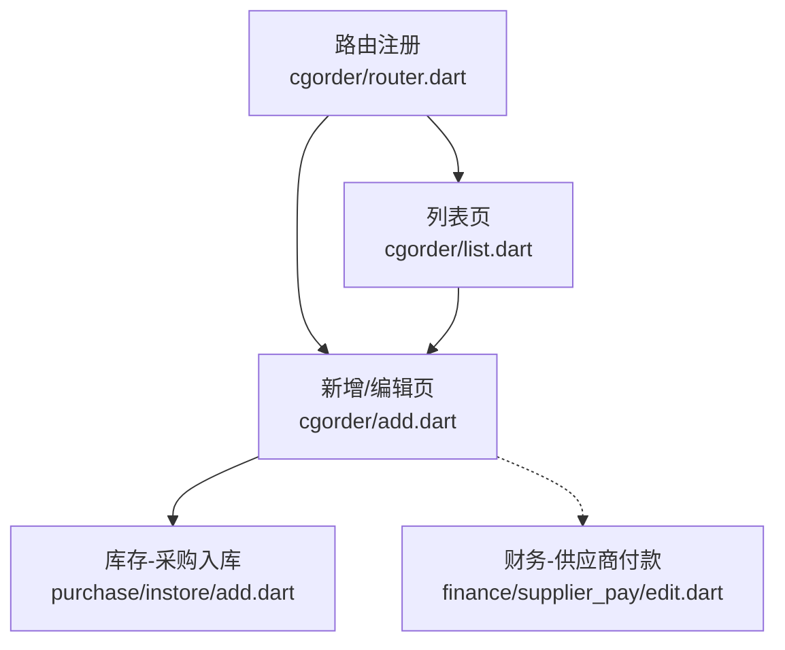
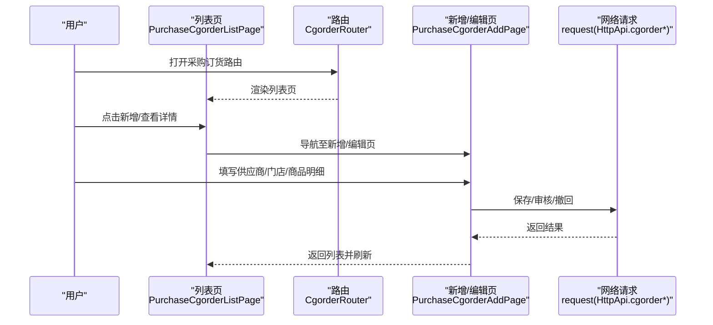
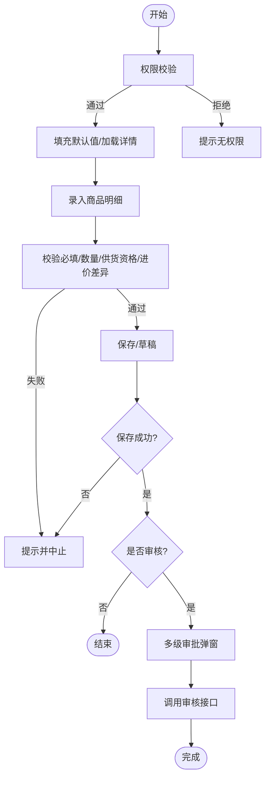
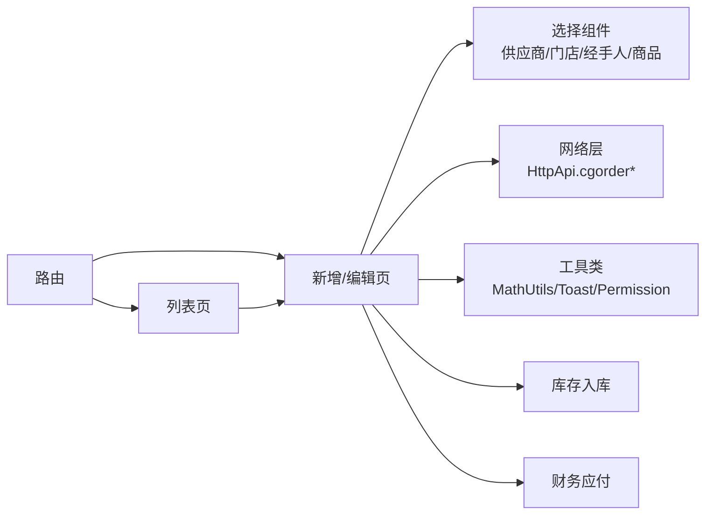

# 采购订单

<cite>
**本文引用的文件 **
- [router.dart](file://lib/pages/business/purchase/cgorder/router.dart)
- [list.dart](file://lib/pages/business/purchase/cgorder/list.dart)
- [add.dart](file://lib/pages/business/purchase/cgorder/add.dart)
- [instore_add.dart](file://lib/pages/business/purchase/instore/add.dart)
- [supplier_pay_edit.dart](file://lib/pages/business/finance/supplier_pay/edit.dart)
</cite>

## 目录
1. [引言](#引言)
2. [项目结构](#项目结构)
3. [核心组件](#核心组件)
4. [架构总览](#架构总览)
5. [详细组件分析](#详细组件分析)
6. [依赖关系分析](#依赖关系分析)
7. [性能与体验](#性能与体验)
8. [故障排查](#故障排查)
9. [结论](#结论)

## 引言
本文面向灵犀管店 Flutter 项目的“采购订单”功能，围绕以下目标展开：
- 说明采购订单的创建、编辑、查看和列表管理流程。
- 描述从供应商选择、商品添加、数量价格确认到提交审核的业务链路。
- 解释订单状态管理机制及状态转换规则。
- 说明与库存模块入库、财务应付账款的关联方式。
- 给出具体代码位置示例，帮助开发者快速定位实现逻辑。
- 总结数据校验规则与错误处理策略。

## 项目结构
采购订单功能集中在业务采购模块下的 cgorder 子目录中，并通过路由注册对外暴露页面入口；同时与入库、财务模块存在跨模块调用和数据关联。

**图表来源**
- [router.dart:1-25](file://lib/pages/business/purchase/cgorder/router.dart#L1-L25)
- [list.dart:945-1020](file://lib/pages/business/purchase/cgorder/list.dart#L945-L1020)
- [add.dart:201-300](file://lib/pages/business/purchase/cgorder/add.dart#L201-L300)
- [instore_add.dart:454-465](file://lib/pages/business/purchase/instore/add.dart#L454-L465)
- [supplier_pay_edit.dart:178-185](file://lib/pages/business/finance/supplier_pay/edit.dart#L178-L185)

**章节来源**
- [router.dart:1-25](file://lib/pages/business/purchase/cgorder/router.dart#L1-L25)

## 核心组件
- 路由提供者：定义采购订货列表和新增路由，统一由 Fluro 注册。
- 列表页：展示采购订货单列表，支持按状态筛选、搜索单号、机构/供应商/经手人过滤、分页加载和下拉刷新。
- 新增/编辑页：负责供应商、门店、经手人选择，商品明细维护（扫码、语音、批量），保存、草稿、审核、撤回、打印等完整生命周期操作。
- 库存入库联动：采购入库可基于采购订货单生成或关联，受系统参数控制是否必须按订货单入库。
- 财务应付联动：供应商付款单据通过上游单据字段建立应付账款与采购业务的间接关联。

**章节来源**
- [router.dart:1-25](file://lib/pages/business/purchase/cgorder/router.dart#L1-L25)
- [list.dart:1-1148](file://lib/pages/business/purchase/cgorder/list.dart#L1-L1148)
- [add.dart:1-4342](file://lib/pages/business/purchase/cgorder/add.dart#L1-L4342)
- [instore_add.dart:454-465](file://lib/pages/business/purchase/instore/add.dart#L454-L465)
- [supplier_pay_edit.dart:178-185](file://lib/pages/business/finance/supplier_pay/edit.dart#L178-L185)

## 架构总览
采购订单在移动端采用“页面 + 工具类 + 网络层”的轻量分层：页面负责交互与本地状态，业务校验与格式化通过工具类完成，最终通过 HTTP API 与后端交互。列表与详情复用同一新增/编辑页以承载新增与编辑两种场景。

**图表来源**
- [router.dart:1-25](file://lib/pages/business/purchase/cgorder/router.dart#L1-L25)
- [list.dart:945-1020](file://lib/pages/business/purchase/cgorder/list.dart#L945-L1020)
- [add.dart:201-300](file://lib/pages/business/purchase/cgorder/add.dart#L201-L300)

## 详细组件分析

### 路由与入口
- 路由常量：
  - 列表路由：`/purchase/cgorder/list`
  - 新增路由：`/purchase/cgorder/add`
- 路由注册：将两个路径分别映射到 `PurchaseCgorderListPage` 与 `PurchaseCgorderAddPage`。

使用建议：
- 其他模块通过路由常量跳转，避免硬编码路径。
- 新增/编辑共用页面，便于复用表单与校验逻辑。

**章节来源**
- [router.dart:1-25](file://lib/pages/business/purchase/cgorder/router.dart#L1-L25)

### 列表页：查询、筛选与分页
列表页承担以下职责：
- Tab 状态筛选：全部、待审核、已审核、已驳回（根据审批配置动态显示）。
- 单号模糊搜索与去抖。
- 快捷时间范围与自定义日期选择。
- 机构、供应商、经手人筛选。
- 分页滚动加载与下拉刷新。
- 权限校验：查看、新增、进入详情页均需权限检查。

关键行为说明：
- 状态映射：
  - 待审核 → signflag=0
  - 已审核 → signflag=1
  - 已驳回 → signflag=2
- 筛选条件包含：单号、时间范围、供应商、经手人、机构。
- 分页参数包括：page、is_page、排序字段与方向。
- 空态与加载更多占位。

典型调用路径参考：
- 初始化与权限校验：[list.dart:1-120](file://lib/pages/business/purchase/cgorder/list.dart#L1-L120)
- 数据加载与分页：[list.dart:120-220](file://lib/pages/business/purchase/cgorder/list.dart#L120-L220)
- 筛选抽屉与时间选择器：[list.dart:220-557](file://lib/pages/business/purchase/cgorder/list.dart#L220-L557)
- 列表构建与卡片渲染：[list.dart:945-1148](file://lib/pages/business/purchase/cgorder/list.dart#L945-L1148)

**章节来源**
- [list.dart:1-220](file://lib/pages/business/purchase/cgorder/list.dart#L1-L220)
- [list.dart:220-557](file://lib/pages/business/purchase/cgorder/list.dart#L220-L557)
- [list.dart:945-1148](file://lib/pages/business/purchase/cgorder/list.dart#L945-L1148)

### 新增/编辑页：订单生命周期
该页面承载采购订单的新增、编辑、保存、草稿、审核、撤回、打印等操作，同时集成多种商品录入方式。

#### 1. 数据来源与模式判断
- 新增模式：默认填充当前登录用户、当前门店等信息。
- 编辑模式：调用接口加载单据详情，回显头信息与明细。
- 快照机制：用于检测未保存变更，防止误退出丢失数据。

参考路径：
- 新增默认值填充：[add.dart:201-300](file://lib/pages/business/purchase/cgorder/add.dart#L201-L300)
- 编辑详情加载与明细回显：[add.dart:300-500](file://lib/pages/business/purchase/cgorder/add.dart#L300-L500)
- 未保存变更检测与拦截：[add.dart:500-600](file://lib/pages/business/purchase/cgorder/add.dart#L500-L600)

#### 2. 商品录入与计算
支持三种录入方式：
- 扫码：相机扫码或红外扫描枪，自动匹配商品条码/自编码，重复项累加数量。
- 语音识别：语音转文字后搜索商品，自动取最新采购价或档案价。
- 手动添加：通过选品组件选择商品。

金额与数量计算：
- 行金额 = 数量 × 单价。
- 件数 = 数量 ÷ 包装数。
- 汇总金额与数量用于提交参数。

参考路径：
- 扫码与红外扫描处理：[add.dart:800-1230](file://lib/pages/business/purchase/cgorder/add.dart#L800-L1230)
- 语音识别与商品匹配：[add.dart:1230-1500](file://lib/pages/business/purchase/cgorder/add.dart#L1230-L1500)
- 行数据计算与重算：[add.dart:1500-1800](file://lib/pages/business/purchase/cgorder/add.dart#L1500-L1800)

#### 3. 数据校验与错误处理
- 必填校验：供应商、门店、至少一条有效商品明细。
- 数量校验：每条明细数量与赠品数量不能同时为 0。
- 供货资格校验：非供货资格商品弹出提示，可选择移除或继续。
- 进价差异校验：入库价与档案价不一致、进价高于原进价两倍时弹出二次确认。
- 权限校验：新增、编辑、查看详情均有独立权限码。
- 失败处理：统一 Toast 提示，必要时保留页面以便修正。

参考路径：
- 基础校验与权限检查：[add.dart:600-800](file://lib/pages/business/purchase/cgorder/add.dart#L600-L800)
- 供货资格与进价校验弹窗：[add.dart:800-1000](file://lib/pages/business/purchase/cgorder/add.dart#L800-L1000)

#### 4. 提交与审核
- 保存：组装头信息、明细、附件、汇总金额数量，调用保存接口。
- 存为草稿：仅保存不触发审核。
- 审核：新建后直接审核，或多级审批时弹出审批弹窗；通过后更新状态。
- 撤回：将单据置为撤回待处理，需要重新走审批流。

参考路径：
- 保存与草稿：[add.dart:1000-1200](file://lib/pages/business/purchase/cgorder/add.dart#L1000-L1200)
- 审核与多级审批：[add.dart:1200-1400](file://lib/pages/business/purchase/cgorder/add.dart#L1200-L1400)
- 撤回逻辑：[add.dart:800-850](file://lib/pages/business/purchase/cgorder/add.dart#L800-L850)

**图表来源**
- [add.dart:600-1400](file://lib/pages/business/purchase/cgorder/add.dart#L600-L1400)

**章节来源**
- [add.dart:201-1800](file://lib/pages/business/purchase/cgorder/add.dart#L201-L1800)

### 与库存模块的入库联动
采购入库可基于采购订货单进行：
- 系统参数控制：
  - `cgOrderLinkDhFlag`：是否只能按订货单采购入库。
  - `cgOrderLinkDhQtyFlag`：是否清空数量由手工录入。
- 入库单头携带原单编号、原单 ID，保存时将 refbillid/refbillno 传入后端。
- 当开启“只能按订货单入库”时，禁止手动选择商品，仅允许原单带入。

参考路径：
- 系统参数读取与影响：[instore_add.dart:454-465](file://lib/pages/business/purchase/instore/add.dart#L454-L465)
- 原单编号与ID传递：[instore_add.dart:882-926](file://lib/pages/business/purchase/instore/add.dart#L882-L926)
- 按订货单入库限制的商品选择与扫码禁用：[instore_add.dart:2601-2602](file://lib/pages/business/purchase/instore/add.dart#L2601-L2602)、[instore_add.dart:2733-2734](file://lib/pages/business/purchase/instore/add.dart#L2733-L2734)

**章节来源**
- [instore_add.dart:454-465](file://lib/pages/business/purchase/instore/add.dart#L454-L465)
- [instore_add.dart:882-926](file://lib/pages/business/purchase/instore/add.dart#L882-L926)
- [instore_add.dart:2601-2602](file://lib/pages/business/purchase/instore/add.dart#L2601-L2602)
- [instore_add.dart:2733-2734](file://lib/pages/business/purchase/instore/add.dart#L2733-L2734)

### 与财务模块的应付账款关联
供应商付款页面通过上游单据集合形成应付账款关联：
- 付款编辑页加载供应商付款信息，解析 `suppayflow` 作为关联单据列表。
- 采购订货单作为上游业务单据之一，可被纳入供应商应付结算。

参考路径：
- 供应商付款信息加载与 suppayflow 解析：[supplier_pay_edit.dart:178-185](file://lib/pages/business/finance/supplier_pay/edit.dart#L178-L185)

**章节来源**
- [supplier_pay_edit.dart:178-185](file://lib/pages/business/finance/supplier_pay/edit.dart#L178-L185)

## 依赖关系分析
- 页面耦合：
  - 列表页依赖路由与新增/编辑页进行跳转。
  - 新增/编辑页依赖通用选择组件（供应商、门店、经手人、商品）以及网络请求封装。
- 外部依赖：
  - 权限系统：通过权限码控制操作可见性。
  - 审批系统：通过多级审批流控制审核与撤回。
  - 系统参数：控制入库与订货单的绑定行为。

**图表来源**
- [router.dart:1-25](file://lib/pages/business/purchase/cgorder/router.dart#L1-L25)
- [list.dart:945-1020](file://lib/pages/business/purchase/cgorder/list.dart#L945-L1020)
- [add.dart:201-300](file://lib/pages/business/purchase/cgorder/add.dart#L201-L300)

**章节来源**
- [router.dart:1-25](file://lib/pages/business/purchase/cgorder/router.dart#L1-L25)
- [list.dart:945-1020](file://lib/pages/business/purchase/cgorder/list.dart#L945-L1020)
- [add.dart:201-300](file://lib/pages/business/purchase/cgorder/add.dart#L201-L300)

## 性能与体验
- 列表分页与去抖：减少频繁请求，提升滚动流畅度。
- 缓存与边界优化：使用 RepaintBoundary 降低复杂卡片重绘开销。
- 扫码与语音输入防抖：避免 PDA 扫码枪字符注入过快导致重复处理。
- 快照比对：减少不必要的保存弹窗，提高用户操作效率。

[本节为通用指导，不直接分析具体文件]

## 故障排查
常见问题与定位要点：
- 列表无法加载：
  - 检查权限码是否具备查看权限。
  - 检查筛选参数是否正确拼接，特别是时间与状态。
  - 参考：[list.dart:120-220](file://lib/pages/business/purchase/cgorder/list.dart#L120-L220)
- 新增/编辑保存失败：
  - 检查必填字段、数量是否为 0、供货资格与进价差异提示。
  - 关注保存后是否重建快照以避免误判未保存。
  - 参考：[add.dart:600-1000](file://lib/pages/business/purchase/cgorder/add.dart#L600-L1000)
- 审核失败：
  - 检查是否属于当前审批节点，多级审批弹窗参数是否正确。
  - 参考：[add.dart:1200-1400](file://lib/pages/business/purchase/cgorder/add.dart#L1200-L1400)
- 入库与订货单关联异常：
  - 检查系统参数 cgOrderLinkDhFlag 与 cgOrderLinkDhQtyFlag。
  - 参考：[instore_add.dart:454-465](file://lib/pages/business/purchase/instore/add.dart#L454-L465)
- 财务应付未关联：
  - 检查 suppayflow 数据是否加载成功。
  - 参考：[supplier_pay_edit.dart:178-185](file://lib/pages/business/finance/supplier_pay/edit.dart#L178-L185)

**章节来源**
- [list.dart:120-220](file://lib/pages/business/purchase/cgorder/list.dart#L120-L220)
- [add.dart:600-1400](file://lib/pages/business/purchase/cgorder/add.dart#L600-L1400)
- [instore_add.dart:454-465](file://lib/pages/business/purchase/instore/add.dart#L454-L465)
- [supplier_pay_edit.dart:178-185](file://lib/pages/business/finance/supplier_pay/edit.dart#L178-L185)

## 结论
采购订单模块在 Flutter 端通过清晰的路由与页面组织，结合权限、审批与系统参数，实现了完整的订单生命周期管理。其特点包括：
- 列表与详情复用同一新增/编辑页，简化维护成本。
- 丰富的商品录入方式（扫码、语音、手动）适配多场景。
- 严格的校验与错误处理，保证数据质量。
- 与库存入库、财务应付形成上下游联动，支撑供应链闭环。

对于后续开发建议：
- 继续使用路由常量与权限码，保持扩展一致性。
- 对高频操作（如扫码、语音）增加更细粒度的防抖与重试策略。
- 明确状态转换边界，确保审批流与业务状态一致。
- 加强跨模块联动的数据契约与错误反馈。

[本节为总结性内容，不直接分析具体文件]