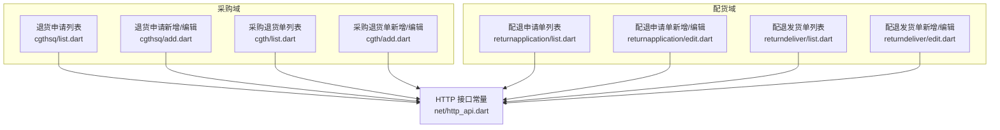
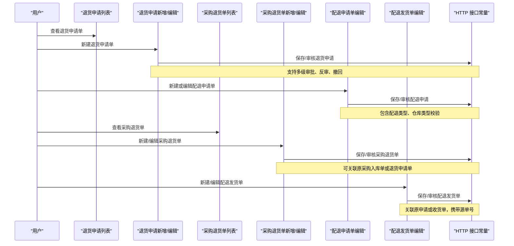
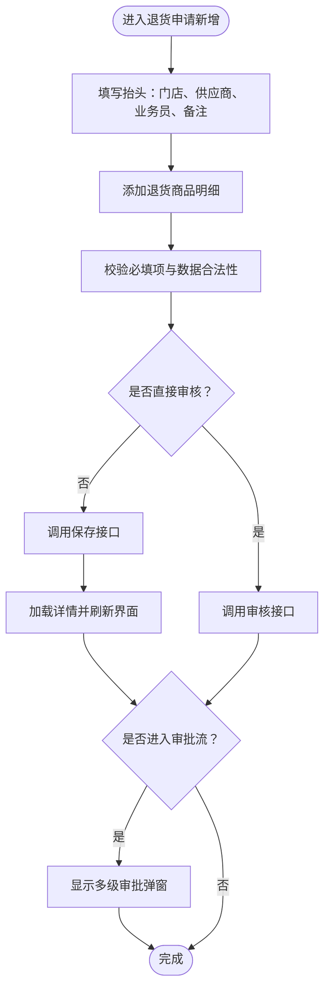
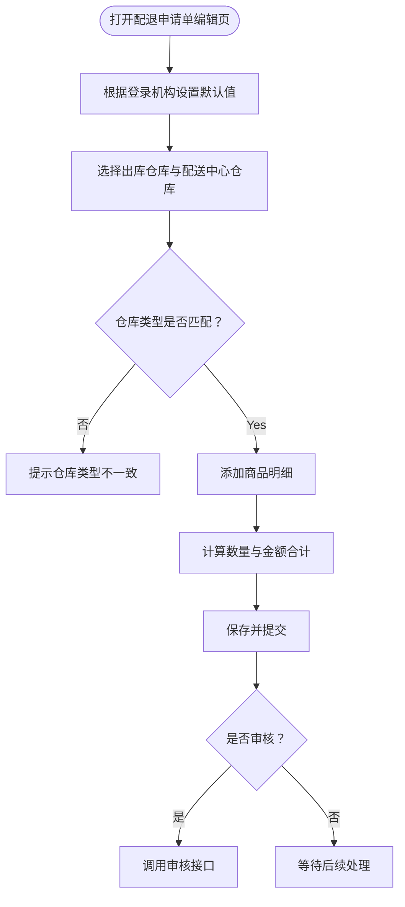
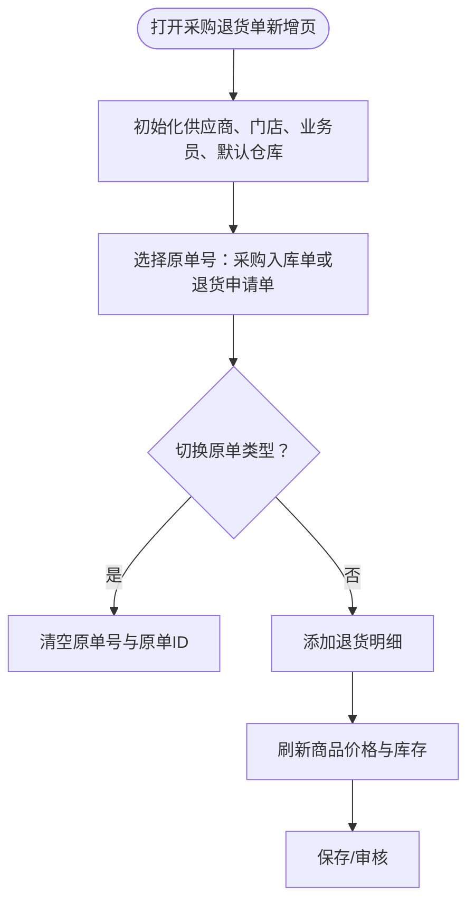
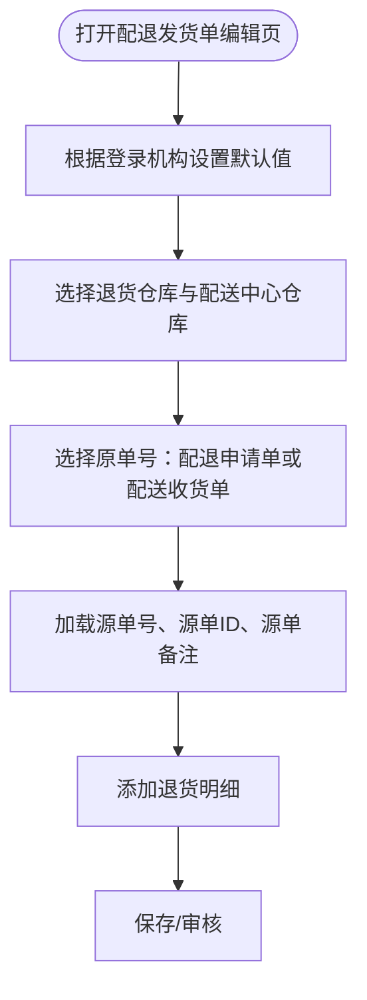
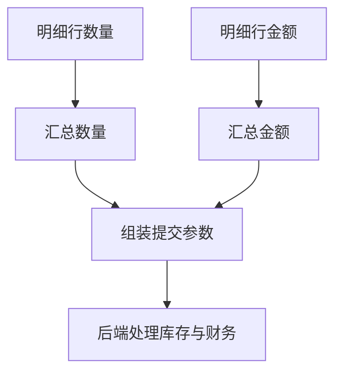
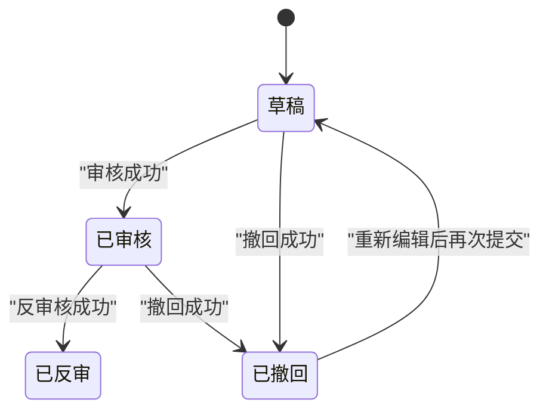
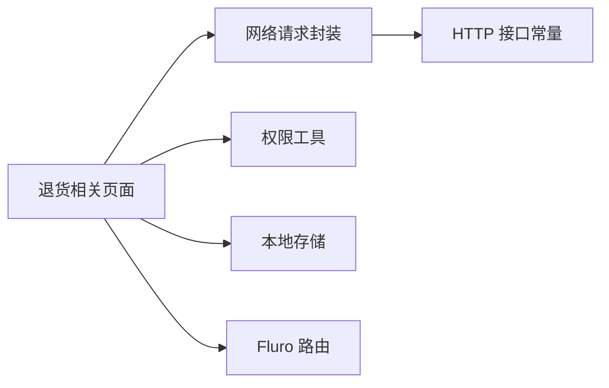

# 采购退货

<cite>
**本文引用的文件**   
- [lib/pages/business/purchase/cgthsq/list.dart](file://lib/pages/business/purchase/cgthsq/list.dart)
- [lib/pages/business/purchase/cgthsq/add.dart](file://lib/pages/business/purchase/cgthsq/add.dart)
- [lib/pages/business/purchase/cgthsq/router.dart](file://lib/pages/business/purchase/cgthsq/router.dart)
- [lib/pages/business/purchase/cgth/list.dart](file://lib/pages/business/purchase/cgth/list.dart)
- [lib/pages/business/purchase/cgth/add.dart](file://lib/pages/business/purchase/cgth/add.dart)
- [lib/pages/business/chain/returnapplication/list.dart](file://lib/pages/business/chain/returnapplication/list.dart)
- [lib/pages/business/chain/returnapplication/edit.dart](file://lib/pages/business/chain/returnapplication/edit.dart)
- [lib/pages/business/chain/returndeliver/list.dart](file://lib/pages/business/chain/returndeliver/list.dart)
- [lib/pages/business/chain/returndeliver/edit.dart](file://lib/pages/business/chain/returndeliver/edit.dart)
- [lib/net/http_api.dart](file://lib/net/http_api.dart)
</cite>

## 目录
1. [简介](#简介)
2. [项目结构](#项目结构)
3. [核心组件](#核心组件)
4. [架构总览](#架构总览)
5. [详细组件分析](#详细组件分析)
6. [依赖关系分析](#依赖关系分析)
7. [性能与准确性考虑](#性能与准确性考虑)
8. [常见问题排查](#常见问题排查)
9. [结论](#结论)

## 简介
本文围绕灵犀管店 Flutter 客户端中的“采购退货”能力，梳理从“退货申请 → 审核 → 退货出库 → 财务应付调整与退款处理”的完整业务链。代码中主要存在两类退货入口：
- 面向供应商的“采购退货申请单 / 采购退货单”，对应路径 `purchase/cgthsq` 与 `purchase/cgth`。
- 面向配送中心的“配退申请单 / 配退发货单”，对应路径 `chain/returnapplication` 与 `chain/returndeliver`。

需要特别说明的是：当前仓库为 Flutter 客户端实现，库存扣减、应付账款调整、退款入账等实际业务执行发生在后端服务；客户端主要负责表单交互、权限控制、审批流参与以及调用后端接口。因此，“库存扣减机制”和“应付账款调整逻辑”在本仓库中以“字段传递 + 接口调用”的方式体现，具体会计分录由后端完成。

## 项目结构
采购退货相关页面集中在两个业务域下：
- 采购域：退货申请（cgthsq）、退货单（cgth）。
- 配货域：配退申请（returnapplication）、配退发货（returndeliver）。

**图示来源**
- [lib/pages/business/purchase/cgthsq/list.dart:1-120](file://lib/pages/business/purchase/cgthsq/list.dart#L1-L120)
- [lib/pages/business/purchase/cgthsq/add.dart:1-120](file://lib/pages/business/purchase/cgthsq/add.dart#L1-L120)
- [lib/pages/business/purchase/cgth/list.dart:1-120](file://lib/pages/business/purchase/cgth/list.dart#L1-L120)
- [lib/pages/business/purchase/cgth/add.dart:1-120](file://lib/pages/business/purchase/cgth/add.dart#L1-L120)
- [lib/pages/business/chain/returnapplication/list.dart:1-120](file://lib/pages/business/chain/returnapplication/list.dart#L1-L120)
- [lib/pages/business/chain/returnapplication/edit.dart:1-120](file://lib/pages/business/chain/returnapplication/edit.dart#L1-L120)
- [lib/pages/business/chain/returndeliver/list.dart:1-120](file://lib/pages/business/chain/returndeliver/list.dart#L1-L120)
- [lib/pages/business/chain/returndeliver/edit.dart:1-120](file://lib/pages/business/chain/returndeliver/edit.dart#L1-L120)
- [lib/net/http_api.dart:87-94](file://lib/net/http_api.dart#L87-L94)
- [lib/net/http_api.dart:120](file://lib/net/http_api.dart#L120)
- [lib/net/http_api.dart:169-184](file://lib/net/http_api.dart#L169-L184)

**章节来源**
- [lib/pages/business/purchase/cgthsq/router.dart:1-25](file://lib/pages/business/purchase/cgthsq/router.dart#L1-L25)
- [lib/net/http_api.dart:87-94](file://lib/net/http_api.dart#L87-L94)
- [lib/net/http_api.dart:120](file://lib/net/http_api.dart#L120)
- [lib/net/http_api.dart:169-184](file://lib/net/http_api.dart#L169-L184)

## 核心组件
本功能的核心组件包括：
- 退货申请类单据：采购退货申请单、配退申请单。
- 退货执行类单据：采购退货单、配退发货单。
- 公共能力：权限校验、审批流、扫码入库、附件上传、日期筛选、分页加载。

这些组件通过统一的网络层调用后端接口，形成“前端表单 → 后端单据 → 库存与财务”的闭环。

**章节来源**
- [lib/pages/business/purchase/cgthsq/list.dart:1-120](file://lib/pages/business/purchase/cgthsq/list.dart#L1-L120)
- [lib/pages/business/chain/returnapplication/list.dart:1-120](file://lib/pages/business/chain/returnapplication/list.dart#L1-L120)
- [lib/pages/business/purchase/cgth/list.dart:1-120](file://lib/pages/business/purchase/cgth/list.dart#L1-L120)
- [lib/pages/business/chain/returndeliver/list.dart:1-120](file://lib/pages/business/chain/returndeliver/list.dart#L1-L120)

## 架构总览
采购退货在客户端侧遵循“列表页 → 新增/编辑页 → 提交保存 → 审核/反审/撤回 → 生成下游单据”的流程。下图展示了两条典型链路：供应商退货与配送中心配退。

**图示来源**
- [lib/pages/business/purchase/cgthsq/add.dart:1-120](file://lib/pages/business/purchase/cgthsq/add.dart#L1-L120)
- [lib/pages/business/purchase/cgth/add.dart:743-1103](file://lib/pages/business/purchase/cgth/add.dart#L743-L1103)
- [lib/pages/business/chain/returnapplication/edit.dart:376-542](file://lib/pages/business/chain/returnapplication/edit.dart#L376-L542)
- [lib/pages/business/chain/returndeliver/edit.dart:376-543](file://lib/pages/business/chain/returndeliver/edit.dart#L376-L543)
- [lib/net/http_api.dart:87-94](file://lib/net/http_api.dart#L87-L94)
- [lib/net/http_api.dart:120](file://lib/net/http_api.dart#L120)
- [lib/net/http_api.dart:169-184](file://lib/net/http_api.dart#L169-L184)

## 详细组件分析

### 采购退货申请单
采购退货申请单用于发起对供应商的退货请求，通常作为后续生成采购退货单的依据。

- 列表页负责按状态、时间、单号、创建人、供应商等条件分页查询。
- 新增/编辑页支持选择门店、供应商、业务员、备注、明细商品，并支持扫码、附件、批量选择。
- 提交后进入保存、审核、反审、撤回、打印等流程。
- 若启用多级审批，会加载审批人员列表并引导进入审批弹窗。

#### 业务流程图

**图示来源**
- [lib/pages/business/purchase/cgthsq/add.dart:1-120](file://lib/pages/business/purchase/cgthsq/add.dart#L1-L120)
- [lib/pages/business/purchase/cgthsq/list.dart:1-120](file://lib/pages/business/purchase/cgthsq/list.dart#L1-L120)

**章节来源**
- [lib/pages/business/purchase/cgthsq/list.dart:1-120](file://lib/pages/business/purchase/cgthsq/list.dart#L1-L120)
- [lib/pages/business/purchase/cgthsq/add.dart:1-120](file://lib/pages/business/purchase/cgthsq/add.dart#L1-L120)

### 配退申请单
配退申请单用于门店向配送中心发起退货或差异处理申请，支持“配送差异”和“退货”两种配退类型。

- 列表页支持按配退类型、时间、创建人、配送中心、申请门店等维度筛选。
- 编辑页默认根据登录机构类型自动填充配送中心或申请门店。
- 提交时计算总数量与总金额，并携带明细、附件、配退类型等信息。
- 审核、反审、撤回与采购退货申请单类似，且支持多级审批。

#### 关键逻辑要点
- 配退类型字段用于区分“配送差异”与“退货”。
- 双配送中心场景下会进行仓库类型一致性校验。
- 提交前强制校验申请门店、配送中心、出库仓库、配送中心仓库是否为空。

**图示来源**
- [lib/pages/business/chain/returnapplication/edit.dart:200-597](file://lib/pages/business/chain/returnapplication/edit.dart#L200-L597)
- [lib/pages/business/chain/returnapplication/list.dart:1-120](file://lib/pages/business/chain/returnapplication/list.dart#L1-L120)

**章节来源**
- [lib/pages/business/chain/returnapplication/list.dart:1-120](file://lib/pages/business/chain/returnapplication/list.dart#L1-L120)
- [lib/pages/business/chain/returnapplication/edit.dart:200-597](file://lib/pages/business/chain/returnapplication/edit.dart#L200-L597)

### 采购退货单
采购退货单是供应商退货的实际执行单据，可与原始采购入库单或退货申请单关联。

- 列表页使用统一的后端列表接口，按状态、时间、供应商、仓库等条件查询。
- 新增/编辑页支持选择供应商、门店、业务员、退货仓库，并可关联原单号。
- 原单号选择支持两种原单类型：采购入库单、退货申请单。
- 提交后进入保存、审核、反审、撤回、删除、打印流程。
- 默认仓库加载逻辑会优先取退货仓库，并按仓库类型排序。

#### 与原单的关联关系
- 原单号字段用于追溯原始采购入库单或上游退货申请单。
- 原单 ID 字段随表单提交，便于后端建立单据关联。
- 切换原单类型时会清空原单号及关联信息，避免误用历史数据。

**图示来源**
- [lib/pages/business/purchase/cgth/add.dart:516-743](file://lib/pages/business/purchase/cgth/add.dart#L516-L743)
- [lib/pages/business/purchase/cgth/add.dart:943-1103](file://lib/pages/business/purchase/cgth/add.dart#L943-L1103)

**章节来源**
- [lib/pages/business/purchase/cgth/list.dart:1-120](file://lib/pages/business/purchase/cgth/list.dart#L1-L120)
- [lib/pages/business/purchase/cgth/add.dart:516-743](file://lib/pages/business/purchase/cgth/add.dart#L516-L743)
- [lib/pages/business/purchase/cgth/add.dart:943-1103](file://lib/pages/business/purchase/cgth/add.dart#L943-L1103)

### 配退发货单
配退发货单用于配送中心侧执行配退出库，通常由配退申请单触发，也可关联配送收货单。

- 列表页支持按配退状态、时间、创建人、配送中心、退货门店等条件查询。
- 编辑页支持选择退货门店、退货仓库、配送中心、配送中心仓库，并可选择原单号。
- 原单号来源支持两种类型：配退申请单、配送收货单。
- 提交后进入保存、审核、反审、撤回、删除、打印流程。

#### 源单与源单号
- 源单号字段记录原申请或收货单号。
- 源单 ID 字段用于关联上游单据。
- 源单备注字段用于保留上游单据备注信息。

**图示来源**
- [lib/pages/business/chain/returndeliver/edit.dart:200-591](file://lib/pages/business/chain/returndeliver/edit.dart#L200-L591)
- [lib/pages/business/chain/returndeliver/list.dart:1-120](file://lib/pages/business/chain/returndeliver/list.dart#L1-L120)

**章节来源**
- [lib/pages/business/chain/returndeliver/list.dart:1-120](file://lib/pages/business/chain/returndeliver/list.dart#L1-L120)
- [lib/pages/business/chain/returndeliver/edit.dart:200-591](file://lib/pages/business/chain/returndeliver/edit.dart#L200-L591)

### 退货类型与处理流程
当前代码中与“退货类型”直接相关的字段出现在配退申请单中：
- 配退类型：值为“配送差异”或“退货”。
- 该字段影响单据的业务语义，并在只读展示时以文本形式呈现。

对于更细粒度的退货原因分类（如质量问题退货、数量差异退货、过期商品退货），在当前 Flutter 代码中未发现专用枚举字段。此类原因一般通过备注、附件、或后端扩展字段表达；客户端侧以通用表单字段承载。

**章节来源**
- [lib/pages/business/chain/returnapplication/edit.dart:200-597](file://lib/pages/business/chain/returnapplication/edit.dart#L200-L597)

### 退货数量计算与库存扣减机制
退货数量的计算在客户端侧主要体现在以下环节：
- 明细行数量由用户输入或通过扫码、批量选择获得。
- 保存前汇总数量与金额：总数量为各明细行数量之和，总金额为数量乘以单价后的累加结果。
- 部分场景会调用价格刷新接口，同步最新采购价、库存、规格单位等信息。

库存扣减的具体执行在后端完成；客户端通过传递仓库、商品、批次、数量等字段，让后端在单据审核通过后更新库存。配退发货单还支持库存销售标志字段，用于控制退货仓库的库存策略。

**图示来源**
- [lib/pages/business/chain/returnapplication/edit.dart:376-542](file://lib/pages/business/chain/returnapplication/edit.dart#L376-L542)
- [lib/pages/business/chain/returndeliver/edit.dart:376-543](file://lib/pages/business/chain/returndeliver/edit.dart#L376-L543)
- [lib/pages/business/purchase/cgth/add.dart:943-1103](file://lib/pages/business/purchase/cgth/add.dart#L943-L1103)

**章节来源**
- [lib/pages/business/chain/returnapplication/edit.dart:376-542](file://lib/pages/business/chain/returnapplication/edit.dart#L376-L542)
- [lib/pages/business/chain/returndeliver/edit.dart:376-543](file://lib/pages/business/chain/returndeliver/edit.dart#L376-L543)
- [lib/pages/business/purchase/cgth/add.dart:943-1103](file://lib/pages/business/purchase/cgth/add.dart#L943-L1103)

### 审核流程与权限控制
所有退货相关单据都具备相似的审核能力：
- 保存操作受“保存权限”控制。
- 审核操作受“审核权限”控制。
- 反审核操作受“反审核权限”控制。
- 撤回操作将单据退回至待处理状态，要求相应审核权限。
- 管理员或特定用户编码可能拥有额外处理权限。

多类单据的权限码在前端以硬编码字符串形式出现，例如：
- 配退申请单：保存权限、审核权限、反审核权限。
- 配退发货单：保存权限、审核权限、反审核权限。
- 采购退货单：保存权限、审核权限、反审核权限。
- 退货申请列表与采购退货列表也有各自的查看权限码。

**图示来源**
- [lib/pages/business/chain/returnapplication/edit.dart:376-597](file://lib/pages/business/chain/returnapplication/edit.dart#L376-L597)
- [lib/pages/business/chain/returndeliver/edit.dart:376-591](file://lib/pages/business/chain/returndeliver/edit.dart#L376-L591)
- [lib/pages/business/purchase/cgth/add.dart:1055-1266](file://lib/pages/business/purchase/cgth/add.dart#L1055-L1266)

**章节来源**
- [lib/pages/business/chain/returnapplication/edit.dart:376-597](file://lib/pages/business/chain/returnapplication/edit.dart#L376-L597)
- [lib/pages/business/chain/returndeliver/edit.dart:376-591](file://lib/pages/business/chain/returndeliver/edit.dart#L376-L591)
- [lib/pages/business/purchase/cgth/add.dart:1055-1266](file://lib/pages/business/purchase/cgth/add.dart#L1055-L1266)

### 与财务模块的应付账款调整和退款处理
在当前 Flutter 仓库中，并未发现直接对接财务应付账款或退款入账的详细实现。但可以从单据字段和接口命名推断其业务意图：
- 采购退货单和配退申请单都会提交金额字段，金额通常用于后端生成应付冲减、退款或结算凭证。
- 配退发货单携带源单号和源单 ID，便于后端关联上游申请或收货单，进而联动财务结算。
- 财务相关页面存在于供应链金融模块，例如供应商付款、门店付款等，但这些页面未在本文件中直接参与退货流程。

因此，建议将“应付账款调整”和“退款处理”视为后端职责；客户端通过正确传递数量、金额、仓库、源单号等字段，确保财务数据的可追溯性。

**章节来源**
- [lib/pages/business/chain/returnapplication/edit.dart:376-542](file://lib/pages/business/chain/returnapplication/edit.dart#L376-L542)
- [lib/pages/business/chain/returndeliver/edit.dart:376-543](file://lib/pages/business/chain/returndeliver/edit.dart#L376-L543)
- [lib/pages/business/purchase/cgth/add.dart:943-1103](file://lib/pages/business/purchase/cgth/add.dart#L943-L1103)

## 依赖关系分析
采购退货相关页面依赖的主要外部能力包括：
- 网络层：统一封装的请求函数和接口常量。
- 权限工具：用于判断用户是否具备查看、保存、审核、反审等权限。
- 本地存储：读取当前登录用户、当前门店、系统登录参数等。
- 路由：Fluro 路由定义，用于跳转退货申请、退货单等页面。

**图示来源**
- [lib/pages/business/purchase/cgthsq/add.dart:1-120](file://lib/pages/business/purchase/cgthsq/add.dart#L1-L120)
- [lib/pages/business/purchase/cgth/add.dart:1-120](file://lib/pages/business/purchase/cgth/add.dart#L1-L120)
- [lib/pages/business/chain/returnapplication/edit.dart:1-120](file://lib/pages/business/chain/returnapplication/edit.dart#L1-L120)
- [lib/pages/business/chain/returndeliver/edit.dart:1-120](file://lib/pages/business/chain/returndeliver/edit.dart#L1-L120)
- [lib/net/http_api.dart:87-94](file://lib/net/http_api.dart#L87-L94)
- [lib/net/http_api.dart:169-184](file://lib/net/http_api.dart#L169-L184)
- [lib/pages/business/purchase/cgthsq/router.dart:1-25](file://lib/pages/business/purchase/cgthsq/router.dart#L1-L25)

**章节来源**
- [lib/pages/business/purchase/cgthsq/router.dart:1-25](file://lib/pages/business/purchase/cgthsq/router.dart#L1-L25)
- [lib/net/http_api.dart:87-94](file://lib/net/http_api.dart#L87-L94)
- [lib/net/http_api.dart:169-184](file://lib/net/http_api.dart#L169-L184)

## 性能与准确性考虑
- 分页加载：列表页采用分页滚动加载，避免一次性拉取大量数据。
- 防抖搜索：搜索框使用定时器防抖，减少频繁请求。
- 默认值初始化：新增页根据登录用户和门店信息自动填充默认值，减少用户输入错误。
- 价格刷新：供应商、门店、仓库切换后批量刷新商品价格与库存，保证金额计算准确。
- 快照比对：新增/编辑页维护表单快照，返回时检测未保存修改，避免数据丢失。
- 权限前置校验：列表加载前检查查看权限，避免无权限用户触发无效请求。

[本节为通用优化建议，不直接分析具体代码文件]

## 常见问题排查
- 无法查看退货列表：检查对应列表页面的查看权限码是否配置。
- 无法保存退货单据：检查保存权限是否授予当前用户。
- 无法审核或反审核：检查审核、反审核权限是否正确配置。
- 仓库类型不匹配：双配送中心配退场景下，需确保出库仓库与配送中心仓库类型一致。
- 原单号为空：选择原单号前需先选择供应商、门店或仓库；切换原单类型会清空原单号。
- 金额与数量不一致：部分历史单据可能保留手动金额，客户端加载时会识别并保留原值，避免被静默重算。

**章节来源**
- [lib/pages/business/purchase/cgthsq/list.dart:1-120](file://lib/pages/business/purchase/cgthsq/list.dart#L1-L120)
- [lib/pages/business/chain/returnapplication/edit.dart:376-597](file://lib/pages/business/chain/returnapplication/edit.dart#L376-L597)
- [lib/pages/business/purchase/cgth/add.dart:943-1103](file://lib/pages/business/purchase/cgth/add.dart#L943-L1103)

## 结论
灵犀管店 Flutter 客户端的采购退货功能以“退货申请 → 审核 → 退货出库 → 财务联动”为主线，覆盖供应商退货与配送中心配退两条业务线。前端重点承担：
- 单据录入与校验。
- 权限控制与审批参与。
- 与原单号的关联追溯。
- 数量、金额、仓库等关键字段的准确传递。

库存扣减与应付账款调整由后端实现；前端应确保字段完整、权限正确、原单关联清晰，从而保障退货数据的准确性与可追溯性。