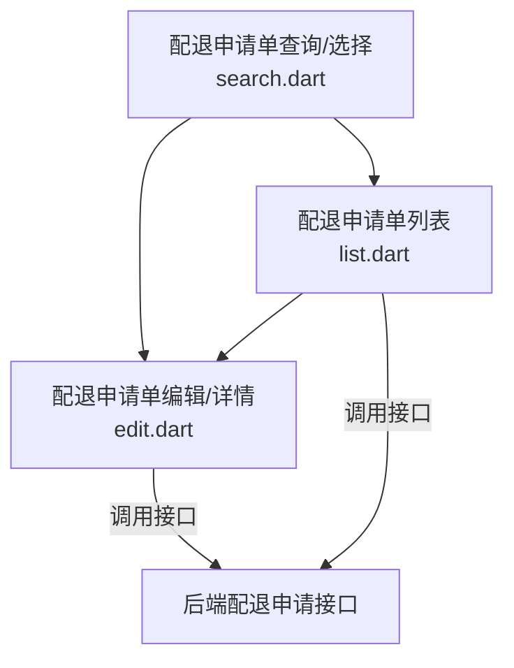
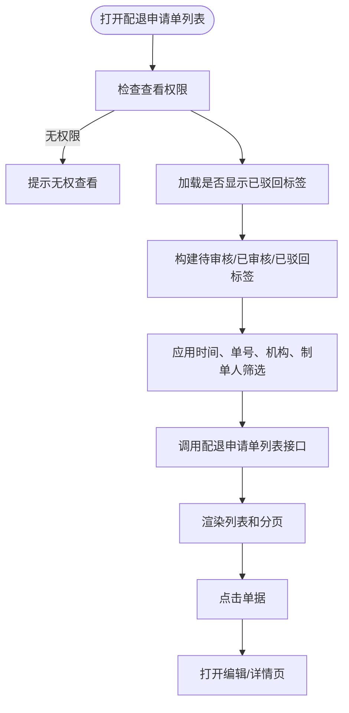
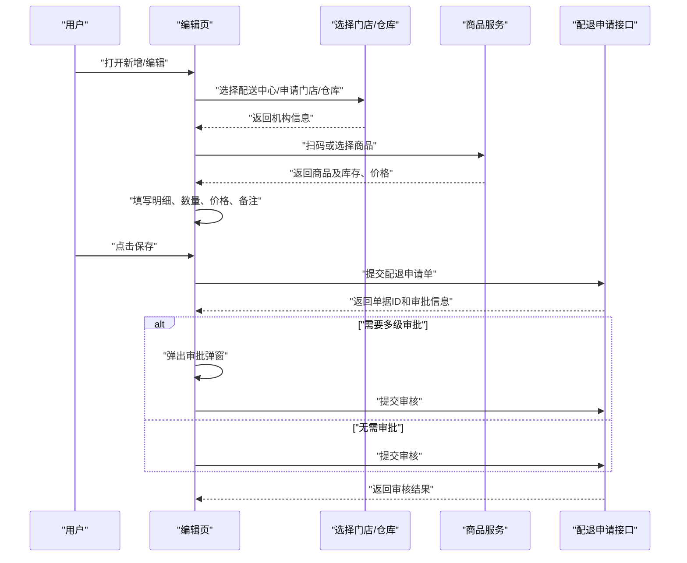
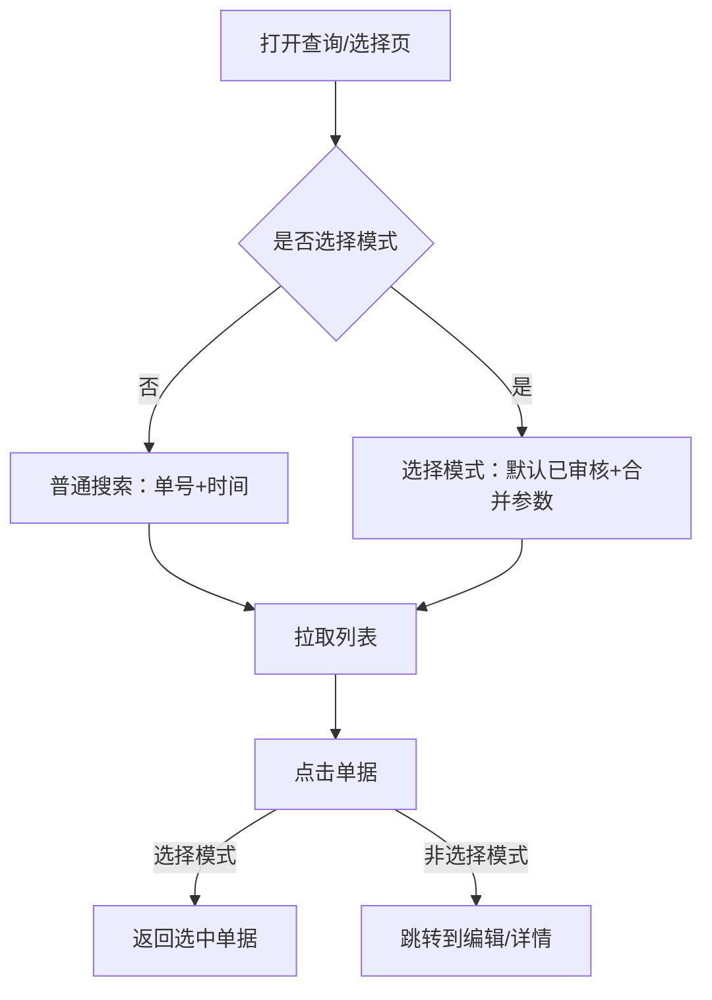
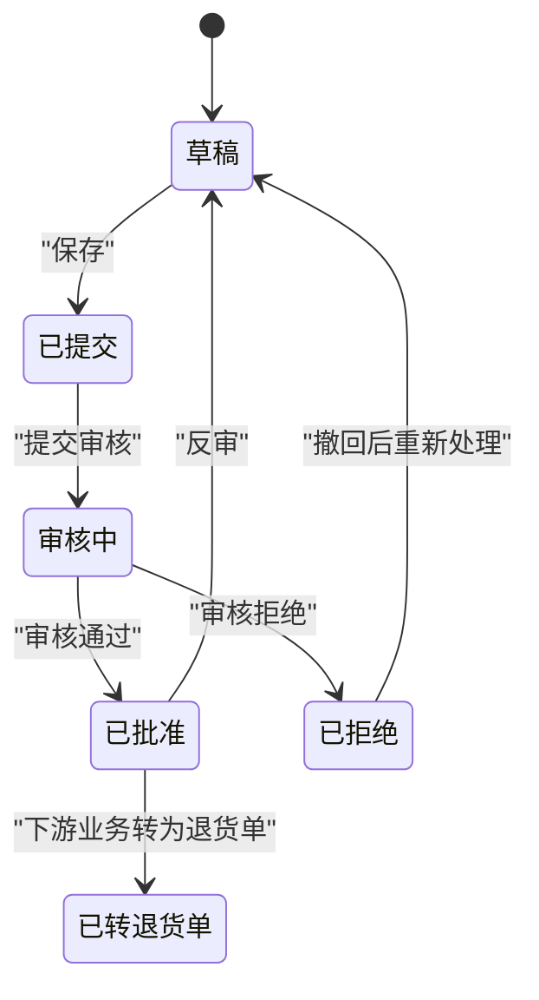
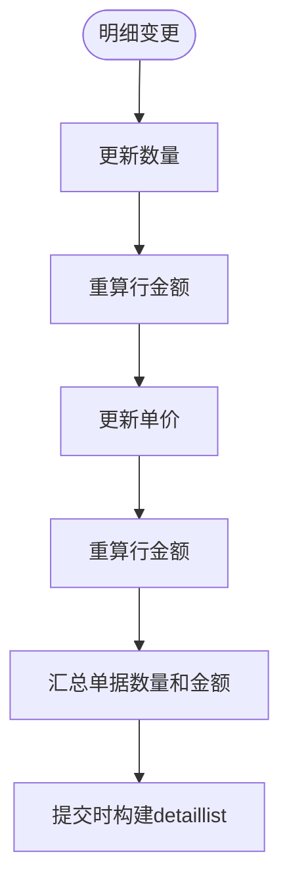
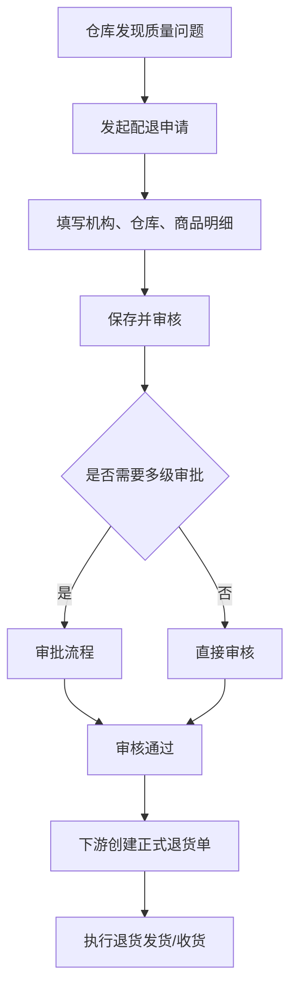
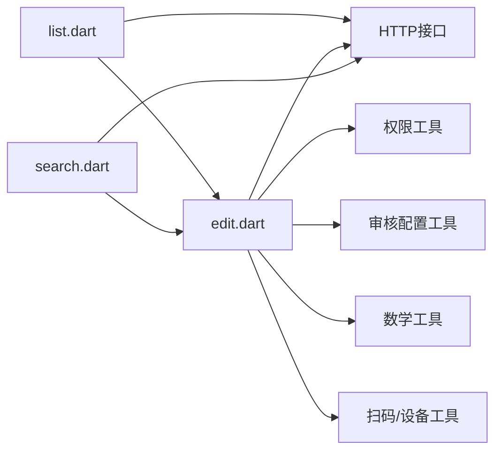

# 采购退货申请

<cite>
**本文引用的文件**   
- [list.dart](file://lib/pages/business/chain/returnapplication/list.dart)
- [edit.dart](file://lib/pages/business/chain/returnapplication/edit.dart)
- [search.dart](file://lib/pages/business/chain/returnapplication/search.dart)
</cite>

## 目录
1. [引言](#引言)
2. [项目结构定位](#项目结构定位)
3. [核心概念与边界](#核心概念与边界)
4. [数据模型与字段说明](#数据模型与字段说明)
5. [界面与交互流程](#界面与交互流程)
6. [审批与多级审核机制](#审批与多级审核机制)
7. [状态管理](#状态管理)
8. [商品明细与数量价格计算](#商品明细与数量价格计算)
9. [库存与暂扣逻辑](#库存与暂扣逻辑)
10. [业务场景示例](#业务场景示例)
11. [依赖关系分析](#依赖关系分析)
12. [常见问题与排错建议](#常见问题与排错建议)
13. [结论](#结论)

## 引言
本文面向灵犀管店 Flutter 项目中“采购退货申请”功能，重点说明：
- 如何发起采购退货申请；
- 退货申请与正式退货单的区别和转换关系；
- 退货申请的审核流程、多级审批机制；
- 退货申请的数据结构和关键字段；
- 退货申请的状态管理；
- 与库存管理的集成方式，包括扫描商品、选择仓库、价格同步等实现细节。

需要特别说明的是：在现有代码中，“配退申请单”统一对应“配送中心与门店之间的退货或差异处理”。从字段命名看，它既承担“退货申请”，也承担“配送差异申请”。因此，本文使用“采购退货申请”作为业务入口名称，但实际实现以 `psrefundapply`（配退申请）接口和“配退类型”字段为核心依据。

## 项目结构定位
采购退货申请功能位于业务链路的“配退申请”模块，主要包含三个页面：
- 列表页：展示配退申请单，支持按时间、制单人、申请门店、配送中心等筛选，以及待审核、已审核、已驳回 Tab 切换。
- 编辑页：新增、修改、查看配退申请单，包含单据头信息、商品明细、附件、审批节点、保存、审核、反审、撤回、删除、打印等操作。
- 查询/选择页：可作为普通查询入口，也可作为其他业务“选择配退申请单”的选择器。

**图示来源**
- [list.dart:1-200](file://lib/pages/business/chain/returnapplication/list.dart#L1-L200)
- [edit.dart:1-200](file://lib/pages/business/chain/returnapplication/edit.dart#L1-L200)
- [search.dart:1-200](file://lib/pages/business/chain/returnapplication/search.dart#L1-L200)

**章节来源**
- [list.dart:1-200](file://lib/pages/business/chain/returnapplication/list.dart#L1-L200)
- [edit.dart:1-200](file://lib/pages/business/chain/returnapplication/edit.dart#L1-L200)
- [search.dart:1-200](file://lib/pages/business/chain/returnapplication/search.dart#L1-L200)

## 核心概念与边界
### 退货申请与正式退货单的区别
| 维度 | 退货申请 | 正式退货单 |
|---|---|---|
| 目的 | 先发起退货或配送差异的确认请求，记录原因、商品、数量和金额，进入审批流。 | 通常用于执行实际发货、收货、库存出库入库等后续履约动作。 |
| 当前代码范围 | 明确实现了“配退申请单”的新增、编辑、列表、查询、审核、反审、撤回、删除、打印、附件、商品明细等。 | 仓库中与“退货单”相关的页面存在于其他路径，例如采购退货单、配货退货、批发退货等；本文不展开其完整实现细节。 |
| 转换关系 | 从现有配退申请页面看，没有直接“一键转退货单”的按钮；申请通过后一般由其他业务流程引用或另行创建退货单。 | 退货单可能引用配退申请单号，也可能独立生成；具体映射取决于后端接口和业务配置。 |

### 配退类型
编辑页和卡片显示中都存在“配退类型”字段：
- 值为 `1`：配送差异；
- 值为 `2`：退货。

该字段决定了本次申请是“因配送差异导致的退款/补货”还是“常规退货”。

**章节来源**
- [edit.dart:1-200](file://lib/pages/business/chain/returnapplication/edit.dart#L1-L200)
- [search.dart:450-666](file://lib/pages/business/chain/returnapplication/search.dart#L450-L666)

## 数据模型与字段说明
配退申请单由“单据头 + 商品明细 + 附件 + 审批信息”组成。以下字段均来自编辑页加载详情和提交参数构建逻辑。

### 单据头关键字段
| 字段 | 含义 | 说明 |
|---|---|---|
| `billid` | 单据主键 | 新增后返回，用于编辑、删除、打印、审核等。 |
| `billno` | 单据编号 | 列表和详情页展示。 |
| `signflag` | 审核状态 | `0` 待审核，`1` 已审核，`2` 已驳回，`-1` 已作废。 |
| `reviewsignflag` | 多级审批标志 | 参与多级审批流程控制，如撤回时设置为 `2`。 |
| `insid` / `instorename` | 配送中心 ID 和名称 | 退货接收方通常为配送中心。 |
| `incounterid` / `incountername` / `incountertype` | 配送中心仓库 ID、名称、类型 | 双配送中心间配退时需要仓库类型一致。 |
| `outsid` / `outstorename` | 申请门店 ID 和名称 | 发起退货的门店。 |
| `outcounterid` / `outcountername` / `outcountertype` | 出库仓库 ID、名称、类型 | 门店出库仓库。 |
| `outhandlerid` / `outhandlername` | 发货经手人 | 配送方向发货人员。 |
| `inhandlerid` / `inhandlername` | 收货经手人 | 配送中心方向收货人员。 |
| `shbillno` | 配送收货单号 | 可能与上游配送收货单关联。 |
| `yhremark` | 要货备注 | 只读字段，来自上游业务。 |
| `refundtype` | 配退类型 | `1` 配送差异，`2` 退货。 |
| `urgentflag` | 紧急标识 | 数字型标记。 |
| `pstime` | 配退时间 | 表单中为日期字符串。 |
| `remark` | 备注 | 用户填写的业务备注。 |
| `billqty` | 申请总数量 | 明细数量求和。 |
| `billamt` | 申请总金额 | 明细数量乘以单价后求和。 |
| `createtime` / `createname` | 制单时间和制单人 | 列表和详情展示。 |
| `signtime` / `signname` | 审核时间和审核人 | 审核通过后回填。 |

### 商品明细关键字段
| 字段 | 含义 | 说明 |
|---|---|---|
| `productid` / `prodid` | 商品 ID | 明细唯一标识之一。 |
| `barcode` / `selfbarcode` | 条码 | 扫码和匹配明细时使用。 |
| `productname` / `name` / `prodname` | 商品名称 | 展示和提交都保留多个兼容字段。 |
| `unit` / `unitonlyid` | 单位和单位 ID | 影响换算和规格组合。 |
| `size` / `sizeonlyid` | 规格和规格 ID | 可选，受商品规格开关控制。 |
| `packagenum` | 包装数 | 用于换算标准数量 `jsqty`。 |
| `qty` | 配退数量 | 提交时保留 1 位小数。 |
| `price` | 单价 | 通常取配送价 `lspsprice`，为空时回退到普通价格。 |
| `amt` | 行金额 | 提交时保留 3 位小数。 |
| `sellprice` / `sellamt` | 售价和销售金额 | 主要用于商品详情展示和内部计算。 |
| `outstockqty` / `instockqty` | 申请门店库存 / 配送中心库存 | 商品详情弹窗中展示。 |
| `remark` | 行备注 | 可记录质量问题、破损位置等业务说明。 |

### 数据结构关系图

```mermaid
erDiagram
  RETURN_APPLICATION {
    string billid PK
    string billno UK
    int signflag
    int reviewsignflag
    string insid
    string instorename
    string incounterid
    string incountername
    string incountertype
    string outsid
    string outstorename
    string outcounterid
    string outcountername
    string outcountertype
    string outhandlerid
    string outhandlername
    string inhandlerid
    string inhandlername
    string shbillno
    string yhremark
    int refundtype
    int urgentflag
    datetime pstime
    text remark
    decimal billqty
    decimal billamt
    datetime createtime
    string createname
    datetime signtime
    string signname
  }

  RETURN_ITEM {
    string item_id PK
    string application_id FK
    string productid
    string prodid
    string barcode
    string selfbarcode
    string productname
    string name
    string prodname
    string unit
    string unitonlyid
    string size
    string sizeonlyid
    decimal packagenum
    decimal qty
    decimal price
    decimal amt
    decimal sellprice
    decimal sellamt
    decimal outstockqty
    decimal instockqty
    text remark
  }

  RETURN_APPLICATION ||--o{ RETURN_ITEM : "包含"
```

**图示来源**
- [edit.dart:201-598](file://lib/pages/business/chain/returnapplication/edit.dart#L201-L598)
- [edit.dart:1200-1584](file://lib/pages/business/chain/returnapplication/edit.dart#L1200-L1584)
- [edit.dart:2400-2770](file://lib/pages/business/chain/returnapplication/edit.dart#L2400-L2770)

**章节来源**
- [edit.dart:201-598](file://lib/pages/business/chain/returnapplication/edit.dart#L201-L598)
- [edit.dart:1200-1584](file://lib/pages/business/chain/returnapplication/edit.dart#L1200-L1584)
- [edit.dart:2400-2770](file://lib/pages/business/chain/returnapplication/edit.dart#L2400-L2770)

## 界面与交互流程
### 列表页交互
列表页负责：
- 权限校验：无权限时提示“无权查看配退申请单”；
- 动态 Tab：根据后台审核配置决定是否显示“已驳回”标签；
- 快速筛选：昨天、今天、本周、本月、自定义；
- 高级筛选：配退类型、制单人、配送中心、申请门店；
- 分页加载：每页 20 条，滚动到底部加载更多；
- 跳转详情：点击卡片进入编辑页，并再次校验查看权限。

**图示来源**
- [list.dart:1-200](file://lib/pages/business/chain/returnapplication/list.dart#L1-L200)
- [list.dart:201-500](file://lib/pages/business/chain/returnapplication/list.dart#L201-L500)

**章节来源**
- [list.dart:1-200](file://lib/pages/business/chain/returnapplication/list.dart#L1-L200)
- [list.dart:201-500](file://lib/pages/business/chain/returnapplication/list.dart#L201-L500)

### 编辑页交互
编辑页支持：
- 新增：自动填充当前登录机构和默认值；
- 编辑：加载已有单据，并根据审核状态限制可编辑性；
- 查看：已审核、已驳回、已作废单据以只读模式展示；
- 保存：校验必填项、仓库类型一致性、商品明细；
- 保存并审核：保存成功后进入多级审批流程；
- 反审：需反审权限；
- 撤回：需审核权限，将审批流程重置；
- 删除：需删除权限；
- 打印：调用打印接口；
- 附件：绑定菜单号与单据号；
- 商品明细：新增、批量选择、批量删除、扫码录入、PDA 红外扫描输入。

**图示来源**
- [edit.dart:201-598](file://lib/pages/business/chain/returnapplication/edit.dart#L201-L598)
- [edit.dart:600-995](file://lib/pages/business/chain/returnapplication/edit.dart#L600-L995)
- [edit.dart:1200-1584](file://lib/pages/business/chain/returnapplication/edit.dart#L1200-L1584)

**章节来源**
- [edit.dart:201-598](file://lib/pages/business/chain/returnapplication/edit.dart#L201-L598)
- [edit.dart:600-995](file://lib/pages/business/chain/returnapplication/edit.dart#L600-L995)
- [edit.dart:1200-1584](file://lib/pages/business/chain/returnapplication/edit.dart#L1200-L1584)

### 查询/选择页交互
查询/选择页有两个用途：
- 普通查询：标题为“配退申请单”，可搜索单号、时间区间；
- 选择器模式：标题为“选择配退申请单”，默认仅显示已审核单据，点击整行返回选中的单据对象。

**图示来源**
- [search.dart:1-200](file://lib/pages/business/chain/returnapplication/search.dart#L1-L200)
- [search.dart:201-450](file://lib/pages/business/chain/returnapplication/search.dart#L201-L450)
- [search.dart:450-666](file://lib/pages/business/chain/returnapplication/search.dart#L450-L666)

**章节来源**
- [search.dart:1-200](file://lib/pages/business/chain/returnapplication/search.dart#L1-L200)
- [search.dart:201-450](file://lib/pages/business/chain/returnapplication/search.dart#L201-L450)
- [search.dart:450-666](file://lib/pages/business/chain/returnapplication/search.dart#L450-L666)

## 审批与多级审核机制
### 基础审核
编辑页提供“保存并审核”操作。保存成功后，如果接口返回了审批人员列表，则进入多级审批流程；否则直接走普通审核。

审核相关方法包括：
- `_doSignAfterSave`：保存后判断是否需要审批弹窗；
- `_doSign`：提交审核，设置 `signflag=1`；
- `_retsign`：反审，需要反审权限；
- `_restsign`：撤回，将 `reviewsignflag` 设为 `2` 后再调审核接口，使所有审批步骤重新处理。

### 多级审批
多级审批通过以下数据结构驱动：
- `_reviewFlowUsers`：当前审批流程用户列表；
- `_reviewBillFlows`：历史审批记录；
- `_userCode`：当前用户编码，管理员编码为 `1001`；
- `_bolHandleT`、`_bolHandleTT`、`_bolHandleTTT`：判断当前用户是否属于当前审批节点。

**图示来源**
- [edit.dart:1-200](file://lib/pages/business/chain/returnapplication/edit.dart#L1-L200)
- [edit.dart:600-995](file://lib/pages/business/chain/returnapplication/edit.dart#L600-L995)
- [edit.dart:1585-1939](file://lib/pages/business/chain/returnapplication/edit.dart#L1585-L1939)

### 权限控制
| 操作 | 权限码 | 行为 |
|---|---:|---|
| 查看列表 | `013308` | 列表加载和卡片点击时校验。 |
| 保存/编辑 | `013303` | 编辑页保存前校验；已审核、已驳回单据额外限制。 |
| 审核 | `013305` | 保存并审核、撤回时校验。 |
| 反审 | `013006` | 反审前校验。 |
| 删除 | `013304` | 删除前校验。 |
| 打印 | `013307` | 打印前校验。 |

**章节来源**
- [list.dart:1-200](file://lib/pages/business/chain/returnapplication/list.dart#L1-L200)
- [edit.dart:600-995](file://lib/pages/business/chain/returnapplication/edit.dart#L600-L995)
- [edit.dart:1585-1939](file://lib/pages/business/chain/returnapplication/edit.dart#L1585-L1939)

## 状态管理
配退申请单的状态主要通过 `signflag` 表示：
- `0`：待审核；
- `1`：已审核；
- `2`：已驳回；
- `-1`：已作废。

此外，`reviewsignflag` 表示多级审批阶段状态：
- `2`：撤回后等待重新处理；
- `0` 或其他值：由后端和审批流程决定。

列表和卡片对状态的展示如下：
- 待审核：红色系；
- 已审核：绿色系；
- 已驳回：橙色系；
- 已作废：灰色系。

需要注意：文档目标中提到的“草稿、已提交、审核中、已批准、已拒绝、已转退货单”是业务语义状态，而代码中直接持久化的主要是 `signflag`。其中：
- “草稿”对应未提交的本地表单；
- “已提交”对应保存但未审核；
- “审核中”对应进入多级审批；
- “已批准”对应 `signflag=1`；
- “已拒绝”对应 `signflag=2`；
- “已转退货单”在当前配退申请页面中没有直接状态字段，通常需要下游退货单业务维护。

**章节来源**
- [search.dart:450-666](file://lib/pages/business/chain/returnapplication/search.dart#L450-L666)
- [edit.dart:1-200](file://lib/pages/business/chain/returnapplication/edit.dart#L1-L200)
- [edit.dart:1585-1939](file://lib/pages/business/chain/returnapplication/edit.dart#L1585-L1939)

## 商品明细与数量价格计算
### 明细数据来源
明细可以从以下来源进入：
- 手动新增商品；
- 批量选择商品；
- 扫码枪或摄像头扫码；
- PDA 红外扫描输入框连续录入；
- 加载已有单据详情。

### 数量与金额计算规则
- 数量 `qty`：保留 1 位小数；
- 单价 `price`：优先取配送价 `lspsprice`，为空时取普通价格，保留 2 位小数；
- 行金额 `amt`：`qty × price`，保留 3 位小数；
- 销售金额 `sellamt`：`qty × sellprice`，保留 3 位小数；
- 标准数量 `jsqty`：`qty ÷ packagenum`，保留 1 位小数；
- 单据总数量 `billqty`：明细 `qty` 求和；
- 单据总金额 `billamt`：明细 `qty × price` 求和。

**图示来源**
- [edit.dart:1200-1584](file://lib/pages/business/chain/returnapplication/edit.dart#L1200-L1584)
- [edit.dart:2400-2770](file://lib/pages/business/chain/returnapplication/edit.dart#L2400-L2770)

**章节来源**
- [edit.dart:1200-1584](file://lib/pages/business/chain/returnapplication/edit.dart#L1200-L1584)
- [edit.dart:2400-2770](file://lib/pages/business/chain/returnapplication/edit.dart#L2400-L2770)

## 库存与暂扣逻辑
### 库存字段含义
商品明细中涉及库存的字段包括：
- `outstockqty`：申请门店库存；
- `instockqty`：配送中心库存；
- `stockqty`：通用库存字段，在不同场景中取值不同。

商品详情弹窗会同时展示“申请门店库存”和“配送中心库存”，帮助申请人判断可退数量。

### 暂扣库存的实现现状
在当前配退申请页面中，没有看到显式的“暂扣库存”事务逻辑：
- 扫描商品时会读取库存；
- 切换机构时会同步价格和库存字段；
- 保存接口提交的是申请单数据，而不是直接扣减库存；
- 真正的库存冻结、暂扣或出库，更可能发生在“正式退货单”“退货发货”“退货收货”等下游流程。

因此，可以把配退申请理解为“业务意图层”，而非“库存执行层”。如果业务要求“提交退货申请后立即暂扣库存”，应以后端接口或下游退货单执行业务为准，前端不应自行虚构库存扣减。

### 仓库与机构联动
编辑页有明确的仓库类型一致性校验：
- 当申请门店和配送中心都是配送中心（机构类型为 `3`）时；
- 出库仓库和配送中心仓库都已选择；
- 若仓库类型不一致，则提示“出库仓库与配送中心仓库类型不一致，请重新选择”。

这保证了跨配送中心的退货申请在仓库维度上具备一致性。

**章节来源**
- [edit.dart:600-995](file://lib/pages/business/chain/returnapplication/edit.dart#L600-L995)
- [edit.dart:1200-1584](file://lib/pages/business/chain/returnapplication/edit.dart#L1200-L1584)
- [edit.dart:2400-2770](file://lib/pages/business/chain/returnapplication/edit.dart#L2400-L2770)

## 业务场景示例
### 场景一：仓库发现质量问题商品时的退货申请流程
假设某门店仓库在盘点时发现一批商品存在质量问题，需要向配送中心发起退货：

1. 进入“配退申请单列表”，点击新增。
2. 系统默认当前登录机构：
   - 如果是门店，默认申请门店为当前门店；
   - 如果是配送中心，默认配送中心为当前机构。
3. 选择“配送中心”和“申请门店”，确保两者不同。
4. 选择“出库仓库”和“配送中心仓库”。
5. 添加商品明细：
   - 可通过“新增”选择商品；
   - 或通过扫码枪、摄像头、PDA 红外扫描输入商品条码；
   - 在商品详情弹窗中填写“配退数量”“备注”“单位”“规格”。
6. 备注中填写质量问题描述，例如“外包装破损”“临期商品”“批次异常”。
7. 点击“保存并审核”：
   - 若配置了多级审批，弹出审批弹窗；
   - 若无审批人或跳过审批节点，直接进入审核。
8. 审核通过后，状态变为“已审核”。
9. 下游业务根据实际需要创建正式退货单或退货发货单，并引用本申请单信息。

[此图为概念流程图，不对应具体代码文件，因此不附加图示来源]

### 场景二：配送差异导致的退货申请
当配送中心发错货、少发货或品种不符时，可使用“配退类型=配送差异”发起申请。此时：
- 仍填写申请门店和配送中心；
- 明细中记录差异商品、数量、价格；
- 备注中说明差异原因；
- 审核后进入配送差异结算或补货流程。

**章节来源**
- [edit.dart:201-598](file://lib/pages/business/chain/returnapplication/edit.dart#L201-L598)
- [edit.dart:1200-1584](file://lib/pages/business/chain/returnapplication/edit.dart#L1200-L1584)
- [search.dart:450-666](file://lib/pages/business/chain/returnapplication/search.dart#L450-L666)

## 依赖关系分析
### 页面级依赖
- 列表页依赖：
  - HTTP 接口工具；
  - 权限工具；
  - 审核配置工具；
  - 时间选择组件；
  - 门店和业务员选择组件；
  - 编辑页。
- 编辑页依赖：
  - HTTP 接口工具；
  - 权限工具；
  - 数学工具；
  - 扫码、设备工具；
  - 商品选择组件；
  - 仓库选择组件；
  - 附件组件；
  - 审批弹窗和审批日志组件。
- 查询/选择页依赖：
  - HTTP 接口工具；
  - 权限工具；
  - 时间选择组件；
  - 编辑页。

**图示来源**
- [list.dart:1-200](file://lib/pages/business/chain/returnapplication/list.dart#L1-L200)
- [edit.dart:1-200](file://lib/pages/business/chain/returnapplication/edit.dart#L1-L200)
- [search.dart:1-200](file://lib/pages/business/chain/returnapplication/search.dart#L1-L200)

**章节来源**
- [list.dart:1-200](file://lib/pages/business/chain/returnapplication/list.dart#L1-L200)
- [edit.dart:1-200](file://lib/pages/business/chain/returnapplication/edit.dart#L1-L200)
- [search.dart:1-200](file://lib/pages/business/chain/returnapplication/search.dart#L1-L200)

## 常见问题与排错建议
| 问题 | 可能原因 | 处理建议 |
|---|---|---|
| 无法查看配退申请单 | 缺少权限 `013308` | 联系后台配置权限。 |
| 无法保存配退申请单 | 缺少权限 `013303` 或必填项为空 | 检查权限、申请门店、配送中心、仓库、商品明细。 |
| 提示仓库类型不一致 | 双配送中心间配退时出库仓库与配送中心仓库类型不同 | 重新选择仓库，保证类型一致。 |
| 扫码查不到商品 | 条码错误、商品不存在、机构或仓库参数不正确 | 检查条码、申请门店、配送中心、仓库类型。 |
| 同一条码命中多条商品 | 条码重复或规格/单位不明确 | 进入选择商品页人工挑选。 |
| 审核后无法再编辑 | 单据已审核或已驳回 | 如需修改，先反审或重新发起申请。 |
| 无法撤回 | 缺少审核权限 `013305` | 检查权限后重试。 |
| 无法删除 | 缺少删除权限 `013304` | 联系后台配置权限。 |
| 打印失败 | 缺少打印权限 `013307` 或接口返回异常 | 检查权限和后端打印接口。 |

**章节来源**
- [list.dart:1-200](file://lib/pages/business/chain/returnapplication/list.dart#L1-L200)
- [edit.dart:600-995](file://lib/pages/business/chain/returnapplication/edit.dart#L600-L995)
- [edit.dart:1200-1584](file://lib/pages/business/chain/returnapplication/edit.dart#L1200-L1584)

## 结论
灵犀管店 Flutter 项目中的“采购退货申请”功能以“配退申请单”为核心载体，覆盖从发起、审核到下游转换的全链路前端能力。其关键特征包括：
- 明确区分“配送差异”和“退货”两种配退类型；
- 支持多级审批、撤回、反审、删除、打印和附件；
- 商品明细支持手动新增、批量选择、扫码和 PDA 红外扫描；
- 在双配送中心场景下强制仓库类型一致性；
- 与库存管理通过商品详情中的库存字段进行观察式集成，而不直接在前端执行库存扣减；
- 正式退货单的转换关系主要由下游业务维护，配退申请本身更多承担“申请意图”和“审批依据”。

对于仓库质量管理场景，配退申请是一个合适的起点：先记录问题、锁定责任、完成审批，再由退货单执行实际的物流和库存变更。若未来需要强化“暂扣库存”能力，建议在正式退货单或专门的库存冻结接口中实现，并在 UI 上清晰区分“申请态”和“执行态”。