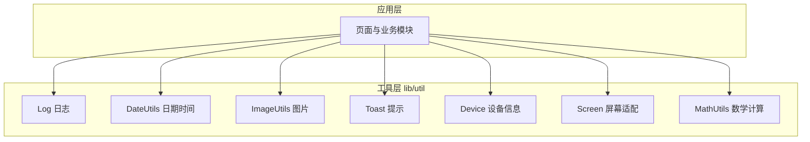
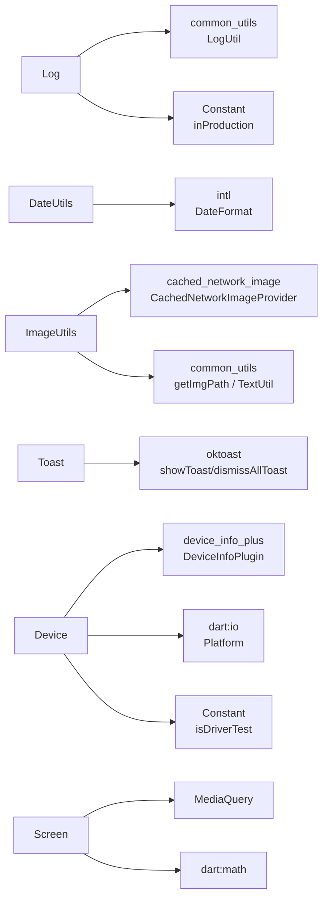
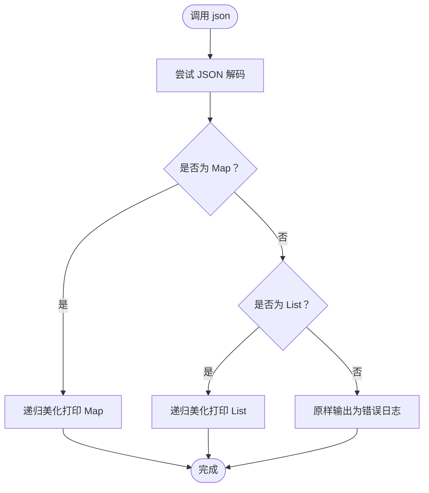
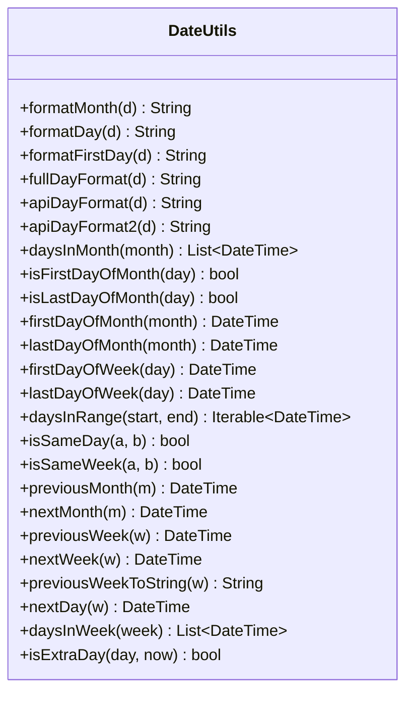
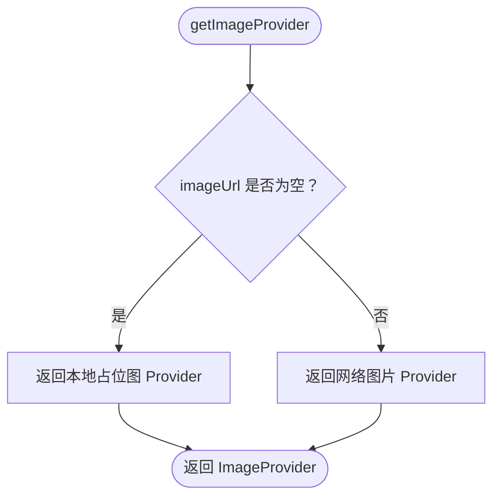
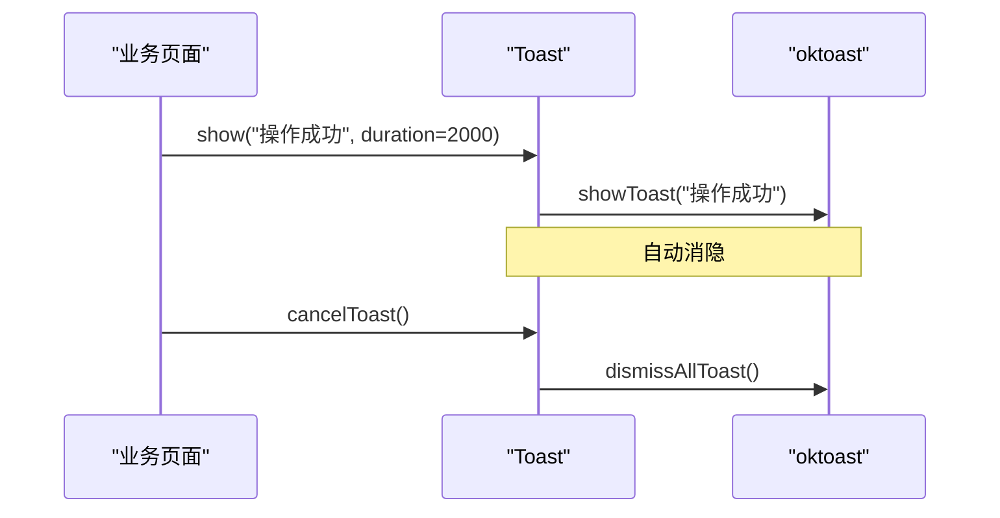
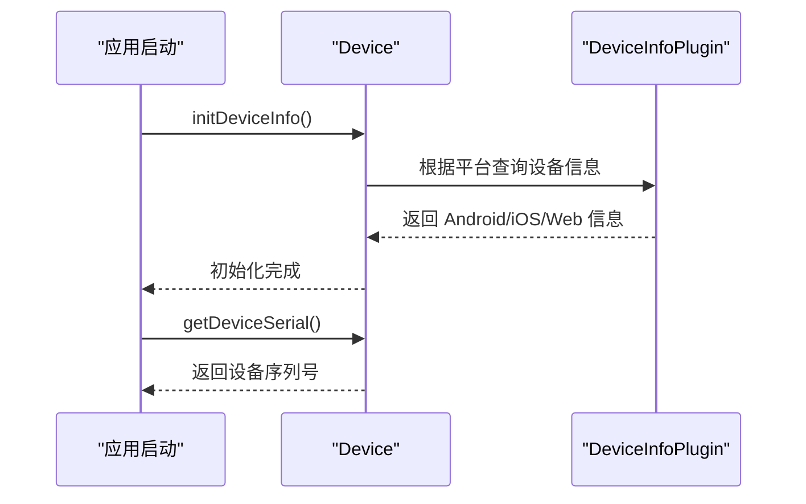
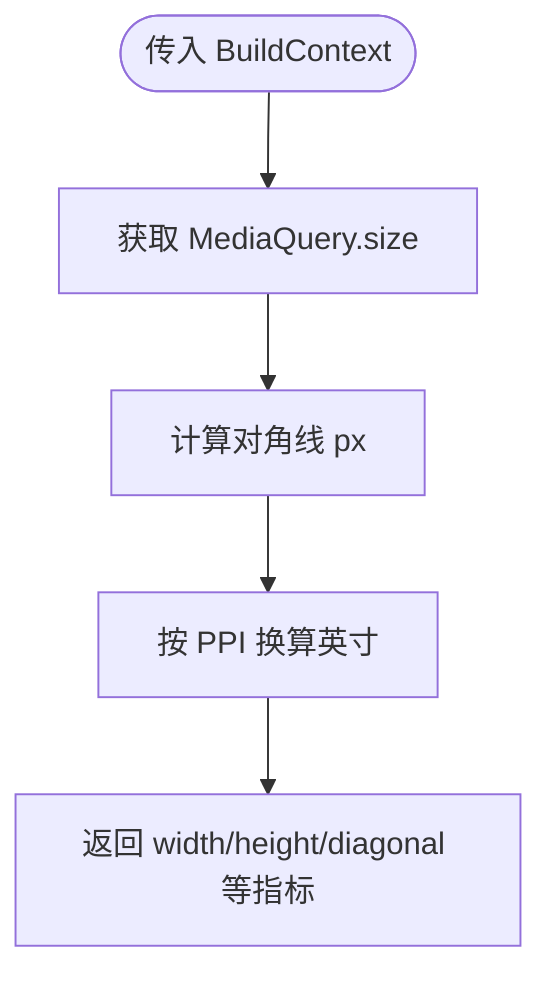
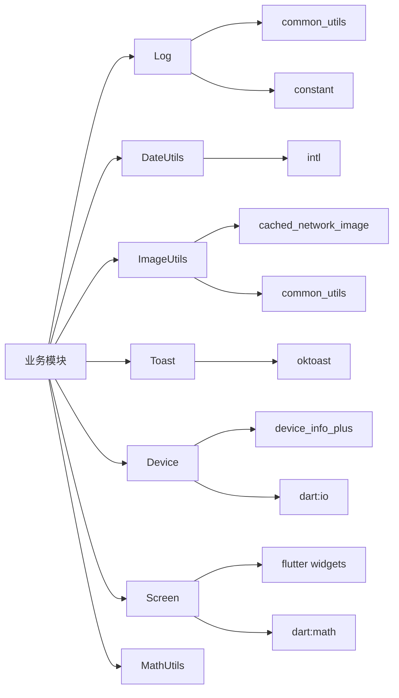

# 工具类库

<cite>
**本文引用的文件**   
- [lib/util/log_utils.dart](file://lib/util/log_utils.dart)
- [lib/util/date_utils.dart](file://lib/util/date_utils.dart)
- [lib/util/image_utils.dart](file://lib/util/image_utils.dart)
- [lib/util/toast_utils.dart](file://lib/util/toast_utils.dart)
- [lib/util/device_utils.dart](file://lib/util/device_utils.dart)
- [lib/util/screen_utils.dart](file://lib/util/screen_utils.dart)
- [lib/util/math_utils.dart](file://lib/util/math_utils.dart)
</cite>

## 目录
1. [引言](#引言)
2. [项目结构中的工具类定位](#项目结构中的工具类定位)
3. [核心工具类总览](#核心工具类总览)
4. [架构与依赖概览](#架构与依赖概览)
5. [详细组件分析](#详细组件分析)
6. [依赖关系分析](#依赖关系分析)
7. [性能与线程安全注意事项](#性能与线程安全注意事项)
8. [异常处理策略](#异常处理策略)
9. [使用规范与最佳实践](#使用规范与最佳实践)
10. [常见问题排查](#常见问题排查)
11. [结语](#结语)

## 引言
本文件为灵犀管店 Flutter 项目的工具类库提供系统化文档，聚焦以下实用能力：日志记录、日期时间处理、图片操作、Toast 提示、设备信息、屏幕适配和数学计算。目标是帮助开发者快速理解各工具类的职责、API 接口、参数说明、使用示例、异常处理策略、性能特征与线程安全注意事项，从而高效复用已有功能，避免重复造轮子。

## 项目结构中的工具类定位
工具类集中位于 `lib/util` 目录下，按功能维度划分，例如：
- 通用工具：日志、Toast、错误处理、权限等
- 领域工具：条码、打印、语音识别、PDA 扫描等
- 平台与显示：设备信息、屏幕尺寸、主题、导航等
- 业务辅助：价格高度、版本检查、登录参数等

本次重点覆盖日志、日期时间、图片、Toast、设备信息、屏幕适配和数学计算相关工具类。

[本节未直接分析具体代码文件]

## 核心工具类总览
- 日志记录：统一输出调试日志，支持 JSON 美化打印，区分生产与调试环境
- 日期时间：常用格式化、周月边界计算、区间枚举、跨时区迭代
- 图片操作：静态资源路径生成、网络图片 Provider 获取、默认占位图
- Toast 提示：全局消息展示与取消
- 设备信息：平台判断、SDK 版本、设备序列号与名称
- 屏幕适配：像素与英寸换算、横竖屏判断、对角线长度
- 数学计算：数值四舍五入、百分比、金额格式、最大最小值等

**章节来源**
- [lib/util/log_utils.dart:1-106](file://lib/util/log_utils.dart#L1-L106)
- [lib/util/date_utils.dart:1-219](file://lib/util/date_utils.dart#L1-L219)
- [lib/util/image_utils.dart:1-34](file://lib/util/image_utils.dart#L1-L34)
- [lib/util/toast_utils.dart:1-20](file://lib/util/toast_utils.dart#L1-L20)
- [lib/util/device_utils.dart:1-95](file://lib/util/device_utils.dart#L1-L95)
- [lib/util/screen_utils.dart:1-46](file://lib/util/screen_utils.dart#L1-L46)
- [lib/util/math_utils.dart](file://lib/util/math_utils.dart)

## 架构与依赖概览
各工具类以静态 API 为主，耦合度低、内聚性强，便于在任意业务层调用。关键依赖如下：
- 日志：依赖公共日志工具与常量配置（控制生产/调试开关）
- 日期：依赖国际化日期格式化
- 图片：依赖网络图片缓存与字符串工具
- Toast：依赖全局 Toast 框架
- 设备：依赖设备信息插件与平台判断
- 屏幕：依赖 Flutter 的 MediaQuery 与 dart:math
- 数学：纯 Dart 计算逻辑

**图表来源**
- [lib/util/log_utils.dart:1-106](file://lib/util/log_utils.dart#L1-L106)
- [lib/util/date_utils.dart:1-219](file://lib/util/date_utils.dart#L1-L219)
- [lib/util/image_utils.dart:1-34](file://lib/util/image_utils.dart#L1-L34)
- [lib/util/toast_utils.dart:1-20](file://lib/util/toast_utils.dart#L1-L20)
- [lib/util/device_utils.dart:1-95](file://lib/util/device_utils.dart#L1-L95)
- [lib/util/screen_utils.dart:1-46](file://lib/util/screen_utils.dart#L1-L46)

**章节来源**
- [lib/util/log_utils.dart:1-106](file://lib/util/log_utils.dart#L1-L106)
- [lib/util/date_utils.dart:1-219](file://lib/util/date_utils.dart#L1-L219)
- [lib/util/image_utils.dart:1-34](file://lib/util/image_utils.dart#L1-L34)
- [lib/util/toast_utils.dart:1-20](file://lib/util/toast_utils.dart#L1-L20)
- [lib/util/device_utils.dart:1-95](file://lib/util/device_utils.dart#L1-L95)
- [lib/util/screen_utils.dart:1-46](file://lib/util/screen_utils.dart#L1-L46)

## 详细组件分析

### 日志记录：Log
用途
- 封装统一日志入口，屏蔽生产环境日志输出
- 支持普通文本与 JSON 结构化日志的美化打印
- 通过初始化方法控制日志级别与行为

主要 API
- init()：根据运行环境初始化日志系统
- d(msg, tag)：调试日志
- e(msg, tag)：错误日志
- json(msg, tag)：解析并美化输出 JSON 字符串

参数说明
- msg：待输出的消息内容；json 方法中期望可被 JSON 解码的字符串
- tag：日志标签，默认使用统一标签

使用示例
- 在应用启动处调用 init，确保日志系统可用
- 在业务模块中使用 d/e/json 输出调试信息
- 将网络响应体作为 json 方法的参数，便于查看结构化数据

异常处理
- json 方法内部捕获解码异常，降级为普通错误日志输出，避免崩溃
- 对嵌套 Map/List 进行深度限制，防止大量日志被系统丢弃

性能考虑
- 对过长列表或深层嵌套对象进行扁平化处理，减少日志行数
- 生产环境默认不输出日志，降低 IO 开销

线程安全
- 所有方法均为静态同步调用；若日志底层非线程安全，建议在业务侧保证串行调用或使用单一线程调度

**图表来源**
- [lib/util/log_utils.dart:1-106](file://lib/util/log_utils.dart#L1-L106)

**章节来源**
- [lib/util/log_utils.dart:1-106](file://lib/util/log_utils.dart#L1-L106)

### 日期时间处理：DateUtils
用途
- 提供常用日期格式化方法
- 计算周、月的起止日期与范围
- 枚举某个月的所有日期
- 比较两个日期是否同一天或同一周

主要 API
- 格式化：formatMonth、formatDay、formatFirstDay、fullDayFormat、apiDayFormat、apiDayFormat2
- 边界计算：firstDayOfMonth、lastDayOfMonth、firstDayOfWeek、lastDayOfWeek、daysInWeek、daysInMonth
- 区间枚举：daysInRange(start, end)
- 比较：isSameDay(a, b)、isSameWeek(a, b)
- 月份/周移动：previousMonth、nextMonth、previousWeek、nextWeek、nextDay
- 额外日判断：isExtraDay(day, now)

参数说明
- DateTime 类型的输入均遵循 Dart 标准时间类型
- daysInRange 的 end 为不包含的右边界

使用示例
- 将后端返回的日期字符串转为 DateTime 后，用 apiDayFormat 输出标准格式
- 渲染日历组件时，使用 daysInMonth 生成当月日期数组
- 筛选报表时，使用 isSameDay 或 isSameWeek 过滤条件

异常处理
- 基本日期运算不会抛出异常；传入非法 DateTime 可能产生不符合预期的结果，建议在业务层做前置校验

性能考虑
- DateFormat 实例为静态常量，避免重复创建
- daysInRange 使用同步生成器，适合小范围日期枚举；大范围枚举建议按需消费

线程安全
- 无状态共享变量，方法为纯函数式调用，具备良好并发安全性

**图表来源**
- [lib/util/date_utils.dart:1-219](file://lib/util/date_utils.dart#L1-L219)

**章节来源**
- [lib/util/date_utils.dart:1-219](file://lib/util/date_utils.dart#L1-L219)

### 图片操作：ImageUtils
用途
- 生成静态图片资源路径
- 根据 URL 返回合适的 ImageProvider，空地址时使用占位图
- 统一图片扩展名枚举与转换

主要 API
- getAssetImage(name, format)：返回 AssetImage
- getImgPath(name, format)：返回图片路径字符串
- getImageProvider(imageUrl, holderImg)：返回 ImageProvider

参数说明
- name：图片文件名（不含扩展名）
- format：图片格式枚举 png/jpg/gif/webp
- imageUrl：网络图片地址；可为空
- holderImg：占位图文件名，默认为 none

使用示例
- 使用 getImgPath 构造 assets/images 下的图片路径
- 在网络列表中使用 getImageProvider，自动处理空图与缓存

异常处理
- 空 imageUrl 会回退到本地占位图，避免 UI 空白
- 外部 URL 无效时由网络图片 Provider 自行处理加载失败状态

性能考虑
- 网络图片建议使用缓存 Provider，减少重复下载
- 静态资源路径生成轻量，适合频繁调用

线程安全
- 无状态共享，纯函数式调用，线程安全

**图表来源**
- [lib/util/image_utils.dart:1-34](file://lib/util/image_utils.dart#L1-L34)

**章节来源**
- [lib/util/image_utils.dart:1-34](file://lib/util/image_utils.dart#L1-L34)

### Toast 提示：Toast
用途
- 统一展示全局提示消息
- 支持自定义显示时长
- 提供一键取消所有 Toast 的能力

主要 API
- show(msg, duration)：显示消息，默认持续 2000 毫秒
- cancelToast()：取消全部 Toast

参数说明
- msg：提示文案；null 时不显示
- duration：显示时长（毫秒）

使用示例
- 在用户操作成功或失败时调用 show 给出反馈
- 页面销毁前调用 cancelToast 清理残留提示

异常处理
- null 文案直接忽略，避免无意义调用

性能考虑
- 短时消息不影响主流程性能
- 频繁触发时需合理控制频率，避免 UI 抖动

线程安全
- 基于全局 Toast 框架，注意不要在非 UI 线程频繁更新 UI

**图表来源**
- [lib/util/toast_utils.dart:1-20](file://lib/util/toast_utils.dart#L1-L20)

**章节来源**
- [lib/util/toast_utils.dart:1-20](file://lib/util/toast_utils.dart#L1-L20)

### 设备信息：Device
用途
- 判断当前运行平台（Android/iOS/Web）
- 初始化并缓存设备信息
- 获取 SDK 版本、设备序列号与设备名称

主要 API
- initDeviceInfo()：异步初始化设备信息
- isMobile/isWeb/isAndroid/isIOS：平台判断
- getAndroidSdkInt()：获取 Android SDK 版本
- getDeviceSerial()：获取设备唯一标识
- getDeviceName()：获取设备名称

参数说明
- 所有方法均无入参；部分方法依赖已初始化的设备信息

使用示例
- 在应用启动阶段调用 initDeviceInfo
- 在上报埋点或日志中拼接设备信息字段

异常处理
- 序列号或名称获取失败时返回空串或“Unknown”，避免中断主流程
- 测试环境下返回固定值，方便自动化测试

性能考虑
- 设备信息仅初始化一次，后续读取为内存缓存，性能良好

线程安全
- 初始化为异步；其他属性读取为同步访问，需确保先完成初始化

**图表来源**
- [lib/util/device_utils.dart:1-95](file://lib/util/device_utils.dart#L1-L95)

**章节来源**
- [lib/util/device_utils.dart:1-95](file://lib/util/device_utils.dart#L1-L95)

### 屏幕适配：Screen
用途
- 获取屏幕尺寸、方向、对角线长度
- 提供像素与英寸之间的换算
- 提供 BuildContext 扩展，简化常见尺寸读取

主要 API
- isLandscape(context)：是否横屏
- size(context)/width(context)/height(context)：像素尺寸
- diagonal(context)：对角线像素长度
- inches(context)/widthInches(context)/heightInches(context)/diagonalInches(context)：英寸单位
- BuildContext.size/height/width：扩展便捷访问

参数说明
- context：BuildContext，用于获取 MediaQuery

使用示例
- 在小屏设备上隐藏次要信息
- 根据对角线英寸判断手机或平板
- 在不同分辨率下按比例设置字体大小或间距

异常处理
- 正常场景不会抛出异常；context 为空或 MediaQuery 不可用时会导致错误，应确保在 Widget 构建期间使用

性能考虑
- 计算量极低，可频繁调用

线程安全
- 依赖 BuildContext 与 MediaQuery，需在 UI 线程使用

**图表来源**
- [lib/util/screen_utils.dart:1-46](file://lib/util/screen_utils.dart#L1-L46)

**章节来源**
- [lib/util/screen_utils.dart:1-46](file://lib/util/screen_utils.dart#L1-L46)

### 数学计算：MathUtils
用途
- 提供常见的数值计算工具方法，如四舍五入、百分比、金额格式化、最大最小值等
- 避免业务代码中散落重复的数值处理逻辑

主要 API
- 请参考该文件的实际方法定义，例如：
  - 四舍五入保留小数位
  - 计算百分比
  - 金额格式化
  - 最大值/最小值

参数说明
- 依据每个方法的入参与返回值而定

使用示例
- 在订单页格式化金额显示
- 在统计页计算百分比并格式化
- 在表单校验中进行数值范围判断

异常处理
- 输入非法数值（如 NaN、Infinity）时应进行前置校验，避免输出异常结果

性能考虑
- 纯计算逻辑，开销极小

线程安全
- 无状态纯函数，线程安全

[本节未直接分析具体代码文件，请以实际 math_utils.dart 实现为准]

## 依赖关系分析
- Log 依赖 common_utils 的日志能力与 constant 的环境标志
- DateUtils 依赖 intl 的 DateFormat
- ImageUtils 依赖 cached_network_image 与 common_utils
- Toast 依赖 oktoast
- Device 依赖 device_info_plus 与 platform
- Screen 依赖 flutter widgets 与 dart:math
- MathUtils 为纯 Dart 计算，无外部 UI 依赖

**图表来源**
- [lib/util/log_utils.dart:1-106](file://lib/util/log_utils.dart#L1-L106)
- [lib/util/date_utils.dart:1-219](file://lib/util/date_utils.dart#L1-L219)
- [lib/util/image_utils.dart:1-34](file://lib/util/image_utils.dart#L1-L34)
- [lib/util/toast_utils.dart:1-20](file://lib/util/toast_utils.dart#L1-L20)
- [lib/util/device_utils.dart:1-95](file://lib/util/device_utils.dart#L1-L95)
- [lib/util/screen_utils.dart:1-46](file://lib/util/screen_utils.dart#L1-L46)

**章节来源**
- [lib/util/log_utils.dart:1-106](file://lib/util/log_utils.dart#L1-L106)
- [lib/util/date_utils.dart:1-219](file://lib/util/date_utils.dart#L1-L219)
- [lib/util/image_utils.dart:1-34](file://lib/util/image_utils.dart#L1-L34)
- [lib/util/toast_utils.dart:1-20](file://lib/util/toast_utils.dart#L1-L20)
- [lib/util/device_utils.dart:1-95](file://lib/util/device_utils.dart#L1-L95)
- [lib/util/screen_utils.dart:1-46](file://lib/util/screen_utils.dart#L1-L46)

## 性能与线程安全注意事项
- 日志
  - 生产环境关闭日志输出，减少 IO
  - JSON 日志存在递归遍历，应避免过深嵌套或超长数组
- 日期
  - DateFormat 使用静态常量，避免重复创建
  - daysInRange 使用同步生成器，适合小范围枚举
- 图片
  - 优先使用缓存的网络图片 Provider
  - 占位图用于空 URL 场景，避免布局闪烁
- Toast
  - 频繁弹出会影响用户体验，适当合并与节流
- 设备
  - 初始化为异步，其他属性同步读取，需先完成初始化
- 屏幕
  - 计算轻量，但必须在使用 Widget 树上下文中调用
- 数学
  - 纯函数，线程安全；注意输入合法性校验

[本节为通用指导，不涉及具体代码行引用]

## 异常处理策略
- Log.json：捕获 JSON 解码异常，降级为错误日志
- Device：序列号与名称获取失败时返回空串或默认值
- ImageUtils：空 URL 回退到占位图
- Toast：null 文案不显示
- Screen：必须在有效 BuildContext 中使用
- DateUtils：保持纯函数式，避免抛错；业务侧负责输入校验

**章节来源**
- [lib/util/log_utils.dart:1-106](file://lib/util/log_utils.dart#L1-L106)
- [lib/util/device_utils.dart:1-95](file://lib/util/device_utils.dart#L1-L95)
- [lib/util/image_utils.dart:1-34](file://lib/util/image_utils.dart#L1-L34)
- [lib/util/toast_utils.dart:1-20](file://lib/util/toast_utils.dart#L1-L20)
- [lib/util/screen_utils.dart:1-46](file://lib/util/screen_utils.dart#L1-L46)
- [lib/util/date_utils.dart:1-219](file://lib/util/date_utils.dart#L1-L219)

## 使用规范与最佳实践
- 统一入口
  - 日志：在应用启动时调用 Log.init，并在业务中使用 Log.d/e/json
  - 设备：在应用启动时调用 Device.initDeviceInfo
- 参数校验
  - 日期、数值计算前进行合法性和范围校验
  - 图片 URL 判空后再调用 ImageUtils.getImageProvider
- 输出规范
  - 日志标签统一使用默认 tag，或在必要时显式传入
  - Toast 文案简洁明确，避免过长
- 性能优化
  - 避免在高频刷新中重复创建 DateFormat
  - 合理使用缓存图片，避免重复下载
- 线程安全
  - 设备信息初始化完成后，再读取属性
  - Toast 与屏幕相关 API 需在 UI 线程使用
- 可维护性
  - 将重复的数值与日期处理逻辑抽取到工具类
  - 避免在页面中直接拼装复杂 JSON 日志，优先使用 Log.json

[本节为通用指导，不涉及具体代码行引用]

## 常见问题排查
- 日志未输出
  - 确认 Log.init 已调用
  - 检查是否在 production 模式下被抑制
- 设备序列号为空
  - 确认 Device.initDeviceInfo 已完成
  - Android 高版本可能受限，回退到 id
- 图片不显示
  - 检查网络 URL 是否有效
  - 检查本地占位图是否存在
- Toast 不消失
  - 检查是否多次调用且未取消
  - 页面销毁时可调用 cancelToast
- 屏幕尺寸异常
  - 确认在有效的 BuildContext 中调用
  - 检查 MediaQuery 是否可用

**章节来源**
- [lib/util/log_utils.dart:1-106](file://lib/util/log_utils.dart#L1-L106)
- [lib/util/device_utils.dart:1-95](file://lib/util/device_utils.dart#L1-L95)
- [lib/util/image_utils.dart:1-34](file://lib/util/image_utils.dart#L1-L34)
- [lib/util/toast_utils.dart:1-20](file://lib/util/toast_utils.dart#L1-L20)
- [lib/util/screen_utils.dart:1-46](file://lib/util/screen_utils.dart#L1-L46)

## 结语
通过统一的工具类库，灵犀管店项目在日志、日期时间、图片、Toast、设备信息与屏幕适配等方面实现了稳定、易用的基础设施。建议团队在日常开发中优先复用这些工具类，遵循本文的使用规范与最佳实践，持续提升代码质量与可维护性。