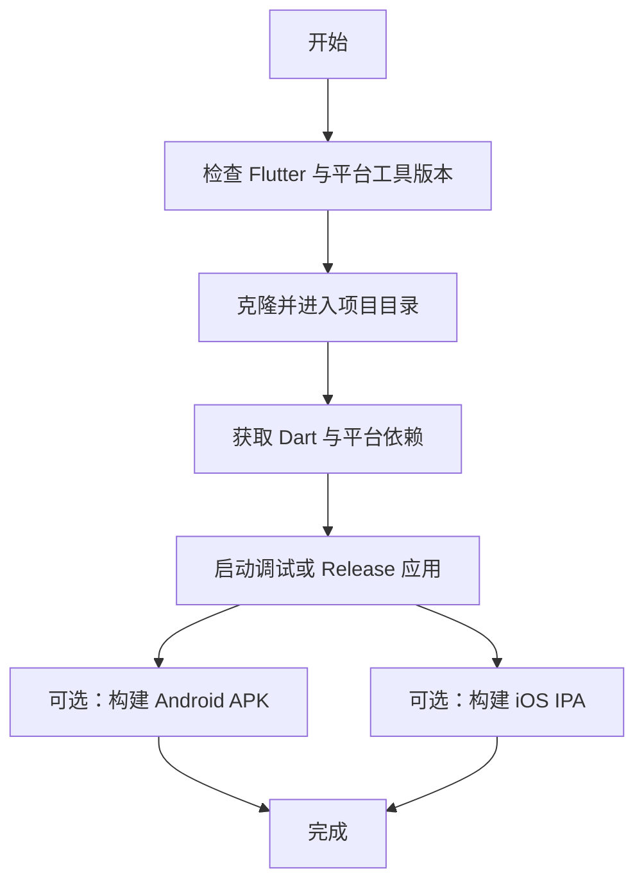
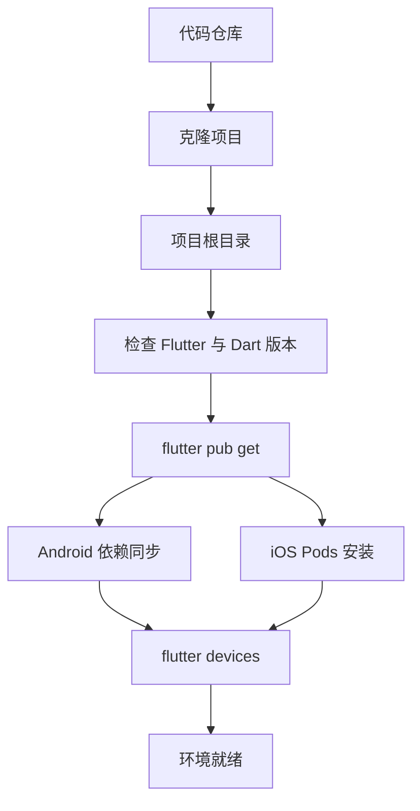
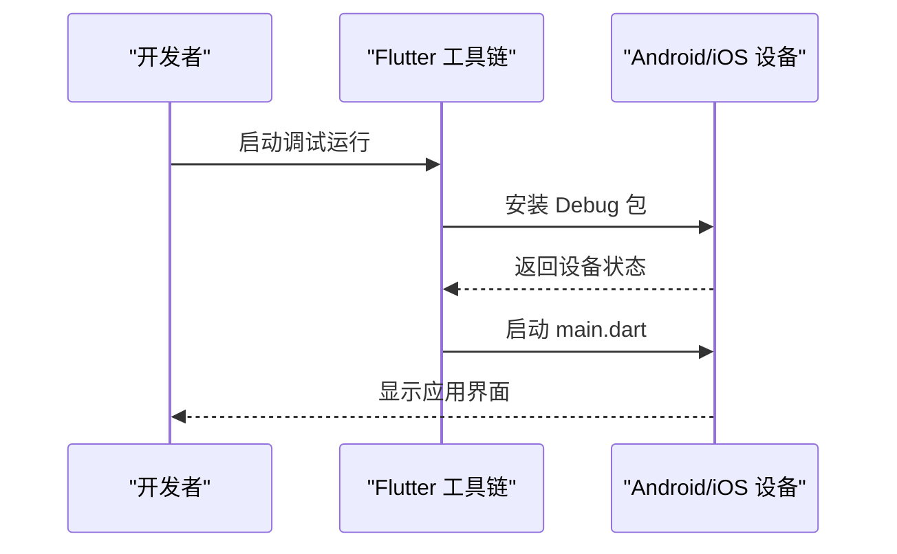
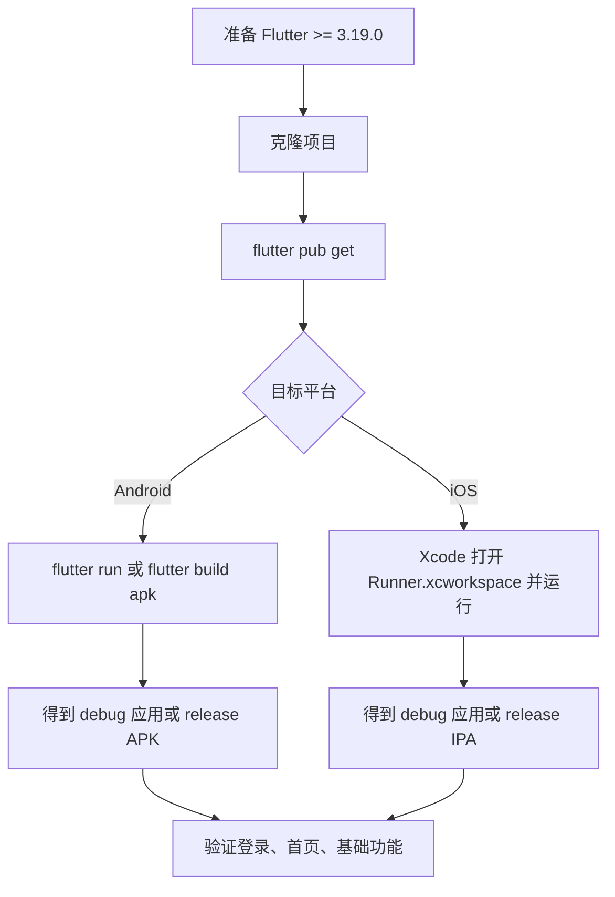
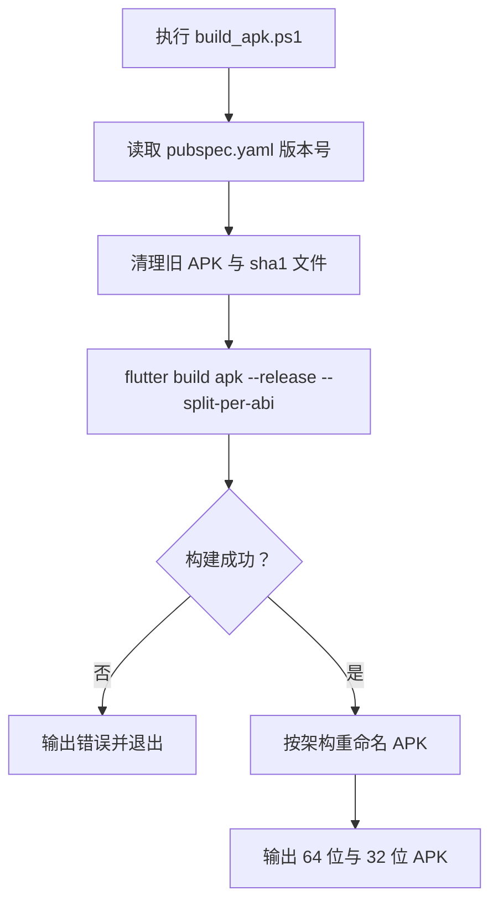
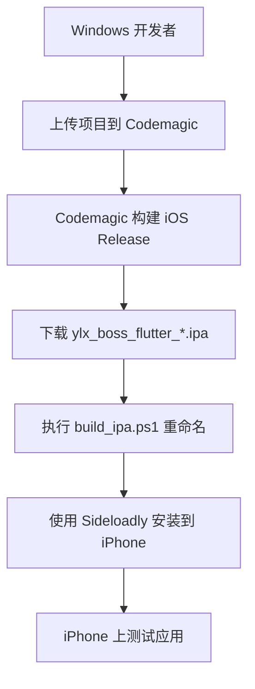
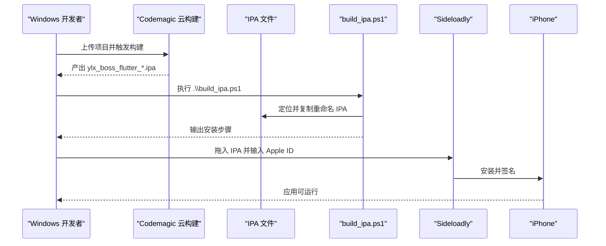
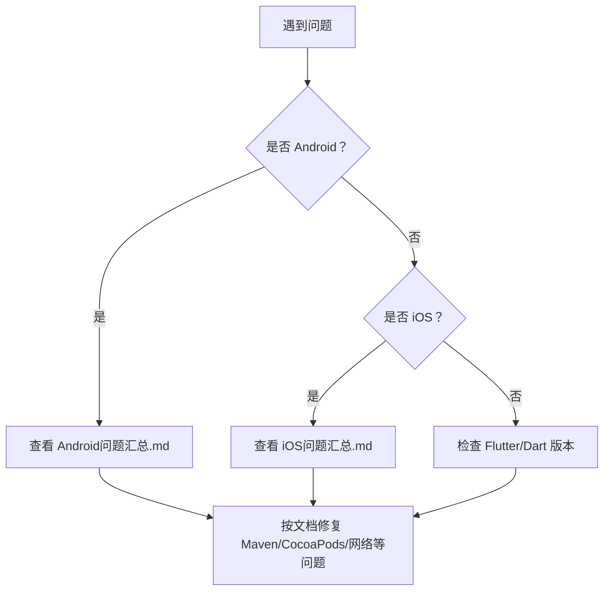
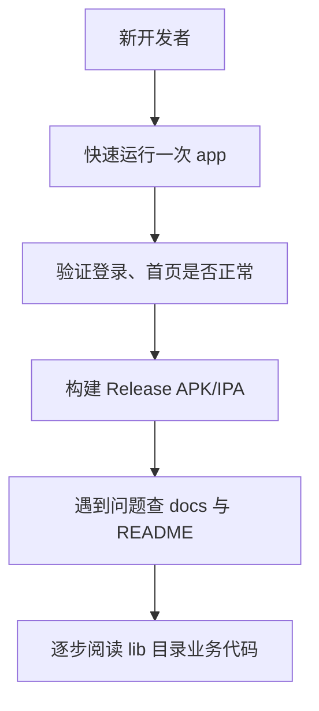

# 快速开始

<cite>
**本文引用的文件**   
- [README.md](file://README.md)
- [pubspec.yaml](file://pubspec.yaml)
- [build_apk.ps1](file://build_apk.ps1)
- [build_ipa.ps1](file://build_ipa.ps1)
- [download_flutter.ps1](file://download_flutter.ps1)
- [codemagic.yaml](file://codemagic.yaml)
- [Android问题汇总.md](file://docs/Android问题汇总.md)
- [iOS问题汇总.md](file://docs/iOS问题汇总.md)
- [lib/main.dart](file://lib/main.dart)
</cite>

## 目录
1. [简介](#简介)
2. [最低开发环境要求](#最低开发环境要求)
3. [项目克隆与依赖安装](#项目克隆与依赖安装)
4. [首次运行配置](#首次运行配置)
5. [从源码到可运行应用](#从源码到可运行应用)
6. [Android APK 构建脚本](#android-apk-构建脚本)
7. [iOS IPA 构建与测试流程](#ios-ipa-构建与测试流程)
8. [常见环境问题解决方案](#常见环境问题解决方案)
9. [新开发者上手建议](#新开发者上手建议)
10. [总结](#总结)

## 简介
本指南面向第一次接触灵犀管店 Flutter 项目的开发者，目标是帮助你在最短时间内完成环境准备、依赖安装、首次运行验证，并掌握 Android APK 和 iOS IPA 的构建方式。项目是一个基于 Flutter 的多端业务应用，包含登录、门店管理、进销存、数据报表、推送、扫码等功能模块；文档会根据仓库中的脚本、配置文件和问题汇总给出可操作的上手路径。

## 最低开发环境要求
根据项目声明和环境约束，推荐满足以下最低条件：

- **Flutter SDK**：`>= 3.19.0`  
  项目 `pubspec.yaml` 中显式声明 Flutter 下限为 `3.19.0`。
- **Dart SDK**：`>= 3.4.0` 且 `< 4.0.0`  
  项目 `pubspec.yaml` 中声明 Dart SDK 范围。
- **Android 开发环境**：
  - Android Studio
  - Android SDK、Android SDK Platform、Android SDK Command-line Tools
  - Gradle（由 Flutter 工程内嵌管理）
- **iOS 开发环境**：
  - macOS 系统
  - Xcode
  - CocoaPods（用于 iOS 原生依赖）
- **Windows 辅助工具**（可选但推荐）：
  - PowerShell（用于执行项目根目录的 `.ps1` 脚本）
  - Sideloadly（用于通过免费 Apple ID 将云构建产出的 `.ipa` 安装到 iPhone 测试）

说明：
- README 中示例版本使用了较新的 Flutter 与 Dart 版本，但 `pubspec.yaml` 是项目可运行的硬性约束，应以 `pubspec.yaml` 为准。
- 如果你使用 Windows 进行本地开发，Android 方向可以完整工作；iOS 方向建议使用 Codemagic 云构建产出 `.ipa`，再通过 `build_ipa.ps1` 重命名并配合 Sideloadly 安装测试。

**章节来源**
- [pubspec.yaml:1-15](file://pubspec.yaml#L1-L15)
- [README.md:90-110](file://README.md#L90-L110)

## 项目克隆与依赖安装
### 步骤一：克隆项目
在终端中克隆仓库后，切换到项目根目录。若你使用的是 Git 子模块或私有仓库地址，请替换为你实际的仓库 URL。

### 步骤二：检查 Flutter 版本
进入项目根目录后，执行 Flutter 健康检查，确认当前 Flutter SDK 不低于 `3.19.0`，Dart SDK 不低于 `3.4.0`。

如果版本不匹配，优先升级 Flutter SDK，使 Dart 版本跟随稳定通道更新。

### 步骤三：获取依赖
在项目根目录执行依赖获取命令。该命令会：
- 解析 `pubspec.yaml` 中的依赖
- 下载 Dart 包
- 触发 Android Gradle 同步
- 触发 iOS CocoaPods 安装

### 步骤四：确认设备可用
- Android：连接真机或启动模拟器，确认 `flutter devices` 能识别设备。
- iOS：在 macOS 上连接真机或使用模拟器，确保 Xcode 命令行工具可用。

**章节来源**
- [pubspec.yaml:1-20](file://pubspec.yaml#L1-L20)
- [README.md:90-110](file://README.md#L90-L110)

## 首次运行配置
### 首次运行目标
首次运行只需要把应用启动到已连接的 Android 或 iOS 设备上，验证主界面、登录页、基础页面能够加载即可。

### 启动调试模式
在 Flutter 项目中，直接运行 Debug 模式可以快速看到 UI 变化。Debug 模式适合开发调试，但 README 明确指出 Debug 下可能出现卡顿，属于正常现象；正式体验应使用 Release 构建。

### 首次运行注意事项
- 如果是 Android 真机，首次安装可能需要授予相机、存储等权限，具体权限取决于你实际要测试的功能。
- 如果是 iOS 真机，需要信任开发者证书或完成调试签名流程。
- 项目入口位于 `lib/main.dart`，首次运行失败时可重点观察该入口是否被正确编译和执行。

**章节来源**
- [README.md:90-110](file://README.md#L90-L110)
- [lib/main.dart](file://lib/main.dart)

## 从源码到可运行应用
下面的流程覆盖“本地调试 → Android Release APK → iOS Release IPA”的完整路径。

关键点：
- 本地开发时优先用 `flutter run` 启动 Debug 模式。
- Android Release APK 可直接使用项目提供的 PowerShell 脚本。
- iOS 在 Windows 环境下推荐使用 Codemagic 云构建，再用 `build_ipa.ps1` 处理产物。

**章节来源**
- [README.md:90-110](file://README.md#L90-L110)
- [pubspec.yaml:1-15](file://pubspec.yaml#L1-L15)

## Android APK 构建脚本
项目提供了 `build_apk.ps1`，用于自动读取版本号、清理旧产物、构建 Release APK，并按架构重命名为更友好的文件名。

### 脚本行为概览
- 从 `pubspec.yaml` 解析 `version` 字段，例如 `1.0.1+112` 会被转换为带点号的完整版本号。
- 清理 `build\app\outputs\flutter-apk` 下的旧 APK 和校验文件。
- 调用 Flutter 构建 Release APK，并指定 `android-arm64` 与 `android-arm` 两种架构。
- 将生成的 arm64 和 armeabi-v7a APK 分别重命名为带完整版本号的名称。

### 使用方式
- 在 Windows PowerShell 中进入项目根目录。
- 执行 `.\build_apk.ps1`。
- 成功后在 `build\app\outputs\flutter-apk` 目录下查看重命名后的 APK。

### 适用场景
- 本地 Android Release 构建。
- CI 中希望输出带清晰版本信息的 APK。
- 需要区分 32 位与 64 位 APK 的场景。

**章节来源**
- [build_apk.ps1:1-63](file://build_apk.ps1#L1-L63)
- [pubspec.yaml:1-15](file://pubspec.yaml#L1-L15)

## iOS IPA 构建与测试流程
由于 iOS 构建通常需要 macOS 和 Xcode，项目提供了两条路径：

### 路径一：macOS 本地构建
如果你有 macOS 和 Xcode，可以直接在 Xcode 中打开 `ios/Runner.xcworkspace`，选择目标设备后构建和运行。Release 构建可用于 App Store 上传或企业分发。

### 路径二：Codemagic 云构建 + Windows 测试
项目根目录提供 `codemagic.yaml`，用于在 Codemagic 云端 macOS 机器上构建 iOS Release 包，并生成未签名的 `.ipa`。Windows 用户可通过 `build_ipa.ps1` 对下载的 `.ipa` 按版本号重命名，并使用 Sideloadly 安装到 iPhone 测试。

#### Codemagic 构建要点
- 工作流名称为 iOS 测试包构建。
- 构建参数包含 `--no-codesign`，表示不签名，便于后续通过 Sideloadly 使用免费 Apple ID 重新签名。
- 构建产物命名为 `ylx_boss_flutter_<版本号>.ipa`。
- 构建过程中会从环境变量注入语音识别相关密钥文件。

#### Windows 测试辅助脚本行为
- 自动查找当前目录、`build\ios`、系统下载目录中最新的 `.ipa`。
- 按 `pubspec.yaml` 的版本号复制并重命名。
- 输出 Sideloadly 安装指引，包括开启开发者模式、信任 Apple ID、7 天有效期说明等。

**章节来源**
- [codemagic.yaml:1-47](file://codemagic.yaml#L1-L47)
- [build_ipa.ps1:1-68](file://build_ipa.ps1#L1-L68)
- [pubspec.yaml:1-15](file://pubspec.yaml#L1-L15)

## 常见环境问题解决方案
### Android 常见问题
- **Maven 源无法解析 Flutter embedding 包**  
  可按 `Android问题汇总.md` 的建议修改 Flutter Gradle 中的 Maven 源，或在项目 `android/build.gradle` 中添加 Flutter 官方镜像源。
- **包体积过大或调试信息过多**  
  可使用 `--target-platform` 指定架构，或使用 `--obfuscate` 与 `--split-debug-info` 减小包体并控制调试信息。

### iOS 常见问题
- **CocoaPods CDN trunk 源更新失败**  
  可在 `Podfile` 中指定 `source` 为 GitHub 源或国内镜像，并移除默认的 `trunk` 源。
- **raw.githubusercontent.com 无法访问**  
  可在 hosts 中添加对应 IP，或通过国内镜像解决。

### Flutter 版本相关问题
- README 中列出了若干历史已知问题，建议遇到类似现象时先核对 Flutter 版本，并参考 README 和 docs 目录中的问题汇总。
- 如果遇到插件兼容性问题，优先检查 `pubspec.yaml` 中依赖版本是否与当前 Flutter 版本匹配。

**章节来源**
- [Android问题汇总.md:1-56](file://docs/Android问题汇总.md#L1-L56)
- [iOS问题汇总.md:1-55](file://docs/iOS问题汇总.md#L1-L55)
- [README.md:90-110](file://README.md#L90-L110)

## 新开发者上手建议
为了降低门槛，建议新加入的开发者按以下顺序行动：

1. **先确认 Flutter 版本**  
   确保 Flutter SDK 至少为 `3.19.0`，Dart SDK 至少为 `3.4.0`。
2. **只跑通一次应用**  
   先用 `flutter run` 在 Android 或 iOS 设备上启动 Debug 应用，看到主界面即可确认环境基本可用。
3. **再尝试构建 Release**  
   - Android：使用 `.\build_apk.ps1` 快速生成 Release APK。
   - iOS：如果没有 macOS，使用 Codemagic 构建 `.ipa`，再通过 `build_ipa.ps1` 和 Sideloadly 安装到 iPhone。
4. **遇到问题先看文档**  
   优先查阅 `docs/Android问题汇总.md` 和 `docs/iOS问题汇总.md`，再结合 `README.md` 中的说明排查。
5. **理解核心入口**  
   项目入口为 `lib/main.dart`，后续阅读业务代码时可以从入口出发，逐步了解路由、页面、网络、状态管理等模块。

[本节为概念性指导，不直接分析具体代码文件]

## 总结
- 项目最低 Flutter 版本为 `3.19.0`，Dart SDK 范围为 `>=3.4.0 <4.0.0`。
- 首次运行推荐使用 `flutter run` 启动 Debug 应用，验证基础功能。
- Android 构建推荐使用 `build_apk.ps1`，自动生成带版本信息的 Release APK。
- iOS 构建推荐使用 Codemagic 云构建 + `build_ipa.ps1` + Sideloadly 的无 Mac 测试方案。
- 遇到问题优先查阅 `docs/Android问题汇总.md`、`docs/iOS问题汇总.md` 和 `README.md`。
- 对于新开发者，最短路径是：装好 Flutter → 拉取代码 → 安装依赖 → 运行一次 → 构建一个 Release 包。