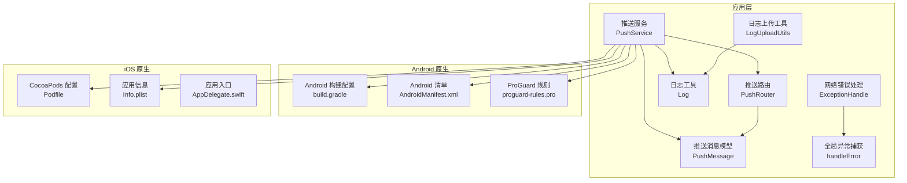
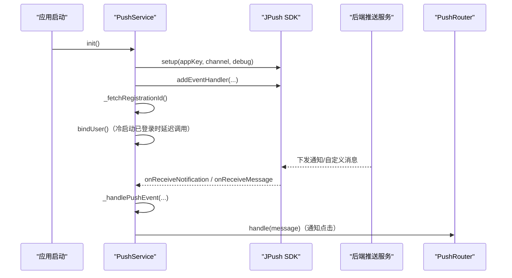
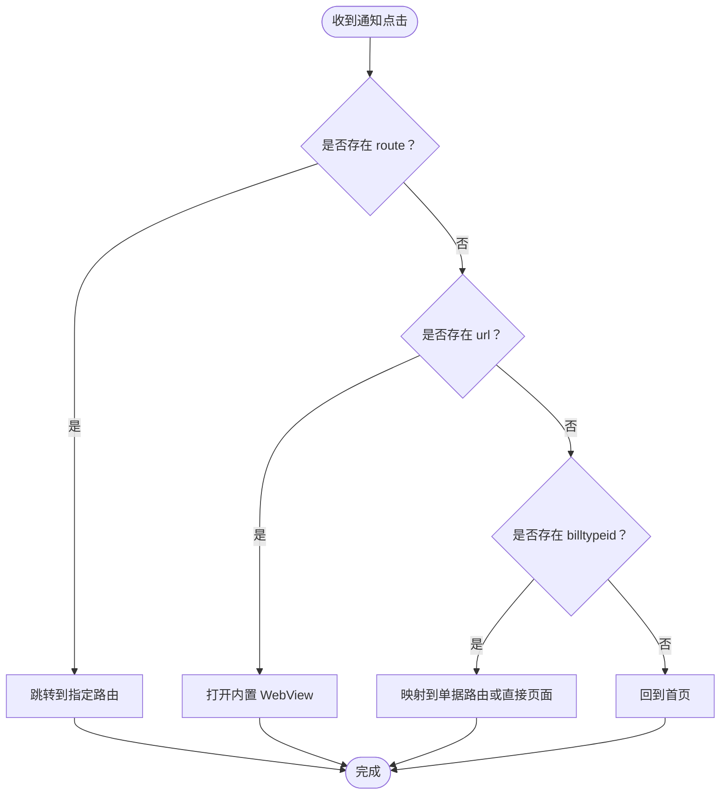
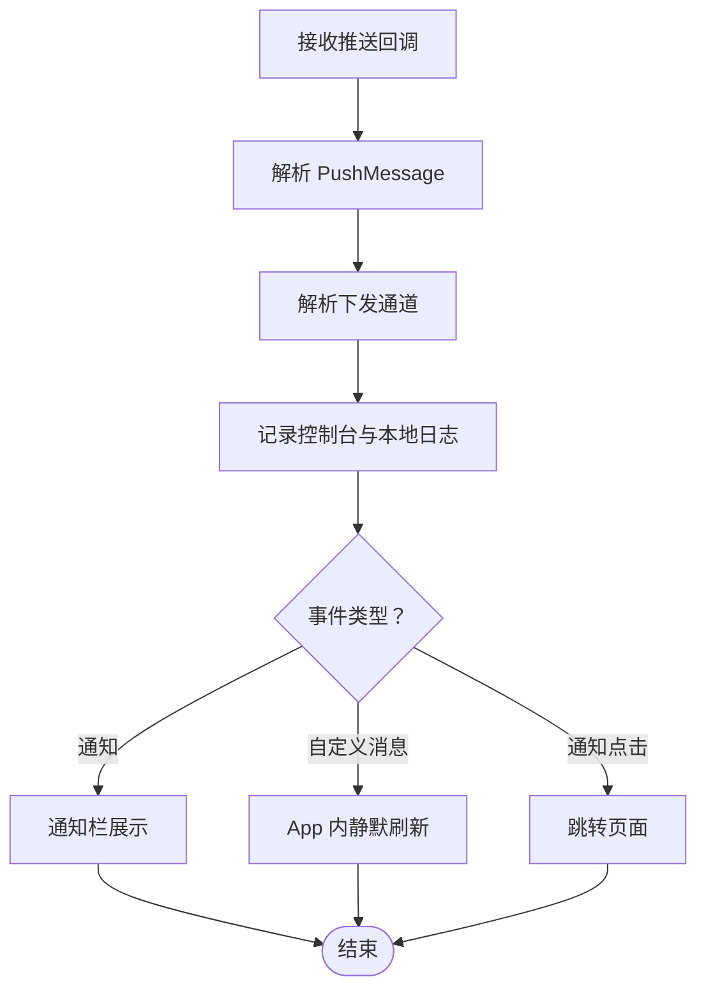

# 故障排除与FAQ

<cite>
**本文引用的文件**   
- [Android问题汇总.md](file://docs/Android问题汇总.md)
- [iOS问题汇总.md](file://docs/iOS问题汇总.md)
- [push_guide.md](file://docs/push_guide.md)
- [push_service.dart](file://lib/push/push_service.dart)
- [push_config.dart](file://lib/push/push_config.dart)
- [push_message.dart](file://lib/push/push_message.dart)
- [push_router.dart](file://lib/push/push_router.dart)
- [log_utils.dart](file://lib/util/log_utils.dart)
- [log_upload_utils.dart](file://lib/util/log_upload_utils.dart)
- [error_handle.dart](file://lib/net/error_handle.dart)
- [handle_error_utils.dart](file://lib/util/handle_error_utils.dart)
- [build.gradle](file://android/app/build.gradle)
- [AndroidManifest.xml](file://android/app/src/main/AndroidManifest.xml)
- [proguard-rules.pro](file://android/app/proguard-rules.pro)
- [Podfile](file://ios/Podfile)
- [AppDelegate.swift](file://ios/Runner/AppDelegate.swift)
- [Info.plist](file://ios/Runner/Info.plist)
- [README.md](file://README.md)
</cite>

## 目录
1. [引言](#引言)
2. [项目结构与排障范围](#项目结构与排障范围)
3. [常见问题总览](#常见问题总览)
4. [Android平台故障排除](#android平台故障排除)
5. [iOS平台故障排除](#ios平台故障排除)
6. [推送服务配置与调试](#推送服务配置与调试)
7. [日志分析方法](#日志分析方法)
8. [错误堆栈解读](#错误堆栈解读)
9. [性能问题定位与优化建议](#性能问题定位与优化建议)
10. [问题报告模板](#问题报告模板)
11. [调试工具与社区支持](#调试工具与社区支持)
12. [结论](#结论)

## 引言
本文件面向灵犀管店 Flutter 项目的开发者与维护者，集中整理 Android、iOS 平台的典型编译、运行、平台差异及性能问题，并重点说明极光推送服务的配置、调试和排查方法。文档既提供快速解决方案，也给出日志分析、错误堆栈解读、性能瓶颈定位技巧，以及统一的问题报告模板和社区支持渠道，帮助你在开发中更快定位和解决问题。

## 项目结构与排障范围
本项目为灵犀管店 Flutter 应用，包含 Android、iOS 原生工程、Flutter 业务代码、推送模块、网络层、日志上传等能力。排障范围覆盖：
- Android 构建与打包、权限与厂商通道、混淆与深链接。
- iOS CocoaPods、部署目标、通知权限与证书环境。
- 极光推送初始化、别名标签绑定、通知点击跳转、厂商通道与 APNs。
- 全局异常捕获、HTTP 错误分类、日志压缩上传。

**图表来源**
- [push_service.dart:1-200](file://lib/push/push_service.dart#L1-L200)
- [push_router.dart:1-147](file://lib/push/push_router.dart#L1-L147)
- [push_message.dart:1-147](file://lib/push/push_message.dart#L1-L147)
- [log_utils.dart:1-106](file://lib/util/log_utils.dart#L1-L106)
- [log_upload_utils.dart:1-200](file://lib/util/log_upload_utils.dart#L1-L200)
- [error_handle.dart:1-82](file://lib/net/error_handle.dart#L1-L82)
- [handle_error_utils.dart:1-38](file://lib/util/handle_error_utils.dart#L1-L38)
- [build.gradle:1-119](file://android/app/build.gradle#L1-L119)
- [AndroidManifest.xml:1-98](file://android/app/src/main/AndroidManifest.xml#L1-L98)
- [proguard-rules.pro:1-53](file://android/app/proguard-rules.pro#L1-L53)
- [Podfile:1-53](file://ios/Podfile#L1-L53)
- [Info.plist:1-76](file://ios/Runner/Info.plist#L1-L76)
- [AppDelegate.swift:1-31](file://ios/Runner/AppDelegate.swift#L1-L31)

**章节来源**
- [README.md:1-210](file://README.md#L1-L210)

## 常见问题总览
- 构建与依赖：
  - Android Gradle 无法解析 Flutter embedding 包。
  - iOS CocoaPods CDN 源不可用或 Spec 下载失败。
- 权限与系统限制：
  - Android 13+ 通知权限未授权导致通知不展示。
  - iOS 通知权限未开启或证书环境配置不正确。
- 推送相关：
  - AppKey 不一致、包名不一致、未配置厂商通道。
  - 应用被杀后收不到推送。
  - 点击通知白屏或跳转失败。
  - Release 包因混淆导致推送类被误删。
- 网络与异常：
  - 超时、Socket 异常、HTTP 异常、JSON 解析异常。
  - Flutter 未捕获异常未上报或未打印。
- 性能与卡顿：
  - Debug 模式卡顿、列表渲染过多、图片加载与 WebView 开销。

## Android平台故障排除

### 无法解析 Flutter embedding 包
- 现象：构建时报错无法解析 `io.flutter:flutter_embedding_xxx`。
- 原因：Maven 仓库地址变更或镜像不可达。
- 解决：
  - 在 Flutter SDK 的 `flutter/packages/flutter_tools/gradle` 下的 `flutter.gradle` 中将 Maven 仓库替换为官方地址。
  - 或在项目 `android/build.gradle` 的 `repositories` 中添加 `http://download.flutter.io`。
- 参考路径：[Android问题汇总.md:1-56](file://docs/Android问题汇总.md#L1-L56)

### 打包体积与调试信息
- 建议通过 `--target-platform` 指定架构减小包体积；使用 `--split-debug-info` 可省略调试信息，但会丢失可读堆栈。
- 参考路径：[Android问题汇总.md:1-56](file://docs/Android问题汇总.md#L1-L56)

### 通知权限（Android 13+）
- 现象：通知不展示或仅自定义消息到达。
- 检查：
  - 是否声明 `POST_NOTIFICATIONS` 权限。
  - 是否在运行时调用 `PushService.instance.requestNotificationPermission()`。
  - 用户拒绝后是否引导打开通知设置。
- 参考路径：
  - [AndroidManifest.xml:1-98](file://android/app/src/main/AndroidManifest.xml#L1-L98)
  - [push_guide.md:1-138](file://docs/push_guide.md#L1-L138)
  - [push_service.dart:1-200](file://lib/push/push_service.dart#L1-L200)

### 深链接与通知点击白屏
- 现象：应用被杀后点击厂商通道通知出现白屏。
- 原因：Flutter 深链接拦截了 Intent 的 data，导致路由解析失败。
- 解决：已关闭 Flutter 深链接处理，若仍白屏需检查 `MainActivity` 的深链接配置。
- 参考路径：
  - [AndroidManifest.xml:1-98](file://android/app/src/main/AndroidManifest.xml#L1-L98)
  - [push_guide.md:1-138](file://docs/push_guide.md#L1-L138)

### 混淆导致 Release 包收不到推送
- 现象：Release 包无推送或回调缺失。
- 原因：ProGuard 混淆裁剪了 JPush/HMS 反射入口。
- 解决：确认 `proguard-rules.pro` 保留 `cn.jpush.*`、`cn.jiguang.*`、华为 HMS/AGConnect 相关类。
- 参考路径：
  - [proguard-rules.pro:1-53](file://android/app/proguard-rules.pro#L1-L53)
  - [push_guide.md:1-138](file://docs/push_guide.md#L1-L138)

### 厂商通道依赖与占位符
- 现象：构建阶段 manifest 合并失败或缺少占位符。
- 原因：引入 OPPO 厂商通道插件但未填写占位符。
- 解决：在 `build.gradle` 中确保 `OPPO_APPKEY`、`OPPO_APPID`、`OPPO_APPSECRET` 已赋值。
- 参考路径：
  - [build.gradle:1-119](file://android/app/build.gradle#L1-L119)
  - [push_guide.md:1-138](file://docs/push_guide.md#L1-L138)

**章节来源**
- [Android问题汇总.md:1-56](file://docs/Android问题汇总.md#L1-L56)
- [AndroidManifest.xml:1-98](file://android/app/src/main/AndroidManifest.xml#L1-L98)
- [build.gradle:1-119](file://android/app/build.gradle#L1-L119)
- [proguard-rules.pro:1-53](file://android/app/proguard-rules.pro#L1-L53)
- [push_guide.md:1-138](file://docs/push_guide.md#L1-L138)
- [push_service.dart:1-200](file://lib/push/push_service.dart#L1-L200)

## iOS平台故障排除

### CocoaPods CDN 源更新失败
- 现象：`CDN: trunk Repo update failed` 或 URL 无法下载。
- 原因：CocoaPods 1.8 起默认使用 CDN 源，国内访问受限。
- 解决：
  - 在 `Podfile` 添加 source 源（GitHub 或国内镜像）。
  - 执行 `pod repo remove trunk` 移除旧 trunk 源。
- 参考路径：[iOS问题汇总.md:1-55](file://docs/iOS问题汇总.md#L1-L55)

### raw.githubusercontent.com 无法访问
- 现象：Spec 下载失败。
- 解决：在 hosts 文件中添加对应 IP，或使用国内镜像。
- 参考路径：[iOS问题汇总.md:1-55](file://docs/iOS问题汇总.md#L1-L55)

### 部署目标与新 Xcode 兼容
- 现象：Xcode 版本较新时构建报错。
- 解决：将部署目标提升至 `15.5`，并在 `post_install` 中统一低版本 target。
- 参考路径：[Podfile:1-53](file://ios/Podfile#L1-L53)

### 通知权限与环境证书
- 现象：通知不展示或生产环境无效。
- 检查：
  - Xcode 中启用 Push Notifications。
  - 极光后台配置 APNs 证书或 token 鉴权。
  - 生产环境开关 `PushConfig.production`。
- 参考路径：
  - [push_guide.md:1-138](file://docs/push_guide.md#L1-L138)
  - [push_config.dart:1-26](file://lib/push/push_config.dart#L1-L26)

**章节来源**
- [iOS问题汇总.md:1-55](file://docs/iOS问题汇总.md#L1-L55)
- [Podfile:1-53](file://ios/Podfile#L1-L53)
- [push_guide.md:1-138](file://docs/push_guide.md#L1-L138)
- [push_config.dart:1-26](file://lib/push/push_config.dart#L1-L26)

## 推送服务配置与调试

### 推送架构与生命周期

**图表来源**
- [push_service.dart:1-200](file://lib/push/push_service.dart#L1-L200)
- [push_router.dart:1-147](file://lib/push/push_router.dart#L1-L147)

### 关键配置项
- AppKey：必须与极光后台一致，且 Android 包名为 `com.boyou.lxboss`。
- 渠道名：用于统计，保持与 demo 一致。
- 别名前缀：`user_`，按用户精准推送。
- 标签前缀：`store_`，按门店批量推送。
- iOS 生产环境开关：控制 APNs 证书环境。

参考路径：
- [push_config.dart:1-26](file://lib/push/push_config.dart#L1-L26)
- [push_guide.md:1-138](file://docs/push_guide.md#L1-L138)

### 通知点击跳转逻辑

**图表来源**
- [push_router.dart:1-147](file://lib/push/push_router.dart#L1-L147)
- [push_message.dart:1-147](file://lib/push/push_message.dart#L1-L147)

### 常见推送问题与解决
- 收不到推送：
  - 确认 AppKey、包名、通知权限正确。
  - 确认极光后台已创建推送并“立即发送”。
- 应用被杀后收不到：
  - 未在极光后台配置厂商通道或配置错误。
- 点击通知白屏：
  - 已关闭 Flutter 深链接处理；仍白屏需检查 MainActivity 深链接配置。
- Release 包收不到：
  - 确认混淆 keep 规则生效。

参考路径：
- [push_guide.md:1-138](file://docs/push_guide.md#L1-L138)
- [push_service.dart:1-200](file://lib/push/push_service.dart#L1-L200)
- [AndroidManifest.xml:1-98](file://android/app/src/main/AndroidManifest.xml#L1-L98)
- [proguard-rules.pro:1-53](file://android/app/proguard-rules.pro#L1-L53)

**章节来源**
- [push_guide.md:1-138](file://docs/push_guide.md#L1-L138)
- [push_service.dart:1-200](file://lib/push/push_service.dart#L1-L200)
- [push_router.dart:1-147](file://lib/push/push_router.dart#L1-L147)
- [push_message.dart:1-147](file://lib/push/push_message.dart#L1-L147)
- [push_config.dart:1-26](file://lib/push/push_config.dart#L1-L26)
- [AndroidManifest.xml:1-98](file://android/app/src/main/AndroidManifest.xml#L1-L98)
- [proguard-rules.pro:1-53](file://android/app/proguard-rules.pro#L1-L53)

## 日志分析方法

### 控制台日志
- 日志工具 `Log` 在非生产环境输出 verbose/error/json。
- JSON 日志会自动格式化 Map/List，便于阅读。
- 推送事件统一以 tag `PUSH` 输出，包含通道信息与消息摘要。

参考路径：
- [log_utils.dart:1-106](file://lib/util/log_utils.dart#L1-L106)
- [push_service.dart:1-200](file://lib/push/push_service.dart#L1-L200)

### 本地日志文件与压缩上传
- 操作审计与推送命令结果写入本地日志文件。
- 日志上传工具收集最近 N 天的 `.log` 文件，压缩为 zip 并通过 FTP 上传至远程服务器。
- 文件名包含日期、客户端标识、账户与门店编码，便于问题溯源。

参考路径：
- [log_upload_utils.dart:1-200](file://lib/util/log_upload_utils.dart#L1-L200)

### 推送事件处理流程

**图表来源**
- [push_service.dart:1-200](file://lib/push/push_service.dart#L1-L200)
- [push_message.dart:1-147](file://lib/push/push_message.dart#L1-L147)

**章节来源**
- [log_utils.dart:1-106](file://lib/util/log_utils.dart#L1-L106)
- [log_upload_utils.dart:1-200](file://lib/util/log_upload_utils.dart#L1-L200)
- [push_service.dart:1-200](file://lib/push/push_service.dart#L1-L200)
- [push_message.dart:1-147](file://lib/push/push_message.dart#L1-L147)

## 错误堆栈解读

### 网络异常分类
- 网络异常、解析异常、Socket 异常、HTTP 异常、连接/发送/接收超时、取消请求、未知异常。
- Dio 异常会被转换为统一 `NetError`，便于界面提示与上报。

参考路径：
- [error_handle.dart:1-82](file://lib/net/error_handle.dart#L1-L82)

### Flutter 全局异常捕获
- 非生产环境直接打印异常堆栈。
- 生产环境通过 `runZonedGuarded` 捕获未处理异常并上报（当前预留上报实现位置）。

参考路径：
- [handle_error_utils.dart:1-38](file://lib/util/handle_error_utils.dart#L1-L38)

### 读取与定位步骤
- 从控制台或本地日志中获取异常类型与堆栈。
- 根据错误码定位网络层异常类别。
- 结合业务上下文（登录态、票据、设备信息）进一步排查。

**章节来源**
- [error_handle.dart:1-82](file://lib/net/error_handle.dart#L1-L82)
- [handle_error_utils.dart:1-38](file://lib/util/handle_error_utils.dart#L1-L38)

## 性能问题定位与优化建议

### 已知性能注意事项
- Debug 模式存在部分卡顿属正常现象，建议使用 release 包评估性能。
- 列表渲染、图片加载、WebView 等可能成为瓶颈。
- 日志输出过多会影响 UI 线程，注意控制 JSON 日志频率与大小。

参考路径：
- [README.md:1-210](file://README.md#L1-L210)
- [log_utils.dart:1-106](file://lib/util/log_utils.dart#L1-L106)

### 优化建议
- 减少不必要的 rebuild，合理使用 `provider` 状态管理。
- 对长列表进行分页与懒加载，避免一次性渲染大量数据。
- 图片资源按需加载与缓存，避免大图阻塞主线程。
- 控制日志级别与频率，避免频繁 JSON 序列化。
- 使用 DevTools 进行 CPU/GPU 火焰图、内存泄漏分析与帧率监控。

**章节来源**
- [README.md:1-210](file://README.md#L1-L210)
- [log_utils.dart:1-106](file://lib/util/log_utils.dart#L1-L106)

## 问题报告模板
为提高问题定位效率，请在提交问题时附上以下信息：
- 问题描述：简要说明现象与影响范围。
- 复现步骤：列出可稳定复现的操作序列。
- 期望行为与实际行为。
- 平台与版本：
  - Android：设备型号、系统版本、SDK 版本、Gradle 版本。
  - iOS：设备型号、系统版本、Xcode 版本、CocoaPods 版本。
- 应用版本与渠道：Debug/Release、测试包/正式包。
- 关键日志：
  - 控制台日志片段（含时间戳与 tag）。
  - 本地日志文件（如已压缩上传则附压缩包或链接）。
- 推送问题额外信息：
  - RegistrationID、Message ID、AppKey、极光后台推送记录截图。
  - 是否走厂商通道/APNs（可从日志通道字段判断）。
- 网络信息：
  - 错误码与错误消息（来自 `NetError`）。
  - 是否涉及超时、Socket、HTTP 状态码。
- 其他附件：
  - 崩溃堆栈、截图或录屏、最小复现代码片段。

## 调试工具与社区支持
- 调试工具：
  - Flutter DevTools：性能分析、内存诊断、UI 调试。
  - Android Studio/IDEA：logcat、断点、Profiler。
  - Xcode：Console、Instruments、Crash Reporter。
- 日志收集：
  - 使用 `LogUploadUtils.uploadLog` 收集并上传本地日志。
  - 推送相关日志 tag 为 `PUSH`，便于过滤。
- 社区支持：
  - README 中提供问题反馈渠道与历史问题汇总链接。
  - Android 与 iOS 问题汇总文档可作为先期排查依据。

参考路径：
- [README.md:1-210](file://README.md#L1-L210)
- [Android问题汇总.md:1-56](file://docs/Android问题汇总.md#L1-L56)
- [iOS问题汇总.md:1-55](file://docs/iOS问题汇总.md#L1-L55)
- [log_upload_utils.dart:1-200](file://lib/util/log_upload_utils.dart#L1-L200)

## 结论
本指南围绕灵犀管店 Flutter 项目的构建、平台差异、推送服务、日志与异常、性能优化等维度整理了常见问题与解决方案。通过规范化的日志方法与错误堆栈解读流程，配合统一的推送配置与调试实践，开发者可以快速定位问题根因并提升问题解决效率。遇到问题时，请优先核对配置一致性（AppKey、包名、权限），再依据日志与错误码缩小范围，最后结合平台特性与厂商限制进行针对性修复。