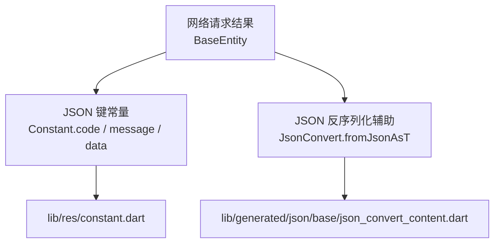
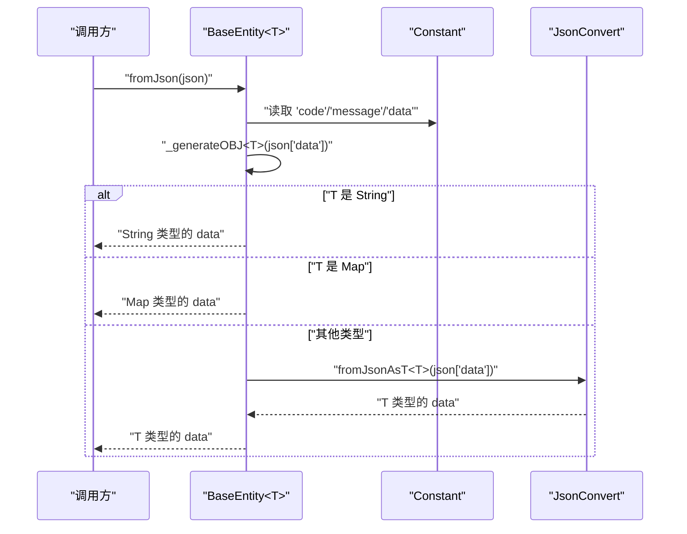
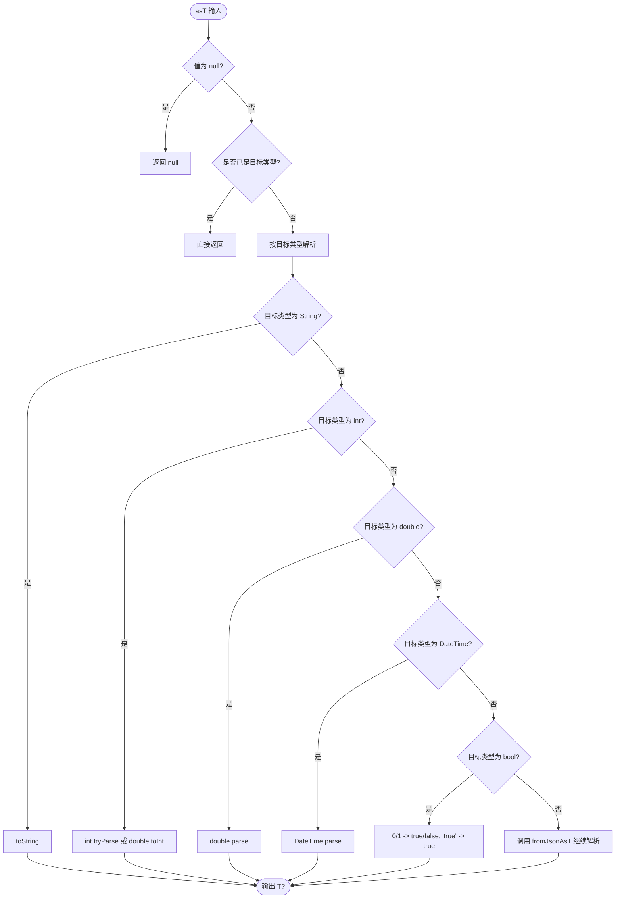
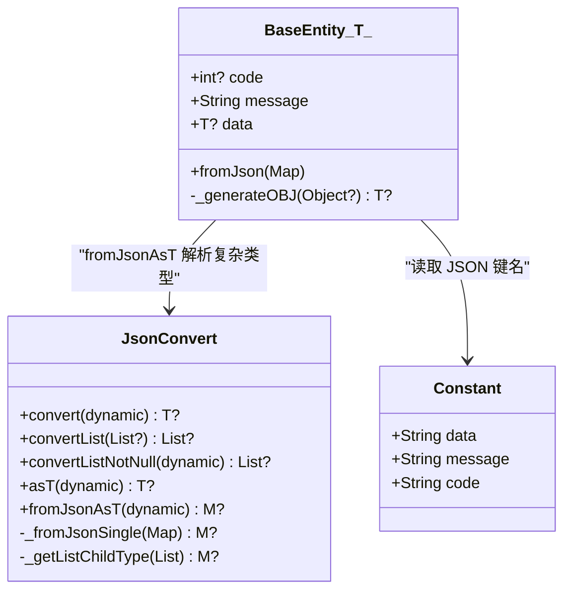

# 基础实体类

<cite>
**本文引用的文件**   
- [lib/net/base_entity.dart](file://lib/net/base_entity.dart)
- [lib/generated/json/base/json_convert_content.dart](file://lib/generated/json/base/json_convert_content.dart)
- [lib/res/constant.dart](file://lib/res/constant.dart)
</cite>

## 目录
1. [简介](#简介)
2. [项目结构定位](#项目结构定位)
3. [核心组件](#核心组件)
4. [架构总览](#架构总览)
5. [详细组件分析](#详细组件分析)
6. [依赖关系分析](#依赖关系分析)
7. [性能与空安全](#性能与空安全)
8. [使用示例与最佳实践](#使用示例与最佳实践)
9. [常见问题排查](#常见问题排查)
10. [结论](#结论)

## 简介
本文面向灵犀管店 Flutter 项目中的网络响应基类 BaseEntity<T>，系统性说明其泛型设计、字段语义、JSON 反序列化流程、类型转换策略以及错误处理机制。重点覆盖以下方面：
- code、message、data 三个核心字段的职责与类型约束
- fromJson 构造器如何解析 JSON 并生成 data
- _generateOBJ 对 String、Map、List 及自定义对象的分支处理
- JsonConvert.fromJsonAsT 的序列化策略、容错行为与扩展点
- 如何在业务模型中继承 BaseEntity<T> 并实现数据解析
- 泛型类型约束、空安全注意事项与性能优化建议

## 项目结构定位
BaseEntity<T> 位于网络层的基础实体定义位置，作为所有接口返回结果的统一包装。它依赖：
- 常量定义 Constant（用于 JSON 键名）
- 自动生成的 JsonConvert（用于复杂类型的反序列化）

图示来源
- [lib/net/base_entity.dart:1-33](file://lib/net/base_entity.dart#L1-L33)
- [lib/res/constant.dart:1-54](file://lib/res/constant.dart#L1-L54)
- [lib/generated/json/base/json_convert_content.dart:1-116](file://lib/generated/json/base/json_convert_content.dart#L1-L116)

章节来源
- [lib/net/base_entity.dart:1-33](file://lib/net/base_entity.dart#L1-L33)
- [lib/res/constant.dart:1-54](file://lib/res/constant.dart#L1-L54)

## 核心组件
- BaseEntity<T>：统一的接口响应包装，提供 code、message、data 三个字段和 fromJson 构造器，并通过 _generateOBJ 将 JSON data 转换为 T 类型对象。
- JsonConvert：自动生成或手写的类型转换工具，提供 asT、fromJsonAsT 等方法，负责将动态 JSON 数据映射为具体类型。
- Constant：集中管理 JSON 键名等字符串常量，避免魔法字符串散落在代码中。

章节来源
- [lib/net/base_entity.dart:1-33](file://lib/net/base_entity.dart#L1-L33)
- [lib/generated/json/base/json_convert_content.dart:1-116](file://lib/generated/json/base/json_convert_content.dart#L1-L116)
- [lib/res/constant.dart:1-54](file://lib/res/constant.dart#L1-L54)

## 架构总览
BaseEntity<T> 在解析 JSON 时采用“先拆壳、后转类型”的两阶段模式：
1. 从 Map<String, dynamic> 中提取 code、message、data 三个键值
2. 根据 T 的类型信息决定 data 的转换方式：
   - 当 T 为 String：直接 toString 转换
   - 当 T 为 Map 系列：直接下转型
   - 其他情况：委托 JsonConvert.fromJsonAsT 进行进一步解析（支持 List 与自定义对象）

图示来源
- [lib/net/base_entity.dart:1-33](file://lib/net/base_entity.dart#L1-L33)
- [lib/generated/json/base/json_convert_content.dart:1-116](file://lib/generated/json/base/json_convert_content.dart#L1-L116)
- [lib/res/constant.dart:1-54](file://lib/res/constant.dart#L1-L54)

## 详细组件分析

### BaseEntity<T> 设计与字段语义
- code: int?
  - 作用：接口状态码，可为空表示未知或异常场景未携带该字段。
  - 语义：由后端约定，通常 0 或特定值代表成功。
- message: late String
  - 作用：接口消息描述，用于提示或调试。
  - 注意：late 声明意味着必须在使用前赋值；fromJson 中会强制从 JSON 的 message 字段赋值。
- data: T?
  - 作用：业务数据负载，泛型 T 表示期望的数据结构。
  - 空安全：允许为 null，对应接口未返回 data 或 data 为空的情况。

fromJson 构造器逻辑：
- 从 JSON 中按 Constant.code / message / data 读取字段
- 若存在 data 键，则调用 _generateOBJ<T> 将 Object? 转为 T?

_generateOBJ 分支策略：
- json == null：返回 null
- T.toString() == 'String'：将任意值转为字符串
- T.toString().startsWith('Map')：直接以 T 类型返回原始 Map
- 其他：委托 JsonConvert.fromJsonAsT<T> 完成解析（包含 List 与自定义对象）

章节来源
- [lib/net/base_entity.dart:1-33](file://lib/net/base_entity.dart#L1-L33)
- [lib/res/constant.dart:1-54](file://lib/res/constant.dart#L1-L54)

### JsonConvert 序列化策略与错误处理
JsonConvert 提供多层次的类型转换能力：
- convert<T>(value)：通用转换入口，内部调用 asT
- convertList<T>(list)：可空列表转换，元素可为空，失败时打印日志并返回空列表
- convertListNotNull<T>(list)：不可空列表转换，失败时打印日志并返回空列表
- asT<T>(value)：核心转换逻辑，支持：
  - 已匹配类型：直接返回
  - String/int/double/DateTime/bool：字符串到目标类型的解析
  - 其他类型：递归调用 fromJsonAsT 进行对象或集合解析
- fromJsonAsT<M>(json)：区分 List 与 Map：
  - List：调用 _getListChildType<M>，按已知类型映射元素
  - Map：调用 _fromJsonSingle<M>，按已知类型映射单个对象

错误处理特性：
- 多处 catch 捕获转换异常，打印堆栈并返回降级值（null 或空集合），保证整体解析不崩溃
- 对未识别的目标类型，打印 “not found” 日志并返回 null

图示来源
- [lib/generated/json/base/json_convert_content.dart:1-116](file://lib/generated/json/base/json_convert_content.dart#L1-L116)

章节来源
- [lib/generated/json/base/json_convert_content.dart:1-116](file://lib/generated/json/base/json_convert_content.dart#L1-L116)

### JSON 键常量
Constant 定义了 BaseEntity 使用的 JSON 键名：
- data：业务数据负载
- message：接口消息
- code：接口状态码

这些常量避免在 BaseEntity 中出现硬编码字符串，便于统一维护。

章节来源
- [lib/res/constant.dart:1-54](file://lib/res/constant.dart#L1-L54)

## 依赖关系分析
BaseEntity<T> 与 JsonConvert、Constant 的关系如下：

图示来源
- [lib/net/base_entity.dart:1-33](file://lib/net/base_entity.dart#L1-L33)
- [lib/generated/json/base/json_convert_content.dart:1-116](file://lib/generated/json/base/json_convert_content.dart#L1-L116)
- [lib/res/constant.dart:1-54](file://lib/res/constant.dart#L1-L54)

章节来源
- [lib/net/base_entity.dart:1-33](file://lib/net/base_entity.dart#L1-L33)
- [lib/generated/json/base/json_convert_content.dart:1-116](file://lib/generated/json/base/json_convert_content.dart#L1-L116)
- [lib/res/constant.dart:1-54](file://lib/res/constant.dart#L1-L54)

## 性能与空安全

### 性能特征
- BaseEntity.fromJson 仅做轻量级分支判断：
  - String 与 Map 的判断通过字符串比较，开销较低
  - 复杂类型才进入 JsonConvert.fromJsonAsT，减少不必要的解析成本
- JsonConvert.asT 在类型匹配成功时直接返回，避免多余转换
- 对于 List 与自定义对象，JsonConvert 会根据运行时类型信息进行分发，属于 O(n) 遍历集合的常规复杂度

潜在优化点：
- 可将 T.toString() 的比较结果缓存或改为更高效的类型判断策略，但需权衡可读性与反射成本
- 对于高频大数组 List<T>，建议确保 T 的反序列化实现高效且稳定

### 空安全处理
- BaseEntity.data 为 T?，允许空值，适配接口未返回 data 的情况
- JsonConvert.convertList<T> 返回 List<T?>?，允许元素为空，适合后端可能返回 null 元素的场景
- JsonConvert.convertListNotNull<T> 返回 List<T>?，适用于元素非空的强约束
- asT 中对无法解析的值返回 null 或降级集合，避免异常中断主流程

注意事项：
- BaseEntity.message 使用 late String，必须在 fromJson 中赋值；若 JSON 缺失 message 字段，可能触发未初始化异常
- 建议在业务侧对 message 做空检查或提供默认值

章节来源
- [lib/net/base_entity.dart:1-33](file://lib/net/base_entity.dart#L1-L33)
- [lib/generated/json/base/json_convert_content.dart:1-116](file://lib/generated/json/base/json_convert_content.dart#L1-L116)

## 使用示例与最佳实践

### 在业务模型中继承 BaseEntity<T>
推荐做法：
- 定义业务实体类（例如 OrderDetail、UserInfo 等）
- 让业务实体类提供 fromJson(Map<String, dynamic>) 构造函数
- 在页面或服务层调用 BaseEntity<OrderDetail>.fromJson(json) 即可得到带 code、message、data 的统一响应

关键步骤：
- 在 fromJson 中正确映射各字段
- 对于嵌套对象，同样提供 fromJson 并在 JsonConvert 注册或使用现有机制解析
- 对于 List<T>，确保 T 的 fromJson 可用，以便 JsonConvert._getListChildType 能正确映射

章节来源
- [lib/net/base_entity.dart:1-33](file://lib/net/base_entity.dart#L1-L33)
- [lib/generated/json/base/json_convert_content.dart:1-116](file://lib/generated/json/base/json_convert_content.dart#L1-L116)

### 数据类型选择建议
- 当 data 为简单文本时，使用 BaseEntity<String>
- 当 data 为字典结构时，使用 BaseEntity<Map<String, dynamic>>
- 当 data 为单对象时，使用 BaseEntity<YourModel>
- 当 data 为数组时，使用 BaseEntity<List<YourModel>>

### 错误处理建议
- 在调用端根据 code 判断成功与否
- 对 data 做空检查，再访问具体字段
- 对 message 进行用户可见提示或日志记录

章节来源
- [lib/net/base_entity.dart:1-33](file://lib/net/base_entity.dart#L1-L33)
- [lib/generated/json/base/json_convert_content.dart:1-116](file://lib/generated/json/base/json_convert_content.dart#L1-L116)

## 常见问题排查

### 问题：message 字段缺失导致运行时异常
现象：由于 BaseEntity.message 为 late String，如果 JSON 不包含 message，可能在赋值阶段抛出异常。
原因：fromJson 中直接对 message 字段进行赋值，没有空保护。
建议：
- 在 JSON 契约层面保证 message 始终存在
- 或在 BaseEntity 中增加空保护，赋予默认空字符串

章节来源
- [lib/net/base_entity.dart:1-33](file://lib/net/base_entity.dart#L1-L33)

### 问题：List<T> 反序列化返回空列表或 null
现象：接口返回数组，但 data 为空或元素解析失败。
原因：JsonConvert.convertList<T> 在捕获异常时会打印日志并返回空列表；fromJsonAsT 在未知类型时也会返回 null。
建议：
- 确认 T 的 fromJson 实现正确
- 检查 JsonConvert 中是否已注册对应的类型映射
- 查看控制台日志中 “asT<$T>” 的错误信息定位具体字段

章节来源
- [lib/generated/json/base/json_convert_content.dart:1-116](file://lib/generated/json/base/json_convert_content.dart#L1-L116)

### 问题：自定义对象无法解析
现象：BaseEntity<CustomModel> 的 data 为 null。
原因：JsonConvert._fromJsonSingle 或 _getListChildType 未识别该类型。
建议：
- 在 JsonConvert 中补充 CustomModel 的映射逻辑
- 或通过生成工具（如 json_serializable）生成 .g.dart 文件并引入

章节来源
- [lib/generated/json/base/json_convert_content.dart:1-116](file://lib/generated/json/base/json_convert_content.dart#L1-L116)

## 结论
BaseEntity<T> 以简洁的泛型封装统一了 API 响应的结构，配合 JsonConvert 实现了灵活而健壮的类型解析。其设计优点包括：
- 清晰的 code/message/data 三字段契约
- 对 String、Map、List 与自定义对象的分支解析
- 完善的空安全与错误降级机制

在实际使用中，应重点关注：
- 确保 JSON 字段与 Constant 定义的键一致
- 完善业务模型的 fromJson 与 JsonConvert 的类型映射
- 对 message 与 data 的空安全进行处理，提升鲁棒性