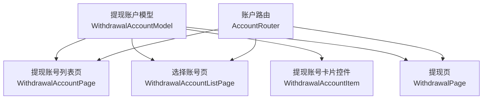
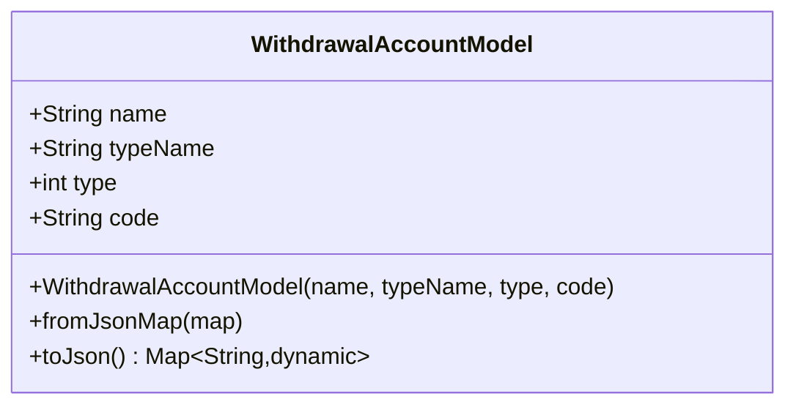
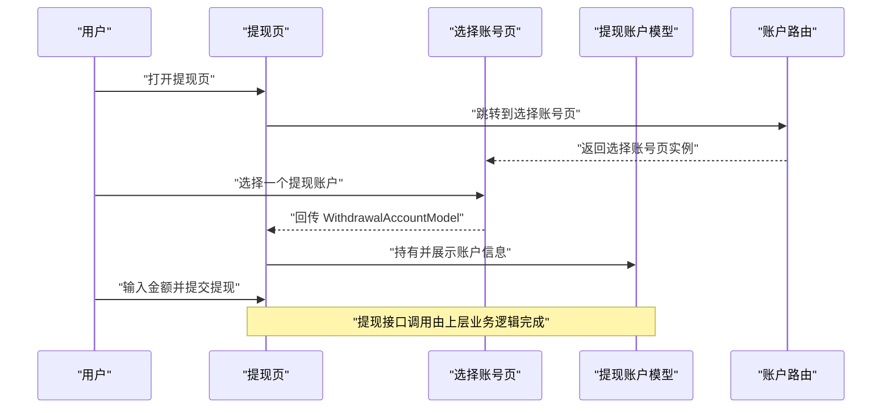
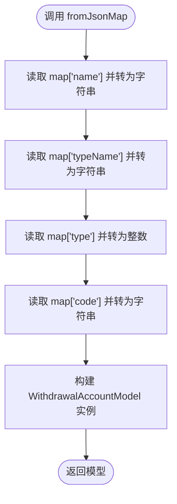
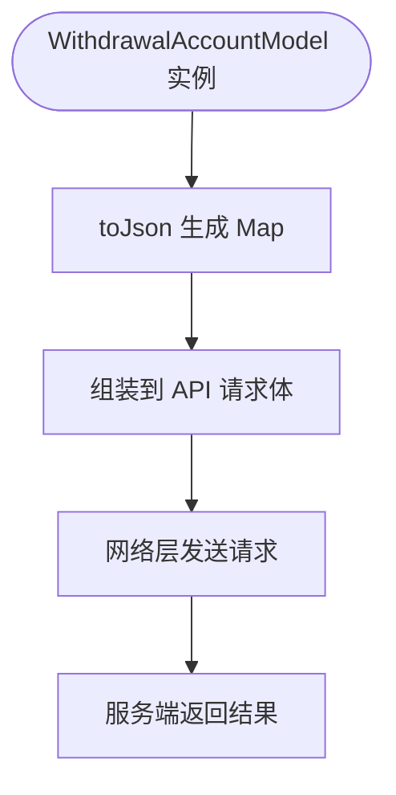
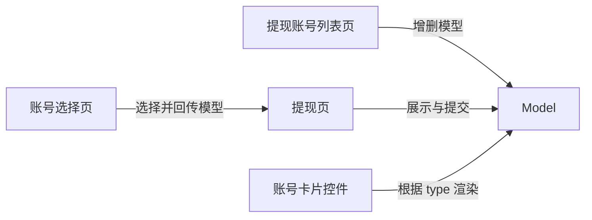
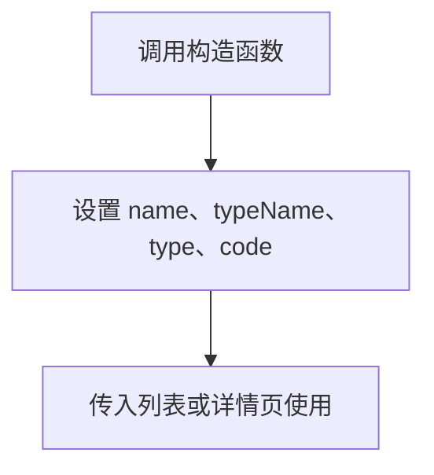
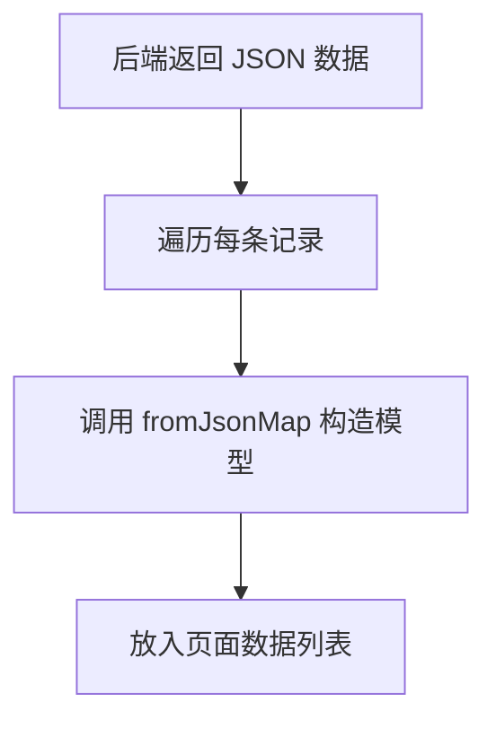
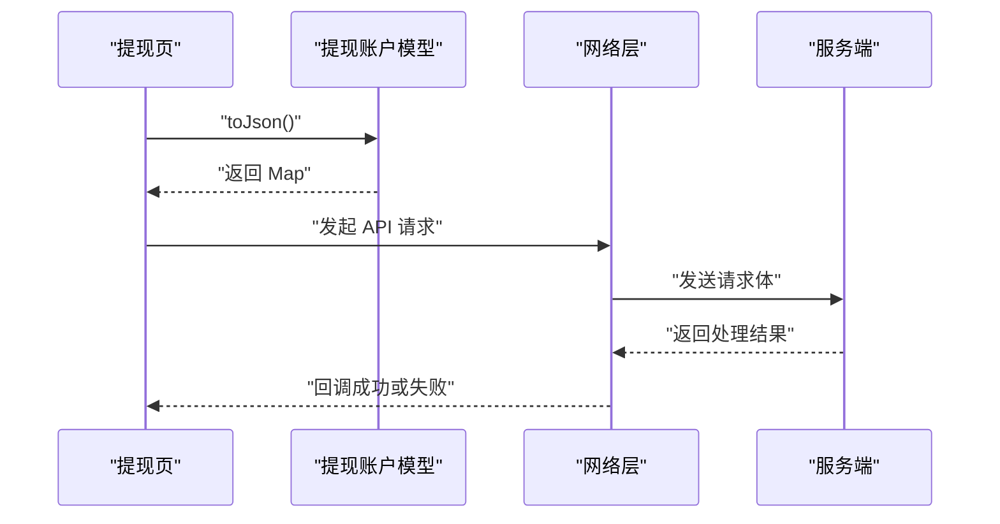
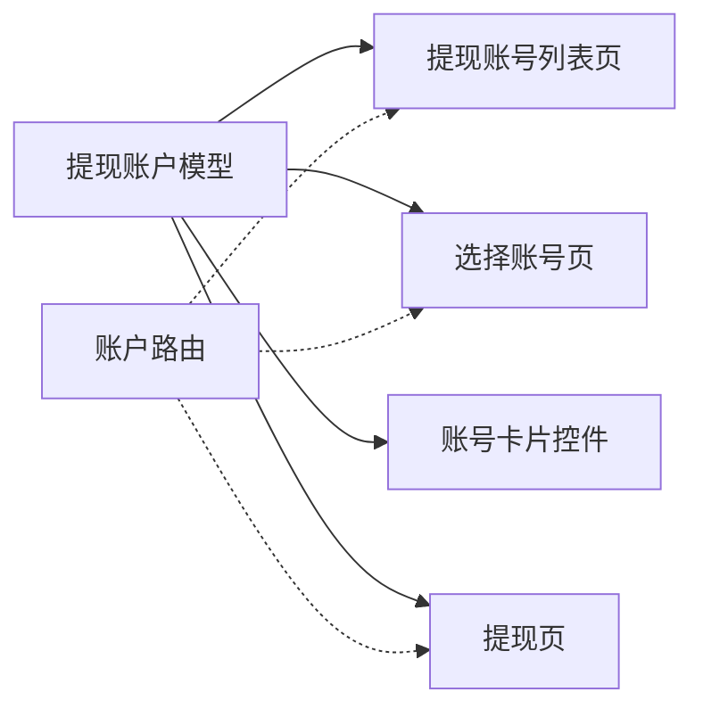

# 提现账户模型

<cite>
**本文引用的文件**   
- [withdrawal_account_model.dart](file://lib/pages/business/member/models/withdrawal_account_model.dart)
- [withdrawal_account_page.dart](file://lib/pages/business/member/page/withdrawal_account_page.dart)
- [withdrawal_account_list_page.dart](file://lib/pages/business/member/page/withdrawal_account_list_page.dart)
- [withdrawal_account_item.dart](file://lib/pages/business/member/widgets/withdrawal_account_item.dart)
- [withdrawal_page.dart](file://lib/pages/business/member/page/withdrawal_page.dart)
- [account_router.dart](file://lib/pages/business/member/account_router.dart)
</cite>

## 目录
1. [简介](#简介)
2. [项目结构定位](#项目结构定位)
3. [核心数据模型](#核心数据模型)
4. [架构总览](#架构总览)
5. [详细组件分析](#详细组件分析)
6. [依赖关系分析](#依赖关系分析)
7. [性能与健壮性](#性能与健壮性)
8. [常见问题排查](#常见问题排查)
9. [结论](#结论)

## 简介
本文围绕灵犀管店 Flutter 项目中“会员提现”场景下的提现账户数据载体 WithdrawalAccountModel，给出完整的技术文档。内容覆盖字段定义、构造函数与 JSON 映射、序列化输出、在提现流程中的使用方式、数据验证约束以及与其他页面和路由的交互关系。该模型本身是一个轻量数据类，不包含网络请求逻辑；实际接口调用由上层页面或业务服务完成。

## 项目结构定位
WithdrawalAccountModel 位于会员业务模块的 models 目录下，被多个提现相关页面和控件引用：
- 模型文件：`lib/pages/business/member/models/withdrawal_account_model.dart`
- 列表展示页：`lib/pages/business/member/page/withdrawal_account_page.dart`
- 账号选择页：`lib/pages/business/member/page/withdrawal_account_list_page.dart`
- 卡片控件：`lib/pages/business/member/widgets/withdrawal_account_item.dart`
- 提现入口页：`lib/pages/business/member/page/withdrawal_page.dart`
- 路由注册：`lib/pages/business/member/account_router.dart`

**图表来源**
- [withdrawal_account_model.dart:1-25](file://lib/pages/business/member/models/withdrawal_account_model.dart#L1-L25)
- [withdrawal_account_page.dart:1-150](file://lib/pages/business/member/page/withdrawal_account_page.dart#L1-L150)
- [withdrawal_account_list_page.dart:1-84](file://lib/pages/business/member/page/withdrawal_account_list_page.dart#L1-L84)
- [withdrawal_account_item.dart:1-181](file://lib/pages/business/member/widgets/withdrawal_account_item.dart#L1-L181)
- [withdrawal_page.dart:1-240](file://lib/pages/business/member/page/withdrawal_page.dart#L1-L240)
- [account_router.dart:1-49](file://lib/pages/business/member/account_router.dart#L1-L49)

**章节来源**
- [withdrawal_account_model.dart:1-25](file://lib/pages/business/member/models/withdrawal_account_model.dart#L1-L25)
- [withdrawal_account_page.dart:1-150](file://lib/pages/business/member/page/withdrawal_account_page.dart#L1-L150)
- [withdrawal_account_list_page.dart:1-84](file://lib/pages/business/member/page/withdrawal_account_list_page.dart#L1-L84)
- [withdrawal_account_item.dart:1-181](file://lib/pages/business/member/widgets/withdrawal_account_item.dart#L1-L181)
- [withdrawal_page.dart:1-240](file://lib/pages/business/member/page/withdrawal_page.dart#L1-L240)
- [account_router.dart:1-49](file://lib/pages/business/member/account_router.dart#L1-L49)

## 核心数据模型
WithdrawalAccountModel 用于表达一个提现收款账户的本地数据对象。它提供：
- 构造方法：直接传入四个字段值。
- JSON 反序列化工厂：从 Map 中读取 name、typeName、type、code。
- toJson 序列化：将对象转为 Map，便于组装 API 请求体。

| 字段 | 类型 | 业务含义 | 说明 |
|---|---|---|---|
| name | String | 账户名称 | 通常显示为持卡人昵称或平台账户名 |
| typeName | String | 账户类型名称 | 如“微信”“工商银行”等可读文本 |
| type | int | 账户类型编码 | 当前实现中 0 表示银行卡，1 表示微信；由 UI 根据此值切换图标与主题色 |
| code | String | 账户编号 | 银行卡号或平台账号标识；示例中使用脱敏展示 |

**图表来源**
- [withdrawal_account_model.dart:1-25](file://lib/pages/business/member/models/withdrawal_account_model.dart#L1-L25)

**章节来源**
- [withdrawal_account_model.dart:1-25](file://lib/pages/business/member/models/withdrawal_account_model.dart#L1-L25)

## 架构总览
WithdrawalAccountModel 在会员提现业务流程中承担“数据载体”角色：
- 列表页通过该模型渲染已保存的提现账户。
- 选择页让用户选择一个提现账户并回传给调用方。
- 提现页维护当前选中的账户对象，并在用户提交提现时参与后续流程。
- 卡片控件根据 type 区分展示银行卡或微信样式。
- 路由负责在不同提现相关页面之间跳转，但不承担数据校验与网络请求职责。

**图表来源**
- [withdrawal_page.dart:1-240](file://lib/pages/business/member/page/withdrawal_page.dart#L1-L240)
- [withdrawal_account_list_page.dart:1-84](file://lib/pages/business/member/page/withdrawal_account_list_page.dart#L1-L84)
- [account_router.dart:1-49](file://lib/pages/business/member/account_router.dart#L1-L49)

## 详细组件分析

### 字段定义与数据类型
- name：字符串，用于界面展示账户名称。
- typeName：字符串，用于界面展示账户类型名称。
- type：整数，表示账户类型编码。UI 层将其作为判断银行卡或微信的依据。
- code：字符串，表示账户编号，常用于银行卡号等标识。

这些字段均为不可变语义的数据字段（即只读展示），由页面在创建 WithdrawalAccountModel 时赋值。

**章节来源**
- [withdrawal_account_model.dart:1-25](file://lib/pages/business/member/models/withdrawal_account_model.dart#L1-L25)

### 构造函数与 fromJsonMap 参数映射
构造函数按顺序接收 name、typeName、type、code 四个参数。fromJsonMap 工厂方法从 Map 中读取键名并转换为对应类型：
- name：map['name']，强制转换为 String。
- typeName：map['typeName']，强制转换为 String。
- type：map['type']，强制转换为 int。
- code：map['code']，强制转换为 String。

若后端返回的字段缺失或类型不匹配，会触发运行时类型转换错误。因此在使用 fromJsonMap 前，应确保 Map 中包含上述键且类型正确。

**图表来源**
- [withdrawal_account_model.dart:1-25](file://lib/pages/business/member/models/withdrawal_account_model.dart#L1-L25)

**章节来源**
- [withdrawal_account_model.dart:1-25](file://lib/pages/business/member/models/withdrawal_account_model.dart#L1-L25)

### toJson 序列化与 API 请求格式
toJson 方法将对象的四个字段转回 Map：
- name -> 'name'
- typeName -> 'typeName'
- type -> 'type'
- code -> 'code'

这意味着 API 请求体中提现账户相关字段应采用与 model 一致的键名和类型。例如，新增提现账户的请求可能包含：
- name：String
- typeName：String
- type：int
- code：String

实际 API 路径和请求包装由网络层处理；本模型仅提供结构化数据。

**图表来源**
- [withdrawal_account_model.dart:1-25](file://lib/pages/business/member/models/withdrawal_account_model.dart#L1-L25)

**章节来源**
- [withdrawal_account_model.dart:1-25](file://lib/pages/business/member/models/withdrawal_account_model.dart#L1-L25)

### 在提现业务流程中的作用
- 提现账号列表页：使用 WithdrawalAccountModel 渲染已绑定的提现账户，支持添加和删除。
- 账号选择页：以 WithdrawalAccountModel 为单位列出可选账户，并将选中项回传给调用方。
- 提现页：维护当前选择的 WithdrawalAccountModel，并据此展示账户类型图标、名称和卡号。
- 卡片控件：根据 type 决定显示银行卡还是微信图标及卡片主题色。

**图表来源**
- [withdrawal_account_page.dart:1-150](file://lib/pages/business/member/page/withdrawal_account_page.dart#L1-L150)
- [withdrawal_account_list_page.dart:1-84](file://lib/pages/business/member/page/withdrawal_account_list_page.dart#L1-L84)
- [withdrawal_page.dart:1-240](file://lib/pages/business/member/page/withdrawal_page.dart#L1-L240)
- [withdrawal_account_item.dart:1-181](file://lib/pages/business/member/widgets/withdrawal_account_item.dart#L1-L181)

**章节来源**
- [withdrawal_account_page.dart:1-150](file://lib/pages/business/member/page/withdrawal_account_page.dart#L1-L150)
- [withdrawal_account_list_page.dart:1-84](file://lib/pages/business/member/page/withdrawal_account_list_page.dart#L1-L84)
- [withdrawal_page.dart:1-240](file://lib/pages/business/member/page/withdrawal_page.dart#L1-L240)
- [withdrawal_account_item.dart:1-181](file://lib/pages/business/member/widgets/withdrawal_account_item.dart#L1-L181)

### 使用示例

#### 创建提现账户模型
通过构造函数创建一个提现账户对象：
- 适用于前端初始化数据或测试数据。
- 示例中常见组合包括：
  - 微信账户：typeName 为“微信”，type 为 1。
  - 银行账户：typeName 为银行名称，type 为 0。

**图表来源**
- [withdrawal_account_model.dart:1-25](file://lib/pages/business/member/models/withdrawal_account_model.dart#L1-L25)
- [withdrawal_account_page.dart:1-150](file://lib/pages/business/member/page/withdrawal_account_page.dart#L1-L150)
- [withdrawal_account_list_page.dart:1-84](file://lib/pages/business/member/page/withdrawal_account_list_page.dart#L1-L84)

#### 解析后端返回的提现账户
当后端返回包含 name、typeName、type、code 的 JSON 数组或对象时，可遍历数据并使用 fromJsonMap 构造 WithdrawalAccountModel 列表，再交给页面状态管理。

**图表来源**
- [withdrawal_account_model.dart:1-25](file://lib/pages/business/member/models/withdrawal_account_model.dart#L1-L25)

#### 传输提现账户到 API
在提交提现或新增提现账户时，先对 WithdrawalAccountModel 调用 toJson，再将返回 Map 合并到请求体中。具体 API 地址和字段命名需与服务端约定保持一致。

**图表来源**
- [withdrawal_account_model.dart:1-25](file://lib/pages/business/member/models/withdrawal_account_model.dart#L1-L25)
- [withdrawal_page.dart:1-240](file://lib/pages/business/member/page/withdrawal_page.dart#L1-L240)

**章节来源**
- [withdrawal_account_model.dart:1-25](file://lib/pages/business/member/models/withdrawal_account_model.dart#L1-L25)
- [withdrawal_page.dart:1-240](file://lib/pages/business/member/page/withdrawal_page.dart#L1-L240)

## 依赖关系分析
WithdrawalAccountModel 是纯数据模型，自身不依赖其他业务模块；但其使用方向明确：
- 页面依赖模型进行展示和数据传递。
- 控件依赖模型的 type 字段做视觉分支。
- 路由仅负责页面跳转，不直接操作模型。

**图表来源**
- [withdrawal_account_model.dart:1-25](file://lib/pages/business/member/models/withdrawal_account_model.dart#L1-L25)
- [withdrawal_account_page.dart:1-150](file://lib/pages/business/member/page/withdrawal_account_page.dart#L1-L150)
- [withdrawal_account_list_page.dart:1-84](file://lib/pages/business/member/page/withdrawal_account_list_page.dart#L1-L84)
- [withdrawal_account_item.dart:1-181](file://lib/pages/business/member/widgets/withdrawal_account_item.dart#L1-L181)
- [withdrawal_page.dart:1-240](file://lib/pages/business/member/page/withdrawal_page.dart#L1-L240)
- [account_router.dart:1-49](file://lib/pages/business/member/account_router.dart#L1-L49)

**章节来源**
- [withdrawal_account_model.dart:1-25](file://lib/pages/business/member/models/withdrawal_account_model.dart#L1-L25)
- [withdrawal_account_page.dart:1-150](file://lib/pages/business/member/page/withdrawal_account_page.dart#L1-L150)
- [withdrawal_account_list_page.dart:1-84](file://lib/pages/business/member/page/withdrawal_account_list_page.dart#L1-L84)
- [withdrawal_account_item.dart:1-181](file://lib/pages/business/member/widgets/withdrawal_account_item.dart#L1-L181)
- [withdrawal_page.dart:1-240](file://lib/pages/business/member/page/withdrawal_page.dart#L1-L240)
- [account_router.dart:1-49](file://lib/pages/business/member/account_router.dart#L1-L49)

## 性能与健壮性
- 时间复杂度：toJson 和 fromJsonMap 都是常数时间操作，开销很小。
- 内存占用：模型字段较少，适合在页面状态和列表中频繁复用。
- 类型安全：fromJsonMap 使用强制类型转换，若后端数据结构变化，容易抛出运行时异常。建议在调用处增加空值和类型检查。
- UI 表现：type 字段驱动图标和主题色分支，建议统一枚举化，避免魔法数字扩散。

[本节为通用指导，不涉及具体代码片段]

## 常见问题排查

### 从 JSON 反序列化时报类型错误
- 现象：fromJsonMap 报类型转换异常。
- 原因：后端返回的 type 不是整数，或缺少必要字段。
- 处理建议：
  - 在调用 fromJsonMap 前校验 Map 是否包含 name、typeName、type、code。
  - 对 type 字段做 is int 判断，必要时做默认值处理。

**章节来源**
- [withdrawal_account_model.dart:1-25](file://lib/pages/business/member/models/withdrawal_account_model.dart#L1-L25)

### 提现页面未显示选中账户
- 现象：点击选择账号后，提现页仍显示默认账户。
- 原因：页面未正确处理 NavigatorUtils.pushResult 的回传数据。
- 处理建议：
  - 确认选择页返回的是 WithdrawalAccountModel。
  - 在提现页 setState 更新 _data 字段。

**章节来源**
- [withdrawal_page.dart:1-240](file://lib/pages/business/member/page/withdrawal_page.dart#L1-L240)
- [withdrawal_account_list_page.dart:1-84](file://lib/pages/business/member/page/withdrawal_account_list_page.dart#L1-L84)

### 银行卡与微信图标显示不正确
- 现象：type 值与图标不一致。
- 原因：UI 层以 type == 0 为银行卡、type == 1 为微信。
- 处理建议：
  - 保证后端返回的 type 与前端约定一致。
  - 新增账户类型时同步更新 UI 分支逻辑。

**章节来源**
- [withdrawal_account_item.dart:1-181](file://lib/pages/business/member/widgets/withdrawal_account_item.dart#L1-L181)
- [withdrawal_account_list_page.dart:1-84](file://lib/pages/business/member/page/withdrawal_account_list_page.dart#L1-L84)

### 提现按钮不可点击
- 现象：提现按钮禁用。
- 原因：提现页对金额做了基础校验，金额小于 1 或为空时禁用。
- 处理建议：
  - 输入合法金额后再提交。
  - 如需调整规则，应在提现页的校验逻辑中修改。

**章节来源**
- [withdrawal_page.dart:1-240](file://lib/pages/business/member/page/withdrawal_page.dart#L1-L240)

## 结论
WithdrawalAccountModel 是会员提现流程中的核心数据载体，负责承载账户名称、类型名称、类型编码和账户编号。它通过构造函数和 fromJsonMap 支持本地创建与后端解析，通过 toJson 支持 API 序列化。虽然模型本身不做网络请求和业务校验，但它是提现账号列表、账号选择和提现页面的关键数据纽带。为保证稳定性，建议在 JSON 解析处增加空值和类型校验，并对 type 字段引入枚举化以减少魔法数字。

[本节为总结性内容，不涉及具体代码片段]