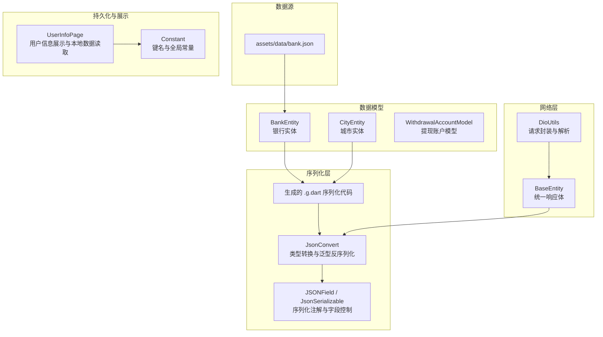
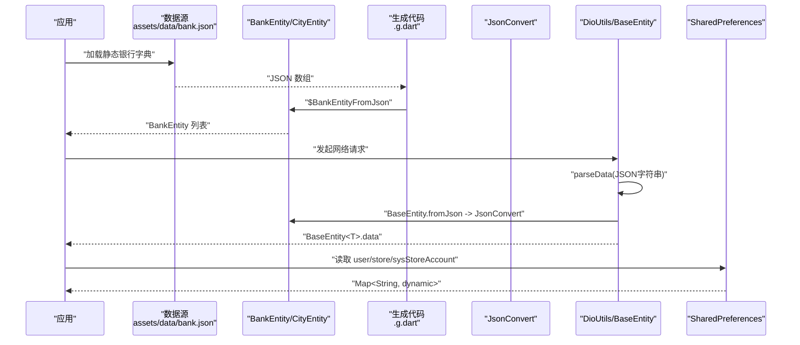
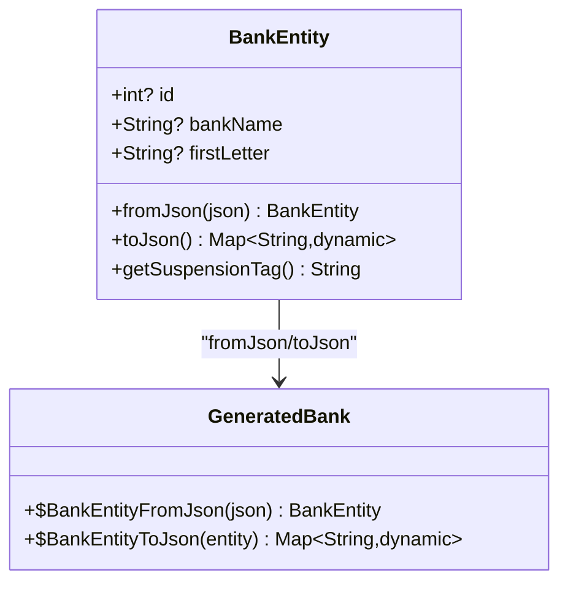
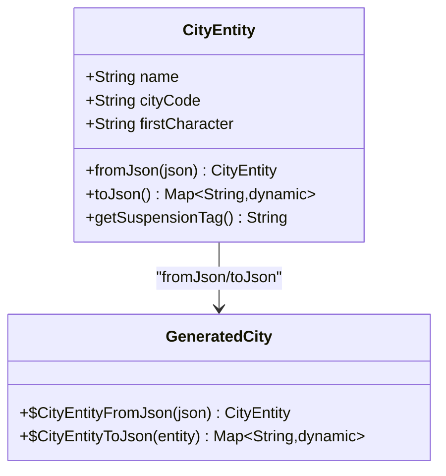
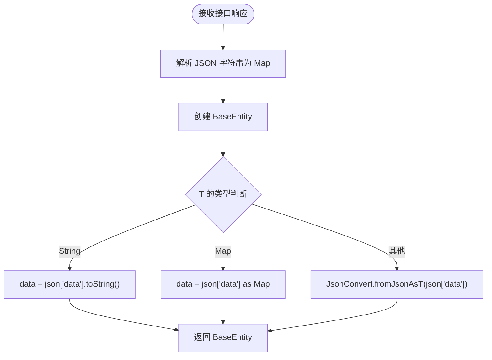
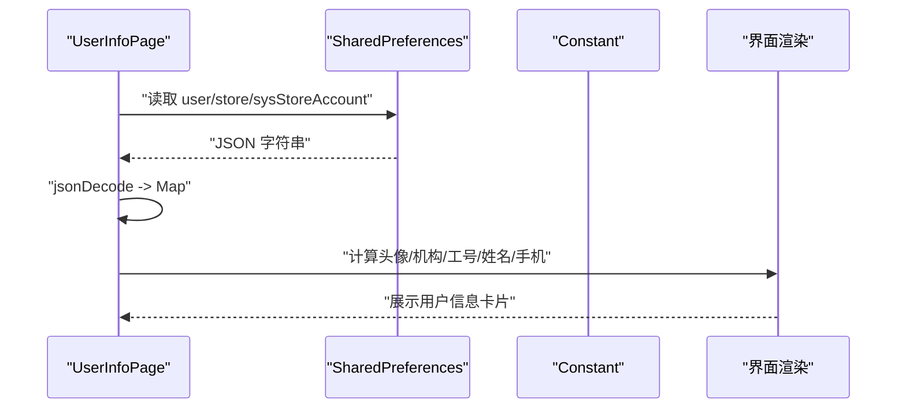
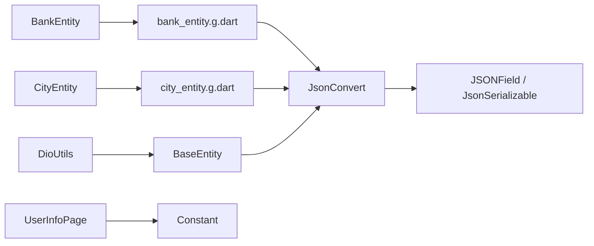
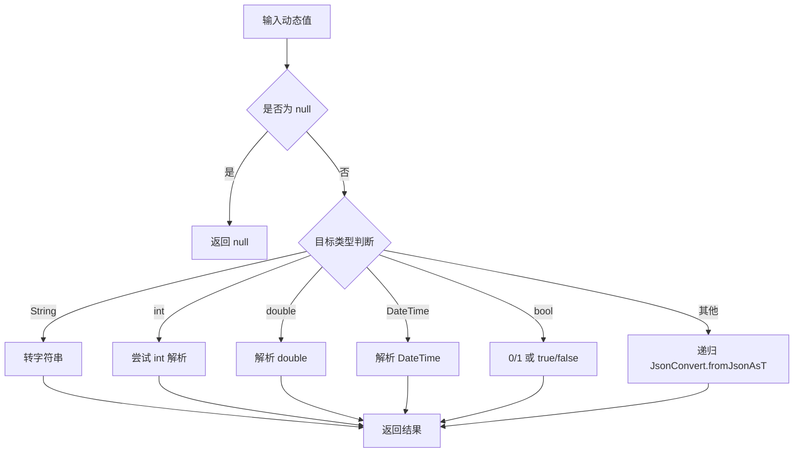
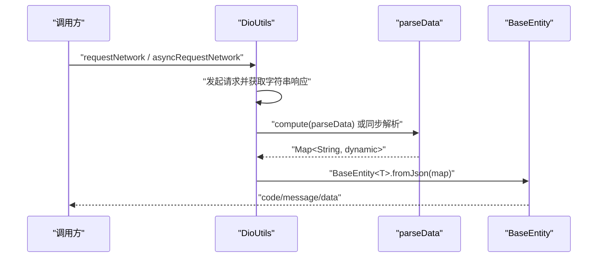
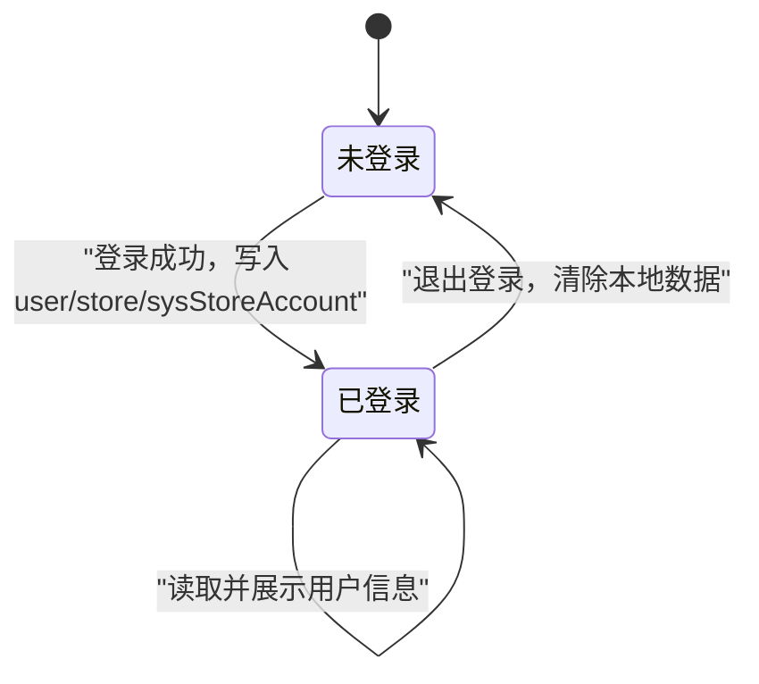

# 数据模型

<cite>
**本文引用的文件**   
- [pubspec.yaml](file://pubspec.yaml)
- [bank_entity.dart](file://lib/pages/business/member/models/bank_entity.dart)
- [city_entity.dart](file://lib/pages/business/member/models/city_entity.dart)
- [bank_entity.g.dart](file://lib/generated/json/bank_entity.g.dart)
- [city_entity.g.dart](file://lib/generated/json/city_entity.g.dart)
- [json_convert_content.dart](file://lib/generated/json/base/json_convert_content.dart)
- [json_field.dart](file://lib/generated/json/base/json_field.dart)
- [base_entity.dart](file://lib/net/base_entity.dart)
- [dio_utils.dart](file://lib/net/dio_utils.dart)
- [constant.dart](file://lib/res/constant.dart)
- [user_info_page.dart](file://lib/pages/user/user_info_page.dart)
- [withdrawal_account_model.dart](file://lib/pages/business/member/models/withdrawal_account_model.dart)
- [bank.json](file://assets/data/bank.json)
</cite>

## 目录
1. [引言](#引言)
2. [项目结构与数据模型定位](#项目结构与数据模型定位)
3. [核心数据模型](#核心数据模型)
4. [架构总览](#架构总览)
5. [详细组件分析](#详细组件分析)
6. [依赖关系分析](#依赖关系分析)
7. [性能与序列化特性](#性能与序列化特性)
8. [缓存策略与生命周期](#缓存策略与生命周期)
9. [常见问题排查](#常见问题排查)
10. [结论](#结论)

## 引言
本文件面向灵犀管店 Flutter 项目的数据模型，系统性梳理基础数据实体、业务实体及其 JSON 序列化机制、数据校验方式、持久化与接口对接约定。重点覆盖：
- 银行信息与城市信息等基础数据模型；
- 用户信息在本地存储中的结构；
- 通用网络响应基类；
- json_serializable 生成代码及自定义 JsonConvert 的协作方式；
- 基于 SharedPreferences 的缓存策略；
- 数据模型之间的关系图、转换流程示例与最佳实践。

## 项目结构与数据模型定位
本项目采用功能域划分组织代码，数据模型主要分布在以下位置：
- 基础数据实体位于 `lib/pages/business/member/models`，包括银行实体和城市实体；
- JSON 序列化生成代码位于 `lib/generated/json`；
- 网络层统一响应封装位于 `lib/net`；
- 常量与键名定义位于 `lib/res/constant.dart`；
- 用户信息展示逻辑位于 `lib/pages/user/user_info_page.dart`，使用本地缓存读取用户、门店和系统门店账号数据；
- 资源文件如银行字典位于 `assets/data/bank.json`。

**图表来源**
- [bank.json:1-1](file://assets/data/bank.json#L1-L1)
- [bank_entity.dart:1-22](file://lib/pages/business/member/models/bank_entity.dart#L1-L22)
- [city_entity.dart:1-22](file://lib/pages/business/member/models/city_entity.dart#L1-L22)
- [bank_entity.g.dart:1-29](file://lib/generated/json/bank_entity.g.dart#L1-L29)
- [city_entity.g.dart:1-29](file://lib/generated/json/city_entity.g.dart#L1-L29)
- [json_convert_content.dart:1-116](file://lib/generated/json/base/json_convert_content.dart#L1-L116)
- [json_field.dart:1-22](file://lib/generated/json/base/json_field.dart#L1-L22)
- [base_entity.dart:1-33](file://lib/net/base_entity.dart#L1-L33)
- [dio_utils.dart:1-204](file://lib/net/dio_utils.dart#L1-L204)
- [constant.dart:1-54](file://lib/res/constant.dart#L1-L54)
- [user_info_page.dart:1-200](file://lib/pages/user/user_info_page.dart#L1-L200)

**章节来源**
- [pubspec.yaml:1-153](file://pubspec.yaml#L1-L153)

## 核心数据模型
本节对项目中已识别的数据模型进行字段说明、数据类型、约束与业务含义总结。

### 银行实体 BankEntity
- 用途：表示银行字典项，用于支付或结算时选择银行。
- 数据来源：静态资源 `assets/data/bank.json`。
- 字段定义与含义：
  - id：银行编号，整型可空。
  - bankName：银行名称，字符串可空。
  - firstLetter：首字母，字符串可空，用于列表分组排序。
- 约束与行为：
  - 实现 `ISuspensionBean`，提供 `getSuspensionTag()` 返回首字母，支持带分组的排序列表展示。
  - 使用 `@JsonSerializable()` 注解，由生成代码完成 JSON 到对象的映射。

| 字段 | Dart 类型 | JSON 键 | 是否必填 | 业务含义 |
| --- | --- | --- | --- | --- |
| id | int? | id | 否 | 银行唯一标识 |
| bankName | String? | bankName | 否 | 银行名称 |
| firstLetter | String? | firstLetter | 否 | 首字母，用于分组显示 |

**章节来源**
- [bank_entity.dart:1-22](file://lib/pages/business/member/models/bank_entity.dart#L1-L22)
- [bank_entity.g.dart:1-29](file://lib/generated/json/bank_entity.g.dart#L1-L29)
- [bank.json:1-1](file://assets/data/bank.json#L1-L1)

### 城市实体 CityEntity
- 用途：表示城市字典项，用于地址或区域相关功能。
- 字段定义与含义：
  - name：城市名称，字符串且不可空（late）。
  - cityCode：城市编码，字符串且不可空（late）。
  - firstCharacter：首字符，字符串且不可空（late），用于列表分组排序。
- 约束与行为：
  - 实现 `ISuspensionBean`，提供 `getSuspensionTag()` 返回首字符，用于分组展示。
  - 使用 `@JsonSerializable()` 注解，由生成代码完成 JSON 到对象的映射。

| 字段 | Dart 类型 | JSON 键 | 是否必填 | 业务含义 |
| --- | --- | --- | --- | --- |
| name | String | name | 是 | 城市名称 |
| cityCode | String | cityCode | 是 | 城市编码 |
| firstCharacter | String | firstCharacter | 是 | 首字符，用于分组显示 |

**章节来源**
- [city_entity.dart:1-22](file://lib/pages/business/member/models/city_entity.dart#L1-L22)
- [city_entity.g.dart:1-29](file://lib/generated/json/city_entity.g.dart#L1-L29)

### 提现账户模型 WithdrawalAccountModel
- 用途：表示提现账户相关信息，常用于会员提现场景。
- 字段定义与含义：
  - name：账户名称，字符串。
  - typeName：账户类型名称，字符串。
  - type：账户类型，整数。
  - code：账户编码，字符串。
- 约束与行为：
  - 提供构造函数、fromJsonMap 与 toJson，手动实现 JSON 序列化。

| 字段 | Dart 类型 | JSON 键 | 是否必填 | 业务含义 |
| --- | --- | --- | --- | --- |
| name | String | name | 是 | 账户名称 |
| typeName | String | typeName | 是 | 账户类型名称 |
| type | int | type | 是 | 账户类型编号 |
| code | String | code | 是 | 账户编码 |

**章节来源**
- [withdrawal_account_model.dart:1-25](file://lib/pages/business/member/models/withdrawal_account_model.dart#L1-L25)

### 用户信息数据结构
项目未定义独立的 UserEntity 模型，用户信息以 Map 形式从 SharedPreferences 中读取并展示。用户页面从本地缓存中读取三个关键对象：
- user：当前登录用户信息；
- store：所属门店信息；
- sysStoreAccount：系统门店账号信息。

常用字段（来自实际展示逻辑）：
- user.code：登录工号；
- user.name 或 user.realname：员工姓名；
- user.phone 或 user.mobile：手机号码；
- user.sysUserWx.wximg：微信头像图片路径；
- store.name、store.deptname 或 store.deptName：门店名称与部门；
- sysStoreAccount.wximg 或 sysStoreAccount.logo：优先使用的机构头像。

| 分类 | 字段 | 数据来源 | 业务含义 |
| --- | --- | --- | --- |
| 用户 | code | Constant.user 对应 Map | 登录工号 |
| 用户 | name / realname | Constant.user 对应 Map | 员工姓名 |
| 用户 | phone / mobile | Constant.user 对应 Map | 手机号码 |
| 用户 | sysUserWx.wximg | Constant.user 对应 Map | 微信头像路径 |
| 门店 | name | Constant.store 对应 Map | 门店名称 |
| 门店 | deptname / deptName | Constant.store 对应 Map | 部门名称 |
| 系统门店账号 | wximg / logo | Constant.sysStoreAccount 对应 Map | 机构头像路径 |

**章节来源**
- [user_info_page.dart:1-200](file://lib/pages/user/user_info_page.dart#L1-L200)
- [constant.dart:1-54](file://lib/res/constant.dart#L1-L54)

## 架构总览
数据流整体分为四层：
1. 数据源层：静态 JSON 资源与后端接口返回；
2. 模型层：实体类定义字段与基本行为；
3. 序列化层：生成代码 + 自定义 JsonConvert；
4. 网络与持久化层：统一响应体、Dio 请求封装与 SharedPreferences 缓存。

**图表来源**
- [bank.json:1-1](file://assets/data/bank.json#L1-L1)
- [bank_entity.g.dart:1-29](file://lib/generated/json/bank_entity.g.dart#L1-L29)
- [city_entity.g.dart:1-29](file://lib/generated/json/city_entity.g.dart#L1-L29)
- [json_convert_content.dart:1-116](file://lib/generated/json/base/json_convert_content.dart#L1-L116)
- [base_entity.dart:1-33](file://lib/net/base_entity.dart#L1-L33)
- [dio_utils.dart:1-204](file://lib/net/dio_utils.dart#L1-L204)
- [user_info_page.dart:1-200](file://lib/pages/user/user_info_page.dart#L1-L200)

## 详细组件分析

### 银行实体 BankEntity 分析
BankEntity 是典型的基础字典实体，具备以下特点：
- 使用 `@JsonSerializable()` 注解；
- 通过工厂方法 `fromJson` 调用生成函数 `$BankEntityFromJson`；
- 提供 `toJson` 将对象转为 Map；
- 实现 `ISuspensionBean`，用于按首字母分组展示；
- 字段均为可空，适合静态字典数据可能缺失字段的容错处理。

**图表来源**
- [bank_entity.dart:1-22](file://lib/pages/business/member/models/bank_entity.dart#L1-L22)
- [bank_entity.g.dart:1-29](file://lib/generated/json/bank_entity.g.dart#L1-L29)

**章节来源**
- [bank_entity.dart:1-22](file://lib/pages/business/member/models/bank_entity.dart#L1-L22)
- [bank_entity.g.dart:1-29](file://lib/generated/json/bank_entity.g.dart#L1-L29)

### 城市实体 CityEntity 分析
CityEntity 与 BankEntity 类似，但字段为 late 非空字符串，适用于必须存在的城市数据。其核心职责是：
- 承载城市名称、编码与首字符；
- 提供分组标签，用于 azlistview 等分组列表；
- 通过生成代码完成 JSON 映射。

**图表来源**
- [city_entity.dart:1-22](file://lib/pages/business/member/models/city_entity.dart#L1-L22)
- [city_entity.g.dart:1-29](file://lib/generated/json/city_entity.g.dart#L1-L29)

**章节来源**
- [city_entity.dart:1-22](file://lib/pages/business/member/models/city_entity.dart#L1-L22)
- [city_entity.g.dart:1-29](file://lib/generated/json/city_entity.g.dart#L1-L29)

### 通用网络响应 BaseEntity
BaseEntity<T> 是项目统一的接口返回封装，包含：
- code：业务状态码；
- message：业务消息；
- data：泛型数据体，可能是具体对象、Map、List 或 String。

解析逻辑：
- 如果 T 是 String，则直接取 data 为字符串；
- 如果 T 是 Map，则直接取 data 为 Map；
- 否则调用 JsonConvert.fromJsonAsT 进行类型反序列化。

**图表来源**
- [base_entity.dart:1-33](file://lib/net/base_entity.dart#L1-L33)
- [dio_utils.dart:1-204](file://lib/net/dio_utils.dart#L1-L204)

**章节来源**
- [base_entity.dart:1-33](file://lib/net/base_entity.dart#L1-L33)
- [dio_utils.dart:1-204](file://lib/net/dio_utils.dart#L1-L204)

### 用户信息展示与本地数据结构
用户信息页面从 SharedPreferences 中读取用户、门店与系统门店账号，并在 UI 上展示。该逻辑体现了项目中“用户信息不以强类型实体保存”的现状，而是以 Map 形式持久化和消费。

关键点：
- 本地存储键：user、store、sysStoreAccount；
- 用户字段兼容多个可能的后端命名；
- 头像 URL 拼接规则：优先系统门店账号，其次用户微信信息，再补全图片前缀。

**图表来源**
- [user_info_page.dart:1-200](file://lib/pages/user/user_info_page.dart#L1-L200)
- [constant.dart:1-54](file://lib/res/constant.dart#L1-L54)

**章节来源**
- [user_info_page.dart:1-200](file://lib/pages/user/user_info_page.dart#L1-L200)
- [constant.dart:1-54](file://lib/res/constant.dart#L1-L54)

## 依赖关系分析
数据模型与序列化、网络、持久化的依赖关系如下：

**图表来源**
- [bank_entity.dart:1-22](file://lib/pages/business/member/models/bank_entity.dart#L1-L22)
- [city_entity.dart:1-22](file://lib/pages/business/member/models/city_entity.dart#L1-L22)
- [bank_entity.g.dart:1-29](file://lib/generated/json/bank_entity.g.dart#L1-L29)
- [city_entity.g.dart:1-29](file://lib/generated/json/city_entity.g.dart#L1-L29)
- [json_convert_content.dart:1-116](file://lib/generated/json/base/json_convert_content.dart#L1-L116)
- [json_field.dart:1-22](file://lib/generated/json/base/json_field.dart#L1-L22)
- [base_entity.dart:1-33](file://lib/net/base_entity.dart#L1-L33)
- [dio_utils.dart:1-204](file://lib/net/dio_utils.dart#L1-L204)
- [user_info_page.dart:1-200](file://lib/pages/user/user_info_page.dart#L1-L200)
- [constant.dart:1-54](file://lib/res/constant.dart#L1-L54)

**章节来源**
- [json_convert_content.dart:1-116](file://lib/generated/json/base/json_convert_content.dart#L1-L116)
- [json_field.dart:1-22](file://lib/generated/json/base/json_field.dart#L1-L22)

## 性能与序列化特性
### JSON 序列化机制
项目混合使用两种序列化方式：
1. 使用 `@JsonSerializable()` 注解并由生成代码完成映射；
2. 使用自定义 JsonConvert 做类型转换与泛型反序列化。

JsonConvert 的核心能力：
- convert：安全类型转换；
- convertList / convertListNotNull：列表转换；
- asT：支持 String、int、double、DateTime、bool 的自动转换；
- fromJsonAsT：根据目标类型反序列化为单对象或列表；
- 内置 BankEntity 与 CityEntity 的反序列化支持。

**图表来源**
- [json_convert_content.dart:1-116](file://lib/generated/json/base/json_convert_content.dart#L1-L116)

**章节来源**
- [json_field.dart:1-22](file://lib/generated/json/base/json_field.dart#L1-L22)
- [json_convert_content.dart:1-116](file://lib/generated/json/base/json_convert_content.dart#L1-L116)

### 网络请求与解析性能
DioUtils 将 HTTP 响应作为纯文本返回，然后统一解析为 Map，再交由 BaseEntity 构造对象。对于大响应体，项目使用 compute 在 isolate 中解析，以减少主线程阻塞。

**图表来源**
- [dio_utils.dart:1-204](file://lib/net/dio_utils.dart#L1-L204)
- [base_entity.dart:1-33](file://lib/net/base_entity.dart#L1-L33)

**章节来源**
- [dio_utils.dart:1-204](file://lib/net/dio_utils.dart#L1-L204)
- [base_entity.dart:1-33](file://lib/net/base_entity.dart#L1-L33)

## 缓存策略与生命周期
### 本地缓存键
项目在 `Constant` 中集中定义本地缓存键，主要包括：
- token、accessToken、refreshToken：认证令牌；
- user、store、rolemap、sysStoreAccount、allLoginData、loginParamResp、sysSeat、vasList、addverList：用户、门店、角色、席位、增值服务等业务数据；
- 记住密码相关键；
- 扫码设置相关键；
- imageBaseUrl：图片 OSS 前缀。

这些键用于 SharedPreferences 存取，是用户会话与基础配置的重要载体。

**章节来源**
- [constant.dart:1-54](file://lib/res/constant.dart#L1-L54)

### 用户信息生命周期
用户信息的生命周期大致为：
1. 登录成功后，服务端返回的用户、门店、系统门店账号等信息写入 SharedPreferences；
2. 应用启动后，从 SharedPreferences 读取并解析为 Map；
3. 展示页面对 Map 进行字段兼容处理，渲染用户信息；
4. 退出登录时清除相关本地数据并重定向。

**图表来源**
- [user_info_page.dart:1-200](file://lib/pages/user/user_info_page.dart#L1-L200)
- [constant.dart:1-54](file://lib/res/constant.dart#L1-L54)

**章节来源**
- [user_info_page.dart:1-200](file://lib/pages/user/user_info_page.dart#L1-L200)
- [constant.dart:1-54](file://lib/res/constant.dart#L1-L54)

## 常见问题排查
### 银行或城市实体字段为空
现象：BankEntity 或 CityEntity 字段为空导致 UI 显示异常。
排查建议：
- 检查静态资源 bank.json 是否完整；
- 检查 JSON 键是否与生成代码一致；
- 对可空字段在使用前做空判断。

**章节来源**
- [bank_entity.dart:1-22](file://lib/pages/business/member/models/bank_entity.dart#L1-L22)
- [bank_entity.g.dart:1-29](file://lib/generated/json/bank_entity.g.dart#L1-L29)
- [city_entity.dart:1-22](file://lib/pages/business/member/models/city_entity.dart#L1-L22)
- [city_entity.g.dart:1-29](file://lib/generated/json/city_entity.g.dart#L1-L29)
- [bank.json:1-1](file://assets/data/bank.json#L1-L1)

### 网络响应 data 类型不匹配
现象：BaseEntity<T>.fromJson 反序列化失败或 data 类型不符合预期。
排查建议：
- 确认接口返回的 data 类型与调用方指定的泛型 T 一致；
- 若 data 是复杂对象，确保 JsonConvert 中已注册对应类型；
- 查看 parseData 是否正确将字符串转为 Map。

**章节来源**
- [base_entity.dart:1-33](file://lib/net/base_entity.dart#L1-L33)
- [json_convert_content.dart:1-116](file://lib/generated/json/base/json_convert_content.dart#L1-L116)
- [dio_utils.dart:1-204](file://lib/net/dio_utils.dart#L1-L204)

### 用户信息显示异常
现象：用户信息页面显示空白或字段错位。
排查建议：
- 检查 SharedPreferences 中 user、store、sysStoreAccount 是否存在；
- 检查字段兼容逻辑是否覆盖了不同后端命名；
- 检查图片 URL 拼接是否符合 imageBaseUrl 规则。

**章节来源**
- [user_info_page.dart:1-200](file://lib/pages/user/user_info_page.dart#L1-L200)
- [constant.dart:1-54](file://lib/res/constant.dart#L1-L54)

## 结论
灵犀管店 Flutter 项目的数据模型以轻量实体为主，结合生成代码与自定义 JsonConvert 实现灵活且可控的 JSON 序列化。基础数据如银行与城市以静态资源或字典形式存在，业务数据如用户信息则以 Map 形式持久化，便于兼容不同后端字段命名。网络层通过 BaseEntity 统一封装响应，DioUtils 负责解析与异常处理，SharedPreferences 承担会话与基础配置缓存。未来若接口契约稳定，可将用户信息进一步抽象为强类型实体，以提升类型安全与维护性。