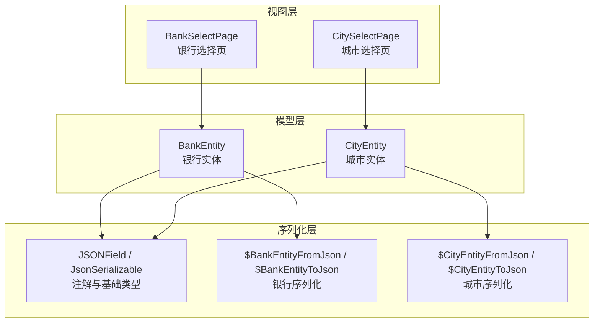
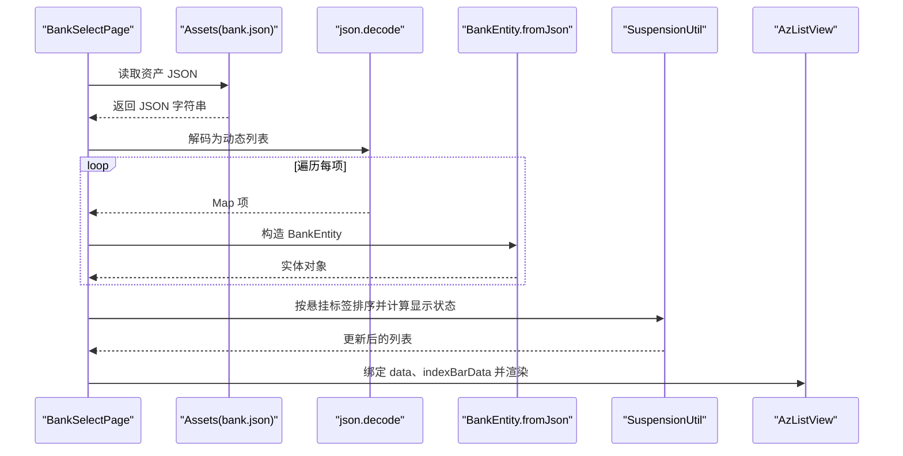
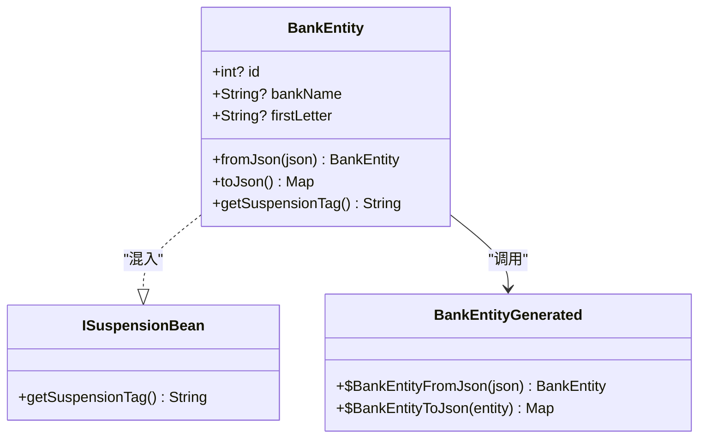
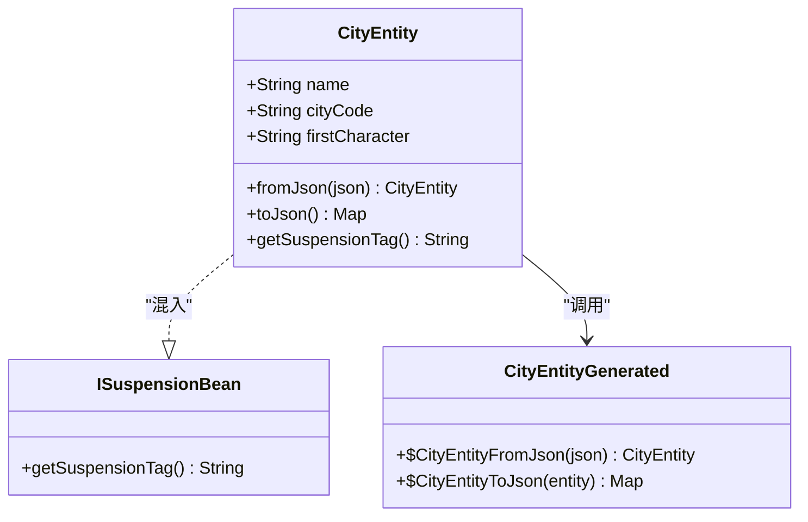
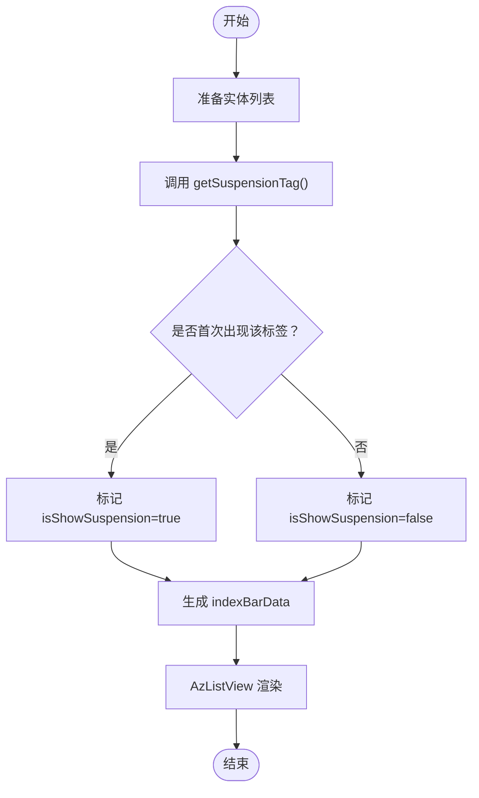
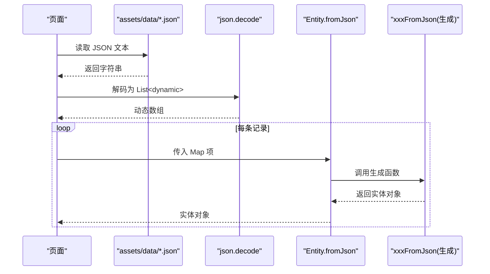
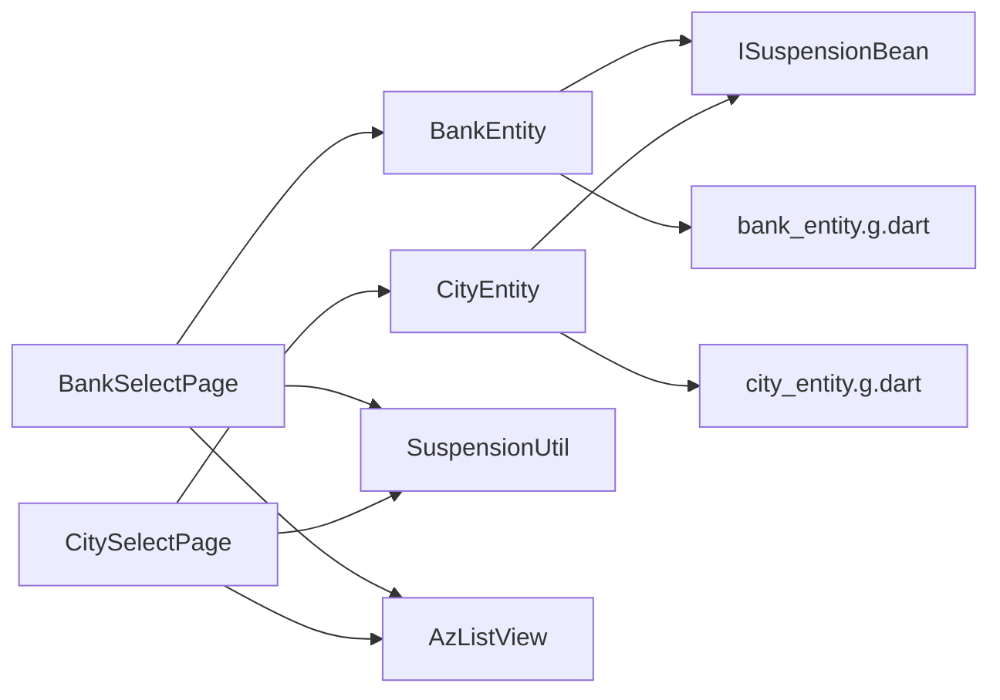

# 银行与城市实体

<cite>
**本文引用的文件**   
- [bank_entity.dart](file://lib/pages/business/member/models/bank_entity.dart)
- [city_entity.dart](file://lib/pages/business/member/models/city_entity.dart)
- [json_field.dart](file://lib/generated/json/base/json_field.dart)
- [bank_entity.g.dart](file://lib/generated/json/bank_entity.g.dart)
- [city_entity.g.dart](file://lib/generated/json/city_entity.g.dart)
- [bank_select_page.dart](file://lib/pages/business/member/page/bank_select_page.dart)
- [city_select_page.dart](file://lib/pages/business/member/page/city_select_page.dart)
</cite>

## 目录
1. [简介](#简介)
2. [项目结构定位](#项目结构定位)
3. [核心实体概览](#核心实体概览)
4. [架构总览](#架构总览)
5. [详细组件分析](#详细组件分析)
6. [依赖关系分析](#依赖关系分析)
7. [性能与数据验证建议](#性能与数据验证建议)
8. [常见问题排查](#常见问题排查)
9. [结论](#结论)

## 简介
本文面向灵犀管店 Flutter 项目中的两个基础实体类：`BankEntity`（银行）和 `CityEntity`（城市）。这两个实体用于银行列表展示和城市选择功能，同时实现了 `ISuspensionBean` 接口，以便在带字母索引的滚动列表中正确显示分组标签。文档将详细说明字段定义、业务含义、序列化机制、与 `AzListView` 的结合方式，以及数据验证与性能优化建议。

## 项目结构定位
- 实体定义位于业务成员模块下的模型目录中，分别对应银行与城市两个静态数据场景。
- JSON 序列化代码由构建工具生成到 `generated/json` 目录下，供实体通过工厂方法直接转换。
- 使用方页面位于成员业务页面下，通过加载本地 JSON 资源并绑定到 `AzListView` 实现字母索引列表。

图表来源
- [bank_entity.dart:1-22](file://lib/pages/business/member/models/bank_entity.dart#L1-L22)
- [city_entity.dart:1-22](file://lib/pages/business/member/models/city_entity.dart#L1-L22)
- [json_field.dart:1-22](file://lib/generated/json/base/json_field.dart#L1-L22)
- [bank_entity.g.dart:1-29](file://lib/generated/json/bank_entity.g.dart#L1-L29)
- [city_entity.g.dart:1-29](file://lib/generated/json/city_entity.g.dart#L1-L29)
- [bank_select_page.dart:1-175](file://lib/pages/business/member/page/bank_select_page.dart#L1-L175)
- [city_select_page.dart:1-124](file://lib/pages/business/member/page/city_select_page.dart#L1-L124)

章节来源
- [bank_entity.dart:1-22](file://lib/pages/business/member/models/bank_entity.dart#L1-L22)
- [city_entity.dart:1-22](file://lib/pages/business/member/models/city_entity.dart#L1-L22)
- [bank_select_page.dart:1-175](file://lib/pages/business/member/page/bank_select_page.dart#L1-L175)
- [city_select_page.dart:1-124](file://lib/pages/business/member/page/city_select_page.dart#L1-L124)

## 核心实体概览
- `BankEntity`：用于银行列表展示，包含标识、名称、首字母等字段；支持从 JSON 创建对象及转为 JSON。
- `CityEntity`：用于城市选择，包含城市名、城市编码、首字符等字段；同样支持 JSON 双向转换。
- 两者都混入 `ISuspensionBean`，提供 `getSuspensionTag()`，以配合 `AzListView` 的字母索引与悬挂标题。

字段与业务含义
- `BankEntity`
  - `id`：银行唯一标识，用于业务区分。
  - `bankName`：银行名称，用于界面展示。
  - `firstLetter`：银行名称的首字母或分组标签，用于字母索引。
- `CityEntity`
  - `name`：城市名称，用于界面展示。
  - `cityCode`：城市编码，用于业务传递与匹配。
  - `firstCharacter`：城市名的首字符，用于字母索引分组。

章节来源
- [bank_entity.dart:1-22](file://lib/pages/business/member/models/bank_entity.dart#L1-L22)
- [city_entity.dart:1-22](file://lib/pages/business/member/models/city_entity.dart#L1-L22)

## 架构总览
下面的时序图展示了银行选择页面的数据加载、解析、排序与渲染流程。城市选择页面流程类似，只是实体不同。

图表来源
- [bank_select_page.dart:30-110](file://lib/pages/business/member/page/bank_select_page.dart#L30-L110)
- [bank_entity.dart:1-22](file://lib/pages/business/member/models/bank_entity.dart#L1-L22)

章节来源
- [bank_select_page.dart:30-110](file://lib/pages/business/member/page/bank_select_page.dart#L30-L110)

## 详细组件分析

### BankEntity 分析
`BankEntity` 是银行数据的领域模型，负责承载银行信息，并提供 JSON 序列化和悬挂标签能力。

图表来源
- [bank_entity.dart:1-22](file://lib/pages/business/member/models/bank_entity.dart#L1-L22)
- [bank_entity.g.dart:1-29](file://lib/generated/json/bank_entity.g.dart#L1-L29)

关键实现要点
- 通过 `@JsonSerializable()` 注解生成 `$BankEntityFromJson` 与 `$BankEntityToJson`。
- `fromJson` 委托给生成的构造函数，`toJson` 委托给生成的转换器。
- `getSuspensionTag()` 返回 `firstLetter`，为空时回退为空字符串，确保索引栏稳定。

章节来源
- [bank_entity.dart:1-22](file://lib/pages/business/member/models/bank_entity.dart#L1-L22)
- [bank_entity.g.dart:1-29](file://lib/generated/json/bank_entity.g.dart#L1-L29)

### CityEntity 分析
`CityEntity` 是城市数据的领域模型，字段均为非空 late 变量，适合从 JSON 填充后直接使用。

图表来源
- [city_entity.dart:1-22](file://lib/pages/business/member/models/city_entity.dart#L1-L22)
- [city_entity.g.dart:1-29](file://lib/generated/json/city_entity.g.dart#L1-L29)

关键实现要点
- 使用 `late` 声明 `name`、`cityCode`、`firstCharacter`，避免空值检查开销。
- `getSuspensionTag()` 直接返回 `firstCharacter`，作为字母索引分组键。
- JSON 生成器会按字段顺序映射，保证 `toJson` 输出键名与业务一致。

章节来源
- [city_entity.dart:1-22](file://lib/pages/business/member/models/city_entity.dart#L1-L22)
- [city_entity.g.dart:1-29](file://lib/generated/json/city_entity.g.dart#L1-L29)

### ISuspensionBean 与 AzListView 协作
`ISuspensionBean` 是 `azlistview` 提供的接口，要求实现 `getSuspensionTag()`。`AzListView` 利用该返回值进行分组与右侧索引栏绘制。

图表来源
- [bank_select_page.dart:60-110](file://lib/pages/business/member/page/bank_select_page.dart#L60-L110)
- [city_select_page.dart:40-90](file://lib/pages/business/member/page/city_select_page.dart#L40-L90)

章节来源
- [bank_select_page.dart:60-110](file://lib/pages/business/member/page/bank_select_page.dart#L60-L110)
- [city_select_page.dart:40-90](file://lib/pages/business/member/page/city_select_page.dart#L40-L90)

### @JsonSerializable 生成的序列化代码与使用
- 生成位置
  - 银行实体：`lib/generated/json/bank_entity.g.dart`
  - 城市实体：`lib/generated/json/city_entity.g.dart`
- 生成内容
  - `xxxFromJson(Map)`：从 `Map<String, dynamic>` 构造实体对象。
  - `xxxToJson(entity)`：将实体对象转为 `Map<String, dynamic>`。
- 使用方式
  - 实体内暴露 `fromJson` 与 `toJson` 方法，内部委托给生成函数。
  - 页面侧通过 `rootBundle.loadString` 加载 JSON，再用 `json.decode` 得到动态列表，逐项调用实体的 `fromJson` 构建实体对象。

图表来源
- [bank_entity.g.dart:1-29](file://lib/generated/json/bank_entity.g.dart#L1-L29)
- [city_entity.g.dart:1-29](file://lib/generated/json/city_entity.g.dart#L1-L29)
- [bank_select_page.dart:60-85](file://lib/pages/business/member/page/bank_select_page.dart#L60-L85)
- [city_select_page.dart:40-65](file://lib/pages/business/member/page/city_select_page.dart#L40-L65)

章节来源
- [bank_entity.g.dart:1-29](file://lib/generated/json/bank_entity.g.dart#L1-L29)
- [city_entity.g.dart:1-29](file://lib/generated/json/city_entity.g.dart#L1-L29)
- [bank_select_page.dart:60-85](file://lib/pages/business/member/page/bank_select_page.dart#L60-L85)
- [city_select_page.dart:40-65](file://lib/pages/business/member/page/city_select_page.dart#L40-L65)

### 实体创建、JSON 转换与 AzListView 使用示例说明
- 实体创建
  - 银行实体：页面从 JSON 项调用 `BankEntity.fromJson(map)` 创建实体；也可在“常用”区域手动构造实体并传回上一页。
  - 城市实体：页面从 JSON 项调用 `CityEntity.fromJson(map)` 创建实体。
- JSON 转换
  - 所有转换均通过生成的 `fromJson`/`toJson` 完成，字段名与 JSON 键保持一致。
- AzListView 使用
  - 设置 `data` 为实体列表。
  - 使用 `SuspensionUtil.sortListBySuspensionTag` 排序并按 `isShowSuspension` 计算悬挂标签可见性。
  - 根据 `isShowSuspension` 过滤出非空标签构成 `indexBarData`，驱动右侧索引栏。
  - 列表项渲染时，依据 `isShowSuspension` 控制左侧首字母标签的透明度。

章节来源
- [bank_select_page.dart:60-175](file://lib/pages/business/member/page/bank_select_page.dart#L60-L175)
- [city_select_page.dart:40-124](file://lib/pages/business/member/page/city_select_page.dart#L40-L124)

## 依赖关系分析
- 模型层依赖
  - 实体依赖 `ISuspensionBean`（来自 `azlistview`），用于悬挂分组。
  - 实体依赖 `@JsonSerializable()` 注解，依赖生成器产物。
- 视图层依赖
  - 页面依赖 `rootBundle` 加载本地 JSON。
  - 页面依赖 `SuspensionUtil` 对列表进行排序与悬挂标签计算。
  - 页面依赖 `AzListView` 渲染带索引的分组列表。

图表来源
- [bank_entity.dart:1-22](file://lib/pages/business/member/models/bank_entity.dart#L1-L22)
- [city_entity.dart:1-22](file://lib/pages/business/member/models/city_entity.dart#L1-L22)
- [bank_entity.g.dart:1-29](file://lib/generated/json/bank_entity.g.dart#L1-L29)
- [city_entity.g.dart:1-29](file://lib/generated/json/city_entity.g.dart#L1-L29)
- [bank_select_page.dart:1-175](file://lib/pages/business/member/page/bank_select_page.dart#L1-L175)
- [city_select_page.dart:1-124](file://lib/pages/business/member/page/city_select_page.dart#L1-L124)

章节来源
- [bank_entity.dart:1-22](file://lib/pages/business/member/models/bank_entity.dart#L1-L22)
- [city_entity.dart:1-22](file://lib/pages/business/member/models/city_entity.dart#L1-L22)
- [bank_select_page.dart:1-175](file://lib/pages/business/member/page/bank_select_page.dart#L1-L175)
- [city_select_page.dart:1-124](file://lib/pages/business/member/page/city_select_page.dart#L1-L124)

## 性能与数据验证建议
- 数据加载
  - 城市页面针对驱动测试场景做了特殊处理，避免大 JSON 在集成测试中使用 `compute` 导致的问题。
  - 建议在真实环境中优先使用异步流式加载或分页，减少一次性解析大 JSON 的内存峰值。
- 列表渲染
  - 已使用 `AzListView`，其具备索引栏与悬挂分组能力，可提升大数据量下的交互效率。
  - 建议对 `indexBarData` 去重后再赋值，避免重复标签影响索引体验。
- 实体设计
  - `CityEntity` 使用 `late` 字段，可减少空判断开销，但需保证 JSON 一定包含这些字段，否则运行时会抛错。
  - 若上游数据可能缺失关键字段，建议改为可空类型并在 `fromJson` 中提供默认值或降级策略。
- 数据校验
  - 建议在加载 JSON 后增加基础校验：
    - 银行：`bankName` 非空；`firstLetter` 仅允许单字符或保留空串。
    - 城市：`name`、`cityCode`、`firstCharacter` 非空；`cityCode` 符合既有编码规范。
  - 可在页面层统一封装一个 `validateAndTransform` 步骤，集中处理非法数据与告警日志。
- 排序与悬挂
  - 当前使用 `SuspensionUtil.sortListBySuspensionTag` 与 `setShowSuspensionStatus`，请确保在设置 `indexBarData` 之前执行，以保证索引与列表同步。

[本节为通用建议，不直接分析具体源码]

## 常见问题排查
- 索引栏为空或异常
  - 检查是否在调用 `SuspensionUtil` 之后才生成 `indexBarData`。
  - 确认 `getSuspensionTag()` 返回的值非空且稳定。
- JSON 字段不生效
  - 确认 `fromJson` 调用了生成函数，并且 JSON 键名与实体字段映射一致。
  - 若新增字段，需要重新运行代码生成命令以更新 `.g.dart`。
- 城市页面驱动测试崩溃
  - 使用页面中的 `_loadString` 分支，避免集成测试环境下 `compute` 的限制。
- 银行“常用”分组显示异常
  - 检查是否在列表头部插入“常用”头节点，并同步更新 `indexBarData`。
  - 注意“常用”头节点的 `firstLetter` 应为非空字符串，以便索引栏显示。

章节来源
- [city_select_page.dart:40-90](file://lib/pages/business/member/page/city_select_page.dart#L40-L90)
- [bank_select_page.dart:60-110](file://lib/pages/business/member/page/bank_select_page.dart#L60-L110)

## 结论
`BankEntity` 与 `CityEntity` 是两个职责清晰的基础实体，既承载业务数据，又通过 `ISuspensionBean` 与 `AzListView` 协作，实现高效的字母索引分组列表。借助 `@JsonSerializable` 生成的序列化代码，实体可以安全地进行 JSON 转换。结合页面中的数据加载、排序与渲染流程，整体架构简洁稳定。后续可在数据校验、空值防护与大列表性能方面进一步增强，以提升健壮性与用户体验。