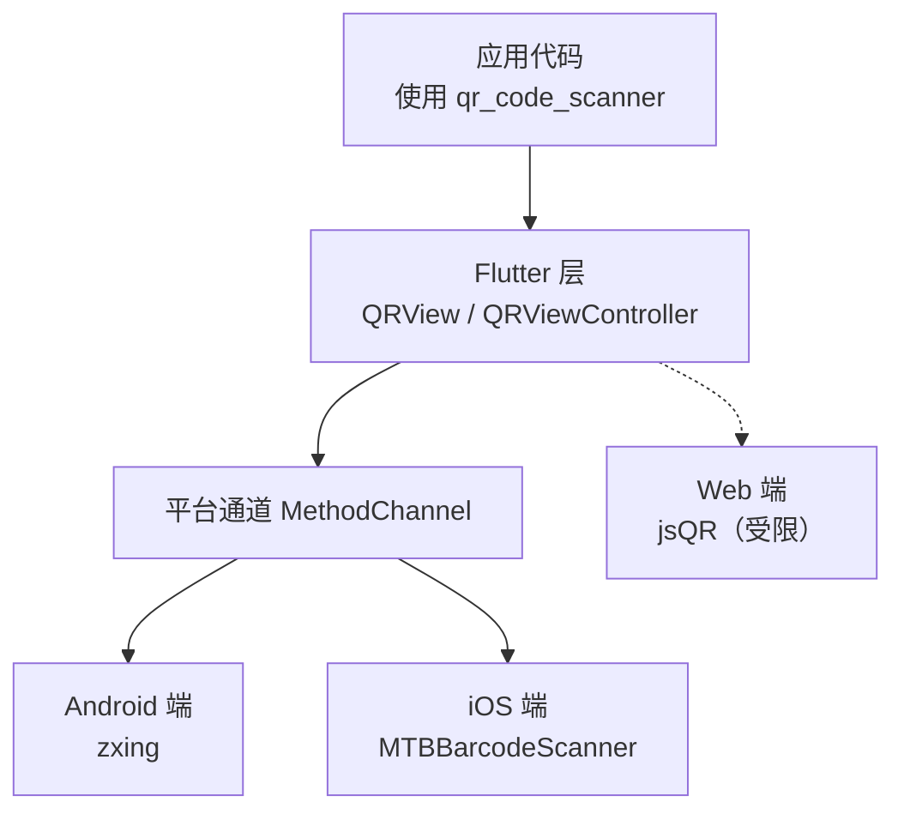
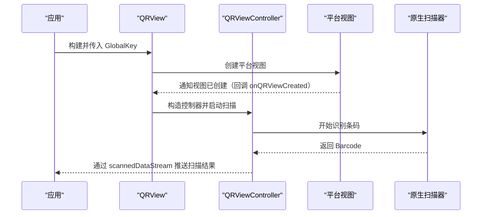
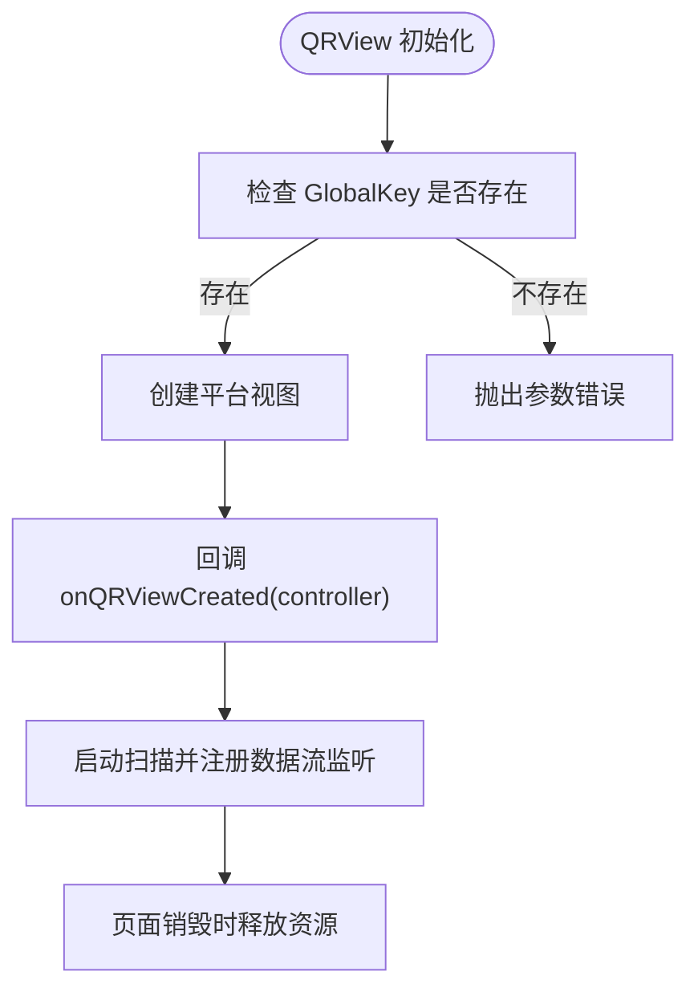

# 二维码扫描本地包 (qr_code_scanner)

<cite>
**本文引用的文件**   
- [pubspec.yaml](file://packages/qr_code_scanner/pubspec.yaml)
- [README.md](file://packages/qr_code_scanner/README.md)
- [qr_code_scanner.dart](file://packages/qr_code_scanner/lib/qr_code_scanner.dart)
- [qr_code_scanner.dart（核心实现）](file://packages/qr_code_scanner/lib/src/qr_code_scanner.dart)
- [barcode.dart](file://packages/qr_code_scanner/lib/src/types/barcode.dart)
- [barcode_format.dart](file://packages/qr_code_scanner/lib/src/types/barcode_format.dart)
- [camera.dart](file://packages/qr_code_scanner/lib/src/types/camera.dart)
- [camera_exception.dart](file://packages/qr_code_scanner/lib/src/types/camera_exception.dart)
- [features.dart](file://packages/qr_code_scanner/lib/src/types/features.dart)
- [flutter_qr_web.dart](file://packages/qr_code_scanner/lib/src/web/flutter_qr_web.dart)
- [android/build.gradle](file://packages/qr_code_scanner/android/build.gradle)
- [ios/qr_code_scanner.podspec](file://packages/qr_code_scanner/ios/qr_code_scanner.podspec)
- [qr_code_scanner_page.dart（项目扫码页面示例）](file://lib/widgets/qr_code_scanner_page.dart)
</cite>

## 目录
1. [简介](#简介)
2. [项目结构](#项目结构)
3. [核心组件](#核心组件)
4. [架构总览](#架构总览)
5. [详细组件分析](#详细组件分析)
6. [依赖与平台配置](#依赖与平台配置)
7. [性能与兼容性](#性能与兼容性)
8. [故障排查](#故障排查)
9. [结论](#结论)
10. [附录：完整扫码页面参考](#附录完整扫码页面参考)

## 简介
qr_code_scanner 是一个可在 Flutter 中嵌入的二维码/条码扫描插件。Android 端基于 zxing，iOS 端基于 MTBBarcodeScanner。当前仓库处于“仅维护模式”，不再进行功能更新，仅提供缺陷修复和轻微增强。Web 平台支持有限，仅支持二维码，且闪光灯、暂停/恢复等特性在 Web 上未实现。

- 包版本：1.0.0
- Dart SDK 约束：>=2.17.0 <3.0.0
- Flutter 约束：>=1.12.0
- 底层技术栈：
  - Android：zxing（通过 journeyapps/zxing-android-embedded）
  - iOS：MTBBarcodeScanner（通过 CocoaPods）
  - Web：jsQR（需引入外部脚本）

**章节来源**
- [pubspec.yaml:1-31](file://packages/qr_code_scanner/pubspec.yaml#L1-L31)
- [README.md:1-20](file://packages/qr_code_scanner/README.md#L1-L20)

## 项目结构
本包采用典型的 Flutter 插件结构：
- lib：对外 API 与类型定义，包含 QRView、QRViewController、Barcode、BarcodeFormat、CameraFacing 等
- android：Android 原生实现（Kotlin + zxing）
- ios：iOS 原生实现（Swift/Objective-C + MTBBarcodeScanner）
- lib/src/web：Web 平台轻量实现（基于 jsQR）

**图表来源**
- [qr_code_scanner.dart（核心实现）:1-120](file://packages/qr_code_scanner/lib/src/qr_code_scanner.dart#L1-L120)
- [flutter_qr_web.dart:1-120](file://packages/qr_code_scanner/lib/src/web/flutter_qr_web.dart#L1-L120)

**章节来源**
- [qr_code_scanner.dart（核心实现）:1-120](file://packages/qr_code_scanner/lib/src/qr_code_scanner.dart#L1-L120)

## 核心组件
- QRView：用于承载相机预览和扫描区域的 StatefulWidget。需要 GlobalKey 管理实例，避免热重载导致状态丢失。
- QRViewController：控制摄像头与扫描逻辑的控制器对象，提供翻转摄像头、切换闪光灯、暂停/恢复相机、释放资源等方法，并通过 scannedDataStream 输出扫描结果。
- Barcode：封装一次扫码结果，包括文本内容、码格式和原始字节。
- BarcodeFormat：枚举类型，表示支持的码制式（如 QR Code、EAN-13、Data Matrix 等）。
- CameraFacing：枚举类型，指定前置或后置摄像头。
- SystemFeatures：描述设备是否具备闪光灯、前后摄像头等能力。
- CameraException：插件抛出的异常类型，包含错误码和描述信息。

**章节来源**
- [qr_code_scanner.dart（核心实现）:1-200](file://packages/qr_code_scanner/lib/src/qr_code_scanner.dart#L1-L200)
- [barcode.dart:1-16](file://packages/qr_code_scanner/lib/src/types/barcode.dart#L1-L16)
- [barcode_format.dart:1-148](file://packages/qr_code_scanner/lib/src/types/barcode_format.dart#L1-L148)
- [camera.dart:1-10](file://packages/qr_code_scanner/lib/src/types/camera.dart#L1-L10)
- [features.dart:1-13](file://packages/qr_code_scanner/lib/src/types/features.dart#L1-L13)
- [camera_exception.dart:1-14](file://packages/qr_code_scanner/lib/src/types/camera_exception.dart#L1-L14)

## 架构总览
QRView 根据目标平台选择具体实现：
- Android：AndroidView 调用平台视图 net.touchcapture.qr.flutterqr/qrview
- iOS：UiKitView 调用同名平台视图
- Web：创建 WebQrView，使用 getUserMedia 获取视频流，定时帧解码并输出 Barcode

**图表来源**
- [qr_code_scanner.dart（核心实现）:60-160](file://packages/qr_code_scanner/lib/src/qr_code_scanner.dart#L60-L160)

## 详细组件分析

### QRView 与生命周期
- GlobalKey 管理：建议为 QRView 分配一个稳定的 GlobalKey，以便后续访问控制器和更新尺寸。
- 生命周期处理：内部注册 LifecycleEventHandler，监听系统事件以触发尺寸更新；dispose 时移除观察者。
- 覆盖层 overlay：可选的 QrScannerOverlayShape，用于绘制扫描框区域与边框样式。
- 权限回调 onPermissionSet：当相机权限设置完成后回调，便于 UI 提示用户授权状态。
- 热重载兼容：在 reassemble 中按平台执行 pause/resume，确保热重载后相机正常恢复。

**图表来源**
- [qr_code_scanner.dart（核心实现）:10-120](file://packages/qr_code_scanner/lib/src/qr_code_scanner.dart#L10-L120)

**章节来源**
- [qr_code_scanner.dart（核心实现）:10-120](file://packages/qr_code_scanner/lib/src/qr_code_scanner.dart#L10-L120)

### QRViewController 核心 API
- flipCamera()：切换前后摄像头。默认使用后置摄像头。
- toggleFlash()：切换闪光灯开关。默认关闭。
- pauseCamera()：暂停相机流与扫描。
- resumeCamera()：恢复相机流与扫描。
- dispose()：释放相机与控制器资源。建议在页面 dispose 或扫码成功后立即调用。
- scannedDataStream：Stream<Barcode>，每次成功识别到码时发出 Barcode 事件。

注意：
- 在 Android 热重载场景下，应先 pauseCamera 再 resumeCamera；iOS 则直接 resumeCamera。
- 如果不需要继续接收扫码结果，应尽早 dispose 以避免后台持续占用相机。

**章节来源**
- [qr_code_scanner.dart（核心实现）:120-200](file://packages/qr_code_scanner/lib/src/qr_code_scanner.dart#L120-L200)
- [README.md:160-214](file://packages/qr_code_scanner/README.md#L160-L214)

### Barcode 与 BarcodeFormat
- Barcode.code：扫码得到的字符串内容（可能为空，取决于平台与码类型）。
- Barcode.format：BarcodeFormat 枚举，标识码的类型。
- Barcode.rawBytes：原始字节数组（Android/iOS 支持，Web 不支持）。

BarcodeFormat 常见值与说明：
- qrcode：二维码
- ean8/ean13/upcA/upcE：零售商品码
- code39/code93/code128：工业条码
- dataMatrix/pdf417/maxicode：二维条码
- aztec/codabar/itf/rss14/rssExpanded：其他一维/二维码
- unknown：未知格式

扩展方法：
- fromString(String)：将平台返回的字符串格式映射为枚举
- formatName：获取平台字符串格式名

**章节来源**
- [barcode.dart:1-16](file://packages/qr_code_scanner/lib/src/types/barcode.dart#L1-L16)
- [barcode_format.dart:1-148](file://packages/qr_code_scanner/lib/src/types/barcode_format.dart#L1-L148)

### 平台差异与限制
- Android：
  - 使用 zxing 进行条码识别，支持多种码制式。
  - minSdkVersion 由插件侧设置为 20。
- iOS：
  - 使用 MTBBarcodeScanner 进行条码识别。
  - 部分码制式（如 codabar、maxicode、rss14、rssExpanded）在 iOS 不受支持。
- Web：
  - 仅支持二维码（QR Code）。
  - 闪光灯、暂停/恢复等功能未实现。
  - 需要在 web/index.html 引入 jsQR 脚本。
  - 相机预览不严格遵循布局约束（受限于 Flutter Web 平台视图早期阶段）。

**章节来源**
- [README.md:140-214](file://packages/qr_code_scanner/README.md#L140-L214)
- [flutter_qr_web.dart:1-200](file://packages/qr_code_scanner/lib/src/web/flutter_qr_web.dart#L1-L200)

## 依赖与平台配置

### Android 配置
插件侧 Android 配置要点：
- Kotlin 版本：1.9.0
- Gradle 插件：com.android.tools.build:gradle:8.1.0
- compileSdk/targetSdk：33
- minSdkVersion：20（由插件侧 defaultConfig 设定）
- Java 兼容级别：11
- zxing 依赖：journeyapps/zxing-android-embedded:4.3.0 与 com.google.zxing:core:3.5.2

若你的宿主工程仍沿用旧版配置，请按需升级 Gradle、Kotlin 与 minSdkVersion。插件 README 提供了历史最低要求参考，但当前仓库内已更新到更高版本。

**章节来源**
- [android/build.gradle:1-61](file://packages/qr_code_scanner/android/build.gradle#L1-L61)
- [README.md:100-140](file://packages/qr_code_scanner/README.md#L100-L140)

### iOS 配置
插件侧 iOS 配置要点：
- 依赖 MTBBarcodeScanner（通过 podspec 声明）
- iOS 部署目标：8.0
- Swift 版本：4.0

必须在 Info.plist 中添加相机权限说明：
- NSCameraUsageDescription：说明为何需要相机权限
- io.flutter.embedded_views_preview：启用嵌入式视图预览

**章节来源**
- [ios/qr_code_scanner.podspec:1-23](file://packages/qr_code_scanner/ios/qr_code_scanner.podspec#L1-L23)
- [README.md:120-140](file://packages/qr_code_scanner/README.md#L120-L140)

### Web 配置
- 在 web/index.html 引入 jsQR 脚本：
  - 
- 仅支持二维码，不支持其他条码与二维条码。
- 不支持闪光灯、暂停/恢复等特性。
- 相机预览可能不遵循布局约束。

**章节来源**
- [README.md:140-214](file://packages/qr_code_scanner/README.md#L140-L214)

## 性能与兼容性
- 扫描性能：Android 基于 zxing，iOS 基于 MTBBarcodeScanner，均为成熟的原生库，性能稳定。
- 内存与相机占用：应在扫码完成后及时调用 dispose() 释放资源，避免后台持续占用相机。
- 热重载：Android 需在 reassemble 中先 pause 再 resume；iOS 仅需 resume。
- Web 性能：jsQR 运行于浏览器环境，受设备性能和页面渲染影响较大，不建议在高帧率或复杂 UI 场景中使用。

[本节为通用建议，不涉及具体文件分析]

## 故障排查
常见问题与处理建议：
- 相机权限被拒绝：
  - 检查 Info.plist 是否添加 NSCameraUsageDescription（iOS）。
  - 在 onPermissionSet 回调中处理权限状态变化。
- 扫描结果为空：
  - 确认光源充足、码清晰、距离合适。
  - 在 Web 平台仅支持二维码，其他码制式不会返回结果。
- 扫码结果重复回调：
  - 在收到首次扫描结果后调用 controller.dispose() 停止监听并释放资源。
- 热重载后相机黑屏：
  - Android：pauseCamera() 后再 resumeCamera()。
  - iOS：resumeCamera()。
- 编译错误（Android）：
  - 升级 Gradle、Kotlin 与 minSdkVersion，确保与宿主工程一致。
  - 遇到 dexing 相关错误可尝试在 gradle.properties 添加 android.enableDexingArtifactTransform=false（参考 README）。

**章节来源**
- [README.md:100-214](file://packages/qr_code_scanner/README.md#L100-L214)

## 结论
qr_code_scanner 在移动平台上提供稳定可靠的二维码与条码扫描能力，适合对性能与兼容性有较高要求的 Flutter 应用。由于底层框架已进入仅维护模式，建议新项目评估迁移至 mobile_scanner 等更现代的方案。对于现有项目，本包仍可继续使用，只需注意平台配置与 Web 限制即可。

[本节为总结性内容，不涉及具体文件分析]

## 附录：完整扫码页面参考
项目中已经实现了完整的扫码页面示例，展示了以下最佳实践：
- 使用 GlobalKey 管理 QRView 实例
- 在 _onQRViewCreated 中保存控制器并监听 scannedDataStream
- 在收到扫码结果后调用 controller.dispose() 避免重复回调
- 通过 NavigatorUtils.goBackWithParams 返回扫码结果
- 在 reassemble 中按平台处理 pause/resume，保证热重载可用
- 使用 QrScannerOverlayShape 自定义扫描框样式

该示例可直接作为集成参考，帮助你快速接入二维码扫描功能。

**章节来源**
- [qr_code_scanner_page.dart:1-107](file://lib/widgets/qr_code_scanner_page.dart#L1-L107)