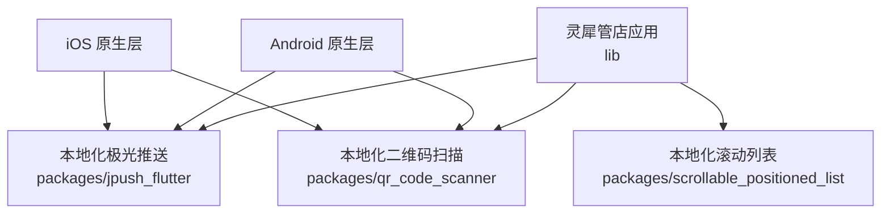
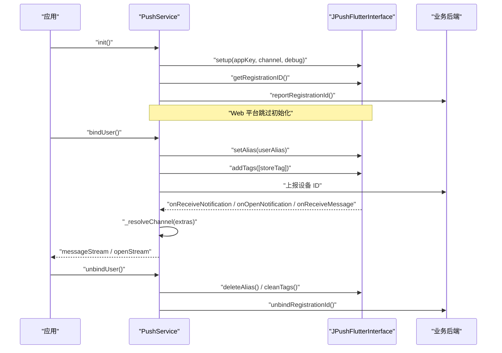
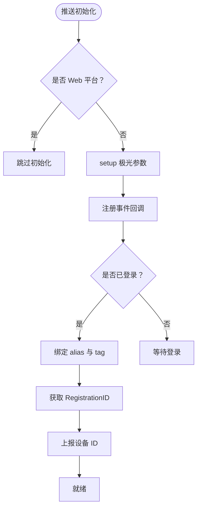
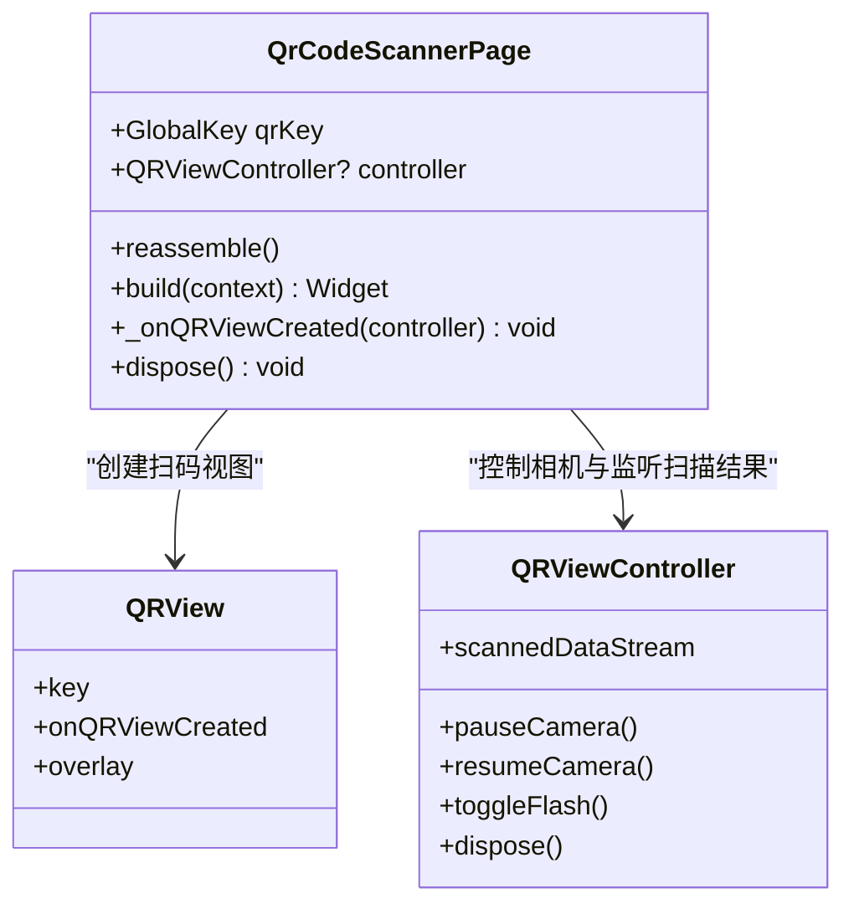
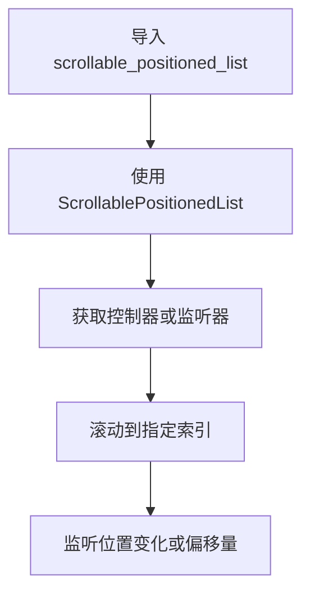
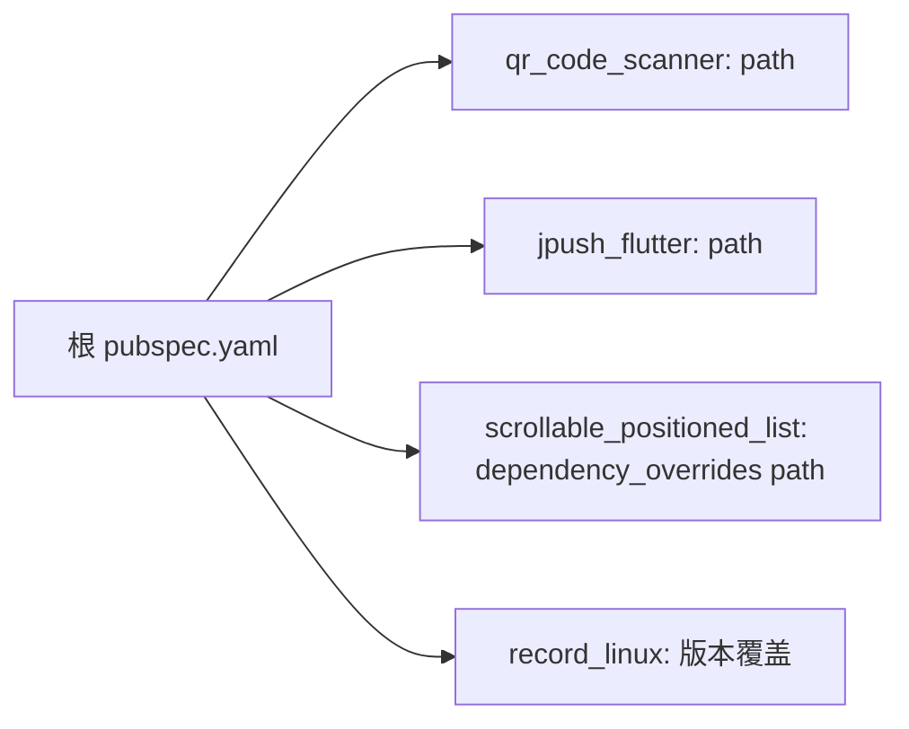
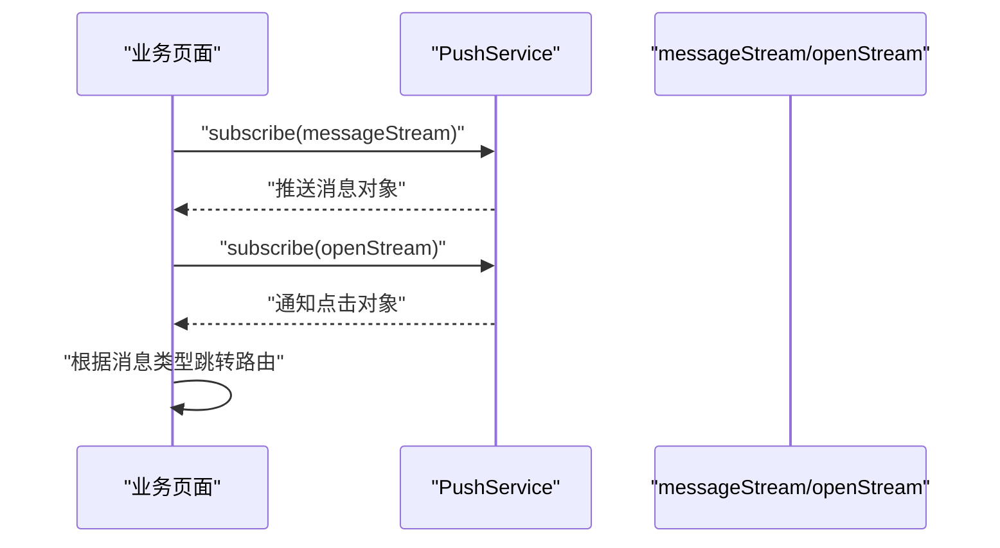

# 本地包说明

<cite>
**本文引用的文件**   
- [pubspec.yaml](file://pubspec.yaml)
- [packages/jpush_flutter/pubspec.yaml](file://packages/jpush_flutter/pubspec.yaml)
- [packages/qr_code_scanner/pubspec.yaml](file://packages/qr_code_scanner/pubspec.yaml)
- [packages/scrollable_positioned_list/pubspec.yaml](file://packages/scrollable_positioned_list/pubspec.yaml)
- [lib/push/push_config.dart](file://lib/push/push_config.dart)
- [lib/push/push_service.dart](file://lib/push/push_service.dart)
- [android/app/src/main/AndroidManifest.xml](file://android/app/src/main/AndroidManifest.xml)
- [ios/Runner/Info.plist](file://ios/Runner/Info.plist)
- [packages/jpush_flutter/lib/jpush_flutter.dart](file://packages/jpush_flutter/lib/jpush_flutter.dart)
- [packages/qr_code_scanner/lib/qr_code_scanner.dart](file://packages/qr_code_scanner/lib/qr_code_scanner.dart)
- [packages/scrollable_positioned_list/lib/scrollable_positioned_list.dart](file://packages/scrollable_positioned_list/lib/scrollable_positioned_list.dart)
- [lib/widgets/qr_code_scanner_page.dart](file://lib/widgets/qr_code_scanner_page.dart)
</cite>

## 目录
1. [引言](#引言)
2. [项目结构与本地包总览](#项目结构与本地包总览)
3. [核心本地包清单](#核心本地包清单)
4. [架构与调用关系](#架构与调用关系)
5. [详细组件分析](#详细组件分析)
6. [依赖分析与版本管理](#依赖分析与版本管理)
7. [配置方法](#配置方法)
8. [API 接口与使用方式](#api-接口与使用方式)
9. [维护策略与更新流程](#维护策略与更新流程)
10. [故障排除指南](#故障排除指南)
11. [性能与兼容性建议](#性能与兼容性建议)
12. [结论](#结论)

## 引言
本文件面向灵犀管店 Flutter 项目的开发者，系统性说明项目中集成的三个本地化第三方包：极光推送 jpush_flutter、二维码扫描 qr_code_scanner、滚动列表 scrollable_positioned_list。文档覆盖以下重点：
- 为什么对这三个包进行本地化与打补丁。
- 每个包的版本来源、路径引用、平台支持与关键 API。
- 在应用中的初始化、权限、消息路由和扫码页面集成方式。
- 包维护策略、升级流程和常见故障排查。
- 如何在现有封装基础上扩展功能，同时保持兼容性和可维护性。

## 项目结构与本地包总览
本项目将三个重要的第三方包以本地形式放入 packages 目录，并在根 pubspec.yaml 中通过 path 引用或 dependency_overrides 强制使用本地版本。这样做的好处是：
- 便于根据业务需求修改原生行为，例如极光通知 extras 透出下发通道。
- 锁定依赖版本，避免上游变更影响主应用稳定性。
- 统一管理升级节奏，结合 CI 与内部测试验证后再合并。

**图示来源**
- [pubspec.yaml](file://pubspec.yaml)
- [packages/jpush_flutter/pubspec.yaml](file://packages/jpush_flutter/pubspec.yaml)
- [packages/qr_code_scanner/pubspec.yaml](file://packages/qr_code_scanner/pubspec.yaml)
- [packages/scrollable_positioned_list/pubspec.yaml](file://packages/scrollable_positioned_list/pubspec.yaml)

**章节来源**
- [pubspec.yaml](file://pubspec.yaml)

## 核心本地包清单
| 包名 | 本地路径 | 版本 | 主要用途 | 平台支持 | 本地化原因 |
|---|---|---:|---|---|---|
| jpush_flutter | packages/jpush_flutter | 3.5.8 | 极光推送初始化、别名标签绑定、事件回调、通知与自定义消息处理 | Android、iOS、HarmonyOS | 官方包需要补充 extras 透出下发通道 TYPE_PLATFORM；应用侧进一步封装 PushService 统一处理权限、注册 ID、登录解绑、日志记录。 |
| qr_code_scanner | packages/qr_code_scanner | 1.0.0 | 嵌入 QRView 进行条形码与二维码扫描 | Android、iOS（示例包含 Web） | 旧版本 SDK 约束较老，项目通过 path 引用并自行管理权限与生命周期。 |
| scrollable_positioned_list | packages/scrollable_positioned_list | 0.3.8 | 提供可程序化滚动到指定位置的列表能力 | Flutter 通用 | 通过 dependency_overrides 强制使用本地版本，确保滚动定位行为稳定。 |

**章节来源**
- [pubspec.yaml](file://pubspec.yaml)
- [packages/jpush_flutter/pubspec.yaml](file://packages/jpush_flutter/pubspec.yaml)
- [packages/qr_code_scanner/pubspec.yaml](file://packages/qr_code_scanner/pubspec.yaml)
- [packages/scrollable_positioned_list/pubspec.yaml](file://packages/scrollable_positioned_list/pubspec.yaml)

## 架构与调用关系
极光推送在本项目中的调用链如下：
- 启动阶段由 PushService 初始化 JPushFlutterInterface。
- 登录后设置 alias 和 tag，并上报 registrationId。
- 收到通知或自定义消息时，统一解析 extras 中的下发通道并分发到业务流。
- 退出登录时解绑 alias、tag 和设备 ID。

**图示来源**
- [lib/push/push_service.dart](file://lib/push/push_service.dart)
- [packages/jpush_flutter/lib/jpush_flutter.dart](file://packages/jpush_flutter/lib/jpush_flutter.dart)

## 详细组件分析

### 极光推送 jpush_flutter
#### 版本与平台
- 包版本：3.5.8。
- Dart SDK 要求：>=2.19.6 <4.0.0。
- Flutter 要求：>=3.3.0。
- 平台：Android、iOS、HarmonyOS。

#### 本地化与补丁
- 应用注释说明已打补丁：通知消息的 extras 透出下发通道 TYPE_PLATFORM。
- 应用侧 PushService 通过 extras 中的 cn.jpush.android.TYPE_PLATFORM 字段判断当前通知走的是极光长连接还是各厂商通道，并输出“极光通道”“小米通道”“华为通道”等可读名称。
- 鸿蒙平台通过 Harmony 实现类接入，但当前应用仅声明 Android/iOS 初始化逻辑。

#### 关键 API
- JPush.newJPush()：返回平台适配的 JPushFlutterInterface。
- setup(appKey, channel, debug)：初始化极光。
- setAlias(alias)、addTags(tags)、deleteAlias()、cleanTags()：别名与标签管理。
- getRegistrationID()：获取设备唯一标识。
- isNotificationEnabled()、requestRequiredPermission()、applyPushAuthority()、openSettingsForNotification()：通知权限相关。
- clearAllNotifications()：清空通知栏。

#### 使用方式
- 在应用启动前调用 PushService.init()。
- 登录后调用 bindUser()，退出登录调用 unbindUser()。
- 订阅 messageStream 接收静默消息，订阅 openStream 处理通知点击跳转。
- 在合适时机调用 requestNotificationPermission() 申请通知权限。

**图示来源**
- [lib/push/push_service.dart](file://lib/push/push_service.dart)
- [packages/jpush_flutter/lib/jpush_flutter.dart](file://packages/jpush_flutter/lib/jpush_flutter.dart)

**章节来源**
- [packages/jpush_flutter/pubspec.yaml](file://packages/jpush_flutter/pubspec.yaml)
- [packages/jpush_flutter/lib/jpush_flutter.dart](file://packages/jpush_flutter/lib/jpush_flutter.dart)
- [lib/push/push_config.dart](file://lib/push/push_config.dart)
- [lib/push/push_service.dart](file://lib/push/push_service.dart)

### 二维码扫描 qr_code_scanner
#### 版本与平台
- 包版本：1.0.0。
- Dart SDK 要求：>=2.17.0 <3.0.0。
- Flutter 要求：>=1.12.0。
- 平台：Android、iOS；示例中包含 Web 示例代码但插件导出未启用 web pluginClass。

#### 本地化原因
- 该包为旧版本，SDK 约束较低；项目通过 path 引用以固定版本，并自行封装扫码页面处理相机权限、热重载兼容和结果回调。

#### 关键 API
- QRView：嵌入扫码视图。
- QRViewController：控制相机启停、闪光灯切换、监听 scannedDataStream。
- QrScannerOverlayShape：自定义扫描区域遮罩。

#### 使用方式
- 在页面中创建 GlobalKey 管理 QRView。
- 在 onQRViewCreated 中保存 controller，并监听 scannedDataStream。
- Android 热重载时需要 pauseCamera 再 resumeCamera；iOS 只需 resumeCamera。
- 扫描成功后 dispose controller，并通过 NavigatorUtils.goBackWithParams 返回扫描结果。

**图示来源**
- [lib/widgets/qr_code_scanner_page.dart](file://lib/widgets/qr_code_scanner_page.dart)
- [packages/qr_code_scanner/lib/qr_code_scanner.dart](file://packages/qr_code_scanner/lib/qr_code_scanner.dart)

**章节来源**
- [packages/qr_code_scanner/pubspec.yaml](file://packages/qr_code_scanner/pubspec.yaml)
- [packages/qr_code_scanner/lib/qr_code_scanner.dart](file://packages/qr_code_scanner/lib/qr_code_scanner.dart)
- [lib/widgets/qr_code_scanner_page.dart](file://lib/widgets/qr_code_scanner_page.dart)

### 滚动列表 scrollable_positioned_list
#### 版本与平台
- 包版本：0.3.8。
- Dart SDK 要求：>=2.15.0 <4.0.0。
- Flutter 要求：>=2.12.0。
- 平台：Flutter 通用。

#### 本地化原因
- 项目在 dependency_overrides 中强制使用本地包，以确保滚动定位行为与历史版本一致，避免因上游更新引入破坏性变更。

#### 关键 API
- 导出 ItemPositionsListener、ScrollablePositionedList、ScrollOffsetListener。
- 通常用于需要程序化滚动到特定项、跟踪项位置或偏移量的列表场景。

**图示来源**
- [packages/scrollable_positioned_list/lib/scrollable_positioned_list.dart](file://packages/scrollable_positioned_list/lib/scrollable_positioned_list.dart)

**章节来源**
- [packages/scrollable_positioned_list/pubspec.yaml](file://packages/scrollable_positioned_list/pubspec.yaml)
- [packages/scrollable_positioned_list/lib/scrollable_positioned_list.dart](file://packages/scrollable_positioned_list/lib/scrollable_positioned_list.dart)

## 依赖分析与版本管理
根 pubspec.yaml 明确采用以下方式管理本地包：
- qr_code_scanner：dependencies 中使用 path 引用本地包。
- jpush_flutter：dependencies 中使用 path 引用本地包。
- scrollable_positioned_list：dependency_overrides 强制覆盖为本地包。
- 同时存在 record_linux 的版本覆盖，用于修复 record_linux 与 record_platform_interface 不兼容问题。

**图示来源**
- [pubspec.yaml](file://pubspec.yaml)

**章节来源**
- [pubspec.yaml](file://pubspec.yaml)

## 配置方法

### 极光推送配置
- AppKey：位于 PushConfig.appKey，需与极光后台「灵犀智店」应用一致。
- Channel：推送统计渠道，默认 default_developer。
- Production：iOS 生产环境开关，当前为 false。
- Alias 前缀：user_，用于按用户精准推送。
- Tag 前缀：store_，用于按门店批量推送。
- Android 权限：AndroidManifest.xml 中声明 POST_NOTIFICATIONS 权限，并关闭 flutter_deeplinking_enabled，避免被杀进程后厂商通道点击导致白屏。
- iOS 权限：Info.plist 中声明相机、相册、麦克风等权限；推送权限由系统弹窗申请。

**章节来源**
- [lib/push/push_config.dart](file://lib/push/push_config.dart)
- [android/app/src/main/AndroidManifest.xml](file://android/app/src/main/AndroidManifest.xml)
- [ios/Runner/Info.plist](file://ios/Runner/Info.plist)

### 二维码扫描配置
- 相机权限：iOS Info.plist 中已有 NSCameraUsageDescription。
- Android 权限：若需要相机权限需在 AndroidManifest.xml 中声明 camera 权限（项目当前清单未直接声明相机权限，扫码页通过插件初始化相机）。
- 热重载兼容：Android 端在 reassemble 中 pauseCamera 再 resumeCamera；iOS 端只 resumeCamera。
- 闪光灯控制：通过 QRViewController.toggleFlash() 控制。

**章节来源**
- [lib/widgets/qr_code_scanner_page.dart](file://lib/widgets/qr_code_scanner_page.dart)
- [ios/Runner/Info.plist](file://ios/Runner/Info.plist)

### 滚动列表配置
- 无需额外原生配置。
- 通过 dependency_overrides 强制使用本地 0.3.8 版本，确保滚动定位行为稳定。

**章节来源**
- [pubspec.yaml](file://pubspec.yaml)

## API 接口与使用方式

### 极光推送 API
- 初始化：PushService.init()
- 绑定用户：PushService.bindUser()
- 解绑用户：PushService.unbindUser()
- 请求通知权限：PushService.requestNotificationPermission()
- 打开通知设置：PushService.openNotificationSettings()
- 订阅消息流：PushService.messageStream
- 订阅通知点击流：PushService.openStream
- 获取 RegistrationID：PushService.getRegistrationId()
- 上报设备 ID：PushService.reportRegistrationId()
- 清空通知：PushService.clearAllNotifications()

#### 事件处理要点
- 通知到达：onReceiveNotification
- 通知点击：onOpenNotification
- 自定义消息：onReceiveMessage
- 通知未展示：onNotifyMessageUnShow
- 长连接状态：onConnected
- 厂商命令回调：onCommandResult

**图示来源**
- [lib/push/push_service.dart](file://lib/push/push_service.dart)

**章节来源**
- [lib/push/push_service.dart](file://lib/push/push_service.dart)

### 二维码扫描 API
- 创建 QRView 并传入 key、onQRViewCreated、overlay。
- 在 onQRViewCreated 中保存 QRViewController。
- 监听 controller.scannedDataStream 获取扫描结果。
- 使用 toggleFlash() 切换闪光灯。
- 页面销毁时 dispose controller。

**章节来源**
- [lib/widgets/qr_code_scanner_page.dart](file://lib/widgets/qr_code_scanner_page.dart)
- [packages/qr_code_scanner/lib/qr_code_scanner.dart](file://packages/qr_code_scanner/lib/qr_code_scanner.dart)

### 滚动列表 API
- 使用 ScrollablePositionedList 构建列表。
- 通过控制器或监听器滚动到指定索引。
- 监听 item 位置或滚动偏移量，实现复杂交互。

**章节来源**
- [packages/scrollable_positioned_list/lib/scrollable_positioned_list.dart](file://packages/scrollable_positioned_list/lib/scrollable_positioned_list.dart)

## 维护策略与更新流程
- 版本锁定：三个包均通过本地路径引用或 dependency_overrides 锁定版本，避免上游破坏性更新影响主应用。
- 补丁范围：
  - jpush_flutter：补充 extras 透出下发通道 TYPE_PLATFORM，便于应用区分极光长连接与厂商通道。
  - qr_code_scanner：保持旧版 SDK，应用侧封装扫码页面处理权限、生命周期和结果回调。
  - scrollable_positioned_list：保持 0.3.8 行为，确保滚动定位稳定。
- 升级流程建议：
  1. 评估上游新版本与项目 SDK 约束是否兼容。
  2. 在本地分支替换 packages 内对应包版本。
  3. 运行 Flutter analyze 与单元测试。
  4. 在 Android/iOS 真机验证初始化、权限、扫码、滚动定位等行为。
  5. 提交变更并触发 CI 构建。
  6. 发布前回归极光推送通知与厂商通道行为。

**章节来源**
- [pubspec.yaml](file://pubspec.yaml)
- [packages/jpush_flutter/pubspec.yaml](file://packages/jpush_flutter/pubspec.yaml)
- [packages/qr_code_scanner/pubspec.yaml](file://packages/qr_code_scanner/pubspec.yaml)
- [packages/scrollable_positioned_list/pubspec.yaml](file://packages/scrollable_positioned_list/pubspec.yaml)

## 故障排除指南

### 极光推送常见问题
- 收不到通知：
  - 检查 PushConfig.appKey 是否与极光后台一致。
  - Android 13+ 确认已授予 POST_NOTIFICATIONS 权限。
  - iOS 确认已弹出通知权限对话框并允许。
  - 检查厂商通道是否在极光后台配置完成。
- 无法区分推送通道：
  - 确认本地补丁生效，extras 中存在 cn.jpush.android.TYPE_PLATFORM。
  - 查看 PushService._resolveChannel 解析结果与日志输出。
- RegistrationID 为空：
  - 查看 _fetchRegistrationId 重试日志，检查网络与极光后台配置。
- 退出登录后仍收到上一账号推送：
  - 确认调用了 unbindUser()，执行 deleteAlias 与 cleanTags。

**章节来源**
- [lib/push/push_service.dart](file://lib/push/push_service.dart)
- [android/app/src/main/AndroidManifest.xml](file://android/app/src/main/AndroidManifest.xml)
- [ios/Runner/Info.plist](file://ios/Runner/Info.plist)

### 二维码扫描常见问题
- 扫码黑屏或无画面：
  - Android 热重载后需 pauseCamera 再 resumeCamera。
  - iOS 需 resumeCamera。
- 扫描结果重复回调：
  - 在监听 scannedDataStream 后立即 dispose controller，避免重复回调。
- 闪光灯无效：
  - 检查设备是否支持闪光灯，以及权限是否正常。

**章节来源**
- [lib/widgets/qr_code_scanner_page.dart](file://lib/widgets/qr_code_scanner_page.dart)

### 滚动列表常见问题
- 滚动到指定项不生效：
  - 确认列表数据加载完成后才调用滚动 API。
  - 检查是否需要先重建或刷新列表。
- 性能抖动：
  - 避免在 itemBuilder 中执行重计算；合理使用 Key 与缓存。

**章节来源**
- [packages/scrollable_positioned_list/lib/scrollable_positioned_list.dart](file://packages/scrollable_positioned_list/lib/scrollable_positioned_list.dart)

## 性能与兼容性建议
- 极光推送：
  - 尽量在应用冷启动时完成初始化，避免频繁 setup。
  - 合理控制日志级别，避免高频日志影响性能。
  - 使用 alias/tag 精准推送，减少广播式推送带来的资源消耗。
- 二维码扫描：
  - 仅在进入扫码页面时启动相机，离开页面时及时 dispose。
  - 避免在扫描回调中进行耗时操作，应异步处理结果。
- 滚动列表：
  - 大数据量列表建议使用虚拟化组件，避免一次性构建大量子项。
  - 滚动到指定项前先确保列表已完成布局。

[本节为通用建议，不涉及具体文件分析]

## 结论
灵犀管店项目通过对 jpush_flutter、qr_code_scanner、scrollable_positioned_list 三个本地包的版本锁定与局部补丁，实现了稳定的推送、扫码与滚动体验。PushService 提供了统一的推送生命周期管理，扫码页面封装了相机生命周期与结果回调，滚动列表则通过 dependency_overrides 确保行为一致。建议在后续升级中遵循本地包维护策略，严格评估兼容性，并通过真机与 CI 验证关键流程。