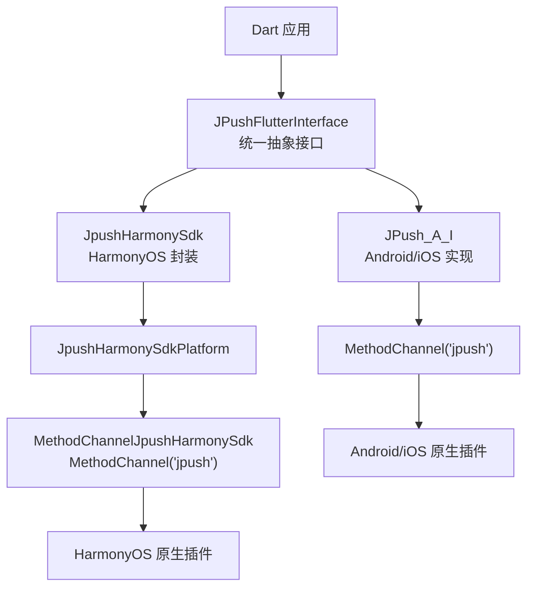
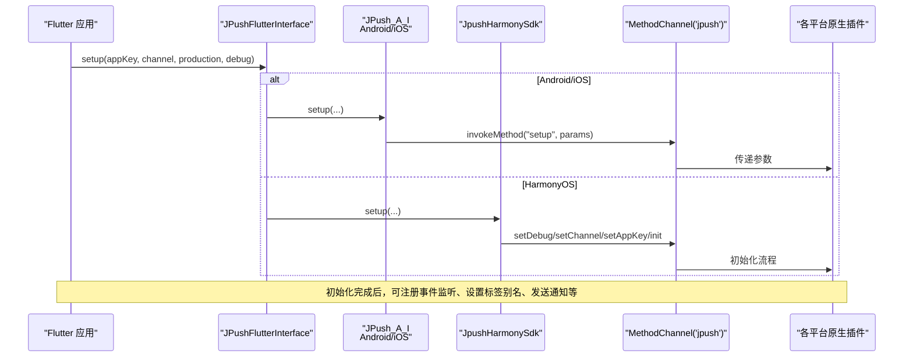
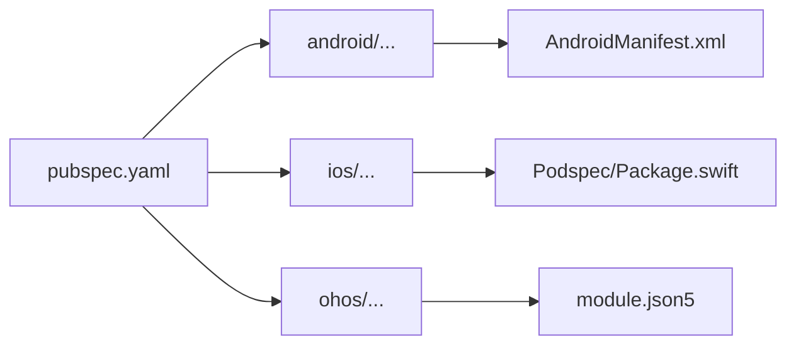
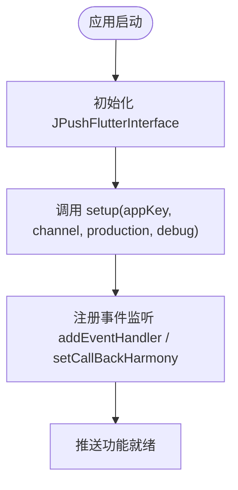

# 极光推送本地包 (jpush_flutter)

<cite>
**本文引用的文件**   
- [packages/jpush_flutter/pubspec.yaml](file://packages/jpush_flutter/pubspec.yaml)
- [packages/jpush_flutter/README.md](file://packages/jpush_flutter/README.md)
- [packages/jpush_flutter/README_Harmony.md](file://packages/jpush_flutter/README_Harmony.md)
- [packages/jpush_flutter/documents/APIs.md](file://packages/jpush_flutter/documents/APIs.md)
- [packages/jpush_flutter/lib/jpush_interface.dart](file://packages/jpush_flutter/lib/jpush_interface.dart)
- [packages/jpush_flutter/lib/android_ios/jpush_flutter_a_i.dart](file://packages/jpush_flutter/lib/android_ios/jpush_flutter_a_i.dart)
- [packages/jpush_flutter/lib/harmony/jpush_harmony_sdk.dart](file://packages/jpush_flutter/lib/harmony/jpush_harmony_sdk.dart)
- [packages/jpush_flutter/lib/harmony/jpush_harmony_sdk_method_channel.dart](file://packages/jpush_flutter/lib/harmony/jpush_harmony_sdk_method_channel.dart)
- [packages/jpush_flutter/lib/harmony/jpush_harmony_sdk_platform_interface.dart](file://packages/jpush_flutter/lib/harmony/jpush_harmony_sdk_platform_interface.dart)
- [packages/jpush_flutter/android/src/main/AndroidManifest.xml](file://packages/jpush_flutter/android/src/main/AndroidManifest.xml)
- [ios/Runner/Info.plist](file://ios/Runner/Info.plist)
- [docs/push_guide.md](file://docs/push_guide.md)
</cite>

## 目录
1. [简介](#简介)
2. [项目结构](#项目结构)
3. [核心组件](#核心组件)
4. [架构总览](#架构总览)
5. [详细组件分析](#详细组件分析)
6. [依赖关系分析](#依赖关系分析)
7. [平台配置指南](#平台配置指南)
8. [Flutter 3.29+ 厂商通道点击白屏问题](#flutter-329-厂商通道点击白屏问题)
9. [初始化与 API 使用](#初始化与-api-使用)
10. [错误处理与排错](#错误处理与排错)
11. [性能考虑](#性能考虑)
12. [结论](#结论)

## 简介
本包是极光推送官方支持的 Flutter 插件，当前版本为 3.5.8，支持 Android、iOS 和 HarmonyOS 三个平台。其 Dart 层通过统一的 `JPushFlutterInterface` 抽象，分别由 Android/iOS 的 MethodChannel 实现和 HarmonyOS 的平台接口实现，从而在 Flutter 应用中提供一致的推送能力：包括初始化、标签别名管理、通知与自定义消息事件、本地通知、推送开关控制等。

该仓库还包含业务侧对推送的封装与接入说明，用于指导「灵犀管店」App 如何使用 jpush_flutter 完成推送集成。

**章节来源**
- [packages/jpush_flutter/pubspec.yaml:1-12](file://packages/jpush_flutter/pubspec.yaml#L1-L12)
- [docs/push_guide.md:1-20](file://docs/push_guide.md#L1-L20)

## 项目结构
jpush_flutter 本地包的核心目录如下：

- lib
  - jpush_interface.dart：统一抽象接口
  - android_ios/jpush_flutter_a_i.dart：Android/iOS 实现
  - harmony/jpush_harmony_sdk.dart：HarmonyOS 上层封装
  - harmony/jpush_harmony_sdk_platform_interface.dart：HarmonyOS 平台接口
  - harmony/jpush_harmony_sdk_method_channel.dart：HarmonyOS MethodChannel 实现
- android/src/main/AndroidManifest.xml：Android 原生 Receiver/Service 声明
- ohos/…：鸿蒙模块描述与清单
- documents/APIs.md：API 文档
- README.md / README_Harmony.md：使用说明与鸿蒙说明

**图示来源**
- [packages/jpush_flutter/lib/jpush_interface.dart:1-60](file://packages/jpush_flutter/lib/jpush_interface.dart#L1-L60)
- [packages/jpush_flutter/lib/android_ios/jpush_flutter_a_i.dart:1-60](file://packages/jpush_flutter/lib/android_ios/jpush_flutter_a_i.dart#L1-L60)
- [packages/jpush_flutter/lib/harmony/jpush_harmony_sdk.dart:1-40](file://packages/jpush_flutter/lib/harmony/jpush_harmony_sdk.dart#L1-L40)
- [packages/jpush_flutter/lib/harmony/jpush_harmony_sdk_platform_interface.dart:1-40](file://packages/jpush_flutter/lib/harmony/jpush_harmony_sdk_platform_interface.dart#L1-L40)
- [packages/jpush_flutter/lib/harmony/jpush_harmony_sdk_method_channel.dart:1-30](file://packages/jpush_flutter/lib/harmony/jpush_harmony_sdk_method_channel.dart#L1-L30)

**章节来源**
- [packages/jpush_flutter/pubspec.yaml:1-25](file://packages/jpush_flutter/pubspec.yaml#L1-L25)
- [packages/jpush_flutter/documents/APIs.md:1-40](file://packages/jpush_flutter/documents/APIs.md#L1-L40)

## 核心组件
- JPushFlutterInterface：定义所有平台的统一 API，包括 setup、addEventHandler、标签别名、通知、推送开关等。默认方法仅打印日志，具体行为由各平台实现类覆盖。
- JPush_A_I（Android/iOS）：基于 MethodChannel('jpush') 转发调用到原生端；负责平台差异分支（如 iOS-only 权限申请、Live Activity Token）。
- JpushHarmonySdk（HarmonyOS）：封装 HarmonyOS SDK 调用，并通过 PlatformInterface + MethodChannel 与原生侧交互。
- JpushHarmonySdkPlatform / MethodChannelJpushHarmonySdk：HarmonyOS 平台接口与方法通道实现，承载 HarmonyOS 专属能力（如 setCallBackHarmony）。

关键职责划分：
- 接口抽象：面向业务代码稳定，屏蔽平台差异。
- Android/iOS 实现：复用同一 MethodChannel，按平台特性分流。
- HarmonyOS 实现：独立平台接口与实现，保留鸿蒙特有回调机制。

**章节来源**
- [packages/jpush_flutter/lib/jpush_interface.dart:1-120](file://packages/jpush_flutter/lib/jpush_interface.dart#L1-L120)
- [packages/jpush_flutter/lib/android_ios/jpush_flutter_a_i.dart:1-120](file://packages/jpush_flutter/lib/android_ios/jpush_flutter_a_i.dart#L1-L120)
- [packages/jpush_flutter/lib/harmony/jpush_harmony_sdk.dart:1-60](file://packages/jpush_flutter/lib/harmony/jpush_harmony_sdk.dart#L1-L60)
- [packages/jpush_flutter/lib/harmony/jpush_harmony_sdk_platform_interface.dart:1-60](file://packages/jpush_flutter/lib/harmony/jpush_harmony_sdk_platform_interface.dart#L1-L60)

## 架构总览
下图展示 Flutter 应用如何通过统一接口与不同平台实现进行交互，并经由 MethodChannel 调用原生插件。

**图示来源**
- [packages/jpush_flutter/lib/jpush_interface.dart:10-40](file://packages/jpush_flutter/lib/jpush_interface.dart#L10-L40)
- [packages/jpush_flutter/lib/android_ios/jpush_flutter_a_i.dart:35-70](file://packages/jpush_flutter/lib/android_ios/jpush_flutter_a_i.dart#L35-L70)
- [packages/jpush_flutter/lib/harmony/jpush_harmony_sdk.dart:16-40](file://packages/jpush_flutter/lib/harmony/jpush_harmony_sdk.dart#L16-L40)
- [packages/jpush_flutter/lib/harmony/jpush_harmony_sdk_method_channel.dart:20-40](file://packages/jpush_flutter/lib/harmony/jpush_harmony_sdk_method_channel.dart#L20-L40)

**章节来源**
- [packages/jpush_flutter/lib/jpush_interface.dart:10-60](file://packages/jpush_flutter/lib/jpush_interface.dart#L10-L60)
- [packages/jpush_flutter/lib/android_ios/jpush_flutter_a_i.dart:35-120](file://packages/jpush_flutter/lib/android_ios/jpush_flutter_a_i.dart#L35-L120)
- [packages/jpush_flutter/lib/harmony/jpush_harmony_sdk.dart:16-60](file://packages/jpush_flutter/lib/harmony/jpush_harmony_sdk.dart#L16-L60)

## 详细组件分析

### JPushFlutterInterface（统一抽象接口）
- 暴露统一 API：setup、setChannelAndSound、setThirdToken、setUnShowAtTheForeground、setWakeEnable、enableAutoWakeup、setAuth、setLinkMergeEnable、setGeofenceEnable、setSmartPushEnable、setDataInsightsEnable、enableSDKLocalLog、readNewLogs、setCollectControl、addEventHandler、applyPushAuthority、pageEnterTo/pageLeave、标签别名管理、推送开关、本地通知、通知状态检查与跳转系统设置等。
- 默认实现多为打印日志或返回空值，实际逻辑由平台实现覆盖。
- 提供 NotificationSettingsIOS 与 LocalNotification 数据模型，便于跨平台传递通知参数。

复杂度与行为要点：
- addEventHandler 将多个回调聚合到一个方法中，简化事件订阅。
- turnOffPush/turnOnPush 语义区分“停止接收推送”和“停止推送服务（反注册）”，后者状态持久化。
- isPushStoppedAndroid/getPushStatus 提供推送状态查询能力。
- setBackgroundEnable 根据平台调用不同的原生方法名，保持 API 一致。

**章节来源**
- [packages/jpush_flutter/lib/jpush_interface.dart:1-200](file://packages/jpush_flutter/lib/jpush_interface.dart#L1-L200)
- [packages/jpush_flutter/lib/jpush_interface.dart:201-500](file://packages/jpush_flutter/lib/jpush_interface.dart#L201-L500)

### JPush_A_I（Android/iOS 实现）
- 构造时使用单例工厂模式，内部维护 MethodChannel('jpush')。
- setup 将 appKey、channel、production、debug 透传到原生。
- addEventHandler 通过 _handleMethod 分发 onReceiveNotification、onOpenNotification、onReceiveMessage、onConnected 等平台事件。
- 针对 iOS-only 的能力（applyPushAuthority、pageEnterTo/pageLeave、registerLiveActivityPushToken、registerLiveActivityPushToStartToken）做平台判断后调用。
- Android-only 的能力（isPushStoppedAndroid、requestSubscribeChannel、setLatestNotificationNumber）同样做平台判断。
- setBackgroundEnable 根据平台选择 setKeepLongConnInBackground 或 setBackgroundEnable。

典型调用链：
- Flutter -> JPush_A_I.setup -> MethodChannel.invokeMethod("setup") -> 原生插件初始化。
- 原生事件 -> MethodChannel 回调 -> _handleMethod -> 用户注册的 EventHandler。

**章节来源**
- [packages/jpush_flutter/lib/android_ios/jpush_flutter_a_i.dart:1-120](file://packages/jpush_flutter/lib/android_ios/jpush_flutter_a_i.dart#L1-L120)
- [packages/jpush_flutter/lib/android_ios/jpush_flutter_a_i.dart:201-704](file://packages/jpush_flutter/lib/android_ios/jpush_flutter_a_i.dart#L201-L704)

### JpushHarmonySdk（HarmonyOS 封装）
- 通过 JpushHarmonySdkImp 调用底层 SDK，对外暴露与统一接口一致的方法。
- setup 中设置 debug、channel、appKey，然后 init。
- 提供 getRegistrationID、标签别名、推送开关、本地通知、角标、心跳间隔等能力。
- 提供 setCallBackHarmony 以接收 HarmonyOS 特有事件回调。

**章节来源**
- [packages/jpush_flutter/lib/harmony/jpush_harmony_sdk.dart:1-146](file://packages/jpush_flutter/lib/harmony/jpush_harmony_sdk.dart#L1-L146)

### JpushHarmonySdkPlatform 与 MethodChannelJpushHarmonySdk
- PlatformInterface 抽象了 HarmonyOS 平台方法，默认实例为 MethodChannelJpushHarmonySdk。
- MethodChannelJpushHarmonySdk 通过 MethodChannel('jpush') 与原生侧通信，支持 setCallBack 设置回调处理器，并在收到调用时转发给上层。
- 定义了 HarmonyOS 特有的能力：setDebug、setAppKey、setChannel、setUserRequestNotificationPermission、init、getRegistrationId、标签别名、推送开关、本地通知、角标、心跳时间等。

**章节来源**
- [packages/jpush_flutter/lib/harmony/jpush_harmony_sdk_platform_interface.dart:1-134](file://packages/jpush_flutter/lib/harmony/jpush_harmony_sdk_platform_interface.dart#L1-L134)
- [packages/jpush_flutter/lib/harmony/jpush_harmony_sdk_method_channel.dart:1-142](file://packages/jpush_flutter/lib/harmony/jpush_harmony_sdk_method_channel.dart#L1-L142)

## 依赖关系分析
- pubspec.yaml 声明 Flutter 与 Dart SDK 环境要求，以及 flutter、plugin_platform_interface 依赖。
- 插件在 flutter.plugin.platforms 中声明 Android、iOS、ohos 三端的 pluginClass 与 package。
- Android 端通过 AndroidManifest.xml 声明 JPushEventReceiver 与 JPushCustomService。
- iOS 端通过 Podspec 与 Package.swift 暴露原生插件。
- HarmonyOS 端通过 ohos 目录中的 module.json5 与构建脚本声明模块。

**图示来源**
- [packages/jpush_flutter/pubspec.yaml:1-25](file://packages/jpush_flutter/pubspec.yaml#L1-L25)
- [packages/jpush_flutter/android/src/main/AndroidManifest.xml:1-40](file://packages/jpush_flutter/android/src/main/AndroidManifest.xml#L1-L40)
- [packages/jpush_flutter/ohos/src/main/module.json5:1-10](file://packages/jpush_flutter/ohos/src/main/module.json5#L1-L10)

**章节来源**
- [packages/jpush_flutter/pubspec.yaml:1-25](file://packages/jpush_flutter/pubspec.yaml#L1-L25)
- [packages/jpush_flutter/android/src/main/AndroidManifest.xml:1-40](file://packages/jpush_flutter/android/src/main/AndroidManifest.xml#L1-L40)

## 平台配置指南

### Android 配置
- 需要在应用的 build.gradle 中添加 manifestPlaceholders，包含：
  - JPUSH_PKGNAME：通常设置为 applicationId。
  - JPUSH_APPKEY：在极光官网注册的包名对应的 AppKey。
  - JPUSH_CHANNEL：渠道标识，可暂时使用默认值。
- 包内已声明 JPushEventReceiver 与 JPushCustomService，确保推送消息接收与长连接稳定性。

参考路径：
- [packages/jpush_flutter/README.md:12-36](file://packages/jpush_flutter/README.md#L12-L36)
- [packages/jpush_flutter/android/src/main/AndroidManifest.xml:1-40](file://packages/jpush_flutter/android/src/main/AndroidManifest.xml#L1-L40)

**章节来源**
- [packages/jpush_flutter/README.md:12-36](file://packages/jpush_flutter/README.md#L12-L36)
- [packages/jpush_flutter/android/src/main/AndroidManifest.xml:1-40](file://packages/jpush_flutter/android/src/main/AndroidManifest.xml#L1-L40)

### iOS 配置
- 在 Xcode 中开启 Push Notifications 能力。
- 如需使用 no-IDFA 版本，可在 Podfile 中指定 JCore 5.5.1-noidfa。
- 通过 applyPushAuthority 请求推送权限（iOS-only），该方法只弹出一次权限请求。
- Info.plist 中未直接配置推送相关字段，需通过 Xcode 能力与极光后台证书/token 鉴权完成。

参考路径：
- [packages/jpush_flutter/README.md:44-62](file://packages/jpush_flutter/README.md#L44-L62)
- [packages/jpush_flutter/lib/jpush_interface.dart:120-160](file://packages/jpush_flutter/lib/jpush_interface.dart#L120-L160)
- [ios/Runner/Info.plist:1-76](file://ios/Runner/Info.plist#L1-L76)

**章节来源**
- [packages/jpush_flutter/README.md:44-62](file://packages/jpush_flutter/README.md#L44-L62)
- [packages/jpush_flutter/lib/jpush_interface.dart:120-160](file://packages/jpush_flutter/lib/jpush_interface.dart#L120-L160)
- [ios/Runner/Info.plist:1-76](file://ios/Runner/Info.plist#L1-L76)

### HarmonyOS 配置
- 需在 hmos 平台开通推送服务并完成签名配置。
- 若需要获取通知数据，应在 EntryAbility 的 onCreate 与 onNewWant 中调用 JpushHarmonySdkPlugin.setClickWant(want, this.context)。
- 如需自定义信息，需创建 PushMessage.json 并在 module.json5 添加 proxyData，同时在 Ability 中使用 pushService.receiveMessage('BACKGROUND', ...) 接收消息。
- 通知扩展消息可通过 ExtensionAbility 继承 RemoteNotificationExtensionAbility，并在 onReceiveMessage 中调用 JPushInterface.receiveExtraDataMessage。

参考路径：
- [packages/jpush_flutter/README_Harmony.md:1-200](file://packages/jpush_flutter/README_Harmony.md#L1-L200)
- [packages/jpush_flutter/lib/harmony/jpush_harmony_sdk.dart:1-146](file://packages/jpush_flutter/lib/harmony/jpush_harmony_sdk.dart#L1-L146)
- [packages/jpush_flutter/ohos/src/main/module.json5:1-10](file://packages/jpush_flutter/ohos/src/main/module.json5#L1-L10)

**章节来源**
- [packages/jpush_flutter/README_Harmony.md:1-200](file://packages/jpush_flutter/README_Harmony.md#L1-L200)
- [packages/jpush_flutter/lib/harmony/jpush_harmony_sdk.dart:1-146](file://packages/jpush_flutter/lib/harmony/jpush_harmony_sdk.dart#L1-L146)
- [packages/jpush_flutter/ohos/src/main/module.json5:1-10](file://packages/jpush_flutter/ohos/src/main/module.json5#L1-L10)

## Flutter 3.29+ 厂商通道点击白屏问题
从 Flutter 3.29 起，FlutterActivity 默认开启深链接（flutter_deeplinking_enabled 默认为 true）。当 App 进程被杀后点击厂商通道离线推送时，拉起应用的 intent 携带的 URI（含 n_extra 参数）会被 Flutter 当作深链接路由解析，如果路由表中无对应页面，则出现白屏。

解决方案有两种：
- 方式一（推荐）：在 MainActivity 中重写 shouldHandleDeeplinking()，返回 false，禁用 Flutter 自动 deep link 处理。
- 方式二：在 AndroidManifest.xml 的主 Activity 中配置 meta-data flutter_deeplinking_enabled=false，效果与方式一等价。

该问题已在包的 README 中给出明确说明与示例。

**章节来源**
- [packages/jpush_flutter/README.md:16-43](file://packages/jpush_flutter/README.md#L16-L43)

## 初始化与 API 使用

### 初始化流程
- 在应用启动处引入 JPushFlutterInterface，并通过 JPush.newJPush() 获取实例。
- 调用 setup(appKey, production, channel, debug) 完成初始化，其他功能才能正常工作。
- 建议在 setup 之前注册事件监听（addEventHandler）与 HarmonyOS 回调（setCallBackHarmony）。

初始化流程图：

**图示来源**
- [packages/jpush_flutter/README.md:64-78](file://packages/jpush_flutter/README.md#L64-L78)
- [packages/jpush_flutter/lib/jpush_interface.dart:10-40](file://packages/jpush_flutter/lib/jpush_interface.dart#L10-L40)
- [packages/jpush_flutter/lib/android_ios/jpush_flutter_a_i.dart:35-70](file://packages/jpush_flutter/lib/android_ios/jpush_flutter_a_i.dart#L35-L70)
- [packages/jpush_flutter/lib/harmony/jpush_harmony_sdk.dart:16-40](file://packages/jpush_flutter/lib/harmony/jpush_harmony_sdk.dart#L16-L40)

### 主要 API 分类
- 通用 API：setup、getRegistrationID、stopPush/resumePush、isPushStoppedAndroid、getPushStatus、turnOffPush/turnOnPush、setLatestNotificationNumber、requestRequiredPermission、requestSubscribeChannel、setAlias/getAlias/deleteAlias、addTags/deleteTags/setTags/cleanTags/getTags。
- Android/iOS 共享：addEventHandler、getAllTags、sendLocalNotification、clearAllNotifications。
- iOS-only：applyPushAuthority、setBadge、getLaunchAppNotification、pageEnterTo/pageLeave、setBackgroundEnable、registerLiveActivityPushToken/registerLiveActivityPushToStartToken。
- HarmonyOS-only：setCallBackHarmony。

API 文档详见：
- [packages/jpush_flutter/documents/APIs.md:1-120](file://packages/jpush_flutter/documents/APIs.md#L1-L120)

**章节来源**
- [packages/jpush_flutter/documents/APIs.md:1-120](file://packages/jpush_flutter/documents/APIs.md#L1-L120)
- [packages/jpush_flutter/lib/jpush_interface.dart:1-200](file://packages/jpush_flutter/lib/jpush_interface.dart#L1-L200)
- [packages/jpush_flutter/lib/android_ios/jpush_flutter_a_i.dart:201-704](file://packages/jpush_flutter/lib/android_ios/jpush_flutter_a_i.dart#L201-L704)
- [packages/jpush_flutter/lib/harmony/jpush_harmony_sdk.dart:1-146](file://packages/jpush_flutter/lib/harmony/jpush_harmony_sdk.dart#L1-L146)

## 错误处理与排错
- 事件回调：addEventHandler 提供 onReceiveNotification、onOpenNotification、onReceiveMessage、onConnected、onInAppMessageClick/Show、onNotifyButtonClick、onCommandResult、onReceiveDeviceToken、onVoipMessage 等回调，便于统一处理推送生命周期。
- 连接状态：onConnected 回调中会统一 Android/iOS 的连接结果类型，保证 message["result"] 两端一致。
- 权限与设置：isNotificationEnabled 检测通知授权状态；openSettingsForNotification 跳转到系统设置界面；requestRequiredPermission 请求必要权限。
- 推送开关：stopPush/resumePush 控制是否接收推送；turnOffPush/turnOnPush 控制推送服务启停（状态持久化）。
- HarmonyOS 回调：setCallBackHarmony 用于接收鸿蒙侧的事件回调，建议放在 setup 之前。

常见排查点（来自业务接入文档）：
- 收不到推送：确认 appKey 与后台一致、包名一致、通知权限已开、极光后台推送记录存在。
- 应用被杀后收不到：未配置厂商通道或厂商通道配置错误。
- 点击通知白屏：已通过关闭 flutter_deeplinking_enabled 处理；仍白屏则检查 MainActivity 深链接配置。
- Release 包收不到：确认混淆 keep 规则生效。

**章节来源**
- [packages/jpush_flutter/lib/android_ios/jpush_flutter_a_i.dart:201-300](file://packages/jpush_flutter/lib/android_ios/jpush_flutter_a_i.dart#L201-L300)
- [packages/jpush_flutter/documents/APIs.md:1-120](file://packages/jpush_flutter/documents/APIs.md#L1-L120)
- [docs/push_guide.md:100-138](file://docs/push_guide.md#L100-L138)

## 性能考虑
- 长连接维持：Android 默认后台维持长连接，iOS 默认不维持；可通过 setBackgroundEnable 调整。
- 心跳间隔：可通过 setHBInterval 调整心跳时间，平衡功耗与实时性。
- 本地通知：LocalNotification 支持定时触发、角标、声音、子标题等属性，注意合理设置以避免频繁唤醒。
- 日志采集：enableSDKLocalLog 可启用 SDK 本地日志，并可选择上传至极光服务器，便于问题定位。

**章节来源**
- [packages/jpush_flutter/lib/android_ios/jpush_flutter_a_i.dart:600-704](file://packages/jpush_flutter/lib/android_ios/jpush_flutter_a_i.dart#L600-L704)
- [packages/jpush_flutter/lib/jpush_interface.dart:350-500](file://packages/jpush_flutter/lib/jpush_interface.dart#L350-L500)

## 结论
jpush_flutter 3.5.8 提供了跨平台的极光推送能力，通过统一接口屏蔽平台差异，支持 Android、iOS 与 HarmonyOS。在实际项目中，应重点关注：
- 正确配置 Android manifestPlaceholders、iOS Push Notifications 与 HarmonyOS 推送服务。
- 处理 Flutter 3.29+ 的深链接白屏问题。
- 在应用启动时完成 setup 与事件监听注册。
- 结合业务需求设置标签别名、通知权限、推送开关与本地通知。
- 使用 APIs 文档与业务接入指南进行排错与优化。