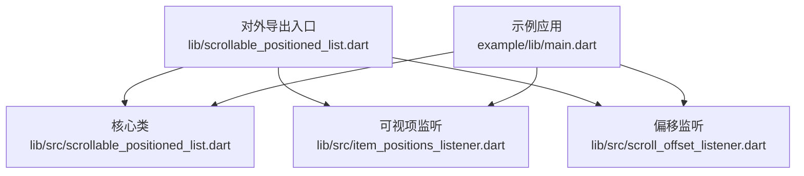
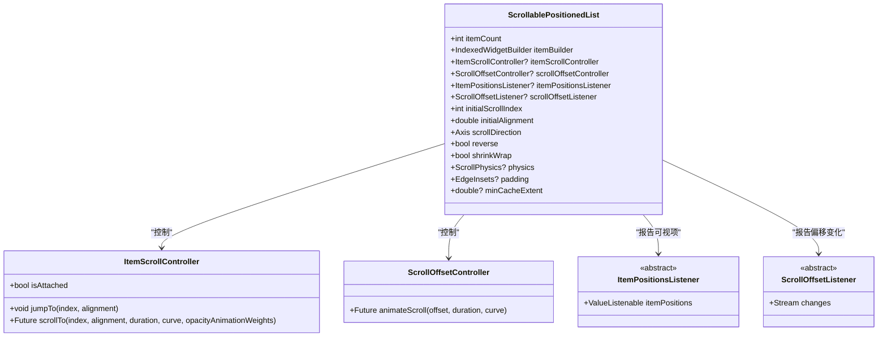
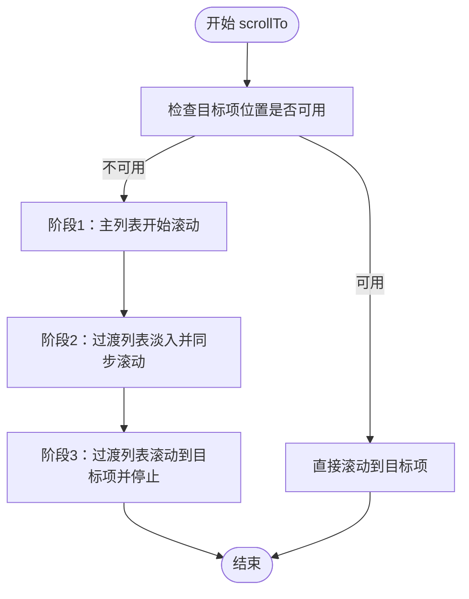
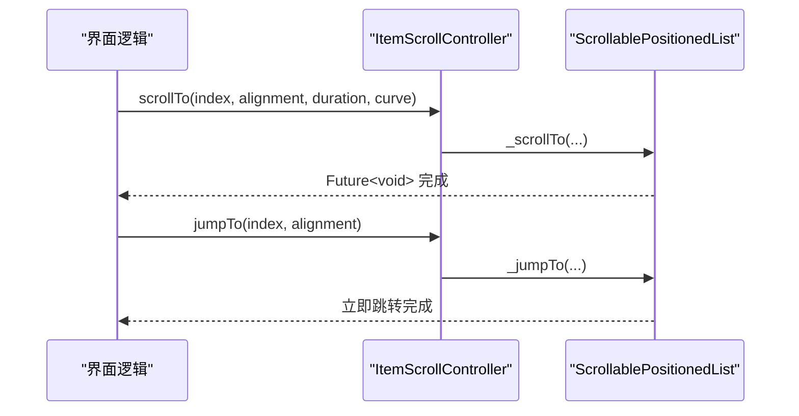
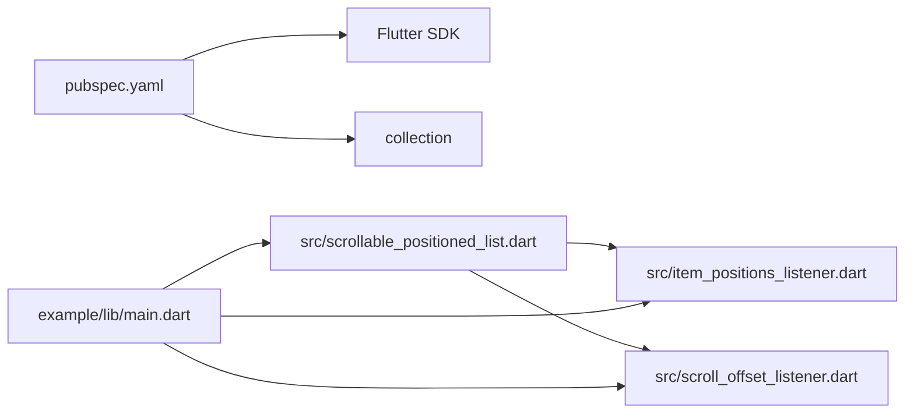

# 滚动列表本地包（scrollable_positioned_list）

<cite>
**本文引用的文件**
- [pubspec.yaml](file://packages/scrollable_positioned_list/pubspec.yaml)
- [README.md](file://packages/scrollable_positioned_list/README.md)
- [scrollable_positioned_list.dart](file://packages/scrollable_positioned_list/lib/scrollable_positioned_list.dart)
- [scrollable_positioned_list.dart](file://packages/scrollable_positioned_list/lib/src/scrollable_positioned_list.dart)
- [item_positions_listener.dart](file://packages/scrollable_positioned_list/lib/src/item_positions_listener.dart)
- [scroll_offset_listener.dart](file://packages/scrollable_positioned_list/lib/src/scroll_offset_listener.dart)
- [main.dart](file://packages/scrollable_positioned_list/example/lib/main.dart)
</cite>

## 目录
1. [简介](#简介)
2. [项目结构](#项目结构)
3. [核心组件](#核心组件)
4. [架构总览](#架构总览)
5. [详细组件分析](#详细组件分析)
6. [依赖关系分析](#依赖关系分析)
7. [性能与最佳实践](#性能与最佳实践)
8. [常见问题排查](#常见问题排查)
9. [结论](#结论)
10. [附录：完整示例路径](#附录完整示例路径)

## 简介
scrollable_positioned_list 是 Google Flutter widgets 官方仓库中的一个本地包，提供基于“索引”的滚动控制与可视项位置监控能力。它弥补了标准 ListView.builder 在“程序化滚动到指定项、获取当前可见项范围”等场景中的不足，特别适合大数据量、需要精确控制滚动目标项或追踪可视区域内容的业务。

该包的版本为 0.3.8，面向 Flutter >= 2.12.0、Dart SDK >= 2.15.0 < 4.0.0，依赖 collection 库，并仅使用 flutter sdk。

**章节来源**
- [pubspec.yaml:1-13](file://packages/scrollable_positioned_list/pubspec.yaml#L1-L13)

## 项目结构
本包采用“对外导出 + 内部实现”的分层组织方式：
- 对外导出入口：lib/scrollable_positioned_list.dart 统一暴露关键类型。
- 核心实现：lib/src/ 下包含滚动控制、偏移监听、可视项监听、底层列表布局等模块。
- 示例：example/lib/main.dart 演示了滚动、跳转、偏移动画和可视项监控的完整用法。

**图表来源**
- [scrollable_positioned_list.dart](file://packages/scrollable_positioned_list/lib/scrollable_positioned_list.dart)
- [scrollable_positioned_list.dart](file://packages/scrollable_positioned_list/lib/src/scrollable_positioned_list.dart)
- [item_positions_listener.dart](file://packages/scrollable_positioned_list/lib/src/item_positions_listener.dart)
- [scroll_offset_listener.dart](file://packages/scrollable_positioned_list/lib/src/scroll_offset_listener.dart)
- [main.dart](file://packages/scrollable_positioned_list/example/lib/main.dart)

**章节来源**
- [scrollable_positioned_list.dart](file://packages/scrollable_positioned_list/lib/scrollable_positioned_list.dart)
- [scrollable_positioned_list.dart](file://packages/scrollable_positioned_list/lib/src/scrollable_positioned_list.dart)
- [item_positions_listener.dart](file://packages/scrollable_positioned_list/lib/src/item_positions_listener.dart)
- [scroll_offset_listener.dart](file://packages/scrollable_positioned_list/lib/src/scroll_offset_listener.dart)
- [main.dart](file://packages/scrollable_positioned_list/example/lib/main.dart)

## 核心组件
- ScrollablePositionedList：类似 ListView.builder 的可滚动列表，支持按索引滚动、对齐、反转、缓存等参数，并通过控制器与监听器扩展能力。
- ItemScrollController：用于跳转到或平滑滚动到指定索引位置的控制器。
- ScrollOffsetController：基于像素偏移量的相对滚动控制器（实验性 API）。
- ItemPositionsListener：监听当前部分或完全可见的项及其在视口中的相对边缘位置。
- ScrollOffsetListener：监听滚动偏移量的变化增量（实验性 API）。

这些组件共同构成“控制 + 观察”的双向接口：既可以从外部驱动滚动，也可以从内部观察滚动带来的可视项变化与像素级偏移变化。

**章节来源**
- [README.md:1-74](file://packages/scrollable_positioned_list/README.md#L1-L74)
- [scrollable_positioned_list.dart](file://packages/scrollable_positioned_list/lib/src/scrollable_positioned_list.dart)
- [item_positions_listener.dart](file://packages/scrollable_positioned_list/lib/src/item_positions_listener.dart)
- [scroll_offset_listener.dart](file://packages/scrollable_positioned_list/lib/src/scroll_offset_listener.dart)

## 架构总览
ScrollablePositionedList 的内部通过两个底层列表视图协作完成长距离滚动：主列表负责稳定显示，过渡列表负责在远距滚动时进行交叉淡入淡出，从而实现更自然的视觉过渡。同时，它将滚动状态与可视项位置、像素偏移变化分别通过不同的监听器上报给调用方。

**图表来源**
- [scrollable_positioned_list.dart](file://packages/scrollable_positioned_list/lib/src/scrollable_positioned_list.dart)
- [item_positions_listener.dart](file://packages/scrollable_positioned_list/lib/src/item_positions_listener.dart)
- [scroll_offset_listener.dart](file://packages/scrollable_positioned_list/lib/src/scroll_offset_listener.dart)

## 详细组件分析

### ScrollablePositionedList 与构造参数
- 构造方式：提供 builder 与 separated 两种构造方式，行为与 ListView 相近。
- 关键参数：
  - itemCount、itemBuilder：数据源与构建回调。
  - itemScrollController、scrollOffsetController：分别用于“按索引滚动/跳转”和“按像素偏移滚动”。
  - itemPositionsListener、scrollOffsetListener：分别用于“可视项位置监听”和“滚动偏移变化监听”。
  - initialScrollIndex、initialAlignment：初始滚动目标项及对齐方式。
  - scrollDirection、reverse、physics、shrinkWrap、padding、minCacheExtent 等：继承 ScrollView 的通用滚动配置。
- 内部机制：
  - 使用两个底层列表视图（primary 与 secondary）协同工作，以实现长距离滚动的三段式动画与交叉淡入淡出效果。
  - 将用户手势与程序化滚动产生的偏移增量，通过 ScrollOffsetNotifier 上报。

典型使用方式见示例页面中构造 ScrollablePositionedList.builder 并注入四个控制器/监听器的做法。

**章节来源**
- [scrollable_positioned_list.dart](file://packages/scrollable_positioned_list/lib/src/scrollable_positioned_list.dart)
- [main.dart](file://packages/scrollable_positioned_list/example/lib/main.dart)

### ItemScrollController：程序化滚动与跳转
- jumpTo(index, alignment)：立即跳转到指定索引项，并按 alignment 对齐视口。alignment 为主轴方向的归一化值，0 表示前缘对齐视口前缘，1 表示前缘对齐视口后缘，0.5 表示前缘对齐视口中线。
- scrollTo(index, alignment, duration, curve, opacityAnimationWeights)：以动画方式滚动到目标项。duration 必须大于零；curve 控制缓动曲线；opacityAnimationWeights 控制三段式过渡动画的不透明度权重，默认值为 [40, 20, 40]，可随曲线调整。
- isAttached：用于判断控制器是否已附着到某个 ScrollablePositionedList 实例，避免在未附着时调用导致异常。

动画三段式流程如下：

**图表来源**
- [scrollable_positioned_list.dart](file://packages/scrollable_positioned_list/lib/src/scrollable_positioned_list.dart)

调用时序示意：

**图表来源**
- [scrollable_positioned_list.dart](file://packages/scrollable_positioned_list/lib/src/scrollable_positioned_list.dart)

**章节来源**
- [scrollable_positioned_list.dart](file://packages/scrollable_positioned_list/lib/src/scrollable_positioned_list.dart)
- [README.md:1-74](file://packages/scrollable_positioned_list/README.md#L1-L74)

### ScrollOffsetController：相对像素偏移滚动
- animateScroll(offset, duration, curve)：在当前滚动偏移基础上增加 offset（正负均可），并以给定时长和曲线执行动画。
- 该 API 标记为实验性，行为可能在某些边界情况下未明确定义。

适用场景：
- 需要基于像素级别的细粒度滚动控制，如滑动手势叠加固定偏移、惯性滚动微调等。

**章节来源**
- [scrollable_positioned_list.dart](file://packages/scrollable_positioned_list/lib/src/scrollable_positioned_list.dart)
- [README.md:1-74](file://packages/scrollable_positioned_list/README.md#L1-L74)

### ItemPositionsListener：可视项位置监听
- 通过 ValueListenable<Iterable<ItemPosition>> itemPositions 暴露当前至少部分可见的项集合。
- ItemPosition 包含：
  - index：项索引。
  - itemLeadingEdge：项前缘相对于视口主轴长度的比例（可能为负数，表示部分可见）。
  - itemTrailingEdge：项后缘相对于视口主轴长度的比例（可能大于 1，表示部分可见）。

常见用法：
- 订阅 itemPositions 的变化，计算当前可视区域的第一个与最后一个可见项索引，用于高亮、懒加载、统计展示等。
- 示例代码展示了如何根据 itemTrailingEdge > 0 筛选首个可见项，以及根据 itemLeadingEdge < 1 筛选末个可见项。

性能注意事项：
- itemPositions 每帧更新一次，频繁重建昂贵 UI 会引发性能问题。建议在监听回调中进行轻量计算，并使用 ValueListenableBuilder 仅在必要时重绘。
- 避免在监听回调中触发 setState 的全局刷新，尽量局部更新或使用 Provider/Riverpod 等状态管理方案。

**章节来源**
- [item_positions_listener.dart](file://packages/scrollable_positioned_list/lib/src/item_positions_listener.dart)
- [main.dart](file://packages/scrollable_positioned_list/example/lib/main.dart)

### ScrollOffsetListener：滚动偏移变化监听
- 通过 Stream<double> changes 暴露滚动偏移的增量事件。
- 可通过 recordProgrammaticScrolls 控制是否记录程序化滚动产生的偏移变化。
- 该 API 为实验性，文档明确指出在某些情况下行为可能未明确定义。

典型用法：
- 累计增量得到当前绝对偏移量，用于自定义分页、滚动进度条、顶部栏渐隐等效果。

**章节来源**
- [scroll_offset_listener.dart](file://packages/scrollable_positioned_list/lib/src/scroll_offset_listener.dart)
- [README.md:1-74](file://packages/scrollable_positioned_list/README.md#L1-L74)

## 依赖关系分析
包的外部依赖非常简洁：
- flutter：SDK 依赖。
- collection：用于集合操作。

内部模块之间职责清晰：
- scrollable_positioned_list.dart（src）作为核心 Widget 与控制器实现。
- item_positions_listener.dart 提供可视项位置抽象与数据结构。
- scroll_offset_listener.dart 提供偏移监听抽象。
- example/lib/main.dart 作为集成示例，串联控制器与监听器。

**图表来源**
- [pubspec.yaml](file://packages/scrollable_positioned_list/pubspec.yaml)
- [scrollable_positioned_list.dart](file://packages/scrollable_positioned_list/lib/src/scrollable_positioned_list.dart)
- [item_positions_listener.dart](file://packages/scrollable_positioned_list/lib/src/item_positions_listener.dart)
- [scroll_offset_listener.dart](file://packages/scrollable_positioned_list/lib/src/scroll_offset_listener.dart)
- [main.dart](file://packages/scrollable_positioned_list/example/lib/main.dart)

**章节来源**
- [pubspec.yaml:1-13](file://packages/scrollable_positioned_list/pubspec.yaml#L1-L13)
- [scrollable_positioned_list.dart](file://packages/scrollable_positioned_list/lib/src/scrollable_positioned_list.dart)
- [item_positions_listener.dart](file://packages/scrollable_positioned_list/lib/src/item_positions_listener.dart)
- [scroll_offset_listener.dart](file://packages/scrollable_positioned_list/lib/src/scroll_offset_listener.dart)
- [main.dart](file://packages/scrollable_positioned_list/example/lib/main.dart)

## 性能与最佳实践
- 优先使用 builder 模式：与 ListView.builder 一样，ScrollablePositionedList 按需构建可见项，适合大数据量场景。
- 合理设置 minCacheExtent：对于长列表，适当增大缓存范围可减少滚动时的重新构建，但会占用更多内存。
- 谨慎使用 scrollTo 的动画权重：当使用非线性曲线（如 easeOut）时，可适当调整 opacityAnimationWeights，使过渡更自然。
- 节流可视化更新：对 itemPositions 的监听应只做轻量计算，并通过 ValueListenableBuilder 最小化重建范围。
- 避免重复创建控制器：ItemScrollController、ScrollOffsetController、ItemPositionsListener、ScrollOffsetListener 应在页面级别复用，避免每次 build 重建造成监听丢失或内存泄漏。
- 使用 align 参数优化首项定位：在跳转或滚动时传入合适的 alignment，提升用户体验。
- 注意实验性 API 的稳定性：ScrollOffsetListener 与 ScrollOffsetController 的行为在某些边界情况可能未明确定义，建议在生产环境中充分测试。

[本节为通用建议，不直接分析具体源码文件]

## 常见问题排查
- 在控制器未附着时调用 scrollTo/jumpTo/animateScroll：
  - 现象：抛出断言错误或空引用异常。
  - 处理：确保控制器已通过 ScrollablePositionedList 的参数注入并在 initState 之后使用；或通过 isAttached 判断后再调用。
- 动画 duration 为零：
  - 现象：assert 失败。
  - 处理：改用 jumpTo 实现无动画跳转。
- 可视项为空：
  - 现象：itemPositions 为空列表。
  - 处理：确认列表有数据且已渲染；在首次构建后可延迟读取或做空集合保护。
- 偏移监听不准确：
  - 现象：changes 流出现偏差或未触发。
  - 处理：确认未禁用程序化滚动记录；检查是否在过渡期间被过滤；理解其为实验性 API。

**章节来源**
- [scrollable_positioned_list.dart](file://packages/scrollable_positioned_list/lib/src/scrollable_positioned_list.dart)
- [scroll_offset_listener.dart](file://packages/scrollable_positioned_list/lib/src/scroll_offset_listener.dart)

## 结论
scrollable_positioned_list 提供了比标准 ListView.builder 更强大的程序化滚动与可视项监控能力。通过 ItemScrollController、ScrollOffsetController、ItemPositionsListener 与 ScrollOffsetListener，开发者可以在大数据列表中实现平滑滚动、精准定位、可视区域统计与像素级滚动控制。配合合理的缓存策略与监听回调优化，可在保证流畅体验的同时满足复杂业务需求。

[本节为总结性内容，不直接分析具体源码文件]

## 附录：完整示例路径
以下示例展示了如何在大数据列表中实现：
- 按钮点击后平滑滚动到指定索引项。
- 按钮点击后按像素偏移量滚动。
- 立即跳转到指定索引项。
- 实时显示第一个与最后一个可见项索引。

参考路径：
- [示例入口与控制器初始化](file://packages/scrollable_positioned_list/example/lib/main.dart)
- [滚动与跳转按钮实现](file://packages/scrollable_positioned_list/example/lib/main.dart)
- [可视项范围计算与展示](file://packages/scrollable_positioned_list/example/lib/main.dart)

**章节来源**
- [main.dart](file://packages/scrollable_positioned_list/example/lib/main.dart)