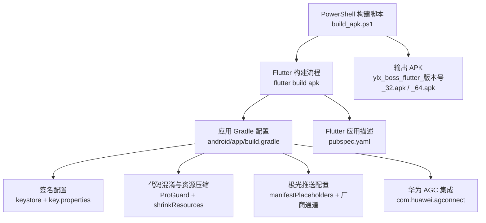
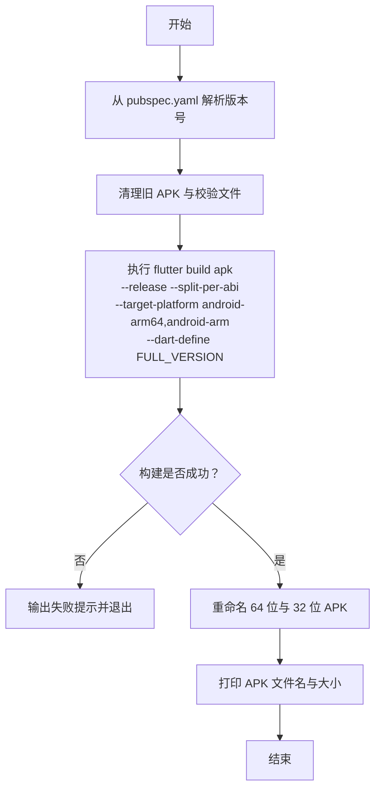
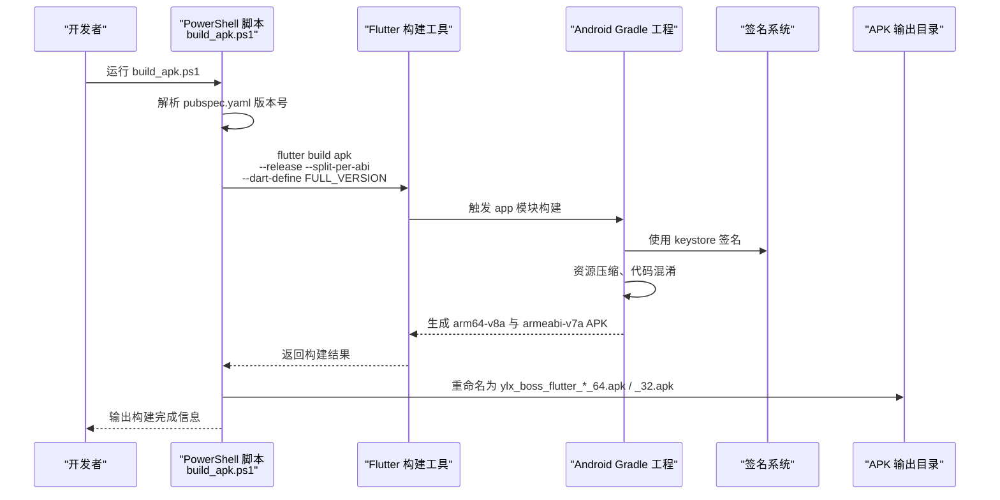
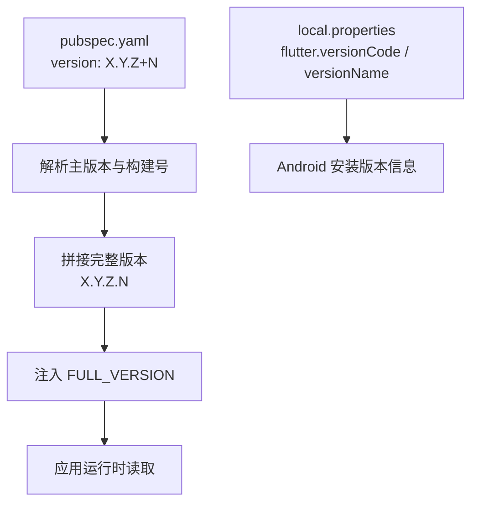
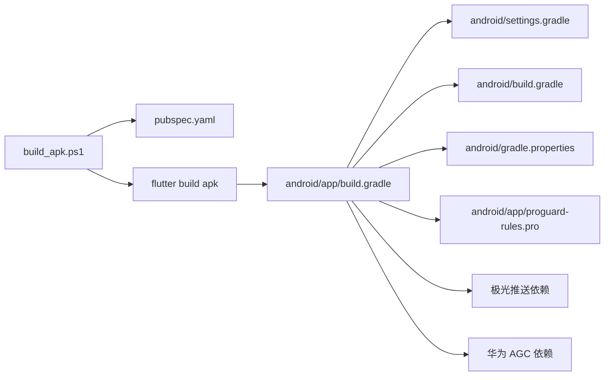

# Android 构建与打包

<cite>
**本文引用的文件**   
- [build_apk.ps1](file://build_apk.ps1)
- [android/app/build.gradle](file://android/app/build.gradle)
- [android/build.gradle](file://android/build.gradle)
- [android/gradle.properties](file://android/gradle.properties)
- [android/settings.gradle](file://android/settings.gradle)
- [android/app/proguard-rules.pro](file://android/app/proguard-rules.pro)
- [pubspec.yaml](file://pubspec.yaml)
- [docs/push_guide.md](file://docs/push_guide.md)
</cite>

## 目录

1. [简介](#简介)
2. [项目结构](#项目结构)
3. [核心组件](#核心组件)
4. [架构总览](#架构总览)
5. [详细组件分析](#详细组件分析)
6. [依赖关系分析](#依赖关系分析)
7. [性能与优化](#性能与优化)
8. [常见问题排查](#常见问题排查)
9. [结论](#结论)
10. [附录：本地配置模板](#附录本地配置模板)

## 简介

本文面向灵犀管店 Flutter 项目的 Android 构建与发布，重点说明以下内容：

- 如何使用根目录的 `build_apk.ps1` 脚本完成自动化 APK 构建、重命名和多架构拆分。
- 如何通过 `pubspec.yaml` 中的版本号生成并注入 `FULL_VERSION`，供应用运行时读取。
- Android Gradle 工程中的签名配置、代码混淆、资源压缩、JPush 厂商通道和华为 AGC 集成。
- `local.properties` 和 keystore 配置文件的作用及填写方式。
- 常见构建问题的定位方法和解决方案。

该文档不要求读者深入掌握 Gradle 或 Android 原生开发细节；对不熟悉 Android 工程的开发者也能按步骤完成本地构建与发布。

## 项目结构

Android 相关构建配置主要分布在以下位置：

| 路径 | 作用 |
|---|---|
| `build_apk.ps1` | PowerShell 构建入口，负责解析版本、清理产物、调用 Flutter 构建、按架构拆分并重命名 APK |
| `android/app/build.gradle` | 应用模块 Gradle 配置，包含应用包名、SDK 版本、签名、混淆、JPush、华为 AGC 等 |
| `android/build.gradle` | 根 Gradle 配置，定义仓库、AGP 版本复用策略 |
| `android/settings.gradle` | 插件加载与华为 AGConnect 插件映射 |
| `android/gradle.properties` | Gradle 运行参数、Kotlin 编译参数、JDK 路径等 |
| `android/app/proguard-rules.pro` | ProGuard/R8 混淆保留规则 |
| `pubspec.yaml` | Flutter 应用元数据，包括版本号 |
| `docs/push_guide.md` | 推送功能接入说明，补充 JPush 与厂商通道配置要点 |



**图表来源**  
- [build_apk.ps1:1-63](file://build_apk.ps1#L1-L63)  
- [android/app/build.gradle:1-119](file://android/app/build.gradle#L1-L119)  
- [pubspec.yaml:1-10](file://pubspec.yaml#L1-L10)

**章节来源**  
- [build_apk.ps1:1-63](file://build_apk.ps1#L1-L63)  
- [android/app/build.gradle:1-119](file://android/app/build.gradle#L1-L119)  
- [pubspec.yaml:1-10](file://pubspec.yaml#L1-L10)

## 核心组件

### 构建脚本 `build_apk.ps1`

`build_apk.ps1` 是 Android APK 构建的主要入口，承担以下职责：

1. **从 `pubspec.yaml` 解析版本号**  
   - 读取 `version:` 行，例如 `1.0.1+112`。
   - 将 `version+buildNumber` 转换为完整版本字符串 `1.0.1.112`。
   - 如果无法解析，则使用默认值 `unknown`。

2. **清理旧构建产物**  
   - 删除 `build\app\outputs\flutter-apk` 下的旧 `.apk` 与 `.sha1` 文件，避免历史产物干扰。

3. **执行 Flutter 构建**  
   - 使用 `--release` 模式。
   - 使用 `--split-per-abi` 拆分架构。
   - 指定目标平台为 `android-arm64,android-arm`，即只构建 64 位 arm64-v8a 和 32 位 armeabi-v7a，不构建 x86/x86_64 模拟器架构，以控制包体大小。
   - 通过 `--dart-define=FULL_VERSION=$fullVersion` 注入完整版本号。

4. **自动重命名 APK**  
   - 64 位 APK 重命名为 `ylx_boss_flutter_<完整版本号>_64.apk`。
   - 32 位 APK 重命名为 `ylx_boss_flutter_<完整版本号>_32.apk`。
   - 同时打印文件大小，方便确认是否成功产出。



**图表来源**  
- [build_apk.ps1:1-63](file://build_apk.ps1#L1-L63)

**章节来源**  
- [build_apk.ps1:1-63](file://build_apk.ps1#L1-L63)

### Flutter 应用版本与 Dart 定义注入

项目当前在 `pubspec.yaml` 中定义应用版本，例如：

- `version: 1.0.1+112`

构建脚本会将其转换为完整版本 `1.0.1.112`，并通过 `FULL_VERSION` 注入到 Flutter 应用中。应用侧可通过 `package_info_plus` 等机制配合 `FULL_VERSION` 显示版本号、进行版本检查或上报日志。

需要注意：

- `pubspec.yaml` 中的 `version` 用于 Flutter 侧构建与 `FULL_VERSION` 注入。
- `android/app/build.gradle` 还会从 `local.properties` 读取 `flutter.versionCode` 与 `flutter.versionName`，用于 Android 原生层的 `versionCode` 与 `versionName`。
- 两者应保持一致或保持可映射关系，避免应用内显示版本与系统安装信息不一致。

**章节来源**  
- [pubspec.yaml:1-10](file://pubspec.yaml#L1-L10)  
- [build_apk.ps1:1-63](file://build_apk.ps1#L1-L63)  
- [android/app/build.gradle:10-41](file://android/app/build.gradle#L10-L41)

### Android Gradle 应用配置

`android/app/build.gradle` 是 Android 端构建的核心配置，关键内容如下：

| 配置项 | 说明 |
|---|---|
| `applicationId` | 应用包名为 `com.boyou.lxboss`，需与极光后台、华为等平台登记的应用包名一致 |
| `compileSdkVersion` | 编译 SDK 版本为 36 |
| `targetSdkVersion` | 目标 SDK 版本为 35 |
| `minSdkVersion` | 最小 SDK 由 Flutter 配置决定 |
| `ndkVersion` | NDK 版本固定为 `28.2.13676358` |
| `versionCode` | 来自 `local.properties` 的 `flutter.versionCode` |
| `versionName` | 来自 `local.properties` 的 `flutter.versionName` |
| `signingConfigs.release` | 从 `app/key.properties` 读取 keystore 信息 |
| `debug` 与 `release` | 均启用 release 签名；release 开启资源压缩、ZipAlign、代码混淆 |
| `namespace` | 当前 Android namespace 为 `com.weilu.deer` |
| JPush 占位符 | 配置 `JPUSH_PKGNAME`、`JPUSH_APPKEY`、`JPUSH_CHANNEL` |
| OPPO 厂商通道占位符 | 配置 `OPPO_APPKEY`、`OPPO_APPID`、`OPPO_APPSECRET` |
| 华为厂商通道 | 引入 `cn.jiguang.sdk.plugin:huawei:6.2.1` |
| 佳博打印机 SDK | 通过 `libs` 目录引入 AAR 与 jar |

**章节来源**  
- [android/app/build.gradle:1-119](file://android/app/build.gradle#L1-L119)

### ProGuard 混淆规则

`android/app/proguard-rules.pro` 定义了代码混淆阶段的保留规则，主要包括：

| 类型 | 保留原因 |
|---|---|
| 高德地图定位与服务类 | 反射访问、模型序列化 |
| 佳博打印机 SDK | 原生打印库需要保留类 |
| JPush 极光推送 | 防止 release 混淆后反射调用失败 |
| 华为 HMS / AGConnect | 保留注解、内部类、反射入口 |

Release 构建会启用 `minifyEnabled true`，因此这些 keep 规则非常重要；若缺失可能导致地图、打印或推送功能异常。

**章节来源**  
- [android/app/proguard-rules.pro:1-53](file://android/app/proguard-rules.pro#L1-L53)  
- [android/app/build.gradle:58-83](file://android/app/build.gradle#L58-L83)

### JPush 厂商通道与华为 AGC 集成

#### JPush 基础配置

- 应用包名必须与极光后台创建的应用包名一致。
- `manifestPlaceholders` 中配置 `JPUSH_APPKEY`、`JPUSH_PKGNAME`、`JPUSH_CHANNEL`。
- 官方文档建议同步修改 `lib/push/push_config.dart` 中的 `appKey`，保持两端一致。

#### OPPO 厂商通道

项目中已添加 `cn.jiguang.sdk.plugin:oppo:6.2.1`，并在 `manifestPlaceholders` 中配置 OPPO 相关占位符。若未配置或为空，可能在 manifest 合并阶段报错。

#### 华为厂商通道

项目通过以下方式集成华为厂商通道：

- 应用层依赖 `cn.jiguang.sdk.plugin:huawei:6.2.1`。
- 根 Gradle 引入华为仓库 `https://developer.huawei.com/repo/`。
- `settings.gradle` 中将 `com.huawei.agconnect` 插件映射到 `com.huawei.agconnect:agcp:${requested.version}`。
- 应用层引入 `com.huawei.agconnect` 插件，用于生成华为应用配置资源。
- ProGuard 规则保留 `com.huawei.hms.**`、`com.huawei.agconnect.**` 等类。

**章节来源**  
- [android/app/build.gradle:1-119](file://android/app/build.gradle#L1-L119)  
- [android/build.gradle:1-36](file://android/build.gradle#L1-L36)  
- [android/settings.gradle:1-37](file://android/settings.gradle#L1-L37)  
- [android/app/proguard-rules.pro:35-53](file://android/app/proguard-rules.pro#L35-L53)  
- [docs/push_guide.md:1-138](file://docs/push_guide.md#L1-L138)

## 架构总览

下图展示从 PowerShell 脚本到 Android APK 产物的整体构建流程：



**图表来源**  
- [build_apk.ps1:1-63](file://build_apk.ps1#L1-L63)  
- [android/app/build.gradle:1-119](file://android/app/build.gradle#L1-L119)  
- [pubspec.yaml:1-10](file://pubspec.yaml#L1-L10)

## 详细组件分析

### 多架构拆分与输出文件命名

项目采用 `--split-per-abi` 生成两个独立 APK：

| 架构 | 对应 ABI | 输出文件名 |
|---|---|---|
| 64 位 ARM | `arm64-v8a` | `ylx_boss_flutter_<完整版本号>_64.apk` |
| 32 位 ARM | `armeabi-v7a` | `ylx_boss_flutter_<完整版本号>_32.apk` |

这种方式的优点是：

- 安装包体积更小，避免把 x86 模拟器架构打入正式包。
- 便于区分 32 位与 64 位版本，出现问题时可针对性回滚或复现。
- 文件名中包含完整版本号，便于归档、测试记录和发布追踪。

注意：

- 如果只构建了其中一个架构，另一个 APK 可能不存在，脚本会输出红色警告。
- 建议在 CI 环境中也验证两个 APK 是否都成功生成。

**章节来源**  
- [build_apk.ps1:1-63](file://build_apk.ps1#L1-L63)

### 版本号解析与 Dart 注入机制

版本号处理逻辑如下：

1. 读取 `pubspec.yaml` 的 `version:` 行。
2. 如果格式为 `X.Y.Z+N`，则拆分为 `X.Y.Z` 与 `N`。
3. 拼接为 `X.Y.Z.N` 作为 `FULL_VERSION`。
4. 通过 `--dart-define=FULL_VERSION` 注入到 Flutter 构建产物中。
5. Android 原生层仍使用 `local.properties` 中的 `flutter.versionCode` 与 `flutter.versionName`。

这意味着：

- 应用内显示的完整版本可用于日志、更新提示、问题反馈。
- Android 系统安装的版本名称应保持简洁，避免重复拼接 buildNumber。
- 如果 `pubspec.yaml` 中没有正确设置 `version:`，脚本会使用默认值 `unknown`，影响 APK 命名。



**图表来源**  
- [build_apk.ps1:1-63](file://build_apk.ps1#L1-L63)  
- [android/app/build.gradle:10-41](file://android/app/build.gradle#L10-L41)  
- [pubspec.yaml:1-10](file://pubspec.yaml#L1-L10)

**章节来源**  
- [build_apk.ps1:1-63](file://build_apk.ps1#L1-L63)  
- [android/app/build.gradle:10-41](file://android/app/build.gradle#L10-L41)  
- [pubspec.yaml:1-10](file://pubspec.yaml#L1-L10)

### 签名配置与 Keystore 管理

应用使用 release 签名配置，keystore 参数从 `app/key.properties` 读取：

| 字段 | 含义 |
|---|---|
| `keyAlias` | 密钥别名 |
| `keyPassword` | 密钥密码 |
| `storeFile` | keystore 文件路径 |
| `storePassword` | keystore 密码 |

`android/app/build.gradle` 中 `signingConfigs.release` 直接读取这些属性，并把 debug 与 release 构建都指向 release 签名。这样 `flutter run --release` 也能使用正式签名。

安全建议：

- `key.properties` 不应提交到版本库。
- keystore 文件应由团队统一保管，不建议放在共享盘或公开仓库中。
- CI 环境建议使用受控的密钥管理系统或加密变量注入。

**章节来源**  
- [android/app/build.gradle:42-60](file://android/app/build.gradle#L42-L60)

### 资源压缩与代码混淆

Release 构建启用了以下优化：

| 选项 | 作用 |
|---|---|
| `shrinkResources true` | 移除未使用的资源，减小包体 |
| `zipAlignEnabled true` | 对齐 zip 包，提升运行时内存效率 |
| `minifyEnabled true` | 启用代码混淆与压缩 |
| `proguardFiles` | 引用 Android 默认优化规则和项目自定义规则 |

ProGuard 规则中保留了高德地图、佳博打印机、极光推送、华为 HMS/AGConnect 等必要类，避免因混淆导致运行时异常。

**章节来源**  
- [android/app/build.gradle:58-83](file://android/app/build.gradle#L58-L83)  
- [android/app/proguard-rules.pro:1-53](file://android/app/proguard-rules.pro#L1-L53)

### local.properties 与版本管理

`android/app/build.gradle` 会从 `local.properties` 读取：

- `flutter.versionCode`
- `flutter.versionName`

这两个值分别用于 Android 原生层的 `versionCode` 与 `versionName`。建议：

- `flutter.versionCode` 使用递增整数，例如 `112`。
- `flutter.versionName` 使用人类可读的版本号，例如 `1.0.1`。
- `pubspec.yaml` 中的 `version` 应与 Android 版本保持一致或可映射。
- 不要把 keystore 敏感信息放入 `local.properties`；keystore 配置应放在 `app/key.properties`。

**章节来源**  
- [android/app/build.gradle:10-41](file://android/app/build.gradle#L10-L41)

## 依赖关系分析



**图表来源**  
- [build_apk.ps1:1-63](file://build_apk.ps1#L1-L63)  
- [android/app/build.gradle:1-119](file://android/app/build.gradle#L1-L119)  
- [android/build.gradle:1-36](file://android/build.gradle#L1-L36)  
- [android/settings.gradle:1-37](file://android/settings.gradle#L1-L37)  
- [android/gradle.properties:1-27](file://android/gradle.properties#L1-L27)  
- [pubspec.yaml:1-10](file://pubspec.yaml#L1-L10)

**章节来源**  
- [build_apk.ps1:1-63](file://build_apk.ps1#L1-L63)  
- [android/app/build.gradle:1-119](file://android/app/build.gradle#L1-L119)  
- [android/build.gradle:1-36](file://android/build.gradle#L1-L36)  
- [android/settings.gradle:1-37](file://android/settings.gradle#L1-L37)  
- [android/gradle.properties:1-27](file://android/gradle.properties#L1-L27)  
- [pubspec.yaml:1-10](file://pubspec.yaml#L1-L10)

## 性能与优化

### 构建性能优化

项目在 `android/gradle.properties` 中做了以下优化：

- 启用 Gradle 守护进程。
- 启用 Gradle 缓存。
- 关闭并行编译，避免内存紧张时 OOM。
- 限制 Kotlin 编译 daemon 内存。
- 禁用 Kotlin 增量编译，避免跨盘符路径异常。
- 指定 JDK 17 路径。

这些配置适合本机内存有限的环境，尤其是 Windows 上磁盘空间不足或页面文件占用较高时。

### APK 体积优化

- 使用 `--split-per-abi` 拆分架构。
- 仅构建 `android-arm64` 与 `android-arm`，跳过 x86 系列。
- Release 构建启用 `shrinkResources`、`zipAlignEnabled`、`minifyEnabled`。
- ProGuard 仅保留必要的第三方 SDK 类，减少无用代码。

### 依赖仓库优化

根 Gradle 引入了阿里云 Maven 镜像，有助于提升国内网络环境下依赖下载速度：

- `maven.aliyun.com/repository/public`
- `maven.aliyun.com/repository/gradle-plugin`
- `maven.aliyun.com/repository/central`
- `maven.aliyun.com/repository/google`

华为依赖还额外引入 `developer.huawei.com/repo`。

**章节来源**  
- [android/gradle.properties:1-27](file://android/gradle.properties#L1-L27)  
- [build_apk.ps1:1-63](file://build_apk.ps1#L1-L63)  
- [android/build.gradle:1-36](file://android/build.gradle#L1-L36)

## 常见问题排查

### 无法读取版本号

**现象：**  
APK 重命名为 `ylx_boss_flutter_unknown_64.apk` 或类似形式。

**可能原因：**  
`pubspec.yaml` 缺少 `version:` 行，或格式不符合预期。

**解决方法：**  
确保 `pubspec.yaml` 中存在形如 `version: 1.0.1+112` 的配置。

**章节来源**  
- [build_apk.ps1:1-24](file://build_apk.ps1#L1-L24)  
- [pubspec.yaml:1-10](file://pubspec.yaml#L1-L10)

### 未找到 arm64-v8a 或 armeabi-v7a APK

**现象：**  
脚本输出“未找到 app-arm64-v8a-release.apk”或“未找到 app-armeabi-v7a-release.apk”。

**可能原因：**  
- Flutter 构建失败。
- `--target-platform` 参数未被正确传递。
- 构建产物被手动删除或路径变更。

**解决方法：**  
重新运行 `build_apk.ps1`，查看 Flutter 构建日志；确认没有覆盖默认的 APK 输出目录。

**章节来源**  
- [build_apk.ps1:35-63](file://build_apk.ps1#L35-L63)

### manifest 合并失败或缺少占位符

**现象：**  
构建时报错，提示缺少 OPPO 或其他厂商通道占位符。

**可能原因：**  
`manifestPlaceholders` 中 OPPO 相关占位符未配置或为空。

**解决方法：**  
在 `android/app/build.gradle` 中补齐 `OPPO_APPKEY`、`OPPO_APPID`、`OPPO_APPSECRET`；或在极光后台配置对应厂商通道。

**章节来源**  
- [android/app/build.gradle:27-41](file://android/app/build.gradle#L27-L41)  
- [docs/push_guide.md:1-138](file://docs/push_guide.md#L1-L138)

### Release 包收不到推送

**现象：**  
Debug 包正常，Release 包无法接收推送。

**可能原因：**  
- ProGuard 混淆导致极光或华为 SDK 反射失败。
- 极光后台 `appKey` 与工程不一致。
- 厂商通道未在极光后台配置。

**解决方法：**  
- 确认 `android/app/proguard-rules.pro` 中已保留 JPush、HMS、AGConnect 相关类。
- 核对 `android/app/build.gradle` 与 `lib/push/push_config.dart` 中的 `appKey`。
- 在极光后台配置 OPPO、华为等厂商通道。

**章节来源**  
- [android/app/proguard-rules.pro:25-53](file://android/app/proguard-rules.pro#L25-L53)  
- [docs/push_guide.md:1-138](file://docs/push_guide.md#L1-L138)

### 签名错误

**现象：**  
构建报 keystore 找不到、密码错误或签名无效。

**可能原因：**  
- `app/key.properties` 中路径或密码错误。
- keystore 文件不在指定位置。
- keystore 别名或密码被修改。

**解决方法：**  
检查 `app/key.properties` 中 `storeFile`、`keyAlias`、`storePassword`、`keyPassword`；确认 keystore 文件存在且未被损坏。

**章节来源**  
- [android/app/build.gradle:42-60](file://android/app/build.gradle#L42-L60)

### Gradle 或 JDK 配置问题

**现象：**  
Gradle 初始化失败、Kotlin 编译失败、JDK 版本不匹配。

**可能原因：**  
- `android/gradle.properties` 中 `org.gradle.java.home` 指向的 JDK 不存在。
- JDK 版本不是 17。
- Kotlin 增量编译因跨盘符路径异常。

**解决方法：**  
- 确认 Eclipse Adoptium JDK 17 已安装，且路径与 `gradle.properties` 一致。
- 如需恢复 Kotlin 增量编译，请确认项目路径不再跨盘符。
- 调整 `org.gradle.jvmargs` 与 `kotlin.daemon.jvmargs` 以适应机器内存。

**章节来源**  
- [android/gradle.properties:1-27](file://android/gradle.properties#L1-L27)

### 华为 AGC 依赖拉取失败

**现象：**  
构建时无法拉取华为 AGConnect 或 HMS 相关依赖。

**可能原因：**  
- 网络无法访问 `developer.huawei.com/repo`。
- `settings.gradle` 中华为插件映射未生效。
- 根 Gradle 未引入华为仓库。

**解决方法：**  
- 检查代理或网络是否能访问华为仓库。
- 确认 `android/settings.gradle` 中 `com.huawei.agconnect` 插件映射存在。
- 确认 `android/build.gradle` 中已加入华为仓库。

**章节来源**  
- [android/settings.gradle:1-37](file://android/settings.gradle#L1-L37)  
- [android/build.gradle:1-36](file://android/build.gradle#L1-L36)

## 结论

灵犀管店 Android 构建体系围绕 `build_apk.ps1` 脚本组织，形成“版本解析 → Flutter 构建 → 多架构拆分 → 自动重命名”的完整闭环。Android Gradle 工程在此基础上提供签名、混淆、JPush 厂商通道和华为 AGC 集成能力。

对于日常开发与发布，推荐遵循以下实践：

- 始终通过 `build_apk.ps1` 构建，不要绕过脚本直接调用 `flutter build apk`。
- 维护 `pubspec.yaml` 中的 `version`，并与 `local.properties` 中的 `flutter.versionCode`、`flutter.versionName` 保持一致。
- 严格管理 keystore 与 `key.properties`，避免泄露。
- 发布前检查 JPush 与厂商通道配置，确保 Debug 与 Release 行为一致。
- 遇到问题时优先查看 Flutter 构建日志、Gradle 日志和极光推送接入文档。

## 附录：本地配置模板

### `local.properties` 示例

该文件用于 Flutter 与 Android 工程本地环境配置，其中 `flutter.sdk` 必须由 Flutter 工具自动生成或手动设置；`flutter.versionCode` 与 `flutter.versionName` 由版本管理流程维护。

```properties
flutter.sdk=/path/to/flutter
flutter.versionCode=112
flutter.versionName=1.0.1
```

### `app/key.properties` 示例

该文件用于 Android 签名配置，请勿提交到版本库。

```properties
keyAlias=my_alias
keyPassword=my_key_password
storeFile=/path/to/release.keystore
storePassword=my_store_password
```

**章节来源**  
- [android/app/build.gradle:10-60](file://android/app/build.gradle#L10-L60)