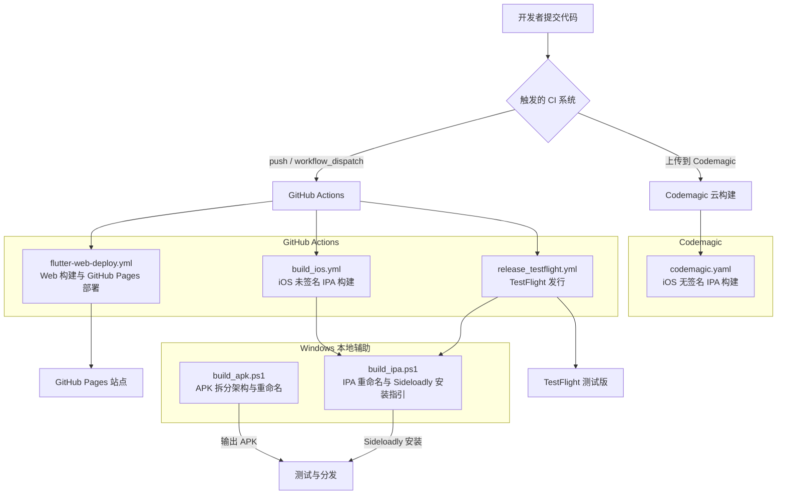
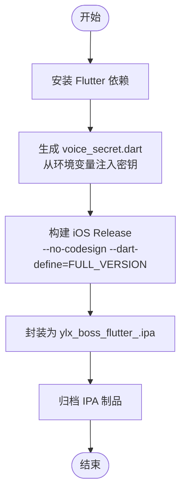
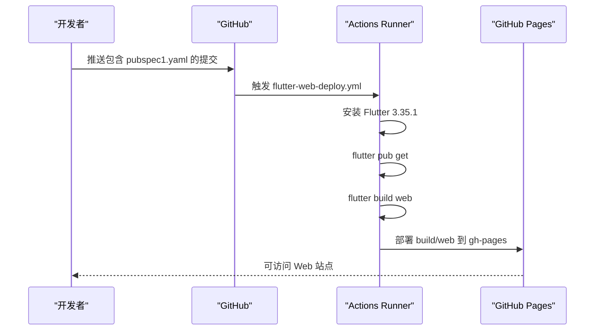
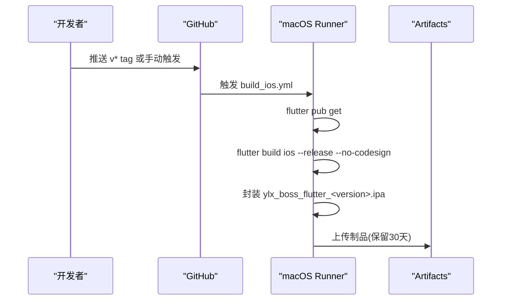
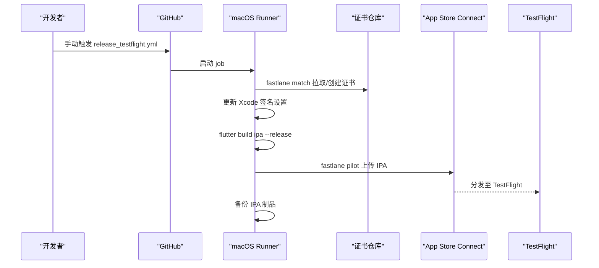
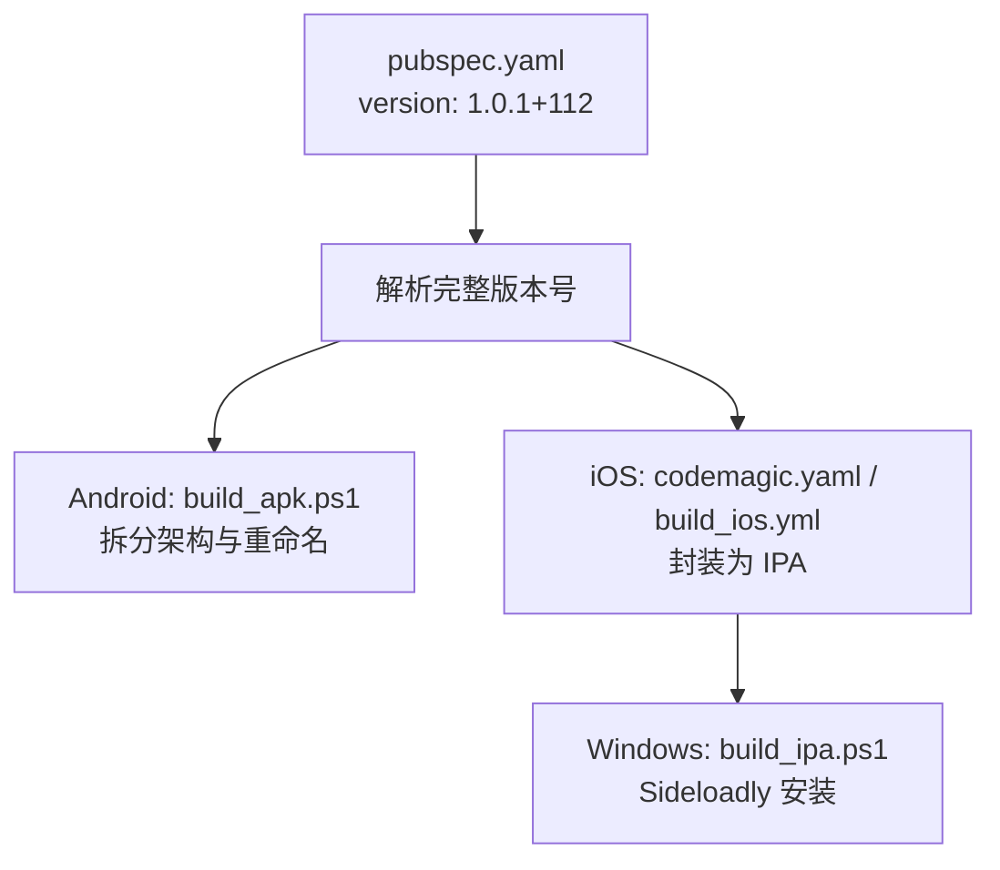
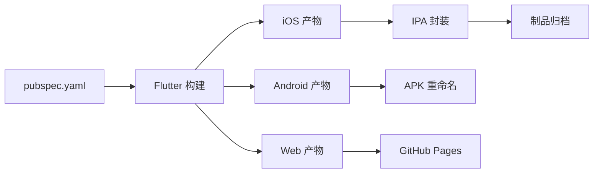

# CI/CD 流水线

<cite>
**本文引用的文件**   
- [codemagic.yaml](file://codemagic.yaml)
- [.github/workflows/flutter-web-deploy.yml](file://.github/workflows/flutter-web-deploy.yml)
- [.github/workflows/build_ios.yml](file://.github/workflows/build_ios.yml)
- [.github/workflows/release_testflight.yml](file://.github/workflows/release_testflight.yml)
- [pubspec.yaml](file://pubspec.yaml)
- [build_apk.ps1](file://build_apk.ps1)
- [build_ipa.ps1](file://build_ipa.ps1)
</cite>

## 目录
1. [引言](#引言)
2. [项目结构与流水线总览](#项目结构与流水线总览)
3. [Codemagic 云构建配置](#codemagic-云构建配置)
4. [GitHub Actions 工作流](#github-actions-工作流)
5. [版本管理与分支发布规则](#版本管理与分支发布规则)
6. [自动化测试与制品归档](#自动化测试与制品归档)
7. [依赖与触发条件分析](#依赖与触发条件分析)
8. [CI/CD 优化建议](#cicd-优化建议)
9. [监控、日志与问题诊断](#监控日志与问题诊断)
10. [结论](#结论)

## 引言
本文面向灵犀管店 Flutter 项目的 CI/CD 体系，重点说明以下能力：
- Codemagic 云构建：在无 Mac 环境下产出免签名 iOS IPA。
- GitHub Actions 工作流：Web 部署、iOS 未签名 IPA 构建、TestFlight 发行。
- 版本管理策略：基于 `pubspec.yaml` 的 `version` 字段与 Git tag。
- 制品归档：IPA/APK/Web 产物命名、保留期与下载方式。
- 优化与排障：缓存、并行、失败重试、密钥注入、证书链排查等。

当前仓库已实现“云构建 + 本地安装”和“云端 TestFlight 分发”两条主线；Android 侧提供 Windows 脚本辅助构建与重命名；Web 端通过 GitHub Pages 发布。

**章节来源**
- [README.md:1-210](file://README.md#L1-L210)

## 项目结构与流水线总览
本项目采用多平台 Flutter 工程结构，核心 CI/CD 配置文件分布如下：
- 根目录 `codemagic.yaml`：定义 Codemagic 工作流。
- `.github/workflows`：包含 Web 部署、iOS 构建、TestFlight 发布的 GitHub Actions 工作流。
- 根目录 PowerShell 脚本：`build_apk.ps1`、`build_ipa.ps1`，用于 Windows 环境下的 APK 重命名和 IPA 安装指引。
- `pubspec.yaml`：统一维护应用名称、描述、版本号与依赖。

**图表来源**
- [codemagic.yaml:1-47](file://codemagic.yaml#L1-L47)
- [.github/workflows/flutter-web-deploy.yml:1-30](file://.github/workflows/flutter-web-deploy.yml#L1-L30)
- [.github/workflows/build_ios.yml:1-50](file://.github/workflows/build_ios.yml#L1-L50)
- [.github/workflows/release_testflight.yml:1-130](file://.github/workflows/release_testflight.yml#L1-L130)
- [build_apk.ps1:1-63](file://build_apk.ps1#L1-L63)
- [build_ipa.ps1:1-68](file://build_ipa.ps1#L1-L68)

**章节来源**
- [codemagic.yaml:1-47](file://codemagic.yaml#L1-L47)
- [.github/workflows/flutter-web-deploy.yml:1-30](file://.github/workflows/flutter-web-deploy.yml#L1-L30)
- [.github/workflows/build_ios.yml:1-50](file://.github/workflows/build_ios.yml#L1-L50)
- [.github/workflows/release_testflight.yml:1-130](file://.github/workflows/release_testflight.yml#L1-L130)
- [build_apk.ps1:1-63](file://build_apk.ps1#L1-L63)
- [build_ipa.ps1:1-68](file://build_ipa.ps1#L1-L68)

## Codemagic 云构建配置
### 目标与适用场景
Codemagic 工作流用于在 macOS 云端机器上构建 iOS Release 包，但跳过签名步骤。产物为未签名 IPA，随后在 Windows 上使用 Sideloadly 配合免费 Apple ID 进行自签安装，适合快速内部测试。

### 工作流定义
- 工作流名称：`ios-test-build`
- 最大构建时长：60 分钟
- 环境变量：
  - `flutter: stable`
  - `cocoapods: default`
- 脚本阶段：
  1. 安装依赖：执行 Flutter 依赖获取。
  2. 生成语音识别密钥文件：从环境变量读取 `VOICE_APP_KEY`、`VOICE_ACCESS_KEY_ID`、`VOICE_ACCESS_KEY_SECRET`，并写入 `lib/util/voice_secret.dart`。
  3. 构建 iOS Release：使用 `--no-codesign` 构建，并通过 `dart-define=FULL_VERSION` 注入完整版本号。
  4. 封装为 IPA：将 `Runner.app` 打包成 Payload，命名为 `ylx_boss_flutter_<version>.ipa`。
- 制品归档：匹配 `ylx_boss_flutter_*.ipa`。

**图表来源**
- [codemagic.yaml:1-47](file://codemagic.yaml#L1-L47)

### 环境变量与密钥管理
- 必须配置的 Codemagic Secrets：
  - `VOICE_APP_KEY`
  - `VOICE_ACCESS_KEY_ID`
  - `VOICE_ACCESS_KEY_SECRET`
- 构建时若未配置，会生成空值占位文件，避免编译失败。
- 该机制适用于敏感参数不落地仓库的场景。

### 制品与安装流程
- 产物命名：`ylx_boss_flutter_<version>.ipa`
- 安装方式：
  - 在 Windows 上运行 `build_ipa.ps1 -IpaPath <下载的ipa路径>`。
  - 按提示使用 Sideloadly 安装到 iPhone。
  - 免费签名有效期约 7 天，过期后重新签名即可。

**章节来源**
- [codemagic.yaml:1-47](file://codemagic.yaml#L1-L47)
- [build_ipa.ps1:1-68](file://build_ipa.ps1#L1-L68)

## GitHub Actions 工作流
### Web 部署工作流
- 文件名：`.github/workflows/flutter-web-deploy.yml`
- 触发条件：仅当推送文件中包含一个不存在文件名 `pubspec1.yaml` 时触发（用于演示或特殊部署）。
- 主要步骤：
  1. 检出代码。
  2. 安装 Flutter 3.35.1 stable。
  3. 构建 Web。
  4. 使用 `JamesIves/github-pages-deploy-action` 部署到 `gh-pages` 分支的 `build/web` 目录。

**图表来源**
- [.github/workflows/flutter-web-deploy.yml:1-30](file://.github/workflows/flutter-web-deploy.yml#L1-L30)

**章节来源**
- [.github/workflows/flutter-web-deploy.yml:1-30](file://.github/workflows/flutter-web-deploy.yml#L1-L30)

### iOS 未签名 IPA 构建工作流
- 文件名：`.github/workflows/build_ios.yml`
- 触发条件：
  - 手动触发：Actions 页面选择 “Build iOS IPA”。
  - 自动触发：推送以 `v` 开头的 Git tag（例如 `v1.0.1.108`）。
- 主要步骤：
  1. 检出代码。
  2. 安装 Flutter 3.44.0 stable，启用缓存。
  3. 安装依赖。
  4. 构建 iOS Release：`--no-codesign --verbose --dart-define=FULL_VERSION`。
  5. 封装为 IPA：命名为 `ylx_boss_flutter_<version>.ipa`。
  6. 上传制品：保留 30 天。

**图表来源**
- [.github/workflows/build_ios.yml:1-50](file://.github/workflows/build_ios.yml#L1-L50)

**章节来源**
- [.github/workflows/build_ios.yml:1-50](file://.github/workflows/build_ios.yml#L1-L50)

### TestFlight 发行工作流
- 文件名：`.github/workflows/release_testflight.yml`
- 触发条件：手动触发。
- 前置 Secret：
  - `ASC_KEY_ID`
  - `ASC_ISSUER_ID`
  - `ASC_KEY_P8`
  - `APPLE_TEAM_ID`
  - `MATCH_PASSWORD`
  - `CERT_REPO_SSH_KEY`
- 主要步骤：
  1. 检出代码。
  2. 安装 Flutter 3.44.0 stable，启用缓存。
  3. 安装依赖。
  4. 安装 fastlane。
  5. 写入 App Store Connect API 密钥。
  6. 准备签名证书：使用 `fastlane match` 与私有证书仓库 `yigezzd/ylx-ios-certs`，创建临时钥匙串。
  7. 配置 Xcode 工程为手动签名。
  8. 构建发行 IPA：使用 `--build-number=${{ github.run_number }}` 和 `--dart-define=FULL_VERSION`。
  9. 上传 TestFlight：通过 fastlane pilot。
  10. 备份 IPA 产物：保留 30 天。

**图表来源**
- [.github/workflows/release_testflight.yml:1-130](file://.github/workflows/release_testflight.yml#L1-L130)

**章节来源**
- [.github/workflows/release_testflight.yml:1-130](file://.github/workflows/release_testflight.yml#L1-L130)

## 版本管理与分支发布规则
### 版本来源
- 应用版本由 `pubspec.yaml` 中的 `version` 字段决定，当前值为 `1.0.1+112`。
- 构建时通过解析该字段生成完整版本号，并注入 `FULL_VERSION` 供运行时使用。

### 分支与标签策略
- 测试型 iOS IPA：
  - 推荐通过 GitHub Actions 手动触发，或使用 `v*` 标签自动触发。
  - 产物命名遵循 `ylx_boss_flutter_<version>.ipa`。
- 发布型 TestFlight：
  - 通过手动触发，结合 App Store Connect API 与 fastlane match 完成签名与上传。
  - 构建号使用 `github.run_number`，避免重复上传被拒绝。

### Android 构建辅助
- `build_apk.ps1`：
  - 清理旧构建产物。
  - 执行 `flutter build apk --release --split-per-abi --target-platform android-arm64,android-arm`。
  - 重命名为 `ylx_boss_flutter_<version>_64.apk` 与 `ylx_boss_flutter_<version>_32.apk`。
- `build_ipa.ps1`：
  - 自动搜索最新 `.ipa` 文件并重命名为 `ylx_boss_flutter_<version>.ipa`。
  - 输出 Sideloadly 安装步骤。

**图表来源**
- [pubspec.yaml:1-153](file://pubspec.yaml#L1-L153)
- [build_apk.ps1:1-63](file://build_apk.ps1#L1-L63)
- [build_ipa.ps1:1-68](file://build_ipa.ps1#L1-L68)
- [codemagic.yaml:1-47](file://codemagic.yaml#L1-L47)
- [.github/workflows/build_ios.yml:1-50](file://.github/workflows/build_ios.yml#L1-L50)

**章节来源**
- [pubspec.yaml:1-153](file://pubspec.yaml#L1-L153)
- [build_apk.ps1:1-63](file://build_apk.ps1#L1-L63)
- [build_ipa.ps1:1-68](file://build_ipa.ps1#L1-L68)
- [codemagic.yaml:1-47](file://codemagic.yaml#L1-L47)
- [.github/workflows/build_ios.yml:1-50](file://.github/workflows/build_ios.yml#L1-L50)

## 自动化测试与制品归档
### 自动化测试现状
- `pubspec.yaml` 中声明了 `flutter_test` 与 `test` 依赖，但未在工作流中显式执行单元测试或集成测试命令。
- README 提到存在集成测试入口，但仓库中未见对应驱动脚本在当前 CI 中调用。
- 建议在新增 CI 任务中加入：
  - `flutter test`
  - `flutter drive`（如存在 driver 脚本）
  - 覆盖率报告上传（可选）

### 制品归档规范
- Codemagic：
  - 归档 `ylx_boss_flutter_*.ipa`。
- GitHub Actions：
  - iOS 未签名 IPA：`ylx_boss_flutter_<version>.ipa`，保留 30 天。
  - TestFlight 发行 IPA：`build/ios/ipa/*.ipa`，保留 30 天。
- Web：
  - 部署到 GitHub Pages 的 `build/web`。

**章节来源**
- [pubspec.yaml:1-153](file://pubspec.yaml#L1-L153)
- [codemagic.yaml:1-47](file://codemagic.yaml#L1-L47)
- [.github/workflows/build_ios.yml:1-50](file://.github/workflows/build_ios.yml#L1-L50)
- [.github/workflows/release_testflight.yml:1-130](file://.github/workflows/release_testflight.yml#L1-L130)
- [.github/workflows/flutter-web-deploy.yml:1-30](file://.github/workflows/flutter-web-deploy.yml#L1-L30)

## 依赖与触发条件分析
### 触发矩阵
| 流水线 | 触发方式 | 运行环境 | 主要产物 | 备注 |
|---|---|---|---|---|
| Web 部署 | push 包含 `pubspec1.yaml` | macOS-latest | GitHub Pages | 使用 Flutter 3.35.1 |
| iOS 构建 | 手动或 push `v*` 标签 | macOS-latest | `ylx_boss_flutter_<version>.ipa` | 使用 Flutter 3.44.0 |
| TestFlight | 手动 | macOS-latest | TestFlight 分发 | 需要 fastlane、match、App Store Connect API |
| Codemagic | 上传项目到 Codemagic | macOS 云机 | `ylx_boss_flutter_<version>.ipa` | 无签名，需 Sideloadly 安装 |

### 依赖关系图

**图表来源**
- [pubspec.yaml:1-153](file://pubspec.yaml#L1-L153)
- [.github/workflows/flutter-web-deploy.yml:1-30](file://.github/workflows/flutter-web-deploy.yml#L1-L30)
- [.github/workflows/build_ios.yml:1-50](file://.github/workflows/build_ios.yml#L1-L50)
- [build_apk.ps1:1-63](file://build_apk.ps1#L1-L63)

**章节来源**
- [.github/workflows/flutter-web-deploy.yml:1-30](file://.github/workflows/flutter-web-deploy.yml#L1-L30)
- [.github/workflows/build_ios.yml:1-50](file://.github/workflows/build_ios.yml#L1-L50)
- [.github/workflows/release_testflight.yml:1-130](file://.github/workflows/release_testflight.yml#L1-L130)
- [codemagic.yaml:1-47](file://codemagic.yaml#L1-L47)

## CI/CD 优化建议
### 并行构建
- 将 Android APK 构建、iOS 未签名 IPA 构建、Web 构建拆分为独立 job，并行执行。
- 对 iOS 和 Android 分别指定 runner 类型与 Flutter 版本，避免互相影响。

### 缓存策略
- 复用现有 `flutter-action` 的 `cache: true`，缓存 Flutter SDK、Pub 依赖、Pods。
- 增加 Gradle 缓存与 Maven 缓存（如有原生依赖）。
- 对 Pod 缓存使用 `actions/cache` 明确 key，提升 CocoaPods 拉取速度。

### 失败重试机制
- 对网络相关步骤（`flutter pub get`、`pod install`、fastlane）添加 `retry` 逻辑或多次尝试。
- 对证书导入、钥匙串操作增加幂等处理，避免首次创建失败导致后续步骤中断。

### 制品清理
- 设置合理的保留期（当前已设置为 30 天）。
- 对历史 Tag 构建产物做归档策略，避免 artifacts 无限增长。

### 安全与密钥
- 所有敏感信息使用 Secrets 管理，禁止硬编码。
- 对 App Store Connect API 密钥、SSH 私钥、Match 密码加强权限控制。
- 定期轮换密钥并审计访问日志。

[本节为通用优化建议，不直接分析具体文件]

## 监控、日志与问题诊断
### 流水线监控
- GitHub Actions：
  - 查看 Runs 列表，筛选特定 workflow。
  - 使用 Run number 定位具体构建。
  - 关注 job 状态与 step 耗时。
- Codemagic：
  - 在 Build 页面查看构建进度与 artifacts。
  - 检查环境变量是否缺失，尤其是语音密钥。

### 日志查看
- GitHub Actions：
  - 进入具体 Run，点击失败 step 查看详细日志。
  - 对 iOS 构建使用 `--verbose` 输出更详细错误。
- Codemagic：
  - 查看构建日志，确认 `flutter build ios --no-codesign` 是否成功。
  - 检查 `voice_secret.dart` 生成是否按预期。

### 常见问题与解决思路
- iOS 签名失败：
  - 使用 TestFlight 工作流时，检查 fastlane match 与证书仓库配置。
  - 确保临时钥匙串创建与解锁成功。
- 未找到 IPA：
  - 确认 GitHub Actions 已成功上传 artifacts。
  - 使用 `build_ipa.ps1` 自动查找最新 IPA。
- Web 部署失败：
  - 检查 `pubspec1.yaml` 触发条件是否符合预期。
  - 确认 `build/web` 是否存在且非空。
- Android APK 大小异常：
  - 检查 `build_apk.ps1` 是否正确拆分架构。
  - 清理旧构建产物后再构建。

**章节来源**
- [.github/workflows/build_ios.yml:1-50](file://.github/workflows/build_ios.yml#L1-L50)
- [.github/workflows/release_testflight.yml:1-130](file://.github/workflows/release_testflight.yml#L1-L130)
- [codemagic.yaml:1-47](file://codemagic.yaml#L1-L47)
- [build_apk.ps1:1-63](file://build_apk.ps1#L1-L63)
- [build_ipa.ps1:1-68](file://build_ipa.ps1#L1-L68)

## 结论
本项目已形成覆盖 Web、iOS、Android 的基础 CI/CD 能力：
- Codemagic 提供无签名 iOS 构建，配合 Sideloadly 实现快速内测。
- GitHub Actions 提供 Web 部署、iOS 未签名 IPA 构建与 TestFlight 发行。
- 版本管理以 `pubspec.yaml` 为中心，Git tag 作为发布信号。
- 制品命名统一、保留期可控，便于追溯与回滚。

建议下一步完善自动化测试接入、并行化构建与缓存优化，并建立统一的发布门禁与质量度量指标，进一步提升交付效率与稳定性。

[本节为总结性内容，不直接分析具体文件]