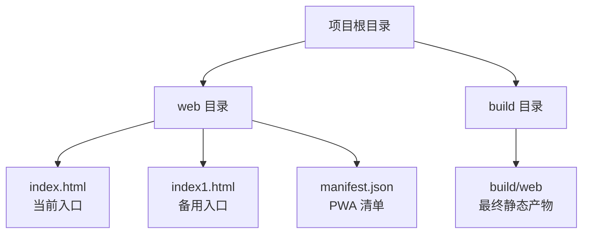
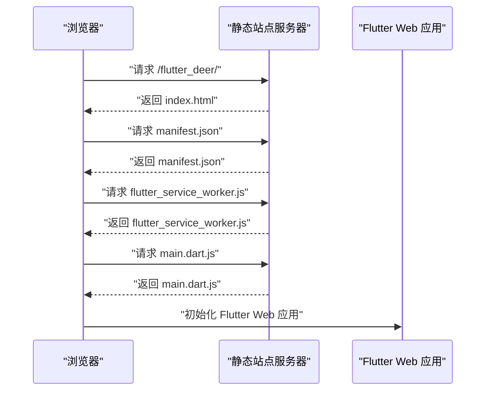
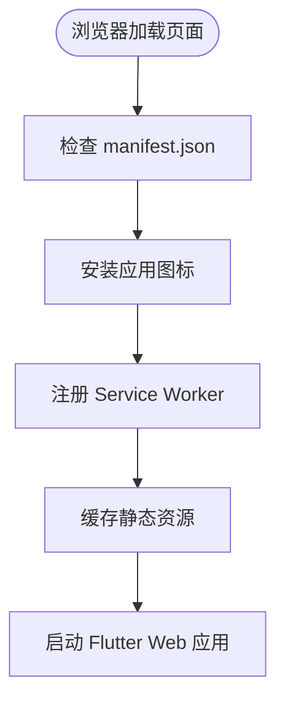
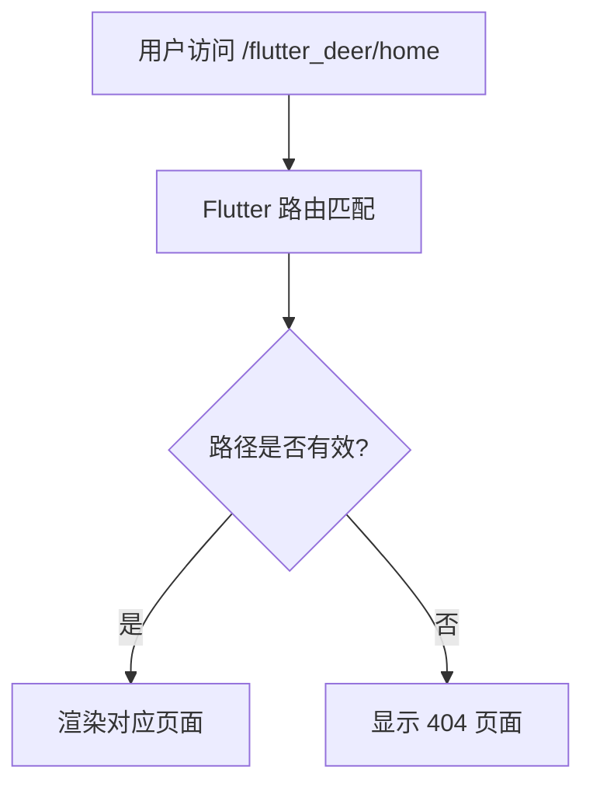

# Web 部署

<cite>
**本文引用的文件**
- [web/index.html](file://web/index.html)
- [web/index1.html](file://web/index1.html)
- [web/manifest.json](file://web/manifest.json)
- [pubspec.yaml](file://pubspec.yaml)
- [lib/main.dart](file://lib/main.dart)
- [.github/workflows/flutter-web-deploy.yml](file://.github/workflows/flutter-web-deploy.yml)
- [README.md](file://README.md)
</cite>

## 目录
1. [简介](#简介)
2. [项目结构与 Web 产物定位](#项目结构与-web-产物定位)
3. [Web 构建命令与输出结构](#web-构建命令与输出结构)
4. [入口文件与静态资源管理](#入口文件与静态资源管理)
5. [应用清单与 PWA 支持](#应用清单与-pwa-支持)
6. [路由策略与部署路径](#路由策略与部署路径)
7. [部署策略：托管、CDN 与浏览器兼容](#部署策略托管cdn-与浏览器兼容)
8. [性能优化建议](#性能优化建议)
9. [常见问题排查](#常见问题排查)
10. [生产环境最佳实践](#生产环境最佳实践)
11. [结论](#结论)

## 简介
本文件面向“灵犀管店”Flutter 项目的 Web 部署，说明如何构建 Flutter Web、理解 `web/index.html` 与 `web/manifest.json` 的作用、配置 PWA、选择托管平台并实现稳定上线。文档同时给出常见部署问题排查方法和生产环境建议，帮助开发者在 GitHub Pages、自建服务器、对象存储或 CDN 等环境中成功发布应用。

## 项目结构与 Web 产物定位
该仓库是一个多端 Flutter 项目，Web 相关静态资源集中在 `web` 目录中。核心文件包括：
- `web/index.html`：当前使用的 Web 入口页面。
- `web/index1.html`：另一个带 Service Worker 预加载逻辑的入口模板。
- `web/manifest.json`：PWA 应用清单。
- `build/web`：Flutter Web 构建产物目录（由 `flutter build web` 生成）。

**图表来源**
- [web/index.html:1-49](file://web/index.html#L1-L49)
- [web/index1.html:1-97](file://web/index1.html#L1-L97)
- [web/manifest.json:1-23](file://web/manifest.json#L1-L23)

**章节来源**
- [web/index.html:1-49](file://web/index.html#L1-L49)
- [web/index1.html:1-97](file://web/index1.html#L1-L97)
- [web/manifest.json:1-23](file://web/manifest.json#L1-L23)

## Web 构建命令与输出结构
### 构建命令
在项目根目录执行：
- `flutter build web`

该命令会编译 Dart 到 JavaScript，并生成完整的静态站点。默认输出目录为 `build/web`。GitHub Actions 中的部署工作流也使用该命令进行 Web 构建。

### 输出目录结构
`build/web` 是静态资源根目录，典型结构包括：
- `main.dart.js`：Dart 应用的 JS 入口。
- `flutter_service_worker.js`：Service Worker 脚本（用于 PWA 缓存与更新）。
- `assets/`：Flutter 打包后的资源目录，包含图片、字体、JSON 数据等。
- `icons/`、`favicon.png`：图标与网站图标。
- `index.html`：由 Flutter 生成的入口 HTML（也可使用自定义 `web/index.html`）。
- `version.json`：版本信息。

注意：如果使用了自定义 `web/index.html`，则部署时除了 `build/web` 中的内容，还需要将自定义入口和清单文件一并部署到目标站点根路径或指定子路径下。

**章节来源**
- [.github/workflows/flutter-web-deploy.yml:1-30](file://.github/workflows/flutter-web-deploy.yml#L1-L30)

## 入口文件与静态资源管理
### 当前入口文件 `web/index.html`
当前 Web 入口是 `web/index.html`，它负责：
- 设置 `<base href>`，决定应用在非根路径下的基础 URL。
- 设置页面标题、描述、Favicon 和 Apple 移动 Web 相关 meta。
- 引用 `manifest.json`，启用 PWA 应用清单。
- 注册 `flutter_service_worker.js`，提供 PWA 能力。
- 引入高德地图 Loader 脚本。
- 加载 `main.dart.js`，启动 Flutter Web 应用。

该入口没有使用复杂的前置加载逻辑，直接注册 Service Worker 并加载主 JS。

### 备用入口 `web/index1.html`
`web/index1.html` 提供了更详细的 Service Worker 预加载流程：
- 通过 `serviceWorkerVersion` 控制 Service Worker 版本。
- 先注册 Service Worker，再等待其激活后加载 `main.dart.js`。
- 若 Service Worker 长时间未就绪，则回退到直接加载 `main.dart.js`。
- 同样引用高德地图 Loader 和应用清单。

这两个入口都设置了相同的 `<base href="/flutter_deer/" />`，表示该应用在服务器上通常以 `/flutter_deer/` 作为基础路径。

### 静态资源管理
Flutter 在 `pubspec.yaml` 中声明了资源目录，例如：
- `assets/data/`
- `assets/images/`
- `assets/svg/`

这些资源会被 Flutter 构建过程打包进 `build/web/assets/`。由于项目还引入了高德地图等外部 JS 资源，需要在 `web/index.html` 或 `web/index1.html` 中正确引入对应脚本。

**图表来源**
- [web/index.html:1-49](file://web/index.html#L1-L49)
- [web/index1.html:1-97](file://web/index1.html#L1-L97)

**章节来源**
- [web/index.html:1-49](file://web/index.html#L1-L49)
- [web/index1.html:1-97](file://web/index1.html#L1-L97)
- [pubspec.yaml:1-153](file://pubspec.yaml#L1-L153)

## 应用清单与 PWA 支持
`web/manifest.json` 定义了 PWA 的基本元数据：
- `name`、`short_name`：应用名称。
- `start_url`：应用启动地址。
- `display`：设置为 `standalone`，使应用在独立窗口打开。
- `background_color`、`theme_color`：主题色。
- `orientation`：推荐竖屏。
- `icons`：定义 192x192 和 512x512 两个图标尺寸。

入口 HTML 通过 `<link rel="manifest" href="manifest.json" />` 引用清单，并在支持 Service Worker 的浏览器中注册 `flutter_service_worker.js`，从而实现离线缓存、后台更新等 PWA 特性。

**图表来源**
- [web/manifest.json:1-23](file://web/manifest.json#L1-L23)
- [web/index.html:27-49](file://web/index.html#L27-L49)

**章节来源**
- [web/manifest.json:1-23](file://web/manifest.json#L1-L23)
- [web/index.html:27-49](file://web/index.html#L27-L49)

## 路由策略与部署路径
### 路由策略
项目在 `lib/main.dart` 中调用 `setPathUrlStrategy()`，移除 URL 中的 `#`，使用 History API 实现干净的路由。该行为依赖 `url_strategy` 包，且仅对 Web 生效。

这意味着部署时必须确保服务器能正确处理所有前端路由，避免刷新页面时出现 404。

### 部署路径
入口 HTML 中的 `<base href="/flutter_deer/" />` 表明应用部署在 `/flutter_deer/` 路径下。因此：
- 应用应部署到服务器的 `/flutter_deer/` 目录下。
- 如果使用 GitHub Pages，应确保仓库名或分支名与路径一致。
- 如果使用自定义服务器，需要将所有前端路由重定向到 `index.html`。

**图表来源**
- [lib/main.dart:24-45](file://lib/main.dart#L24-L45)
- [web/index.html:12-15](file://web/index.html#L12-L15)

**章节来源**
- [lib/main.dart:24-45](file://lib/main.dart#L24-L45)
- [web/index.html:12-15](file://web/index.html#L12-L15)
- [pubspec.yaml:20-22](file://pubspec.yaml#L20-L22)

## 部署策略：托管、CDN 与浏览器兼容
### 静态文件托管
Flutter Web 是纯静态站点，可部署到任何支持静态文件的平台：
- GitHub Pages：适合演示和个人项目。
- Vercel、Netlify：适合现代前端部署。
- 阿里云 OSS、腾讯云 COS：对象存储 + CDN。
- Nginx、Apache：自建服务器。

### CDN 加速
建议开启 CDN 加速，尤其是图片和大体积 JS 文件。CDN 可以显著降低首屏加载时间，提升用户体验。

### 浏览器兼容性
Flutter Web 基于 Chromium 引擎，主要支持现代浏览器。对于较旧浏览器，可能出现功能缺失或性能下降。建议：
- 在目标平台中测试主流浏览器。
- 对不支持的浏览器提供降级提示。
- 避免使用过于前沿的 Web API。

**章节来源**
- [README.md:1-210](file://README.md#L1-L210)

## 性能优化建议
### 资源压缩
- 启用 Gzip 或 Brotli 压缩，减少传输体积。
- 使用 HTTP/2 或 HTTP/3 提升并发加载效率。

### 懒加载
- 将大型图片或视频资源改为按需加载。
- 使用 Flutter 的 `DeferredLoading` 或代码分割技术减少初始包大小。

### 缓存策略
- 利用 `flutter_service_worker.js` 缓存关键资源。
- 为静态资源设置长期缓存头，如 `Cache-Control: public, max-age=31536000`。
- 对动态资源设置较短缓存时间。

### 其他优化
- 使用 CDN 加速静态资源。
- 减少第三方库体积，按需引入。
- 监控和分析网络请求，识别瓶颈。

[本节为通用指导，不直接分析具体文件]

## 常见问题排查
### 问题一：部署后刷新页面出现 404
**原因**：服务器未将所有前端路由重定向到 `index.html`。  
**解决**：配置服务器将所有未知路径返回 `index.html`，让 Flutter 路由接管。

### 问题二：应用部署在非根路径下，资源路径错误
**原因**：`<base href>` 与实际部署路径不一致。  
**解决**：修改 `web/index.html` 中的 `<base href>`，使其与部署路径一致。

### 问题三：PWA 无法安装或缓存失效
**原因**：`manifest.json` 配置错误或 Service Worker 未正确注册。  
**解决**：检查清单文件路径、图标路径和 Service Worker 注册逻辑。

### 问题四：高德地图加载失败
**原因**：外部脚本加载失败或安全密钥配置错误。  
**解决**：检查高德地图脚本链接和安全密钥配置。

**章节来源**
- [web/index.html:1-49](file://web/index.html#L1-L49)
- [web/manifest.json:1-23](file://web/manifest.json#L1-L23)

## 生产环境最佳实践
- 始终使用 `flutter build web --release` 构建生产版本。
- 验证所有路由均可正常访问。
- 测试不同设备和浏览器的兼容性。
- 启用 HTTPS 和 CDN 加速。
- 配置合理的缓存策略和版本化文件名。
- 监控错误日志和用户反馈，持续优化性能。

[本节为通用指导，不直接分析具体文件]

## 结论
通过合理配置 `web/index.html`、`web/manifest.json` 和路由策略，并结合合适的托管平台和 CDN 加速，可以将“灵犀管店”Flutter Web 应用稳定部署到各种环境。遵循本文提供的构建命令、部署策略和优化建议，开发者可以有效提升应用的可访问性、性能和用户体验。

[本节为总结性内容，不直接分析具体文件]