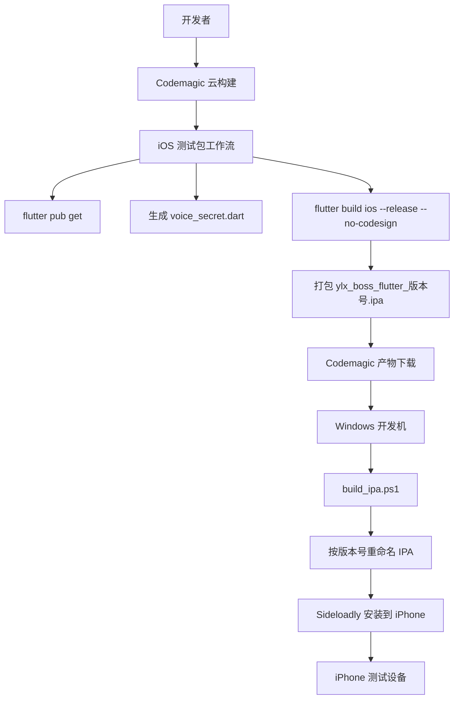
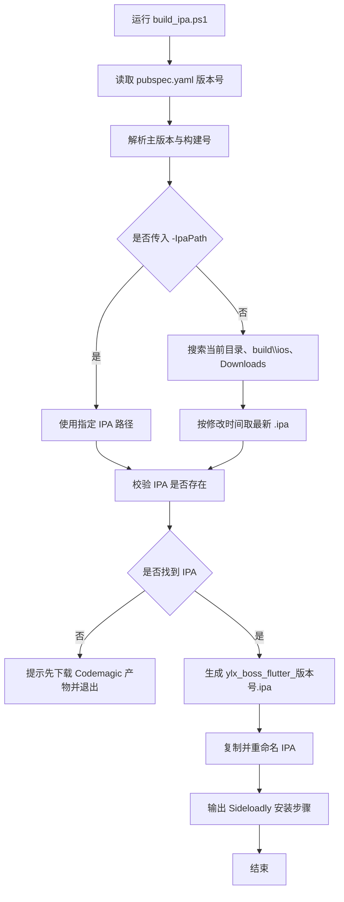
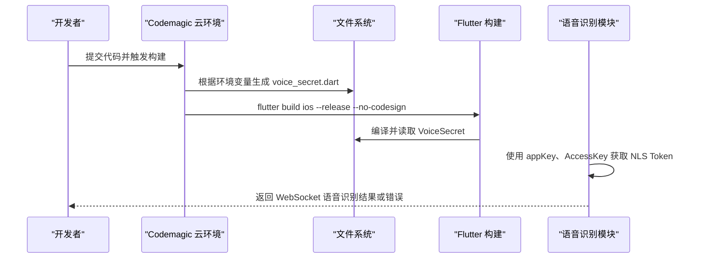
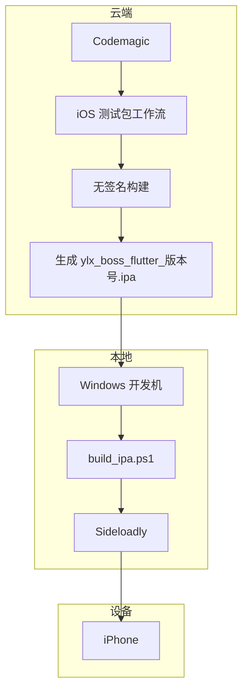
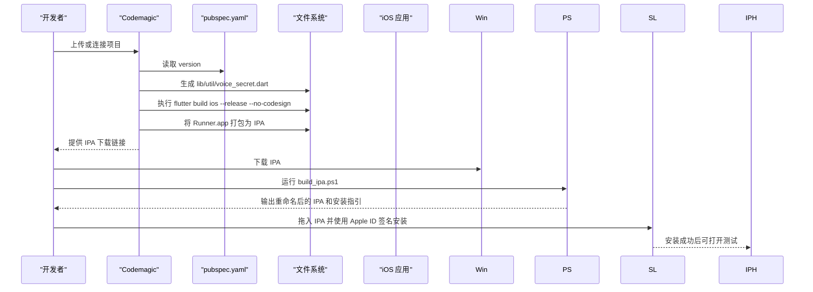
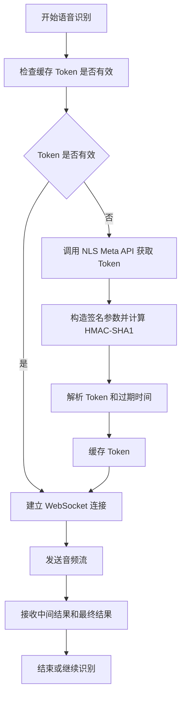
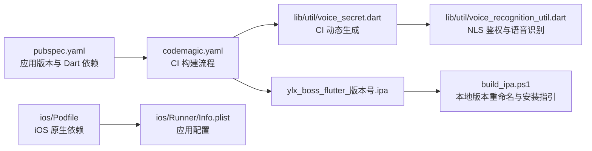

# iOS 构建与打包

<cite>
**本文引用的文件**   
- [codemagic.yaml](file://codemagic.yaml)
- [build_ipa.ps1](file://build_ipa.ps1)
- [ios/Runner/Info.plist](file://ios/Runner/Info.plist)
- [ios/Podfile](file://ios/Podfile)
- [lib/util/voice_secret.dart](file://lib/util/voice_secret.dart)
- [lib/util/voice_recognition_util.dart](file://lib/util/voice_recognition_util.dart)
- [docs/iOS问题汇总.md](file://docs/iOS问题汇总.md)
</cite>

## 目录

1. [引言](#引言)
2. [项目结构](#项目结构)
3. [核心组件](#核心组件)
4. [架构总览](#架构总览)
5. [详细组件分析](#详细组件分析)
6. [依赖关系分析](#依赖关系分析)
7. [性能与稳定性注意事项](#性能与稳定性注意事项)
8. [常见问题排查](#常见问题排查)
9. [结论](#结论)
10. [附录：推荐工作流](#附录推荐工作流)

## 引言

本文件面向灵犀管店 Flutter 项目的 iOS 测试包构建、打包和分发，重点说明以下内容：

- 在 Codemagic 云环境中执行无 Mac 环境下的 iOS Release 构建。
- 使用 `--no-codesign` 生成未签名 IPA，并通过 Sideloadly 在 Windows 上安装到 iPhone 进行内部测试。
- 本地 PowerShell 脚本 `build_ipa.ps1` 的自动化定位、版本号解析和安装指引。
- `Info.plist` 权限、应用标识、方向、网络访问等关键配置。
- `Podfile` 的 iOS 部署目标、CocoaPods 依赖管理和构建设置调整。
- 语音识别密钥的动态生成机制、运行时鉴权流程与安全建议。
- 团队可复用的 iOS 测试包构建流程、证书管理策略及故障处理方案。

## 项目结构

与 iOS 构建和打包直接相关的文件主要分布在以下位置：

| 路径 | 职责 |
|---|---|
| `codemagic.yaml` | 定义 Codemagic 云构建工作流、依赖安装、动态密钥生成、不签名构建与 IPA 产物输出 |
| `build_ipa.ps1` | Windows 端辅助脚本：自动查找 IPA、按版本号重命名、输出 Sideloadly 安装步骤 |
| `ios/Runner/Info.plist` | iOS 应用元数据、权限声明、界面方向、网络访问策略、出口合规标记 |
| `ios/Podfile` | CocoaPods 平台版本、Flutter 插件依赖、部署目标强制升级与构建设置 |
| `lib/util/voice_secret.dart` | 阿里云 NLS 语音识别密钥静态配置（本地私有） |
| `lib/util/voice_recognition_util.dart` | 阿里云 NLS Token 获取、WebSocket 语音识别调用逻辑 |
| `docs/iOS问题汇总.md` | CocoaPods CDN、Specs 源等历史问题的排查记录 |

**图表来源**
- [codemagic.yaml:1-47](file://codemagic.yaml#L1-L47)
- [build_ipa.ps1:1-68](file://build_ipa.ps1#L1-L68)

**章节来源**
- [codemagic.yaml:1-47](file://codemagic.yaml#L1-L47)
- [build_ipa.ps1:1-68](file://build_ipa.ps1#L1-L68)

## 核心组件

### Codemagic 云构建工作流

Codemagic 工作流名为 `ios-test-build`，目标是产出可用于 iPhone 内部测试的 IPA，而不是提交 App Store Connect。

关键点如下：

| 阶段 | 行为 | 说明 |
|---|---|---|
| 环境 | 使用稳定版 Flutter 与默认 CocoaPods | 适合云端通用构建环境 |
| 依赖安装 | `flutter pub get` | 拉取 Dart 依赖 |
| 密钥生成 | 根据环境变量写入 `lib/util/voice_secret.dart` | 避免把真实密钥提交到代码仓库 |
| 构建 | `flutter build ios --release --no-codesign` | 生成未签名的 Runner.app |
| 封装 IPA | 将 `Runner.app` 放入 `Payload` 并压缩为 IPA | 产物名包含 `pubspec.yaml` 中的版本号 |
| 产物 | 上传 `ylx_boss_flutter_*.ipa` | Windows 下载后由本地脚本处理 |

该工作流强调“无 Apple 开发者账号也可构建”的内部测试模式：云环境只负责编译，不负责签名；签名由 Sideloadly 使用免费 Apple ID 完成，有效期通常为 7 天。

**章节来源**
- [codemagic.yaml:1-47](file://codemagic.yaml#L1-L47)

### Windows 本地辅助脚本

`build_ipa.ps1` 的目标不是重新编译 iOS，而是对 Codemagic 产出的 IPA 做本地整理和安装引导。

脚本能力包括：

1. 从 `pubspec.yaml` 中解析 `version` 字段。
2. 支持 `+` 分隔的原始版本号，例如 `主版本.次版本+构建号`，转换为点号形式。
3. 自动搜索当前目录、`build\ios`、系统下载目录中最新的 `.ipa`。
4. 将 IPA 复制并重命名为 `ylx_boss_flutter_完整版本号.ipa`。
5. 输出 Sideloadly 安装步骤，包括开发者模式、Apple ID 输入、信任企业或免费签名证书等。

**图表来源**
- [build_ipa.ps1:1-68](file://build_ipa.ps1#L1-L68)

**章节来源**
- [build_ipa.ps1:1-68](file://build_ipa.ps1#L1-L68)

### Info.plist 配置要点

`ios/Runner/Info.plist` 定义了应用在 iOS 上的基本行为和权限。

| 配置项 | 作用 | 注意事项 |
|---|---|---|
| `CFBundleDevelopmentRegion` | 设置开发区域 | 文件中出现中文与英文两处值，建议统一 |
| `CFBundleLocalizations` | 支持语言列表 | 当前包含英文和简体中文 |
| `NSCameraUsageDescription` | 相机权限说明 | 用于扫码等功能 |
| `NSLocationWhenInUseUsageDescription` | 使用期间定位权限说明 | 影响定位相关功能 |
| `NSPhotoLibraryUsageDescription` | 相册权限说明 | 涉及图片选择时必需 |
| `NSMicrophoneUsageDescription` | 麦克风权限说明 | 语音识别需要此权限 |
| `NSAppTransportSecurity.NSAllowsArbitraryLoads` | 允许任意 HTTP 请求 | 局域网设备调试常用，上架前建议收紧 |
| `CFBundleShortVersionString` | 显示短版本号 | 使用 Flutter 构建名称变量 |
| `CFBundleVersion` | 内部构建编号 | 使用 Flutter 构建编号变量 |
| `UISupportedInterfaceOrientations` | iPhone 支持的界面方向 | 当前主要为竖屏 |
| `UISupportedInterfaceOrientations~ipad` | iPad 支持的方向 | 包含横屏和竖屏倒置 |
| `ITSAppUsesNonExemptEncryption` | 加密用途声明 | 当前标记为非豁免加密 |

**章节来源**
- [ios/Runner/Info.plist:1-76](file://ios/Runner/Info.plist#L1-L76)

### Podfile 依赖管理与部署目标

`ios/Podfile` 控制 iOS 原生依赖和 Xcode 构建行为。

重点如下：

| 配置 | 含义 |
|---|---|
| `platform :ios, '15.5'` | 最低 iOS 版本设为 15.5 |
| `ENV['COCOAPODS_DISABLE_STATS'] = 'true'` | 关闭 CocoaPods 统计上报，减少构建延迟 |
| `use_frameworks! :linkage => :static` | 以静态框架方式链接 Flutter 插件 |
| `flutter_install_all_ios_pods` | 自动安装 Flutter 插件对应的 Pods |
| `post_install` 中强制部署目标不低于 15.5 | 保证第三方 Pod 满足 Xcode 和新插件要求 |

Podfile 中还保留了两个被注释的 source 地址，分别指向 GitHub 官方 CocoaPods Specs 和国内镜像。若构建时遇到 CDN 或 Specs 下载失败，可参考文档中的排查方法。

**章节来源**
- [ios/Podfile:1-53](file://ios/Podfile#L1-L53)

### 语音识别密钥动态生成机制

#### 本地私有密钥文件

`lib/util/voice_secret.dart` 提供阿里云 NLS 语音识别所需的三个常量：

| 字段 | 用途 |
|---|---|
| `appKey` | 语音项目 AppKey |
| `accessKeyId` | 阿里云 AccessKey ID |
| `accessKeySecret` | 阿里云 AccessKey Secret |

该文件属于本地私有配置，不应提交到版本库。

#### CI 动态生成

`codemagic.yaml` 在构建前会创建 `lib/util/voice_secret.dart`，内容来自环境变量：

| 环境变量 | 对应字段 |
|---|---|
| `VOICE_APP_KEY` | `VoiceSecret.appKey` |
| `VOICE_ACCESS_KEY_ID` | `VoiceSecret.accessKeyId` |
| `VOICE_ACCESS_KEY_SECRET` | `VoiceSecret.accessKeySecret` |

如果环境变量未配置，生成的值为空字符串，运行时可能触发语音识别错误回调。

**图表来源**
- [codemagic.yaml:1-47](file://codemagic.yaml#L1-L47)
- [lib/util/voice_secret.dart:1-14](file://lib/util/voice_secret.dart#L1-L14)
- [lib/util/voice_recognition_util.dart:1-200](file://lib/util/voice_recognition_util.dart#L1-L200)

**章节来源**
- [codemagic.yaml:1-47](file://codemagic.yaml#L1-L47)
- [lib/util/voice_secret.dart:1-14](file://lib/util/voice_secret.dart#L1-L14)
- [lib/util/voice_recognition_util.dart:1-200](file://lib/util/voice_recognition_util.dart#L1-L200)

## 架构总览

整体 iOS 测试包构建流程分为三条主线：

1. **云端构建线**：Codemagic 拉取代码、安装依赖、生成密钥、构建未签名 IPA。
2. **本地处理线**：Windows 下载 IPA，通过 `build_ipa.ps1` 重命名并按版本归档。
3. **设备测试线**：Sideloadly 使用免费 Apple ID 重签名并安装到 iPhone。

**图表来源**
- [codemagic.yaml:1-47](file://codemagic.yaml#L1-L47)
- [build_ipa.ps1:1-68](file://build_ipa.ps1#L1-L68)

## 详细组件分析

### 构建流程时序

**图表来源**
- [codemagic.yaml:1-47](file://codemagic.yaml#L1-L47)
- [build_ipa.ps1:1-68](file://build_ipa.ps1#L1-L68)

**章节来源**
- [codemagic.yaml:1-47](file://codemagic.yaml#L1-L47)
- [build_ipa.ps1:1-68](file://build_ipa.ps1#L1-L68)

### 版本号解析规则

`build_ipa.ps1` 的版本解析逻辑如下：

| 输入格式 | 解析结果 |
|---|---|
| `1.2.3` | `1.2.3` |
| `1.2.3+456` | `1.2.3.456` |
| 无法读取 | 使用 `unknown` 作为文件名后缀 |

该逻辑与 Android 构建脚本保持一致，便于跨平台版本命名统一管理。

**章节来源**
- [build_ipa.ps1:1-68](file://build_ipa.ps1#L1-L68)

### 语音识别鉴权流程

`lib/util/voice_recognition_util.dart` 实现阿里云 NLS 实时语音识别的关键流程：

1. 从 `VoiceSecret` 读取 `appKey`、`accessKeyId`、`accessKeySecret`。
2. 构造 CreateToken 请求参数，按字母顺序排序。
3. 使用 HMAC-SHA1 对规范化查询字符串签名。
4. 调用 NLS Meta API 获取 Token 和过期时间。
5. 缓存 Token，并在过期前自动刷新。
6. 使用 Token 建立 WebSocket 连接，发送音频流并接收识别结果。

**图表来源**
- [lib/util/voice_recognition_util.dart:1-200](file://lib/util/voice_recognition_util.dart#L1-L200)
- [lib/util/voice_secret.dart:1-14](file://lib/util/voice_secret.dart#L1-L14)

**章节来源**
- [lib/util/voice_recognition_util.dart:1-200](file://lib/util/voice_recognition_util.dart#L1-L200)
- [lib/util/voice_secret.dart:1-14](file://lib/util/voice_secret.dart#L1-L14)

### 不签名构建与 Sideloadly 安装

| 环节 | 说明 |
|---|---|
| 云构建 | 使用 `--no-codesign` 跳过 Xcode 签名，降低对 Apple 开发者账号和证书的依赖 |
| 产物 | 生成未签名的 IPA，适合内部测试 |
| 本地安装 | 使用 Sideloadly 将 IPA 安装到 iPhone |
| 签名方式 | 使用个人 Apple ID 进行临时签名 |
| 有效期 | 通常 7 天后失效，需要重新安装 |
| 适用场景 | 团队内部测试、演示、快速验证 |

注意：这种方式不适合 App Store 发布。App Store 发布仍需要使用受信任的企业证书或 App Store Connect 流程。

**章节来源**
- [codemagic.yaml:1-47](file://codemagic.yaml#L1-L47)
- [build_ipa.ps1:1-68](file://build_ipa.ps1#L1-L68)

## 依赖关系分析

**图表来源**
- [codemagic.yaml:1-47](file://codemagic.yaml#L1-L47)
- [lib/util/voice_secret.dart:1-14](file://lib/util/voice_secret.dart#L1-L14)
- [lib/util/voice_recognition_util.dart:1-200](file://lib/util/voice_recognition_util.dart#L1-L200)
- [ios/Podfile:1-53](file://ios/Podfile#L1-L53)
- [ios/Runner/Info.plist:1-76](file://ios/Runner/Info.plist#L1-L76)
- [build_ipa.ps1:1-68](file://build_ipa.ps1#L1-L68)

**章节来源**
- [codemagic.yaml:1-47](file://codemagic.yaml#L1-L47)
- [build_ipa.ps1:1-68](file://build_ipa.ps1#L1-L68)
- [ios/Podfile:1-53](file://ios/Podfile#L1-L53)
- [ios/Runner/Info.plist:1-76](file://ios/Runner/Info.plist#L1-L76)
- [lib/util/voice_secret.dart:1-14](file://lib/util/voice_secret.dart#L1-L14)
- [lib/util/voice_recognition_util.dart:1-200](file://lib/util/voice_recognition_util.dart#L1-L200)

## 性能与稳定性注意事项

### 构建性能

- 使用稳定版 Flutter 和默认 CocoaPods，有利于云环境一致性。
- `Podfile` 中关闭 CocoaPods 统计上报，可减少构建过程中的网络等待。
- `pod install` 应提前执行，避免首次 `flutter build ios` 时同时解析依赖和编译。

### 语音识别稳定性

- Token 存在缓存，避免每次识别都重复调用 Meta API。
- 建议在 Token 过期前一段时间主动刷新，防止临界超时。
- WebSocket 连接需设置超时保护，避免长时间阻塞。
- 当 `VoiceSecret` 为空时，应明确提示用户或管理员配置服务。

### 网络访问安全

- `Info.plist` 中允许任意 HTTP 请求适用于局域网调试。
- 对外发布前应评估是否改用更严格的 `NSAllowsLocalNetworking`。
- 阿里云 NLS 接口使用 HTTPS，但客户端侧仍需妥善保管 AccessKey Secret。

[本节为通用建议，不直接分析具体代码文件]

## 常见问题排查

### CocoaPods CDN 或 Specs 源更新失败

常见表现是 `CDN: trunk Repo update failed` 或 CDN URL 无法下载。

处理建议：

1. 在 `Podfile` 中显式添加 `source` 源，可使用 GitHub 官方地址或国内镜像。
2. 执行 `pod repo remove trunk` 移除旧 trunk 源。
3. 如 DNS 解析异常，可在 host 文件中添加 `raw.githubusercontent.com` 的真实 IP。
4. 确保已执行 `flutter pub get`，使 `Generated.xcconfig` 可用。

**章节来源**
- [docs/iOS问题汇总.md:1-55](file://docs/iOS问题汇总.md#L1-L55)
- [ios/Podfile:1-53](file://ios/Podfile#L1-L53)

### 找不到语音识别 Token

现象：语音识别启动后立即报错，提示 Token 为空或未配置。

可能原因：

- 未配置 `VOICE_APP_KEY`、`VOICE_ACCESS_KEY_ID`、`VOICE_ACCESS_KEY_SECRET`。
- CI 生成的 `lib/util/voice_secret.dart` 内容为空。
- 本地运行时使用的仍是模板或空密钥。

处理方法：

1. 在 Codemagic 的环境变量中配置三个语音密钥。
2. 重新触发构建，确认 `lib/util/voice_secret.dart` 中包含正确值。
3. 本地开发时根据 `voice_secret.example.dart` 创建本地密钥文件。

**章节来源**
- [codemagic.yaml:1-47](file://codemagic.yaml#L1-L47)
- [lib/util/voice_secret.dart:1-14](file://lib/util/voice_secret.dart#L1-L14)
- [lib/util/voice_recognition_util.dart:1-200](file://lib/util/voice_recognition_util.dart#L1-L200)

### 未找到 IPA 文件

现象：运行 `build_ipa.ps1` 后提示未找到 `.ipa`。

可能原因：

- 尚未从 Codemagic 下载 IPA。
- IPA 不在当前目录、`build\ios` 或系统下载目录。
- 文件名不是 `.ipa` 后缀。

处理方法：

1. 从 Codemagic 构建页面下载 `ylx_boss_flutter_*.ipa`。
2. 将 IPA 放到当前项目目录、`build\ios` 或系统下载目录。
3. 使用 `-IpaPath` 参数指定完整路径。

**章节来源**
- [build_ipa.ps1:1-68](file://build_ipa.ps1#L1-L68)

### Sideloadly 安装失败

常见原因：

- iPhone 未开启开发者模式。
- 未点击“信任此电脑”。
- Apple ID 密码错误或账户状态异常。
- 证书过期，需要重新安装。
- 数据线连接不稳定。

处理方法：

1. 在 iPhone 设置中开启开发者模式。
2. 使用数据线连接并信任电脑。
3. 在 Sideloadly 中输入有效的 Apple ID。
4. 证书过期后重新拖入 IPA 并安装。
5. 安装完成后在“通用 → VPN 与设备管理”中信任对应证书。

**章节来源**
- [build_ipa.ps1:1-68](file://build_ipa.ps1#L1-L68)

## 结论

灵犀管店的 iOS 构建方案以 Codemagic 云构建为核心，结合 `--no-codesign` 与 Sideloadly，形成了一条低门槛、可重复的内部测试流水线。其优势在于：

- 不需要每台开发机都具备 macOS 和 Xcode。
- 不需要 Apple 开发者账号即可构建和安装测试包。
- 通过环境变量注入语音识别密钥，避免敏感信息进入代码仓库。
- 通过 PowerShell 脚本统一 IPA 命名和安装指引，降低人工操作成本。

建议团队在此基础上补充：

- 将 Codemagic 环境变量纳入团队机密管理流程。
- 区分测试 IPA 与正式 IPA 的命名、渠道和密钥。
- 为语音识别增加降级提示，当服务不可用时不影响其他功能。
- 定期清理过期 IPA 和临时签名证书，避免设备证书混乱。

[本节为总结性内容，不直接分析具体代码文件]

## 附录：推荐工作流

### 日常测试包构建步骤

1. 在 Codemagic 中配置环境变量：
   - `VOICE_APP_KEY`
   - `VOICE_ACCESS_KEY_ID`
   - `VOICE_ACCESS_KEY_SECRET`
2. 触发 `ios-test-build` 工作流。
3. 等待构建完成后下载 `ylx_boss_flutter_版本号.ipa`。
4. 在 Windows 项目中打开终端，运行 `.\build_ipa.ps1 -IpaPath <ipa路径>`。
5. 按照脚本输出的步骤，使用 Sideloadly 安装到 iPhone。
6. 在 iPhone 中信任对应 Apple ID 证书并打开测试。

### 证书与密钥管理最佳实践

| 类别 | 建议 |
|---|---|
| 语音密钥 | 放在环境变量或机密管理中，不要提交到代码仓库 |
| 本地开发密钥 | 使用 `voice_secret.example.dart` 作为模板，本地维护实际密钥 |
| 测试签名 | 使用个人 Apple ID + Sideloadly，仅用于内部测试 |
| 正式发布 | 使用企业证书或 App Store Connect，不走 Sideloadly |
| IPA 命名 | 保留版本号，便于回溯和对比测试 |
| 过期证书 | 定期重装测试包，避免频繁切换导致信任状态混乱 |

[本节为流程建议，不直接分析具体代码文件]