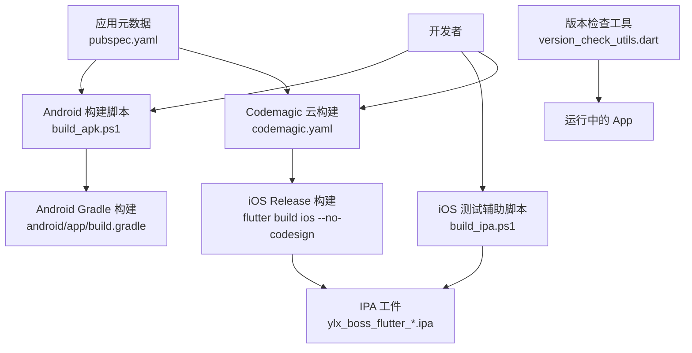
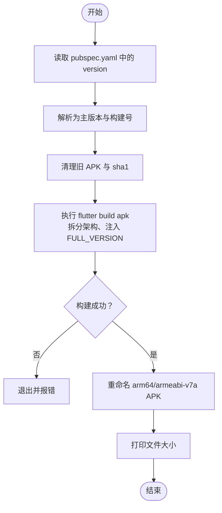
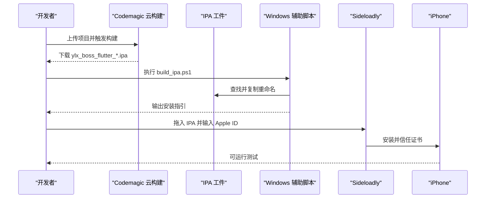
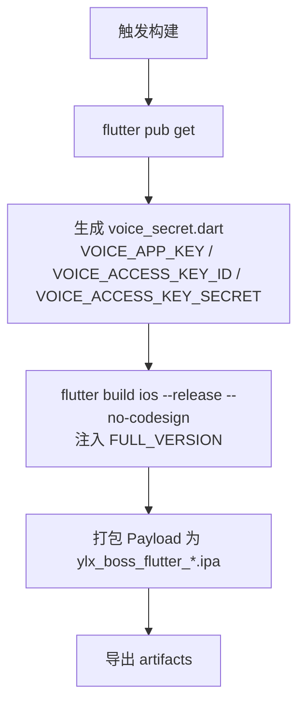
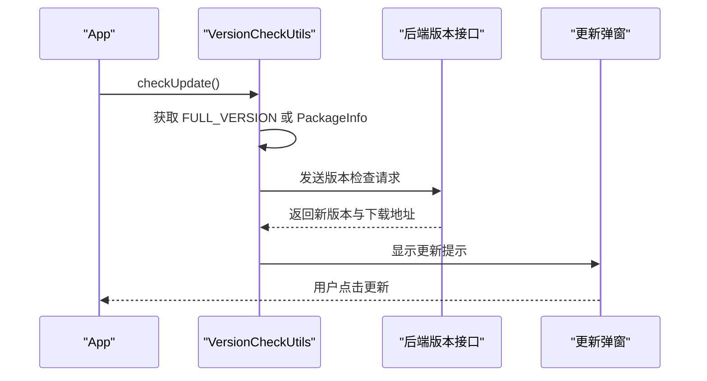

# 构建与部署

<cite>
**本文引用的文件**   
- [build_apk.ps1](file://build_apk.ps1)
- [build_ipa.ps1](file://build_ipa.ps1)
- [codemagic.yaml](file://codemagic.yaml)
- [pubspec.yaml](file://pubspec.yaml)
- [android/app/build.gradle](file://android/app/build.gradle)
- [android/gradle.properties](file://android/gradle.properties)
- [android/settings.gradle](file://android/settings.gradle)
- [ios/Podfile](file://ios/Podfile)
- [ios/Runner/Info.plist](file://ios/Runner/Info.plist)
- [lib/util/version_check_utils.dart](file://lib/util/version_check_utils.dart)
- [docs/Android问题汇总.md](file://docs/Android问题汇总.md)
- [docs/iOS问题汇总.md](file://docs/iOS问题汇总.md)
</cite>

## 目录
1. [引言](#引言)
2. [项目结构与构建边界](#项目结构与构建边界)
3. [核心构建产物](#核心构建产物)
4. [Android 构建指南](#android-构建指南)
5. [iOS 构建指南](#ios-构建指南)
6. [Codemagic CI/CD 流水线](#codemagic-cicd-流水线)
7. [版本管理与回滚机制](#版本管理与回滚机制)
8. [多平台部署策略](#多平台部署策略)
9. [构建优化技巧](#构建优化技巧)
10. [自动化测试与质量保障](#自动化测试与质量保障)
11. [问题排查指南](#问题排查指南)
12. [生产环境部署最佳实践](#生产环境部署最佳实践)
13. [结论](#结论)

## 引言
本文面向灵犀管店 Flutter 项目的维护者、构建工程师和发布负责人，系统性说明 Android APK 与 iOS IPA 的构建方法、签名配置、环境变量注入、Codemagic 云构建流水线、自动化测试、版本管理、多平台部署策略以及回滚方案。文档以仓库中现有脚本和配置文件为依据，补充可操作的流程建议，帮助团队建立稳定高效的构建发布体系。

## 项目结构与构建边界
本项目的构建相关关键位置如下：
- 根级 PowerShell 构建脚本负责 Android 打包、版本号解析和输出命名；提供 iOS 测试辅助脚本用于无 Mac 环境的 IPA 重命名与安装指引。
- `pubspec.yaml` 声明应用名称、描述、Flutter/Dart SDK 约束、依赖、资源、字体和包版本。
- Android 端由 Gradle 构建，包含应用 ID、JDK、NDK、签名、混淆和资源压缩配置。
- iOS 端通过 CocoaPods 管理依赖，Podfile 指定最低部署目标为 iOS 15.5，并使用静态 Framework 链接。
- Codemagic 配置负责云端生成不签名的 iOS Release 包并产出 `.ipa` 工件。
- 运行时版本检查逻辑从编译期注入的 `FULL_VERSION` 读取完整版本，并与后端接口返回的版本进行比较，驱动更新弹窗。

**图表来源**
- [build_apk.ps1:1-63](file://build_apk.ps1#L1-L63)
- [build_ipa.ps1:1-68](file://build_ipa.ps1#L1-L68)
- [codemagic.yaml:1-47](file://codemagic.yaml#L1-L47)
- [pubspec.yaml:1-153](file://pubspec.yaml#L1-L153)
- [android/app/build.gradle:1-119](file://android/app/build.gradle#L1-L119)
- [lib/util/version_check_utils.dart:1-200](file://lib/util/version_check_utils.dart#L1-L200)

**章节来源**
- [pubspec.yaml:1-153](file://pubspec.yaml#L1-L153)
- [android/app/build.gradle:1-119](file://android/app/build.gradle#L1-L119)
- [ios/Podfile:1-53](file://ios/Podfile#L1-L53)
- [build_apk.ps1:1-63](file://build_apk.ps1#L1-L63)
- [build_ipa.ps1:1-68](file://build_ipa.ps1#L1-L68)
- [codemagic.yaml:1-47](file://codemagic.yaml#L1-L47)
- [lib/util/version_check_utils.dart:1-200](file://lib/util/version_check_utils.dart#L1-L200)

## 核心构建产物
- Android：按架构拆分的 APK 文件，文件名格式为 `ylx_boss_flutter_{完整版本号}_64.apk` 与 `ylx_boss_flutter_{完整版本号}_32.apk`。
- iOS：Codemagic 产出的未签名 `.ipa`，文件名格式为 `ylx_boss_flutter_{完整版本号}.ipa`。
- 版本信息：通过 `--dart-define=FULL_VERSION=<version>` 注入到应用内部，供运行时版本检查使用。
- 工件归档：Codemagic 将 `.ipa` 作为 artifacts 输出，便于下载、分发和回滚。

**章节来源**
- [build_apk.ps1:24-63](file://build_apk.ps1#L24-L63)
- [codemagic.yaml:31-47](file://codemagic.yaml#L31-L47)
- [lib/util/version_check_utils.dart:18-26](file://lib/util/version_check_utils.dart#L18-L26)

## Android 构建指南

### 前置条件
- Windows 或支持 PowerShell 的环境。
- 已安装 Flutter SDK（满足 `pubspec.yaml` 的 SDK 与 Flutter 版本约束）。
- JDK 17，Gradle 8.x，Android SDK 与 NDK（本项目使用 NDK 28.2）。
- Android Keystore 及 `app/key.properties` 签名配置文件。
- `local.properties` 中需包含 Flutter SDK 路径；如需自定义 Android 版本号，可在其中配置 `flutter.versionCode` 与 `flutter.versionName`。

### 构建步骤
1. 确保 `pubspec.yaml` 中的 `version` 字段符合 `主版本+构建号` 的语义，例如 `1.0.1+112`。
2. 在根目录执行 `.\build_apk.ps1`。
3. 脚本会：
   - 从 `pubspec.yaml` 解析 `version`，将 `+` 替换为 `.`，得到完整版本号。
   - 清理旧 APK 与校验文件。
   - 调用 `flutter build apk --release --split-per-abi --target-platform android-arm64,android-arm --dart-define=FULL_VERSION=<完整版本号>`。
   - 重命名为带架构后缀的文件名，并打印大小。
4. 输出位于 `build\app\outputs\flutter-apk`。

**图表来源**
- [build_apk.ps1:8-22](file://build_apk.ps1#L8-L22)
- [build_apk.ps1:24-63](file://build_apk.ps1#L24-L63)

### 签名与环境变量
- 签名配置来源于 `android/app/key.properties`，Gradle 中引用 keyAlias、keyPassword、storeFile、storePassword。
- `android/app/build.gradle` 中 release 与 debug 均启用 release signingConfig，并开启混淆、ZipAlign 与资源压缩。
- `FULL_VERSION` 通过 `--dart-define` 注入，运行时由 `VersionCheckUtils` 读取。
- `local.properties` 可覆盖 `flutter.versionCode` 与 `flutter.versionName`，避免 PackageInfo 重复拼接版本号。

**章节来源**
- [build_apk.ps1:8-22](file://build_apk.ps1#L8-L22)
- [build_apk.ps1:24-63](file://build_apk.ps1#L24-L63)
- [android/app/build.gradle:12-69](file://android/app/build.gradle#L12-L69)
- [android/app/build.gradle:71-119](file://android/app/build.gradle#L71-L119)
- [lib/util/version_check_utils.dart:18-26](file://lib/util/version_check_utils.dart#L18-L26)

### 常见问题
- 网络库或插件源不可达：参考 Android 问题汇总中的 Maven 源配置建议。
- 包体过大：可通过 `--target-platform` 指定架构或使用 `--obfuscate --split-debug-info` 控制调试信息。

**章节来源**
- [docs/Android问题汇总.md:1-56](file://docs/Android问题汇总.md#L1-L56)

## iOS 构建指南

### 本地开发环境
- 需要 macOS + Xcode 环境进行常规 iOS 构建。
- Podfile 已将最低部署目标提升到 iOS 15.5，并启用静态 Framework 链接。
- Info.plist 定义了权限描述、语言、显示名称、Bundle 标识符占位符等。

### 无 Mac 环境的测试安装
- 使用 Codemagic 云端构建生成不签名的 IPA。
- 在 Windows 上运行 `.\build_ipa.ps1 [-IpaPath <ipa路径>]`：
  - 自动搜索当前目录、`build\ios`、系统下载目录中的最新 `.ipa`。
  - 按版本号复制并重命名为 `ylx_boss_flutter_<完整版本号>.ipa`。
  - 输出安装到 iPhone 的步骤，包括 Sideloadly 的使用说明与 Apple ID 自签流程。

**图表来源**
- [codemagic.yaml:31-47](file://codemagic.yaml#L31-L47)
- [build_ipa.ps1:1-68](file://build_ipa.ps1#L1-L68)

### 签名与部署
- Codemagic 构建使用 `--no-codesign`，不执行 Apple 签名，便于使用 Sideloadly 免费账号重新签名（有效期通常为 7 天）。
- 如需正式发布到 App Store，需要在本地或 CI 中使用 Apple Developer 账号进行正式签名与上架流程（本仓库当前仅包含无签名测试包流程）。

**章节来源**
- [codemagic.yaml:1-47](file://codemagic.yaml#L1-L47)
- [build_ipa.ps1:1-68](file://build_ipa.ps1#L1-L68)
- [ios/Podfile:1-53](file://ios/Podfile#L1-L53)
- [ios/Runner/Info.plist:1-76](file://ios/Runner/Info.plist#L1-L76)

## Codemagic CI/CD 流水线

### 流水线职责
- 在云端 macOS 机器上执行 `flutter pub get`。
- 根据环境变量生成语音识别密钥文件 `lib/util/voice_secret.dart`，若未配置则写入空值。
- 执行 `flutter build ios --release --no-codesign --dart-define=FULL_VERSION=<version>`。
- 将 `Runner.app` 打包为 `.ipa`，并以版本号命名，输出为 artifacts。

**图表来源**
- [codemagic.yaml:12-47](file://codemagic.yaml#L12-L47)

### 环境变量
- `VOICE_APP_KEY`
- `VOICE_ACCESS_KEY_ID`
- `VOICE_ACCESS_KEY_SECRET`
这些变量用于生成 `lib/util/voice_secret.dart`，未设置时默认为空字符串。

**章节来源**
- [codemagic.yaml:12-47](file://codemagic.yaml#L12-L47)

## 版本管理与回滚机制

### 版本规范
- `pubspec.yaml` 的 `version` 采用 `主版本.子版本.补丁+构建号` 形式，例如 `1.0.1+112`。
- 构建脚本会将 `+` 替换为 `.`，形成完整版本号用于文件名与运行时注入。
- Android 原生 `versionCode` 与 `versionName` 可由 `local.properties` 覆盖，避免 PackageInfo 重复拼接。

### 运行时版本检查
- `VersionCheckUtils` 优先使用编译期注入的 `FULL_VERSION`，否则回退到 `PackageInfo`。
- 客户端向后端发起版本检查请求，携带设备信息、用户信息与当前版本号。
- 服务端返回新版本、下载地址、更新说明、是否强制更新等信息，客户端展示更新弹窗。

**图表来源**
- [lib/util/version_check_utils.dart:18-200](file://lib/util/version_check_utils.dart#L18-L200)

### 回滚策略
- 保留历史 `.apk` 与 `.ipa` 工件，并按版本号命名，便于快速切换。
- 若发现线上问题，可将后端版本接口返回的下载地址指向上一稳定版本。
- iOS 测试包可通过 Sideloadly 重新安装历史版本的 IPA。
- Android 可分发历史 APK 或通过后端更新接口引导用户下载安装。

**章节来源**
- [pubspec.yaml:1-10](file://pubspec.yaml#L1-L10)
- [build_apk.ps1:8-22](file://build_apk.ps1#L8-L22)
- [build_ipa.ps1:23-43](file://build_ipa.ps1#L23-L43)
- [lib/util/version_check_utils.dart:18-200](file://lib/util/version_check_utils.dart#L18-L200)

## 多平台部署策略

### Android
- 推荐使用分架构 APK（arm64 与 armeabi-v7a），减少模拟器 x86_64 包体。
- 发布前建议对 release 包执行混淆与资源压缩，已在 Gradle 中默认开启。
- 可使用 `--split-debug-info` 保存符号表以便崩溃分析。

### iOS
- 测试阶段使用 Codemagic 生成不签名 IPA，配合 Sideloadly 快速安装到真机。
- 正式发布建议使用 Apple Developer 账号进行签名与 App Store 上架。
- Podfile 已统一最低部署目标为 iOS 15.5，保证插件兼容性。

### Web
- 项目包含 `web/index.html` 与 `web/manifest.json`，可作为 Flutter Web 入口。
- 当前构建脚本未包含 Web 构建命令，可按需添加 `flutter build web --release`。
- Web 部署建议结合静态托管服务（如 GitHub Pages、Vercel、Nginx）与 CDN 加速。

**章节来源**
- [build_apk.ps1:24-63](file://build_apk.ps1#L24-L63)
- [android/app/build.gradle:71-119](file://android/app/build.gradle#L71-L119)
- [codemagic.yaml:31-47](file://codemagic.yaml#L31-L47)
- [ios/Podfile:1-53](file://ios/Podfile#L1-L53)

## 构建优化技巧
- 使用分架构 APK，避免引入模拟器架构，降低包体。
- 启用 ProGuard 混淆与 ZipAlign，已在本项目 Gradle 配置中启用。
- 使用 `--split-debug-info` 分离调试符号，减小发布包体积并保留崩溃堆栈可读性。
- 合理管理第三方依赖，避免冗余资源。
- iOS 构建时关闭 CocoaPods 统计以减少构建延迟。
- 合理设置 Gradle JVM 内存与 Kotlin Daemon 内存，避免 OOM。

**章节来源**
- [build_apk.ps1:24-63](file://build_apk.ps1#L24-L63)
- [android/app/build.gradle:71-119](file://android/app/build.gradle#L71-L119)
- [ios/Podfile:1-53](file://ios/Podfile#L1-L53)
- [android/gradle.properties:1-27](file://android/gradle.properties#L1-L27)

## 自动化测试与质量保障
- 项目依赖中包含 `flutter_test` 与 `test`，可用于单元测试与 Widget 测试。
- README 提及集成测试命令，但当前仓库未提供对应 driver 文件，建议按需补充。
- 建议在 CI 中增加静态分析与 lint 任务，例如 `flutter analyze` 与 `flutter test`。
- 针对关键页面可补充黄金测试或 UI 测试用例，提升回归质量。

**章节来源**
- [pubspec.yaml:110-153](file://pubspec.yaml#L110-L153)
- [README.md:1-200](file://README.md#L1-L200)

## 问题排查指南

### Android
- 无法解析 Flutter embedding 依赖：参考 Android 问题汇总，添加 Flutter Maven 源或修改 `flutter.gradle`。
- 打包体积过大：使用 `--target-platform` 指定架构，或使用 `--obfuscate --split-debug-info`。
- 签名失败：检查 `app/key.properties` 与 keystore 路径、密码是否正确。

**章节来源**
- [docs/Android问题汇总.md:1-56](file://docs/Android问题汇总.md#L1-L56)
- [android/app/build.gradle:12-69](file://android/app/build.gradle#L12-L69)

### iOS
- CocoaPods CDN 更新失败：移除 trunk 源或添加镜像源，执行 `pod repo remove trunk`。
- 主机 hosts 解析失败：添加 `raw.githubusercontent.com` 的真实 IP。
- 部署目标不一致：Podfile 已统一为 iOS 15.5，如遇插件兼容性问题请升级依赖。

**章节来源**
- [docs/iOS问题汇总.md:1-55](file://docs/iOS问题汇总.md#L1-L55)
- [ios/Podfile:1-53](file://ios/Podfile#L1-L53)

## 生产环境部署最佳实践
- 严格区分开发、测试、预发、生产环境，使用环境变量注入不同后端地址与功能开关。
- 所有发布包均需经过自动化测试与代码审查，禁止直接手动发布。
- 保留历史工件与变更日志，确保能快速回滚。
- 对敏感配置（如推送 Key、语音识别密钥）使用 CI 环境变量，不提交到代码库。
- 监控线上崩溃与性能指标，结合符号表定位问题。
- 定期评估第三方依赖版本，及时修复安全漏洞与兼容性问题。

[本节为通用指导，不直接分析具体文件]

## 结论
本仓库提供了清晰的 Android 与 iOS 构建路径：Android 通过 PowerShell 脚本完成分架构打包与版本号注入，iOS 通过 Codemagic 云端构建生成测试用 IPA，并由 Windows 辅助脚本简化安装流程。版本管理以 `pubspec.yaml` 为核心，运行时通过 `FULL_VERSION` 与后端接口联动实现更新控制。团队可在此基础上扩展 CI 流水线、静态分析、自动化测试与发布门禁，形成完整的质量保障与高效发布体系。