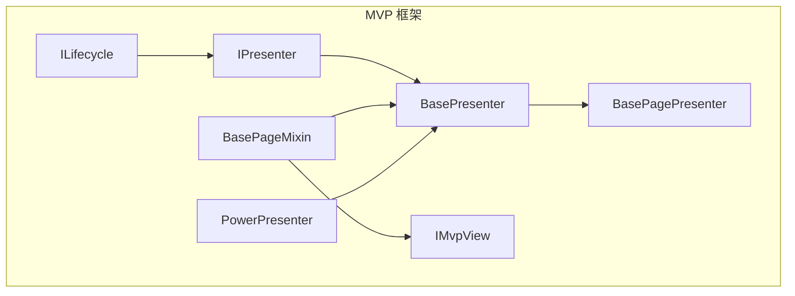
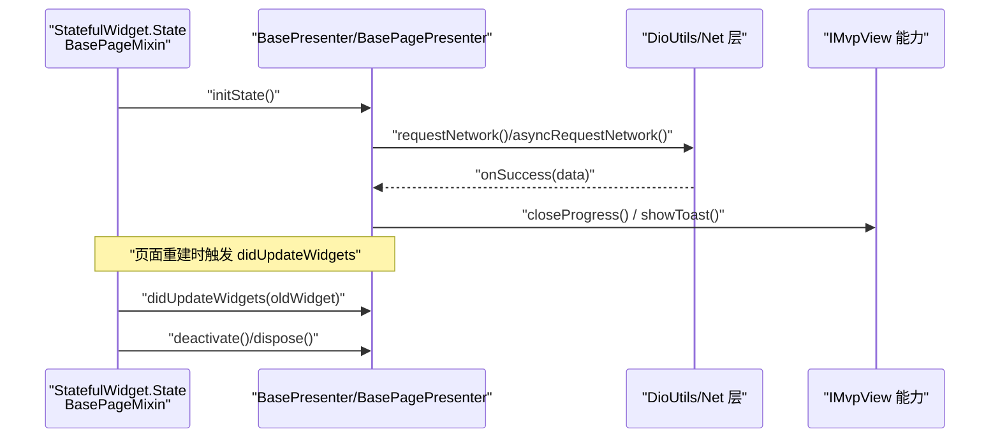
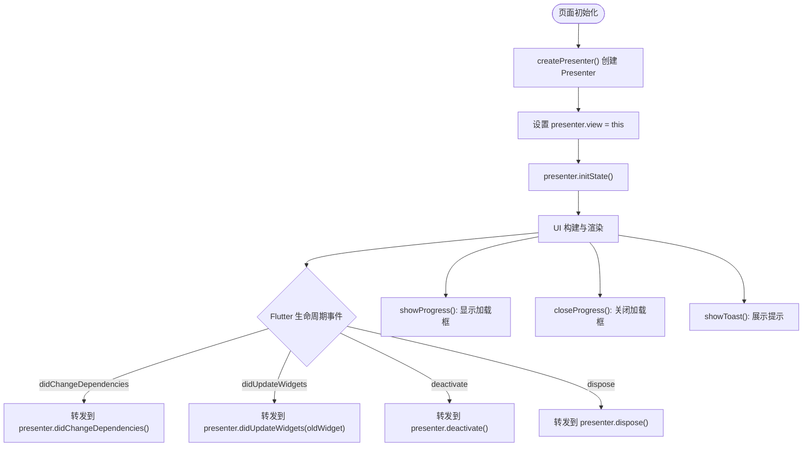
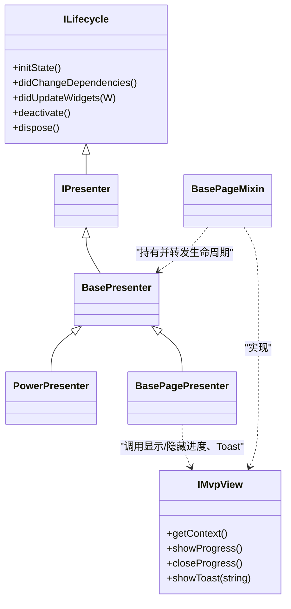
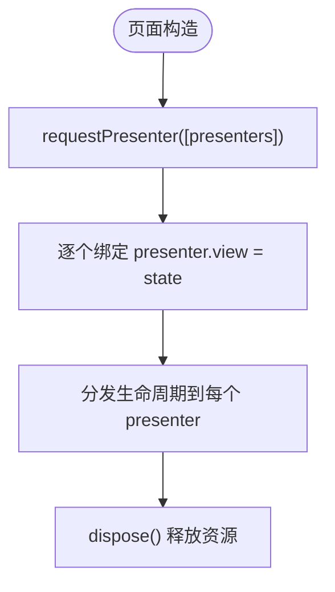
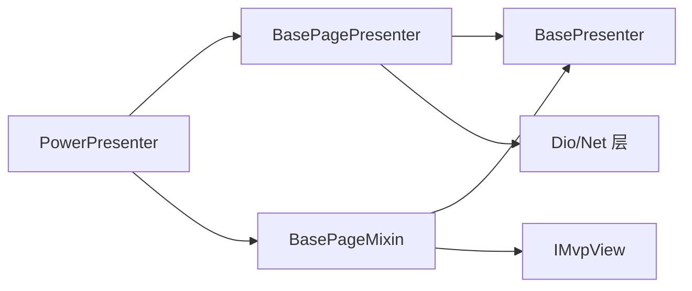
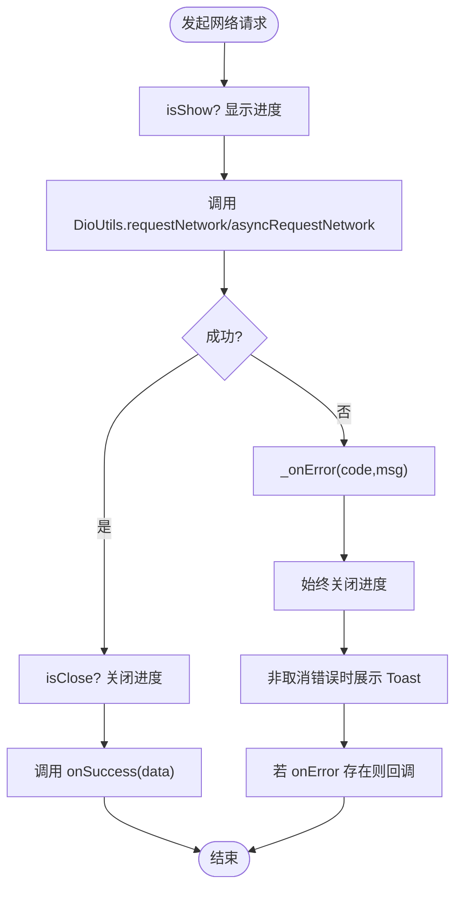

# MVP 架构模式

<cite>
**本文引用的文件**   
- [lib/mvp/base_page.dart](file://lib/mvp/base_page.dart)
- [lib/mvp/base_presenter.dart](file://lib/mvp/base_presenter.dart)
- [lib/mvp/base_page_presenter.dart](file://lib/mvp/base_page_presenter.dart)
- [lib/mvp/power_presenter.dart](file://lib/mvp/power_presenter.dart)
- [lib/mvp/i_lifecycle.dart](file://lib/mvp/i_lifecycle.dart)
- [lib/mvp/mvps.dart](file://lib/mvp/mvps.dart)
</cite>

## 目录
1. [简介](#简介)
2. [项目结构中的 MVP 位置](#项目结构中的-mvp-位置)
3. [核心组件总览](#核心组件总览)
4. [架构概览](#架构概览)
5. [详细组件分析](#详细组件分析)
6. [依赖关系分析](#依赖关系分析)
7. [异步与错误处理](#异步与错误处理)
8. [使用示例与最佳实践](#使用示例与最佳实践)
9. [常见问题与排查](#常见问题与排查)
10. [性能与可维护性建议](#性能与可维护性建议)
11. [结论](#结论)

## 简介
本文面向灵犀管店 Flutter 项目，系统化梳理其内部实现的 MVP（Model-View-Presenter）架构。重点围绕以下核心类展开：
- View 层入口：BasePageMixin
- Presenter 基类：BasePresenter、BasePagePresenter
- 多 Presenter 聚合器：PowerPresenter
- 接口与生命周期：IMvpView、IPresenter、ILifecycle

通过职责分离，MVP 将页面 UI 渲染逻辑与业务逻辑解耦，使页面更专注展示，Presenter 负责状态编排、网络请求、数据转换与错误处理，便于测试与维护。

## 项目结构中的 MVP 位置
MVP 相关代码集中在 lib/mvp 目录下，包含 View/Presenter 的抽象基类、生命周期定义以及多 Presenter 管理工具。该模块被各业务页面广泛复用，是项目的通用基础设施。

**图示来源**
- [lib/mvp/i_lifecycle.dart:1-13](file://lib/mvp/i_lifecycle.dart#L1-L13)
- [lib/mvp/mvps.dart:1-19](file://lib/mvp/mvps.dart#L1-L19)
- [lib/mvp/base_presenter.dart:1-21](file://lib/mvp/base_presenter.dart#L1-L21)
- [lib/mvp/base_page_presenter.dart:1-120](file://lib/mvp/base_page_presenter.dart#L1-L120)
- [lib/mvp/base_page.dart:1-103](file://lib/mvp/base_page.dart#L1-L103)
- [lib/mvp/power_presenter.dart:1-69](file://lib/mvp/power_presenter.dart#L1-L69)

**章节来源**
- [lib/mvp/base_page.dart:1-103](file://lib/mvp/base_page.dart#L1-L103)
- [lib/mvp/base_presenter.dart:1-21](file://lib/mvp/base_presenter.dart#L1-L21)
- [lib/mvp/base_page_presenter.dart:1-120](file://lib/mvp/base_page_presenter.dart#L1-L120)
- [lib/mvp/power_presenter.dart:1-69](file://lib/mvp/power_presenter.dart#L1-L69)
- [lib/mvp/i_lifecycle.dart:1-13](file://lib/mvp/i_lifecycle.dart#L1-L13)
- [lib/mvp/mvps.dart:1-19](file://lib/mvp/mvps.dart#L1-L19)

## 核心组件总览
- ILifecycle：统一的生命周期契约，规定 initState、didChangeDependencies、didUpdateWidgets、deactivate、dispose。
- IMvpView：View 层对外暴露的能力，包括获取 BuildContext、显示/关闭进度提示、展示 Toast。
- IPresenter：继承 ILifecycle，表示 Presenter 的生命周期。
- BasePresenter：实现 IPresenter 的空实现基类，持有对 IMvpView 的引用，供子类扩展。
- BasePagePresenter：面向页面的 Presenter 增强版，封装网络请求、取消令牌、图片上传等能力，并统一处理加载与错误。
- BasePageMixin：Flutter State 的 Mixin，桥接 Flutter 生命周期到 Presenter，并提供统一的 Progress/Toast 实现。
- PowerPresenter：聚合多个 BasePagePresenter，统一管理它们的生命周期和视图绑定，适合复杂页面拆分业务。

**章节来源**
- [lib/mvp/i_lifecycle.dart:1-13](file://lib/mvp/i_lifecycle.dart#L1-L13)
- [lib/mvp/mvps.dart:1-19](file://lib/mvp/mvps.dart#L1-L19)
- [lib/mvp/base_presenter.dart:1-21](file://lib/mvp/base_presenter.dart#L1-L21)
- [lib/mvp/base_page_presenter.dart:1-120](file://lib/mvp/base_page_presenter.dart#L1-L120)
- [lib/mvp/base_page.dart:1-103](file://lib/mvp/base_page.dart#L1-L103)
- [lib/mvp/power_presenter.dart:1-69](file://lib/mvp/power_presenter.dart#L1-L69)

## 架构概览
MVP 在 Flutter 中的落地方式如下：
- View 层：通过 BasePageMixin 注入到 StatefulWidget 的 State 中，负责 UI 渲染和用户交互回调。
- Presenter 层：BasePresenter/BasePagePresenter 承载业务逻辑、网络请求、数据处理；PowerPresenter 用于聚合多个 Presenter。
- Model 层：由外部 net 层或其他模块提供数据模型与 API 调用；Presenter 通过 net 层获取数据后，更新 View 层。

**图示来源**
- [lib/mvp/base_page.dart:1-103](file://lib/mvp/base_page.dart#L1-L103)
- [lib/mvp/base_presenter.dart:1-21](file://lib/mvp/base_presenter.dart#L1-L21)
- [lib/mvp/base_page_presenter.dart:1-120](file://lib/mvp/base_page_presenter.dart#L1-L120)

## 详细组件分析

### View 层：BasePageMixin
BasePageMixin 是一个 on State<T> 的 mixin，实现了 IMvpView，并将 Flutter 生命周期方法转发给 Presenter。关键行为：
- initState：创建 Presenter、设置 view 引用、调用 Presenter.initState。
- didChangeDependencies/didUpdateWidgets/deactivate/dispose：将对应生命周期转发给 Presenter。
- showProgress/closeProgress：避免重复弹窗，拦截返回键关闭，支持自定义 buildProgress。
- showToast：统一 Toast 展示。
- createPresenter：由具体页面实现，决定使用哪个 Presenter 类型。

**图示来源**
- [lib/mvp/base_page.dart:1-103](file://lib/mvp/base_page.dart#L1-L103)

**章节来源**
- [lib/mvp/base_page.dart:1-103](file://lib/mvp/base_page.dart#L1-L103)

### Presenter 层：BasePresenter 与 BasePagePresenter
- BasePresenter：
  - 持有 view 引用，实现 IPresenter 的空方法，作为所有 Presenter 的基类。
- BasePagePresenter：
  - 为页面场景增强 Presenter，内置网络请求封装、取消令牌管理、图片上传。
  - requestNetwork/asyncRequestNetwork：
    - 根据 isShow/isClose 控制 Progress 显示与关闭。
    - onSuccess/onError 回调透传，错误统一走 _onError 处理。
  - uploadImg：封装图片上传流程，失败时展示 Toast。
  - dispose：确保 CancelToken 被取消，避免内存泄漏或后台更新。

**图示来源**
- [lib/mvp/i_lifecycle.dart:1-13](file://lib/mvp/i_lifecycle.dart#L1-L13)
- [lib/mvp/mvps.dart:1-19](file://lib/mvp/mvps.dart#L1-L19)
- [lib/mvp/base_presenter.dart:1-21](file://lib/mvp/base_presenter.dart#L1-L21)
- [lib/mvp/base_page_presenter.dart:1-120](file://lib/mvp/base_page_presenter.dart#L1-L120)
- [lib/mvp/power_presenter.dart:1-69](file://lib/mvp/power_presenter.dart#L1-L69)
- [lib/mvp/base_page.dart:1-103](file://lib/mvp/base_page.dart#L1-L103)

**章节来源**
- [lib/mvp/base_presenter.dart:1-21](file://lib/mvp/base_presenter.dart#L1-L21)
- [lib/mvp/base_page_presenter.dart:1-120](file://lib/mvp/base_page_presenter.dart#L1-L120)

### 多 Presenter 管理：PowerPresenter
PowerPresenter 用于一个页面聚合多个 BasePagePresenter，典型场景如首页由多个子模块组成，每个子模块独立维护自身数据和 UI 逻辑。
- requestPresenter：接收一组 BasePagePresenter，并为每个 presenter 绑定当前 BasePageMixin 作为 view。
- 生命周期分发：将 deactivate/didChangeDependencies/didUpdateWidgets/dispose/initState 分发给内部列表中的每个 Presenter。

**图示来源**
- [lib/mvp/power_presenter.dart:1-69](file://lib/mvp/power_presenter.dart#L1-L69)
- [lib/mvp/base_page.dart:1-103](file://lib/mvp/base_page.dart#L1-L103)

**章节来源**
- [lib/mvp/power_presenter.dart:1-69](file://lib/mvp/power_presenter.dart#L1-L69)

### 接口与生命周期：IMvpView、IPresenter、ILifecycle
- ILifecycle：定义标准生命周期方法，确保所有 Presenter 遵循一致的生命周期约定。
- IMvpView：定义 View 层能力，Presenter 仅通过这些方法与 UI 交互，避免直接访问 Widget 树。
- IPresenter：基于 ILifecycle 的 Presenter 抽象，BasePresenter 提供默认空实现。

这些接口确保了 View 与 Presenter 之间的松耦合，同时保证生命周期一致性。

**章节来源**
- [lib/mvp/i_lifecycle.dart:1-13](file://lib/mvp/i_lifecycle.dart#L1-L13)
- [lib/mvp/mvps.dart:1-19](file://lib/mvp/mvps.dart#L1-L19)
- [lib/mvp/base_presenter.dart:1-21](file://lib/mvp/base_presenter.dart#L1-L21)

## 依赖关系分析
- BasePageMixin 依赖：
  - BasePresenter：持有并转发生命周期。
  - IMvpView：实现 View 接口。
  - 路由、日志、Toast、ProgressDialog：用于导航与 UI 反馈。
- BasePagePresenter 依赖：
  - BasePresenter：继承基础能力。
  - Dio/DioUtils/HttpApi：进行网络请求与统一错误处理。
  - IMvpView：控制进度与提示。
- PowerPresenter 依赖：
  - BasePagePresenter：聚合多个 Presenter。
  - BasePageMixin：绑定 view 引用。

**图示来源**
- [lib/mvp/base_page.dart:1-103](file://lib/mvp/base_page.dart#L1-L103)
- [lib/mvp/base_presenter.dart:1-21](file://lib/mvp/base_presenter.dart#L1-L21)
- [lib/mvp/base_page_presenter.dart:1-120](file://lib/mvp/base_page_presenter.dart#L1-L120)
- [lib/mvp/power_presenter.dart:1-69](file://lib/mvp/power_presenter.dart#L1-L69)

**章节来源**
- [lib/mvp/base_page.dart:1-103](file://lib/mvp/base_page.dart#L1-L103)
- [lib/mvp/base_presenter.dart:1-21](file://lib/mvp/base_presenter.dart#L1-L21)
- [lib/mvp/base_page_presenter.dart:1-120](file://lib/mvp/base_page_presenter.dart#L1-L120)
- [lib/mvp/power_presenter.dart:1-69](file://lib/mvp/power_presenter.dart#L1-L69)

## 异步与错误处理
BasePagePresenter 对异步网络请求做了统一封装：
- requestNetwork：返回 Future，适用于刷新等需要等待结果的场景。
- asyncRequestNetwork：不返回 Future，适用于后台任务（如下拉加载更多）。
- 进度控制：
  - isShow=true 时显示进度。
  - isClose=true 时成功回调后自动关闭进度。
- 错误处理：
  - _onError 统一关闭进度，非取消错误时展示 Toast。
  - 如果页面已 dispose，则不调用 onError 回调，避免空引用或无效 UI 更新。
- 取消令牌：
  - 每个 BasePagePresenter 拥有独立的 CancelToken。
  - dispose 时取消未完成的请求，防止内存泄漏与多余 UI 更新。

**图示来源**
- [lib/mvp/base_page_presenter.dart:1-120](file://lib/mvp/base_page_presenter.dart#L1-L120)

**章节来源**
- [lib/mvp/base_page_presenter.dart:1-120](file://lib/mvp/base_page_presenter.dart#L1-L120)

## 使用示例与最佳实践

### 如何创建一个 MVP 页面
步骤：
1. 创建 StatefulWidget 及其 State。
2. 让 State 混入 BasePageMixin，并指定泛型参数（StatefulWidget 类型与 Presenter 类型）。
3. 实现 createPresenter，返回具体的 Presenter 实例。
4. 在 UI 中通过 presenter.view.showProgress()/closeProgress()/showToast() 控制交互反馈（通常由 Presenter 调用）。
5. 在 Presenter 中实现业务逻辑，包括网络请求、数据组装、错误处理。

参考路径：
- [lib/mvp/base_page.dart:1-103](file://lib/mvp/base_page.dart#L1-L103)

### 如何实现 Presenter 的业务逻辑
- 继承 BasePresenter 或 BasePagePresenter。
- 如需网络请求，优先使用 BasePagePresenter 提供的 requestNetwork/asyncRequestNetwork。
- 在 initState 中发起数据加载，或在用户交互回调中触发。
- 通过 view 回调更新 UI（例如刷新列表、跳转页面），保持 View 无业务判断。

参考路径：
- [lib/mvp/base_presenter.dart:1-21](file://lib/mvp/base_presenter.dart#L1-L21)
- [lib/mvp/base_page_presenter.dart:1-120](file://lib/mvp/base_page_presenter.dart#L1-L120)

### 如何处理异步操作与错误
- 使用 requestNetwork 获取 Future，结合 await 处理结果。
- 使用 asyncRequestNetwork 处理无需等待的任务（如批量上报、后台同步）。
- 利用 isShow/isClose 控制进度显示与关闭时机。
- 在 onError 中补充业务特定错误处理，但避免重复展示错误信息。
- 注意页面销毁后不再更新 UI，BasePagePresenter 已在 _onError 中规避。

参考路径：
- [lib/mvp/base_page_presenter.dart:1-120](file://lib/mvp/base_page_presenter.dart#L1-L120)

### 复杂页面使用 PowerPresenter
- 当页面包含多个子模块（如首页仪表盘、统计卡片、推荐内容）时，可将每个模块拆分为独立的 BasePagePresenter。
- 在页面中使用 PowerPresenter.requestPresenter 注册这些 Presenter，由 PowerPresenter 统一绑定 view 和分发生命周期。
- 这样每个模块独立维护状态与逻辑，降低页面复杂度。

参考路径：
- [lib/mvp/power_presenter.dart:1-69](file://lib/mvp/power_presenter.dart#L1-L69)
- [lib/mvp/base_page.dart:1-103](file://lib/mvp/base_page.dart#L1-L103)

**章节来源**
- [lib/mvp/base_page.dart:1-103](file://lib/mvp/base_page.dart#L1-L103)
- [lib/mvp/base_presenter.dart:1-21](file://lib/mvp/base_presenter.dart#L1-L21)
- [lib/mvp/base_page_presenter.dart:1-120](file://lib/mvp/base_page_presenter.dart#L1-L120)
- [lib/mvp/power_presenter.dart:1-69](file://lib/mvp/power_presenter.dart#L1-L69)

## 常见问题与排查

- 问题：重复弹出进度对话框
  - 现象：快速触发多次加载，出现多个遮罩或卡顿。
  - 原因：BasePageMixin.showProgress 已做 mounted 与 _isShowDialog 防重判，但若在未构建完成时调用可能抛异常。
  - 解决：确保在页面 build 完成后才调用 showProgress；必要时在 try/catch 中包裹调用。
  
  参考路径：[lib/mvp/base_page.dart:1-103](file://lib/mvp/base_page.dart#L1-L103)

- 问题：页面销毁后仍收到网络回调导致崩溃
  - 现象：dispose 之后继续执行 UI 更新或回调。
  - 原因：Presenter 未在 dispose 时取消请求或未检查页面状态。
  - 解决：使用 BasePagePresenter，其 dispose 会取消 CancelToken；_onError 中避免在页面不可用时回调 onError。
  
  参考路径：[lib/mvp/base_page_presenter.dart:1-120](file://lib/mvp/base_page_presenter.dart#L1-L120)

- 问题：多个 Presenter 生命周期不同步
  - 现象：部分子模块未正确释放或初始化。
  - 原因：手动管理 Presenter 时遗漏生命周期分发。
  - 解决：使用 PowerPresenter.requestPresenter 统一管理，并由 BasePageMixin 转发生命周期。
  
  参考路径：[lib/mvp/power_presenter.dart:1-69](file://lib/mvp/power_presenter.dart#L1-L69)
  参考路径：[lib/mvp/base_page.dart:1-103](file://lib/mvp/base_page.dart#L1-L103)

- 问题：Progress 无法关闭
  - 现象：请求结束后遮罩仍存在。
  - 原因：isClose=false 或未显式 closeProgress。
  - 解决：确保 isClose=true，或在成功回调中手动调用 closeProgress。
  
  参考路径：[lib/mvp/base_page_presenter.dart:1-120](file://lib/mvp/base_page_presenter.dart#L1-L120)

**章节来源**
- [lib/mvp/base_page.dart:1-103](file://lib/mvp/base_page.dart#L1-L103)
- [lib/mvp/base_page_presenter.dart:1-120](file://lib/mvp/base_page_presenter.dart#L1-L120)
- [lib/mvp/power_presenter.dart:1-69](file://lib/mvp/power_presenter.dart#L1-L69)

## 性能与可维护性建议
- 职责清晰：
  - View 只负责 UI 渲染与用户交互，不做业务判断。
  - Presenter 集中处理网络、数据转换与状态编排。
- 生命周期安全：
  - 始终通过 BasePageMixin 转发生命周期，避免忘记释放 Presenter。
  - 使用 BasePagePresenter 的 CancelToken 管理取消，避免内存泄漏。
- 错误处理统一：
  - 使用 BasePagePresenter._onError 统一关闭进度与提示，减少重复代码。
- 模块化拆分：
  - 复杂页面使用 PowerPresenter 拆分多个子 Presenter，提升可读性与可测试性。
- 可测试性：
  - 通过 IMvpView 接口替换 Mock View，方便单元测试 Presenter 逻辑。

## 结论
灵犀管店的 MVP 架构通过 BasePageMixin、BasePresenter/BasePagePresenter、PowerPresenter 以及 IMvpView/IPresenter/ILifecycle 接口形成了一套完整且易用的分层方案。它将 UI 与业务解耦，统一了异步与错误处理，提升了代码的可维护性与可测试性。在实际项目中，应严格遵循职责分离原则，合理使用 PowerPresenter 拆分复杂页面，并通过 BasePagePresenter 的网络封装保障请求安全与用户体验。