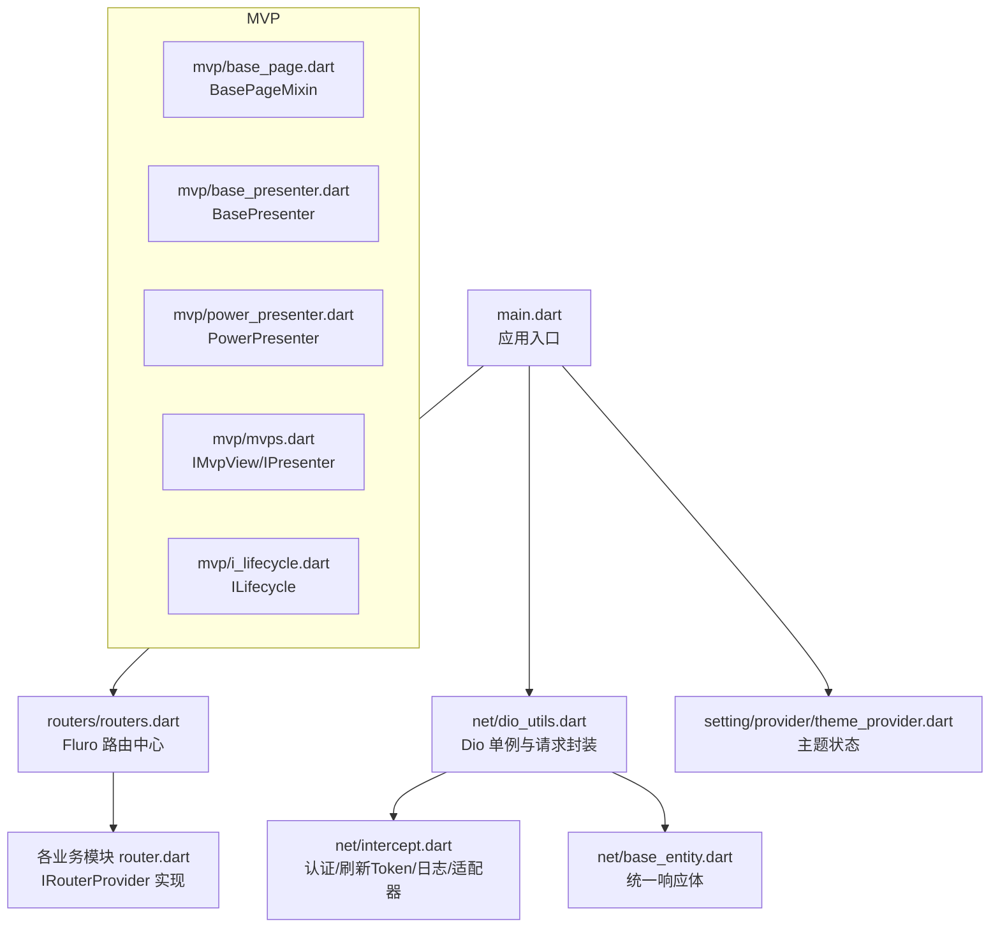
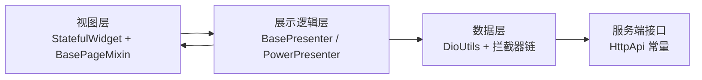
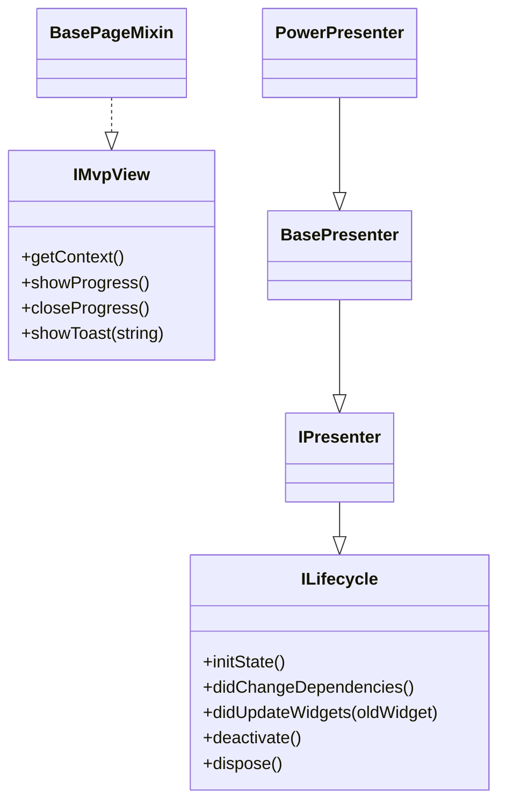
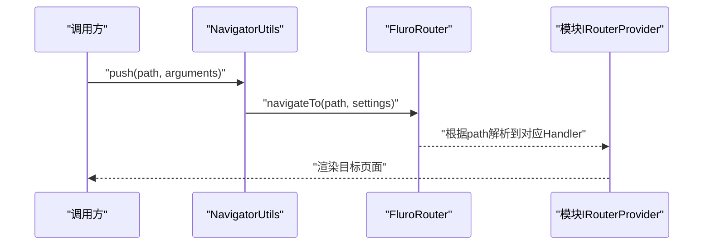
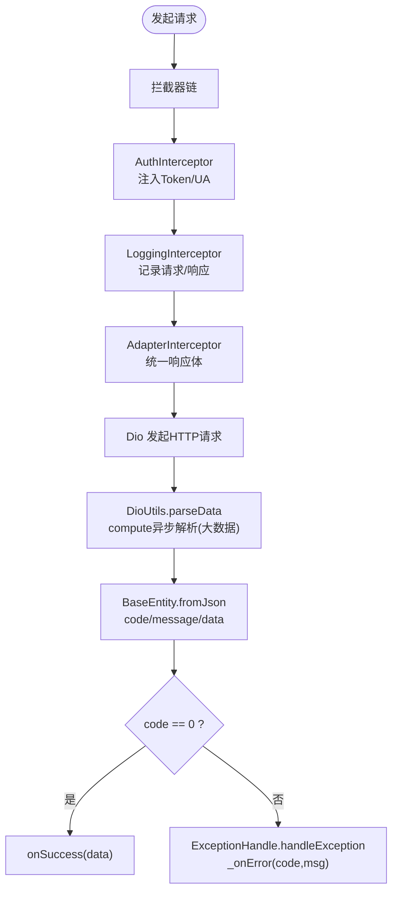
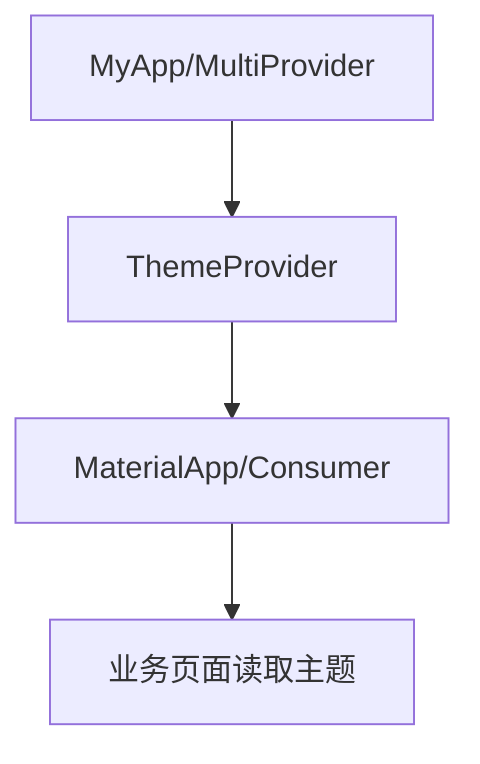
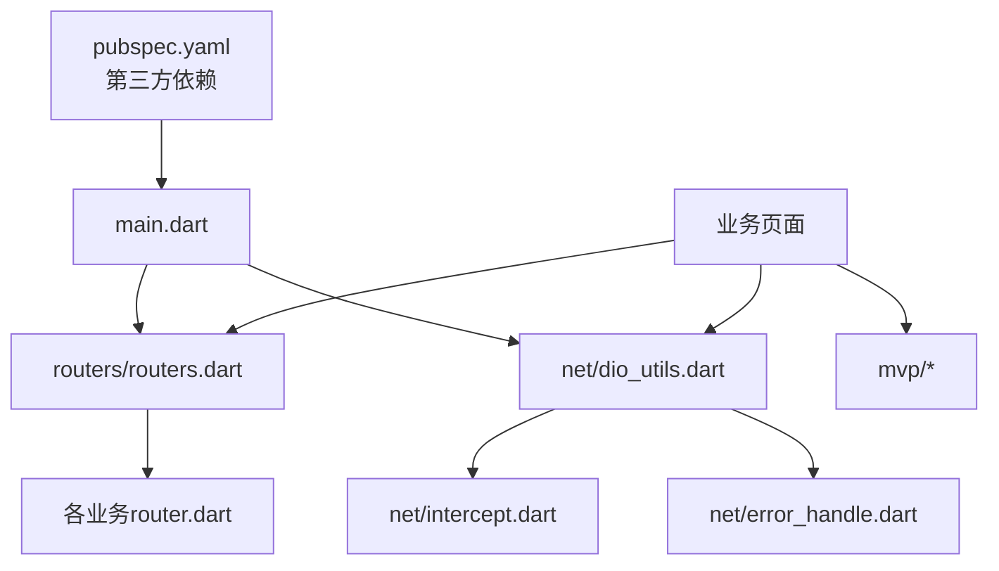

# 架构设计

<cite>
**本文引用的文件**   
- [lib/main.dart](file://lib/main.dart)
- [pubspec.yaml](file://pubspec.yaml)
- [lib/mvp/base_page.dart](file://lib/mvp/base_page.dart)
- [lib/mvp/base_presenter.dart](file://lib/mvp/base_presenter.dart)
- [lib/mvp/power_presenter.dart](file://lib/mvp/power_presenter.dart)
- [lib/mvp/i_lifecycle.dart](file://lib/mvp/i_lifecycle.dart)
- [lib/mvp/mvps.dart](file://lib/mvp/mvps.dart)
- [lib/routers/fluro_navigator.dart](file://lib/routers/fluro_navigator.dart)
- [lib/routers/i_router.dart](file://lib/routers/i_router.dart)
- [lib/routers/routers.dart](file://lib/routers/routers.dart)
- [lib/net/dio_utils.dart](file://lib/net/dio_utils.dart)
- [lib/net/base_entity.dart](file://lib/net/base_entity.dart)
- [lib/net/intercept.dart](file://lib/net/intercept.dart)
- [lib/net/error_handle.dart](file://lib/net/error_handle.dart)
- [lib/net/http_api.dart](file://lib/net/http_api.dart)
- [lib/setting/provider/theme_provider.dart](file://lib/setting/provider/theme_provider.dart)
- [lib/pages/home/provider/home_provider.dart](file://lib/pages/home/provider/home_provider.dart)
</cite>

## 目录
1. [引言](#引言)
2. [项目结构](#项目结构)
3. [核心组件](#核心组件)
4. [架构总览](#架构总览)
5. [详细组件分析](#详细组件分析)
6. [依赖关系分析](#依赖关系分析)
7. [性能与可维护性](#性能与可维护性)
8. [故障排查指南](#故障排查指南)
9. [结论](#结论)

## 引言
本文件面向灵犀管店 Flutter 项目的开发者，系统性梳理 MVP 架构、模块化路由、网络层封装与 Provider 状态管理的实现方式与职责边界。文档从代码级实现出发，给出架构图表、数据流向图与最佳实践建议，帮助团队在扩展业务页面时保持一致的架构风格。

## 项目结构
应用以 lib 为源码根目录，采用“功能域 + 分层”的组织方式：
- mvp：MVP 抽象基类、生命周期接口与多 Presenter 组合容器。
- routers：Fluro 路由集中注册与跳转工具。
- net：Dio 网络层封装、拦截器链、统一响应体与错误处理。
- setting/provider：基于 Provider 的全局主题状态管理。
- pages：按业务域划分的路由与页面，每个模块通常附带 router.dart 暴露 IRouterProvider。
- widgets、util、res：通用 UI 组件、工具与资源常量。
- main.dart：应用启动、全局 Provider 注入、网络初始化与路由注册入口。

图表来源
- [lib/main.dart:60-160](file://lib/main.dart#L60-L160)
- [lib/routers/routers.dart:1-176](file://lib/routers/routers.dart#L1-L176)
- [lib/net/dio_utils.dart:1-204](file://lib/net/dio_utils.dart#L1-L204)
- [lib/net/intercept.dart:1-213](file://lib/net/intercept.dart#L1-L213)
- [lib/net/base_entity.dart:1-33](file://lib/net/base_entity.dart#L1-L33)
- [lib/setting/provider/theme_provider.dart:1-88](file://lib/setting/provider/theme_provider.dart#L1-L88)

章节来源
- [lib/main.dart:1-204](file://lib/main.dart#L1-L204)
- [pubspec.yaml:1-153](file://pubspec.yaml#L1-L153)

## 核心组件
- MVP 层：通过 BasePageMixin 绑定页面生命周期与展示能力，BasePresenter 提供空实现，IPresenter 继承 ILifecycle 定义生命周期契约；PowerPresenter 聚合多个子 Presenter 实现复用。
- 路由层：Routes 统一管理 Fluro 路由，IRouterProvider 作为模块路由注册契约，NavigatorUtils 提供 push/pushResult/goBack 等统一跳转 API。
- 网络层：DioUtils 封装 Dio 单例、超时、统一返回类型 BaseEntity；拦截器链包含 AuthInterceptor、TokenInterceptor、LoggingInterceptor、AdapterInterceptor；ExceptionHandle 统一异常码与消息。
- 状态管理：ThemeProvider 基于 ChangeNotifier 管理主题模式与主题配置，HomeProvider 示例使用 RestorableInt 管理轻量本地状态。

章节来源
- [lib/mvp/base_page.dart:1-103](file://lib/mvp/base_page.dart#L1-L103)
- [lib/mvp/base_presenter.dart:1-21](file://lib/mvp/base_presenter.dart#L1-L21)
- [lib/mvp/power_presenter.dart:1-69](file://lib/mvp/power_presenter.dart#L1-L69)
- [lib/mvp/mvps.dart:1-19](file://lib/mvp/mvps.dart#L1-L19)
- [lib/mvp/i_lifecycle.dart:1-13](file://lib/mvp/i_lifecycle.dart#L1-L13)
- [lib/routers/fluro_navigator.dart:1-72](file://lib/routers/fluro_navigator.dart#L1-L72)
- [lib/routers/i_router.dart:1-7](file://lib/routers/i_router.dart#L1-L7)
- [lib/routers/routers.dart:1-176](file://lib/routers/routers.dart#L1-L176)
- [lib/net/dio_utils.dart:1-204](file://lib/net/dio_utils.dart#L1-L204)
- [lib/net/base_entity.dart:1-33](file://lib/net/base_entity.dart#L1-L33)
- [lib/net/intercept.dart:1-213](file://lib/net/intercept.dart#L1-L213)
- [lib/net/error_handle.dart:1-82](file://lib/net/error_handle.dart#L1-L82)
- [lib/setting/provider/theme_provider.dart:1-88](file://lib/setting/provider/theme_provider.dart#L1-L88)
- [lib/pages/home/provider/home_provider.dart:1-6](file://lib/pages/home/provider/home_provider.dart#L1-L6)

## 架构总览
本项目采用三层分离的 MVP 架构：
- 视图层（View）：Flutter StatefulWidget，仅负责渲染与用户交互，通过 IMvpView 向 Presenter 暴露上下文、进度与 Toast 能力。
- 展示逻辑层（Presenter）：承载页面状态变更、业务流程编排、调用数据层；对 View 只通过接口回调结果。
- 数据层（Data）：DioUtils 统一发起网络请求，经拦截器链处理后返回 BaseEntity，上层再映射为业务模型。

图表来源
- [lib/mvp/base_page.dart:1-103](file://lib/mvp/base_page.dart#L1-L103)
- [lib/mvp/base_presenter.dart:1-21](file://lib/mvp/base_presenter.dart#L1-L21)
- [lib/mvp/power_presenter.dart:1-69](file://lib/mvp/power_presenter.dart#L1-L69)
- [lib/net/dio_utils.dart:1-204](file://lib/net/dio_utils.dart#L1-L204)
- [lib/net/http_api.dart:1-595](file://lib/net/http_api.dart#L1-L595)

## 详细组件分析

### MVP 架构实现
- BasePageMixin：混入 State，实现 IMvpView，持有 presenter 并转发生命周期方法；提供 showProgress/closeProgress/showToast 的统一 UI 能力；在 initState 中创建 Presenter 并回挂 view 引用。
- BasePresenter：默认空实现，所有生命周期钩子为空操作，便于子类按需覆盖。
- IPresenter/ILifecycle：定义 initState、didChangeDependencies、didUpdateWidgets、deactivate、dispose 生命周期契约。
- PowerPresenter：聚合多个 BasePagePresenter，用于将复杂页面的逻辑拆分为可复用的子 Presenter，并在生命周期中批量分发。

图表来源
- [lib/mvp/i_lifecycle.dart:1-13](file://lib/mvp/i_lifecycle.dart#L1-L13)
- [lib/mvp/mvps.dart:1-19](file://lib/mvp/mvps.dart#L1-L19)
- [lib/mvp/base_presenter.dart:1-21](file://lib/mvp/base_presenter.dart#L1-L21)
- [lib/mvp/base_page.dart:1-103](file://lib/mvp/base_page.dart#L1-L103)
- [lib/mvp/power_presenter.dart:1-69](file://lib/mvp/power_presenter.dart#L1-L69)

职责边界与原则
- 视图层不直接访问网络或持久化存储，所有副作用通过 Presenter 完成。
- Presenter 仅依赖 IMvpView 接口，避免反向耦合到具体 Widget。
- PowerPresenter 用于拆分大型页面的复杂逻辑，提高可测试性与复用性。

章节来源
- [lib/mvp/base_page.dart:1-103](file://lib/mvp/base_page.dart#L1-L103)
- [lib/mvp/base_presenter.dart:1-21](file://lib/mvp/base_presenter.dart#L1-L21)
- [lib/mvp/power_presenter.dart:1-69](file://lib/mvp/power_presenter.dart#L1-L69)
- [lib/mvp/mvps.dart:1-19](file://lib/mvp/mvps.dart#L1-L19)
- [lib/mvp/i_lifecycle.dart:1-13](file://lib/mvp/i_lifecycle.dart#L1-L13)

### 模块化路由系统（Fluro 集成与 IRouterProvider）
- Routes：集中管理 FluroRouter，注册全局路由与未匹配处理，维护 List<IRouterProvider> 并按需调用 initRouter。
- IRouterProvider：模块级路由注册契约，每个业务模块实现该接口，在 initRouter 中向 FluroRouter 注册自身路由。
- NavigatorUtils：封装 push/pushResult/goBack 等方法，统一焦点处理与参数传递，支持 WebView/Asset HTML 快捷跳转。

图表来源
- [lib/routers/fluro_navigator.dart:1-72](file://lib/routers/fluro_navigator.dart#L1-L72)
- [lib/routers/i_router.dart:1-7](file://lib/routers/i_router.dart#L1-L7)
- [lib/routers/routers.dart:1-176](file://lib/routers/routers.dart#L1-L176)

设计要点
- 路由路径集中声明，避免硬编码字符串散落各处。
- 模块自治路由注册，降低主路由文件的耦合度。
- 跳转统一封装，保证焦点管理与返回行为一致。

章节来源
- [lib/routers/fluro_navigator.dart:1-72](file://lib/routers/fluro_navigator.dart#L1-L72)
- [lib/routers/i_router.dart:1-7](file://lib/routers/i_router.dart#L1-L7)
- [lib/routers/routers.dart:1-176](file://lib/routers/routers.dart#L1-L176)

### 网络层封装策略（DioUtils、拦截器链、BaseEntity）
- DioUtils：
  - 单例模式，提供 requestNetwork/asyncRequestNetwork 两类 API。
  - 统一设置超时、baseUrl、禁用默认 validateStatus，交由 AdapterInterceptor 判断业务成功。
  - 大体积响应体通过 compute 异步解析，减少阻塞主线程。
  - 将 DioException 转换为 NetError，并统一 onError 回调。
- 拦截器链：
  - AuthInterceptor：注入 Authorization、User-Agent。
  - TokenInterceptor：基于 QueuedInterceptor 在 401 时自动刷新 accessToken 并重试失败请求。
  - LoggingInterceptor：打印请求/响应与耗时（生产环境可关闭）。
  - AdapterInterceptor：适配后端多种响应格式，统一包装为 code/message/data 结构，透传 retcode 场景。
- BaseEntity：统一响应体，内部使用 JsonConvert 反序列化 data。

图表来源
- [lib/net/dio_utils.dart:1-204](file://lib/net/dio_utils.dart#L1-L204)
- [lib/net/intercept.dart:1-213](file://lib/net/intercept.dart#L1-L213)
- [lib/net/base_entity.dart:1-33](file://lib/net/base_entity.dart#L1-L33)
- [lib/net/error_handle.dart:1-82](file://lib/net/error_handle.dart#L1-L82)

职责边界与注意事项
- 业务层仅关心 onSuccess/onError 回调，无需感知底层 HTTP 细节。
- 401 自动刷新由 TokenInterceptor 处理，避免业务重复逻辑。
- 对于需要原始响应的场景，AdapterInterceptor 会保持透传，但需留意统一结构约定。

章节来源
- [lib/net/dio_utils.dart:1-204](file://lib/net/dio_utils.dart#L1-L204)
- [lib/net/intercept.dart:1-213](file://lib/net/intercept.dart#L1-L213)
- [lib/net/base_entity.dart:1-33](file://lib/net/base_entity.dart#L1-L33)
- [lib/net/error_handle.dart:1-82](file://lib/net/error_handle.dart#L1-L82)
- [lib/net/http_api.dart:1-595](file://lib/net/http_api.dart#L1-L595)

### Provider 状态管理模式与应用场景
- ThemeProvider：基于 ChangeNotifier 管理主题模式与主题配置，并通过 SpUtil 持久化；UI 层通过 MultiProvider 注入并使用 Consumer 订阅变化。
- HomeProvider：示例使用 RestorableInt 管理轻量状态，适用于需要随路由恢复的简单整型状态。

图表来源
- [lib/main.dart:60-160](file://lib/main.dart#L60-L160)
- [lib/setting/provider/theme_provider.dart:1-88](file://lib/setting/provider/theme_provider.dart#L1-L88)

使用建议
- 跨页面共享且影响 UI 的状态（如主题、语言、登录态）适合用 Provider。
- 局部小状态可使用 setState 或 Restorable*，避免不必要的重建范围扩大。

章节来源
- [lib/main.dart:60-160](file://lib/main.dart#L60-L160)
- [lib/setting/provider/theme_provider.dart:1-88](file://lib/setting/provider/theme_provider.dart#L1-L88)
- [lib/pages/home/provider/home_provider.dart:1-6](file://lib/pages/home/provider/home_provider.dart#L1-L6)

### 组件复用机制与设计原则
- 页面级复用：PowerPresenter 将复杂页面的逻辑拆分为多个 BasePagePresenter，分别处理列表、表单、统计等不同职责，生命周期由 PowerPresenter 统一派发。
- 视图复用：widgets 目录下的通用组件（如 MyCard、MyButton、ProgressDialog 等）配合 BasePageMixin 提供的 showProgress/closeProgress 能力，形成一致的加载反馈体验。
- 路由复用：IRouterProvider 让每个模块自管路由，新增模块只需实现接口并注册至 Routes，避免中心化膨胀。

设计原则
- 单一职责：每个 Presenter 只负责一个子功能域。
- 低耦合：View 与 Presenter 通过接口通信；Presenter 与 Data 通过 DioUtils 通信。
- 高内聚：模块路由、API 常量、领域逻辑尽量就近组织。

章节来源
- [lib/mvp/power_presenter.dart:1-69](file://lib/mvp/power_presenter.dart#L1-L69)
- [lib/routers/i_router.dart:1-7](file://lib/routers/i_router.dart#L1-L7)
- [lib/routers/routers.dart:1-176](file://lib/routers/routers.dart#L1-L176)

## 依赖关系分析
- 外部依赖：dio、fluro、provider、sp_util、oktoast、jpush_flutter 等均在 pubspec.yaml 中声明。
- 模块间依赖：
  - main.dart 依赖 routers 与 net 完成初始化。
  - 业务页面依赖 mvp 基类与 routers 工具。
  - 网络层依赖 intercept 与 error_handle，对外暴露 dio_utils。

图表来源
- [pubspec.yaml:1-153](file://pubspec.yaml#L1-L153)
- [lib/main.dart:1-204](file://lib/main.dart#L1-L204)
- [lib/routers/routers.dart:1-176](file://lib/routers/routers.dart#L1-L176)
- [lib/net/dio_utils.dart:1-204](file://lib/net/dio_utils.dart#L1-L204)
- [lib/net/intercept.dart:1-213](file://lib/net/intercept.dart#L1-L213)
- [lib/net/error_handle.dart:1-82](file://lib/net/error_handle.dart#L1-L82)

章节来源
- [pubspec.yaml:1-153](file://pubspec.yaml#L1-L153)
- [lib/main.dart:1-204](file://lib/main.dart#L1-L204)

## 性能与可维护性
- 大响应体异步解析：DioUtils 对大于 10KB 的响应体使用 compute 在 isolate 中解析，降低主线程压力。
- 拦截器顺序合理：鉴权与日志在前，适配器在后，保证最终业务层拿到统一结构。
- 路由与网络配置集中：main.dart 中集中初始化，便于统一修改与测试替换。
- 状态管理最小化：仅在必要处使用 Provider，避免大范围 rebuild。

优化建议
- 对高频网络请求考虑引入缓存策略或去抖/防重。
- 对长列表与复杂页面继续使用 PowerPresenter 拆分逻辑，并结合懒加载。
- 对路由进行分组命名空间化管理，避免路径冲突。

[本节为通用指导，不直接分析具体文件]

## 故障排查指南
- 无法获取数据：
  - 检查 AdapterInterceptor 是否正确将后端响应适配为 code/message/data。
  - 确认 BaseEntity.fromJson 的字段名与 Constant 常量一致。
- 401 未授权：
  - 确认 TokenInterceptor 已正确刷新 accessToken 并重试请求。
  - 检查 SpUtil 中 token 是否有效。
- 网络异常统一提示：
  - ExceptionHandle 已将各类 DioException 映射为 NetError，可在 onError 回调中根据 code 区分处理。
- 路由未命中：
  - Routes.notFoundHandler 会返回 NotFoundPage，检查路径是否注册，参数是否传递正确。

章节来源
- [lib/net/intercept.dart:1-213](file://lib/net/intercept.dart#L1-L213)
- [lib/net/base_entity.dart:1-33](file://lib/net/base_entity.dart#L1-L33)
- [lib/net/error_handle.dart:1-82](file://lib/net/error_handle.dart#L1-L82)
- [lib/routers/routers.dart:1-176](file://lib/routers/routers.dart#L1-L176)

## 结论
灵犀管店项目以 MVP 为核心，清晰分离视图、展示逻辑与数据层；以 Fluro 为基础构建模块化路由体系；以 Dio 为中心实现可插拔的网络层封装；并以 Provider 支撑必要的跨组件状态。该架构具备良好的可扩展性与可测试性，建议在新增功能时遵循现有职责边界与复用机制，以保持代码的一致性与长期可维护性。