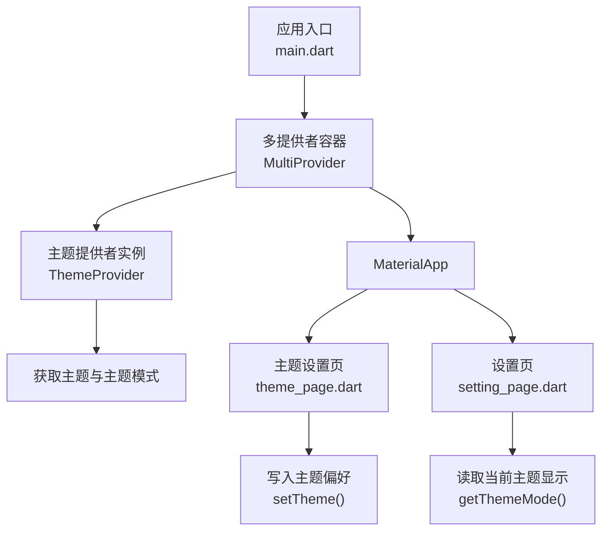
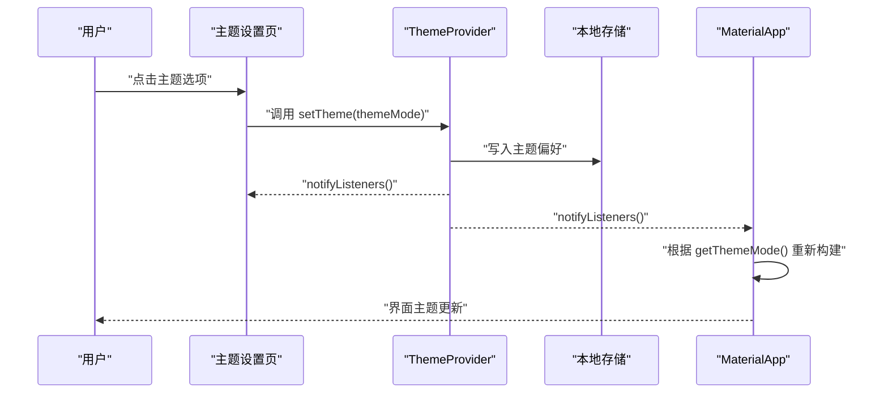
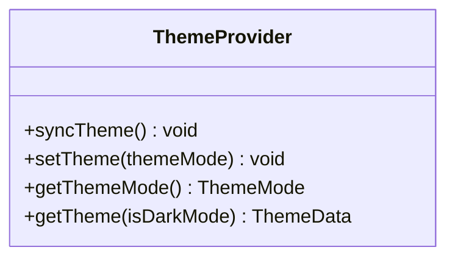
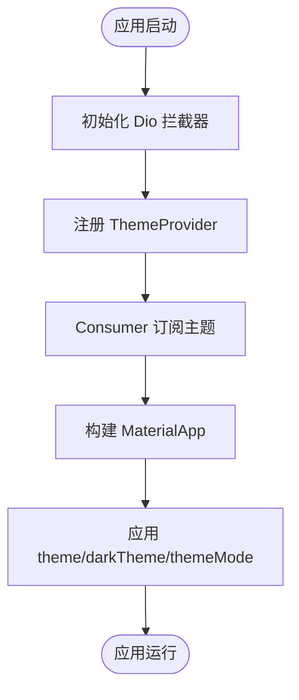
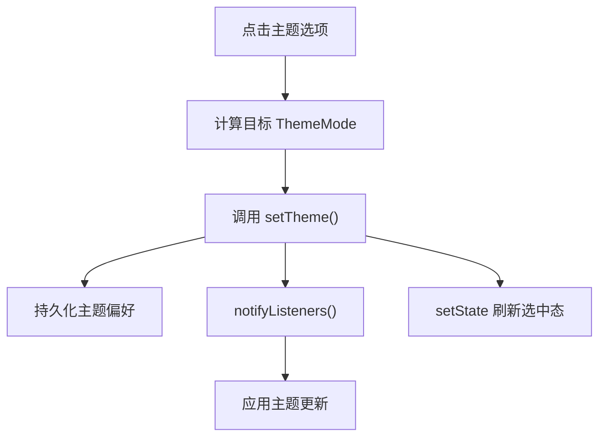
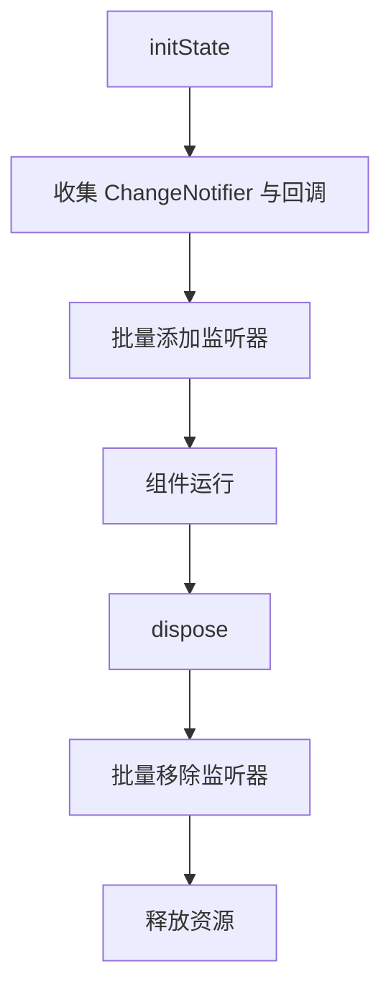
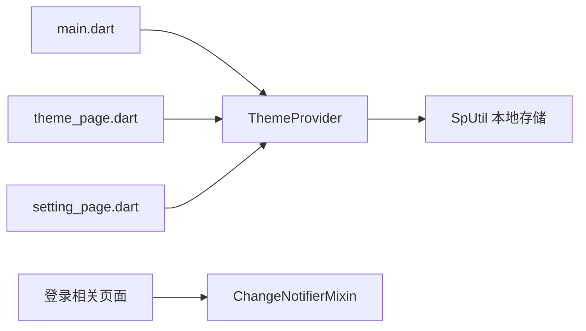

# 状态管理

<cite>
**本文引用的文件**
- [main.dart](file://lib/main.dart)
- [theme_provider.dart](file://lib/setting/provider/theme_provider.dart)
- [theme_page.dart](file://lib/setting/page/theme_page.dart)
- [setting_page.dart](file://lib/setting/page/setting_page.dart)
- [home_provider.dart](file://lib/pages/home/provider/home_provider.dart)
- [change_notifier_manage.dart](file://lib/util/change_notifier_manage.dart)
</cite>

## 目录
1. [引言](#引言)
2. [项目结构与 Provider 布局](#项目结构与-provider-布局)
3. [核心组件与职责](#核心组件与职责)
4. [架构总览](#架构总览)
5. [详细组件分析](#详细组件分析)
6. [依赖关系分析](#依赖关系分析)
7. [性能优化与避免不必要重建](#性能优化与避免不必要重建)
8. [复杂状态场景处理方案](#复杂状态场景处理方案)
9. [状态持久化策略](#状态持久化策略)
10. [代码规范](#代码规范)
11. [调试方法](#调试方法)
12. [故障排查](#故障排查)
13. [结论](#结论)

## 引言
本文面向灵犀管店 Flutter 项目的状态管理，重点说明：
- ChangeNotifier 的使用模式。
- Provider 在主题切换、全局状态同步中的职责。
- 状态提升的最佳实践。
- Consumer 组件的正确使用方式。
- 性能优化技巧，避免不必要的重建。
- 复杂状态场景的处理方案。
- 基于本地存储的状态持久化策略。
- 代码规范和调试方法。

本项目以 Provider 作为 UI 层与业务状态之间的桥梁，通过 ChangeNotifier 暴露可观察状态；主题相关的全局状态由 ThemeProvider 提供；页面中通过 Consumer 或 context.read 读取并消费状态。

## 项目结构与 Provider 布局
项目在应用入口中使用 MultiProvider 注册全局 Provider，并通过 Consumer 订阅 ThemeProvider，使 MaterialApp 的 theme、darkTheme 和 themeMode 随主题状态变化而更新。设置页和主题页负责读取和修改主题。

**图表来源**
- [main.dart:119-171](file://lib/main.dart#L119-L171)
- [theme_provider.dart:15-38](file://lib/setting/provider/theme_provider.dart#L15-L38)
- [theme_page.dart:36-54](file://lib/setting/page/theme_page.dart#L36-L54)
- [setting_page.dart:34-73](file://lib/setting/page/setting_page.dart#L34-L73)

**章节来源**
- [main.dart:119-171](file://lib/main.dart#L119-L171)
- [theme_provider.dart:15-38](file://lib/setting/provider/theme_provider.dart#L15-L38)
- [theme_page.dart:36-54](file://lib/setting/page/theme_page.dart#L36-L54)
- [setting_page.dart:34-73](file://lib/setting/page/setting_page.dart#L34-L73)

## 核心组件与职责
- ThemeProvider：继承自 ChangeNotifier，负责主题模式、主题样式、以及将主题写入本地存储。
- MyApp：使用 MultiProvider 注册 ThemeProvider，并用 Consumer 订阅主题变化，更新 MaterialApp 的主题配置。
- ThemePage：用户选择主题时调用 setTheme，保存偏好并触发通知。
- SettingPage：展示当前主题选项，使用 Consumer 订阅主题提供者。
- HomeProvider：轻量状态示例，演示 RestorableInt 作为页面级状态的用法。
- ChangeNotifierMixin：统一管理 ChangeNotifier 的生命周期，减少监听器添加与释放样板代码。

**章节来源**
- [theme_provider.dart:15-88](file://lib/setting/provider/theme_provider.dart#L15-L88)
- [main.dart:119-171](file://lib/main.dart#L119-L171)
- [theme_page.dart:36-54](file://lib/setting/page/theme_page.dart#L36-L54)
- [setting_page.dart:34-73](file://lib/setting/page/setting_page.dart#L34-L73)
- [home_provider.dart:1-6](file://lib/pages/home/provider/home_provider.dart#L1-L6)
- [change_notifier_manage.dart:1-79](file://lib/util/change_notifier_manage.dart#L1-L79)

## 架构总览
下图展示了从用户交互到主题更新的完整调用链：用户在主题页选择新主题后，Provider 写持久化数据并通知监听者；MaterialApp 重新构建并使用新的主题模式。

**图表来源**
- [theme_page.dart:36-54](file://lib/setting/page/theme_page.dart#L36-L54)
- [theme_provider.dart:22-24](file://lib/setting/provider/theme_provider.dart#L22-L24)
- [main.dart:169-171](file://lib/main.dart#L169-L171)

## 详细组件分析

### ThemeProvider：主题状态中心
ThemeProvider 是典型的状态提供者，它封装了以下能力：
- 同步外部主题偏好（例如从本地存储恢复）。
- 设置主题模式并持久化。
- 读取主题模式。
- 生成浅色或深色 ThemeData。

该类的关键设计点：
- 使用 ChangeNotifier 暴露 notifyListeners，供 UI 订阅。
- 通过 SpUtil 将主题偏好写入本地存储，保证重启后一致。
- getTheme 支持 isDarkMode 参数，便于在不同上下文中构建不同主题。

**图表来源**
- [theme_provider.dart:15-88](file://lib/setting/provider/theme_provider.dart#L15-L88)

**章节来源**
- [theme_provider.dart:15-88](file://lib/setting/provider/theme_provider.dart#L15-L88)

### MyApp：Provider 注册与主题装配
MyApp 的职责：
- 初始化网络、路由、版本检查等基础设施。
- 使用 MultiProvider 注册 ThemeProvider。
- 使用 Consumer 订阅 ThemeProvider，并将 provider.getThemeMode() 注入 MaterialApp 的 themeMode。
- 同时通过 provider.getTheme() 提供 theme 与 darkTheme。

这保证了当 ThemeProvider 发出通知时，整个应用会重建并应用新主题。

**图表来源**
- [main.dart:119-171](file://lib/main.dart#L119-L171)

**章节来源**
- [main.dart:119-171](file://lib/main.dart#L119-L171)

### ThemePage：主题切换入口
ThemePage 展示“跟随系统”“开启”“关闭”三个选项。用户点击某项后：
- 计算目标 ThemeMode。
- 通过 context.read<ThemeProvider>().setTheme(themeMode) 更新状态。
- 局部 setState 刷新选中指示图标。

注意：该页面没有直接订阅 ThemeProvider 进行 UI 自动刷新，而是通过 setState 刷新选中态；整体应用的主题由 MyApp 订阅 Provider 控制。

**图表来源**
- [theme_page.dart:36-54](file://lib/setting/page/theme_page.dart#L36-L54)
- [theme_provider.dart:22-24](file://lib/setting/provider/theme_provider.dart#L22-L24)

**章节来源**
- [theme_page.dart:36-54](file://lib/setting/page/theme_page.dart#L36-L54)

### SettingPage：使用 Consumer 订阅主题
SettingPage 使用 Consumer<ThemeProvider> 包裹内容，从而在主题变化时局部重建。它主要用来展示当前主题文本，例如“跟随系统”“开启”“关闭”。

这里体现了 Consumer 的典型用法：只重建需要的部分，而不是整页 rebuild。

**章节来源**
- [setting_page.dart:34-73](file://lib/setting/page/setting_page.dart#L34-L73)

### HomeProvider：轻量页面状态示例
HomeProvider 继承 RestorableInt，表示一个可恢复的整数状态。这类状态常用于需要跨生命周期保持的值，例如滚动位置、分页索引等。

虽然该项目中主题使用 ThemeProvider，但 HomeProvider 展示了另一种 Provider 形态：RestorableXxx 系列，用于更贴近 Flutter 原生状态恢复机制的场景。

**章节来源**
- [home_provider.dart:1-6](file://lib/pages/home/provider/home_provider.dart#L1-L6)

### ChangeNotifierMixin：统一生命周期管理
ChangeNotifierMixin 为 Stateful Widget 提供统一的 ChangeNotifier 管理：
- 在 initState 中添加监听器。
- 在 dispose 中移除监听器并释放资源。
- 通过 changeNotifier() 返回需要管理的 ChangeNotifier 与回调映射。

该 Mixin 显著减少了重复样板代码，降低了忘记释放监听器导致的内存泄漏风险。

**图表来源**
- [change_notifier_manage.dart:1-79](file://lib/util/change_notifier_manage.dart#L1-L79)

**章节来源**
- [change_notifier_manage.dart:1-79](file://lib/util/change_notifier_manage.dart#L1-L79)

## 依赖关系分析
- main.dart 依赖 ThemeProvider，通过 Provider 注入。
- ThemePage 依赖 ThemeProvider，用于写入主题。
- SettingPage 依赖 ThemeProvider，用于读取主题。
- ThemeProvider 依赖本地存储 SpUtil，用于持久化主题偏好。
- ChangeNotifierMixin 被登录相关页面使用，用于管理输入控制器和焦点节点。

**图表来源**
- [main.dart:119-171](file://lib/main.dart#L119-L171)
- [theme_page.dart:36-54](file://lib/setting/page/theme_page.dart#L36-L54)
- [setting_page.dart:34-73](file://lib/setting/page/setting_page.dart#L34-L73)
- [change_notifier_manage.dart:1-79](file://lib/util/change_notifier_manage.dart#L1-L79)

**章节来源**
- [main.dart:119-171](file://lib/main.dart#L119-L171)
- [theme_page.dart:36-54](file://lib/setting/page/theme_page.dart#L36-L54)
- [setting_page.dart:34-73](file://lib/setting/page/setting_page.dart#L34-L73)
- [change_notifier_manage.dart:1-79](file://lib/util/change_notifier_manage.dart#L1-L79)

## 性能优化与避免不必要重建
- 使用 Consumer 精确订阅：只在 Consumer 包裹的子树重建，避免整页 rebuild。
- 避免在 build 中进行昂贵计算：将计算结果缓存或使用 compute 异步任务。
- 拆分细粒度 Provider：将大对象拆分为多个小 Provider，降低通知范围。
- 合理使用 listen=false：仅更新状态不改变 UI 时使用 context.read，避免无意义重建。
- 使用 const 构造和 Key：对稳定子树使用 const，对列表使用合理 Key。
- 避免频繁 notifyListeners：合并多次状态变更，或在必要时节流。

在本项目中：
- MyApp 通过 Consumer<ThemeProvider> 订阅主题，主题变化时仅重建 MaterialApp 所需部分。
- SettingPage 使用 Consumer<ThemeProvider> 包裹设置项，避免整页重建。
- ThemePage 通过 setState 刷新选中态，而不是重建整个 ListView。

**章节来源**
- [main.dart:119-171](file://lib/main.dart#L119-L171)
- [setting_page.dart:34-73](file://lib/setting/page/setting_page.dart#L34-L73)
- [theme_page.dart:36-54](file://lib/setting/page/theme_page.dart#L36-L54)

## 复杂状态场景处理方案
- 多 Provider 协作：将不同领域状态（如主题、用户信息、购物车）分别放入独立 Provider，避免耦合。
- 状态提升：把共享状态提升到共同父级，让多个子组件共享。
- 不可变数据模型：使用不可变数据配合 copyWith，减少比较开销。
- 异步状态：在 Provider 中处理网络请求，用 StreamProvider 或自定义 Stream 通知 UI。
- 状态恢复：使用 RestorableXxx 或 SharedPreferences 持久化关键状态。

本项目示例：
- ThemeProvider 承担主题领域状态。
- HomeProvider 展示 RestorableInt 的轻量状态用法。
- ChangeNotifierMixin 帮助页面集中管理多个 ChangeNotifier 生命周期。

**章节来源**
- [theme_provider.dart:15-88](file://lib/setting/provider/theme_provider.dart#L15-L88)
- [home_provider.dart:1-6](file://lib/pages/home/provider/home_provider.dart#L1-L6)
- [change_notifier_manage.dart:1-79](file://lib/util/change_notifier_manage.dart#L1-L79)

## 状态持久化策略
主题偏好通过 SpUtil 写入本地存储：
- setTheme 写入主题字符串值。
- getThemeMode 从本地存储读取并转换为 ThemeMode。
- syncTheme 可在适当时机同步外部主题偏好，确保一致性。

建议：
- 所有影响 UI 的关键偏好都应在应用启动时同步一次。
- 写入前做幂等判断，避免重复无效写入。
- 对敏感数据考虑加密或更安全存储方案。

**章节来源**
- [theme_provider.dart:15-38](file://lib/setting/provider/theme_provider.dart#L15-L38)

## 代码规范
- Provider 命名：使用 XxxProvider 后缀，职责单一。
- ChangeNotifier 使用：
  - 在状态变更后调用 notifyListeners。
  - 避免在高频路径中频繁 notify。
- Consumer 使用：
  - 仅包裹需要重建的部分。
  - 优先使用 builder 闭包访问 provider。
- 非监听式访问：
  - 仅修改状态时使用 context.read。
- 生命周期管理：
  - 使用 ChangeNotifierMixin 管理 TextEditingController、FocusNode 等。
- 主题相关：
  - 主题逻辑集中在 ThemeProvider。
  - UI 只负责展示与触发操作。

**章节来源**
- [change_notifier_manage.dart:1-79](file://lib/util/change_notifier_manage.dart#L1-L79)
- [theme_page.dart:36-54](file://lib/setting/page/theme_page.dart#L36-L54)
- [setting_page.dart:34-73](file://lib/setting/page/setting_page.dart#L34-L73)

## 调试方法
- 打印通知：在 setTheme 与 notifyListeners 附近添加日志，确认状态变更是否发生。
- 性能监控：启用 showPerformanceOverlay 观察重建频率。
- 断点调试：在 Consumer 的 builder 与 Provider 的方法处打断点。
- 日志输出：结合项目已有日志工具记录关键状态变更。

建议在关键路径增加日志：
- 主题设置入口。
- 主题模式读取。
- 本地存储读写。
- Provider 通知。

**章节来源**
- [theme_provider.dart:22-24](file://lib/setting/provider/theme_provider.dart#L22-L24)
- [main.dart:119-171](file://lib/main.dart#L119-L171)

## 故障排查
常见问题与解决思路：
- 主题未生效：
  - 检查 ThemeProvider.setTheme 是否调用 notifyListeners。
  - 检查 MyApp 是否正确使用 provider.getThemeMode() 设置 themeMode。
- 页面未重建：
  - 检查是否使用 Consumer 包裹目标区域。
  - 确认没有在 Consumer 之外访问 provider 导致误判。
- 状态不一致：
  - 检查本地存储是否成功写入。
  - 检查 syncTheme 是否在合适时机调用。
- 内存泄漏：
  - 检查 ChangeNotifierMixin 是否正确移除监听器并释放资源。

**章节来源**
- [theme_provider.dart:15-38](file://lib/setting/provider/theme_provider.dart#L15-L38)
- [main.dart:119-171](file://lib/main.dart#L119-L171)
- [change_notifier_manage.dart:1-79](file://lib/util/change_notifier_manage.dart#L1-L79)

## 结论
灵犀管店项目的状态管理以 Provider 为核心，通过 ThemeProvider 管理主题这一全局状态，并在应用入口完成 Provider 注册与主题装配。页面通过 Consumer 或 context.read 读取和修改状态，结合本地存储实现主题持久化。借助 ChangeNotifierMixin 统一管理生命周期，降低样板代码与内存泄漏风险。在实际开发中，应遵循 Provider 职责单一、Consumer 精准订阅、状态提升与不可变数据等最佳实践，并结合日志与性能监控进行调试和优化。