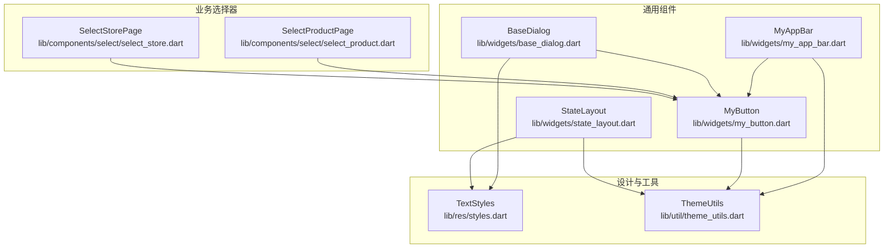
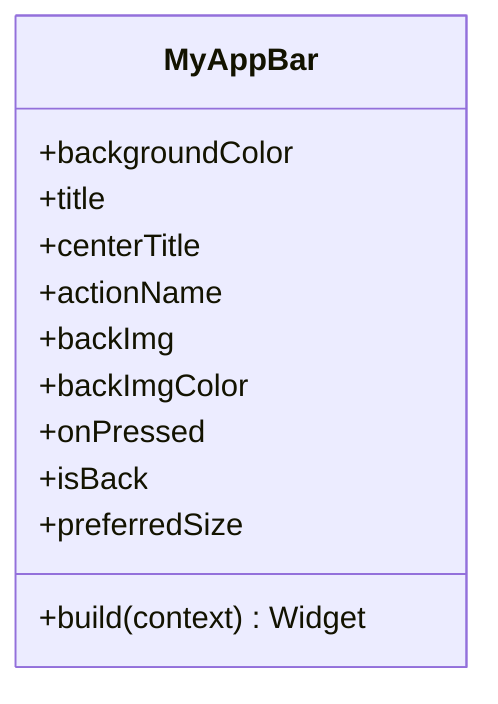
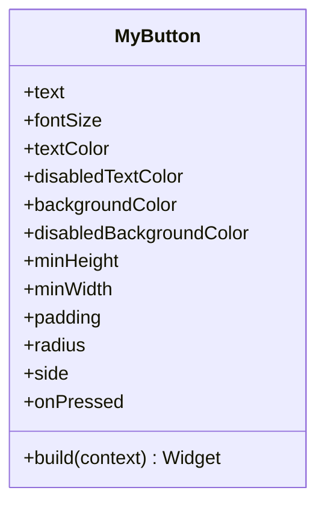
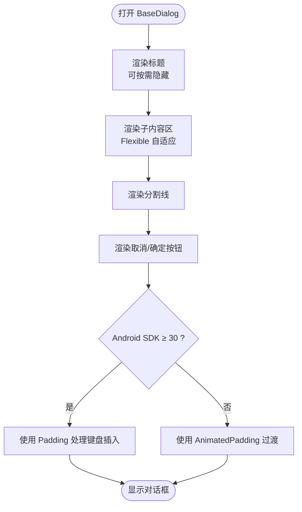
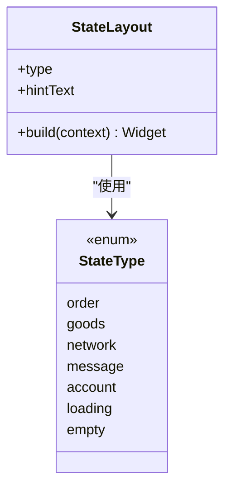
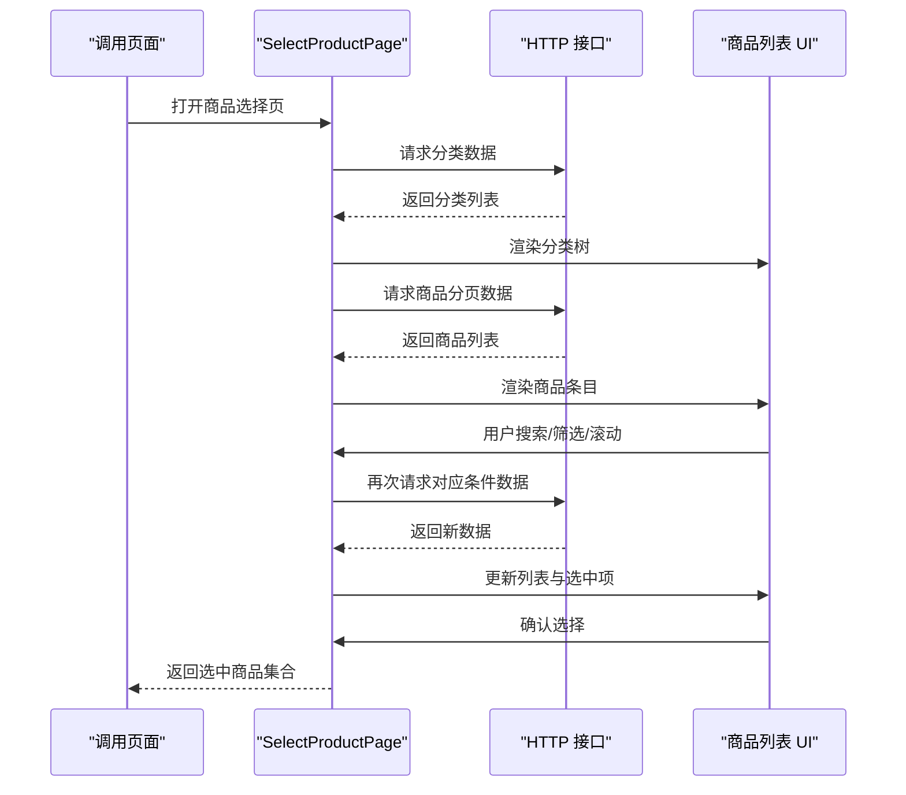
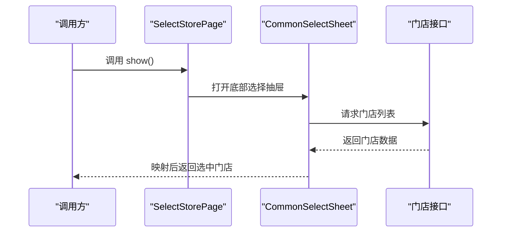
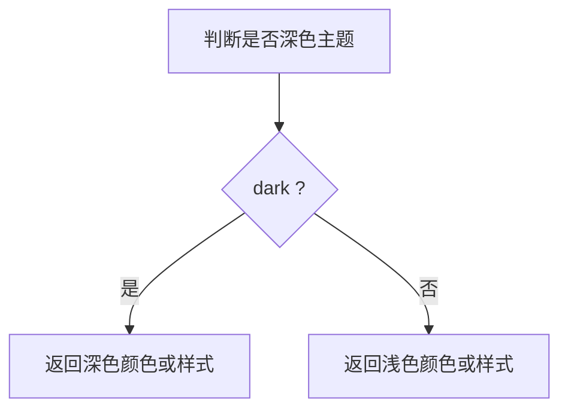
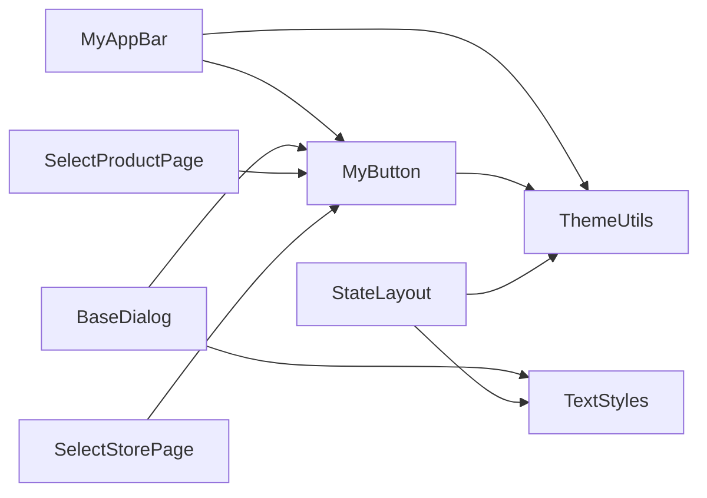

# 组件系统

<cite>
**本文引用的文件**   
- [my_app_bar.dart](file://lib/widgets/my_app_bar.dart)
- [my_button.dart](file://lib/widgets/my_button.dart)
- [base_dialog.dart](file://lib/widgets/base_dialog.dart)
- [state_layout.dart](file://lib/widgets/state_layout.dart)
- [select_product.dart](file://lib/components/select/select_product.dart)
- [select_store.dart](file://lib/components/select/select_store.dart)
- [styles.dart](file://lib/res/styles.dart)
- [theme_utils.dart](file://lib/util/theme_utils.dart)
</cite>

## 目录
1. [引言](#引言)
2. [项目结构中的组件分布](#项目结构中的组件分布)
3. [通用 UI 组件](#通用-ui-组件)
4. [业务选择器组件](#业务选择器组件)
5. [样式、主题与响应式适配](#样式主题与响应式适配)
6. [组件组合与扩展指南](#组件组合与扩展指南)
7. [依赖关系分析](#依赖关系分析)
8. [性能优化建议](#性能优化建议)
9. [可访问性与无障碍支持](#可访问性与无障碍支持)
10. [故障排查](#故障排查)
11. [结论](#结论)

## 引言
本文件面向灵犀管店 Flutter 项目的组件体系，重点说明以下三类内容：
- 通用 UI 组件：AppBar、Button、Dialog、StateLayout 的设计目标、参数边界和复用方式。
- 业务选择器组件：以 SelectProduct、SelectStore 为代表，解释其数据加载、筛选、结果映射及扩展点。
- 样式与主题：通过统一文本样式、颜色资源和 ThemeUtils 实现明暗主题、状态栏适配及跨页面一致性。

目标是帮助开发者在不深入业务代码的情况下，快速理解现有组件的契约，并在此基础上安全地扩展或组合新的界面能力。

## 项目结构中的组件分布
当前仓库采用按职责分层的 Flutter 工程组织：
- `lib/widgets`：通用 UI 组件，如自定义 AppBar、按钮、对话框模板、状态占位视图。
- `lib/components/select`：业务选择器组件，围绕商品、门店、批次等实体提供选择能力。
- `lib/res`：样式、尺寸、颜色、间距等设计资源。
- `lib/util`：工具类，包括主题、设备信息、导航、网络等。

**图表来源**
- [my_app_bar.dart:1-110](file://lib/widgets/my_app_bar.dart#L1-L110)
- [my_button.dart:1-75](file://lib/widgets/my_button.dart#L1-L75)
- [base_dialog.dart:1-129](file://lib/widgets/base_dialog.dart#L1-L129)
- [state_layout.dart:1-75](file://lib/widgets/state_layout.dart#L1-L75)
- [select_product.dart:1-200](file://lib/components/select/select_product.dart#L1-L200)
- [select_store.dart:1-197](file://lib/components/select/select_store.dart#L1-L197)
- [styles.dart:1-76](file://lib/res/styles.dart#L1-L76)
- [theme_utils.dart:1-52](file://lib/util/theme_utils.dart#L1-L52)

**章节来源**
- [my_app_bar.dart:1-110](file://lib/widgets/my_app_bar.dart#L1-L110)
- [my_button.dart:1-75](file://lib/widgets/my_button.dart#L1-L75)
- [base_dialog.dart:1-129](file://lib/widgets/base_dialog.dart#L1-L129)
- [state_layout.dart:1-75](file://lib/widgets/state_layout.dart#L1-L75)
- [select_product.dart:1-200](file://lib/components/select/select_product.dart#L1-L200)
- [select_store.dart:1-197](file://lib/components/select/select_store.dart#L1-L197)
- [styles.dart:1-76](file://lib/res/styles.dart#L1-L76)
- [theme_utils.dart:1-52](file://lib/util/theme_utils.dart#L1-L52)

## 通用 UI 组件

### 自定义 AppBar：MyAppBar
MyAppBar 是一个无状态组件，负责：
- 显示标题、返回按钮和右侧操作按钮。
- 根据背景色自动决定状态栏与导航栏图标亮度。
- 在点击返回时先尝试 pop，失败则调用系统级退出。
- 使用语义化包装提升可访问性。

关键行为与配置要点：
- 支持传入背景色、标题、居中标题、返回图片、返回按钮颜色、右侧文案及回调。
- 通过 `AnnotatedRegion` 设置系统 UI 覆盖样式，避免标题被状态栏遮挡。
- 当未传入 actionName 时不渲染右侧按钮；当 isBack 为 false 时隐藏返回按钮。
- 使用 `Semantics` 标注头部区域，提高屏幕阅读器的识别度。

**图表来源**
- [my_app_bar.dart:1-110](file://lib/widgets/my_app_bar.dart#L1-L110)

**章节来源**
- [my_app_bar.dart:1-110](file://lib/widgets/my_app_bar.dart#L1-L110)

### 按钮组件：MyButton
MyButton 封装 Material TextButton 的行为，统一默认字号、高度、圆角、水波纹和禁用态样式，并通过 `MaterialStateProperty.resolveWith` 区分启用/禁用状态的颜色。

可定制项包括：
- 文字内容与字号。
- 启用/禁用时的文字颜色、背景颜色。
- 最小宽高、内边距、圆角半径、边框。
- 点击回调。

该组件是其他 UI 元素（如 BaseDialog 的操作按钮）的基础构件。

**图表来源**
- [my_button.dart:1-75](file://lib/widgets/my_button.dart#L1-L75)

**章节来源**
- [my_button.dart:1-75](file://lib/widgets/my_button.dart#L1-L75)

### 对话框模板：BaseDialog
BaseDialog 提供标准对话框骨架，包含标题、可插拔内容区以及“取消”“确定”两个底部按钮。它通过 `MediaQuery.removeViewInsets` 包裹内容，并在 Android 11+ 上使用 Padding 替代 AnimatedPadding，以避免键盘动画冲突。

主要能力：
- 可选隐藏标题。
- 固定宽度卡片布局，带圆角、分隔线和底部按钮行。
- “取消”按钮关闭对话框，“确定”按钮由调用方提供回调。
- 内部按钮复用 MyButton，保证风格一致。

**图表来源**
- [base_dialog.dart:1-129](file://lib/widgets/base_dialog.dart#L1-L129)

**章节来源**
- [base_dialog.dart:1-129](file://lib/widgets/base_dialog.dart#L1-L129)

### 状态占位视图：StateLayout
StateLayout 用于展示列表为空、加载中、无网络等状态，配合枚举 StateType 控制图片和提示文案。

特点：
- 加载中状态使用 CupertinoActivityIndicator。
- 其他非空状态使用本地静态图片资源，并根据主题调整透明度。
- 显示提示文本，默认文案来自 StateType 扩展。
- 整体垂直居中布局，适合直接作为空状态容器。

**图表来源**
- [state_layout.dart:1-75](file://lib/widgets/state_layout.dart#L1-L75)

**章节来源**
- [state_layout.dart:1-75](file://lib/widgets/state_layout.dart#L1-L75)

## 业务选择器组件

### 商品选择器：SelectProductPage
SelectProductPage 是一个复杂的状态fulWidget，承担商品检索、分类筛选、分页滚动、多选/单选、批量输入、金额反算等功能。它通常以全屏页面形式被导航打开，并向调用方返回已选商品集合。

核心能力：
- 左侧分类树与右侧商品列表联动。
- 搜索关键字过滤与分页加载。
- 支持多选、复选框模式、单选模式。
- 支持历史选中项预加载。
- 支持小计金额与数量反算策略，并可配置小数精度。
- 结合扫码页、详情弹窗等业务组件完成完整业务流程。

典型交互流程如下：

**图表来源**
- [select_product.dart:1-200](file://lib/components/select/select_product.dart#L1-L200)

扩展要点：
- 若需要新增字段展示或计算逻辑，可在已选项汇总处增加计算分支。
- 若需要改变价格取值优先级，应同步修改 `_getPrice` 相关分支，确保与后端计费规则一致。
- 若新增筛选维度，应同时更新搜索参数、分类联动和分页加载逻辑。

**章节来源**
- [select_product.dart:1-200](file://lib/components/select/select_product.dart#L1-L200)

### 门店选择器：SelectStorePage
SelectStorePage 是一个轻量选择器页面，主要用于选择门店或机构，支持底部抽屉展示，并通过 `CommonSelectSheet` 复用统一的列表选择体验。

关键特性：
- 提供静态工厂方法 `show`，便于在任意位置弹出选择器。
- 将登录态、配送中心范围、总店标志等上下文自动注入到查询参数中。
- 对结果进行统一映射，包含门店 ID、名称、类型、冷热仓及服务配送中心标识。
- 支持传入初始选中项、筛选类型、区域 ID、供应商/客户标志等参数。

**图表来源**
- [select_store.dart:1-197](file://lib/components/select/select_store.dart#L1-L197)

扩展建议：
- 若需要增加新的筛选字段，应在 `_fetchData` 的参数构建处追加，并保持与 Vue 端一致的键名。
- 若需要扩展返回字段，应在 `mapStoreResult` 中补充，避免上层业务出现空值。

**章节来源**
- [select_store.dart:1-197](file://lib/components/select/select_store.dart#L1-L197)

## 样式、主题与响应式适配

### 文本样式：TextStyles
TextStyles 集中定义了常用字体大小、粗细和颜色组合，例如加粗标题、灰色辅助文本、深色模式文本等。它基于 `Dimens.font_sp*` 和 `Colours.*`，保证全应用文本风格一致。

建议：
- 新增页面优先复用已有 TextStyles，不要随意创建新 TextStyle。
- 如需新增样式，请加入 TextStyles 并命名清晰，避免散落在页面中。

**章节来源**
- [styles.dart:1-76](file://lib/res/styles.dart#L1-L76)

### 主题工具：ThemeUtils
ThemeUtils 提供明暗主题判断、图标颜色获取、粘性头部背景色、对话框输入框背景色、键盘背景色等能力，并提供系统 UI 覆盖样式。

MyAppBar 利用该工具动态切换状态栏与导航栏图标亮度；StateLayout 使用 `context.isDark` 调整图片透明度；MyButton 根据主题选择主色调和禁用色。

**图表来源**
- [theme_utils.dart:1-52](file://lib/util/theme_utils.dart#L1-L52)

**章节来源**
- [theme_utils.dart:1-52](file://lib/util/theme_utils.dart#L1-L52)

### 响应式设计建议
当前组件主要通过以下方式适应不同屏幕：
- 使用 SafeArea 避免刘海屏、状态栏遮挡。
- 使用 Flexible、SizedBox、Column 等布局控件控制弹性空间。
- 使用统一 Dimens 控制字号、间距。
- 使用 MediaQuery 的 viewInsets 处理键盘弹出场景。

建议在新组件中延续这些约定，避免硬编码像素值。

[本节为通用指导，不直接分析具体文件]

## 组件组合与扩展指南

### 组合使用方式
- AppBar 与页面主体组合：在 Scaffold 的 appBar 中使用 MyAppBar，body 中放置业务列表或表单。
- 按钮与表单组合：在 BaseDialog 的 child 中嵌入表单或选项，在 onPressed 中提交数据。
- 状态占位与列表组合：在列表数据为空或加载失败时替换为 StateLayout。
- 选择器与业务页组合：在表单中调用 SelectStorePage.show 或导航到 SelectProductPage，接收选中结果回填表单。

推荐组合顺序：
1. 先用 MyAppBar 定义页面头部。
2. 用 StateLayout 处理空态、加载态、错误态。
3. 用 BaseDialog 承载简单确认或编辑流程。
4. 用业务选择器组件完成复杂实体选择。

### 扩展开发指南
- 新增通用按钮变体：在 MyButton 基础上封装更高阶按钮，而不是复制 ButtonStyle。
- 新增业务选择器：参考 SelectStorePage 的结构，定义静态 `show` 方法，封装 fetchData 和 mapResult。
- 新增主题颜色：先在 Colours 中定义，再在 TextStyles 或组件样式中使用。
- 新增状态类型：在 StateType 中增加枚举，并在 img 和 hintText 扩展中补充默认文案和图片路径。

**章节来源**
- [my_app_bar.dart:1-110](file://lib/widgets/my_app_bar.dart#L1-L110)
- [base_dialog.dart:1-129](file://lib/widgets/base_dialog.dart#L1-L129)
- [state_layout.dart:1-75](file://lib/widgets/state_layout.dart#L1-L75)
- [select_store.dart:1-197](file://lib/components/select/select_store.dart#L1-L197)

## 依赖关系分析

**图表来源**
- [my_app_bar.dart:1-110](file://lib/widgets/my_app_bar.dart#L1-L110)
- [my_button.dart:1-75](file://lib/widgets/my_button.dart#L1-L75)
- [base_dialog.dart:1-129](file://lib/widgets/base_dialog.dart#L1-L129)
- [state_layout.dart:1-75](file://lib/widgets/state_layout.dart#L1-L75)
- [select_product.dart:1-200](file://lib/components/select/select_product.dart#L1-L200)
- [select_store.dart:1-197](file://lib/components/select/select_store.dart#L1-L197)
- [styles.dart:1-76](file://lib/res/styles.dart#L1-L76)
- [theme_utils.dart:1-52](file://lib/util/theme_utils.dart#L1-L52)

**章节来源**
- [my_app_bar.dart:1-110](file://lib/widgets/my_app_bar.dart#L1-L110)
- [my_button.dart:1-75](file://lib/widgets/my_button.dart#L1-L75)
- [base_dialog.dart:1-129](file://lib/widgets/base_dialog.dart#L1-L129)
- [state_layout.dart:1-75](file://lib/widgets/state_layout.dart#L1-L75)
- [select_product.dart:1-200](file://lib/components/select/select_product.dart#L1-L200)
- [select_store.dart:1-197](file://lib/components/select/select_store.dart#L1-L197)
- [styles.dart:1-76](file://lib/res/styles.dart#L1-L76)
- [theme_utils.dart:1-52](file://lib/util/theme_utils.dart#L1-L52)

## 性能优化建议
- 列表与分页：SelectProductPage 已采用分页加载和滚动监听，继续使用时应保持分页参数稳定，避免频繁重建控制器。
- 避免重复构建：尽量把不变的子组件提升到外层，减少不必要的 rebuild。
- 图片资源：StateLayout 使用本地静态图片，应避免在热路径中重复加载大图片。
- 键盘交互：BaseDialog 已在 Android 11+ 使用 Padding 避免 AnimatedPadding 抖动，新对话框也应遵循该模式。
- 主题计算：ThemeUtils 的方法应为纯函数，避免在 build 中执行昂贵计算。
- 选择器结果映射：SelectStorePage 的 mapStoreResult 应尽量保持轻量，复杂映射可下沉到业务层。

[本节为通用指导，不直接分析具体文件]

## 可访问性与无障碍支持
- MyAppBar 对标题区域使用 Semantics 标注，有助于屏幕阅读器识别页面标题和路由语义。
- 返回按钮设置了 tooltip，有利于辅助功能提示。
- 建议在新增交互控件时补充 semanticsLabel，并为图像提供语义描述。
- 对于复杂选择器页面，建议在关键步骤提供语音提示或焦点引导。

**章节来源**
- [my_app_bar.dart:1-110](file://lib/widgets/my_app_bar.dart#L1-L110)

## 故障排查
- AppBar 返回行为异常：如果 Navigator.maybePop 返回 false，会调用系统级退出。检查页面栈是否正确入栈，避免误触发系统退出。
- Dialog 键盘遮挡：BaseDialog 已处理 Android 11+ 键盘动画差异。若仍有遮挡，检查外层是否再次包裹了 MediaQuery 或 Padding。
- 主题颜色不正确：确认组件是否通过 ThemeUtils 或 context.isDark 获取颜色，避免硬编码浅色/深色颜色。
- 门店选择结果缺失字段：检查 mapStoreResult 是否返回必要字段，尤其是 storeid、storename、storetype、coldsid、fwsid。
- 商品选择金额计算不符：核对 amtRecalcQty 与 amtQtyDecimals 的设置，以及价格字段优先级是否与业务需求一致。

**章节来源**
- [my_app_bar.dart:1-110](file://lib/widgets/my_app_bar.dart#L1-L110)
- [base_dialog.dart:1-129](file://lib/widgets/base_dialog.dart#L1-L129)
- [select_store.dart:1-197](file://lib/components/select/select_store.dart#L1-L197)
- [select_product.dart:1-200](file://lib/components/select/select_product.dart#L1-L200)

## 结论
灵犀管店的组件系统以少量通用 UI 组件为基础，向上支撑复杂的业务选择器。MyAppBar、MyButton、BaseDialog、StateLayout 提供了稳定的视觉和行为基线；SelectProductPage 和 SelectStorePage 则在数据接入、筛选、结果映射上形成可扩展模式。通过 TextStyles 与 ThemeUtils，项目在主题一致性和可访问性方面具备良好基础。后续扩展应遵循现有约定，优先复用通用组件和业务选择器模板，以降低维护成本并保持一致的用户体验。