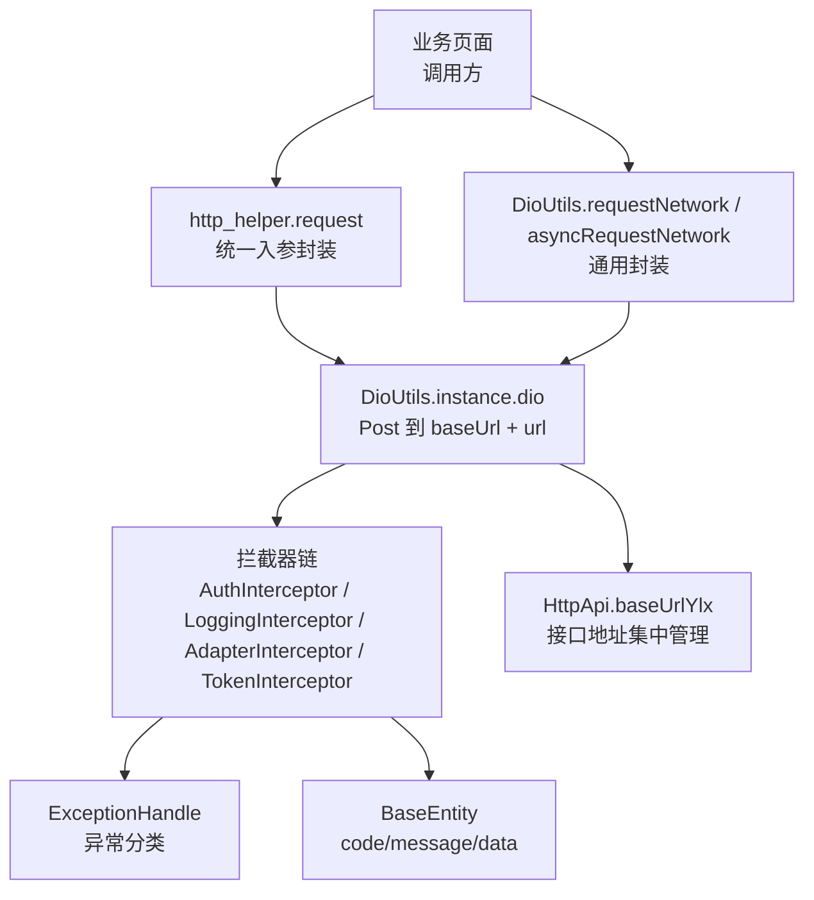
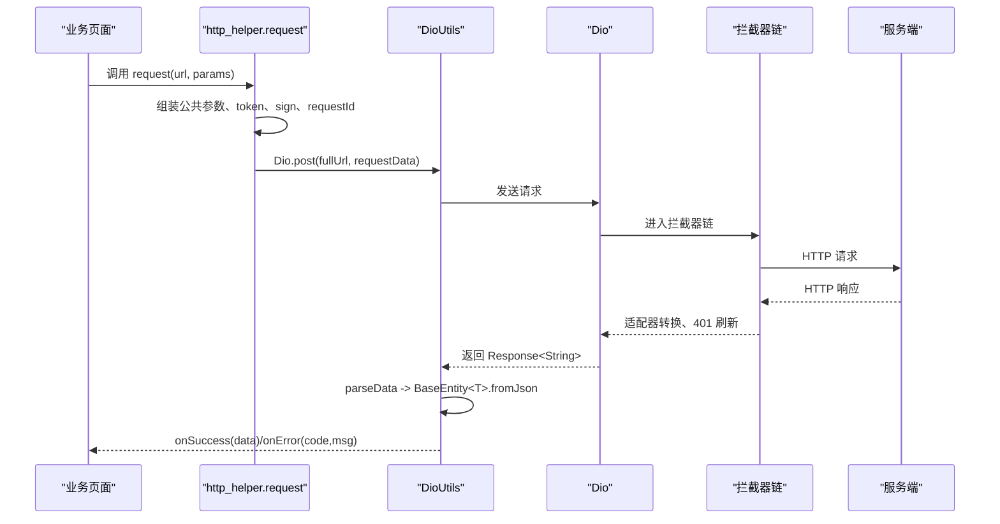
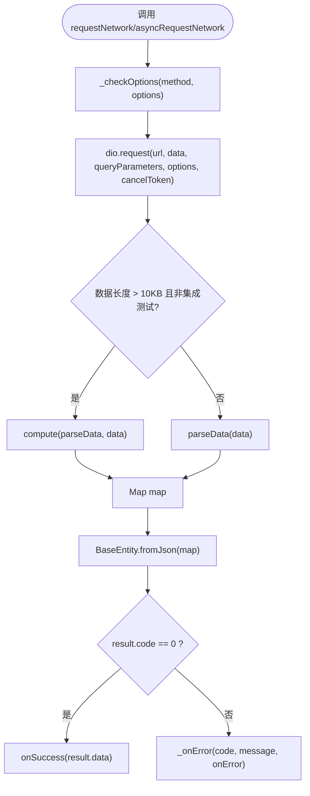
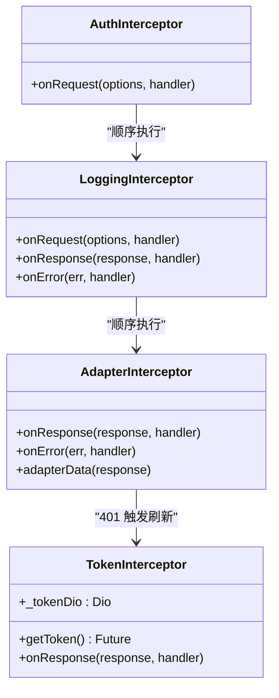
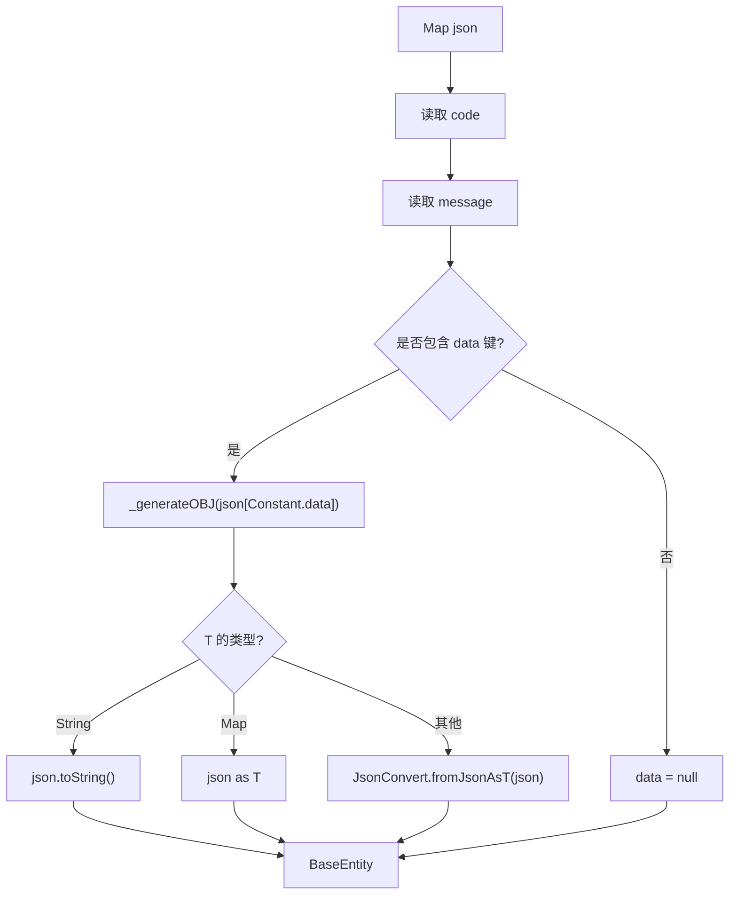
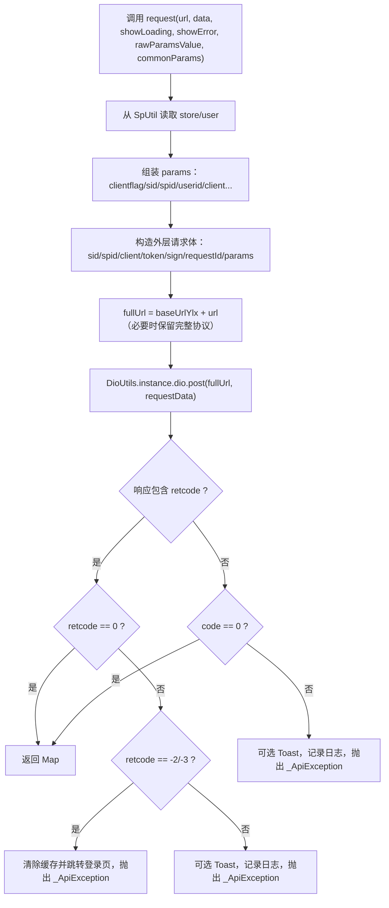
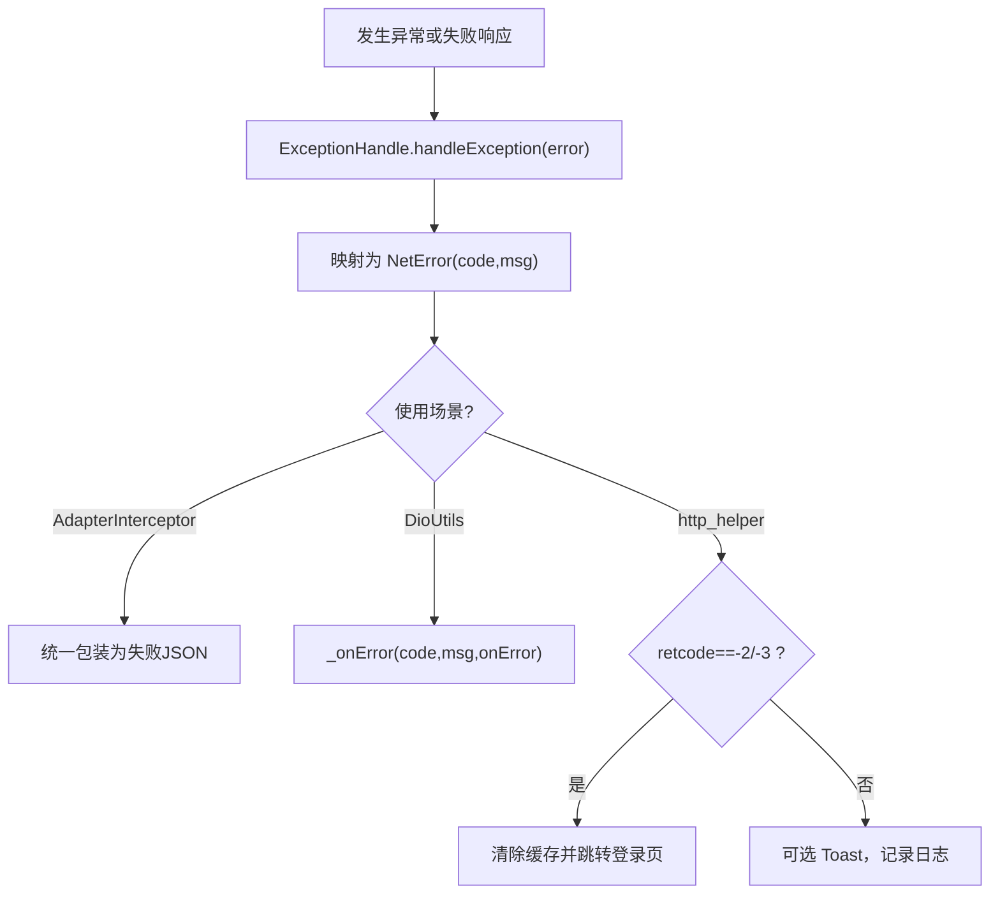
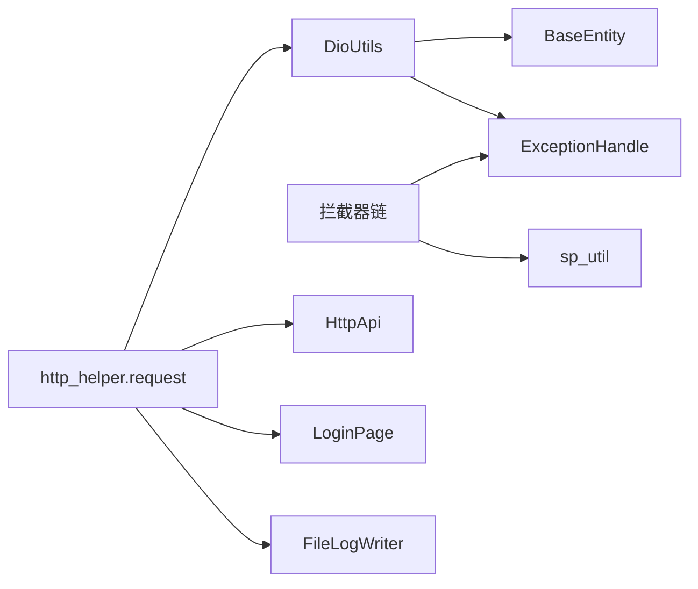

# 网络层设计

<cite>
**本文引用的文件**   
- [dio_utils.dart](file://lib/net/dio_utils.dart)
- [base_entity.dart](file://lib/net/base_entity.dart)
- [intercept.dart](file://lib/net/intercept.dart)
- [error_handle.dart](file://lib/net/error_handle.dart)
- [http_api.dart](file://lib/net/http_api.dart)
- [http_helper.dart](file://lib/net/http_helper.dart)
- [net.dart](file://lib/net/net.dart)
</cite>

## 目录
1. [引言](#引言)
2. [项目结构](#项目结构)
3. [核心组件](#核心组件)
4. [架构总览](#架构总览)
5. [详细组件分析](#详细组件分析)
6. [依赖关系分析](#依赖关系分析)
7. [性能与缓存策略](#性能与缓存策略)
8. [重试与生命周期管理](#重试与生命周期管理)
9. [扩展点与最佳实践](#扩展点与最佳实践)
10. [故障排查指南](#故障排查指南)
11. [结论](#结论)

## 引言
本文件面向灵犀管店 Flutter 项目的网络层，围绕 DioUtils 封装、拦截器链（认证、日志、错误适配）、统一响应体 BaseEntity、HTTP API 组织方式、请求参数封装、错误处理策略展开。文档还覆盖网络请求生命周期、缓存策略、重试机制的技术现状与建议，以及扩展方法和性能优化建议，帮助开发者在不直接操作 Dio 的情况下安全、一致地发起业务请求。

## 项目结构
网络层位于 lib/net 目录下，采用“能力分层 + 职责单一”的组织方式：
- dio_utils.dart：Dio 单例、全局配置、统一请求入口、异步回调封装、类型枚举 Method。
- intercept.dart：认证拦截器、Token 自动刷新、日志记录、响应体适配器。
- error_handle.dart：异常码常量、异常映射、统一 NetError 模型。
- base_entity.dart：统一响应体 BaseEntity<T>，负责 code/message/data 解析。
- http_api.dart：接口路径集中定义，包含基础地址和各业务接口常量。
- http_helper.dart：面向业务的 ylx-boss 风格 request 封装，负责公共参数注入、登录过期处理、错误日志落盘。
- net.dart：对外导出网络层常用模块。

**图表来源**
- [dio_utils.dart:1-204](file://lib/net/dio_utils.dart#L1-L204)
- [intercept.dart:1-213](file://lib/net/intercept.dart#L1-L213)
- [error_handle.dart:1-82](file://lib/net/error_handle.dart#L1-L82)
- [base_entity.dart:1-33](file://lib/net/base_entity.dart#L1-L33)
- [http_api.dart:1-200](file://lib/net/http_api.dart#L1-L200)
- [http_helper.dart:1-200](file://lib/net/http_helper.dart#L1-L200)

**章节来源**
- [dio_utils.dart:1-204](file://lib/net/dio_utils.dart#L1-L204)
- [http_api.dart:1-200](file://lib/net/http_api.dart#L1-L200)
- [http_helper.dart:1-200](file://lib/net/http_helper.dart#L1-L200)

## 核心组件
- DioUtils：提供全局 Dio 实例、统一请求方法、回调式结果分发、取消请求日志、Method 枚举。
- BaseEntity<T>：将服务端返回的 code、message、data 标准化为泛型对象。
- 拦截器链：
  - AuthInterceptor：注入 Authorization 头、User-Agent。
  - LoggingInterceptor：打印请求起止时间、URL、方法、头部、数据、响应耗时。
  - AdapterInterceptor：将不同后端格式（retcode、code/message）统一为标准成功/失败语义。
  - TokenInterceptor：基于 QueuedInterceptor 对 401 进行排队刷新并自动重试。
- ExceptionHandle：HTTP 状态码、网络/解析/超时等错误码映射，统一生成 NetError。
- HttpApi：集中维护 baseUrl 和所有接口路径常量。
- http_helper.request：面向业务的统一入参封装、公共参数注入、登录过期跳转、错误日志落盘。

**章节来源**
- [dio_utils.dart:1-204](file://lib/net/dio_utils.dart#L1-L204)
- [base_entity.dart:1-33](file://lib/net/base_entity.dart#L1-L33)
- [intercept.dart:1-213](file://lib/net/intercept.dart#L1-L213)
- [error_handle.dart:1-82](file://lib/net/error_handle.dart#L1-L82)
- [http_api.dart:1-200](file://lib/net/http_api.dart#L1-L200)
- [http_helper.dart:1-200](file://lib/net/http_helper.dart#L1-L200)

## 架构总览
网络层由“业务封装层 + 通用封装层 + 底层 Dio 层 + 拦截器链 + 响应解析层”组成：
- 业务封装层：http_helper.request，聚合公共参数、签名、请求 ID、登录过期处理、错误日志落盘。
- 通用封装层：DioUtils.requestNetwork / asyncRequestNetwork，屏蔽 Dio 细节，提供 onSuccess/onError 回调。
- 底层 Dio 层：DioUtils._dio，配置 BaseOptions、响应类型 plain、validateStatus(true)。
- 拦截器链：Auth -> Logging -> Adapter -> Token，分别承担鉴权、日志、格式适配、令牌刷新。
- 响应解析层：AdapterInterceptor 输出标准成功/失败 JSON；BaseEntity<T> 进一步解析 data。

**图表来源**
- [http_helper.dart:1-200](file://lib/net/http_helper.dart#L1-L200)
- [dio_utils.dart:1-204](file://lib/net/dio_utils.dart#L1-L204)
- [intercept.dart:1-213](file://lib/net/intercept.dart#L1-L213)
- [base_entity.dart:1-33](file://lib/net/base_entity.dart#L1-L33)

## 详细组件分析

### DioUtils 封装设计与实现要点
- 单例模式：通过工厂构造与静态 instance 暴露 DioUtils 实例。
- 全局配置：configDio 支持设置 connectTimeout/receiveTimeout/sendTimeout、baseUrl、拦截器列表。
- BaseOptions：
  - responseType: plain，避免 Dio 默认 JSON 解析，交由上层 parseData/BaseEntity 处理。
  - validateStatus(_) = true，统一在 AdapterInterceptor 中处理业务状态码。
- 统一请求入口：
  - _request：发起请求、解析 JSON、构建 BaseEntity<T>，并在集成测试环境下跳过 compute。
  - requestNetwork / asyncRequestNetwork：封装 onSuccess/onError 回调，内部根据 result.code 判断成功或转交 ExceptionHandle。
- 取消请求：CancelToken.isCancel 时输出取消日志。
- 类型枚举：Method 替代 switch，简化方法选择。

**图表来源**
- [dio_utils.dart:1-204](file://lib/net/dio_utils.dart#L1-L204)
- [base_entity.dart:1-33](file://lib/net/base_entity.dart#L1-L33)

**章节来源**
- [dio_utils.dart:1-204](file://lib/net/dio_utils.dart#L1-L204)

### 拦截器链：认证、日志、错误处理、Token 刷新
- AuthInterceptor：
  - 从本地缓存读取 accessToken，写入 Authorization: token xxx。
  - 非 Web 环境添加 User-Agent。
- LoggingInterceptor：
  - 记录请求开始时间、URL、方法、Headers、Content-Type、Body。
  - 记录响应状态码、响应体、耗时。
  - 错误路径也记录日志。
- AdapterInterceptor：
  - 成功分支：200/204 透传原始数据；空体填充默认文本；确保 statusCode=200。
  - 失败分支：
    - 404 转为固定 message。
    - 其他错误：尝试解析 body，兼容 retcode 与 message/msg 字段，统一包装为 {code,status,message} 的标准失败体。
    - 401 保持未授权状态码，供 TokenInterceptor 处理。
- TokenInterceptor：
  - 捕获 401，使用独立 Dio(_tokenDio) 调用 lgn/refreshToken，携带 refresh_token。
  - 成功后更新本地 accessToken，并用 _tokenDio 重新发起原请求，避免重复触发拦截器。
  - 使用 QueuedInterceptor 保证并发刷新的队列行为。

**图表来源**
- [intercept.dart:1-213](file://lib/net/intercept.dart#L1-L213)

**章节来源**
- [intercept.dart:1-213](file://lib/net/intercept.dart#L1-L213)

### BaseEntity 统一响应体设计与解析流程
- 结构：code、message、data。
- 解析逻辑：
  - code：int?，来自 Constant.code。
  - message：String，必填。
  - data：T?，支持 String、Map、List 或自定义实体（JsonConvert.fromJsonAsT）。
- 用途：DioUtils 在 _request 中统一将 Response<String> 解析为 BaseEntity<T>，再按 code 判断成功与否。

**图表来源**
- [base_entity.dart:1-33](file://lib/net/base_entity.dart#L1-L33)

**章节来源**
- [base_entity.dart:1-33](file://lib/net/base_entity.dart#L1-L33)

### HTTP API 组织方式与请求参数封装
- HttpApi：
  - 集中管理 baseUrlYlx 与各业务接口常量，如登录、系统参数、推送、采购入库、调拨、配送、WMS 等。
  - 便于统一切换环境与查找接口。
- http_helper.request：
  - 入参优先级：rawParamsValue > data(非 Map) > data(Map)。
  - 公共参数注入：clientflag、sid、spid、userid、client、token、sign、requestId、params。
  - 完整 URL 拼接：以 baseUrlYlx 为前缀，但排除已带 http/https 的地址。
  - 成功分支：优先兼容 retcode==0 或 code==0 两种格式。
  - 失败分支：
    - retcode==-2/-3：触发登录过期处理（清除缓存并跳转登录页），抛出 _ApiException。
    - 其他失败：可选 Toast 提示，记录 FileLogWriter 日志，抛出 _ApiException。
  - 网络异常：尝试从 DioException.response.data 解析 retcode/retmsg，仍走登录过期或展示真实错误信息。

**图表来源**
- [http_helper.dart:1-200](file://lib/net/http_helper.dart#L1-L200)
- [http_api.dart:1-200](file://lib/net/http_api.dart#L1-L200)

**章节来源**
- [http_api.dart:1-200](file://lib/net/http_api.dart#L1-L200)
- [http_helper.dart:1-200](file://lib/net/http_helper.dart#L1-L200)

### 错误处理策略
- ExceptionHandle：
  - 定义 HTTP 状态码常量（success、unauthorized、forbidden、not_found 等）。
  - 定义业务错误码（net_error、parse_error、socket_error、http_error、connect_timeout_error、send_timeout_error、receive_timeout_error、cancel_error、unknown_error）。
  - handleException：将 DioException、SocketException、HttpException、FormatException 映射为 NetError。
  - DioErrorTypeExtension：将 DioExceptionType 映射为业务错误码。
- 拦截器层：
  - AdapterInterceptor 将不同后端错误格式统一为 {code,status,message}，并保证成功态 statusCode=200。
  - TokenInterceptor 对 401 做自动刷新后重试。
- 业务层：
  - http_helper.request 对 retcode==-2/-3 做登录过期处理。
  - DioUtils 在 _onError 中将未知错误归一为 unknown_error。

**图表来源**
- [error_handle.dart:1-82](file://lib/net/error_handle.dart#L1-L82)
- [intercept.dart:1-213](file://lib/net/intercept.dart#L1-L213)
- [dio_utils.dart:1-204](file://lib/net/dio_utils.dart#L1-L204)
- [http_helper.dart:1-200](file://lib/net/http_helper.dart#L1-L200)

**章节来源**
- [error_handle.dart:1-82](file://lib/net/error_handle.dart#L1-L82)
- [intercept.dart:1-213](file://lib/net/intercept.dart#L1-L213)
- [dio_utils.dart:1-204](file://lib/net/dio_utils.dart#L1-L204)
- [http_helper.dart:1-200](file://lib/net/http_helper.dart#L1-L200)

## 依赖关系分析
- DioUtils 依赖：
  - dio：发起 HTTP 请求。
  - flutter/foundation：debugPrint、compute。
  - res/constant：Constant.code、Constant.message、Constant.isDriverTest。
  - util/log_utils：Log.e。
  - net/base_entity、net/error_handle：统一响应体与异常处理。
- intercept.dart 依赖：
  - dio：拦截器、Dio、Options、Response、DioException。
  - res/constant：常量。
  - util/device_utils、util/log_utils、util/other_utils：设备与环境辅助。
  - sp_util：本地存储 accessToken/refreshToken。
  - sprintf：格式化字符串。
  - dio_utils、error_handle：访问 Dio 实例与错误码。
- http_helper.dart 依赖：
  - dio：Response。
  - main：app 上下文（如路由跳转所需）。
  - net/*：DioUtils、HttpApi。
  - pages/login/page/login_page：登录页跳转。
  - push/push_service：推送服务（可能与绑定相关）。
  - res/constant：本地存储键。
  - util/file_log_writer：错误日志落盘。
  - util/toast_utils：Toast 提示。
  - sp_util：本地存储。

**图表来源**
- [dio_utils.dart:1-204](file://lib/net/dio_utils.dart#L1-L204)
- [intercept.dart:1-213](file://lib/net/intercept.dart#L1-L213)
- [http_helper.dart:1-200](file://lib/net/http_helper.dart#L1-L200)
- [http_api.dart:1-200](file://lib/net/http_api.dart#L1-L200)

**章节来源**
- [dio_utils.dart:1-204](file://lib/net/dio_utils.dart#L1-L204)
- [intercept.dart:1-213](file://lib/net/intercept.dart#L1-L213)
- [http_helper.dart:1-200](file://lib/net/http_helper.dart#L1-L200)

## 性能与缓存策略
- 解析性能优化：
  - DioUtils._request 对大于 10KB 的数据且在非集成测试环境下使用 compute 在 isolate 中解析 JSON，降低主线程阻塞风险。
- 响应类型：
  - BaseOptions.responseType=plain，避免 Dio 默认二次解析，减少内存分配与解析开销。
- 日志与 I/O：
  - LoggingInterceptor 会序列化响应体与耗时统计，建议在调试环境开启，生产环境按需关闭以减少 I/O。
- 缓存策略：
  - 当前代码未实现网络级缓存（无 Cache-Control、ETag 等处理）。
  - 本地缓存主要集中于 sp_util（accessToken、refreshToken、store、user），用于鉴权与公共参数。
- 建议：
  - 对读多写少的接口引入内存缓存（如 Provider/Riverpod）与磁盘缓存（如 hive/shared_preferences 配合版本号与过期时间）。
  - 结合服务端 Cache-Control/ETag，在 AdapterInterceptor 中增加缓存命中判定与条件请求。

**章节来源**
- [dio_utils.dart:1-204](file://lib/net/dio_utils.dart#L1-L204)
- [intercept.dart:1-213](file://lib/net/intercept.dart#L1-L213)

## 重试与生命周期管理
- 重试机制：
  - 当前未实现通用的指数退避重试。
  - Token 刷新后仅对因 401 失败的请求进行一次重试（TokenInterceptor），属于定向重试而非通用重试策略。
- 生命周期管理：
  - 支持 CancelToken，DioUtils 会在取消请求时输出日志。
  - http_helper.request 未显式传入 CancelToken，如需页面销毁取消请求，应在调用处创建并传递。
- 建议：
  - 在 DioUtils 层增加可配置的重试策略（最大次数、退避间隔、针对特定错误码重试）。
  - 在页面级组合 CancelToken 与 dispose，确保请求随页面生命周期正确释放。

**章节来源**
- [dio_utils.dart:1-204](file://lib/net/dio_utils.dart#L1-L204)
- [intercept.dart:1-213](file://lib/net/intercept.dart#L1-L213)

## 扩展点与最佳实践
- 扩展拦截器：
  - 在 configDio 中传入自定义 Interceptor，例如埋点、签名、限流。
  - 注意拦截器顺序：鉴权 -> 日志 -> 适配器 -> 令牌刷新。
- 扩展请求封装：
  - 在 DioUtils 上增加更多便捷方法（如 get/post 快捷方法），或在 http_helper 上扩展更高层的业务封装。
- 最佳实践：
  - 使用 HttpApi 统一管理接口地址，避免硬编码字符串。
  - 使用 BaseEntity<T> 统一接收响应，避免在各页面重复解析。
  - 对敏感参数（如 token）优先使用 commonParams/rawParamsValue 控制，避免被公共参数覆盖。
  - 对大数据量接口启用 compute，并确保不在集成测试环境误用。

**章节来源**
- [dio_utils.dart:1-204](file://lib/net/dio_utils.dart#L1-L204)
- [http_api.dart:1-200](file://lib/net/http_api.dart#L1-L200)
- [http_helper.dart:1-200](file://lib/net/http_helper.dart#L1-L200)

## 故障排查指南
- 常见错误码与含义：
  - net_error、socket_error、http_error：网络或服务器异常。
  - parse_error：JSON 解析失败。
  - connect/send/receive_timeout_error：连接/发送/接收超时。
  - cancel_error：请求被取消。
  - unknown_error：未识别异常。
- 定位步骤：
  - 检查 LoggingInterceptor 输出的 RequestUrl/RequestMethod/RequestHeaders/RequestData/ResponseCode/耗时。
  - 若出现 401，确认 TokenInterceptor 是否成功刷新并重新发起请求。
  - 对于 retcode==-2/-3，确认是否触发登录过期跳转与缓存清理。
  - 对解析失败，检查 AdapterInterceptor 的输出是否符合预期，以及 BaseEntity<T> 的泛型类型是否正确。
- 日志查看：
  - 控制台 debugPrint 与 Log.e。
  - FileLogWriter 错误日志文件（http_helper.request 中的 _logApi）。

**章节来源**
- [error_handle.dart:1-82](file://lib/net/error_handle.dart#L1-L82)
- [intercept.dart:1-213](file://lib/net/intercept.dart#L1-L213)
- [dio_utils.dart:1-204](file://lib/net/dio_utils.dart#L1-L204)
- [http_helper.dart:1-200](file://lib/net/http_helper.dart#L1-L200)

## 结论
灵犀管店的网络层以 DioUtils 为核心，结合拦截器链实现了认证、日志、错误适配与 Token 自动刷新；BaseEntity<T> 提供了统一的响应体解析；HttpApi 集中管理接口地址；http_helper.request 则面向业务封装了公共参数、登录过期处理与错误日志落盘。当前版本缺少通用重试与网络缓存，但具备良好的扩展性。建议在生产环境中逐步引入缓存与重试策略，并根据业务需求精细化控制日志级别与性能开销。