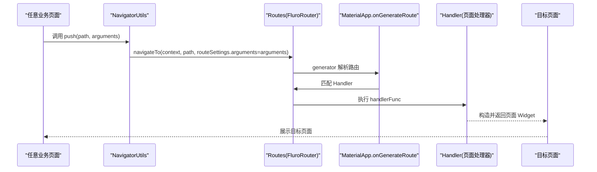
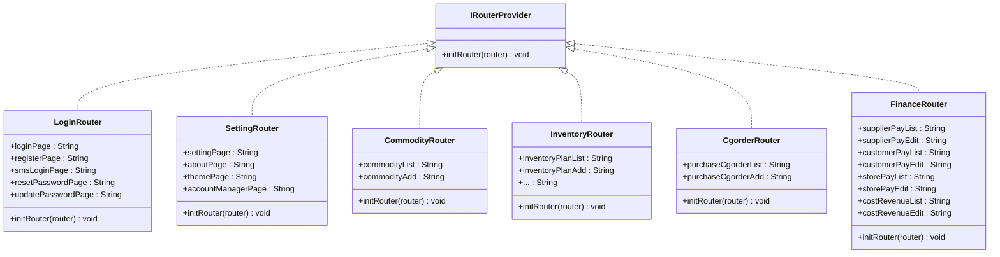
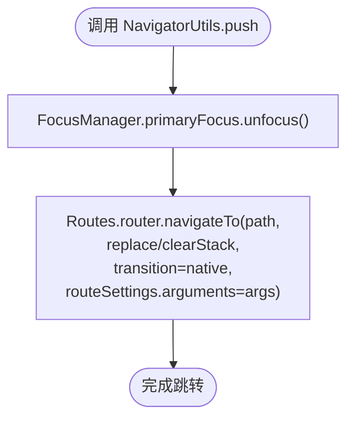
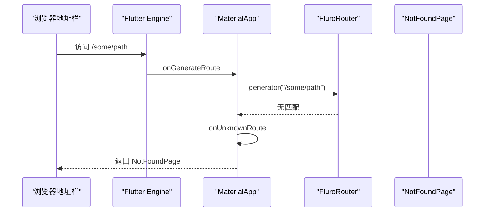
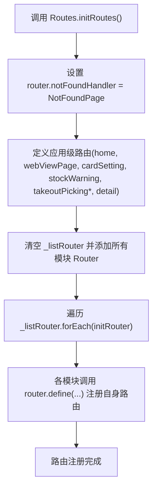
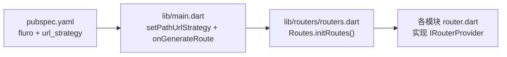

# 路由系统

<cite>
**本文引用的文件**   
- [pubspec.yaml](file://pubspec.yaml)
- [lib/main.dart](file://lib/main.dart)
- [lib/routers/fluro_navigator.dart](file://lib/routers/fluro_navigator.dart)
- [lib/routers/i_router.dart](file://lib/routers/i_router.dart)
- [lib/routers/routers.dart](file://lib/routers/routers.dart)
- [lib/routers/web_page_transitions.dart](file://lib/routers/web_page_transitions.dart)
- [lib/routers/not_found_page.dart](file://lib/routers/not_found_page.dart)
- [lib/pages/login/login_router.dart](file://lib/pages/login/login_router.dart)
- [lib/setting/setting_router.dart](file://lib/setting/setting_router.dart)
- [lib/pages/business/basis/commodity/router.dart](file://lib/pages/business/basis/commodity/router.dart)
- [lib/pages/business/inventory/router.dart](file://lib/pages/business/inventory/router.dart)
- [lib/pages/business/purchase/cgorder/router.dart](file://lib/pages/business/purchase/cgorder/router.dart)
- [lib/pages/business/finance/router.dart](file://lib/pages/business/finance/router.dart)
- [lib/pages/home/webview_page.dart](file://lib/pages/home/webview_page.dart)
</cite>

## 目录
1. [引言](#引言)
2. [项目结构](#项目结构)
3. [核心组件](#核心组件)
4. [架构总览](#架构总览)
5. [详细组件分析](#详细组件分析)
6. [依赖关系分析](#依赖关系分析)
7. [性能与优化](#性能与优化)
8. [故障排查](#故障排查)
9. [结论](#结论)
10. [附录：模块路由清单与最佳实践](#附录模块路由清单与最佳实践)

## 引言
本文件为灵犀管店 Flutter 项目的路由系统设计文档。该项目基于 Fluro 构建统一路由，并通过 IRouterProvider 接口实现模块化路由注册；通过 NavigatorUtils 提供统一的跳转封装；在 Web 端使用 url_strategy 去除 URL 中的 “#”，并配合全局未知路由处理返回“页面不存在”页。本文从系统架构、组件职责、数据流、Web 适配、参数传递、权限控制扩展点以及性能优化等方面进行全面说明。

## 项目结构
路由相关代码集中在 lib/routers 目录，业务模块的路由按领域拆分到各自 router.dart 中，由中心 Routes 类集中初始化。

```mermaid
graph TB
  subgraph "应用入口"
    main["lib/main.dart<br/>MaterialApp + onGenerateRoute"]
  end

  subgraph "路由基础设施"
    routers_core["lib/routers/routers.dart<br/>Routes + FluroRouter"]
    i_router["lib/routers/i_router.dart<br/>IRouterProvider"]
    nav_utils["lib/routers/fluro_navigator.dart<br/>NavigatorUtils"]
    web_trans["lib/routers/web_page_transitions.dart<br/>NoTransitionsOnWeb"]
    not_found["lib/routers/not_found_page.dart<br/>NotFoundPage"]
  end

  subgraph "业务模块路由"
    login_router["pages/login/login_router.dart"]
    setting_router["setting/setting_router.dart"]
    commodity_router["pages/business/basis/commodity/router.dart"]
    inventory_router["pages/business/inventory/router.dart"]
    purchase_router["pages/business/purchase/cgorder/router.dart"]
    finance_router["pages/business/finance/router.dart"]
  end

  subgraph "通用页面"
    webview_page["pages/home/webview_page.dart"]
  end

  main --> routers_core
  routers_core --> i_router
  routers_core --> login_router
  routers_core --> setting_router
  routers_core --> commodity_router
  routers_core --> inventory_router
  routers_core --> purchase_router
  routers_core --> finance_router
  routers_core --> webview_page
  nav_utils --> routers_core
```

图示来源
- [lib/main.dart:1-L200](file://lib/main.dart#L1-L200)
- [lib/routers/routers.dart:1-L176](file://lib/routers/routers.dart#L1-L176)
- [lib/routers/fluro_navigator.dart:1-L72](file://lib/routers/fluro_navigator.dart#L1-L72)
- [lib/routers/i_router.dart:1-L7](file://lib/routers/i_router.dart#L1-L7)
- [lib/routers/web_page_transitions.dart:1-L26](file://lib/routers/web_page_transitions.dart#L1-L26)
- [lib/routers/not_found_page.dart:1-L21](file://lib/routers/not_found_page.dart#L1-L21)
- [lib/pages/login/login_router.dart:1-L28](file://lib/pages/login/login_router.dart#L1-L28)
- [lib/setting/setting_router.dart:1-L24](file://lib/setting/setting_router.dart#L1-L24)
- [lib/pages/business/basis/commodity/router.dart:1-L25](file://lib/pages/business/basis/commodity/router.dart#L1-L25)
- [lib/pages/business/inventory/router.dart:1-L57](file://lib/pages/business/inventory/router.dart#L1-L57)
- [lib/pages/business/purchase/cgorder/router.dart:1-L25](file://lib/pages/business/purchase/cgorder/router.dart#L1-L25)
- [lib/pages/business/finance/router.dart:1-L48](file://lib/pages/business/finance/router.dart#L1-L48)
- [lib/pages/home/webview_page.dart:1-L95](file://lib/pages/home/webview_page.dart#L1-L95)

章节来源
- [lib/routers/routers.dart:1-L176](file://lib/routers/routers.dart#L1-L176)
- [lib/main.dart:1-L200](file://lib/main.dart#L1-L200)

## 核心组件
- Fluro 路由器集成：Routes 持有静态 FluroRouter 实例，并提供 initRoutes() 进行全局路由定义与模块聚合。
- IRouterProvider 接口：抽象出 initRouter(FluroRouter)，各业务模块实现该接口以集中维护自身路由表。
- NavigatorUtils：统一封装 push / goBack / WebView 跳转等常用操作，屏蔽细节（如焦点管理、传参方式）。
- Web 适配：应用层使用 setPathUrlStrategy() 去除 URL 中的 “#”，并在 MaterialApp 中配置 onUnknownRoute 返回 NotFoundPage。
- 未找到页面：NotFoundPage 作为统一兜底页。

章节来源
- [lib/routers/routers.dart:1-L176](file://lib/routers/routers.dart#L1-L176)
- [lib/routers/i_router.dart:1-L7](file://lib/routers/i_router.dart#L1-L7)
- [lib/routers/fluro_navigator.dart:1-L72](file://lib/routers/fluro_navigator.dart#L1-L72)
- [lib/routers/not_found_page.dart:1-L21](file://lib/routers/not_found_page.dart#L1-L21)
- [lib/main.dart:1-L200](file://lib/main.dart#L1-L200)

## 架构总览
Fluro 作为底层路由引擎，被 Routes 集中管理；业务模块通过 IRouterProvider 将自身路由注入到 FluroRouter；NavigatorUtils 作为上层统一调用入口，负责跳转与返回逻辑；MaterialApp 的 onGenerateRoute 委托给 FluroRouter.generator 完成页面解析与渲染；Web 端通过 url_strategy 启用路径模式，避免 “#”。

图示来源
- [lib/routers/fluro_navigator.dart:1-L72](file://lib/routers/fluro_navigator.dart#L1-L72)
- [lib/routers/routers.dart:1-L176](file://lib/routers/routers.dart#L1-L176)
- [lib/main.dart:1-L200](file://lib/main.dart#L1-L200)

## 详细组件分析

### Fluro 路由器与统一入口
- Routes.initRoutes() 完成以下工作：
  - 设置未找到路由时的默认处理，返回 NotFoundPage。
  - 定义应用级常量路由，例如首页、WebView 页、卡片设置、库存预警、外卖拣货列表与详情等。
  - 维护一个 IRouterProvider 列表，依次调用其 initRouter(router) 完成模块化路由注册。
- 已注册的模块包括登录、账户、会员支付记录、设置、采购、商品、价格策略、印刷、库存、批发、财务、WMS、各类报表与数据分析等。

关键点
- 所有模块路由通过同一 FluroRouter 实例注册，便于统一管理、查找与测试。
- 路由字符串采用语义化路径，便于阅读与维护。

章节来源
- [lib/routers/routers.dart:1-L176](file://lib/routers/routers.dart#L1-L176)

### IRouterProvider 接口与模块化路由
- IRouterProvider 暴露 initRouter(FluroRouter) 方法，强制每个模块自行维护自己的路由表。
- 典型模块示例：
  - LoginRouter：登录、注册、短信登录、重置密码、更新密码等。
  - SettingRouter：设置、关于、主题、账户管理等。
  - CommodityRouter：商品列表、新增商品。
  - InventoryRouter：库存计划、盘点、移仓、成本调整、搜索等。
  - CgorderRouter：采购订单列表、新增。
  - FinanceRouter：供应商应付、客户应收、门店收款、成本收入等，包含动态参数 billid。

优点
- 高内聚低耦合：路由定义与页面逻辑就近组织。
- 可扩展性强：新增模块只需实现 IRouterProvider 并在 Routes 中添加一行即可。

图示来源
- [lib/routers/i_router.dart:1-L7](file://lib/routers/i_router.dart#L1-L7)
- [lib/pages/login/login_router.dart:1-L28](file://lib/pages/login/login_router.dart#L1-L28)
- [lib/setting/setting_router.dart:1-L24](file://lib/setting/setting_router.dart#L1-L24)
- [lib/pages/business/basis/commodity/router.dart:1-L25](file://lib/pages/business/basis/commodity/router.dart#L1-L25)
- [lib/pages/business/inventory/router.dart:1-L57](file://lib/pages/business/inventory/router.dart#L1-L57)
- [lib/pages/business/purchase/cgorder/router.dart:1-L25](file://lib/pages/business/purchase/cgorder/router.dart#L1-L25)
- [lib/pages/business/finance/router.dart:1-L48](file://lib/pages/business/finance/router.dart#L1-L48)

章节来源
- [lib/routers/i_router.dart:1-L7](file://lib/routers/i_router.dart#L1-L7)
- [lib/pages/login/login_router.dart:1-L28](file://lib/pages/login/login_router.dart#L1-L28)
- [lib/setting/setting_router.dart:1-L24](file://lib/setting/setting_router.dart#L1-L24)
- [lib/pages/business/basis/commodity/router.dart:1-L25](file://lib/pages/business/basis/commodity/router.dart#L1-L25)
- [lib/pages/business/inventory/router.dart:1-L57](file://lib/pages/business/inventory/router.dart#L1-L57)
- [lib/pages/business/purchase/cgorder/router.dart:1-L25](file://lib/pages/business/purchase/cgorder/router.dart#L1-L25)
- [lib/pages/business/finance/router.dart:1-L48](file://lib/pages/business/finance/router.dart#L1-L48)

### 统一导航工具 NavigatorUtils
NavigatorUtils 提供以下能力：
- push：跳转到指定路径，支持 replace、clearStack、arguments 传参，统一使用原生过渡动画。
- pushResult：跳转并接收返回结果，支持异常捕获。
- goBack / goBackWithParams：返回上一页或带返回值返回。
- goWebViewPage / goAssetHtmlPage：封装 WebView 页面跳转，自动对中文进行 URI 编码。
- unfocus：跳转前主动失焦，避免不必要的 build。

注意事项
- 当前实现统一使用 TransitionType.native，未区分平台。
- WebView 标题与 URL 需进行编码以避免中文导致解析异常。

图示来源
- [lib/routers/fluro_navigator.dart:1-L72](file://lib/routers/fluro_navigator.dart#L1-L72)

章节来源
- [lib/routers/fluro_navigator.dart:1-L72](file://lib/routers/fluro_navigator.dart#L1-L72)

### 路由参数传递机制
- RouteSettings.arguments：NavigatorUtils 将 Object? arguments 放入 RouteSettings.arguments，供目标页面读取。
- 路径参数：部分模块使用路径参数，例如 FinanceRouter 通过 params['billid'] 获取单据号。
- Query 参数：WebView 页面通过 query 参数 title、url、isAsset 传入，并进行 URI 编码。

建议
- 复杂对象优先使用 RouteSettings.arguments。
- 简单标识符可使用路径参数或查询参数，但需保证编码正确。

章节来源
- [lib/routers/fluro_navigator.dart:1-L72](file://lib/routers/fluro_navigator.dart#L1-L72)
- [lib/pages/business/finance/router.dart:1-L48](file://lib/pages/business/finance/router.dart#L1-L48)
- [lib/routers/routers.dart:1-L176](file://lib/routers/routers.dart#L1-L176)
- [lib/pages/home/webview_page.dart:1-L95](file://lib/pages/home/webview_page.dart#L1-L95)

### 页面跳转动画
- NavigatorUtils 统一使用 TransitionType.native。
- Web 端可通过 NoTransitionsOnWeb 禁用过渡动画以提升感知性能，但当前未在该应用中直接使用该主题。

章节来源
- [lib/routers/fluro_navigator.dart:1-L72](file://lib/routers/fluro_navigator.dart#L1-L72)
- [lib/routers/web_page_transitions.dart:1-L26](file://lib/routers/web_page_transitions.dart#L1-L26)

### Web 端路由适配
- 应用启动时调用 setPathUrlStrategy() 去除 URL 中的 “#”。
- MaterialApp 使用 onGenerateRoute: Routes.router.generator 交由 Fluro 解析。
- onUnknownRoute 返回 MaterialPageRoute<NotFoundPage>，用于 Web 端未知路由兜底。

图示来源
- [lib/main.dart:1-L200](file://lib/main.dart#L1-L200)
- [lib/routers/not_found_page.dart:1-L21](file://lib/routers/not_found_page.dart#L1-L21)

章节来源
- [lib/main.dart:1-L200](file://lib/main.dart#L1-L200)

### 路由注册流程
Routes.initRoutes() 的执行流程如下：

图示来源
- [lib/routers/routers.dart:1-L176](file://lib/routers/routers.dart#L1-L176)

章节来源
- [lib/routers/routers.dart:1-L176](file://lib/routers/routers.dart#L1-L176)

### 动态路由配置
- 部分路由使用路径参数，如 FinanceRouter 的 edit 页面通过 billid 动态加载数据。
- WebView 路由使用查询参数 title、url、isAsset 动态决定内容来源（远程 URL 或本地 asset HTML）。

章节来源
- [lib/pages/business/finance/router.dart:1-L48](file://lib/pages/business/finance/router.dart#L1-L48)
- [lib/routers/routers.dart:1-L176](file://lib/routers/routers.dart#L1-L176)
- [lib/pages/home/webview_page.dart:1-L95](file://lib/pages/home/webview_page.dart#L1-L95)

### 权限控制与高级特性
当前仓库未实现显式的路由守卫或权限拦截器。可基于现有结构扩展：
- 在 Routes.initRoutes() 中集中放置鉴权逻辑，根据登录状态决定是否注册敏感路由。
- 在 IRouterProvider 扩展中增加 canAccess 校验，按需注册路由。
- 在 NavigatorUtils 中包装鉴权检查，跳转前判断权限，不足则引导至登录或提示。

注意
- 以上为建议方案，非现有实现。

章节来源
- [lib/routers/routers.dart:1-L176](file://lib/routers/routers.dart#L1-L176)
- [lib/routers/i_router.dart:1-L7](file://lib/routers/i_router.dart#L1-L7)
- [lib/routers/fluro_navigator.dart:1-L72](file://lib/routers/fluro_navigator.dart#L1-L72)

## 依赖关系分析
- pubspec.yaml 声明 fluro 依赖版本为 ^2.0.5，并引入 url_strategy 用于 Web 端路径模式。
- 应用入口 main.dart 初始化 Dio、Provider、PushService、Log 等后运行 MyApp，MyApp 构造函数中调用 Routes.initRoutes()，并将 FluroRouter.generator 交给 MaterialApp.onGenerateRoute。

图示来源
- [pubspec.yaml:1-L153](file://pubspec.yaml#L1-L153)
- [lib/main.dart:1-L200](file://lib/main.dart#L1-L200)
- [lib/routers/routers.dart:1-L176](file://lib/routers/routers.dart#L1-L176)

章节来源
- [pubspec.yaml:1-L153](file://pubspec.yaml#L1-L153)
- [lib/main.dart:1-L200](file://lib/main.dart#L1-L200)
- [lib/routers/routers.dart:1-L176](file://lib/routers/routers.dart#L1-L176)

## 性能与优化
- Web 端过渡动画：NoTransitionsOnWeb 可在 Web 上禁用页面切换动画以提升感知性能，建议在需要时应用到全局主题或特定页面。
- 统一过渡类型：NavigatorUtils 固定使用 native 过渡，避免不同页面重复配置带来的不一致和额外开销。
- WebView 进度反馈：webview_page 通过加载进度条提升用户体验，减少白屏感知时间。
- 路由懒加载：当前路由均为静态 define，若模块极大，可考虑按需动态注册路由以减少冷启动负担。

章节来源
- [lib/routers/web_page_transitions.dart:1-L26](file://lib/routers/web_page_transitions.dart#L1-L26)
- [lib/routers/fluro_navigator.dart:1-L72](file://lib/routers/fluro_navigator.dart#L1-L72)
- [lib/pages/home/webview_page.dart:1-L95](file://lib/pages/home/webview_page.dart#L1-L95)

## 故障排查
- 未找到路由：
  - 现象：访问不存在的 path 时显示“页面不存在”。
  - 定位：确认 Routes.initRoutes() 是否正确设置 notFoundHandler；检查 onUnknownRoute 是否覆盖。
- 中文参数乱码：
  - 现象：WebView 跳转中文标题或 URL 出现异常。
  - 定位：确保使用 NavigatorUtils.goWebViewPage / goAssetHtmlPage，其对参数进行了 URI 编码。
- 返回结果为空：
  - 现象：pushResult 回调未触发。
  - 定位：目标页面需使用 Navigator.pop<Object>(context, result) 返回非 null 值。
- Web 端 URL 带 “#”：
  - 现象：URL 中出现 “#”。
  - 定位：确认已调用 setPathUrlStrategy()。

章节来源
- [lib/routers/not_found_page.dart:1-L21](file://lib/routers/not_found_page.dart#L1-L21)
- [lib/routers/fluro_navigator.dart:1-L72](file://lib/routers/fluro_navigator.dart#L1-L72)
- [lib/main.dart:1-L200](file://lib/main.dart#L1-L200)

## 结论
本项目通过 Fluro 构建了清晰、可维护的路由体系：Routes 作为中心化管理器，IRouterProvider 实现模块化路由，NavigatorUtils 统一跳转行为，Web 端通过 url_strategy 和 onUnknownRoute 完善体验。整体结构具备良好的扩展性，适合大型业务模块持续演进。后续可在此基础上加入路由守卫、埋点统计、动态路由与更丰富的过渡动画策略。

## 附录：模块路由清单与最佳实践
- 已注册模块（节选）：登录、账户、会员支付记录、设置、采购、商品、价格策略、印刷、库存、批发、财务、WMS、报表与数据分析等。
- 命名规范：
  - 路由路径使用语义化分段，如 /basis/commodity/list、/purchase/cgorder/add。
  - 模块类名遵循 ModuleRouter 形式，实现 IRouterProvider。
- 参数传递最佳实践：
  - 简单标识符使用路径参数，如 billid。
  - 复杂对象使用 RouteSettings.arguments。
  - WebView 使用查询参数并进行 URI 编码。
- 过渡与 Web：
  - 移动端使用 native 过渡。
  - Web 端可根据场景使用 NoTransitionsOnWeb 提升性能。

章节来源
- [lib/routers/routers.dart:1-L176](file://lib/routers/routers.dart#L1-L176)
- [lib/pages/business/finance/router.dart:1-L48](file://lib/pages/business/finance/router.dart#L1-L48)
- [lib/pages/business/inventory/router.dart:1-L57](file://lib/pages/business/inventory/router.dart#L1-L57)
- [lib/pages/business/purchase/cgorder/router.dart:1-L25](file://lib/pages/business/purchase/cgorder/router.dart#L1-L25)
- [lib/pages/business/basis/commodity/router.dart:1-L25](file://lib/pages/business/basis/commodity/router.dart#L1-L25)
- [lib/pages/login/login_router.dart:1-L28](file://lib/pages/login/login_router.dart#L1-L28)
- [lib/setting/setting_router.dart:1-L24](file://lib/setting/setting_router.dart#L1-L24)