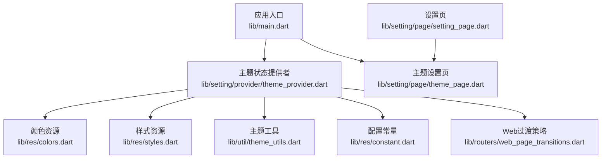
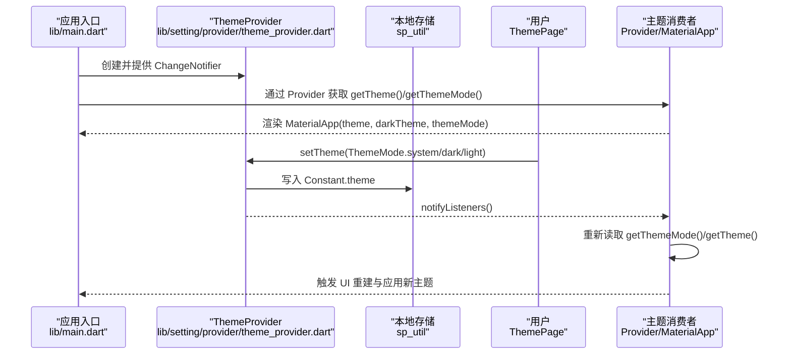
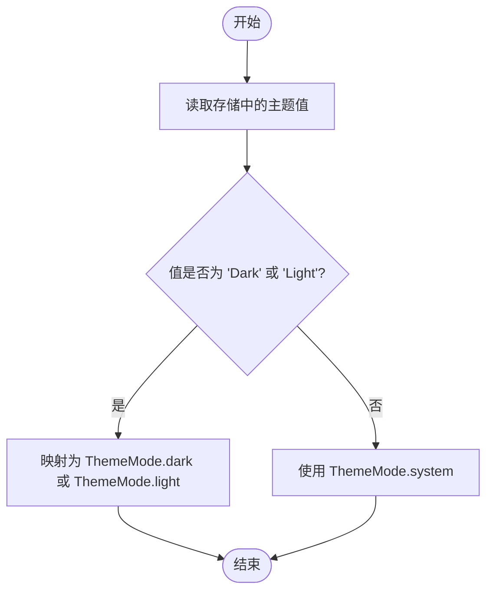
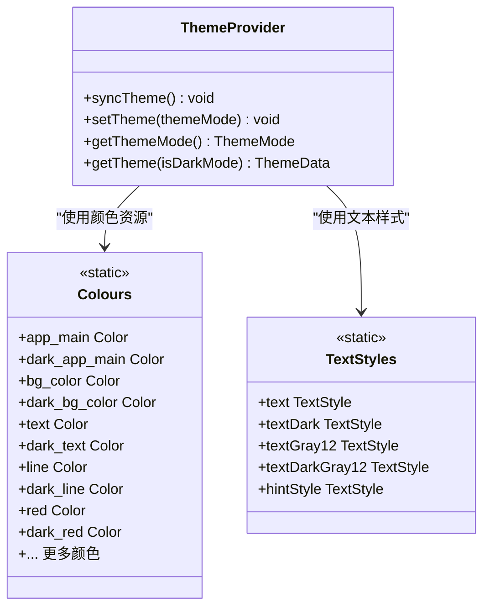
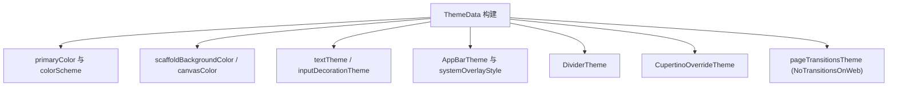
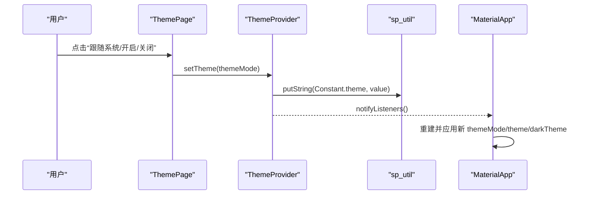
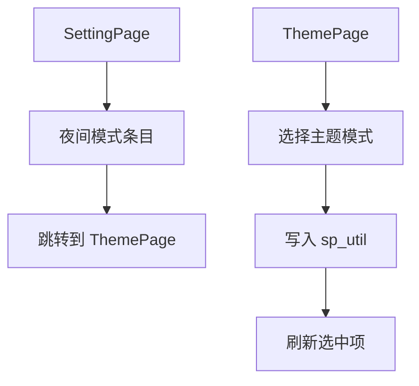
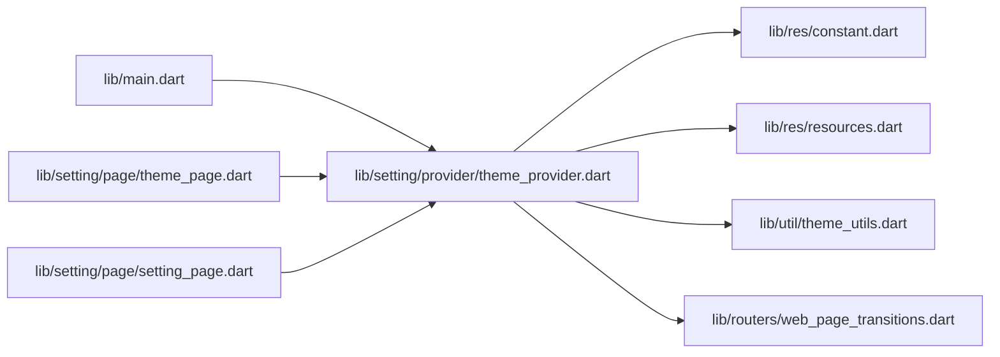

# 主题系统

<cite>
**本文引用的文件**   
- [lib/main.dart](file://lib/main.dart)
- [lib/setting/provider/theme_provider.dart](file://lib/setting/provider/theme_provider.dart)
- [lib/setting/page/theme_page.dart](file://lib/setting/page/theme_page.dart)
- [lib/setting/page/setting_page.dart](file://lib/setting/page/setting_page.dart)
- [lib/util/theme_utils.dart](file://lib/util/theme_utils.dart)
- [lib/res/colors.dart](file://lib/res/colors.dart)
- [lib/res/styles.dart](file://lib/res/styles.dart)
- [lib/res/resources.dart](file://lib/res/resources.dart)
- [lib/res/constant.dart](file://lib/res/constant.dart)
- [lib/routers/web_page_transitions.dart](file://lib/routers/web_page_transitions.dart)
</cite>

## 目录
1. [简介](#简介)
2. [项目结构与主题相关文件](#项目结构与主题相关文件)
3. [核心组件](#核心组件)
4. [架构总览](#架构总览)
5. [详细组件分析](#详细组件分析)
6. [依赖关系分析](#依赖关系分析)
7. [性能与可维护性建议](#性能与可维护性建议)
8. [故障排查指南](#故障排查指南)
9. [结论](#结论)
10. [附录：业务页面使用指南](#附录业务页面使用指南)

## 简介
本文件面向灵犀管店 Flutter 项目的主题系统，围绕以下目标展开：
- 说明主题模式切换机制：跟随系统、深色模式、浅色模式。
- 解析 Provider 状态管理与响应式更新流程。
- 解释主题配置的持久化存储方案。
- 梳理颜色资源管理、样式定义规范与动态主题切换的实现细节。
- 总结自定义扩展方法、主题适配最佳实践以及不同屏幕尺寸下的注意事项。
- 提供在业务页面中引用主题变量的方式，并说明主题切换对现有 UI 的影响与处理方式。

该主题系统以 `ThemeProvider` 为中心，结合 `MaterialApp` 的 `theme`、`darkTheme`、`themeMode` 完成全局主题注入；通过 `sp_util` 将用户选择持久化为字符串键值；通过 `Provider` 实现跨页面的响应式刷新；并通过 `Colours`、`TextStyles`、`ThemeUtils` 等工具统一颜色、文字和系统 UI 行为。

## 项目结构与主题相关文件
主题相关代码主要分布在以下模块：
- 应用入口与全局主题装配：`lib/main.dart`
- 主题状态管理：`lib/setting/provider/theme_provider.dart`
- 主题设置页：`lib/setting/page/theme_page.dart`
- 设置入口与当前主题展示：`lib/setting/page/setting_page.dart`
- 主题运行时工具与上下文扩展：`lib/util/theme_utils.dart`
- 颜色与样式资源：`lib/res/colors.dart`、`lib/res/styles.dart`、`lib/res/resources.dart`
- 配置常量（如持久化 key）：`lib/res/constant.dart`
- Web 平台页面过渡优化：`lib/routers/web_page_transitions.dart`

**图表来源**
- [lib/main.dart:1-200](file://lib/main.dart#L1-L200)
- [lib/setting/provider/theme_provider.dart:1-88](file://lib/setting/provider/theme_provider.dart#L1-L88)
- [lib/setting/page/theme_page.dart:1-72](file://lib/setting/page/theme_page.dart#L1-L72)
- [lib/setting/page/setting_page.dart:1-107](file://lib/setting/page/setting_page.dart#L1-L107)
- [lib/util/theme_utils.dart:1-52](file://lib/util/theme_utils.dart#L1-L52)
- [lib/res/colors.dart:1-46](file://lib/res/colors.dart#L1-L46)
- [lib/res/styles.dart:1-76](file://lib/res/styles.dart#L1-L76)
- [lib/res/constant.dart:1-54](file://lib/res/constant.dart#L1-L54)
- [lib/routers/web_page_transitions.dart:1-26](file://lib/routers/web_page_transitions.dart#L1-L26)

**章节来源**
- [lib/main.dart:1-200](file://lib/main.dart#L1-L200)
- [lib/setting/provider/theme_provider.dart:1-88](file://lib/setting/provider/theme_provider.dart#L1-L88)
- [lib/setting/page/theme_page.dart:1-72](file://lib/setting/page/theme_page.dart#L1-L72)
- [lib/setting/page/setting_page.dart:1-107](file://lib/setting/page/setting_page.dart#L1-L107)
- [lib/util/theme_utils.dart:1-52](file://lib/util/theme_utils.dart#L1-L52)
- [lib/res/colors.dart:1-46](file://lib/res/colors.dart#L1-L46)
- [lib/res/styles.dart:1-76](file://lib/res/styles.dart#L1-L76)
- [lib/res/constant.dart:1-54](file://lib/res/constant.dart#L1-L54)
- [lib/routers/web_page_transitions.dart:1-26](file://lib/routers/web_page_transitions.dart#L1-L26)

## 核心组件
主题系统的核心由以下部分组成：
- `ThemeProvider`：封装主题模式、主题数据构建与持久化操作，暴露给 Provider 消费。
- `ThemePage`：用户交互入口，允许选择“跟随系统”“开启”“关闭”。
- `SettingPage`：设置入口，显示当前主题状态，并导航到主题设置页。
- `ThemeUtils`：运行时主题判断、系统 UI 样式工具类与 BuildContext 扩展。
- `Colours`、`TextStyles`：颜色与文本样式资源，供主题与业务界面统一使用。
- `Constant.theme`：持久化主题的存储键名。
- `NoTransitionsOnWeb`：针对 Web 平台的页面过渡策略，避免动画影响性能。

这些组件共同构成“用户选择 → Provider 写入持久化 → MaterialApp 应用主题 → 消费者重建 UI”的完整链路。

**章节来源**
- [lib/setting/provider/theme_provider.dart:1-88](file://lib/setting/provider/theme_provider.dart#L1-L88)
- [lib/setting/page/theme_page.dart:1-72](file://lib/setting/page/theme_page.dart#L1-L72)
- [lib/setting/page/setting_page.dart:1-107](file://lib/setting/page/setting_page.dart#L1-L107)
- [lib/util/theme_utils.dart:1-52](file://lib/util/theme_utils.dart#L1-L52)
- [lib/res/colors.dart:1-46](file://lib/res/colors.dart#L1-L46)
- [lib/res/styles.dart:1-76](file://lib/res/styles.dart#L1-L76)
- [lib/res/constant.dart:1-54](file://lib/res/constant.dart#L1-L54)
- [lib/routers/web_page_transitions.dart:1-26](file://lib/routers/web_page_transitions.dart#L1-L26)

## 架构总览
下图展示了主题系统从启动到用户切换的端到端流程。

**图表来源**
- [lib/main.dart:1-200](file://lib/main.dart#L1-L200)
- [lib/setting/provider/theme_provider.dart:1-88](file://lib/setting/provider/theme_provider.dart#L1-L88)
- [lib/setting/page/theme_page.dart:1-72](file://lib/setting/page/theme_page.dart#L1-L72)

**章节来源**
- [lib/main.dart:1-200](file://lib/main.dart#L1-L200)
- [lib/setting/provider/theme_provider.dart:1-88](file://lib/setting/provider/theme_provider.dart#L1-L88)
- [lib/setting/page/theme_page.dart:1-72](file://lib/setting/page/theme_page.dart#L1-L72)

## 详细组件分析

### 主题模式切换机制
主题模式支持三种选项：
- 跟随系统：对应 `ThemeMode.system`，当未显式设置或设置为默认时生效。
- 开启（深色模式）：对应 `ThemeMode.dark`。
- 关闭（浅色模式）：对应 `ThemeMode.light`。

持久化键为 `Constant.theme`，值为字符串：
- `'System'`：跟随系统。
- `'Dark'`：深色模式。
- `'Light'`：浅色模式。

`ThemeProvider.getThemeMode()` 根据存储值映射到 `ThemeMode`；`setTheme()` 负责写入存储并通知监听者。

**图表来源**
- [lib/setting/provider/theme_provider.dart:1-88](file://lib/setting/provider/theme_provider.dart#L1-L88)
- [lib/res/constant.dart:1-54](file://lib/res/constant.dart#L1-L54)

**章节来源**
- [lib/setting/provider/theme_provider.dart:1-88](file://lib/setting/provider/theme_provider.dart#L1-L88)
- [lib/res/constant.dart:1-54](file://lib/res/constant.dart#L1-L54)

### Provider 状态管理与响应式更新
`ThemeProvider` 继承自 `ChangeNotifier`，对外暴露：
- `syncTheme()`：用于启动时同步主题，若存在非系统主题则触发监听。
- `setTheme(ThemeMode)`：写入 `Constant.theme` 并通知监听者。
- `getThemeMode()`：返回当前主题模式。
- `getTheme({bool isDarkMode})`：构建浅色或深色的 `ThemeData`。

在 `main.dart` 中，`ThemeProvider` 通过 `MultiProvider` 提供，并被 `Consumer<ThemeProvider>` 消费，从而驱动 `MaterialApp` 的 `theme`、`darkTheme`、`themeMode`。

**图表来源**
- [lib/setting/provider/theme_provider.dart:1-88](file://lib/setting/provider/theme_provider.dart#L1-L88)
- [lib/res/colors.dart:1-46](file://lib/res/colors.dart#L1-L46)
- [lib/res/styles.dart:1-76](file://lib/res/styles.dart#L1-L76)

**章节来源**
- [lib/setting/provider/theme_provider.dart:1-88](file://lib/setting/provider/theme_provider.dart#L1-L88)
- [lib/main.dart:1-200](file://lib/main.dart#L1-L200)

### 主题配置的持久化存储
主题选择通过 `sp_util` 进行持久化：
- 存储键：`Constant.theme`。
- 存储值：`'System'`、`'Dark'`、`'Light'`。
- 读取逻辑：`getThemeMode()` 将字符串映射为 `ThemeMode`。
- 写入逻辑：`setTheme()` 调用 `SpUtil.putString(Constant.theme, value)`。

注意：
- `syncTheme()` 仅在存储值不为空且不是 `'System'` 时触发 `notifyListeners()`，确保冷启动后主题能正确刷新。
- 首次运行或清除缓存后，默认会回退到 `ThemeMode.system`。

**章节来源**
- [lib/setting/provider/theme_provider.dart:1-88](file://lib/setting/provider/theme_provider.dart#L1-L88)
- [lib/res/constant.dart:1-54](file://lib/res/constant.dart#L1-L54)

### 颜色资源管理与样式定义规范
颜色资源集中在 `Colours`，包括主色、背景色、文字色、分割线色、错误色等，并为深色模式提供对应变体（如 `dark_app_main`、`dark_bg_color`、`dark_text`、`dark_line`）。

文本样式集中在 `TextStyles`，包含常用字号、粗细与颜色组合，同时区分浅色与深色文本（例如 `text` 与 `textDark`）。

`ThemeProvider.getTheme()` 使用这些资源构建 `ThemeData`，覆盖：
- 主色与颜色方案。
- 指示器颜色、Scaffold 背景、Canvas 背景。
- 文本主题与输入框装饰主题。
- AppBar 主题（含系统覆盖栏样式）。
- 分割线主题。
- Cupertino 主题亮度。
- Web 平台过渡策略。

**图表来源**
- [lib/setting/provider/theme_provider.dart:1-88](file://lib/setting/provider/theme_provider.dart#L1-L88)
- [lib/res/colors.dart:1-46](file://lib/res/colors.dart#L1-L46)
- [lib/res/styles.dart:1-76](file://lib/res/styles.dart#L1-L76)
- [lib/routers/web_page_transitions.dart:1-26](file://lib/routers/web_page_transitions.dart#L1-L26)

**章节来源**
- [lib/setting/provider/theme_provider.dart:1-88](file://lib/setting/provider/theme_provider.dart#L1-L88)
- [lib/res/colors.dart:1-46](file://lib/res/colors.dart#L1-L46)
- [lib/res/styles.dart:1-76](file://lib/res/styles.dart#L1-L76)
- [lib/routers/web_page_transitions.dart:1-26](file://lib/routers/web_page_transitions.dart#L1-L26)

### 动态主题切换的响应式更新机制
用户在 `ThemePage` 中选择主题后，调用 `context.read<ThemeProvider>().setTheme(themeMode)`，随后 `ThemeProvider` 写入存储并触发 `notifyListeners()`。由于 `main.dart` 使用 `Consumer<ThemeProvider>` 包裹 `MaterialApp`，监听变化后会重建 Material 应用，从而应用新的 `themeMode`、`theme` 与 `darkTheme`。

此外，`ThemePage` 自身也通过本地 `setState()` 刷新选中项的对勾显示，保证界面即时反馈。

**图表来源**
- [lib/setting/page/theme_page.dart:1-72](file://lib/setting/page/theme_page.dart#L1-L72)
- [lib/setting/provider/theme_provider.dart:1-88](file://lib/setting/provider/theme_provider.dart#L1-L88)
- [lib/main.dart:1-200](file://lib/main.dart#L1-L200)

**章节来源**
- [lib/setting/page/theme_page.dart:1-72](file://lib/setting/page/theme_page.dart#L1-L72)
- [lib/setting/provider/theme_provider.dart:1-88](file://lib/setting/provider/theme_provider.dart#L1-L88)
- [lib/main.dart:1-200](file://lib/main.dart#L1-L200)

### 自定义扩展方法与上下文便利
项目中提供了两类扩展：
- `ThemeModeExtension`：为 `ThemeMode` 提供字符串表示，便于存储与比较。
- `ThemeExtension`：为 `BuildContext` 提供便捷访问：
  - `isDark`：判断是否深色。
  - `backgroundColor`：获取 Scaffold 背景色。
  - `dialogBackgroundColor`：获取 Canvas 背景色，常用于对话框背景。

`ThemeUtils` 还提供：
- `isDark(context)`：基于 `Theme.of(context).brightness` 判断深浅。
- 多种辅助颜色获取方法，如 `getIconColor`、`getStickyHeaderColor`、`getDialogTextFieldColor`、`getKeyboardActionsColor`。
- 系统 UI 覆盖样式的静态常量 `light` 与 `dark`，用于控制状态栏与导航栏样式。

这些扩展与工具让业务代码无需直接依赖 `Theme.of(context)` 的复杂结构，即可按主题动态取值。

**章节来源**
- [lib/setting/provider/theme_provider.dart:1-88](file://lib/setting/provider/theme_provider.dart#L1-L88)
- [lib/util/theme_utils.dart:1-52](file://lib/util/theme_utils.dart#L1-L52)

### 主题设置页与设置入口
`ThemePage` 提供三个选项：
- “跟随系统”
- “开启”（深色）
- “关闭”（浅色）

选中项通过本地 `themeMode` 变量与图标透明度展示。点击后调用 `context.read<ThemeProvider>().setTheme()` 并刷新选中态。

`SettingPage` 作为设置入口，通过 `Consumer<ThemeProvider>` 订阅主题变更，并在“夜间模式”条目中显示当前主题描述（跟随系统/开启/关闭），点击跳转至 `ThemePage`。

**图表来源**
- [lib/setting/page/setting_page.dart:1-107](file://lib/setting/page/setting_page.dart#L1-L107)
- [lib/setting/page/theme_page.dart:1-72](file://lib/setting/page/theme_page.dart#L1-L72)

**章节来源**
- [lib/setting/page/setting_page.dart:1-107](file://lib/setting/page/setting_page.dart#L1-L107)
- [lib/setting/page/theme_page.dart:1-72](file://lib/setting/page/theme_page.dart#L1-L72)

## 依赖关系分析
主题系统的主要依赖如下：
- `ThemeProvider` 依赖：
  - `flutter/material.dart`：`ThemeMode`、`ThemeData`、`ColorScheme`、`TextTheme`、`InputDecorationTheme`、`AppBarTheme`、`DividerThemeData`、`CupertinoThemeData`、`PageTransitionsTheme`。
  - `flutter_deer/res/constant.dart`：持久化键。
  - `flutter_deer/res/resources.dart`：导出 `colors.dart`、`styles.dart`、`dimens.dart`、`gaps.dart`。
  - `flutter_deer/routers/web_page_transitions.dart`：Web 平台页面过渡策略。
  - `sp_util`：本地持久化。
- `ThemePage` 依赖：
  - `provider`：`context.read`。
  - `sp_util`：读取当前主题值以展示选中项。
  - `flutter_deer/widgets/my_app_bar.dart`：通用 AppBar。
- `SettingPage` 依赖：
  - `provider`：`Consumer<ThemeProvider>`。
  - `sp_util`：读取当前主题值以显示条目内容。
  - `flutter_deer/widgets/click_item.dart`、`my_app_bar.dart`：UI 组件。
- `ThemeUtils` 依赖：
  - `flutter/material.dart`、`flutter/services.dart`。
  - `flutter_deer/res/resources.dart`：颜色资源。
- `main.dart` 依赖：
  - `provider`：`MultiProvider`、`Consumer`。
  - `flutter_deer/setting/provider/theme_provider.dart`：主题提供者。
  - `flutter_deer/util/theme_utils.dart`：系统 UI 样式工具。
  - `oktoast`、`flutter_localizations`、`url_strategy` 等基础设施。

**图表来源**
- [lib/main.dart:1-200](file://lib/main.dart#L1-L200)
- [lib/setting/provider/theme_provider.dart:1-88](file://lib/setting/provider/theme_provider.dart#L1-L88)
- [lib/setting/page/theme_page.dart:1-72](file://lib/setting/page/theme_page.dart#L1-L72)
- [lib/setting/page/setting_page.dart:1-107](file://lib/setting/page/setting_page.dart#L1-L107)
- [lib/res/constant.dart:1-54](file://lib/res/constant.dart#L1-L54)
- [lib/res/resources.dart:1-12](file://lib/res/resources.dart#L1-L12)
- [lib/util/theme_utils.dart:1-52](file://lib/util/theme_utils.dart#L1-L52)
- [lib/routers/web_page_transitions.dart:1-26](file://lib/routers/web_page_transitions.dart#L1-L26)

**章节来源**
- [lib/main.dart:1-200](file://lib/main.dart#L1-L200)
- [lib/setting/provider/theme_provider.dart:1-88](file://lib/setting/provider/theme_provider.dart#L1-L88)
- [lib/setting/page/theme_page.dart:1-72](file://lib/setting/page/theme_page.dart#L1-L72)
- [lib/setting/page/setting_page.dart:1-107](file://lib/setting/page/setting_page.dart#L1-L107)
- [lib/res/constant.dart:1-54](file://lib/res/constant.dart#L1-L54)
- [lib/res/resources.dart:1-12](file://lib/res/resources.dart#L1-L12)
- [lib/util/theme_utils.dart:1-52](file://lib/util/theme_utils.dart#L1-L52)
- [lib/routers/web_page_transitions.dart:1-26](file://lib/routers/web_page_transitions.dart#L1-L26)

## 性能与可维护性建议
- 避免频繁重建：`ThemeProvider` 仅在使用 `notifyListeners()` 时触发重建，建议在业务侧使用 `Consumer` 或 `Selector` 精确订阅所需字段，以减少无关重建。
- 颜色与样式集中管理：所有主题相关颜色应优先从 `Colours` 与 `TextStyles` 取用，避免硬编码颜色导致深浅模式不一致。
- Web 平台优化：已启用 `NoTransitionsOnWeb` 禁用页面过渡动画，提升感知性能。
- 系统 UI 一致性：通过 `ThemeUtils.dark` 与 `AnnotatedRegion` 保证无 AppBar 页面也能保持统一的系统覆盖栏样式。
- 文本缩放处理：在 `builder` 中使用 `MediaQuery` 的 `textScaler: TextScaler.noScaling`，避免系统字体缩放破坏布局。

[本节为通用建议，不直接分析具体代码行]

## 故障排查指南
常见问题与定位要点：
- 主题切换后未刷新：
  - 检查是否在 `ThemePage` 中调用 `context.read<ThemeProvider>().setTheme()`。
  - 确认 `main.dart` 是否正确提供 `ThemeProvider` 并消费其变化。
- 重启后主题恢复异常：
  - 检查 `Constant.theme` 的存储键是否与 `ThemeProvider` 一致。
  - 检查 `getThemeMode()` 的字符串映射逻辑是否与实际存储值匹配。
- 某些页面颜色不正确：
  - 检查是否直接使用 `Colors.white` 等硬编码颜色，应改为 `Colours.*` 或从 `Theme.of(context)` 获取。
  - 检查 `ThemeUtils.isDark(context)` 的使用场景是否符合预期。
- 系统栏图标不可见：
  - 检查 `ThemeUtils.dark` 与 `AnnotatedRegion<SystemUiOverlayStyle>` 的配置。
  - 确认 `AppBarTheme.systemOverlayStyle` 与全局 `builder` 中的 `AnnotatedRegion` 保持一致。
- Web 平台动画卡顿：
  - 确认已启用 `NoTransitionsOnWeb`。
  - 避免在长列表或高频刷新页面中引入不必要的动画。

**章节来源**
- [lib/setting/page/theme_page.dart:1-72](file://lib/setting/page/theme_page.dart#L1-L72)
- [lib/setting/provider/theme_provider.dart:1-88](file://lib/setting/provider/theme_provider.dart#L1-L88)
- [lib/main.dart:1-200](file://lib/main.dart#L1-L200)
- [lib/util/theme_utils.dart:1-52](file://lib/util/theme_utils.dart#L1-L52)
- [lib/routers/web_page_transitions.dart:1-26](file://lib/routers/web_page_transitions.dart#L1-L26)

## 结论
灵犀管店的主题系统以 `ThemeProvider` 为核心，结合 `MaterialApp` 的主题能力与 `sp_util` 的持久化能力，实现了“跟随系统、深色、浅色”三种主题模式的稳定切换。颜色与样式资源通过 `Colours` 与 `TextStyles` 统一管理，配合 `ThemeUtils` 与上下文扩展，使业务代码能够以简洁的方式适配深浅模式。整体架构清晰、职责分明，具备较好的可维护性与扩展性。

[本节为总结性内容，不直接分析具体代码行]

## 附录：业务页面使用指南
在业务页面中使用主题变量与工具时，建议遵循以下方式：
- 使用 `ThemeProvider`：
  - 通过 `context.read<ThemeProvider>()` 获取实例，调用 `setTheme()` 修改主题。
  - 通过 `context.watch<ThemeProvider>()` 或 `Consumer<ThemeProvider>` 订阅主题变化，触发局部重建。
- 使用颜色与样式：
  - 优先从 `Colours` 与 `TextStyles` 获取颜色与文本样式，避免硬编码。
  - 在需要区分深浅模式时，使用 `ThemeUtils.getIconColor(context)`、`ThemeUtils.getStickyHeaderColor(context)`、`ThemeUtils.getDialogTextFieldColor(context)` 等方法。
- 使用上下文扩展：
  - `context.isDark` 快速判断深浅模式。
  - `context.backgroundColor`、`context.dialogBackgroundColor` 获取主题背景色。
- 主题切换对 UI 的影响：
  - 主色、背景色、文字色、分割线色、错误色等会通过 `ThemeData` 全局生效。
  - 系统覆盖栏样式通过 `ThemeUtils.dark` 与 `AnnotatedRegion` 统一。
  - Web 平台页面过渡动画被禁用以提升性能。
- 不同屏幕尺寸的适配：
  - 主题资源本身与屏幕尺寸无关，但文本样式与布局应避免硬编码尺寸。
  - 如需适配大屏，建议结合 `MediaQuery` 与响应式布局，而不是单独维护多套主题颜色。

[本节为通用使用指南，不直接分析具体代码行]