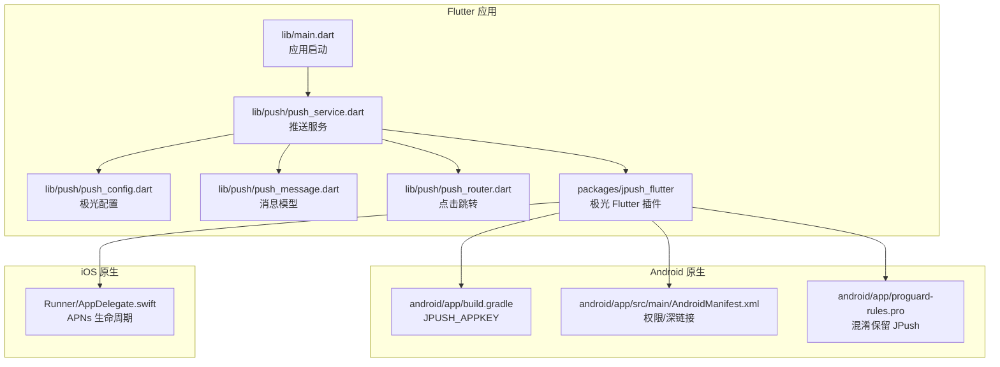
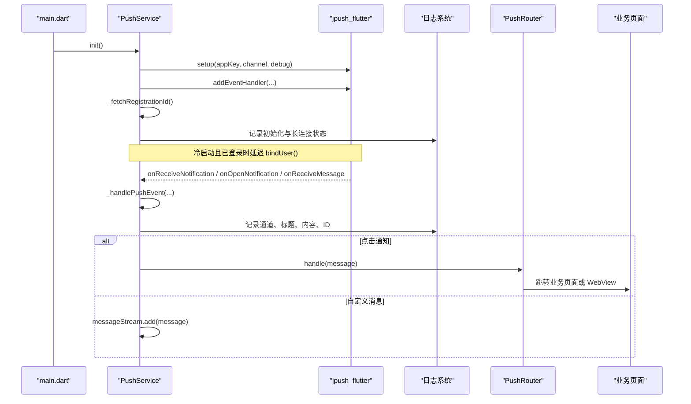
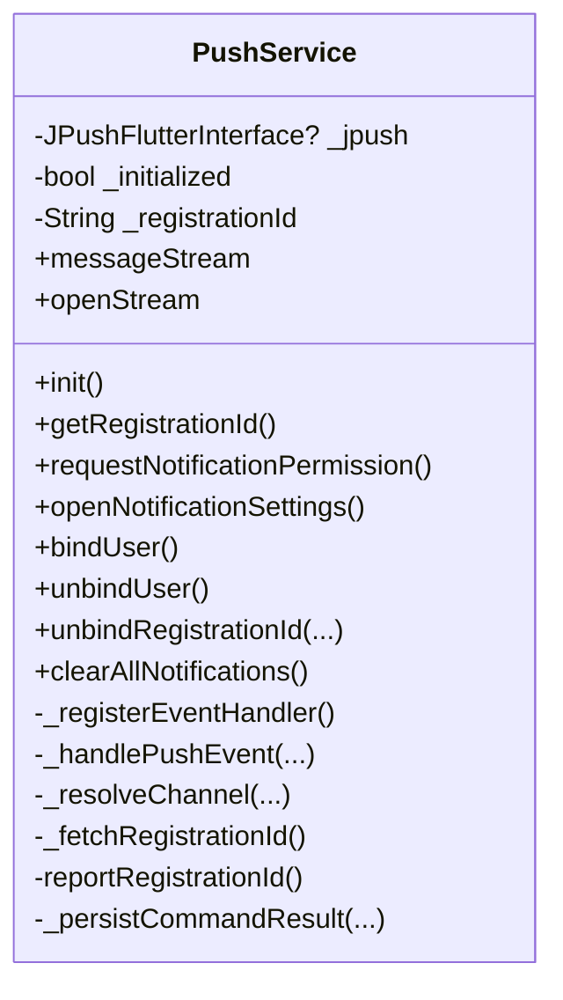
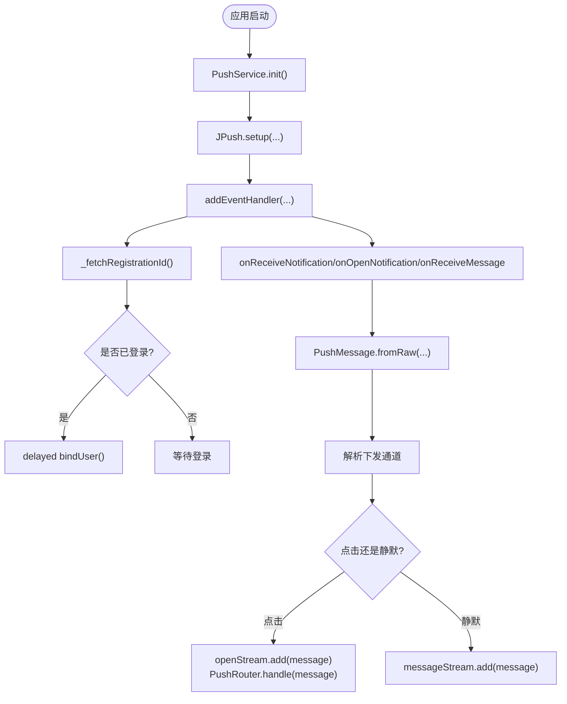
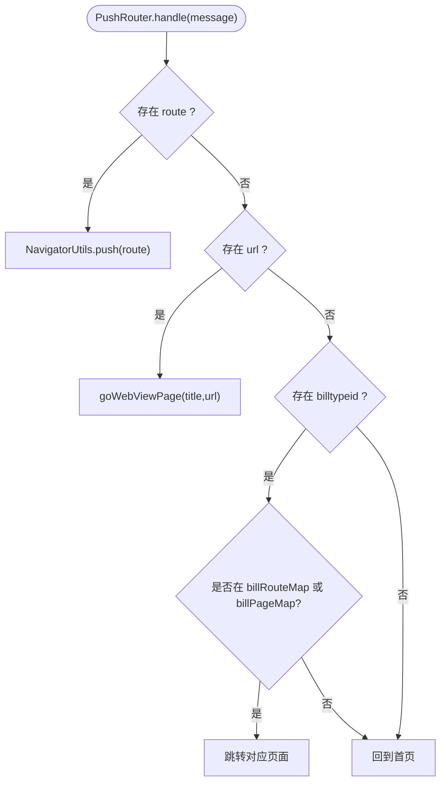
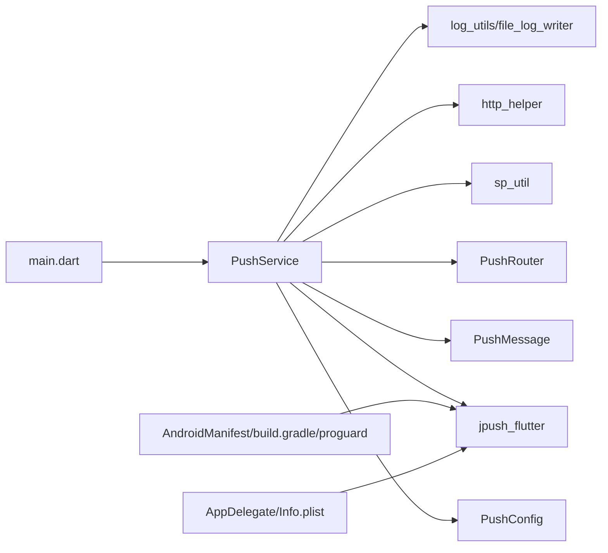

# 推送通知服务

<cite>
**本文引用的文件**   
- [lib/push/push_config.dart](file://lib/push/push_config.dart)
- [lib/push/push_message.dart](file://lib/push/push_message.dart)
- [lib/push/push_service.dart](file://lib/push/push_service.dart)
- [lib/push/push_router.dart](file://lib/push/push_router.dart)
- [lib/main.dart](file://lib/main.dart)
- [pubspec.yaml](file://pubspec.yaml)
- [docs/push_guide.md](file://docs/push_guide.md)
- [android/app/build.gradle](file://android/app/build.gradle)
- [android/app/src/main/AndroidManifest.xml](file://android/app/src/main/AndroidManifest.xml)
- [android/app/proguard-rules.pro](file://android/app/proguard-rules.pro)
</cite>

## 目录
1. [简介](#简介)
2. [项目结构](#项目结构)
3. [核心组件](#核心组件)
4. [架构总览](#架构总览)
5. [详细组件分析](#详细组件分析)
6. [依赖关系分析](#依赖关系分析)
7. [性能与通道特性](#性能与通道特性)
8. [配置与消息规范](#配置与消息规范)
9. [权限与平台差异](#权限与平台差异)
10. [错误处理与调试](#错误处理与调试)
11. [常见问题排查](#常见问题排查)
12. [结论](#结论)

## 简介
本文档面向灵犀管店 Flutter 项目的推送通知服务，基于极光推送（JPush）实现。文档覆盖以下目标：
- 极光推送的集成配置、初始化流程、设备注册与别名/标签绑定。
- 用户绑定与解绑机制，避免多账号串号。
- 消息类型定义、消息路由分发、Android 与 iOS 平台差异化处理。
- 推送权限申请、后台消息处理、点击跳转业务页面的完整流程。
- 推送配置选项说明、消息格式规范、错误处理和调试方法。
- 厂商通道（小米、华为、OPPO、vivo、魅族、荣耀等）的配置和使用指南。

推送能力服务于系统公告、订单/单据状态变更、库存预警、审批提醒等业务场景，既支持通知栏展示，也支持 App 内静默自定义消息刷新。

**章节来源**
- [docs/push_guide.md:1-20](file://docs/push_guide.md#L1-L20)

## 项目结构
推送相关代码集中在 `lib/push` 目录，按职责拆分为配置、消息模型、服务层和路由层；原生侧 Android 完成权限、AppKey 注入与混淆规则；iOS 通过 APNs 走极光插件封装。

**图表来源**
- [lib/main.dart:40-70](file://lib/main.dart#L40-L70)
- [lib/push/push_service.dart:1-120](file://lib/push/push_service.dart#L1-L120)
- [lib/push/push_config.dart:1-26](file://lib/push/push_config.dart#L1-L26)
- [lib/push/push_message.dart:1-147](file://lib/push/push_message.dart#L1-L147)
- [lib/push/push_router.dart:1-147](file://lib/push/push_router.dart#L1-L147)
- [android/app/build.gradle:43-47](file://android/app/build.gradle#L43-L47)
- [android/app/src/main/AndroidManifest.xml:1-15](file://android/app/src/main/AndroidManifest.xml#L1-L15)
- [android/app/proguard-rules.pro:41-46](file://android/app/proguard-rules.pro#L41-L46)

**章节来源**
- [docs/push_guide.md:22-50](file://docs/push_guide.md#L22-L50)
- [pubspec.yaml:1-120](file://pubspec.yaml#L1-L120)

## 核心组件
- 推送配置：集中管理极光 AppKey、渠道名、生产环境开关、别名/标签前缀。
- 消息模型：统一解析通知与自定义消息，归一化 extras、标题、内容、类型、跳转字段。
- 推送服务：封装初始化、事件回调、RegistrationID 获取、权限申请、用户绑定/解绑、设备上报、通知清理。
- 点击路由：根据 route/url/billtypeid 将通知点击跳转到对应业务页面或 WebView。

关键职责边界：
- `PushConfig` 只暴露常量配置，不参与运行时逻辑。
- `PushMessage` 只做数据归一化，不发起网络请求。
- `PushService` 是对外唯一入口，协调极光插件、日志、本地存储与业务接口。
- `PushRouter` 仅负责 UI 导航，不包含推送接入细节。

**章节来源**
- [lib/push/push_config.dart:1-26](file://lib/push/push_config.dart#L1-L26)
- [lib/push/push_message.dart:1-147](file://lib/push/push_message.dart#L1-L147)
- [lib/push/push_service.dart:1-120](file://lib/push/push_service.dart#L1-L120)
- [lib/push/push_router.dart:1-60](file://lib/push/push_router.dart#L1-L60)

## 架构总览
推送在应用中的整体调用链如下：

**图表来源**
- [lib/main.dart:40-70](file://lib/main.dart#L40-L70)
- [lib/push/push_service.dart:60-180](file://lib/push/push_service.dart#L60-L180)
- [lib/push/push_router.dart:60-147](file://lib/push/push_router.dart#L60-L147)

**章节来源**
- [lib/push/push_service.dart:60-180](file://lib/push/push_service.dart#L60-L180)

## 详细组件分析

### 推送配置 PushConfig
- 极光 AppKey：与极光后台应用一致。
- 渠道名：用于推送统计。
- iOS 生产环境开关：控制 APNs 证书环境。
- 别名前缀：按用户精准推送。
- 标签前缀：按门店批量推送。

该模块无运行时副作用，适合集中维护。

**章节来源**
- [lib/push/push_config.dart:1-26](file://lib/push/push_config.dart#L1-L26)

### 消息模型 PushMessage
- 类型枚举：notice、bill、stock、approval、unknown。
- 字段归一化：从原始 Map 中读取 id/title/content/extras。
- 跳转字段：route、url、billtypeid，并兼容 router 与 route 两种命名。
- 扩展兼容：Android 通知的 extras 可能嵌套在 cn.jpush.android.EXTRA 中，会平铺到顶层。

复杂度方面，解析过程为线性遍历 Map，时间复杂度 O(n)，空间复杂度 O(n)，n 为 extras 字段数量。

**章节来源**
- [lib/push/push_message.dart:1-147](file://lib/push/push_message.dart#L1-L147)

### 推送服务 PushService
主要职责：
- 初始化：创建 JPush 实例、注册事件、调用 setup、打印日志。
- 事件处理：通知到达、通知点击、自定义消息、通知未展示、长连接状态、厂商命令结果。
- RegistrationID：获取、重试、上报。
- 权限：检查、申请、跳转系统设置。
- 用户绑定：设置 alias、添加 tag，并上报设备。
- 用户解绑：删除 alias、清理 tag，并调用后端解绑接口。
- 通知清理：清空系统通知栏。

#### 类图（PushService 核心）

**图表来源**
- [lib/push/push_service.dart:1-120](file://lib/push/push_service.dart#L1-L120)
- [lib/push/push_service.dart:238-486](file://lib/push/push_service.dart#L238-L486)

#### 初始化与事件分发流程

**图表来源**
- [lib/push/push_service.dart:60-180](file://lib/push/push_service.dart#L60-L180)
- [lib/push/push_router.dart:60-147](file://lib/push/push_router.dart#L60-L147)

**章节来源**
- [lib/push/push_service.dart:60-180](file://lib/push/push_service.dart#L60-L180)
- [lib/push/push_service.dart:238-486](file://lib/push/push_service.dart#L238-L486)

### 点击路由 PushRouter
- 优先级：route > url > billtypeid > 首页。
- billRouteMap：将常见单据类型映射到 fluro 路由。
- billPageMap：对连锁模块未注册 fluro 路由的页面直接构造 Widget。
- 冷启动保护：延迟到下一帧再执行 Navigator，失败则最多重试 10 次。

#### 跳转决策流程图

**图表来源**
- [lib/push/push_router.dart:60-147](file://lib/push/push_router.dart#L60-L147)

**章节来源**
- [lib/push/push_router.dart:1-147](file://lib/push/push_router.dart#L1-L147)

### 应用启动集成
应用启动时调用 `PushService.instance.init()`，并在运行 `runApp` 之前完成 SDK 初始化与事件注册；若冷启动已登录，延迟 1 秒后自动 `bindUser()`。

**章节来源**
- [lib/main.dart:40-70](file://lib/main.dart#L40-L70)

## 依赖关系分析
- Flutter 层依赖：
  - jpush_flutter：极光推送 Flutter 插件，路径依赖本地 packages。
  - sp_util：本地缓存读取 userid/store/token。
  - routers/fluro_navigator：页面导航。
  - util/log_utils/file_log_writer：控制台与操作日志。
  - net/http_helper/http_api：上报设备与解绑接口。
- Android 层依赖：
  - manifestPlaceholders 注入 JPUSH_APPKEY。
  - POST_NOTIFICATIONS 权限声明。
  - proguard-rules.pro 保留 JPush 类。
- iOS 层依赖：
  - APNs 由极光插件与 Xcode 配置共同完成。

**图表来源**
- [pubspec.yaml:1-120](file://pubspec.yaml#L1-L120)
- [android/app/build.gradle:43-47](file://android/app/build.gradle#L43-L47)
- [android/app/src/main/AndroidManifest.xml:1-15](file://android/app/src/main/AndroidManifest.xml#L1-L15)
- [android/app/proguard-rules.pro:41-46](file://android/app/proguard-rules.pro#L41-L46)

**章节来源**
- [pubspec.yaml:1-120](file://pubspec.yaml#L1-L120)
- [android/app/build.gradle:43-47](file://android/app/build.gradle#L43-L47)
- [android/app/src/main/AndroidManifest.xml:1-15](file://android/app/src/main/AndroidManifest.xml#L1-L15)
- [android/app/proguard-rules.pro:41-46](file://android/app/proguard-rules.pro#L41-L46)

## 性能与通道特性
- 极光长连接：前台或后台在线时，走极光自有通道，实时、不限量。
- 厂商通道：应用被杀进程后，由小米、华为、OPPO、vivo、魅族、荣耀等厂商通道下发，受厂商每日限额影响。
- iOS：统一走 APNs。
- 通道识别：Android 通过 extras 中的 TYPE_PLATFORM 枚举识别通道；iOS 统一下发通道为 APNs。
- 长连接状态：onConnected 回调区分“已连接”和“已断开”，断开时离线通知依赖厂商通道或上线补发。

这些设计确保推送在典型场景下可靠触达，同时通过日志落盘便于定位离线通道问题。

**章节来源**
- [lib/push/push_service.dart:120-238](file://lib/push/push_service.dart#L120-L238)
- [docs/push_guide.md:22-40](file://docs/push_guide.md#L22-L40)

## 配置与消息规范

### 推送配置项
- AppKey：必须与极光后台一致。
- Channel：推送渠道名。
- Production：iOS 生产环境开关。
- UserAliasPrefix：用户别名前缀。
- StoreTagPrefix：门店标签前缀。

建议只在 `PushConfig` 中修改，避免散落多处。

**章节来源**
- [lib/push/push_config.dart:1-26](file://lib/push/push_config.dart#L1-L26)

### 消息类型
- notice：系统公告。
- bill：订单/单据状态变更。
- stock：库存预警/证照到期。
- approval：审批提醒。
- unknown：未指定类型。

**章节来源**
- [lib/push/push_message.dart:1-40](file://lib/push/push_message.dart#L1-L40)

### 通知附加字段（extras）约定
- type：消息类型。
- route：目标页面路由，优先级最高。
- url：网页地址，跳转内置 WebView。
- billtypeid：单据类型 id，映射到对应列表页。

点击跳转优先级：route > url > billtypeid > 首页。

**章节来源**
- [docs/push_guide.md:80-110](file://docs/push_guide.md#L80-L110)
- [lib/push/push_router.dart:1-60](file://lib/push/push_router.dart#L1-L60)

### 设备标识与绑定策略
- alias：user_<userid>，用于按用户精准推送。
- tag：store_<sid>，用于按门店批量推送。
- RegistrationID：设备在极光的唯一标识，可上报业务后台。

**章节来源**
- [lib/push/push_service.dart:351-486](file://lib/push/push_service.dart#L351-L486)
- [docs/push_guide.md:60-90](file://docs/push_guide.md#L60-L90)

## 权限与平台差异

### Android
- 权限：已声明 POST_NOTIFICATIONS。
- 运行时：通过 `requestNotificationPermission()` 申请。
- 深链接：关闭 flutter_deeplinking_enabled，避免白屏。
- 混淆：proguard-rules.pro 保留 JPush 相关类。
- AppKey：build.gradle manifestPlaceholders 注入 JPUSH_APPKEY。

**章节来源**
- [android/app/src/main/AndroidManifest.xml:1-15](file://android/app/src/main/AndroidManifest.xml#L1-L15)
- [android/app/proguard-rules.pro:41-46](file://android/app/proguard-rules.pro#L41-L46)
- [android/app/build.gradle:43-47](file://android/app/build.gradle#L43-L47)

### iOS
- 平台：APNs。
- 生产环境：需设置 PushConfig.production 为 true。
- 权限：通过 `applyPushAuthority()` 触发系统弹窗。
- 建议：在 Xcode 开启 Push Notifications 能力，并在极光后台配置 APNs。

**章节来源**
- [lib/push/push_config.dart:1-26](file://lib/push/push_config.dart#L1-L26)
- [lib/push/push_service.dart:321-340](file://lib/push/push_service.dart#L321-L340)
- [docs/push_guide.md:40-60](file://docs/push_guide.md#L40-L60)

## 错误处理与调试
- 控制台日志：tag 为 PUSH，Debug 模式输出。
- 操作日志：FileLogWriter 始终记录，包含通道、标题、内容、ID、错误信息。
- 厂商命令回调：cmd=10000 为厂商 token 注册结果，记录 errorCode 与 platform。
- RegistrationID：空值时会重试 5 次；上报失败也会记录错误。
- 跳转失败：冷启动 Navigator 未就绪时最多重试 10 次，最终输出错误日志。

建议排查时提供 RegistrationID、Message ID、AppKey、设备型号、系统版本与 SDK 日志。

**章节来源**
- [lib/push/push_service.dart:120-238](file://lib/push/push_service.dart#L120-L238)
- [lib/push/push_service.dart:238-320](file://lib/push/push_service.dart#L238-L320)
- [lib/push/push_router.dart:100-147](file://lib/push/push_router.dart#L100-L147)
- [docs/push_guide.md:110-138](file://docs/push_guide.md#L110-L138)

## 常见问题排查
- 收不到推送：确认 AppKey 与后台一致、包名一致、通知权限已开、极光后台确实发送成功。
- 应用被杀后收不到：未在极光后台配置厂商通道，或厂商通道 AppKey/AppId 配置错误。
- 点击通知白屏：已关闭 flutter_deeplinking_enabled；如仍白屏，检查 MainActivity 的深链接配置。
- Release 包收不到：确认 proguard-rules.pro 中 JPush 混淆规则生效。

**章节来源**
- [docs/push_guide.md:110-138](file://docs/push_guide.md#L110-L138)
- [android/app/proguard-rules.pro:41-46](file://android/app/proguard-rules.pro#L41-L46)

## 结论
灵犀管店的推送通知服务以 `PushService` 为核心，结合 `PushConfig`、`PushMessage`、`PushRouter` 形成清晰的职责分层。通过极光长连接与厂商通道的组合，满足前台、后台与应用被杀后的推送需求；Android 与 iOS 的平台差异在插件与服务层得到统一抽象。配合完善的日志与错误处理机制，开发者和运维人员可以高效定位推送问题，保证业务消息的可靠触达与准确跳转。