# 核心功能

<cite>
**本文引用的文件**   
- [lib/main.dart](file://lib/main.dart)
- [pubspec.yaml](file://pubspec.yaml)
- [README.md](file://README.md)
- [docs/push_guide.md](file://docs/push_guide.md)
- [lib/push/push_service.dart](file://lib/push/push_service.dart)
- [lib/push/push_config.dart](file://lib/push/push_config.dart)
- [lib/push/push_router.dart](file://lib/push/push_router.dart)
- [lib/push/push_message.dart](file://lib/push/push_message.dart)
- [lib/pages/login/page/login_page.dart](file://lib/pages/login/page/login_page.dart)
- [lib/pages/login/page/register_page.dart](file://lib/pages/login/page/register_page.dart)
- [lib/net/http_helper.dart](file://lib/net/http_helper.dart)
- [lib/util/permission_utils.dart](file://lib/util/permission_utils.dart)
- [lib/util/pda_scanner_util.dart](file://lib/util/pda_scanner_util.dart)
- [lib/util/gprinter.dart](file://lib/util/gprinter.dart)
- [lib/widgets/qr_code_scanner_page.dart](file://lib/widgets/qr_code_scanner_page.dart)
- [lib/setting/provider/theme_provider.dart](file://lib/setting/provider/theme_provider.dart)
- [lib/setting/page/theme_page.dart](file://lib/setting/page/theme_page.dart)
- [lib/res/constant.dart](file://lib/res/constant.dart)
</cite>

## 目录
1. [引言](#引言)
2. [项目结构](#项目结构)
3. [核心组件总览](#核心组件总览)
4. [架构总览](#架构总览)
5. [详细组件分析](#详细组件分析)
6. [依赖关系分析](#依赖关系分析)
7. [性能与可靠性建议](#性能与可靠性建议)
8. [故障排查指南](#故障排查指南)
9. [结论](#结论)

## 引言
本文面向灵犀管店 Flutter 项目的开发者，系统性梳理跨业务的核心能力：用户认证体系、推送服务、硬件集成、主题系统与设置。文档基于仓库实际代码进行逐层拆解，给出实现原理、配置项、调用流程、错误处理策略和常见问题定位方法，帮助读者在现有基础上扩展权限控制、推送路由、PDA 扫描、蓝牙打印与扫码等能力。

## 项目结构
项目采用按“领域 + 分层”组织的方式：
- `lib/pages`：页面入口（登录、注册、首页、业务模块、系统设置等）
- `lib/net`：网络层封装（Dio、拦截器、统一请求、错误处理）
- `lib/push`：极光推送封装（配置、消息模型、服务、跳转路由）
- `lib/util`：通用工具（权限、日志、设备信息、PDA 扫描、蓝牙打印、二维码扫描等）
- `lib/setting`：主题与设置相关 Provider 和页面
- `lib/res`：常量、颜色、样式等全局资源
- `packages`：本地依赖的第三方包（JPush、QR Code Scanner、滚动列表等）

```mermaid
graph TB
  Main["应用入口<br/>lib/main.dart"] --> Net["网络层<br/>lib/net/*"]
  Main --> Push["推送服务<br/>lib/push/*"]
  Main --> Router["路由与未找到页<br/>lib/routers/*"]
  Main --> ThemeProv["主题状态<br/>lib/setting/provider/theme_provider.dart"]
  LoginPage["登录页<br/>lib/pages/login/page/login_page.dart"] --> Net
  RegisterPage["注册页<br/>lib/pages/login/page/register_page.dart"] --> Net
  PermissionUtils["权限工具<br/>lib/util/permission_utils.dart"] --> Net
  PushService["推送服务<br/>lib/push/push_service.dart"] --> PushRouter["推送跳转<br/>lib/push/push_router.dart"]
  PdaScanner["PDA 扫描工具<br/>lib/util/pda_scanner_util.dart"]
  GPrinter["蓝牙打印工具<br/>lib/util/gprinter.dart"]
  QrPage["二维码扫描页<br/>lib/widgets/qr_code_scanner_page.dart"]
```

**图示来源**
- [lib/main.dart:1-204](file://lib/main.dart#L1-L204)
- [lib/push/push_service.dart:1-200](file://lib/push/push_service.dart#L1-L200)
- [lib/push/push_router.dart:1-147](file://lib/push/push_router.dart#L1-L147)
- [lib/util/pda_scanner_util.dart:1-66](file://lib/util/pda_scanner_util.dart#L1-L66)
- [lib/util/gprinter.dart:1-130](file://lib/util/gprinter.dart#L1-L130)
- [lib/widgets/qr_code_scanner_page.dart:1-107](file://lib/widgets/qr_code_scanner_page.dart#L1-L107)
- [lib/setting/provider/theme_provider.dart:1-88](file://lib/setting/provider/theme_provider.dart#L1-L88)

**章节来源**
- [README.md:1-210](file://README.md#L1-L210)
- [pubspec.yaml:1-153](file://pubspec.yaml#L1-L153)

## 核心组件总览
- 用户认证体系：手机号/商户号登录、门店选择、记住密码、登录态校验、退出登录解绑推送。
- 推送服务：极光 JPush 初始化、通知与自定义消息分发、设备 RegistrationID、别名/标签绑定、通知点击跳转。
- 硬件集成：PDA 硬件扫码事件监听、佳博蓝牙标签打印、摄像头二维码扫描。
- 主题与设置：跟随系统/深色/浅色主题切换，主题持久化与全局 ThemeData 构建。
- 权限管理：基于 rolemap 的菜单级权限校验、超级管理员放行、刷新节流与可见性通知。

**章节来源**
- [lib/pages/login/page/login_page.dart:1-500](file://lib/pages/login/page/login_page.dart#L1-L500)
- [lib/pages/login/page/register_page.dart:1-135](file://lib/pages/login/page/register_page.dart#L1-L135)
- [lib/push/push_service.dart:1-200](file://lib/push/push_service.dart#L1-L200)
- [lib/util/permission_utils.dart:1-190](file://lib/util/permission_utils.dart#L1-L190)
- [lib/util/pda_scanner_util.dart:1-66](file://lib/util/pda_scanner_util.dart#L1-L66)
- [lib/util/gprinter.dart:1-130](file://lib/util/gprinter.dart#L1-L130)
- [lib/widgets/qr_code_scanner_page.dart:1-107](file://lib/widgets/qr_code_scanner_page.dart#L1-L107)
- [lib/setting/provider/theme_provider.dart:1-88](file://lib/setting/provider/theme_provider.dart#L1-L88)

## 架构总览
应用启动后完成异常捕获、持久化存储、日志、极光推送初始化，再进入 Material App；登录成功后缓存 token、用户、门店、角色权限等信息，并绑定推送别名/标签；退出或登录失效时清理并解绑推送。

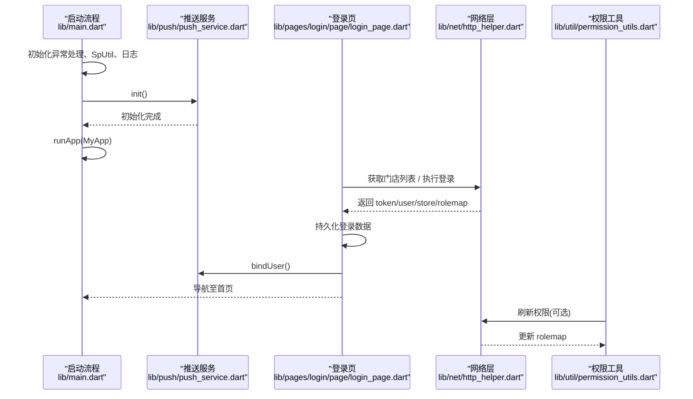

**图示来源**
- [lib/main.dart:1-204](file://lib/main.dart#L1-L204)
- [lib/push/push_service.dart:1-200](file://lib/push/push_service.dart#L1-L200)
- [lib/pages/login/page/login_page.dart:200-500](file://lib/pages/login/page/login_page.dart#L200-L500)
- [lib/net/http_helper.dart:1-200](file://lib/net/http_helper.dart#L1-L200)
- [lib/util/permission_utils.dart:1-190](file://lib/util/permission_utils.dart#L1-L190)

## 详细组件分析

### 用户认证体系
- 登录方式：手机号登录、商户号登录；支持记住密码、协议勾选、开发环境标识显示。
- 登录流程：先拉取门店列表，若多门店则弹窗选择；单门店或无门店直接登录。
- 登录结果：缓存 token、user、store、rolemap、sysSeat、loginParamResp 等，并记录操作审计日志。
- 推送绑定：登录成功后调用推送服务绑定用户别名与门店标签。
- 退出/失效：网络层遇到登录失效码会触发退出逻辑，推送侧需解绑。

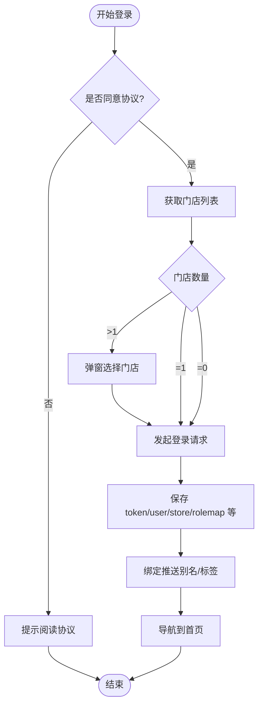

**图示来源**
- [lib/pages/login/page/login_page.dart:1-500](file://lib/pages/login/page/login_page.dart#L1-L500)
- [lib/push/push_service.dart:1-200](file://lib/push/push_service.dart#L1-L200)

**章节来源**
- [lib/pages/login/page/login_page.dart:1-500](file://lib/pages/login/page/login_page.dart#L1-L500)
- [lib/pages/login/page/register_page.dart:1-135](file://lib/pages/login/page/register_page.dart#L1-L135)
- [lib/res/constant.dart:1-54](file://lib/res/constant.dart#L1-L54)

### 权限管理
权限数据来源于登录接口返回的 `rolemap`，并在必要时通过 `/role/getInfoRetMap` 刷新。校验规则与 boss 前端保持一致：
- rolemap 与 user 均不存在时放行（兼容无权限管控场景）。
- rolemap 中存在对应 menuId 且值非显式 falsy 时放行。
- user.roleid 或 code 为超级管理员“1001”时放行。
- 其他情况拦截并提示。

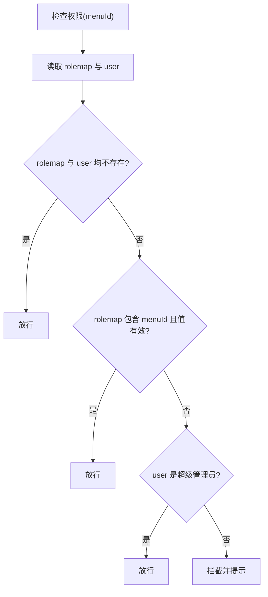

**图示来源**
- [lib/util/permission_utils.dart:1-190](file://lib/util/permission_utils.dart#L1-L190)

**章节来源**
- [lib/util/permission_utils.dart:1-190](file://lib/util/permission_utils.dart#L1-L190)

### 推送服务（极光推送）
- 初始化：应用启动时调用 `PushService.instance.init()`，Web 平台自动跳过。
- 事件回调：通知到达、通知点击、自定义消息、长连接状态、命令结果等。
- 通道识别：根据 extras 中的平台字段识别极光长连接与各厂商通道。
- 消息模型：将通知与自定义消息归一化为 `PushMessage`，提取 type、route、url、billtypeid 等。
- 跳转路由：优先级 route > url > billtypeid，最后回到首页；冷启动时延迟重试 Navigator。
- 别名/标签：登录后绑定 `user_<userid>` 与 `store_<sid>`。

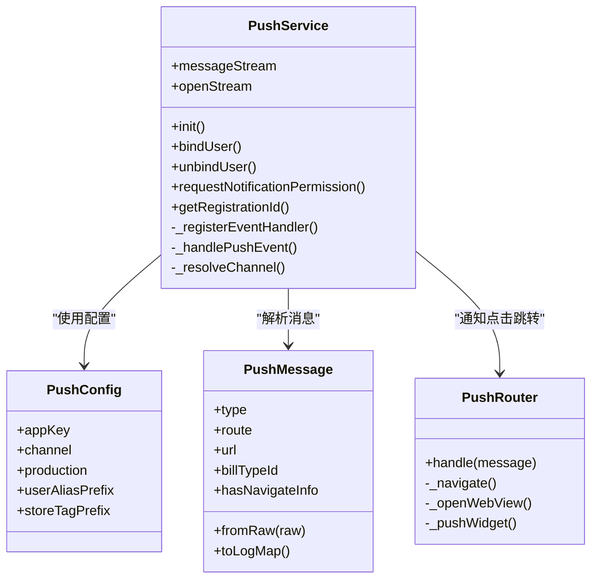

**图示来源**
- [lib/push/push_service.dart:1-200](file://lib/push/push_service.dart#L1-L200)
- [lib/push/push_config.dart:1-26](file://lib/push/push_config.dart#L1-L26)
- [lib/push/push_message.dart:1-147](file://lib/push/push_message.dart#L1-L147)
- [lib/push/push_router.dart:1-147](file://lib/push/push_router.dart#L1-L147)

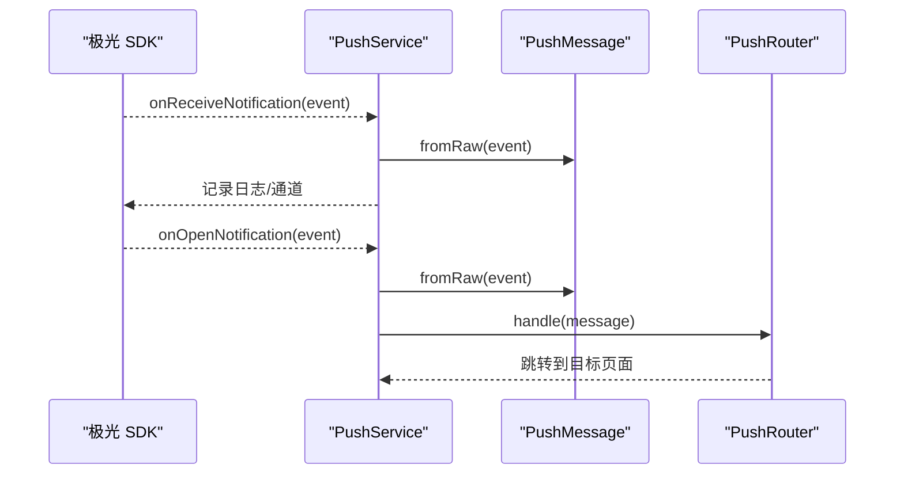

**图示来源**
- [lib/push/push_service.dart:1-200](file://lib/push/push_service.dart#L1-L200)
- [lib/push/push_message.dart:1-147](file://lib/push/push_message.dart#L1-L147)
- [lib/push/push_router.dart:1-147](file://lib/push/push_router.dart#L1-L147)

**章节来源**
- [docs/push_guide.md:1-138](file://docs/push_guide.md#L1-L138)
- [lib/push/push_service.dart:1-200](file://lib/push/push_service.dart#L1-L200)
- [lib/push/push_config.dart:1-26](file://lib/push/push_config.dart#L1-L26)
- [lib/push/push_message.dart:1-147](file://lib/push/push_message.dart#L1-L147)
- [lib/push/push_router.dart:1-147](file://lib/push/push_router.dart#L1-L147)

### 硬件集成

#### PDA 扫码
- 通过 EventChannel 监听 Android PDA 设备硬件扫描广播，暴露 Stream 给 Flutter 层。
- 提供 startListening、stopListening、isSupported 等方法。
- 适用于商米、优博音、新大陆等 PDA 设备。

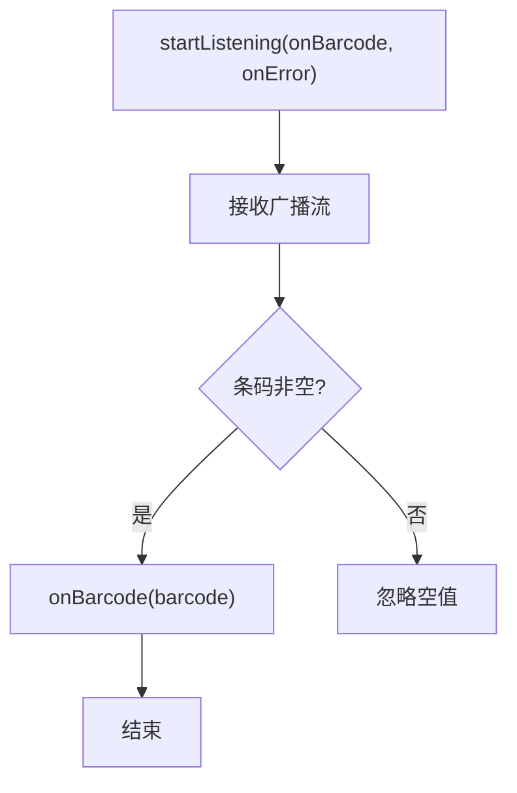

**图示来源**
- [lib/util/pda_scanner_util.dart:1-66](file://lib/util/pda_scanner_util.dart#L1-L66)

**章节来源**
- [lib/util/pda_scanner_util.dart:1-66](file://lib/util/pda_scanner_util.dart#L1-L66)

#### 蓝牙打印（佳博）
- 通过 MethodChannel 调用原生佳博 SDK，封装蓝牙开关、扫描、连接、断开、打印标签、预包装改价标签、测试打印等能力。
- 支持模板尺寸选择（如 60×40mm、50×30mm 等），返回打印结果。

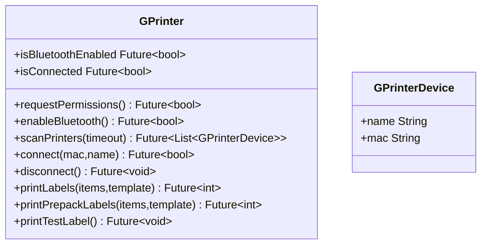

**图示来源**
- [lib/util/gprinter.dart:1-130](file://lib/util/gprinter.dart#L1-L130)

**章节来源**
- [lib/util/gprinter.dart:1-130](file://lib/util/gprinter.dart#L1-L130)

#### 二维码扫描
- 基于 qr_code_scanner 插件，提供摄像头扫码界面，支持闪光灯切换。
- 扫描成功回调后释放控制器并返回结果。

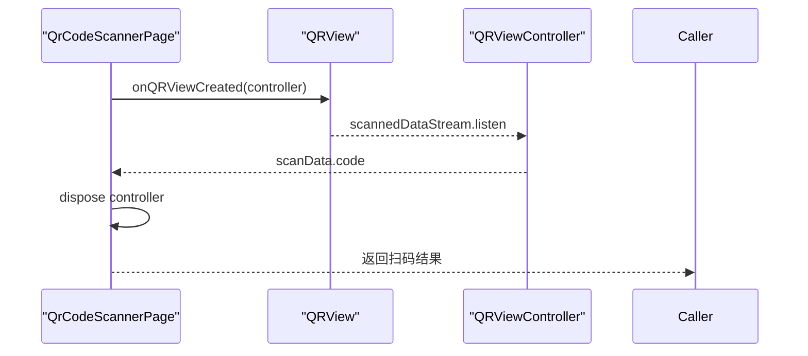

**图示来源**
- [lib/widgets/qr_code_scanner_page.dart:1-107](file://lib/widgets/qr_code_scanner_page.dart#L1-L107)

**章节来源**
- [lib/widgets/qr_code_scanner_page.dart:1-107](file://lib/widgets/qr_code_scanner_page.dart#L1-L107)

### 主题系统与设置
- ThemeProvider 负责从 SpUtil 读取/写入主题模式，并提供全局 ThemeData 构建。
- 主题模式包括跟随系统、深色、浅色，持久化 Key 为 `Constant.theme`。
- 设置页面提供选项切换，并使用 Provider 更新主题。

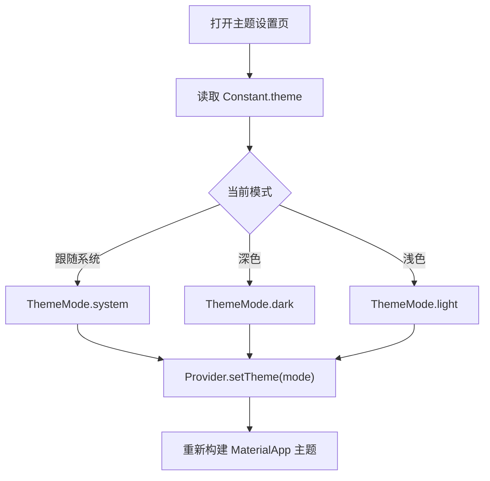

**图示来源**
- [lib/setting/provider/theme_provider.dart:1-88](file://lib/setting/provider/theme_provider.dart#L1-L88)
- [lib/setting/page/theme_page.dart:1-72](file://lib/setting/page/theme_page.dart#L1-L72)
- [lib/res/constant.dart:1-54](file://lib/res/constant.dart#L1-L54)

**章节来源**
- [lib/setting/provider/theme_provider.dart:1-88](file://lib/setting/provider/theme_provider.dart#L1-L88)
- [lib/setting/page/theme_page.dart:1-72](file://lib/setting/page/theme_page.dart#L1-L72)
- [lib/res/constant.dart:1-54](file://lib/res/constant.dart#L1-L54)

## 依赖关系分析
- 应用入口依赖网络初始化、路由初始化、版本检查、Toast 配置、主题 Provider。
- 登录页依赖网络层、推送服务、常量、工具类。
- 推送服务依赖极光插件、网络接口、日志、持久化、跳转路由。
- 权限工具依赖网络层与持久化。
- 硬件能力依赖平台通道（MethodChannel/EventChannel）。

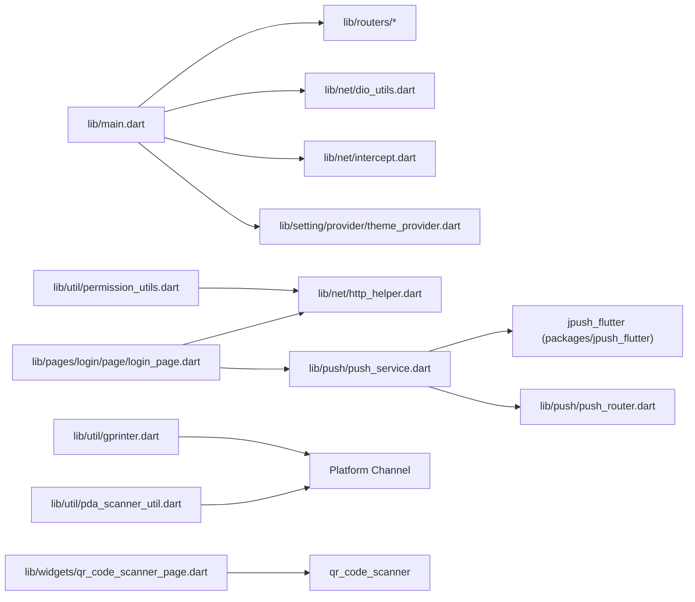

**图示来源**
- [lib/main.dart:1-204](file://lib/main.dart#L1-L204)
- [lib/pages/login/page/login_page.dart:1-500](file://lib/pages/login/page/login_page.dart#L1-L500)
- [lib/push/push_service.dart:1-200](file://lib/push/push_service.dart#L1-L200)
- [lib/util/permission_utils.dart:1-190](file://lib/util/permission_utils.dart#L1-L190)
- [lib/util/pda_scanner_util.dart:1-66](file://lib/util/pda_scanner_util.dart#L1-L66)
- [lib/util/gprinter.dart:1-130](file://lib/util/gprinter.dart#L1-L130)
- [lib/widgets/qr_code_scanner_page.dart:1-107](file://lib/widgets/qr_code_scanner_page.dart#L1-L107)
- [pubspec.yaml:1-153](file://pubspec.yaml#L1-L153)

**章节来源**
- [pubspec.yaml:1-153](file://pubspec.yaml#L1-L153)

## 性能与可靠性建议
- 网络层：
  - 统一拦截器处理身份验证、Token 刷新、日志与适配；避免重复 Toast 提示。
  - 对登录失效（retcode=-2/-3）集中处理，防止并发重复跳转登录页。
- 推送：
  - 使用长连接通道提高实时性；离线走厂商通道时需正确配置各厂商通道。
  - 注意 Notification 权限申请时机，首次进入首页后申请一次即可。
- 硬件：
  - PDA 扫描需在不再使用时停止监听，避免后台持续消耗。
  - 蓝牙打印连接前判断系统蓝牙开关状态，Android 13+ 引导至设置页开启。
  - 二维码扫描在回调中及时释放控制器，避免相机占用。
- 主题：
  - 使用 Provider 管理主题变更，减少不必要的重建范围。
  - 深色模式下统一状态栏图标亮度，保证可读性。

[本节为通用指导，不直接分析具体文件]

## 故障排查指南
- 推送收不到：
  - 确认 appKey 与后台一致、包名一致、通知权限已开启。
  - 应用被杀后仍收不到，需配置厂商通道（OPPO/小米/华为/vivo/魅族/荣耀）。
  - Release 包需确保混淆 keep 规则生效。
- 通知点击白屏：
  - 已通过关闭深链接处理；若仍白屏，检查 MainActivity 的深链接配置。
- 登录失败或频繁跳转登录页：
  - 检查 retcode=-2/-3 分支，确认网络层是否正确清理登录态并解绑推送。
- 权限无效：
  - 检查 rolemap 是否刷新成功，注意 10s 节流与并发保护；必要时强制刷新。
- PDA 扫描无数据：
  - 确认 EventChannel 名称与原生端一致，仅在 Android 平台启用。
- 蓝牙打印失败：
  - 检查蓝牙权限与开关状态；确认打印机 MAC 与模板参数正确。

**章节来源**
- [docs/push_guide.md:1-138](file://docs/push_guide.md#L1-L138)
- [lib/net/http_helper.dart:1-200](file://lib/net/http_helper.dart#L1-L200)
- [lib/util/permission_utils.dart:1-190](file://lib/util/permission_utils.dart#L1-L190)
- [lib/util/pda_scanner_util.dart:1-66](file://lib/util/pda_scanner_util.dart#L1-L66)
- [lib/util/gprinter.dart:1-130](file://lib/util/gprinter.dart#L1-L130)

## 结论
灵犀管店项目在认证、推送、硬件集成与主题设置方面形成了清晰的模块化设计：
- 认证与权限围绕登录态与 rolemap 展开，结合持久化与网络层统一处理。
- 推送服务封装了极光 SDK，提供消息归一化、通道识别与跳转路由。
- 硬件能力通过平台通道与第三方插件实现，兼顾 PDA 扫描、蓝牙打印与二维码扫描。
- 主题系统通过 Provider 统一管理，提供可复用的 ThemeData 构建。

建议在后续迭代中：
- 将更多业务入口接入权限校验，结合 revision 通知动态隐藏不可见菜单。
- 完善推送消息类型枚举与路由映射，避免硬编码。
- 对硬件能力增加更完善的错误码与用户引导提示。
- 继续优化网络层异常处理与日志采集，提升问题定位效率。

[本节为总结性内容，不直接分析具体文件]