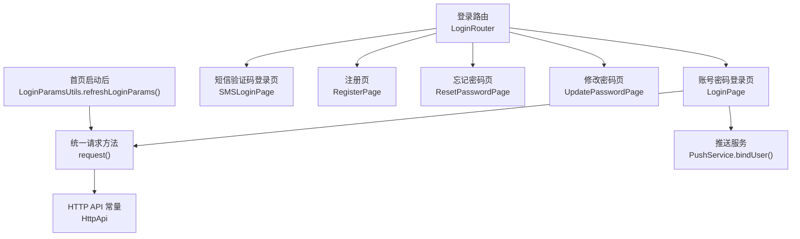
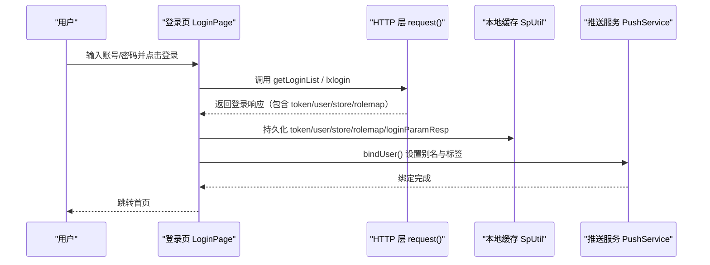
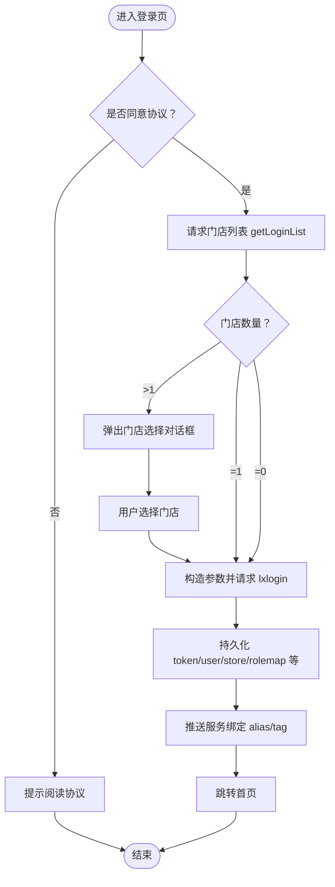
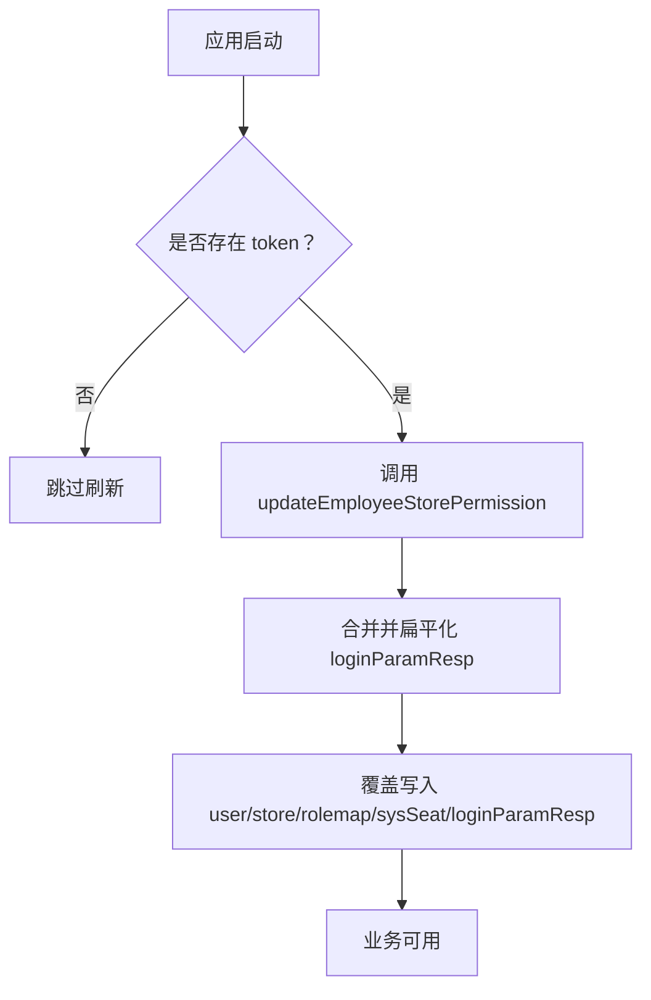
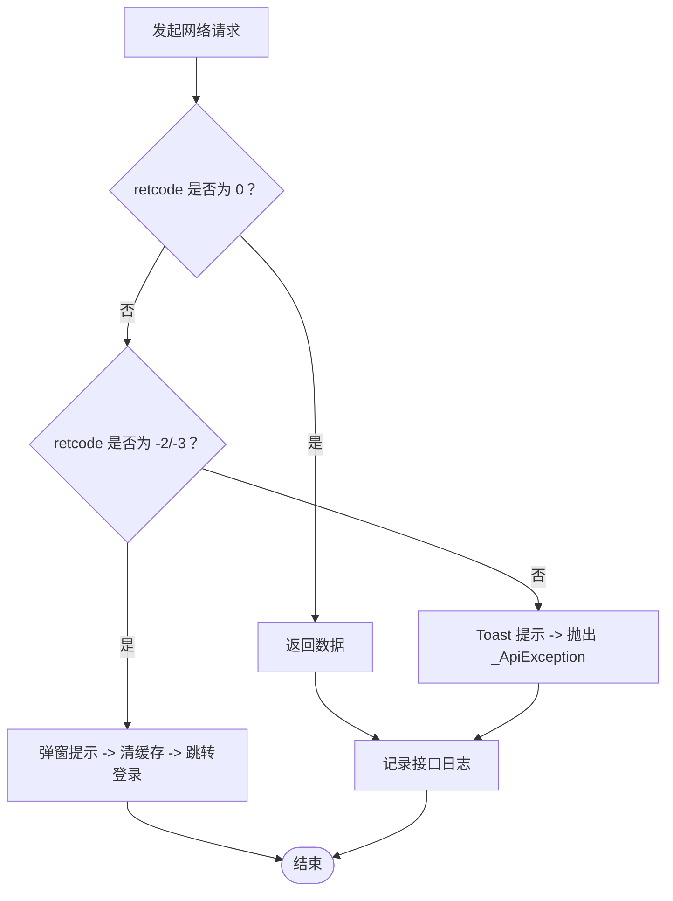
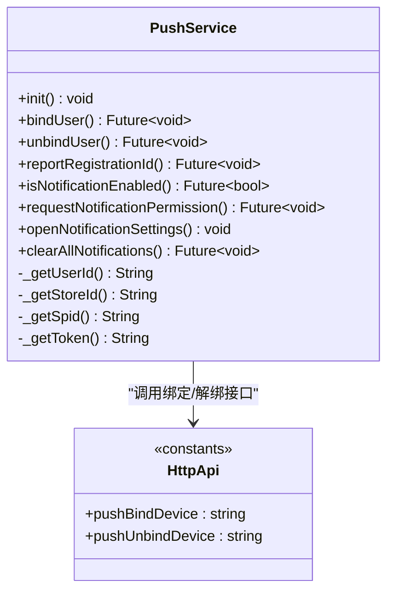
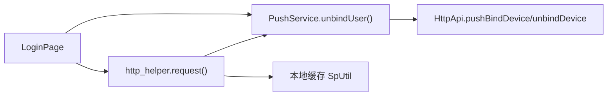

# 用户认证模块

<cite>
**本文引用的文件**   
- [lib/pages/login/page/login_page.dart](file://lib/pages/login/page/login_page.dart)
- [lib/pages/login/page/sms_login_page.dart](file://lib/pages/login/page/sms_login_page.dart)
- [lib/pages/login/page/register_page.dart](file://lib/pages/login/page/register_page.dart)
- [lib/pages/login/page/reset_password_page.dart](file://lib/pages/login/page/reset_password_page.dart)
- [lib/pages/login/page/update_password_page.dart](file://lib/pages/login/page/update_password_page.dart)
- [lib/pages/login/login_router.dart](file://lib/pages/login/login_router.dart)
- [lib/net/http_api.dart](file://lib/net/http_api.dart)
- [lib/net/http_helper.dart](file://lib/net/http_helper.dart)
- [lib/push/push_service.dart](file://lib/push/push_service.dart)
- [lib/util/login_params_utils.dart](file://lib/util/login_params_utils.dart)
</cite>

## 目录
1. [引言](#引言)
2. [项目结构](#项目结构)
3. [核心组件](#核心组件)
4. [架构总览](#架构总览)
5. [详细组件分析](#详细组件分析)
6. [依赖关系分析](#依赖关系分析)
7. [性能与安全考量](#性能与安全考量)
8. [故障排查指南](#故障排查指南)
9. [结论](#结论)

## 引言
本文件聚焦灵犀管店 Flutter 项目的用户认证模块，系统性梳理账号密码登录、手机号短信登录、注册、重置密码、更新密码等认证相关页面与能力。文档说明登录业务流程、Token 与会话存储机制、权限数据刷新、错误处理策略、推送服务集成方式，并给出可落地的安全最佳实践与性能优化建议。该模块同时承担“业务入口”的职责：登录成功后会持久化用户、门店、角色映射等上下文，触发权限参数刷新，并与极光推送完成设备与用户标识绑定。

## 项目结构
认证相关代码集中在以下路径：
- 登录与账户页：`lib/pages/login/...`
- 网络请求与统一异常处理：`lib/net/...`
- 推送服务集成：`lib/push/...`
- 启动后登录参数刷新工具：`lib/util/login_params_utils.dart`

图示来源
- [lib/pages/login/login_router.dart:1-28](file://lib/pages/login/login_router.dart#L1-L28)
- [lib/pages/login/page/login_page.dart:1-200](file://lib/pages/login/page/login_page.dart#L1-L200)
- [lib/net/http_api.dart:1-80](file://lib/net/http_api.dart#L1-L80)
- [lib/net/http_helper.dart:1-120](file://lib/net/http_helper.dart#L1-L120)
- [lib/push/push_service.dart:1-120](file://lib/push/push_service.dart#L1-L120)
- [lib/util/login_params_utils.dart:1-60](file://lib/util/login_params_utils.dart#L1-L60)

章节来源
- [lib/pages/login/login_router.dart:1-28](file://lib/pages/login/login_router.dart#L1-L28)

## 核心组件
- 登录路由：集中管理登录、注册、短信登录、重置密码、修改密码的页面路由。
- 账号密码登录页：支持“手机号登录”和“商户号登录”，含记住密码、协议勾选、门店选择、登录成功后的 Token 持久化与推送绑定。
- 短信验证码登录页：当前为占位实现，提供表单校验与跳转入口。
- 注册页：收集手机号、验证码、密码，进行前端校验。
- 重置密码页：收集手机号、验证码、新密码，进行前端校验。
- 修改密码页：旧密码与新密码校验，完成后返回上一页。
- HTTP 层：封装 Dio 请求、公共参数注入、签名、retcode 处理、登录失效强制下线、全局日志记录。
- 推送服务：初始化极光推送、获取 RegistrationID、登录后设置别名与标签、退出时解绑、通知权限管理。
- 登录参数刷新：App 启动后静默拉取 user/store/rolemap/sysSeat/loginParamResp 等数据，合并缓存并扁平化嵌套字段。

章节来源
- [lib/pages/login/login_router.dart:1-28](file://lib/pages/login/login_router.dart#L1-L28)
- [lib/pages/login/page/login_page.dart:1-200](file://lib/pages/login/page/login_page.dart#L1-L200)
- [lib/pages/login/page/sms_login_page.dart:1-141](file://lib/pages/login/page/sms_login_page.dart#L1-L141)
- [lib/pages/login/page/register_page.dart:1-135](file://lib/pages/login/page/register_page.dart#L1-L135)
- [lib/pages/login/page/reset_password_page.dart:1-123](file://lib/pages/login/page/reset_password_page.dart#L1-L123)
- [lib/pages/login/page/update_password_page.dart:1-108](file://lib/pages/login/page/update_password_page.dart#L1-L108)
- [lib/net/http_api.dart:1-80](file://lib/net/http_api.dart#L1-L80)
- [lib/net/http_helper.dart:1-200](file://lib/net/http_helper.dart#L1-L200)
- [lib/push/push_service.dart:1-200](file://lib/push/push_service.dart#L1-L200)
- [lib/util/login_params_utils.dart:1-145](file://lib/util/login_params_utils.dart#L1-L145)

## 架构总览
认证模块采用“页面 + 网络层 + 推送服务 + 本地缓存”的分层设计：
- 页面层负责输入校验、交互流程与结果展示。
- 网络层通过统一 `request()` 封装公共参数、签名、错误码处理与强制下线逻辑。
- 推送服务在登录成功后绑定用户标识（别名）与门店标识（标签），并在退出或失效时解绑。
- 本地缓存使用 sp_util 保存 token、user、store、rolemap、loginParamResp 等会话数据。

图示来源
- [lib/pages/login/page/login_page.dart:201-300](file://lib/pages/login/page/login_page.dart#L201-L300)
- [lib/net/http_helper.dart:1-120](file://lib/net/http_helper.dart#L1-L120)
- [lib/push/push_service.dart:320-420](file://lib/push/push_service.dart#L320-L420)

## 详细组件分析

### 账号密码登录流程
登录页支持两种模式：
- 手机号登录：传入 phone、pwd、logintype=1。
- 商户号登录：传入 account、code、pwd、logintype=2。

流程要点：
1. 首次请求门店列表接口 getLoginList，用于判断是否需要用户选择门店。
2. 若存在多个门店，弹出选择对话框；用户确认后再次发起 lxlogin。
3. 登录成功后持久化 token、user、store、rolemap、sysStoreAccount、sysSeat、allLoginData、accessToken、loginParamResp。
4. 对 loginParamResp 做扁平化处理，将一级嵌套对象展开到顶层，再写入缓存。
5. 登录成功后记录设备信息，并调用推送服务绑定用户与门店标识。
6. 最终跳转到首页，清空栈。

图示来源
- [lib/pages/login/page/login_page.dart:1-200](file://lib/pages/login/page/login_page.dart#L1-L200)
- [lib/pages/login/page/login_page.dart:201-300](file://lib/pages/login/page/login_page.dart#L201-L300)
- [lib/net/http_api.dart:20-40](file://lib/net/http_api.dart#L20-L40)

章节来源
- [lib/pages/login/page/login_page.dart:1-300](file://lib/pages/login/page/login_page.dart#L1-L300)
- [lib/net/http_api.dart:20-40](file://lib/net/http_api.dart#L20-L40)

### 手机号短信登录
短信登录页目前为 UI 占位实现：
- 手机号需 11 位，验证码需 6 位。
- “获取验证码”按钮默认返回成功但不真正发送。
- “登录”按钮仅提示“去登录......”。
- 提供跳转到注册与忘记密码页面的入口。

实际业务接入建议：
- 在“获取验证码”回调中调用后端短信接口，返回成功后再启用登录按钮。
- 登录按钮调用短信验证码登录接口，成功后复用登录成功流程（持久化 Token、跳转首页）。

章节来源
- [lib/pages/login/page/sms_login_page.dart:1-141](file://lib/pages/login/page/sms_login_page.dart#L1-L141)

### 注册流程
注册页收集：
- 手机号（11 位）
- 验证码（6 位）
- 密码（至少 6 位）

当前行为：
- 前端校验通过后点击“注册”，仅显示 Toast“点击注册”。
- 验证码获取仅校验手机号长度，未真正发送。

建议接入步骤：
- 在验证码获取回调中调用后端发送短信接口。
- 在注册提交处调用注册接口，成功后可自动跳转到登录页或直接登录。

章节来源
- [lib/pages/login/page/register_page.dart:1-135](file://lib/pages/login/page/register_page.dart#L1-L135)

### 重置密码流程
重置密码页收集：
- 手机号（11 位）
- 验证码（6 位）
- 新密码（至少 6 位）

当前行为：
- 点击“确认”仅显示 Toast“确认”。

建议接入步骤：
- 先发送验证码。
- 提交后调用重置密码接口，成功后提示并跳转登录页。

章节来源
- [lib/pages/login/page/reset_password_page.dart:1-123](file://lib/pages/login/page/reset_password_page.dart#L1-L123)

### 更新密码流程
修改密码页收集：
- 旧密码（至少 6 位）
- 新密码（至少 6 位）

当前行为：
- 点击“确认”提示“修改成功！”并返回上一页。

建议接入步骤：
- 调用修改密码接口，成功后提示并返回上一页。

章节来源
- [lib/pages/login/page/update_password_page.dart:1-108](file://lib/pages/login/page/update_password_page.dart#L1-L108)

### 登录状态管理与 Token 存储
登录成功后，登录页会将以下关键数据写入本地缓存：
- token：访问令牌
- user：用户信息
- store：门店信息
- rolemap：角色映射
- sysStoreAccount：系统门店账号
- sysSeat：席位信息
- allLoginData：完整登录响应
- accessToken：访问令牌（冗余字段）
- loginParamResp：登录参数，经扁平化处理后写入

这些字段由 HTTP 层统一读取，作为后续接口的公共参数来源（sid、spid、userid、token 等）。

章节来源
- [lib/pages/login/page/login_page.dart:201-300](file://lib/pages/login/page/login_page.dart#L201-L300)
- [lib/net/http_helper.dart:1-120](file://lib/net/http_helper.dart#L1-L120)

### 权限验证流程
权限验证主要通过两个阶段完成：
1. 登录阶段：服务端返回 rolemap、sysSeat 等权限数据，客户端持久化。
2. 启动阶段：首页启动后调用 LoginParamsUtils.refreshLoginParams()，静默刷新 user、store、rolemap、sysSeat、loginParamResp，并将嵌套参数扁平化合并到缓存。

图示来源
- [lib/util/login_params_utils.dart:1-145](file://lib/util/login_params_utils.dart#L1-L145)
- [lib/net/http_api.dart:40-60](file://lib/net/http_api.dart#L40-L60)

章节来源
- [lib/util/login_params_utils.dart:1-145](file://lib/util/login_params_utils.dart#L1-L145)
- [lib/net/http_api.dart:40-60](file://lib/net/http_api.dart#L40-L60)

### 错误处理策略
HTTP 层对错误做了统一处理：
- retcode 为 -2 或 -3 表示登录信息失效，触发强制下线流程：弹窗提示、清除缓存（保留记住密码）、跳转登录页。
- 非业务异常（如超时、连接错误）会被转换为友好提示，并记录操作日志。
- 所有请求的成功与失败均通过 FileLogWriter 记录，便于定位问题。

图示来源
- [lib/net/http_helper.dart:1-200](file://lib/net/http_helper.dart#L1-L200)
- [lib/net/http_helper.dart:201-351](file://lib/net/http_helper.dart#L201-L351)

章节来源
- [lib/net/http_helper.dart:1-351](file://lib/net/http_helper.dart#L1-L351)

### 推送服务集成
推送服务在以下时机介入：
- 应用冷启动：初始化 JPush，延迟 1 秒检测已登录则重新绑定。
- 登录成功：设置别名 alias=user_<userid>，添加标签 tag=store_<sid>，并上报 RegistrationID。
- 退出或登录失效：删除别名、清理标签，并调用后端接口解绑设备 ID。
- 通知权限：检查、申请、引导用户开启通知权限。

图示来源
- [lib/push/push_service.dart:1-200](file://lib/push/push_service.dart#L1-L200)
- [lib/push/push_service.dart:320-486](file://lib/push/push_service.dart#L320-L486)
- [lib/net/http_api.dart:40-60](file://lib/net/http_api.dart#L40-L60)

章节来源
- [lib/push/push_service.dart:1-486](file://lib/push/push_service.dart#L1-L486)
- [lib/net/http_api.dart:40-60](file://lib/net/http_api.dart#L40-L60)

## 依赖关系分析
- 登录页依赖：
  - HTTP 层：getLoginList、lxlogin
  - 本地缓存：token、user、store、rolemap、loginParamResp
  - 推送服务：bindUser()
- HTTP 层依赖：
  - Dio 网络库
  - 本地缓存：token、user、store
  - 日志组件：FileLogWriter
  - 推送服务：unbindUser()（登录失效时）
- 推送服务依赖：
  - 极光 SDK：JPushFlutterInterface
  - HTTP 层：pushBindDevice、pushUnbindDevice
  - 本地缓存：user、store、token

图示来源
- [lib/pages/login/page/login_page.dart:201-300](file://lib/pages/login/page/login_page.dart#L201-L300)
- [lib/net/http_helper.dart:1-200](file://lib/net/http_helper.dart#L1-L200)
- [lib/push/push_service.dart:320-486](file://lib/push/push_service.dart#L320-L486)

章节来源
- [lib/pages/login/page/login_page.dart:201-300](file://lib/pages/login/page/login_page.dart#L201-L300)
- [lib/net/http_helper.dart:1-200](file://lib/net/http_helper.dart#L1-L200)
- [lib/push/push_service.dart:320-486](file://lib/push/push_service.dart#L320-L486)

## 性能与安全考量

### 性能优化建议
- 登录流程分步加载：先获取门店列表，再根据门店数决定是否弹出选择框，避免按钮长时间转圈。
- 登录参数刷新采用静默异步执行，不阻塞启动流程；同一 App 运行周期内只执行一次，避免重复请求。
- 推送服务在冷启动后延迟绑定，降低初始化竞争。
- 所有网络请求统一日志记录，便于快速定位慢请求与失败原因。

### 安全最佳实践
- 密码在前端进行 MD5 加密后传输，避免明文密码在网络中暴露。
- Token、用户信息、门店信息等敏感数据存储在本地缓存中，建议使用安全存储方案（如密钥链/Keystore 封装）进一步提升安全性。
- 登录失效时统一走强制下线流程，清除缓存并跳转登录页，防止过期凭证继续被使用。
- 推送别名与标签绑定使用 userid 与 sid，避免跨用户串号；退出或失效时主动解绑。
- 操作审计日志避免记录密码等敏感信息，仅记录账号、动作与必要上下文。

### 常见问题解决方案
- 登录成功但无法收到推送：
  - 检查推送服务是否成功初始化，RegistrationID 是否获取成功。
  - 检查别名与标签是否绑定成功。
  - 检查通知权限是否开启。
- 接口返回 retcode=-2/-3：
  - 确认 Token 是否有效；若无效，按统一流程清除缓存并跳转登录页。
- 登录参数未刷新：
  - 确认首页是否调用 LoginParamsUtils.refreshLoginParams()。
  - 检查接口 updateEmployeeStorePermission 是否返回期望数据。

[本节为通用指导，无需列出具体文件来源]

## 故障排查指南
- 查看网络请求日志：
  - HTTP 层会对每次请求记录 URL、参数、结果与异常信息。
- 查看操作审计日志：
  - 登录页与推送服务会通过 FileLogWriter 记录关键动作，便于追踪登录与推送生命周期。
- 检查本地缓存：
  - 确认 token、user、store、rolemap、loginParamResp 是否已正确写入。
- 检查推送服务：
  - 确认 alias 与 tag 是否设置成功。
  - 确认 RegistrationID 上报是否成功。

章节来源
- [lib/net/http_helper.dart:1-200](file://lib/net/http_helper.dart#L1-L200)
- [lib/pages/login/page/login_page.dart:1-200](file://lib/pages/login/page/login_page.dart#L1-L200)
- [lib/push/push_service.dart:1-200](file://lib/push/push_service.dart#L1-L200)

## 结论
灵犀管店的用户认证模块以登录页为核心入口，结合统一 HTTP 层与推送服务，形成完整的登录、权限刷新与会话管理机制。当前账号密码登录已具备端到端流程，而短信登录、注册、重置密码、修改密码页面仍需要接入真实接口。建议在后续迭代中优先补齐这些接口的后端对接，完善前端校验与错误提示，并持续强化 Token 与敏感数据的存储安全。推送服务已在登录成功后完成用户与门店标识绑定，退出或失效时也会主动解绑，整体链路清晰、可维护性良好。

[本节为总结性内容，无需列出具体文件来源]