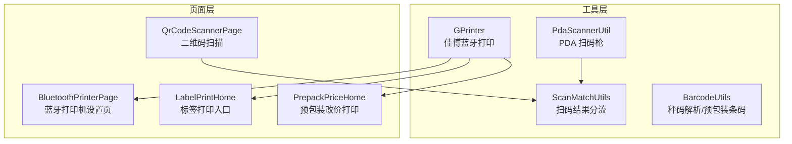
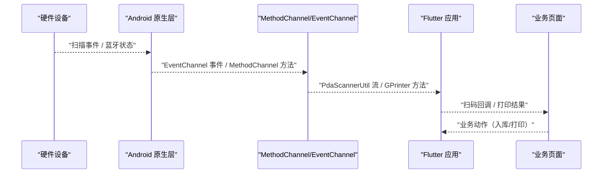
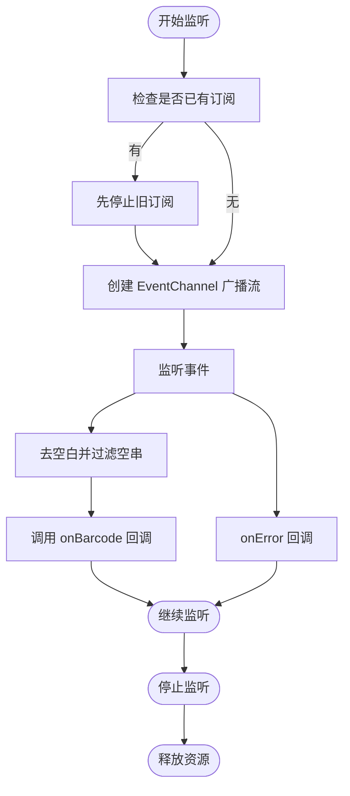
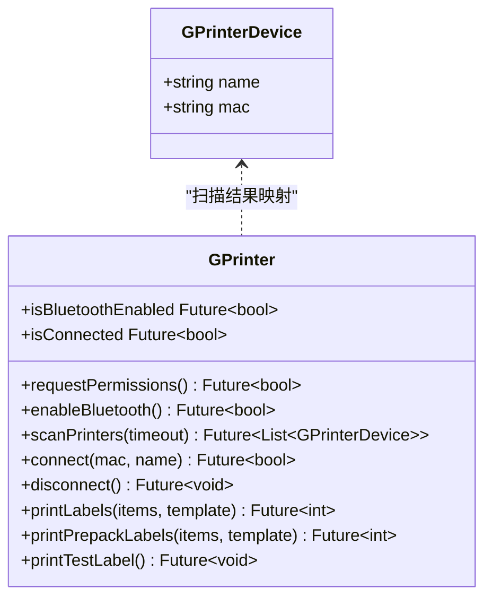
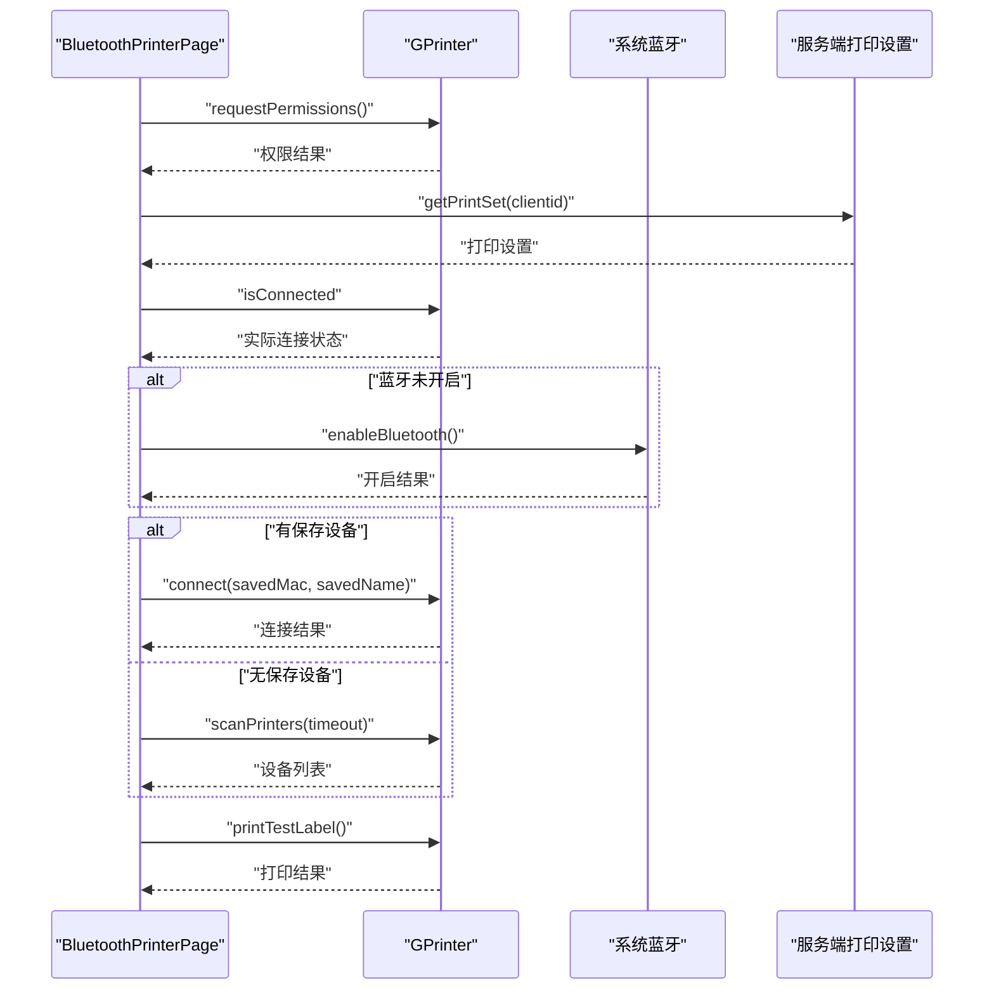
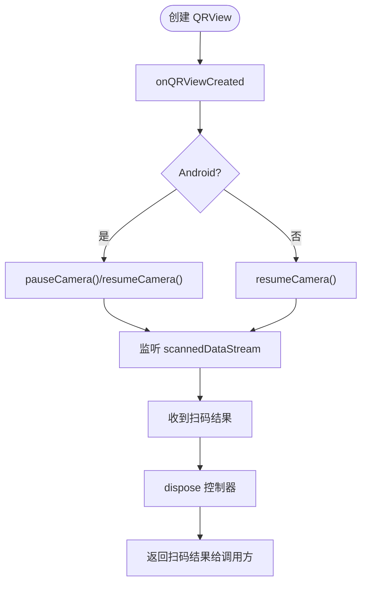
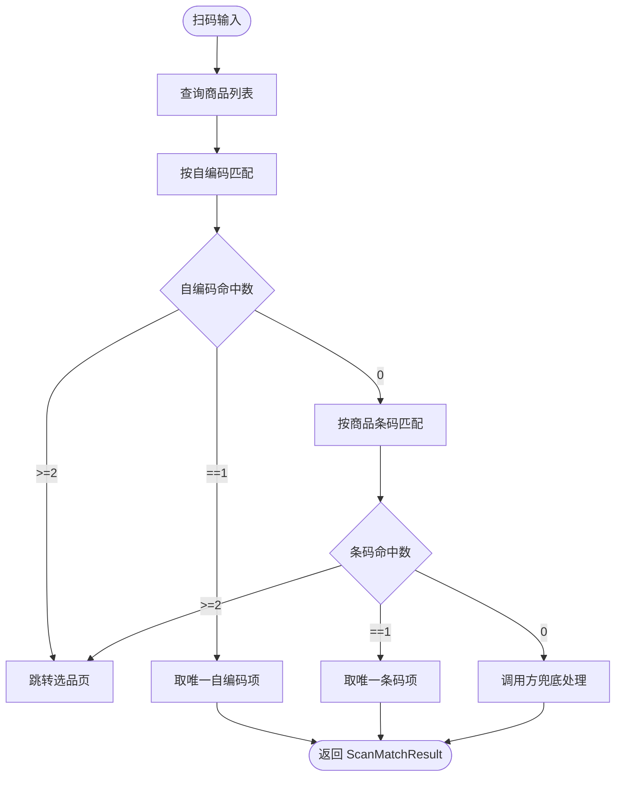

# 硬件集成

<cite>
**本文引用的文件**   
- [lib/util/pda_scanner_util.dart](file://lib/util/pda_scanner_util.dart)
- [lib/util/gprinter.dart](file://lib/util/gprinter.dart)
- [lib/widgets/qr_code_scanner_page.dart](file://lib/widgets/qr_code_scanner_page.dart)
- [lib/pages/user/bluetooth_printer_page.dart](file://lib/pages/user/bluetooth_printer_page.dart)
- [lib/util/scan_match_utils.dart](file://lib/util/scan_match_utils.dart)
- [lib/util/barcode_utils.dart](file://lib/util/barcode_utils.dart)
- [lib/pages/business/basis/printing/label_print_home.dart](file://lib/pages/business/basis/printing/label_print_home.dart)
- [lib/pages/business/basis/prepackPrice/prepack_price_home.dart](file://lib/pages/business/basis/prepackPrice/prepack_price_home.dart)
</cite>

## 目录
1. [引言](#引言)
2. [项目结构定位](#项目结构定位)
3. [核心组件总览](#核心组件总览)
4. [系统架构与数据流](#系统架构与数据流)
5. [PDA 扫码枪集成](#pda-扫码枪集成)
6. [蓝牙打印机连接与打印](#蓝牙打印机连接与打印)
7. [二维码扫描功能](#二维码扫描功能)
8. [扫码结果处理与业务分流](#扫码结果处理与业务分流)
9. [设备兼容性说明](#设备兼容性说明)
10. [权限、状态管理与异常处理](#权限状态管理与异常处理)
11. [性能优化建议](#性能优化建议)
12. [实际业务场景示例](#实际业务场景示例)
13. [故障排查指南](#故障排查指南)
14. [结论](#结论)

## 引言
本文件面向灵犀管店 Flutter 项目的硬件集成功能，聚焦三类能力：
- PDA 扫码枪集成：通过 EventChannel 监听 Android PDA 硬件扫描事件。
- 蓝牙打印机连接与打印：基于佳博打印机 SDK 的 MethodChannel 封装，提供蓝牙开关、配对、连接、标签打印和测试打印。
- 二维码扫描：基于 qr_code_scanner 插件实现摄像头扫码，用于收银授权码等场景。

文档同时覆盖设备权限管理、蓝牙扫描流程、打印模板配置、扫码结果处理、兼容性与性能优化，并给出商品扫码入库、标签打印、订单打印等实际使用思路。

## 项目结构定位
硬件相关代码主要分布在以下位置：
- 工具层：`lib/util/pda_scanner_util.dart`、`lib/util/gprinter.dart`、`lib/util/scan_match_utils.dart`、`lib/util/barcode_utils.dart`。
- 页面层：`lib/widgets/qr_code_scanner_page.dart`、`lib/pages/user/bluetooth_printer_page.dart`。
- 业务打印入口：`lib/pages/business/basis/printing/label_print_home.dart`、`lib/pages/business/basis/prepackPrice/prepack_price_home.dart`。

**图示来源**
- [lib/util/pda_scanner_util.dart:1-66](file://lib/util/pda_scanner_util.dart#L1-L66)
- [lib/util/gprinter.dart:1-130](file://lib/util/gprinter.dart#L1-L130)
- [lib/widgets/qr_code_scanner_page.dart:1-107](file://lib/widgets/qr_code_scanner_page.dart#L1-L107)
- [lib/pages/user/bluetooth_printer_page.dart:1-200](file://lib/pages/user/bluetooth_printer_page.dart#L1-L200)

**章节来源**
- [lib/util/pda_scanner_util.dart:1-66](file://lib/util/pda_scanner_util.dart#L1-L66)
- [lib/util/gprinter.dart:1-130](file://lib/util/gprinter.dart#L1-L130)
- [lib/widgets/qr_code_scanner_page.dart:1-107](file://lib/widgets/qr_code_scanner_page.dart#L1-L107)
- [lib/pages/user/bluetooth_printer_page.dart:1-200](file://lib/pages/user/bluetooth_printer_page.dart#L1-L200)

## 核心组件总览
- `PdaScannerUtil`：封装 EventChannel 扫描事件流，支持启动、停止、资源释放，以及平台支持判断。
- `GPrinter`：封装佳博蓝牙打印 MethodChannel，包括权限请求、蓝牙开关、扫描、连接、断开、连接状态查询、标签打印、预包装标签打印和测试打印。
- `GPrinterDevice`：表示蓝牙打印机设备名称和 MAC。
- `QrCodeScannerPage`：基于 qr_code_scanner 的扫码页面，返回扫码结果。
- `ScanMatchResult` 与 `matchScanList`：根据自编码或商品条码命中数量决定是否需要跳转选品页。
- `barcode_utils.dart`：秤码解析、预包装条码生成，支撑称重类商品扫码与包装条码生成。

**章节来源**
- [lib/util/pda_scanner_util.dart:1-66](file://lib/util/pda_scanner_util.dart#L1-L66)
- [lib/util/gprinter.dart:1-130](file://lib/util/gprinter.dart#L1-L130)
- [lib/widgets/qr_code_scanner_page.dart:1-107](file://lib/widgets/qr_code_scanner_page.dart#L1-L107)
- [lib/util/scan_match_utils.dart:1-38](file://lib/util/scan_match_utils.dart#L1-L38)
- [lib/util/barcode_utils.dart:1-200](file://lib/util/barcode_utils.dart#L1-L200)

## 系统架构与数据流
硬件集成的整体调用链如下：
- PDA 扫码枪：Android 原生广播 → EventChannel → Flutter `PdaScannerUtil` → 业务页面（如入库、库存盘点）。
- 蓝牙打印机：Flutter `GPrinter` → MethodChannel → Android 佳博 SDK → 打印机。
- 二维码扫描：摄像头 → qr_code_scanner → `QrCodeScannerPage` → 返回扫码结果给调用方。
- 扫码结果处理：统一由 `scan_match_utils.dart` 判定是否唯一命中，再决定直接填充还是跳转选品。

**图示来源**
- [lib/util/pda_scanner_util.dart:1-66](file://lib/util/pda_scanner_util.dart#L1-L66)
- [lib/util/gprinter.dart:1-130](file://lib/util/gprinter.dart#L1-L130)

## PDA 扫码枪集成
### 设计目标
为商米、优博音、新大陆等 Android PDA 设备提供统一的扫码事件接收方式，避免业务页面直接耦合底层广播。

### 关键实现要点
- 使用 `EventChannel('com.weilu.deer/pda_scanner')` 建立扫描事件通道。
- `startListening` 启动监听，将原始事件转换为去空白后的字符串回调。
- `stopListening` 取消订阅，防止内存泄漏。
- `isSupported` 限定仅在非 Web 且 Android 平台生效。

**图示来源**
- [lib/util/pda_scanner_util.dart:1-66](file://lib/util/pda_scanner_util.dart#L1-L66)

### 使用建议
- 在需要扫码的页面初始化时调用 `startListening`，在页面销毁或不再需要时调用 `stopListening`。
- 若同一页面多次启动监听，应先停止旧监听，避免重复回调。
- 建议在业务层对扫码结果做去重和校验，例如结合商品库查询后再更新表单。

**章节来源**
- [lib/util/pda_scanner_util.dart:1-66](file://lib/util/pda_scanner_util.dart#L1-L66)

## 蓝牙打印机连接与打印
### 设计目标
封装佳博蓝牙打印机 SDK，提供一致的 Flutter API，涵盖权限、蓝牙开关、设备扫描、连接、断开、连接状态、标签打印、预包装标签打印和测试打印。

### 核心类型与方法
- `GPrinterDevice`：包含 `name` 和 `mac`。
- `GPrinter`：
  - `requestPermissions()`：请求蓝牙相关运行时权限。
  - `isBluetoothEnabled`：查询系统蓝牙是否开启。
  - `enableBluetooth()`：尝试开启系统蓝牙。
  - `scanPrinters(timeout)`：扫描附近蓝牙打印机。
  - `connect(mac, name)`：连接指定打印机，名称用于品牌识别（佳博 TSPL、汉印 CPCL）。
  - `disconnect()`：断开当前连接。
  - `isConnected`：查询 SDK 实际连接状态。
  - `printLabels(items, template)`：打印商品标签。
  - `printPrepackLabels(items, template)`：打印预包装改价标签。
  - `printTestLabel()`：打印测试标签。

**图示来源**
- [lib/util/gprinter.dart:1-130](file://lib/util/gprinter.dart#L1-L130)

### 蓝牙打印机设置页交互
`BluetoothPrinterPage` 对齐小程序蓝牙打印逻辑，负责：
- 初始化时请求权限、加载服务端打印设置、查询 SDK 实际连接状态。
- 蓝牙未开启时引导用户开启。
- 已保存设备自动重连，否则扫描附近设备。
- 扫描失败时区分 `BT_DISABLED` 错误并引导开启蓝牙。
- 连接成功后保存设备信息，断开后保留地址以便下次自动重连。
- 提供测试打印按钮验证连接。

**图示来源**
- [lib/pages/user/bluetooth_printer_page.dart:1-200](file://lib/pages/user/bluetooth_printer_page.dart#L1-L200)
- [lib/pages/user/bluetooth_printer_page.dart:201-722](file://lib/pages/user/bluetooth_printer_page.dart#L201-L722)
- [lib/util/gprinter.dart:1-130](file://lib/util/gprinter.dart#L1-L130)

### 打印模板配置
- `printLabels` 和 `printPrepackLabels` 均支持 `template` 参数：
  - 1：60×40mm
  - 2：50×30mm
  - 3：40×30mm
  - 4：45×20mm
- 标签明细字段要求：
  - 普通标签：`name`、`size`、`mprice1`、`sellprice`、`qty`、`barcode`、`copies`。
  - 预包装标签：`name`、`size`、`barcode`、`sellprice`、`packQty`、`packAmount`、`packDiscount`、`packBarcode`、`copies`。

**章节来源**
- [lib/util/gprinter.dart:1-130](file://lib/util/gprinter.dart#L1-L130)
- [lib/pages/user/bluetooth_printer_page.dart:1-200](file://lib/pages/user/bluetooth_printer_page.dart#L1-L200)
- [lib/pages/user/bluetooth_printer_page.dart:201-722](file://lib/pages/user/bluetooth_printer_page.dart#L201-L722)

## 二维码扫描功能
### 设计目标
提供可复用二维码扫描页面，返回扫码结果供业务使用，适用于收银授权码、动态码等场景。

### 关键行为
- 使用 `QRView` 展示摄像头画面，并提供扫码区域遮罩。
- Android 平台在热重载时暂停并恢复相机；iOS 平台仅恢复相机。
- 扫描到结果后销毁控制器，避免重复回调。
- 通过导航返回扫码结果字符串。

**图示来源**
- [lib/widgets/qr_code_scanner_page.dart:1-107](file://lib/widgets/qr_code_scanner_page.dart#L1-L107)

### 使用建议
- 在扫码页面返回前销毁控制器，避免后台持续占用摄像头。
- 若业务需要连续扫码，应在返回结果后重新进入扫码页面或重建控制器。
- 注意在 Android 热重载场景下正确恢复相机。

**章节来源**
- [lib/widgets/qr_code_scanner_page.dart:1-107](file://lib/widgets/qr_code_scanner_page.dart#L1-L107)

## 扫码结果处理与业务分流
### 分流规则
`ScanMatchResult` 与 `matchScanList` 对齐 lxAss 的 `scanFn`：
- 自编码命中：
  - 唯一命中：不跳转，优先匹配自编码商品。
  - 多条命中：跳转选品页。
- 无自编码命中：
  - 商品条码多条：跳转选品页。
  - 商品条码唯一：优先匹配该商品。

**图示来源**
- [lib/util/scan_match_utils.dart:1-38](file://lib/util/scan_match_utils.dart#L1-L38)

### 秤码与预包装条码
`barcode_utils.dart` 还提供秤码解析与预包装条码生成能力：
- 秤码解析：支持 13 位重量码、金额码，以及多种 18 位组合格式，返回 `ScaleBarcodeResult`。
- 预包装条码生成：根据后端配置的小数精度和标识位生成标准称重条码，用于预包装改价打印。

**章节来源**
- [lib/util/scan_match_utils.dart:1-38](file://lib/util/scan_match_utils.dart#L1-L38)
- [lib/util/barcode_utils.dart:1-200](file://lib/util/barcode_utils.dart#L1-L200)
- [lib/util/barcode_utils.dart:201-311](file://lib/util/barcode_utils.dart#L201-L311)

## 设备兼容性说明
### PDA 扫码枪
- 当前实现限定为 Android 平台，Web 平台不支持。
- 不同 PDA 厂商（商米、优博音、新大陆等）依赖原生层广播，Flutter 侧仅消费 EventChannel。
- 若原生未接入对应广播，Flutter 侧会触发 `onError` 回调。

### 蓝牙打印机
- 蓝牙权限与系统蓝牙开关由 Android 原生控制，Flutter 侧通过 MethodChannel 调用。
- Android 13 及以上版本，开启蓝牙需跳转系统设置页，返回值需在用户手动开启后再次判断。
- 打印机品牌识别依据设备名称：佳博走 TSPL，汉印走 CPCL；名称未识别时会连接后自动探测，失败回退 TSPL。

### 二维码扫描
- 依赖摄像头权限与 qr_code_scanner 插件。
- Android 热重载时需要暂停并恢复相机；iOS 只需恢复相机。
- 扫码结果返回为字符串，后续由业务层进行校验和处理。

**章节来源**
- [lib/util/pda_scanner_util.dart:1-66](file://lib/util/pda_scanner_util.dart#L1-L66)
- [lib/util/gprinter.dart:1-130](file://lib/util/gprinter.dart#L1-L130)
- [lib/widgets/qr_code_scanner_page.dart:1-107](file://lib/widgets/qr_code_scanner_page.dart#L1-L107)

## 权限、状态管理与异常处理
### 权限管理
- 蓝牙打印：`GPrinter.requestPermissions()` 统一处理权限请求；权限拒绝时提示用户在系统设置中开启。
- 扫码枪：Flutter 侧不直接申请硬件扫描权限，但可在业务层提示用户确保设备已启用扫描功能。
- 二维码扫描：依赖系统相机权限，权限不足时应引导用户开启。

### 蓝牙连接状态管理
- `BluetoothPrinterPage` 维护 `_enabled`、`_connected`、`_scanning`、`_connectingMac`、`_printing` 等状态。
- 已保存设备自动重连；连接失败时保持 UI 为“未连接”并允许重试。
- 扫描失败时区分 `PlatformException` 的 `BT_DISABLED`，引导开启系统蓝牙后重新扫描。

### 异常处理
- PDA 扫码监听错误：打印调试日志并调用可选 `onError` 回调。
- 蓝牙扫描/连接/打印异常：捕获 `PlatformException` 并显示友好提示。
- 网络获取打印设置失败：静默降级，UI 仍可使用本地默认值。

**章节来源**
- [lib/pages/user/bluetooth_printer_page.dart:1-200](file://lib/pages/user/bluetooth_printer_page.dart#L1-L200)
- [lib/pages/user/bluetooth_printer_page.dart:201-722](file://lib/pages/user/bluetooth_printer_page.dart#L201-L722)
- [lib/util/pda_scanner_util.dart:1-66](file://lib/util/pda_scanner_util.dart#L1-L66)

## 性能优化建议
- PDA 扫码：
  - 避免在同一页面重复启动多个监听器，使用 `stopListening` 及时释放。
  - 在业务层对扫码结果做快速去重，减少重复入库或重复查询。
- 蓝牙打印：
  - 扫描超时时间可按场景调整，默认 10 秒，设置页中使用 8 秒。
  - 连接过程中使用 `_connectingMac` 防重复点击。
  - 打印过程显示 loading，避免重复提交。
- 二维码扫描：
  - 扫码成功后立即 dispose 控制器，释放摄像头资源。
  - 热重载时正确处理相机生命周期，避免黑屏或崩溃。
- 通用：
  - 对频繁 UI 更新使用防抖或节流，例如扫码结果合并、蓝牙状态轮询。
  - 避免在主线程执行耗时任务，必要时使用 Isolate 或异步处理。

[本节为通用指导，不直接分析具体文件]

## 实际业务场景示例
### 商品扫码入库
- 数据来源：PDA 扫码枪或二维码扫描页面。
- 处理流程：
  1. 获取扫码字符串。
  2. 调用商品查询接口得到候选列表。
  3. 使用 `matchScanList` 判断是否唯一命中。
  4. 唯一命中则自动填充商品信息；多条命中则跳转选品页。
  5. 确认入库数量、单价、仓库等信息后提交。

**章节来源**
- [lib/util/scan_match_utils.dart:1-38](file://lib/util/scan_match_utils.dart#L1-L38)
- [lib/util/pda_scanner_util.dart:1-66](file://lib/util/pda_scanner_util.dart#L1-L66)
- [lib/widgets/qr_code_scanner_page.dart:1-107](file://lib/widgets/qr_code_scanner_page.dart#L1-L107)

### 标签打印
- 数据来源：购物车、拣货单或商品详情页。
- 处理流程：
  1. 构建标签明细列表，包含名称、规格、价格、数量、条码、份数。
  2. 选择打印模板（60×40mm、50×30mm、40×30mm、45×20mm）。
  3. 调用 `GPrinter.printLabels`。
  4. 打印成功后更新 UI，失败时提示并重试。

**章节来源**
- [lib/util/gprinter.dart:1-130](file://lib/util/gprinter.dart#L1-L130)
- [lib/pages/business/basis/printing/label_print_home.dart](file://lib/pages/business/basis/printing/label_print_home.dart)

### 订单打印
- 数据来源：销售订单、出库单或配送单。
- 处理流程：
  1. 组装订单明细，转换为标签打印所需数据结构。
  2. 根据订单类型选择模板。
  3. 调用 `GPrinter.printLabels` 或 `GPrinter.printPrepackLabels`。
  4. 记录打印次数与失败原因，便于售后追踪。

**章节来源**
- [lib/util/gprinter.dart:1-130](file://lib/util/gprinter.dart#L1-L130)
- [lib/pages/business/basis/prepackPrice/prepack_price_home.dart](file://lib/pages/business/basis/prepackPrice/prepack_price_home.dart)

### 收银授权码
- 数据来源：后端动态生成的授权码。
- 处理流程：
  1. 拉取授权码并显示条码与二维码。
  2. 倒计时刷新，5 秒冷却限制手动刷新。
  3. 扫码终端扫描授权码完成收银授权。

**章节来源**
- [lib/pages/user/dynamics_code_page.dart:1-375](file://lib/pages/user/dynamics_code_page.dart#L1-L375)

## 故障排查指南
### PDA 扫码无响应
- 检查是否在 Android 平台。
- 检查是否调用 `startListening`，是否存在重复监听。
- 检查原生层是否已接入对应 EventChannel。
- 查看 `onError` 回调日志。

### 蓝牙无法扫描或连接
- 确认蓝牙权限已授予。
- 确认系统蓝牙已开启，必要时引导用户开启。
- 检查设备名称是否正确，品牌识别是否匹配。
- 查看 `PlatformException` 的错误码，特别是 `BT_DISABLED`。

### 打印失败
- 确认已连接打印机。
- 确认模板编号有效。
- 检查标签明细字段是否完整。
- 使用测试打印验证连接是否正常。

### 二维码扫描无结果
- 确认相机权限已开启。
- 检查扫码区域是否对准二维码。
- 确认扫码成功后控制器已 dispose。
- 在 Android 热重载后确认相机已恢复。

**章节来源**
- [lib/util/pda_scanner_util.dart:1-66](file://lib/util/pda_scanner_util.dart#L1-L66)
- [lib/pages/user/bluetooth_printer_page.dart:1-200](file://lib/pages/user/bluetooth_printer_page.dart#L1-L200)
- [lib/pages/user/bluetooth_printer_page.dart:201-722](file://lib/pages/user/bluetooth_printer_page.dart#L201-L722)
- [lib/widgets/qr_code_scanner_page.dart:1-107](file://lib/widgets/qr_code_scanner_page.dart#L1-L107)

## 结论
灵犀管店 Flutter 项目的硬件集成围绕 PDA 扫码枪、蓝牙打印机和二维码扫描三大能力展开。通过工具层抽象与页面层交互配合，实现了从硬件事件到业务数据的稳定流转。在实际使用中，应重视权限管理、连接状态、异常处理和性能优化，并结合商品扫码入库、标签打印、订单打印等典型场景形成标准化流程。