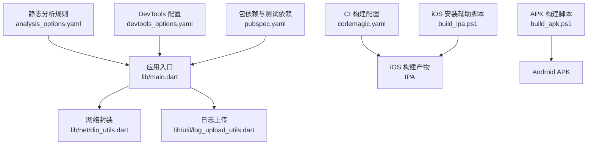
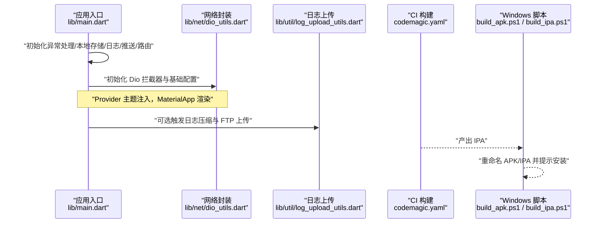
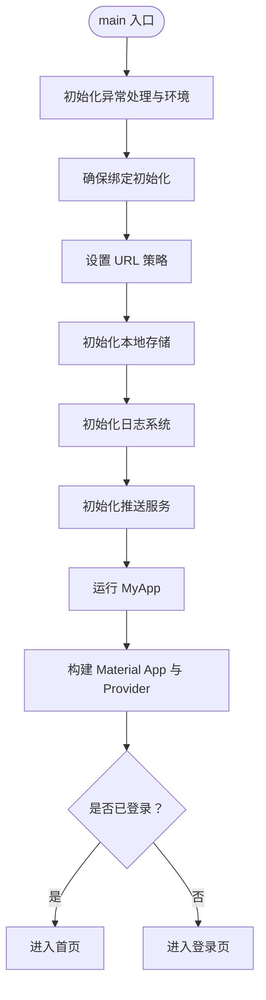
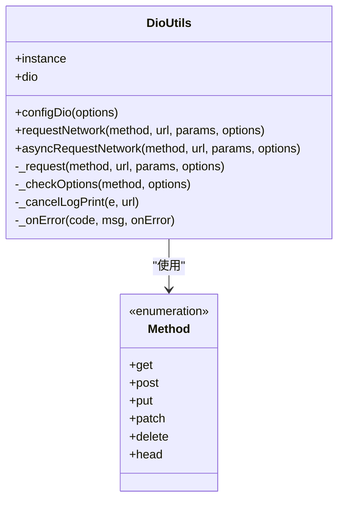
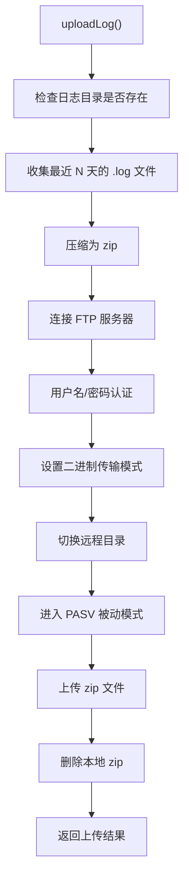
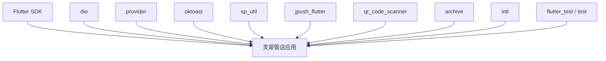

# 测试与质量

<cite>
**本文引用的文件**
- [pubspec.yaml](file://pubspec.yaml)
- [analysis_options.yaml](file://analysis_options.yaml)
- [devtools_options.yaml](file://devtools_options.yaml)
- [codemagic.yaml](file://codemagic.yaml)
- [build_apk.ps1](file://build_apk.ps1)
- [build_ipa.ps1](file://build_ipa.ps1)
- [lib/main.dart](file://lib/main.dart)
- [lib/net/dio_utils.dart](file://lib/net/dio_utils.dart)
- [lib/util/log_upload_utils.dart](file://lib/util/log_upload_utils.dart)
</cite>

## 目录
1. [引言](#引言)
2. [项目结构](#项目结构)
3. [核心组件](#核心组件)
4. [架构总览](#架构总览)
5. [详细组件分析](#详细组件分析)
6. [依赖关系分析](#依赖关系分析)
7. [性能考虑](#性能考虑)
8. [故障排查指南](#故障排查指南)
9. [结论](#结论)
10. [附录](#附录)

## 引言
本文件为灵犀管店 Flutter 项目的测试与质量保证文档，覆盖以下内容：
- 集成测试编写方法、用例设计与执行流程
- 静态分析与代码规范配置（analysis_options）
- 单元测试策略、Mock 数据构造与断言方法
- DevTools 调试工具使用、性能分析与内存泄漏检测
- 代码质量门禁、持续集成检查与发布前验证流程

该项目基于 Flutter，采用 Provider 进行状态管理，Dio 作为网络层，极光推送用于消息通道，并使用 Codemagic 完成 iOS 无签名构建与 IPA 输出。当前仓库根目录未包含业务单元测试或集成测试文件，但已具备完善的静态分析、构建脚本和 DevTools 配置文件，适合在此基础上建立完整的测试与质量保障体系。

## 项目结构
从质量与测试视角看，项目关键文件分布如下：
- 应用入口与初始化逻辑位于 lib/main.dart，负责异常处理、本地存储、日志系统、推送服务与路由初始化
- 网络请求封装在 lib/net/dio_utils.dart，统一超时、拦截器、响应解析、错误处理与隔离计算
- 日志压缩上传逻辑位于 lib/util/log_upload_utils.dart，用于收集日志、压缩并 FTP 上传
- 静态分析规则在 analysis_options.yaml，DevTools 扩展开关在 devtools_options.yaml
- 包依赖与开发依赖在 pubspec.yaml，其中仅声明 flutter_test 与 test，未引入 mockito 等 Mock 框架
- CI 构建配置在 codemagic.yaml，生成 iOS 测试包；Windows 提供 build_apk.ps1 与 build_ipa.ps1 辅助打包与安装

**图示来源**
- [lib/main.dart:1-204](file://lib/main.dart#L1-L204)
- [lib/net/dio_utils.dart:1-204](file://lib/net/dio_utils.dart#L1-L204)
- [lib/util/log_upload_utils.dart:1-317](file://lib/util/log_upload_utils.dart#L1-L317)
- [analysis_options.yaml:1-252](file://analysis_options.yaml#L1-L252)
- [devtools_options.yaml:1-3](file://devtools_options.yaml#L1-L3)
- [pubspec.yaml:1-153](file://pubspec.yaml#L1-L153)
- [codemagic.yaml:1-47](file://codemagic.yaml#L1-L47)
- [build_apk.ps1:1-63](file://build_apk.ps1#L1-L63)
- [build_ipa.ps1:1-68](file://build_ipa.ps1#L1-L68)

**章节来源**
- [lib/main.dart:1-204](file://lib/main.dart#L1-L204)
- [pubspec.yaml:1-153](file://pubspec.yaml#L1-L153)

## 核心组件
面向测试与质量的关键实现如下：
- 应用启动与全局初始化：main 函数中统一处理异常、URL 策略、持久化、日志、推送与服务初始化，随后注入 Provider 主题并提供 Material App
- 网络请求封装：DioUtils 提供统一请求方法，处理超时、拦截器链、响应体 JSON 解析与错误码映射；对大响应使用 compute 隔离计算，同时在集成测试环境关闭该优化
- 日志上传工具：LogUploadUtils 收集最近若干天的 .log 文件，压缩成 zip 并通过 FTP 被动模式上传，完成后删除本地压缩包
- 静态分析：启用严格类型推断与大量 Lint 规则，排除自动生成与第三方图表组件
- DevTools：默认启用扩展，便于运行时调试与分析
- 构建与发布：Codemagic 构建 iOS 无签名 IPA；PowerShell 脚本自动命名 APK/IPA 并引导安装

**章节来源**
- [lib/main.dart:1-204](file://lib/main.dart#L1-L204)
- [lib/net/dio_utils.dart:1-204](file://lib/net/dio_utils.dart#L1-L204)
- [lib/util/log_upload_utils.dart:1-317](file://lib/util/log_upload_utils.dart#L1-L317)
- [analysis_options.yaml:1-252](file://analysis_options.yaml#L1-L252)
- [devtools_options.yaml:1-3](file://devtools_options.yaml#L1-L3)
- [codemagic.yaml:1-47](file://codemagic.yaml#L1-L47)
- [build_apk.ps1:1-63](file://build_apk.ps1#L1-L63)
- [build_ipa.ps1:1-68](file://build_ipa.ps1#L1-L68)

## 架构总览
下图展示应用启动到网络请求、日志上传以及构建产物的端到端流程：

**图示来源**
- [lib/main.dart:1-204](file://lib/main.dart#L1-L204)
- [lib/net/dio_utils.dart:1-204](file://lib/net/dio_utils.dart#L1-L204)
- [lib/util/log_upload_utils.dart:1-317](file://lib/util/log_upload_utils.dart#L1-L317)
- [codemagic.yaml:1-47](file://codemagic.yaml#L1-L47)
- [build_apk.ps1:1-63](file://build_apk.ps1#L1-L63)
- [build_ipa.ps1:1-68](file://build_ipa.ps1#L1-L68)

## 详细组件分析

### 应用入口与初始化流程
- main 函数先设置生产环境下 debugPrint 为空，再调用 handleError 包裹初始化流程
- 初始化顺序包括：WidgetsFlutterBinding.ensureInitialized、URL 策略、SpUtil、FileLogWriter、操作审计、Log、PushService，最后运行 MyApp
- MyApp 构造函数中初始化 Dio、Routes、VersionCheckUtils；build 中通过 MultiProvider 注入 ThemeProvider，并返回 OKToast 包裹的 MaterialApp
- 登录态判断逻辑读取 token 与 store 信息，决定首页是 HomePage 还是 LoginPage

**图示来源**
- [lib/main.dart:1-204](file://lib/main.dart#L1-L204)

**章节来源**
- [lib/main.dart:1-204](file://lib/main.dart#L1-L204)

### 网络请求封装与测试要点
DioUtils 提供以下能力：
- 统一 BaseOptions：连接/接收/发送超时、baseUrl、validateStatus 返回 true 交由拦截器处理
- 拦截器链：认证、Token 刷新、日志打印、适配器转换
- 请求方法：requestNetwork 与 asyncRequestNetwork，统一 onSuccess/onError 回调
- 响应解析：大响应走 compute 隔离解析，非集成测试且大于 10KB 时启用
- 错误处理：将 DioException 转换为内部 NetError，并记录日志

**图示来源**
- [lib/net/dio_utils.dart:1-204](file://lib/net/dio_utils.dart#L1-L204)

测试建议：
- 使用 flutter_test 与 fake_async 模拟异步网络行为
- 通过替换 Dio 实例或拦截器，构造成功、失败、超时、取消等场景
- 针对 compute 分支，在集成测试模式下确认不走 isolate，避免阻塞

**章节来源**
- [lib/net/dio_utils.dart:1-204](file://lib/net/dio_utils.dart#L1-L204)

### 日志压缩与上传流程
LogUploadUtils 的职责：
- 收集最近 N 天的 .log 文件（N 随月份变化）
- 使用 archive 库压缩为 zip
- 通过 Socket 实现 FTP 被动模式上传
- 成功后删除本地 zip，并将结果回传

**图示来源**
- [lib/util/log_upload_utils.dart:1-317](file://lib/util/log_upload_utils.dart#L1-L317)

测试建议：
- 对文件收集与压缩逻辑进行单元测试，验证保留天数与文件名格式
- 对 FTP 流程使用网络桩或最小 FTP 服务端进行集成测试
- 校验异常路径：目录不存在、压缩失败、认证失败、网络中断

**章节来源**
- [lib/util/log_upload_utils.dart:1-317](file://lib/util/log_upload_utils.dart#L1-L317)

### 静态分析与代码规范
analysis_options.yaml 启用了严格的语言特性与大量 Lint 规则，包括：
- strict-casts、strict-inference、strict-raw-types
- 忽略测试相关的 deprecated_member_use 警告
- 排除 lib/generated/json 与 bezier_chart 等第三方或生成代码
- formatter.page_width 设置为 100
- 启用大量风格与健壮性规则，如 avoid_print、prefer_const_constructors、await_only_futures、non_constant_identifier_names 等

建议：
- 在提交前运行 dart analyze 与 dart format --set-exit-code
- 将 analysis_options 纳入 CI 门禁，失败则阻断合并
- 新增模块遵循现有命名与风格约定

**章节来源**
- [analysis_options.yaml:1-252](file://analysis_options.yaml#L1-L252)

### DevTools 调试与性能分析
devtools_options.yaml 启用 DevTools 扩展，可用于：
- Widget 树检查、布局问题定位
- 性能帧分析、卡顿检测
- 内存快照、对象分配追踪、内存泄漏检测
- 网络请求监控、日志查看

结合 lib/main.dart 中的注释，可开启 showPerformanceOverlay、debugRepaintRainbowEnabled 等调试开关进行可视化诊断。

建议：
- 在开发机启用 DevTools 并与 Flutter Inspector 配合使用
- 对高频滚动页面使用 Repaint Rainbow 检查过度重绘
- 对大图与复杂图表做内存采样，关注堆增长趋势

**章节来源**
- [devtools_options.yaml:1-3](file://devtools_options.yaml#L1-L3)
- [lib/main.dart:1-204](file://lib/main.dart#L1-L204)

### 单元测试策略
当前 pubspec.yaml 仅声明 flutter_test 与 test，未引入 mockito 或 http_mock_adapter 等网络 Mock 工具。建议：
- 为纯函数与工具类编写单元测试，例如日期格式化、数学计算、输入格式化等
- 为 Provider 状态变更编写 widget 测试，断言 UI 状态更新
- 对网络层封装使用 Dart 的 Stream 与 Future 桩进行异步测试
- 对日志上传的文件 IO 逻辑使用内存文件或临时目录进行验证

由于项目未包含测试文件，可在 lib 同级新增 test 目录，按模块组织测试用例，并在 CI 中执行 flutter test。

**章节来源**
- [pubspec.yaml:1-153](file://pubspec.yaml#L1-L153)

### 集成测试策略
integration_test 目录存在但未包含用例。建议：
- 使用 flutter_driver 或 integration_test 框架编写端到端流程：登录、首页加载、列表刷新、扫码、打印等
- 针对网络失败、权限拒绝、设备差异等边界条件设计用例
- 对长耗时流程添加超时与重试机制，避免 CI 不稳定

由于当前没有集成测试实现，本文不给出具体用例路径，建议团队根据业务优先级逐步补充。

**章节来源**
- [integration_test/.](file://integration_test)

### 构建与发布前验证
- Codemagic 构建 iOS 无签名 IPA，并生成带版本号的制品
- Windows 脚本 build_apk.ps1 构建 Android APK，按 ABI 拆分并重命名
- build_ipa.ps1 查找并重命名最新 IPA，提供 Sideloadly 安装指引

建议在 CI 中增加以下步骤：
- flutter analyze 静态检查
- flutter test 单元测试
- flutter build apk --release 与 flutter build ios --release 构建产物
- 对产物进行签名校验、版本号一致性校验、文件大小与体积阈值检查

**章节来源**
- [codemagic.yaml:1-47](file://codemagic.yaml#L1-L47)
- [build_apk.ps1:1-63](file://build_apk.ps1#L1-L63)
- [build_ipa.ps1:1-68](file://build_ipa.ps1#L1-L68)

## 依赖关系分析
项目依赖以 Flutter SDK 为基础，业务依赖涵盖网络、状态管理、UI 组件、扫码、推送、图片缓存等。测试相关依赖仅包含 flutter_test 与 test。

**图示来源**
- [pubspec.yaml:1-153](file://pubspec.yaml#L1-L153)

**章节来源**
- [pubspec.yaml:1-153](file://pubspec.yaml#L1-L153)

## 性能考虑
- 网络响应解析对大数据使用 compute 隔离计算，避免主线程阻塞；集成测试下禁用该优化以避免阻塞
- 日志上传流程同步读取文件并压缩，应在后台任务中执行，避免影响主界面
- 应用启动流程集中初始化，注意各服务的启动耗时与失败降级
- 建议使用 DevTools 的 Performance 面板分析首屏渲染、滚动流畅度与频繁重建的 Widget

**章节来源**
- [lib/net/dio_utils.dart:1-204](file://lib/net/dio_utils.dart#L1-L204)
- [lib/util/log_upload_utils.dart:1-317](file://lib/util/log_upload_utils.dart#L1-L317)
- [lib/main.dart:1-204](file://lib/main.dart#L1-L204)

## 故障排查指南
常见问题与建议：
- 静态检查失败：检查 analysis_options 规则，使用 dart analyze 定位问题并按规则修复
- 网络请求异常：查看 DioUtils 的错误处理与拦截器日志，确认 baseUrl、拦截器链与响应解析
- 日志上传失败：检查 FTP 地址、端口、账号密码、目录权限与网络连通性；查看 LogUploadUtils 中的 FTP 响应码判断逻辑
- 启动崩溃：检查 main 中的初始化顺序与异常处理，确认本地存储、日志与推送服务可用
- 构建失败：核对 Codemagic 环境与变量，确认 iOS 无签名构建步骤；Windows 侧检查 PowerShell 脚本路径与版本解析

**章节来源**
- [lib/net/dio_utils.dart:1-204](file://lib/net/dio_utils.dart#L1-L204)
- [lib/util/log_upload_utils.dart:1-317](file://lib/util/log_upload_utils.dart#L1-L317)
- [lib/main.dart:1-204](file://lib/main.dart#L1-L204)
- [codemagic.yaml:1-47](file://codemagic.yaml#L1-L47)

## 结论
灵犀管店项目在静态分析、构建脚本与 DevTools 方面已有良好基础。当前缺少单元测试与集成测试实现，建议在现有架构基础上逐步补充：
- 为工具类与 Provider 编写单元测试
- 为网络层与日志上传编写桩与集成测试
- 将分析、测试与构建纳入 CI 门禁
- 使用 DevTools 进行性能与内存分析，持续优化用户体验

## 附录

### 持续集成与质量门禁建议
- 代码规范：flutter analyze 与 dart format
- 单元测试：flutter test
- 集成测试：flutter drive 或 integration_test
- 构建产物：flutter build apk 与 flutter build ios
- 产物校验：版本号、签名、大小、资源完整性
- 发布前验证：冒烟测试、关键业务流程自动化测试

**章节来源**
- [pubspec.yaml:1-153](file://pubspec.yaml#L1-L153)
- [codemagic.yaml:1-47](file://codemagic.yaml#L1-L47)
- [build_apk.ps1:1-63](file://build_apk.ps1#L1-L63)
- [build_ipa.ps1:1-68](file://build_ipa.ps1#L1-L68)