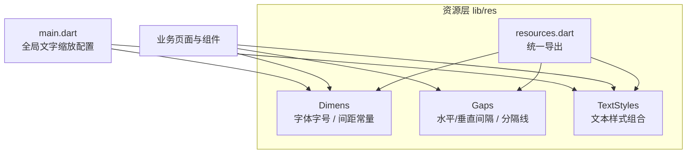
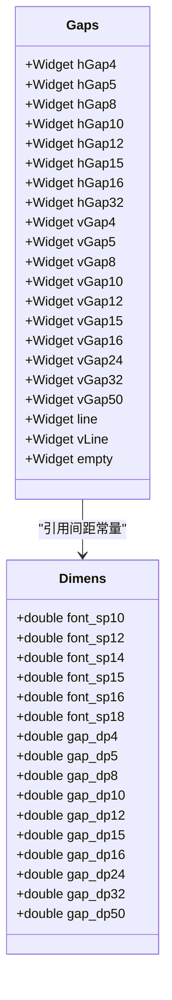
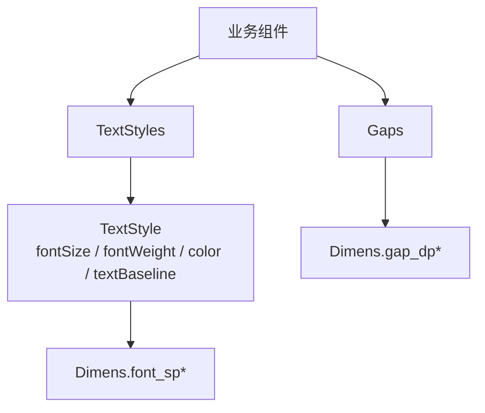
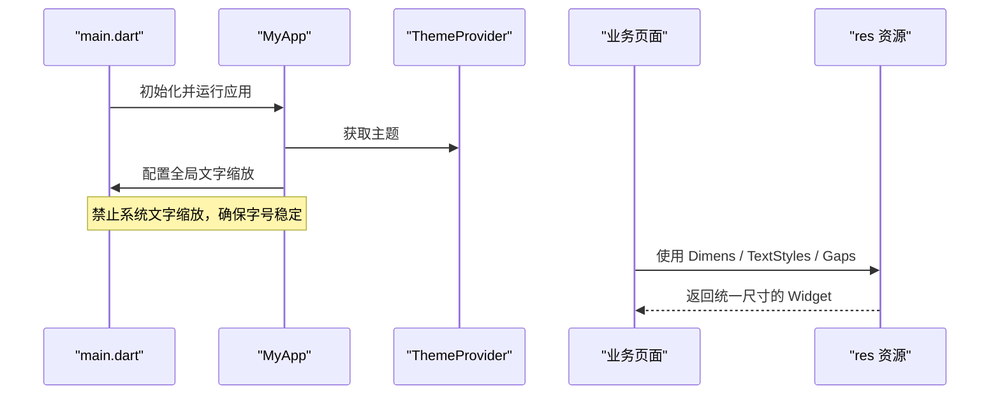
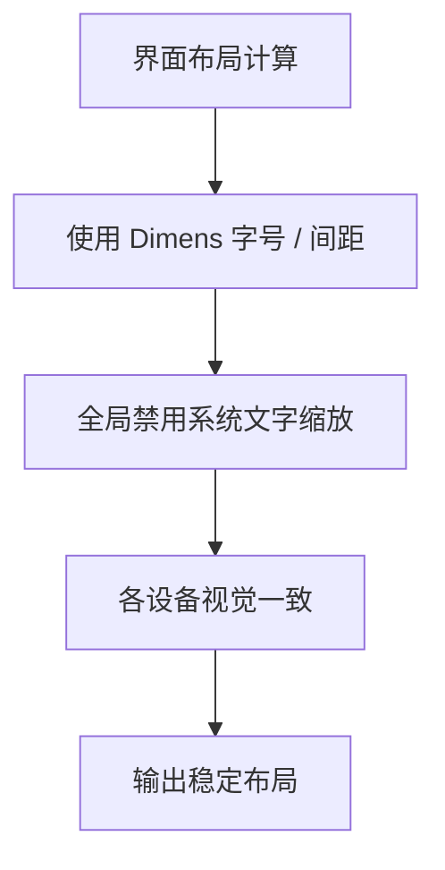

# UI 尺寸规范

<cite>
**本文引用的文件**   
- [dimens.dart](file://lib/res/dimens.dart)
- [gaps.dart](file://lib/res/gaps.dart)
- [styles.dart](file://lib/res/styles.dart)
- [resources.dart](file://lib/res/resources.dart)
- [main.dart](file://lib/main.dart)
</cite>

## 目录
1. [引言](#引言)
2. [项目结构与定位](#项目结构与定位)
3. [核心尺寸常量：Dimens](#核心尺寸常量dimens)
4. [间距工具类：Gaps](#间距工具类gaps)
5. [与样式系统的关系](#与样式系统的关系)
6. [架构总览](#架构总览)
7. [使用规范与实践建议](#使用规范与实践建议)
8. [跨屏幕一致性说明](#跨屏幕一致性说明)
9. [定制指南与设计系统扩展建议](#定制指南与设计系统扩展建议)
10. [常见问题排查](#常见问题排查)
11. [总结](#总结)

## 引言
本文面向灵犀管店 Flutter 项目的 UI 设计系统与前端开发，聚焦应用中的“字体大小”和“间距”两类基础视觉度量。文档以 `Dimens` 类为核心，解释 `font_sp10` 到 `font_sp18` 的字体字号、`gap_dp4` 到 `gap_dp50` 的间距规范，并给出 `Gaps` 工具类的统一使用方式。同时说明这些单位在 Material Design 中的对应关系、在不同屏幕下的视觉一致性策略，以及如何进行尺寸定制和设计系统扩展。

该文档不直接粘贴源码内容，而是通过文件路径和行号定位实现位置，便于读者在项目仓库中对照查看。

## 项目结构与定位
UI 尺寸相关代码集中在资源层 `lib/res/`：
- `Dimens` 定义统一的字体字号与间距数值。
- `Gaps` 提供水平、垂直间隔及分隔线等可复用 Widget。
- `TextStyles`（位于样式文件中）将字号与文本样式组合，形成可复用的文本主题。
- `resources.dart` 统一导出资源模块，方便其他模块集中引入。
- `main.dart` 在全局设置文字缩放行为，确保字号遵循设计预期。

**图表来源**
- [dimens.dart:1-19](file://lib/res/dimens.dart#L1-L19)
- [gaps.dart:1-48](file://lib/res/gaps.dart#L1-L48)
- [styles.dart:1-76](file://lib/res/styles.dart#L1-L76)
- [resources.dart:1-12](file://lib/res/resources.dart#L1-L12)
- [main.dart:1-200](file://lib/main.dart#L1-L200)

**章节来源**
- [dimens.dart:1-19](file://lib/res/dimens.dart#L1-L19)
- [gaps.dart:1-48](file://lib/res/gaps.dart#L1-L48)
- [styles.dart:1-76](file://lib/res/styles.dart#L1-L76)
- [resources.dart:1-12](file://lib/res/resources.dart#L1-L12)
- [main.dart:1-200](file://lib/main.dart#L1-L200)

## 核心尺寸常量：Dimens
`Dimens` 是应用的“单一事实来源”，负责统一管理以下两类尺寸：

- 字体字号（sp）
  - `font_sp10`
  - `font_sp12`
  - `font_sp14`
  - `font_sp15`
  - `font_sp16`
  - `font_sp18`

- 间距（dp）
  - `gap_dp4`
  - `gap_dp5`
  - `gap_dp8`
  - `gap_dp10`
  - `gap_dp12`
  - `gap_dp15`
  - `gap_dp16`
  - `gap_dp24`
  - `gap_dp32`
  - `gap_dp50`

### 设计原理
- 以 sp 作为字体字号单位，符合 Android 字体缩放语义；Flutter 中通常将其视为逻辑像素值。本项目通过全局禁用系统文字缩放，保证不同用户字号偏好不会破坏界面布局。
- 以 dp 作为间距单位，保证在不同密度屏幕上具有一致的物理尺寸感知。
- 字号与间距采用离散取值，避免随意设定导致视觉节奏混乱。

### 与 Material Design 的对应关系
Material Design 推荐的基础字号为 12、14、16、20、24、28、36 等。本项目的字号集合与其存在明确对应：
- 12 → `font_sp12`
- 14 → `font_sp14`
- 16 → `font_sp16`
- 18 → `font_sp18`（偏小标题或强调信息）
- 10 → `font_sp10`（辅助信息、标签）
- 15 → `font_sp15`（过渡字号，用于需要比 14 略大但不到 16 的场景）

间距方面，Material Design 常用 4、8、12、16、24、32 等。本项目与之高度一致，并补充了 `gap_dp5`、`gap_dp10`、`gap_dp15`、`gap_dp50` 等更细粒度的值，用于更精确的视觉节奏控制。

**章节来源**
- [dimens.dart:1-19](file://lib/res/dimens.dart#L1-L19)

## 间距工具类：Gaps
`Gaps` 是基于 `Dimens` 构建的可复用 Widget 集合，主要提供：
- 水平间隔：`hGap4`、`hGap5`、`hGap8`、`hGap10`、`hGap12`、`hGap15`、`hGap16`、`hGap32`
- 垂直间隔：`vGap4`、`vGap5`、`vGap8`、`vGap10`、`vGap12`、`vGap15`、`vGap16`、`vGap24`、`vGap32`、`vGap50`
- 分隔线：`line`（水平分隔线）、`vLine`（垂直分隔线）
- 空 Widget：`empty`

**图表来源**
- [dimens.dart:1-19](file://lib/res/dimens.dart#L1-L19)
- [gaps.dart:1-48](file://lib/res/gaps.dart#L1-L48)

### 使用方式
- 在横向排列的控件之间插入 `Gaps.hGapX`，保持列间间距一致。
- 在纵向堆叠的控件之间插入 `Gaps.vGapX`，保持段落、卡片、列表项之间的呼吸感。
- 使用 `Gaps.line` 作为内容区块的分隔线；使用 `Gaps.vLine` 作为左右分栏时的垂直分隔。
- 当不需要任何占位时，使用 `Gaps.empty`，避免硬编码空容器。

**章节来源**
- [gaps.dart:1-48](file://lib/res/gaps.dart#L1-L48)

## 与样式系统的关系
样式系统中存在 `TextStyles`，它将字号与颜色、字重、基线等属性组合成可直接使用的文本样式。其关键要点：
- 字号来自 `Dimens.font_sp*`，确保所有文本都基于同一套字号体系。
- 常用样式包括小号灰色文本、加粗标题、主文本样式等。
- 文本基线设置为 alphabetic，以保证中英文混排时的对齐体验。

**图表来源**
- [styles.dart:1-76](file://lib/res/styles.dart#L1-L76)
- [dimens.dart:1-19](file://lib/res/dimens.dart#L1-L19)

**章节来源**
- [styles.dart:1-76](file://lib/res/styles.dart#L1-L76)

## 架构总览
从应用启动到界面渲染，尺寸规范的使用链路如下：

**图表来源**
- [main.dart:1-200](file://lib/main.dart#L1-L200)
- [resources.dart:1-12](file://lib/res/resources.dart#L1-L12)

**章节来源**
- [main.dart:1-200](file://lib/main.dart#L1-L200)
- [resources.dart:1-12](file://lib/res/resources.dart#L1-L12)

## 使用规范与实践建议
为保证界面一致性和可维护性，建议遵循以下规则：

1. **禁止在业务代码中硬编码字号与间距**
   - 所有字号应使用 `Dimens.font_sp*`。
   - 所有间距应使用 `Dimens.gap_dp*` 或 `Gaps` 的预置间隔。

2. **优先使用 `TextStyles` 提供的文本样式**
   - 例如正文、标题、提示文案等，避免每个页面自行定义 `TextStyle`。
   - 若确有新增场景，应在 `TextStyles` 中补充命名样式，而不是散落各处。

3. **统一使用 `Gaps` 管理布局间距**
   - 在 Row、Column、ListView、Card、表单字段等常见场景中，优先使用 `Gaps.hGapX` 与 `Gaps.vGapX`。
   - 使用 `Gaps.line` 和 `Gaps.vLine` 表示内容分隔，不要手写分割线尺寸。

4. **保持一致的视觉节奏**
   - 小段内间距优先选择 `gap_dp4`、`gap_dp5`、`gap_dp8`。
   - 常规区块间距优先选择 `gap_dp10`、`gap_dp12`、`gap_dp16`。
   - 大区块或重要分组使用 `gap_dp24`、`gap_dp32`。
   - `gap_dp50` 用于明显的大块留白或顶部重点区域。

5. **文本层级建议**
   - 正文：`font_sp14`
   - 次级正文或提示：`font_sp12`
   - 小标题或强调信息：`font_sp16`、`font_sp18`
   - 极小辅助信息：`font_sp10`
   - 过渡字号：`font_sp15`

6. **导出组织**
   - 通过 `resources.dart` 统一导出 `colors`、`dimens`、`gaps`、`styles`，避免多处重复导入造成依赖不一致。

**章节来源**
- [dimens.dart:1-19](file://lib/res/dimens.dart#L1-L19)
- [gaps.dart:1-48](file://lib/res/gaps.dart#L1-L48)
- [styles.dart:1-76](file://lib/res/styles.dart#L1-L76)
- [resources.dart:1-12](file://lib/res/resources.dart#L1-L12)

## 跨屏幕一致性说明
本项目在全局层面禁用了系统文字缩放，使字号不再随系统无障碍设置变化：
- 这保证了在不同手机、平板和横竖屏下，字号始终按设计值渲染。
- 因此，`font_sp10` 到 `font_sp18` 在不同设备上具有稳定的相对大小关系。
- 间距 `gap_dp4` 到 `gap_dp50` 以 dp 为单位，可在不同像素密度下保持相近的物理尺寸。

**图表来源**
- [main.dart:1-200](file://lib/main.dart#L1-L200)
- [dimens.dart:1-19](file://lib/res/dimens.dart#L1-L19)

**章节来源**
- [main.dart:1-200](file://lib/main.dart#L1-L200)

## 定制指南与设计系统扩展建议
### 何时调整字号
- 品牌升级或产品风格变更时，优先在 `Dimens` 中统一调整字号。
- 如果某字号仅用于特定场景，建议在 `TextStyles` 中新增命名样式，而不是修改已有公共字号。

### 何时新增间距
- 当现有 `gap_dp*` 无法表达新的视觉节奏时，才新增间距常量。
- 新增间距应保持与 Material Design 接近的步进节奏，避免产生过多近似值。

### 如何扩展文本样式
- 在 `TextStyles` 中按用途分类新增 TextStyle，例如“标题”“正文”“备注”“按钮文案”等。
- 所有新样式都应引用 `Dimens.font_sp*`，避免再次引入自由字号。

### 如何扩展 Gaps
- 若确实需要新的水平或垂直间隔，先在 `Dimens` 中补充 `gap_dp*`，再在 `Gaps` 中暴露对应的 `hGapX` 或 `vGapX`。
- 对于复杂分隔线或装饰线，可在 `Gaps` 中增加命名 Widget，如 `sectionDivider`、`cardSeparator` 等。

### 与主题系统结合
- 若未来支持动态主题或深色模式下的字号差异，可将字号映射到主题数据中，由 `TextStyles` 读取主题字号。
- 当前实现以静态常量为主，适合中小型应用快速迭代；若规模扩大，可逐步迁移到主题驱动的字号体系。

**章节来源**
- [dimens.dart:1-19](file://lib/res/dimens.dart#L1-L19)
- [gaps.dart:1-48](file://lib/res/gaps.dart#L1-L48)
- [styles.dart:1-76](file://lib/res/styles.dart#L1-L76)
- [resources.dart:1-12](file://lib/res/resources.dart#L1-L12)

## 常见问题排查
1. **为什么字号没有跟随系统字体大小变化？**
   - 因为应用全局设置了文字缩放比例为固定值，目的是保证界面布局稳定。这是设计决策，不是异常。

2. **为什么某些地方间距看起来过大或过小？**
   - 检查是否使用了 `Gaps` 而非自定义 padding。
   - 确认使用的是正确的维度：横向用 `hGapX`，纵向用 `vGapX`。
   - 核对是否误用了 `gap_dp*` 的数值类型，应统一通过 `Dimens` 或 `Gaps` 引用。

3. **新增字号后旧页面没有变化？**
   - 如果是替换已有 `Dimens.font_sp*` 的值，则所有引用处都会生效。
   - 如果是新增字号但未在 `TextStyles` 中使用，则需要在样式层暴露并使用。

4. **如何判断某个间距是否合理？**
   - 参考 Material Design 的 4dp 基准网格，尽量使用 4 的倍数或经过验证的中间值。
   - 优先复用现有 `gap_dp*`，避免引入难以维护的“魔法数字”。

**章节来源**
- [main.dart:1-200](file://lib/main.dart#L1-L200)
- [dimens.dart:1-19](file://lib/res/dimens.dart#L1-L19)
- [gaps.dart:1-48](file://lib/res/gaps.dart#L1-L48)

## 总结
灵犀管店 Flutter 项目的 UI 尺寸规范围绕 `Dimens` 和 `Gaps` 两个核心展开：
- `Dimens` 提供统一的字体字号和间距常量，是设计系统的“度量标准”。
- `Gaps` 将这些常量封装为可直接使用的 Widget，降低布局复杂度。
- `TextStyles` 将字号与文本样式结合，形成可复用的文本主题。
- `main.dart` 在全局禁用系统文字缩放，确保跨设备视觉一致性。

遵循本文规范，可以在不同屏幕尺寸和不同业务页面中保持一致的视觉节奏，提高界面的可维护性与可扩展性。