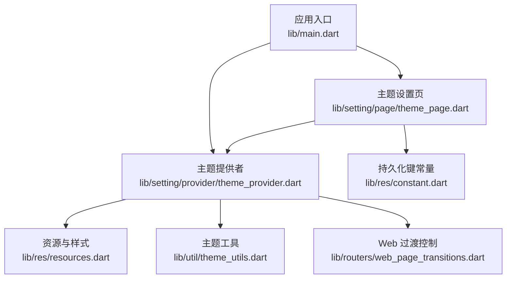
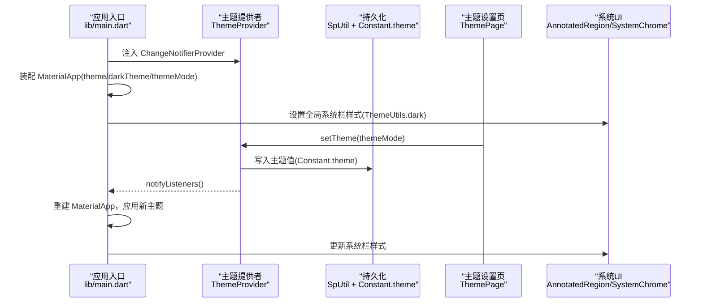
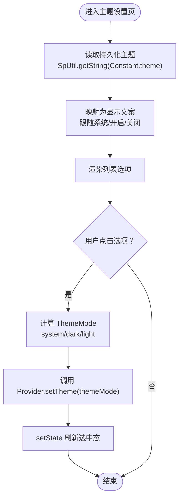
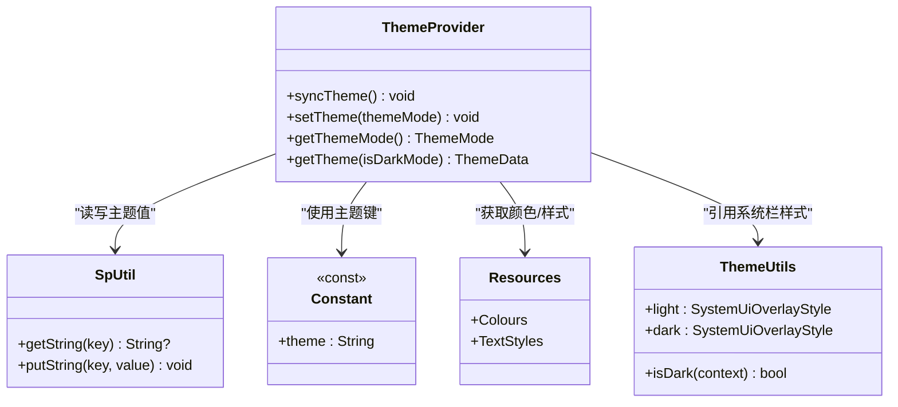
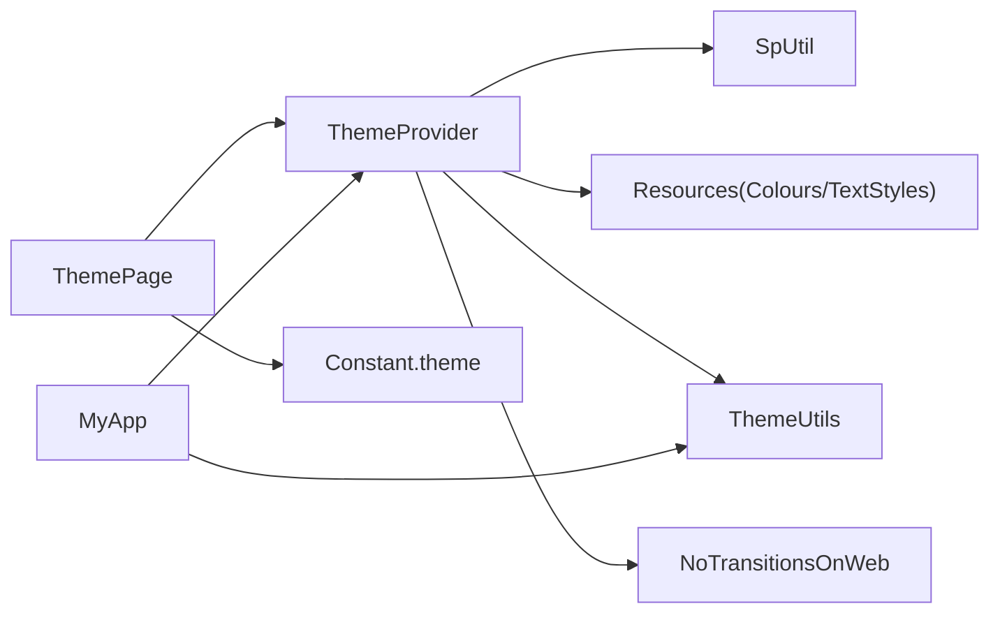

# 主题系统

<cite>
**本文引用的文件**   
- [lib/main.dart](file://lib/main.dart)
- [lib/setting/page/theme_page.dart](file://lib/setting/page/theme_page.dart)
- [lib/setting/provider/theme_provider.dart](file://lib/setting/provider/theme_provider.dart)
- [lib/util/theme_utils.dart](file://lib/util/theme_utils.dart)
- [lib/res/constant.dart](file://lib/res/constant.dart)
- [lib/res/resources.dart](file://lib/res/resources.dart)
- [lib/routers/web_page_transitions.dart](file://lib/routers/web_page_transitions.dart)
</cite>

## 目录
1. [简介](#简介)
2. [项目结构](#项目结构)
3. [核心组件](#核心组件)
4. [架构总览](#架构总览)
5. [详细组件分析](#详细组件分析)
6. [依赖关系分析](#依赖关系分析)
7. [性能与优化建议](#性能与优化建议)
8. [故障排查指南](#故障排查指南)
9. [结论](#结论)
10. [附录：主题配置清单](#附录主题配置清单)

## 简介
本文件面向灵犀管店 Flutter 项目的主题系统，聚焦以下目标：
- ThemePage 主题选择界面的实现方式与交互逻辑。
- ThemeProvider 的状态管理、持久化机制与 ThemeData 生成逻辑。
- 深色模式（Dark Mode）与浅色模式（Light Mode）的配置方法。
- 主题持久化存储（SpUtil + Constant.theme）以及与系统主题的同步策略。
- 自定义主题颜色、样式和组件外观的完整指南。
- 动态主题切换的最佳实践与性能优化建议。

## 项目结构
主题相关代码集中在以下几个位置：
- lib/main.dart：应用入口，提供 Provider 上下文、MaterialApp 主题装配、全局 UI 覆盖层设置。
- lib/setting/provider/theme_provider.dart：主题状态提供者，负责读取/写入主题、生成浅色/深色 ThemeData。
- lib/setting/page/theme_page.dart：主题设置页面，用户可在“跟随系统/开启/关闭”之间选择。
- lib/util/theme_utils.dart：主题辅助工具，包含深色判断、系统 UI 覆盖样式常量等。
- lib/res/constant.dart：全局常量，包含主题存储键值。
- lib/res/resources.dart：导出颜色、字号、间距、文本样式等资源。
- lib/routers/web_page_transitions.dart：Web 平台禁用页面过渡以提升感知性能。

图表来源
- [lib/main.dart:1-204](file://lib/main.dart#L1-L204)
- [lib/setting/provider/theme_provider.dart:1-88](file://lib/setting/provider/theme_provider.dart#L1-L88)
- [lib/setting/page/theme_page.dart:1-72](file://lib/setting/page/theme_page.dart#L1-L72)
- [lib/util/theme_utils.dart:1-52](file://lib/util/theme_utils.dart#L1-L52)
- [lib/res/constant.dart:1-54](file://lib/res/constant.dart#L1-L54)
- [lib/res/resources.dart:1-12](file://lib/res/resources.dart#L1-L12)
- [lib/routers/web_page_transitions.dart:1-26](file://lib/routers/web_page_transitions.dart#L1-L26)

章节来源
- [lib/main.dart:1-204](file://lib/main.dart#L1-L204)
- [lib/setting/page/theme_page.dart:1-72](file://lib/setting/page/theme_page.dart#L1-L72)
- [lib/setting/provider/theme_provider.dart:1-88](file://lib/setting/provider/theme_provider.dart#L1-L88)
- [lib/util/theme_utils.dart:1-52](file://lib/util/theme_utils.dart#L1-L52)
- [lib/res/constant.dart:1-54](file://lib/res/constant.dart#L1-L54)
- [lib/res/resources.dart:1-12](file://lib/res/resources.dart#L1-L12)
- [lib/routers/web_page_transitions.dart:1-26](file://lib/routers/web_page_transitions.dart#L1-L26)

## 核心组件
- ThemePage：主题设置界面，展示“跟随系统/开启/关闭”三个选项，点击后调用 ThemeProvider.setTheme() 并刷新当前页面选中状态。
- ThemeProvider：基于 ChangeNotifier 的主题状态提供者，封装了：
  - 从 SpUtil 读取/写入主题值（Constant.theme）。
  - getThemeMode() 将字符串映射为 ThemeMode。
  - getTheme() 构建浅色/深色 ThemeData，统一色彩、文字、输入框、分割线、导航栏、Cupertino 主题与 Web 过渡行为。
- ThemeUtils：提供 isDark(context)、SystemUiOverlayStyle.light/dark 等工具，配合 Material 主题进行系统 UI 覆盖层样式设置。
- Constant：集中定义主题存储键 Constant.theme = 'AppTheme'。
- MyApp：在应用启动时通过 MultiProvider 注入 ThemeProvider，并在 MaterialApp 中装配 theme、darkTheme、themeMode。

章节来源
- [lib/setting/page/theme_page.dart:1-72](file://lib/setting/page/theme_page.dart#L1-L72)
- [lib/setting/provider/theme_provider.dart:1-88](file://lib/setting/provider/theme_provider.dart#L1-L88)
- [lib/util/theme_utils.dart:1-52](file://lib/util/theme_utils.dart#L1-L52)
- [lib/res/constant.dart:1-54](file://lib/res/constant.dart#L1-L54)
- [lib/main.dart:1-204](file://lib/main.dart#L1-L204)

## 架构总览
主题系统的运行流程如下：
- 应用启动：main 初始化持久化、日志、推送等基础设施后，创建 MyApp。
- 主题提供者注入：MyApp 使用 MultiProvider 注册 ThemeProvider。
- 主题装配：MaterialApp 根据 provider.getThemeMode() 决定 themeMode，并根据是否深色调用 provider.getTheme(isDarkMode:) 分别生成 theme 与 darkTheme。
- 用户切换主题：ThemePage 调用 context.read<ThemeProvider>().setTheme(themeMode)，写回 SpUtil 并通知监听者。
- 全局 UI 覆盖层：MaterialApp.builder 中通过 AnnotatedRegion 注入 SystemUiOverlayStyle，由 ThemeUtils.dark 指定深色模式的系统栏样式；同时通过 MediaQuery 禁用字体缩放，避免主题切换时的布局抖动。

图表来源
- [lib/main.dart:1-204](file://lib/main.dart#L1-L204)
- [lib/setting/provider/theme_provider.dart:1-88](file://lib/setting/provider/theme_provider.dart#L1-L88)
- [lib/setting/page/theme_page.dart:1-72](file://lib/setting/page/theme_page.dart#L1-L72)
- [lib/util/theme_utils.dart:1-52](file://lib/util/theme_utils.dart#L1-L52)
- [lib/res/constant.dart:1-54](file://lib/res/constant.dart#L1-L54)

## 详细组件分析

### ThemePage：主题选择界面
- 功能职责
  - 渲染“跟随系统/开启/关闭”三个选项。
  - 从 SpUtil.getString(Constant.theme) 读取当前主题，并映射为本地显示文案。
  - 用户点击选项时，计算对应 ThemeMode（system/dark/light），调用 Provider.setTheme()，然后 setState 刷新选中态。
- 交互细节
  - 使用 ListView.separated 渲染列表项。
  - 使用 Opacity 图标表示当前选中项。
- 关键路径
  - 读取主题：SpUtil.getString(Constant.theme)
  - 切换主题：context.read<ThemeProvider>().setTheme(themeMode)

图表来源
- [lib/setting/page/theme_page.dart:1-72](file://lib/setting/page/theme_page.dart#L1-L72)
- [lib/res/constant.dart:1-54](file://lib/res/constant.dart#L1-L54)

章节来源
- [lib/setting/page/theme_page.dart:1-72](file://lib/setting/page/theme_page.dart#L1-L72)
- [lib/res/constant.dart:1-54](file://lib/res/constant.dart#L1-L54)

### ThemeProvider：主题状态管理与 ThemeData 生成
- 职责边界
  - 读取/写入主题值到 SpUtil（key 为 Constant.theme）。
  - 将字符串映射为 ThemeMode。
  - 生成浅色/深色 ThemeData，统一 colorScheme、textTheme、inputDecorationTheme、appBarTheme、dividerTheme、cupertinoOverrideTheme、pageTransitionsTheme 等。
- 状态同步
  - syncTheme()：当持久化中存在非 system 的主题值时触发 notifyListeners()，用于冷启动时快速恢复主题状态。
- ThemeData 要点
  - useMaterial3: false（保持 Material 2 风格）。
  - primaryColor、colorScheme.secondary、indicatorColor 等主色来自资源 Colours.app_main / Colours.dark_app_main。
  - scaffoldBackgroundColor、canvasColor 区分深浅背景。
  - textSelectionTheme 统一光标与选区颜色。
  - textTheme、inputDecorationTheme.hintStyle 随深浅模式切换。
  - appBarTheme.systemOverlayStyle 固定为深色模式下的系统栏样式（ThemeUtils.dark）。
  - cupertinoOverrideTheme.brightness 同步 Cupertino 组件亮度。
  - pageTransitionsTheme 使用 NoTransitionsOnWeb 提升 Web 性能。

图表来源
- [lib/setting/provider/theme_provider.dart:1-88](file://lib/setting/provider/theme_provider.dart#L1-L88)
- [lib/res/constant.dart:1-54](file://lib/res/constant.dart#L1-L54)
- [lib/util/theme_utils.dart:1-52](file://lib/util/theme_utils.dart#L1-L52)
- [lib/res/resources.dart:1-12](file://lib/res/resources.dart#L1-L12)

章节来源
- [lib/setting/provider/theme_provider.dart:1-88](file://lib/setting/provider/theme_provider.dart#L1-L88)
- [lib/res/resources.dart:1-12](file://lib/res/resources.dart#L1-L12)

### MyApp：主题装配与全局系统栏样式
- 主题装配
  - MultiProvider 注入 ThemeProvider。
  - MaterialApp 的 theme/darkTheme 分别由 provider.getTheme() 与 provider.getTheme(isDarkMode:true) 生成。
  - themeMode 由 provider.getThemeMode() 决定。
- 全局 UI 覆盖层
  - builder 中使用 AnnotatedRegion<SystemUiOverlayStyle>(value: ThemeUtils.dark) 确保无 AppBar 的页面也应用深色系统栏样式。
  - 使用 MediaQuery(data: ...copyWith(textScaler: TextScaler.noScaling)) 禁止字体缩放，减少主题切换导致的布局重排。
- 其他
  - 启动阶段设置 SystemChrome.setEnabledSystemUIMode 与 SystemChrome.setSystemUIOverlayStyle，避免启动瞬间黑色状态栏问题。

章节来源
- [lib/main.dart:1-204](file://lib/main.dart#L1-L204)
- [lib/util/theme_utils.dart:1-52](file://lib/util/theme_utils.dart#L1-L52)

### 主题持久化与系统主题同步
- 持久化键
  - Constant.theme = 'AppTheme'。
- 存储格式
  - SpUtil.putString(Constant.theme, themeMode.value)
  - 其中 ThemeModeExtension.value 返回 'System'/'Light'/'Dark'。
- 读取与映射
  - getThemeMode() 将 'Dark' 映射为 ThemeMode.dark，'Light' 映射为 ThemeMode.light，其余为 ThemeMode.system。
- 与系统主题同步
  - 当值为 'System' 时，Flutter 将根据系统设置自动切换 Light/Dark。
  - 当值为 'Light'/'Dark' 时，强制覆盖系统设置。

章节来源
- [lib/res/constant.dart:1-54](file://lib/res/constant.dart#L1-L54)
- [lib/setting/provider/theme_provider.dart:1-88](file://lib/setting/provider/theme_provider.dart#L1-L88)
- [lib/setting/page/theme_page.dart:1-72](file://lib/setting/page/theme_page.dart#L1-L72)

## 依赖关系分析
- 耦合度
  - ThemePage 仅依赖 Provider 与 SpUtil，职责单一，易于测试与维护。
  - ThemeProvider 聚合了资源（colors/styles）、工具（theme_utils）、路由过渡（web_page_transitions）与持久化（sp_util）。
- 外部依赖
  - sp_util：主题值持久化。
  - flutter/material：主题体系与系统 UI 覆盖层。
  - provider：状态管理。
- 潜在循环依赖
  - 未发现循环导入，模块间依赖清晰。

图表来源
- [lib/setting/page/theme_page.dart:1-72](file://lib/setting/page/theme_page.dart#L1-L72)
- [lib/setting/provider/theme_provider.dart:1-88](file://lib/setting/provider/theme_provider.dart#L1-L88)
- [lib/util/theme_utils.dart:1-52](file://lib/util/theme_utils.dart#L1-L52)
- [lib/res/constant.dart:1-54](file://lib/res/constant.dart#L1-L54)
- [lib/routers/web_page_transitions.dart:1-26](file://lib/routers/web_page_transitions.dart#L1-L26)
- [lib/main.dart:1-204](file://lib/main.dart#L1-L204)

章节来源
- [lib/setting/page/theme_page.dart:1-72](file://lib/setting/page/theme_page.dart#L1-L72)
- [lib/setting/provider/theme_provider.dart:1-88](file://lib/setting/provider/theme_provider.dart#L1-L88)
- [lib/util/theme_utils.dart:1-52](file://lib/util/theme_utils.dart#L1-L52)
- [lib/res/constant.dart:1-54](file://lib/res/constant.dart#L1-L54)
- [lib/routers/web_page_transitions.dart:1-26](file://lib/routers/web_page_transitions.dart#L1-L26)
- [lib/main.dart:1-204](file://lib/main.dart#L1-L204)

## 性能与优化建议
- 减少不必要的重建
  - 仅在主题变化时重建 MaterialApp 层级，避免全局 rebuild。当前通过 Provider.notifyListeners 仅触发受 Consumer 包裹的节点重建，符合最佳实践。
- 禁用 Web 页面过渡
  - 使用 NoTransitionsOnWeb 在 Web 平台禁用页面过渡动画，提升首屏与导航性能。
- 禁用字体缩放
  - 通过 MediaQuery.textScaler=noScaling 避免系统字体大小对主题切换期间布局的影响。
- 合理组织 ThemeData
  - 将颜色与文本样式集中在 resources.dart 导出的 Colours 与 TextStyles 中，避免分散定义导致不一致。
- 预构建 ThemeData
  - 若主题组合复杂，可预先缓存浅色/深色 ThemeData，避免重复构建开销。

[本节为通用指导，不直接分析具体文件]

## 故障排查指南
- 主题切换无效
  - 检查 Constant.theme 是否与 SpUtil 中的 key 一致。
  - 确认 ThemePage 中调用了 Provider.setTheme()，且后续有 setState 刷新 UI。
- 系统栏颜色异常
  - 确认 MaterialApp.builder 中使用了 AnnotatedRegion(SystemUiOverlayStyle.dark)。
  - 检查 ThemeUtils.dark 的定义是否被正确引用。
- Web 平台卡顿或白屏
  - 确认已启用 NoTransitionsOnWeb，避免 Web 平台默认过渡带来的性能问题。
- 深色模式下文字不可见
  - 检查 textTheme 与 inputDecorationTheme.hintStyle 是否正确切换至深色文本样式。
- 首次启动主题未恢复
  - 确认 ThemeProvider.syncTheme() 已在合适时机调用（例如应用启动或登录后），以触发 notifyListeners()。

章节来源
- [lib/setting/page/theme_page.dart:1-72](file://lib/setting/page/theme_page.dart#L1-L72)
- [lib/setting/provider/theme_provider.dart:1-88](file://lib/setting/provider/theme_provider.dart#L1-L88)
- [lib/util/theme_utils.dart:1-52](file://lib/util/theme_utils.dart#L1-L52)
- [lib/routers/web_page_transitions.dart:1-26](file://lib/routers/web_page_transitions.dart#L1-L26)
- [lib/main.dart:1-204](file://lib/main.dart#L1-L204)

## 结论
该项目的主题系统以 Provider 为核心，结合 SpUtil 完成主题值的持久化，并通过 ThemeData 统一控制色彩、文字、输入框、分割线与系统栏样式。ThemePage 提供简洁的用户交互入口，MyApp 负责主题装配与全局系统栏样式注入。整体设计职责清晰、扩展性强，适合进一步扩展更多主题变体或品牌定制。

[本节为总结性内容，不直接分析具体文件]

## 附录：主题配置清单
- 主题模式
  - 跟随系统：ThemeMode.system
  - 开启（深色）：ThemeMode.dark
  - 关闭（浅色）：ThemeMode.light
- 持久化
  - Key：Constant.theme = 'AppTheme'
  - Value：'System' | 'Light' | 'Dark'
- ThemeData 关键属性
  - useMaterial3：false
  - primaryColor：按深浅模式取 Colours.app_main / Colours.dark_app_main
  - colorScheme：brightness、secondary、error 随深浅模式切换
  - indicatorColor：Tab 指示器主色
  - scaffoldBackgroundColor：页面背景色
  - canvasColor：Material 背景色
  - textSelectionTheme：选区与光标颜色
  - textTheme：标题与正文文本样式
  - inputDecorationTheme：hint 样式
  - appBarTheme：颜色与系统栏覆盖样式（ThemeUtils.dark）
  - dividerTheme：分割线颜色与粗细
  - cupertinoOverrideTheme：Cupertino 组件亮度
  - pageTransitionsTheme：NoTransitionsOnWeb
- 系统栏样式
  - 使用 ThemeUtils.dark 作为全局系统栏覆盖样式，确保深色模式下的图标与文字对比度。

章节来源
- [lib/setting/provider/theme_provider.dart:1-88](file://lib/setting/provider/theme_provider.dart#L1-L88)
- [lib/util/theme_utils.dart:1-52](file://lib/util/theme_utils.dart#L1-L52)
- [lib/res/constant.dart:1-54](file://lib/res/constant.dart#L1-L54)
- [lib/res/resources.dart:1-12](file://lib/res/resources.dart#L1-L12)
- [lib/routers/web_page_transitions.dart:1-26](file://lib/routers/web_page_transitions.dart#L1-L26)