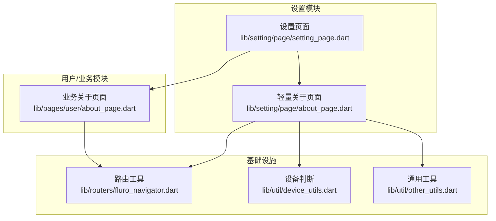
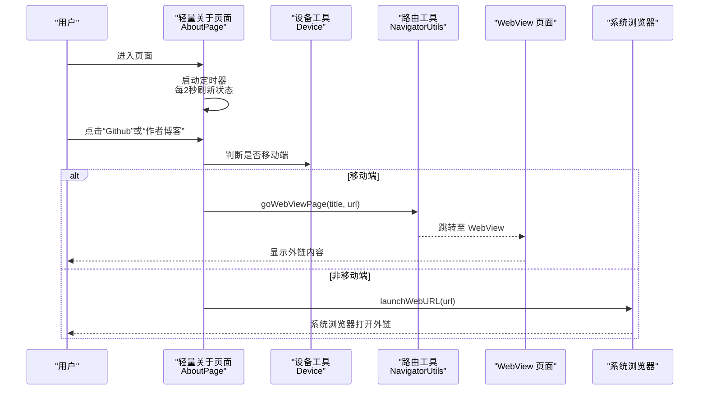
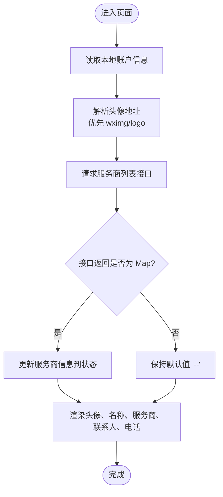
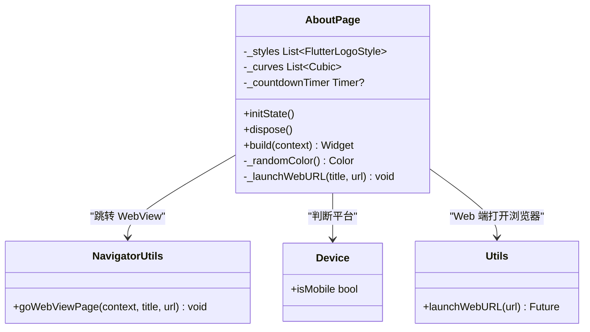
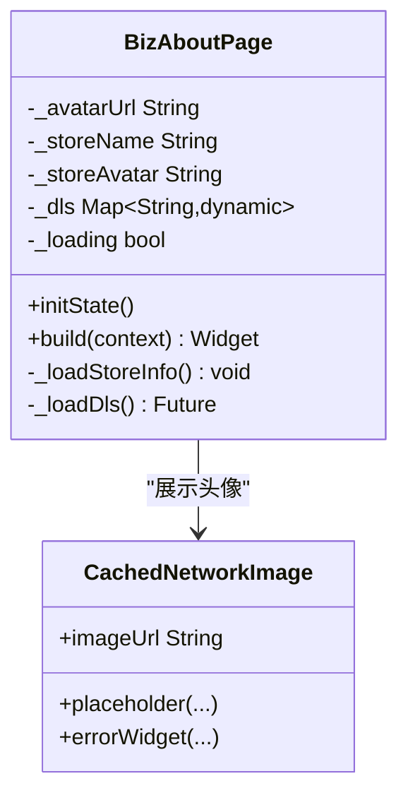
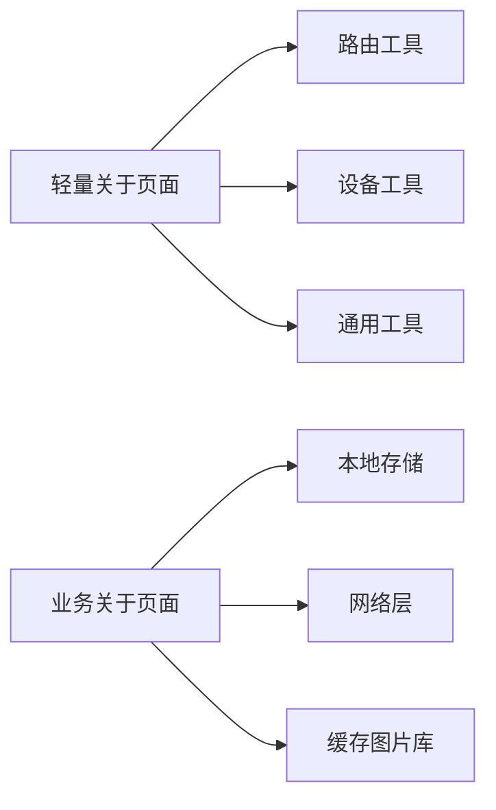

# 关于设置

<cite>
**本文引用的文件**
- [lib/setting/page/about_page.dart](file://lib/setting/page/about_page.dart)
- [lib/pages/user/about_page.dart](file://lib/pages/user/about_page.dart)
- [lib/setting/page/setting_page.dart](file://lib/setting/page/setting_page.dart)
- [lib/routers/fluro_navigator.dart](file://lib/routers/fluro_navigator.dart)
- [lib/util/device_utils.dart](file://lib/util/device_utils.dart)
- [lib/util/other_utils.dart](file://lib/util/other_utils.dart)
</cite>

## 目录
1. [引言](#引言)
2. [项目结构定位](#项目结构定位)
3. [核心组件总览](#核心组件总览)
4. [架构与数据流](#架构与数据流)
5. [详细组件分析](#详细组件分析)
6. [依赖关系分析](#依赖关系分析)
7. [性能与可维护性建议](#性能与可维护性建议)
8. [故障排查](#故障排查)
9. [定制化指南](#定制化指南)
10. [结论](#结论)

## 引言
本文面向灵犀管店 Flutter 项目的“关于”相关页面，重点说明两个实现：
- 设置入口中的轻量级“关于我们”页面：包含动态展示的 Flutter Logo、随机颜色与动画曲线切换、外部链接跳转。
- 业务侧的“关于”页面（服务商信息）：展示商户头像、名称及从接口拉取的服务商联系人、电话等。

目标读者包括需要二次开发该页面的工程师和需要配置公司信息、法律声明、隐私政策等内容的内容运营人员。

## 项目结构定位
本项目的“关于”能力分布在两条路径上：
- 设置模块下的轻量“关于我们”页面：位于设置页入口中，用于展示品牌信息、版本信息与外部资源链接。
- 用户/业务模块下的“关于”页面：用于展示当前登录商户与服务商信息，并支持后续扩展法律声明与隐私政策。

**图示来源**
- [lib/setting/page/setting_page.dart:1-107](file://lib/setting/page/setting_page.dart#L1-L107)
- [lib/setting/page/about_page.dart:1-105](file://lib/setting/page/about_page.dart#L1-L105)
- [lib/pages/user/about_page.dart:1-227](file://lib/pages/user/about_page.dart#L1-L227)
- [lib/routers/fluro_navigator.dart:1-72](file://lib/routers/fluro_navigator.dart#L1-L72)
- [lib/util/device_utils.dart:1-95](file://lib/util/device_utils.dart#L1-L95)
- [lib/util/other_utils.dart:1-104](file://lib/util/other_utils.dart#L1-L104)

**章节来源**
- [lib/setting/page/setting_page.dart:1-107](file://lib/setting/page/setting_page.dart#L1-L107)
- [lib/setting/page/about_page.dart:1-105](file://lib/setting/page/about_page.dart#L1-L105)
- [lib/pages/user/about_page.dart:1-227](file://lib/pages/user/about_page.dart#L1-L227)

## 核心组件总览
- 轻量“关于我们”页面（设置入口）
  - 功能：动态 Flutter Logo 展示、随机颜色与动画曲线切换、点击跳转到 GitHub、作者博客等外部链接。
  - 平台处理：移动端使用应用内 WebView；非移动端调用系统浏览器打开链接。
- 业务“关于”页面（服务商信息）
  - 功能：加载并展示商户名称、头像，以及服务商名称、联系人、电话等信息。
  - 数据来源：本地存储账户信息 + 远程接口返回的服务商列表。
- 公共支撑
  - 路由工具：统一跳转至 WebView 或本地路由。
  - 设备工具：区分移动端与非移动端。
  - 通用工具：在 Web 端通过 url_launcher 打开系统浏览器。

**章节来源**
- [lib/setting/page/about_page.dart:1-105](file://lib/setting/page/about_page.dart#L1-L105)
- [lib/pages/user/about_page.dart:1-227](file://lib/pages/user/about_page.dart#L1-L227)
- [lib/routers/fluro_navigator.dart:1-72](file://lib/routers/fluro_navigator.dart#L1-L72)
- [lib/util/device_utils.dart:1-95](file://lib/util/device_utils.dart#L1-L95)
- [lib/util/other_utils.dart:1-104](file://lib/util/other_utils.dart#L1-L104)

## 架构与数据流
### 轻量“关于我们”页面交互流程

**图示来源**
- [lib/setting/page/about_page.dart:1-105](file://lib/setting/page/about_page.dart#L1-L105)
- [lib/routers/fluro_navigator.dart:1-72](file://lib/routers/fluro_navigator.dart#L1-L72)
- [lib/util/device_utils.dart:1-95](file://lib/util/device_utils.dart#L1-L95)
- [lib/util/other_utils.dart:1-104](file://lib/util/other_utils.dart#L1-L104)

### 业务“关于”页面数据加载流程

**图示来源**
- [lib/pages/user/about_page.dart:1-227](file://lib/pages/user/about_page.dart#L1-L227)

**章节来源**
- [lib/setting/page/about_page.dart:1-105](file://lib/setting/page/about_page.dart#L1-L105)
- [lib/pages/user/about_page.dart:1-227](file://lib/pages/user/about_page.dart#L1-L227)

## 详细组件分析

### 轻量“关于我们”页面
- 动态 Flutter Logo
  - 样式集合：三种 FlutterLogoStyle 随机选择。
  - 动画曲线集合：从一组 Curves 中随机选择，影响 Logo 出现动画。
  - 颜色生成：每次重建时生成随机 RGB 颜色作为文字色，增强视觉变化。
  - 定时刷新：使用 2 秒周期定时器触发 setState，使 Logo 样式、曲线、颜色周期性变化。
- 外部链接跳转
  - 移动端：通过路由工具跳转到内置 WebView 页面，承载外链内容。
  - 非移动端：通过通用工具调用系统浏览器打开 URL。
- 可访问性与体验
  - 使用统一的 MyAppBar 标题。
  - 使用 ClickItem 提供一致的点击反馈与布局风格。

**图示来源**
- [lib/setting/page/about_page.dart:1-105](file://lib/setting/page/about_page.dart#L1-L105)
- [lib/routers/fluro_navigator.dart:1-72](file://lib/routers/fluro_navigator.dart#L1-L72)
- [lib/util/device_utils.dart:1-95](file://lib/util/device_utils.dart#L1-L95)
- [lib/util/other_utils.dart:1-104](file://lib/util/other_utils.dart#L1-L104)

**章节来源**
- [lib/setting/page/about_page.dart:1-105](file://lib/setting/page/about_page.dart#L1-L105)

### 业务“关于”页面（服务商信息）
- 数据加载
  - 本地账户信息：从本地存储读取账户 JSON，提取商户名称与头像字段。
  - 头像地址解析：若为 HTTP 直接返回；否则拼接图片基础地址。
  - 远程接口：调用服务商列表接口，将返回的数据映射到页面状态。
- 界面构建
  - 顶部：圆形头像（带占位与错误占位图标）、商户名称。
  - 信息行：服务商、联系人、电话；电话行支持后续拨号扩展。
  - 分割线：统一分隔各信息行。
- 异常处理
  - 接口异常由网络层统一 Toast 提示，页面在 finally 中关闭 loading。

**图示来源**
- [lib/pages/user/about_page.dart:1-227](file://lib/pages/user/about_page.dart#L1-L227)

**章节来源**
- [lib/pages/user/about_page.dart:1-227](file://lib/pages/user/about_page.dart#L1-L227)

### 设置入口集成
- 设置页提供“关于我们”入口，点击后跳转到轻量关于页面。
- 同时提供“Deer Web版”入口，移动端以 WebView 形式打开 Web 站点。

**章节来源**
- [lib/setting/page/setting_page.dart:1-107](file://lib/setting/page/setting_page.dart#L1-L107)

## 依赖关系分析
- 轻量关于页面依赖：
  - 路由工具：统一跳转到 WebView。
  - 设备工具：判断是否为移动端。
  - 通用工具：在非移动端调用系统浏览器。
- 业务关于页面依赖：
  - 本地存储：读取账户信息。
  - 网络层：拉取服务商列表。
  - 缓存图片库：展示头像并提供占位与错误回退。

**图示来源**
- [lib/setting/page/about_page.dart:1-105](file://lib/setting/page/about_page.dart#L1-L105)
- [lib/pages/user/about_page.dart:1-227](file://lib/pages/user/about_page.dart#L1-L227)
- [lib/routers/fluro_navigator.dart:1-72](file://lib/routers/fluro_navigator.dart#L1-L72)
- [lib/util/device_utils.dart:1-95](file://lib/util/device_utils.dart#L1-L95)
- [lib/util/other_utils.dart:1-104](file://lib/util/other_utils.dart#L1-L104)

**章节来源**
- [lib/setting/page/about_page.dart:1-105](file://lib/setting/page/about_page.dart#L1-L105)
- [lib/pages/user/about_page.dart:1-227](file://lib/pages/user/about_page.dart#L1-L227)

## 性能与可维护性建议
- 动画与刷新
  - 当前定时器每 2 秒触发一次 setState，导致整树重建。建议仅对 FlutterLogo 所在局部进行 rebuild，例如使用 ValueListenableBuilder 或独立小部件包装，降低无关节点重建开销。
- 随机数生成
  - Random.secure() 每次调用开销较大，可在初始化阶段预先生成若干随机颜色与曲线索引，避免频繁分配。
- 外链跳转
  - 建议在路由工具中增加“是否使用 WebView”的配置开关，便于按渠道或环境控制外链行为。
- 图片加载
  - 头像加载已使用缓存图片库，建议为不同尺寸准备多倍图资源，减少大图缩放成本。
- 代码组织
  - 将外链配置（GitHub、博客、官网、法律协议）集中管理，便于运营替换与维护。

[本节为通用建议，不直接分析具体文件]

## 故障排查
- 外链无法打开
  - 检查设备工具是否正确识别平台。
  - Web 端确认 url_launcher 权限与宿主环境是否允许外部链接。
  - 移动端 WebView 页面是否正常接收参数（title、url）。
- 头像不显示
  - 检查头像地址是否以 http 开头；否则需正确拼接图片基础地址。
  - 检查网络层是否返回空或异常数据。
- 定时器未释放
  - 确保在 dispose 中取消定时器，避免内存泄漏。

**章节来源**
- [lib/setting/page/about_page.dart:1-105](file://lib/setting/page/about_page.dart#L1-L105)
- [lib/util/device_utils.dart:1-95](file://lib/util/device_utils.dart#L1-L95)
- [lib/util/other_utils.dart:1-104](file://lib/util/other_utils.dart#L1-L104)
- [lib/pages/user/about_page.dart:1-227](file://lib/pages/user/about_page.dart#L1-L227)

## 定制化指南
- 公司信息展示
  - 在业务关于页面中添加公司 Logo、简介、注册地址、统一社会信用代码等字段。
  - 将公司名称、Logo 地址纳入本地配置或远程接口返回的公司信息对象。
- 法律声明与隐私政策
  - 新增“法律声明”“隐私政策”条目，点击后通过 WebView 打开本地 HTML 或线上地址。
  - 建议将 HTML 资源放置于 assets 目录，并通过路由工具跳转到本地资产页面。
- 外部资源链接
  - 在轻量关于页面中新增“官方博客”“产品文档”“社区论坛”等条目。
  - 统一外链配置表，支持按渠道或 A/B 测试动态启用/禁用。
- Web 与移动端的差异化
  - 移动端优先使用内置 WebView 浏览外链，提升可控性与埋点统计。
  - Web 端直接调用系统浏览器打开链接，避免嵌套窗口体验问题。
- 用户体验优化
  - 在外链打开前增加加载中提示，避免空白等待。
  - 对外链地址进行安全校验（如白名单），防止恶意跳转。
  - 对版本号、更新时间等静态信息进行本地化缓存，减少不必要请求。

**章节来源**
- [lib/setting/page/about_page.dart:1-105](file://lib/setting/page/about_page.dart#L1-L105)
- [lib/pages/user/about_page.dart:1-227](file://lib/pages/user/about_page.dart#L1-L227)
- [lib/routers/fluro_navigator.dart:1-72](file://lib/routers/fluro_navigator.dart#L1-L72)
- [lib/util/other_utils.dart:1-104](file://lib/util/other_utils.dart#L1-L104)

## 结论
本项目实现了两套“关于”页面：轻量“关于我们”用于快速展示品牌信息、动态 Logo 与外链；业务“关于”用于展示商户与服务商信息。两者分别侧重品牌展示与信息呈现，并通过路由、设备判断与通用工具实现跨平台适配。在此基础上，建议将外链与法律协议配置化、优化动画刷新范围、完善外链安全策略，以提升可维护性与用户体验。